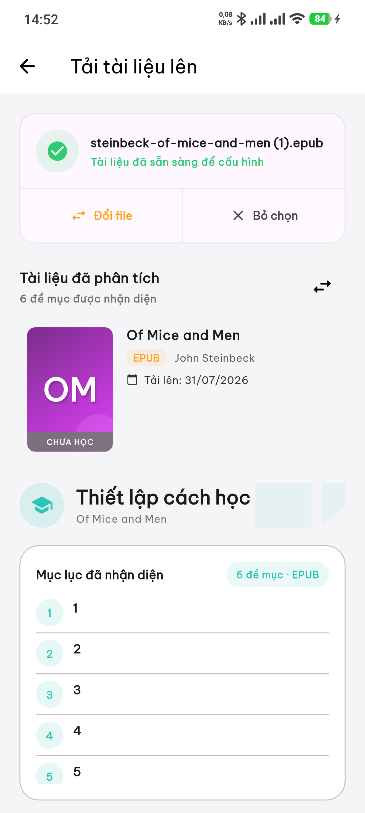
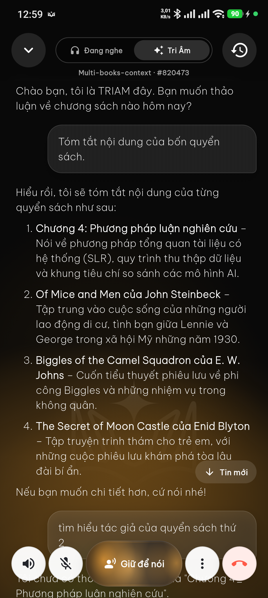
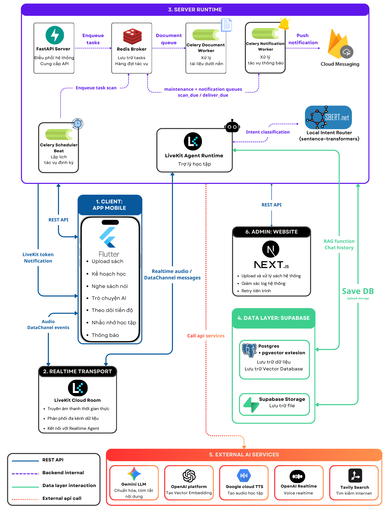
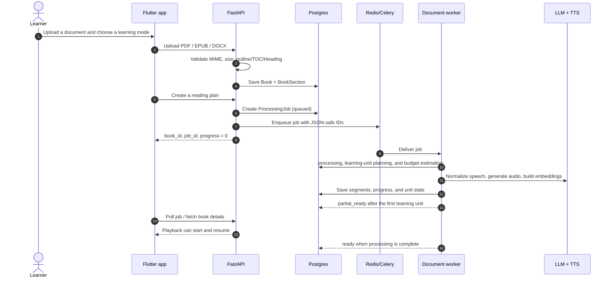

# TRIAM Backend

**TRIAM** is the backend for an AI-powered audiobook learning platform. It turns structured documents into learning plans and replayable audio, tracks progress down to individual audio segments, schedules study and spaced-review reminders, and provides a realtime voice assistant whose answers are grounded in the learner's books.

This repository contains the API, background-processing, data, and realtime-agent layers. The Flutter client is maintained separately.

<p align="center">
  
  <br />
  <em>Scan to watch the TRIAM video demo.</em>
</p>

## Product value

Long-form learning is easy to interrupt: learners must divide material themselves, decide what matters, maintain a routine, and still lack a reliable way to revisit concepts from their source material. TRIAM supports the complete workflow:

- Accepts structured **PDF, EPUB, and DOCX** documents; rejects files without an outline, table of contents, or heading hierarchy instead of guessing chapter boundaries.
- Creates learning plans in **Full** mode or **Pareto** mode, which prioritizes high-value material.
- Rewrites material for speech, produces audio per learning unit, and unlocks playback as soon as useful content is available.
- Persists processing state, listening progress, and resume position so clients recover cleanly after refreshes or restarts.
- Schedules study sessions, records completion, and creates spaced-repetition reviews.
- Supports single- and multi-document chat/voice contexts, using source-grounded RAG with explicit consent before web search.

## Core product experience

| Document ingestion and planning | Audiobook player | Realtime voice assistant |
| :---: | :---: | :---: |
|  |  |  |
| Upload a structured document, inspect its extracted outline, and configure how it will be studied. | Play learning-unit audio, resume precisely, select chapters, and adjust playback controls. | Start a LiveKit-backed conversation without leaving the listening experience. |

These screenshots are exported from the core UI figures used in the TRIAM thesis.

### Agent conversation

<p align="center">
  
  <br />
  <em>A persisted, multi-book agent conversation with transcript, contextual answers, and voice controls.</em>
</p>

## Engineering highlights

| Capability | TRIAM implementation |
| --- | --- |
| Structured document ingestion | Dedicated PDF/EPUB/DOCX parsers normalize a `BookSection` tree and validate structure before persistence or planning. |
| Recoverable AI workflows | FastAPI responds quickly; Celery and Redis execute work; PostgreSQL stores `ProcessingJob` as the client-visible source of truth. |
| Resilient audio experience | Ordered learning units and audio segments, review audio, millisecond-level resume state, and early `partial_ready` playback. |
| Evidence-based RAG | pgvector index over `BookSection`, hybrid vector/lexical retrieval, optional reranking, evidence validation, and Study Context scoping. |
| Realtime voice | A LiveKit Agent uses OpenAI Realtime/transcription and synchronizes transcripts and chat history by thread. |
| Learning loop | Reading-plan sessions, missed-session handling, spaced review, notification outbox, and scheduled FCM push delivery. |
| Security and operations | Supabase JWT, user data isolation, admin RBAC/audit logs, secret redaction, health checks, and independently configurable Docker processes. |

## System architecture

<p align="center">
  
  <br />
  <em>TRIAM system architecture: mobile client, admin portal, LiveKit transport, server runtime, Supabase data layer, and external AI services.</em>
</p>

The diagram is exported from the system-architecture figure in the TRIAM thesis (`c4_01_so_do_tong_quan.tex`).

### Learning-content pipeline



### Realtime study assistant

1. The client obtains or creates a `ChatThread` for a book or Study Context, then requests a thread-bound LiveKit token.
2. The LiveKit agent loads the thread history and document scope.
3. Book questions are routed through metadata/section routing or RAG over `BookSection`; context is constrained to the selected books.
4. For information beyond the uploaded material, the agent calls Tavily only after the learner grants permission.
5. Final answers, transcripts, and source metadata are persisted by thread. ``lk.chat``, ``lk.transcript``, and ``lk.control`` separate previews, the authoritative transcript, and control events.

## Design decisions

- **Layered backend:** routes handle HTTP only; services own orchestration and integrations; repositories isolate database access; SQLModel defines schema; Alembic owns schema evolution.
- **Database as the source of truth:** Redis is a broker, not the state store. Processing jobs, learning progress, outbox rows, and schedules survive worker restarts because they live in Postgres.
- **Idempotency and cost control:** Celery tasks receive JSON-serializable IDs and primitive values, skip completed work when appropriate, cap LLM/TTS/storage concurrency, and estimate token/audio budgets before execution.
- **Structure-first ingestion:** the system does not fall back to regex chapter detection. Documents without trustworthy structure receive a meaningful HTTP 422 response.
- **Grounding before model tuning:** `BookSection` is the canonical knowledge source. Retrieval is evaluated through traces, source selection, and regression cases—not prompt adjustments alone.
- **A learning loop, not only TTS:** plans, calendar sessions, resume state, completion thresholds, review intervals, and the notification outbox work as one cohesive learning experience.

## Technology stack

| Area | Technology |
| --- | --- |
| API and validation | Python 3.12, FastAPI, Pydantic |
| Data access | SQLModel, SQLAlchemy, Alembic |
| Database and vector search | Supabase PostgreSQL, pgvector |
| File storage | Supabase Storage |
| Queue and scheduler | Celery, Redis, Celery Beat |
| Document intelligence | pypdf, pdfplumber, EbookLib, BeautifulSoup, python-docx |
| LLM and embeddings | OpenAI SDK, OpenAI-compatible endpoints, Gemini-compatible providers |
| Audio | Edge TTS or Google Cloud TTS, Mutagen |
| Realtime | LiveKit Agents, OpenAI Realtime, live transcription |
| Notifications | Firebase Admin / FCM |
| Code quality | uv, pytest, pytest-asyncio, Ruff |
| Packaging and deployment | Docker, Hugging Face Spaces |

## Repository layout

```text
app/
  api/
    dependencies/       # Supabase JWT dependencies
    v1/routers/         # REST endpoints: books, jobs, live, admin, notifications...
  core/                 # config, constants, logging, exceptions, Celery, Supabase client
  db/                   # engine/session and Alembic migrations
  models/               # SQLModel tables
  repositories/         # database queries and mutations
  schemas/              # request/response DTOs
  services/             # business logic, parsing, RAG, TTS, scheduling, provider adapters
    workers/            # long-running document and learning-unit pipelines
  tasks/                # Celery task entry points
tests/                   # unit, API contract, regression, and evaluation checks
scripts/                 # smoke tests, migration, and manual integration tools
_docs_implemented/      # technical documentation, FE/BE contracts, phase reports
```

## Local setup

### Prerequisites

- Python 3.12 and [uv](https://docs.astral.sh/uv/)
- PostgreSQL with pgvector (or a Supabase project), Supabase Storage, and Redis
- Credentials for Supabase, LLM/embeddings, and LiveKit; add Firebase to test push notifications

### 1. Install dependencies and configure the environment

```powershell
uv sync
Copy-Item .env.example .env
```

Add secrets to `.env`; do not commit it. `.env.example` contains the full configuration surface. The minimum group for API and data access is:

```env
DATABASE_URL=
SUPABASE_URL=
SUPABASE_KEY=
SUPABASE_SERVICE_ROLE_KEY=
CELERY_BROKER_URL=redis://localhost:6379/0

OPENAI_API_KEY=
GEMINI_API_KEY=
LIVEKIT_API_KEY=
LIVEKIT_API_SECRET=
```

### 2. Apply migrations

```powershell
uv run alembic upgrade head
```

### 3. Run the services

Use separate terminals. The API is required; start the remaining processes according to the features you need.

```powershell
# API
uv run uvicorn app.main:app --host 0.0.0.0 --port 8000 --reload

# Document jobs — Windows requires --pool=solo
uv run celery -A app.core.celery_app.celery_app worker -Q document -l info --pool=solo --concurrency 1

# Notification delivery
uv run celery -A app.core.celery_app.celery_app worker -Q notification,maintenance -l info --pool=solo --concurrency 1
uv run celery -A app.core.celery_app.celery_app beat -l info

# LiveKit voice agent
uv run python -m app.services.agent_voice_gpt_realtime start
```

Open Swagger at [http://127.0.0.1:8000/docs](http://127.0.0.1:8000/docs). Business endpoints use Supabase-issued Bearer JWTs.

## API groups

| Group | Representative endpoints | Purpose |
| --- | --- | --- |
| Health | `GET /api/v1/health`, `GET /api/v1/health/background` | Check API and background dependencies. |
| Ingestion and processing | `POST /api/v1/upload`, `POST /api/v1/generate-plan`, `GET /api/v1/jobs/{job_id}` | Upload, plan, and monitor processing. |
| Audiobook | `GET /api/v1/books`, `GET /api/v1/books/{id}/details`, `POST /api/v1/books/{id}/switch-mode` | Library, audio playlists, and Full/Pareto mode switching. |
| Learning loop | Progress, reading-plan sessions, reviews | Resume playback, completion, calendar sessions, and reviews. |
| Study context | Study contexts, threads, `live-token/thread/{id}` | Multi-document learning, chat history, and voice rooms. |
| Notifications | Notifications, settings, devices | In-app notifications, preferences, and FCM device tokens. |
| Admin | `/api/v1/admin/*` | Dashboard, users, system-book ingest/publishing, job lifecycle, and audit logs. |

Use Swagger for the exact request/response contracts. Route definitions live in `app/api/v1/routers/`.

## Testing and quality

```powershell
# Key regression and API checks
uv run pytest tests/test_document_parsers.py tests/test_processing_jobs_api.py tests/test_auth_user_isolation.py tests/test_notifications_api.py -q

# Learning, RAG, and worker behaviour
uv run pytest tests/test_phase4_2_learning_loop.py tests/test_hybrid_fusion_metrics.py tests/test_celery_enqueue.py -q

# Lint
uv run ruff check app tests
```

The test suite covers parsers, user isolation, API contracts, job enqueue/progress, the learning loop, notification outbox behavior, Pareto planning, hybrid retrieval, and voice-agent regression cases. Provider-backed tests are isolated in `scripts/manual_integration/` or evaluation runners so the default pytest suite remains deterministic and cost-safe.

## Deployment

The repository includes a Dockerfile and Hugging Face Spaces-compatible front matter. `start.sh` can launch the API, the document worker, notification worker/Beat, and the LiveKit agent through explicit switches:

```env
BACKEND_PORT=7860
ENABLE_CELERY_WORKER=true
ENABLE_NOTIFICATION_WORKER=true
ENABLE_CELERY_BEAT=true
ENABLE_VOICE_AGENT=true
RUN_MIGRATIONS_ON_START=false
UVICORN_RELOAD=false
```

For small compute profiles, keep document processing at a single worker concurrency. Split API, worker, and voice workloads into separate runtimes before increasing realtime capacity. Validate the startup script before deployment:

```powershell
bash -n start.sh
```

## Repository documentation

- `_docs_implemented/phase_5_document_structure_tree_learning_unit_planner_implementation_guide.md` — document structure tree and learning-unit planning.
- `_docs_implemented/phase_10_grounded_book_agent_voice_accuracy_roadmap.md` — grounded RAG and voice-agent roadmap.
- `_docs_implemented/phase_4_notification_outbox_celery_beat_implementation_guide.md` — notification outbox and scheduling.
- `_docs_implemented/doc_setup_flutter/` — Flutter API and realtime contracts.
- `_docs_implemented/doc_admin/` — RBAC and system-book ingest/publishing.

## Direction

TRIAM prioritizes correctness of learning content and operational reliability: ongoing work focuses on stronger grounded-RAG/voice evaluation, runtime separation for scale, better observability, and learning-plan refinement based on real usage.

---

For a technical review, start with `app/main.py`, `app/services/workers/book_pipeline.py`, `app/services/agent_voice_gpt_realtime.py`, `app/services/rag_service.py`, and their associated tests.
