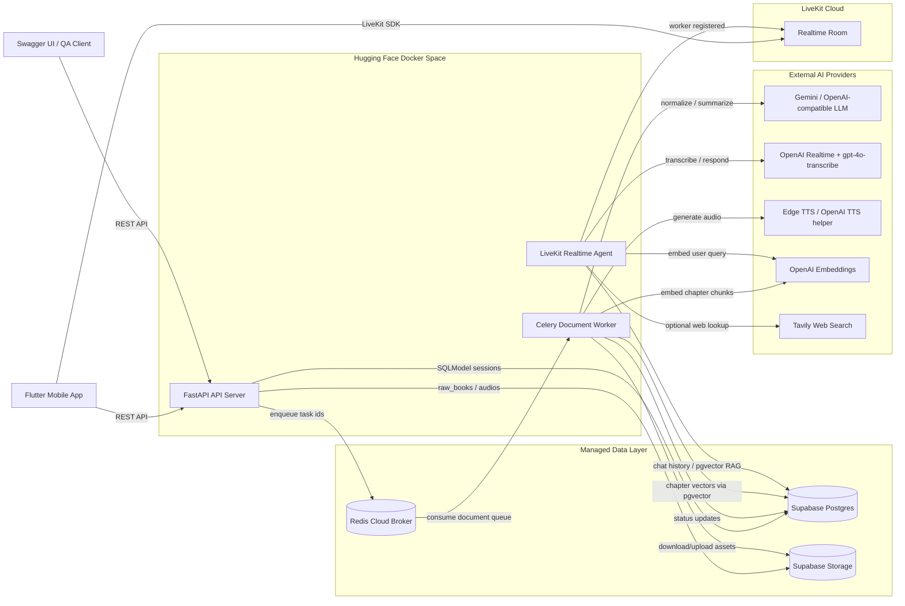
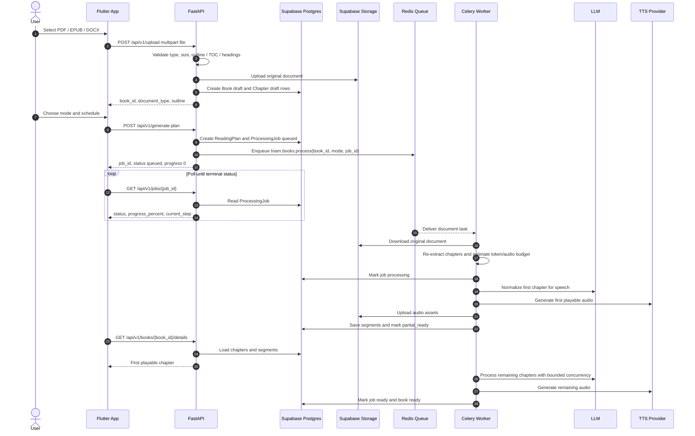
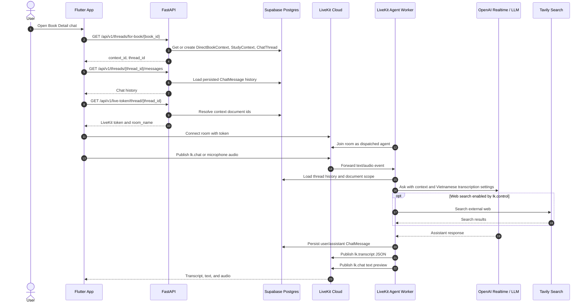
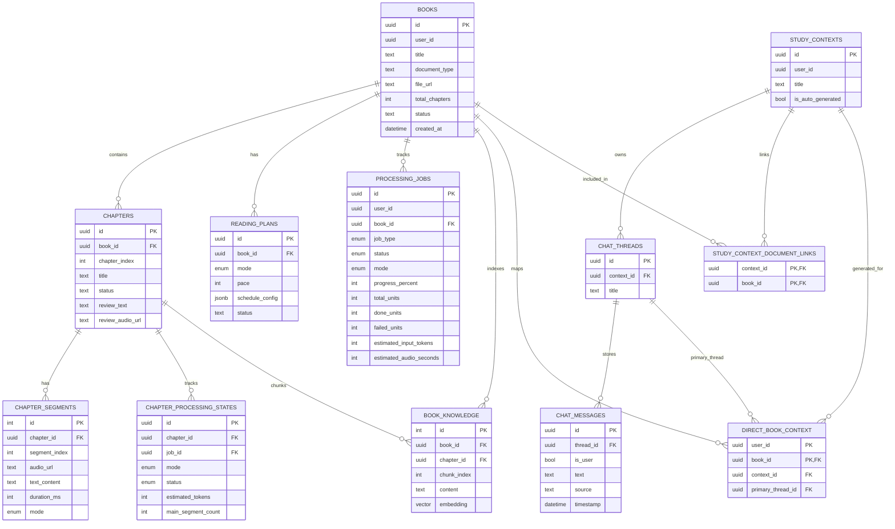

# TRIAM Backend

TRIAM Backend is a FastAPI service for building an AI-powered learning companion from structured documents. It validates uploaded PDF/EPUB/DOCX files, extracts chapter outlines, generates audiobook-ready learning content in background workers, tracks processing progress, and powers a LiveKit-based realtime study assistant.

The service is designed for a Flutter client, but the API is framework-agnostic.

**Live API:** `https://khoasinoo-tri-am-backend.hf.space/api/v1`  
**Swagger UI:** `https://khoasinoo-tri-am-backend.hf.space/docs`

---

## What TRIAM Does

- Upload structured learning documents: PDF, EPUB, DOCX.
- Reject documents without reliable chapter structure instead of guessing.
- Create reading plans in `full` or `pareto` mode.
- Generate chapter audio, review audio, and searchable knowledge in the background.
- Expose DB-backed processing progress for mobile polling.
- Unlock playback early when the first playable chapter is ready.
- Support audiobook playback through ordered chapter segments.
- Provide Study Context and Chat Thread APIs for multi-document learning sessions.
- Connect users to a realtime LiveKit voice/text agent with persisted chat history.

---

## Architecture

### System Context




### Upload, Generation, And Progress Flow



### Realtime Study Assistant Flow



### Core Data Model



### Code Layout

```text
app/
  api/v1/routers/       FastAPI route definitions
  core/                 settings, constants, exceptions, logging, Supabase client
  db/                   SQLModel engine/session and Alembic migrations
  models/               SQLModel database tables
  repositories/         database queries and mutations
  schemas/              request and response DTOs
  services/             business logic and provider integrations
  services/workers/     long-running document/audio/RAG pipelines
  tasks/                Celery task entrypoints
tests/                  focused backend tests
_docs_implemented/      project design notes and FE/BE contracts
```

---

## Tech Stack

| Area             | Stack                                                   |
| ---------------- | ------------------------------------------------------- |
| API              | FastAPI, Uvicorn                                        |
| Database         | Supabase Postgres, SQLModel, SQLAlchemy                 |
| Migrations       | Alembic                                                 |
| Storage          | Supabase Storage                                        |
| Background jobs  | Celery                                                  |
| Queue broker     | Redis                                                   |
| Document parsing | pypdf, pdfplumber, ebooklib, BeautifulSoup, python-docx |
| AI / LLM         | OpenAI SDK, Gemini-compatible endpoint                  |
| Audio            | Edge TTS, OpenAI TTS helper                             |
| Realtime         | LiveKit Agents, OpenAI Realtime                         |
| Search           | Tavily                                                  |
| Vector / RAG     | Supabase Postgres pgvector, OpenAI embeddings           |
| Tooling          | uv, pytest, ruff                                        |
| Deployment       | Docker, Hugging Face Spaces                             |

---

## Engineering Techniques Used

### Backend Architecture

| Technique | Where It Is Used | Why It Matters |
| --- | --- | --- |
| Layered architecture | `routers -> services -> repositories -> models` | Keeps HTTP handling, business rules, and database access separated. |
| DTO boundary | `app/schemas/` | Prevents leaking raw database relationships to the Flutter client. |
| Domain exceptions | `app/core/exceptions.py` | Produces consistent API errors and keeps service code independent from FastAPI `HTTPException`. |
| Repository pattern | `app/repositories/` | Centralizes reusable database reads/writes and reduces duplicated SQLModel queries. |
| Alembic migrations | `app/db/migrations/` | Keeps database schema changes versioned and reviewable. |
| Configuration via environment | `app/core/config.py` | Makes local, test, and Hugging Face deployment behavior explicit and reproducible. |

### Background Processing

| Technique | Where It Is Used | Why It Matters |
| --- | --- | --- |
| Queue-based execution | Celery + Redis `document` queue | Moves long-running LLM/TTS work out of request handlers. |
| DB-backed progress | `processing_jobs` | Lets Flutter recover progress after app reloads, worker restarts, or network loss. |
| Idempotency guard | book task and pipeline startup | Prevents duplicate processing cost when Redis/Celery redelivers an already-finished job. |
| Bounded concurrency | chapter, LLM, TTS, embedding settings | Reduces provider rate-limit failures and stabilizes cost. |
| First playable unlock | `partial_ready` state | Improves UX by letting the user listen before the full book is done. |
| Worker-owned DB sessions | worker services | Avoids leaking request-scoped sessions into background tasks. |

### Document Intelligence

| Technique | Where It Is Used | Why It Matters |
| --- | --- | --- |
| Deterministic parser dispatch | PDF / EPUB / DOCX parser services | Supports multiple document types without hard-coding PDF-only assumptions. |
| Structure-first validation | outline / TOC / Heading checks | Avoids incorrect chapter boundaries and bad learning plans. |
| Token budget estimation | generation guardrails | Prevents oversized chapters from causing provider timeouts or runaway cost. |
| Soft/hard limits | LLM input settings | Allows chunking when reasonable and clear rejection when too large. |
| Chunking with overlap | long chapter normalization | Preserves local context while processing chapters larger than a single LLM call. |
| LLM output validation | normalization service | Prevents malformed JSON from silently creating broken audio playlists. |

### Audio And Learning UX

| Technique | Where It Is Used | Why It Matters |
| --- | --- | --- |
| Segment-based playback | `chapter_segments` | Gives Flutter stable, ordered audio playlists. |
| Mode-specific segments | `mode = full / pareto` | Allows switching learning modes without mixing audio assets. |
| Review script and review audio | chapter detail response | Supports later spaced review and quick recap experiences. |
| Per-chapter processing state | `chapter_processing_states` | Makes retries, debugging, and mode-specific status possible. |

### Realtime Study Assistant

| Technique | Where It Is Used | Why It Matters |
| --- | --- | --- |
| Thread-scoped LiveKit token | `/live-token/thread/{thread_id}` | Ensures chat/voice history is persisted to the correct conversation. |
| Canonical book thread | `/threads/for-book/{book_id}` | Lets Book Detail chat reuse the same thread instead of fragmenting history. |
| DataChannel contract | `lk.chat`, `lk.transcript`, `lk.control` | Separates fast text preview, authoritative transcript, and control messages. |
| Transcript dedupe key | `lk.transcript.id` | Helps Flutter avoid duplicate bubbles after reconnects or mixed chat/transcript events. |
| Optional web-search control | `lk.control` | Makes external web lookup explicit instead of always-on. |

### Operations And Security

| Technique | Where It Is Used | Why It Matters |
| --- | --- | --- |
| Health endpoints | `/health`, `/health/background` | Gives a simple way to verify API, DB, Redis, and queue readiness. |
| Secret redaction | logging setup | Reduces risk of leaking Supabase, Bearer, or provider credentials in logs. |
| Third-party log throttling | `httpx`, `httpcore`, Supabase loggers | Keeps production logs readable and safer to share. |
| Docker start script toggles | `ENABLE_CELERY_WORKER`, `ENABLE_VOICE_AGENT` | Allows one image to run API-only, worker-enabled, or full demo modes. |
| Production smoke script | `scripts/production_smoke_test.py` | Tests real deployed API health, upload, generation, and polling flows. |

---

## Quick Start

### 1. Install Dependencies

```powershell
uv sync
```

### 2. Configure Environment

Create your local environment file:

```powershell
Copy-Item .env.example .env
```

Fill in the required provider credentials, database URL, Supabase keys, Redis URL, and LiveKit keys.

Do not commit `.env`.

### 3. Apply Database Migrations

```powershell
uv run alembic upgrade head
```

### 4. Run The API

```powershell
uv run uvicorn app.main:app --host 0.0.0.0 --port 8000 --reload
```

Open:

```text
http://127.0.0.1:8000/docs
```

---

## Running The Full Local Stack

For local development on Windows, use three terminals.

### Terminal 1 - FastAPI

```powershell
uv run uvicorn app.main:app --host 0.0.0.0 --port 8000 --reload
```

### Terminal 2 - Celery Worker

```powershell
uv run celery -A app.core.celery_app.celery_app worker -Q document -l info --pool=solo --concurrency 1 --hostname triam-local-document@%h
```

### Terminal 3 - LiveKit Realtime Agent

```powershell
uv run python -m app.services.agent_voice_gpt_realtime start
```

Notes:

- Use `--pool=solo` for Celery on Windows.
- Do not run a local worker against production Redis unless you intentionally want local code to consume production jobs.

---

## Environment Variables

The full template lives in `.env.example`.

Important variables:

```env
DATABASE_URL=
SUPABASE_URL=
SUPABASE_KEY=
SUPABASE_SERVICE_ROLE_KEY=

OPENAI_API_KEY=
GEMINI_API_KEY=
GEMINI_BASE_URL=
PINECONE_API_KEY=
PINECONE_ENV=
TAVILY_API_KEY=

LIVEKIT_API_KEY=
LIVEKIT_API_SECRET=
LIVEKIT_AGENT_NAME=

CELERY_BROKER_URL=redis://default:<redis-password>@<redis-host>:<redis-port>/0
CELERY_RESULT_BACKEND=
ENABLE_CELERY_WORKER=false
ENABLE_VOICE_AGENT=true
UV_NO_SYNC=true
BACKEND_PORT=8000

LIVEKIT_AGENT_JOB_EXECUTOR_TYPE=thread
LIVEKIT_AGENT_NUM_IDLE_PROCESSES=1
LIVEKIT_AGENT_INITIALIZE_PROCESS_TIMEOUT=60
LIVEKIT_AGENT_SHUTDOWN_PROCESS_TIMEOUT=20
```

`PINECONE_*` remains in the current settings contract for compatibility, but the active book-search path in this version stores and queries embeddings through Supabase Postgres `pgvector`.

Generation guardrails are also configurable:

```env
LLM_INPUT_SOFT_TOKEN_LIMIT=12000
LLM_INPUT_HARD_TOKEN_LIMIT=60000
LLM_CHUNK_TARGET_TOKENS=5000
LLM_CHUNK_OVERLAP_TOKENS=300
MAX_ESTIMATED_AUDIO_SECONDS_PER_BOOK=14400
FIRST_PLAYABLE_CHAPTERS=1
CHAPTER_PROCESSING_CONCURRENCY=2
LLM_NORMALIZE_CONCURRENCY=1
TTS_GENERATION_CONCURRENCY=2
EMBEDDING_BATCH_SIZE=64
```

---

## API Overview

### Health

| Method | Path                        | Description                          |
| ------ | --------------------------- | ------------------------------------ |
| `GET`  | `/api/v1/health`            | Basic API health                     |
| `GET`  | `/api/v1/health/background` | Database, Redis, and queue readiness |

### Document Processing

| Method | Path                                        | Description                                  |
| ------ | ------------------------------------------- | -------------------------------------------- |
| `POST` | `/api/v1/upload`                            | Upload PDF/EPUB/DOCX and extract outline     |
| `POST` | `/api/v1/generate-plan`                     | Create a reading plan and enqueue processing |
| `GET`  | `/api/v1/jobs/{job_id}`                     | Get job progress                             |
| `GET`  | `/api/v1/books/{book_id}/processing-status` | Get latest job for a book                    |

### Books

| Method   | Path                                  | Description                              |
| -------- | ------------------------------------- | ---------------------------------------- |
| `GET`    | `/api/v1/books`                       | List books                               |
| `POST`   | `/api/v1/books`                       | Create book metadata manually            |
| `GET`    | `/api/v1/books/{book_id}`             | Get book metadata                        |
| `PUT`    | `/api/v1/books/{book_id}`             | Update book metadata                     |
| `DELETE` | `/api/v1/books/{book_id}`             | Delete book and assets                   |
| `GET`    | `/api/v1/books/{book_id}/details`     | Get chapters, segments, and review audio |
| `POST`   | `/api/v1/books/{book_id}/switch-mode` | Switch between `full` and `pareto`       |

### Study Context And Chat

| Method   | Path                                                      | Description                              |
| -------- | --------------------------------------------------------- | ---------------------------------------- |
| `GET`    | `/api/v1/study-contexts`                                  | List study contexts                      |
| `POST`   | `/api/v1/study-contexts`                                  | Create study context                     |
| `GET`    | `/api/v1/study-contexts/{context_id}`                     | Get study context                        |
| `PATCH`  | `/api/v1/study-contexts/{context_id}`                     | Rename study context                     |
| `DELETE` | `/api/v1/study-contexts/{context_id}`                     | Delete study context                     |
| `POST`   | `/api/v1/study-contexts/{context_id}/documents`           | Attach book to context                   |
| `DELETE` | `/api/v1/study-contexts/{context_id}/documents/{book_id}` | Remove book from context                 |
| `GET`    | `/api/v1/study-contexts/{context_id}/threads`             | List threads                             |
| `POST`   | `/api/v1/study-contexts/{context_id}/threads`             | Create thread                            |
| `GET`    | `/api/v1/threads/for-book/{book_id}`                      | Get or create canonical book chat thread |
| `GET`    | `/api/v1/threads/{thread_id}/messages`                    | Load chat history                        |
| `PUT`    | `/api/v1/threads/{thread_id}`                             | Rename thread                            |
| `DELETE` | `/api/v1/threads/{thread_id}`                             | Delete thread                            |

### LiveKit

| Method | Path                                    | Description                              |
| ------ | --------------------------------------- | ---------------------------------------- |
| `GET`  | `/api/v1/live-token/thread/{thread_id}` | Get LiveKit token for a persisted thread |
| `GET`  | `/api/v1/live-token/{book_id}`          | Legacy/debug direct book token           |

The recommended app flow is thread-based:

```text
GET /api/v1/threads/for-book/{book_id}
GET /api/v1/live-token/thread/{thread_id}
```

---

## Example Workflow

### Upload A Document

```powershell
curl.exe -X POST `
  -F "file=@Chương 4_ Phương pháp luận nghiên cứu.pdf;type=application/pdf" `
  "http://127.0.0.1:8000/api/v1/upload"
```

Example response:

```json
{
  "book_id": "971058a0-183a-4371-91bd-b0373c7bf9bc",
  "total_chapters": 3,
  "document_type": "pdf",
  "outline": [
    {
      "title": "Chương 4: Phương pháp luận nghiên cứu",
      "page_start": 1
    }
  ]
}
```

### Create A Reading Plan

```powershell
curl.exe -X POST "http://127.0.0.1:8000/api/v1/generate-plan" `
  -H "Content-Type: application/json" `
  -d "{\"book_id\":\"<book-id>\",\"mode\":\"full\",\"pace\":1,\"schedule_config\":[\"Mon\"]}"
```

Example response:

```json
{
  "message": "Kế hoạch học tập đã được tạo! Chúng tôi đang xử lý sách của bạn.",
  "book_id": "<book-id>",
  "job_id": "<job-id>",
  "mode": "full",
  "status": "queued",
  "progress_percent": 0
}
```

### Poll Progress

```powershell
curl.exe "http://127.0.0.1:8000/api/v1/jobs/<job-id>"
```

Expected lifecycle:

```text
queued -> processing -> partial_ready -> ready
```

---

## Realtime Agent Contract

The LiveKit agent uses DataChannel topics:

| Topic           | Direction         | Payload              |
| --------------- | ----------------- | -------------------- |
| `lk.chat`       | Client <-> Server | UTF-8 plain text     |
| `lk.transcript` | Server -> Client  | JSON transcript      |
| `lk.control`    | Client -> Server  | JSON control message |

Transcript payload:

```json
{
  "v": 1,
  "type": "transcript",
  "role": "assistant",
  "text": "...",
  "id": "<uuid>",
  "ts": "2026-05-22T10:00:00.000+00:00"
}
```

Use `lk.transcript` as the authoritative chat timeline and dedupe by `id`.

---

## Deployment

This repository is configured as a Docker Hugging Face Space.

The Space configuration is kept in the YAML front matter at the top of this README:

```yaml
sdk: docker
app_file: Dockerfile
```

The Docker image runs:

```text
./start.sh
```

`start.sh` can start:

- FastAPI
- Celery document worker
- LiveKit realtime agent

Recommended production runtime values:

```env
BACKEND_PORT=7860
ENABLE_CELERY_WORKER=true
ENABLE_VOICE_AGENT=true
RUN_MIGRATIONS_ON_START=false
UVICORN_RELOAD=false
UV_NO_SYNC=true
CELERY_RESULT_BACKEND=
CELERY_DOCUMENT_CONCURRENCY=1
LIVEKIT_AGENT_JOB_EXECUTOR_TYPE=thread
LIVEKIT_AGENT_NUM_IDLE_PROCESSES=1
LIVEKIT_AGENT_INITIALIZE_PROCESS_TIMEOUT=60
```

---

## Testing

Run focused tests:

```powershell
uv run pytest tests/test_health_api.py tests/test_celery_enqueue.py tests/test_processing_jobs_api.py tests/test_phase3_generation_guardrails.py -q
```

Run parser and study-context tests:

```powershell
uv run pytest tests/test_document_parsers.py tests/test_api_study_context.py tests/test_threads_for_book.py -q
```

Run lint:

```powershell
uv run ruff check app tests
```

Production health smoke:

```powershell
uv run python scripts/production_smoke_test.py `
  --base-url https://khoasinoo-tri-am-backend.hf.space `
  --require-background-ok
```

Full production smoke:

```powershell
uv run python scripts/production_smoke_test.py `
  --base-url https://khoasinoo-tri-am-backend.hf.space `
  --pdf-path "Chương 4_ Phương pháp luận nghiên cứu.pdf" `
  --generate-plan `
  --mode full `
  --poll `
  --require-background-ok
```

The full smoke test consumes LLM/TTS quota.

---

## Database Migrations

Apply migrations:

```powershell
uv run alembic upgrade head
```

Create a migration:

```powershell
uv run alembic revision --autogenerate -m "short description"
```

Check current revision:

```powershell
uv run alembic current
```

Always review autogenerated migrations before applying them.

---

## Documentation

Detailed project documentation lives in `_docs_implemented/`.

Recommended starting points:

- `_docs_implemented/doc_setup_flutter/flutter_phase_1_to_3_backend_contract_uiux_guide.md`
- `_docs_implemented/doc_setup_flutter/flutter_realtime_voice_text_spec.md`
- `_docs_implemented/doc_setup_flutter/fe_imp_study_context.md`
- `_docs_implemented/phase_3_generation_guardrails_implementation_guide.md`
- `_docs_implemented/phase_4_notification_outbox_celery_beat_implementation_guide.md`

---

## Current Limitations

- Authentication is not fully wired into every route yet; several endpoints still use a mock user id.
- Per-user upload quota is not implemented yet.
- Notification reminders and spaced review are planned for a later phase.
- Generation progress currently uses polling, not realtime push.
- `/api/v1/live-token/{book_id}` is kept for legacy/debug use; app flows should prefer thread-based tokens.

---

## Contributing Notes

- Keep FastAPI routers thin.
- Put business rules in services.
- Keep reusable database logic in repositories.
- Use `AppException` subclasses for domain errors.
- Add Alembic migrations for schema changes.
- Do not log secrets, request headers, raw provider payloads, or uploaded file bytes.
- Keep Celery task arguments small and JSON-serializable.
- Update frontend contract docs when API response shapes change.
