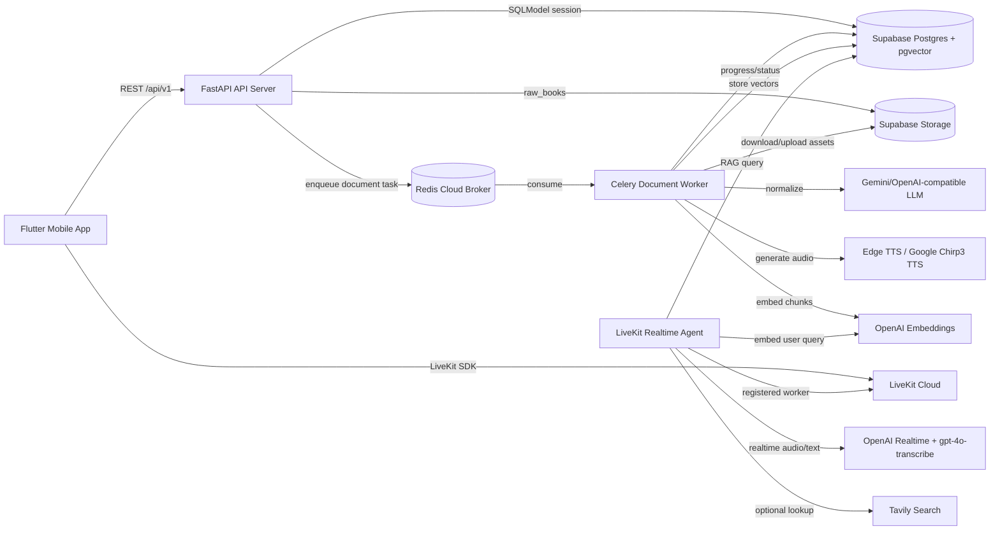
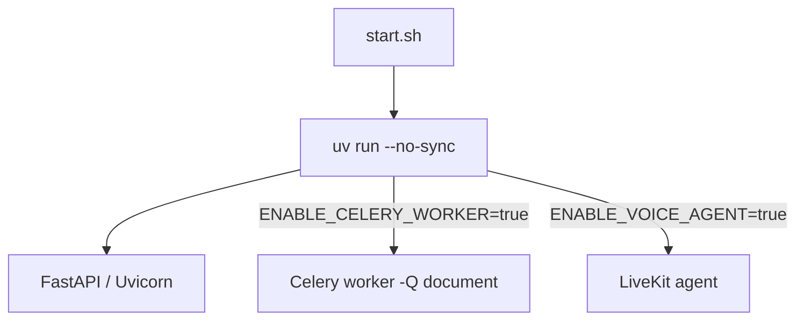
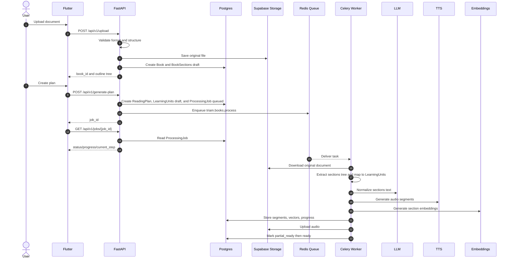
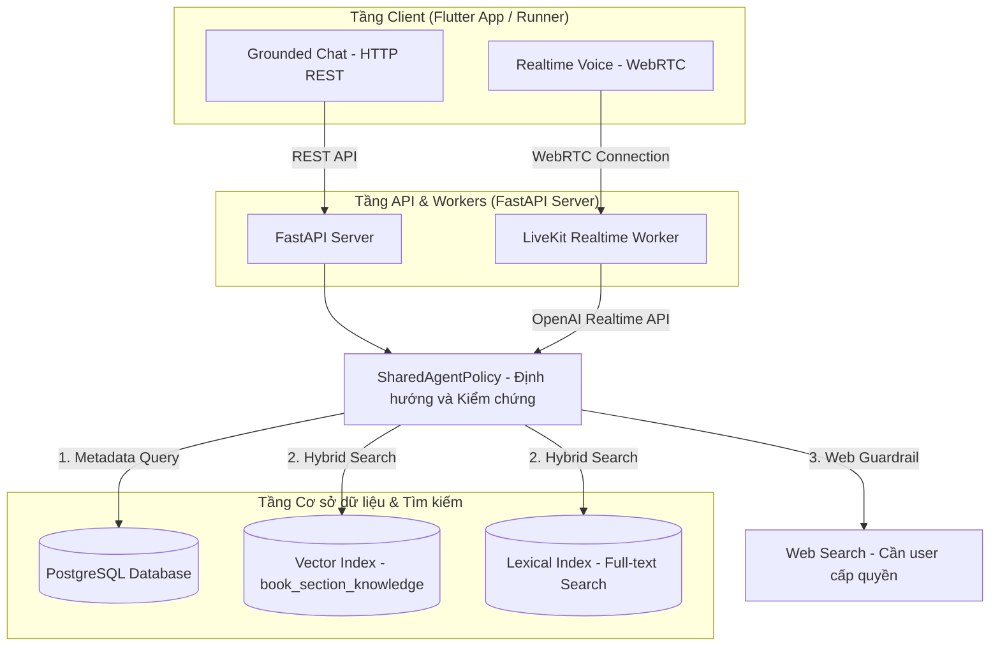
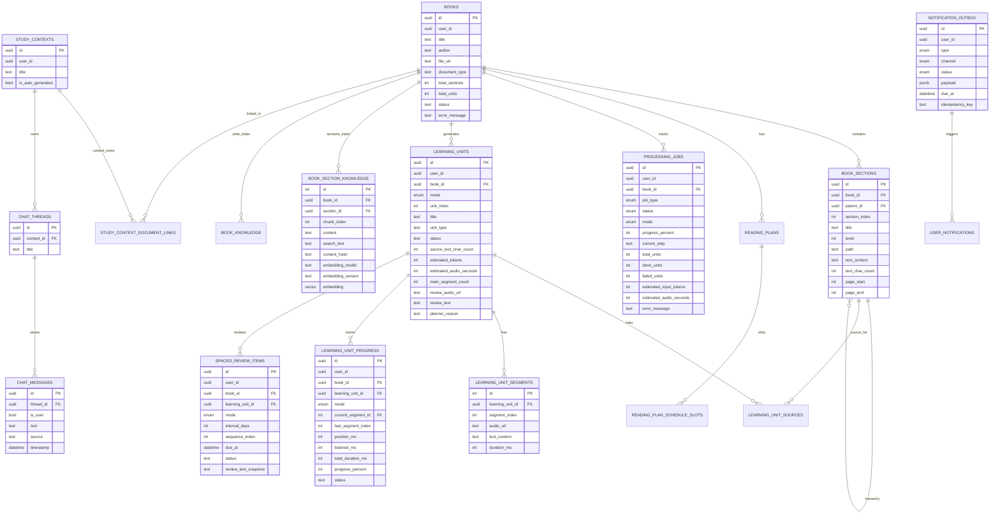

# SPEC TRIAM v1 - Trợ Lý Học Tập Thông Minh AI (AI Assistant Học Tập Thông Minh)

Trạng thái tài liệu: Tài liệu báo cáo Capstone (Capstone reporting spec)  
Cập nhật lần cuối: 2026-06-07  
Phiên bản kiến trúc hiện tại: TRIAM Backend Phase 1 -> Phase 10.10  
Client chính: Flutter Mobile App  
Backend Repo: triam-backend

---

## 1. Executive Summary (Tóm Tắt Dự Án)

TRIAM là một AI Learning Companion (Bạn đồng hành học tập AI) giúp người dùng biến sách và tài liệu học tập thành trải nghiệm nghe, hỏi đáp và ôn tập có ngữ cảnh.

Khác với audiobook truyền thống, TRIAM không chỉ đọc lại nội dung. Hệ thống xử lý tài liệu thành các đề mục có cấu trúc, tạo âm thanh (audio) theo từng bài học và phân đoạn (segment), sinh bản tóm tắt nghe nhanh (review audio), tạo cơ sở tri thức (knowledge base) để hỏi đáp, và kết nối với tác nhân giọng nói thời gian thực (realtime voice agent) để người dùng có thể vừa nghe vừa hỏi.

Mục tiêu Capstone:

- Giảm thời gian tiếp cận sách/tài liệu dài.
- Cho phép người dùng nghe nội dung sớm trong khi backend vẫn xử lý phần còn lại (Listen Early).
- Duy trì ngữ cảnh học tập theo từng sách, không gian học tập (study context) và luồng chat (chat thread).
- Hỗ trợ hỏi đáp bằng văn bản (text) và giọng nói (voice) dựa trên tài liệu người dùng đã tải lên (upload).
- Xây dựng hệ thống backend có khả năng xử lý tác vụ dài bằng hàng đợi worker (worker queue), cơ chế kiểm tra tiến độ (progress polling) và triển khai được trên Hugging Face Spaces.
- Đạt hiệu năng thoại thời gian thực độ trễ thấp (< 1.5s - 2.5s) bằng cách tối ưu hóa VAD, Query Guard, và Dialogue State Tracking.

---

## 2. Product Vision (Tầm Nhìn Sản Phẩm)

### 2.1 Tên Sản Phẩm

TRIAM Assistant (Trợ Lý TRIAM)

### 2.2 Định Vị (Positioning)

TRIAM là trợ lý học tập thông minh dành cho sinh viên và người tự học, đặc biệt là những người:

- Có nhiều sách/tài liệu nhưng thiếu thời gian đọc.
- Muốn nghe tài liệu trong lúc di chuyển hoặc làm việc khác.
- Cần hỏi đáp ngay trong phạm vi tài liệu đang học.
- Cần kế hoạch học tập và ôn tập để duy trì tiến độ.

### 2.3 Tuyên Ngôn Giá Trị Cốt Lõi (Core Value Proposition)

TRIAM giúp người dùng đi qua 4 bước:

```text
Upload tài liệu -> Tạo kế hoạch học -> Nghe/hỏi đáp -> Ôn tập và duy trì tiến độ
```

Giá trị cần chứng minh:

- Người dùng có thể upload sách/tài liệu có cấu trúc rõ ràng.
- Backend kiểm tra (validate) tài liệu để tránh cắt đề mục sai.
- Backend xử lý audio và RAG trong chế độ nền (background) thay vì chặn request.
- Frontend (FE) có thể hiển thị thanh tiến trình (progress bar) và mở khóa nghe sớm (Listen Early).
- Realtime Voice Agent có thể hỏi đáp theo đúng ngữ cảnh tài liệu và lưu lịch sử hội thoại ổn định.

---

## 3. Target Users (Đối Tượng Người Dùng)

### 3.1 Người Dùng Chính (Primary Users)

- Sinh viên cần học giáo trình, slide, sách chuyên ngành.
- Người tự học muốn biến tài liệu dài thành nội dung nghe được.
- Người thích học bằng cách hỏi đáp tương tác thay vì đọc tuyến tính.

### 3.2 Người Dùng Phụ (Secondary Users)

- Giảng viên hoặc người hướng dẫn (mentor) muốn chuẩn bị tài liệu học có âm thanh đi kèm.
- Người đi làm cần đọc nhanh tài liệu nghiệp vụ dài.
- Người học ngoại ngữ hoặc nghiên cứu cần hỏi đáp theo ngữ cảnh (context) tài liệu.

---

## 4. Current Implementation Scope (Phạm Vi Đã Triển Khai)

### 4.1 Đã Triển Khai (Implemented)

Hệ thống hiện tại đã tích hợp đầy đủ:

- **Tải lên (Upload)**: Hỗ trợ các định dạng tài liệu PDF, EPUB, DOCX.
- **Kiểm tra cấu trúc tài liệu bắt buộc (Validation rules)**:
  - PDF cần có mục lục ẩn (hidden outline/bookmarks).
  - EPUB cần có TOC/navigation.
  - DOCX cần có cấu trúc Heading/outline styles.
  - Từ chối (Reject) tài liệu không có cấu trúc rõ ràng bằng mã lỗi 422.
- **Mô hình hóa dữ liệu cấu trúc**: Tạo Thực thể Sách (`Book`), Đề mục (`BookSection`), Bài học (`LearningUnit`), Kế hoạch đọc (`ReadingPlan`).
- **Quản lý công việc chạy nền**: Quản lý tiến trình qua thực thể `ProcessingJob` để FE poll tiến độ.
- **Hàng đợi tác vụ**: Đưa các tác vụ `generate-plan` và `switch-mode` vào hàng đợi (queue) Celery mang tên `document`.
- **Celery Worker xử lý nền các công đoạn**:
  - Tải tài liệu từ Supabase Storage.
  - Trích xuất cấu trúc cây đề mục (`BookSection`) từ tài liệu gốc.
  - Phân chia bài học học tập (Learning Unit Planner) cho từng chế độ.
  - Ước lượng ngân sách token và thời lượng audio (estimate budget).
  - Chuẩn hóa văn bản bằng LLM (LLM normalization).
  - Tạo giọng nói bằng dịch vụ TTS (Edge TTS hoặc Google Chirp3 TTS).
  - Tải tệp âm thanh lên Supabase Storage.
  - Tạo vector embeddings và lưu trữ vào pgvector trong Supabase.
  - Cập nhật tiến độ xử lý vào cơ sở dữ liệu Postgres.
- **Cơ chế mở khóa nghe sớm (Listen Early/Partial-ready)**: Người dùng có thể nghe ngay khi bài học (`LearningUnit`) đầu tiên hoàn thành xử lý.
- **Quản lý thực thể**: CRUD cơ bản cho Books, Study Contexts, Threads, Notifications, Spaced Review và Learning Progress.
- **Liên kết trực tiếp (Direct Book Context)**: Tự động tạo Chat Thread mặc định cho từng sách.
- **LiveKit token**: Cấp quyền LiveKit token bảo mật theo từng chat thread riêng biệt.
- **Realtime Voice/Text Agent**:
  - Nhận văn bản qua kênh `lk.chat`.
  - Nhận giọng nói trực tiếp qua microphone.
  - Nhận diện giọng nói tiếng Việt thời gian thực bằng OpenAI Realtime API (sử dụng cấu hình `gpt-4o-transcribe`).
  - Trả văn bản transcript chuẩn qua kênh `lk.transcript`.
  - Hỗ trợ bật/tắt tính năng tìm kiếm web qua kênh điều khiển `lk.control`.
  - Tự động lưu các tin nhắn hội thoại (`ChatMessage`) vào DB.
- **Đóng gói & Triển khai**: Hỗ trợ đóng gói ứng dụng qua Docker và triển khai dễ dàng lên Hugging Face Spaces thông qua tệp khởi động `start.sh`.
- **Cơ chế bảo mật và ổn định môi trường chạy (Runtime hardening)**:
  - Chạy ứng dụng qua lệnh `uv run --no-sync` để tránh cài đặt lại thư viện khi khởi động.
  - Tách biệt các tiến trình Celery worker, Voice Agent và API server thông qua các biến môi trường cấu hình trong tệp `start.sh`.
  - Quản lý giới hạn tải (capacity control) cho LiveKit worker nhằm phù hợp với tài nguyên của Hugging Face CPU Free.
- **Kiến Trúc RAG Phân Phần (Canonical Section RAG - Phase 10.2)**: Tích hợp bảng `book_section_knowledge` chuyên dụng thay thế cho RAG phân mảnh bài học cũ. Hỗ trợ tìm kiếm lai (Hybrid Search - Phase 10.3) kết hợp giữa Vector Cosine Similarity (trọng số 0.60) và Lexical BM25 (trọng số 0.30) cùng cơ chế Boost điểm số cho tiêu đề hoặc nguồn tài liệu.
- **Voice Query Guard (Bộ lọc kiểm duyệt giọng nói - Phase 10.4)**: Ngăn chặn hiện tượng LLM tự ý gọi tool sai mục đích bằng cách so sánh trùng khớp từ khóa (overlap ratio) giữa câu lệnh gọi tool của LLM và transcript thực tế của người dùng.
- **Dialogue State Tracking (Theo dõi trạng thái hội thoại - Phase 10.10)**: Xây dựng cờ trạng thái `waiting_for_clarification` trong bộ nhớ RAM thông qua lớp trạng thái `PendingVoiceClarification` để phát hiện khi Agent đang chờ xác nhận từ người dùng. Hỗ trợ cơ chế Bypass lai (Hybrid Bypass) cho các câu trả lời ngắn khẳng định/phủ định (như *"đúng rồi"*, *"không phải"*) mà không bị chặn bởi Query Guard, giải quyết triệt để lỗi đơ cuộc thoại.
- **Hệ thống đánh giá tự động tác nhân thoại (Voice Agent Evaluation Framework - Phase 10.0 & 10.9)**: Hỗ trợ chạy giả lập voice test theo các chiến dịch cách ly phòng (`case_thread_new_room`) và xuất báo cáo độ chính xác, tỷ lệ vượt qua và thời gian trễ chi tiết với các mã phân loại lỗi sâu (`TRACE_COVERAGE`, `NO_USER_TRANSCRIPT`, `EVAL_FIXTURE_MISMATCH`, v.v.).

### 4.2 Các Phần Chưa Hoàn Thiện (Not Fully Implemented Yet - Roadmap)

Các thành phần dưới đây thuộc kế hoạch phát triển lâu dài, chưa được tích hợp hoàn chỉnh ở bản hiện tại:

- Giới hạn hạn ngạch (quota) upload tài liệu cho từng tài khoản.
- Tích hợp thanh toán/đăng ký thành viên (Payment/subscription).
- Trang quản trị hệ thống (Admin dashboard) phía frontend.
- Cơ chế đẩy tiến độ thời gian thực (Realtime progress push); hiện tại tiến trình vẫn dựa trên cơ chế poll (truy vấn lặp).

---

## 5. Business Requirements (Yêu Cầu Nghiệp Vụ)

### 5.1 Tải Lên Tài Liệu (Upload Document)

Người dùng tải lên một tài liệu học tập cá nhân.

Các định dạng hỗ trợ: PDF, EPUB, DOCX.

Quy tắc kiểm tra (Validation rules):

- Tệp tải lên phải thuộc định dạng cho phép.
- Dung lượng tệp phải nhỏ hơn biến cấu hình `MAX_FILE_SIZE_BYTES`, mặc định là 50MB.
- Tài liệu PDF bắt buộc phải có Outline/Bookmarks ẩn.
- Tài liệu EPUB bắt buộc phải có TOC (Table of Contents) / cấu trúc định tuyến.
- Tài liệu DOCX bắt buộc phải sử dụng các kiểu Heading/outline rõ ràng.
- Các tài liệu dạng scan hình ảnh, chạy OCR thiếu cấu trúc hoặc không có outline ẩn sẽ bị từ chối thẳng thừng, hệ thống tuyệt đối không tự động chia cắt chương bằng biểu thức chính quy (regex) hay chia cắt theo độ dài token.

Lý do nghiệp vụ:

- TRIAM cần xác định ranh giới đề mục (`BookSection`) chính xác tuyệt đối để phục vụ việc phân nhóm bài học (`LearningUnit`), kế hoạch học tập và tạo danh sách phát.
- Nếu chia cắt dựa trên mẫu văn bản phỏng đoán, hệ thống có thể cắt sai chương, dẫn tới việc xáo trộn trải nghiệm nghe và học của người dùng.

Đầu ra khi thành công (Success output):

- Tạo đối tượng `Book` trạng thái `draft`.
- Tạo các đối tượng `BookSection` tương ứng trạng thái `draft`.
- Tải tài liệu gốc lên Supabase Storage bucket `raw_books`.
- Trả về thông tin: `book_id`, `document_type`, `total_sections`, và cấu trúc mục lục `outline` dạng cây.

Đầu ra khi thất bại (Failure output):

- Mã lỗi 400 đối với tệp sai định dạng hoặc quá dung lượng.
- Mã lỗi 422 đối với tài liệu thiếu cấu trúc mục lục hợp lệ.
- Mã lỗi 500 chỉ dùng cho các lỗi hệ thống nghiêm trọng ngoài tầm kiểm soát.

### 5.2 Tạo Kế Hoạch Đọc (Generate Reading Plan)

Người dùng khởi tạo kế hoạch học cho sách đã tải lên.

Tham số đầu vào:

- `book_id`
- `mode` (chế độ học): `full` (đầy đủ) hoặc `pareto` (tối ưu 80/20)
- `pace` (tốc độ đọc)
- `schedule_config` (lịch học cấu hình)

Hành vi phía Backend:

- Kiểm tra sự tồn tại của sách và trạng thái sách phải là `draft`.
- Tạo đối tượng `ReadingPlan`.
- Tạo đối tượng `ProcessingJob` trạng thái `queued`.
- Cập nhật trạng thái sách thành `processing`.
- Đưa tác vụ `triam.books.process` vào hàng đợi `document` của Celery.
- Trả về mã công việc `job_id` cho FE.

Hành vi phía FE:

- Gửi yêu cầu lặp tới endpoint `GET /api/v1/jobs/{job_id}` để lấy tiến độ xử lý hiển thị lên thanh tiến trình (progress bar).
- Khi trạng thái chuyển thành `partial_ready`, FE mở khóa tính năng nghe cho bài học (`LearningUnit`) đầu tiên đã hoàn thành.
- Khi trạng thái là `ready`, FE hiển thị đầy đủ danh sách bài học phát (playlist).

### 5.3 Chế Độ Học (Study Modes)

#### Chế độ Đầy Đủ (Full Mode)

Full mode giữ đầy đủ ý chính, trình tự lập luận và các thông tin cốt lõi của chương gốc, nhưng được viết lại dưới dạng văn nói tự nhiên để tối ưu hóa cho việc phát âm thanh.

Chế độ đầy đủ không đồng nghĩa với việc đọc nguyên văn (word-for-word) vì tài liệu gốc thường chứa nhiều thông tin nhiễu như tiêu đề trang (header/footer), số trang, dấu xuống dòng lỗi và các định dạng rác.

#### Chế độ Pareto (Pareto Mode)

Pareto mode là chế độ học tối ưu theo nguyên lý 80/20:

- Chỉ giữ lại các định nghĩa, luận điểm cốt lõi, quy trình, công thức, từ khóa chính và kết luận quan trọng.
- Loại bỏ các ví dụ minh họa dài dòng, các đoạn văn mang tính lặp lại và thông tin thứ yếu.
- Tạo ra kịch bản ngắn gọn hơn nhưng vẫn đảm bảo tính mạch lạc, dễ tiếp thu qua đường nghe.

Quy trình xử lý hiện tại:

- Sự khác biệt giữa hai chế độ chủ yếu nằm ở thuật toán gom nhóm đề mục (Learning Unit Planner) và Prompt chuẩn hóa của LLM.
- Dữ liệu RAG (Knowledge base) được xây dựng trực tiếp từ nội dung văn bản thô của cây đề mục (`BookSection`) nên không cần tạo lại khi người dùng chuyển đổi chế độ học (switch-mode).
- Hành động chuyển đổi chế độ học chỉ yêu cầu tạo lại các tệp âm thanh (audio segments) cho chế độ mới.

### 5.4 Nghe Sớm (Listen Early / Partial-ready)

TRIAM không bắt người dùng phải chờ đợi hệ thống xử lý xong toàn bộ cuốn sách (có thể mất nhiều phút).

Quy tắc xử lý:

- Ưu tiên xử lý bài học đầu tiên (`LearningUnit` thứ 1) của sách trước.
- Ngay khi bài học đầu tiên có đầy đủ tệp âm thanh hợp lệ (`LearningUnitSegment`), đánh dấu trạng thái công việc/sách là `partial_ready`.
- FE nhận biết trạng thái này và mở khóa trình phát nhạc cho bài học đầu tiên.
- Các worker tiếp tục xử lý song song các bài học còn lại ở nền.
- Khi tất cả bài học hoàn thành, cập nhật trạng thái cuối cùng là `ready`.

Lợi ích trải nghiệm người dùng (UX):

- Giảm thiểu tối đa thời gian chờ đợi ban đầu.
- Người dùng thấy giá trị của sản phẩm ngay lập tức.
- Phù hợp tốt với các tài liệu dài hàng trăm trang.

### 5.5 Chuyển Đổi Chế Độ Học (Switch Mode)

Người dùng có thể chuyển đổi linh hoạt giữa hai chế độ học `full` và `pareto`.

Hành vi phía Backend:

- Nếu tệp âm thanh của chế độ mới đã được tạo từ trước, trả về đường dẫn phát ngay lập tức (không cần chạy lại task).
- Nếu tệp âm thanh chế độ mới chưa được tạo:
  - Khởi tạo `ProcessingJob` loại `switch_mode`.
  - Đưa tác vụ `triam.books.switch_mode` vào hàng đợi Celery.
  - Worker tiến hành tạo lại các tệp âm thanh bài học dựa trên kịch bản của chế độ mới.

Theo dõi tiến độ:

- FE truy vấn lặp qua `GET /api/v1/jobs/{job_id}` hoặc `GET /api/v1/books/{book_id}/processing-status`.

### 5.6 Không Gian Học Tập (Study Context)

Study Context là không gian làm việc học tập độc lập của người dùng.

Quy tắc hệ thống:

- Một Study Context có thể liên kết với một hoặc nhiều cuốn sách (`Book`).
- Một Study Context có thể chứa nhiều luồng chat (`ChatThread`).
- `ChatThread` lưu giữ lịch sử hỏi đáp của người dùng.
- `DirectBookContext` là cơ chế lập bản đồ đặc biệt giúp kết nối trực tiếp cặp (user, book) tới context và thread mặc định của sách đó.

Mục đích:

- Người dùng có thể hỏi đáp trong phạm vi kiến thức giới hạn của một hoặc nhiều cuốn sách.
- FE có luồng gọi API ổn định: Chi tiết sách -> Thread ID -> LiveKit Token -> Kết nối thoại thời gian thực.

### 5.7 Hỏi Đáp Giọng Nói/Văn Bản Thời Gian Thực (Realtime Voice/Text Q&A)

Tác nhân thoại hỗ trợ:

- Nhận văn bản đầu vào qua kênh `lk.chat`.
- Nhận giọng nói trực tiếp từ microphone của người dùng.
- Xuất văn bản transcript chính thức qua kênh `lk.transcript`.
- Nhận lệnh cấu hình tìm kiếm web thông qua kênh điều khiển `lk.control`.

Quy tắc nghiệp vụ thoại:

- Câu trả lời của Agent bắt buộc phải ưu tiên tìm kiếm trong phạm vi tài liệu (document scope) liên kết với luồng chat đó thông qua cơ sở tri thức RAG Phân Phần (`BookSectionKnowledge`).
- Lịch sử trò chuyện được tải tự động từ DB dựa trên `thread_id`.
- Mọi tin nhắn của người dùng và Agent đều được lưu trữ lâu dài vào bảng `chat_messages`.
- Tệp tin transcript gửi qua DataChannel có chứa ID tin nhắn độc lập để FE khử trùng lặp bong bóng chat (chat bubble).
- Chức năng tìm kiếm web phải được kiểm soát rõ ràng qua nút bật/tắt của người dùng, không được tự động tìm kiếm khi chưa có quyền.

---

## 6. System Architecture (Kiến Trúc Hệ Thống)

### 6.1 Sơ Đồ Kiến Trúc Tổng Quan (High Level Architecture)



### 6.2 Mô Hình Tiến Trình Chạy (Runtime Process Model)



Ghi chú vận hành:

- Lệnh `uv run --no-sync` đảm bảo container không tự ý cập nhật thư viện ngoài ý muốn khi khởi động trên môi trường deploy.
- Biến `ENABLE_CELERY_WORKER` dùng để tắt/bật tiến trình worker xử lý tài liệu nền.
- Biến `ENABLE_VOICE_AGENT` dùng để tắt/bật tác nhân thoại thời gian thực LiveKit.
- Trên môi trường Hugging Face Spaces, cả 3 tiến trình trên có thể được chạy đồng thời trong cùng một container để tối ưu hóa chi phí.

### 6.3 Luồng Xử Lý Nền Tài Liệu (Background Processing Flow)



### 6.4 Sơ Đồ Định Tuyến Tác Nhân Dùng Chung (Shared Agent Policy Routing)

Để đảm bảo tính nhất quán cao về câu trả lời và chính sách phản hồi giữa hai kênh văn bản (text chat) và giọng nói (realtime voice), hệ thống áp dụng lớp chính sách dùng chung `SharedAgentPolicy` để xử lý và điều hướng mọi câu hỏi của người dùng.



#### Quy trình định hướng và kiểm chứng:

1. **Giao tiếp qua Kênh Văn bản (Grounded Chat - HTTP REST)**:
   - Yêu cầu chat bằng văn bản đi qua `FastAPI Server`.
   - Server gọi trực tiếp dịch vụ `SharedAgentPolicy` để thực hiện định tuyến và lấy ngữ cảnh hội thoại, sau đó chuyển cho mô hình ngôn ngữ (LLM) tổng hợp câu trả lời dạng văn bản.

2. **Giao tiếp qua Kênh Giọng nói (Realtime Voice - WebRTC)**:
   - Dòng âm thanh truyền tải thời gian thực WebRTC được kết nối tới `LiveKit Realtime Worker`.
   - Worker nhận diện giọng nói (STT) thông qua OpenAI Realtime API. Khi mô hình thực hiện gọi công cụ lấy tri thức (`search_book_knowledge`), yêu cầu này sẽ đi qua bộ lọc kiểm duyệt `VoiceQueryGuard` để bảo vệ chống trùng khớp sai lệch, sau đó kích hoạt dịch vụ `SharedAgentPolicy` để lấy ngữ cảnh.

3. **Chính sách điều hướng của `SharedAgentPolicy`**:
   - **1. Metadata Query**: Nếu câu hỏi của người dùng liên quan đến thông tin cấu trúc, mục lục, tác giả của sách (được phân loại bởi `GroundingRouter`), hệ thống sẽ thực hiện truy vấn trực tiếp trong cơ sở dữ liệu `PostgreSQL` thay vì tìm kiếm ngữ cảnh.
   - **2. Hybrid Search**: Nếu là câu hỏi kiến thức trong sách, hệ thống thực hiện tìm kiếm lai (Hybrid Search) đồng thời trên chỉ mục Vector (bảng `book_section_knowledge`) và chỉ mục từ khóa (Full-text Search BM25) để có kết quả chính xác nhất.
   - **3. Web Guardrail (Kiểm soát tìm kiếm Web)**: Khi thông tin trong sách không đủ hoặc câu hỏi nằm ngoài phạm vi tài liệu, tác nhân cần tìm kiếm bên ngoài. Hành vi này được kiểm duyệt nghiêm ngặt qua lớp chính sách quyền truy cập web (chỉ kích hoạt tìm kiếm khi người dùng cấp quyền tường minh hoặc có quyền ngầm định còn hiệu lực).

---

## 7. Data Model (Mô Hình Dữ Liệu)

### 7.1 Cấu Trúc Các Bảng Chính (Main Tables)



### 7.2 Các Ràng Buộc Quan Trọng (Important Constraints)

- `book_sections`: Ràng buộc duy nhất trên cặp `(book_id, section_index)` và `(book_id, path)`.
- `learning_units`: Ràng buộc duy nhất trên bộ `(book_id, mode, unit_index)`.
- `learning_unit_segments`: Ràng buộc duy nhất trên cặp `(learning_unit_id, segment_index)`.
- `learning_unit_progress`: Ràng buộc duy nhất trên cặp `(user_id, learning_unit_id)`.
- `book_section_knowledge`: Ràng buộc duy nhất trên bộ `(section_id, chunk_index, embedding_version)`.
- `direct_book_context`: Khóa chính kết hợp `(user_id, book_id)`.
- `notification_outbox`: Ràng buộc duy nhất trên `idempotency_key`.

Mục đích:

- Tránh việc sinh trùng lặp bài học/đoạn âm thanh khi Celery thực hiện chạy lại (retry).
- Đảm bảo tính an toàn dữ liệu và tính lũy đẳng (idempotency) của worker khi nhận lại task.
- Giữ vững thứ tự phát danh sách bài học (playlist) đồng nhất trên thiết bị người dùng.

---

## 8. API Overview (Tổng Quan Giao Diện API)

Đường dẫn gốc (Base path): `/api/v1`

### 8.1 Kiểm Trá Sức Khỏe Hệ Thống (Health Check)

| Phương thức | Đường dẫn | Mục đích |
| --- | --- | --- |
| GET | `/health` | Kiểm tra tình trạng hoạt động cơ bản của API |
| GET | `/health/background` | Kiểm tra độ sẵn sàng của DB, Redis và hệ thống worker nền |

### 8.2 Xử Lý Tài Liệu (Document Processing)

| Phương thức | Đường dẫn | Mục đích |
| --- | --- | --- |
| POST | `/upload` | Tải lên tài liệu PDF/EPUB/DOCX và trích xuất cấu trúc mục lục |
| POST | `/generate-plan` | Khởi tạo kế hoạch đọc sách và đưa công việc vào hàng đợi nền |
| GET | `/jobs/{job_id}` | Truy vấn tiến độ xử lý của ProcessingJob |
| GET | `/books/{book_id}/processing-status` | Lấy thông tin công việc xử lý mới nhất của cuốn sách |

### 8.3 Quản Lý Sách (Books)

| Phương thức | Đường dẫn | Mục đích |
| --- | --- | --- |
| GET | `/books` | Danh sách sách của người dùng |
| POST | `/books` | Tạo thủ công siêu dữ liệu (metadata) của sách |
| GET | `/books/{book_id}` | Lấy thông tin chi tiết một cuốn sách |
| PUT | `/books/{book_id}` | Cập nhật thông tin sách |
| DELETE | `/books/{book_id}` | Xóa sách và toàn bộ tài nguyên âm thanh/RAG liên quan |
| GET | `/books/{book_id}/details` | Lấy danh sách bài học, các đoạn âm thanh và tệp review |
| POST | `/books/{book_id}/switch-mode` | Yêu cầu chuyển đổi chế độ học (full/pareto) |

### 8.4 Tiến Trình Học Tập (Learning Progress)

| Phương thức | Đường dẫn | Mục đích |
| --- | --- | --- |
| PUT | `/books/{book_id}/learning-units/{learning_unit_id}/progress` | Cập nhật tiến trình nghe (segment, thời gian nghe) |
| POST | `/books/{book_id}/learning-units/{learning_unit_id}/complete` | Đánh dấu hoàn thành bài học thủ công |
| GET | `/books/{book_id}/learning-progress` | Lấy tổng quan tiến trình học tập của sách (danh sách tiến trình) |

### 8.5 Ôn Tập Ngắt Quãng (Spaced Review)

| Phương thức | Đường dẫn | Mục đích |
| --- | --- | --- |
| POST | `/reviews/{review_item_id}/complete` | Đánh dấu hoàn thành một mục ôn tập ngắt quãng |
| POST | `/reviews/{review_item_id}/skip` | Bỏ qua mục ôn tập hiện tại |

### 8.6 Thông Báo Hệ Thống (Notifications)

| Phương thức | Đường dẫn | Mục đích |
| --- | --- | --- |
| GET | `/notifications` | Danh sách các thông báo của người dùng |
| PATCH | `/notifications/read-all` | Đánh dấu đọc tất cả thông báo |
| PATCH | `/notifications/{notification_id}/read` | Đánh dấu đọc một thông báo cụ thể |
| GET | `/notifications/settings` | Lấy thông tin cấu hình thông báo (timezone, giờ im lặng) |
| PUT | `/notifications/settings` | Cập nhật cấu hình thông báo |
| POST | `/notifications/devices` | Đăng ký FCM Device Token nhận thông báo đẩy |
| DELETE | `/notifications/devices/{device_token}` | Hủy đăng ký nhận thông báo đẩy trên thiết bị |

### 8.7 Không Gian Học Tập & Luồng Chat (Study Context & Threads)

| Phương thức | Đường dẫn | Mục đích |
| --- | --- | --- |
| GET | `/study-contexts` | Danh sách không gian học tập |
| POST | `/study-contexts` | Khởi tạo không gian học tập mới |
| GET | `/study-contexts/{context_id}` | Lấy chi tiết không gian học tập |
| PATCH | `/study-contexts/{context_id}` | Cập nhật tên/thông tin không gian học tập |
| DELETE | `/study-contexts/{context_id}` | Xóa không gian học tập |
| POST | `/study-contexts/{context_id}/documents` | Liên kết sách vào không gian học tập |
| DELETE | `/study-contexts/{context_id}/documents/{book_id}` | Hủy liên kết sách khỏi không gian học tập |
| GET | `/study-contexts/{context_id}/threads` | Danh sách luồng chat trong không gian học tập |
| POST | `/study-contexts/{context_id}/threads` | Khởi tạo luồng chat mới |
| GET | `/threads/for-book/{book_id}` | Lấy hoặc khởi tạo luồng chat mặc định cho sách |
| GET | `/threads/{thread_id}/messages` | Lấy danh sách lịch sử tin nhắn trong luồng chat |
| PUT | `/threads/{thread_id}` | Cập nhật tên luồng chat |
| DELETE | `/threads/{thread_id}` | Xóa luồng chat |

### 8.8 LiveKit

| Phương thức | Đường dẫn | Mục đích |
| --- | --- | --- |
| GET | `/live-token/thread/{thread_id}` | Tạo mã kết nối thoại LiveKit cho luồng chat cụ thể |
| GET | `/live-token/{book_id}` | Endpoint kiểm thử/cũ để kết nối thoại trực tiếp qua sách |

### 8.9 Quản Trị Hệ Thống (Admin Panel)

| Phương thức | Đường dẫn | Mục đích |
| --- | --- | --- |
| GET | `/admin/me` | Lấy thông tin tài khoản admin hiện tại |
| GET | `/admin/dashboard` | Thống kê tổng số sách, người dùng, tiến độ xử lý |
| GET | `/admin/users` | Danh sách người dùng của hệ thống |
| GET | `/admin/books` | Danh sách toàn bộ sách tải lên (cho phép tìm kiếm, lọc trạng thái) |
| GET | `/admin/books/{book_id}` | Xem chi tiết thông tin sách ở vai trò admin |
| GET | `/admin/jobs` | Danh sách và lịch sử các tác vụ xử lý nền |
| POST | `/admin/jobs/{job_id}/retry` | Yêu cầu chạy lại tác vụ xử lý nền bị lỗi |
| GET | `/admin/audit-logs` | Xem nhật ký kiểm toán hoạt động quản trị viên |

---

## 9. Realtime DataChannel Contract (Hợp Đồng Kênh Dữ Liệu Thời Gian Thực)

### 9.1 Các Kênh Dữ Liệu (Topics)

| Tên kênh | Hướng | Định dạng dữ liệu | Mục đích |
| --- | --- | --- | --- |
| `lk.chat` | Client <-> Server | Văn bản UTF-8 thô | Gửi tin nhắn dạng gõ (text) nhanh và hiển thị trước tin nhắn của Agent |
| `lk.transcript` | Server -> Client | Định dạng JSON | Gửi tin nhắn transcript chính thức để hiển thị bong bóng chat |
| `lk.control` | Client -> Server | Định dạng JSON | Gửi lệnh điều khiển bật/tắt tìm kiếm web của Agent |

### 9.2 Định Dạng Gói Tin Transcript (Transcript Payload)

```json
{
  "v": 1,
  "type": "transcript",
  "role": "assistant",
  "text": "Nội dung phản hồi...",
  "id": "<uuid>",
  "ts": "2026-06-07T10:00:00.000+00:00"
}
```

Quy tắc xử lý cho FE:

- Bắt buộc phải sử dụng dữ liệu từ kênh `lk.transcript` để hiển thị bong bóng chat chính thức trên giao diện.
- Khử trùng lặp (dedupe) tin nhắn dựa trên trường định danh `id`.
- Kênh `lk.chat` chỉ được dùng để hiển thị chữ chạy tạm thời (preview) khi Agent đang phát âm thanh, không dùng làm nguồn dữ liệu lịch sử chính thức.

---

## 10. System States (Trạng Thái Hệ Thống)

### 10.1 Trạng Thái Của Sách (Book Status)

```text
draft (nháp) -> processing (đang xử lý) -> partial_ready (sẵn sàng một phần) -> ready (hoàn thành)
                                              |
                                              -> error (gặp lỗi)
```

### 10.2 Trạng Thái Của Bài Học (Learning Unit Status)

```text
queued (chờ hàng đợi) -> processing (đang xử lý) -> partial_ready (sẵn sàng một phần) -> ready (hoàn thành)
                                                      |
                                                      -> error (gặp lỗi)
                                                      -> cancelled (đã hủy)
```

### 10.3 Trạng Thái Công Việc Xử Lý (Processing Job Status)

```text
queued (chờ hàng đợi) -> processing (đang xử lý) -> partial_ready (sẵn sàng một phần) -> ready (hoàn thành)
                                                      |
                                                      -> error (gặp lỗi)
                                                      -> cancelled (đã hủy)
```

### 10.4 Trạng Thái Kế Hoạch (Plan Status)

```text
active (đang hoạt động) -> inactive (ngừng hoạt động)
                        -> error (gặp lỗi)
```

### 10.5 Trạng Thái Tiến Trình Học Tập (Learning Progress Status)

```text
not_started (chưa bắt đầu) -> in_progress (đang học) -> completed (đã hoàn thành)
```

### 10.6 Trạng Thái Ôn Tập Ngắt Quãng (Spaced Review Item Status)

```text
pending (chờ ôn tập) -> due (đến hạn ôn tập) -> completed (đã ôn tập xong)
                                             -> skipped (đã bỏ qua)
                                             -> cancelled (đã hủy)
```

### 10.7 Trạng Thái Hộp Thư Thông Báo (Notification Status)

```text
pending (chờ xử lý) -> processing (đang gửi) -> sent (gửi thành công)
                                              -> failed (gửi lỗi)
                                              -> skipped (bỏ qua)
                                              -> cancelled (đã hủy)
```

---

## 11. Technical Stack (Công Nghệ Sử Dụng)

| Phân khu | Công nghệ hiện tại |
| --- | --- |
| API Server | FastAPI, Uvicorn |
| DB ORM | SQLModel, SQLAlchemy |
| Database Migrations | Alembic |
| Cơ sở dữ liệu | Supabase Postgres |
| Cơ sở dữ liệu Vector | pgvector tích hợp trong Supabase Postgres |
| Lưu trữ tệp tin (Storage) | Supabase Storage |
| Xử lý tác vụ nền | Celery |
| Broker hàng đợi | Redis Cloud |
| Phân tách văn bản | pypdf, pdfplumber, ebooklib, BeautifulSoup, python-docx |
| Chuẩn hóa LLM | Gemini API / OpenAI API tương thích |
| Vector Embeddings | OpenAI text-embedding-3-small |
| Phát âm thanh (TTS) | Edge TTS (tiếng Việt), Google Chirp3 TTS (nâng cao) |
| Thoại thời gian thực | LiveKit Agents, OpenAI Realtime API (sử dụng gpt-4o-realtime) |
| Tìm kiếm Web | Tavily Search API |
| Triển khai (Deployment) | Docker, Hugging Face Spaces |
| Công cụ phát triển | uv, ruff, pytest |

---

## 12. Non-Functional Requirements (Yêu Cầu Phi Chức Năng)

### 12.1 Độ Tin Cậy & Tính Ổn Định (Reliability)

- Mọi công việc tốn thời gian xử lý (LLM/TTS) tuyệt đối không được thực hiện trực tiếp trong request handler của FastAPI, bắt buộc phải đẩy vào Celery worker.
- Tiến trình xử lý của công việc phải được lưu trữ trực tiếp trong cơ sở dữ liệu Postgres để đảm bảo khả năng khôi phục khi restart, không lưu trữ tạm bợ trong Redis.
- Các tham số truyền vào Celery task bắt buộc phải ở dạng kiểu dữ liệu nguyên thủy (primitive) để dễ dàng tuần tự hóa (serialization) dưới định dạng JSON.
- Celery worker bắt buộc phải tự mở phiên kết nối cơ sở dữ liệu độc lập, không dùng chung session của API.
- Đảm bảo tính lũy đẳng (idempotency) thông qua các khóa ràng buộc duy nhất của DB để tránh việc sinh trùng lặp dữ liệu âm thanh/RAG khi tiến trình xử lý nền bị restart giữa chừng.

### 12.2 Hiệu Năng & Độ Trễ (Performance & Latency)

- Endpoint upload tài liệu phải phản hồi cực kỳ nhanh (chỉ kiểm tra định dạng cấu trúc mục lục và trả kết quả outline, không xử lý gì thêm).
- Endpoint khởi tạo kế hoạch học tập phải trả về mã `job_id` ngay lập tức để giải phóng kết nối cho FE.
- Tiến trình nền luôn ưu tiên xử lý bài học đầu tiên của sách trước để đạt trạng thái nghe sớm (`partial_ready`).
- Quản lý tải giới hạn (capacity control) chặt chẽ cho LiveKit worker để tránh hiện tượng sập container khi triển khai trên Hugging Face CPU Free.
- **Tác nhân thoại thời gian thực**: Trễ phản hồi cực thấp nhờ cơ chế Dialogue State Tracking (`PendingVoiceClarification`) giúp nhận diện và bỏ qua kiểm duyệt trùng khớp từ khóa (Query Guard Bypass) đối với các câu trả lời ngắn của người dùng (khẳng định/phủ định dưới 3 từ) khi đang trong luồng xác nhận.

Cấu hình LiveKit Agent mặc định trên HF Space:

```env
LIVEKIT_AGENT_JOB_EXECUTOR_TYPE=thread
LIVEKIT_AGENT_NUM_IDLE_PROCESSES=1
LIVEKIT_AGENT_MAX_CONCURRENT_JOBS=2
LIVEKIT_AGENT_LOAD_THRESHOLD=0.95
LIVEKIT_AGENT_INITIALIZE_PROCESS_TIMEOUT=60
LIVEKIT_AGENT_SHUTDOWN_PROCESS_TIMEOUT=20
```

### 12.3 Kiểm Soát Chi Phí (Cost Control)

- Đếm số lượng token văn bản trước khi gửi yêu cầu chuẩn hóa tới LLM.
- Tính toán thời lượng audio dự kiến để từ chối các tài liệu vượt quá hạn ngạch cho phép trước khi gọi dịch vụ TTS.
- Không tiến hành sinh lại (regenerate) vector RAG khi người dùng chuyển đổi chế độ học (switch-mode) vì nội dung kiến thức gốc của sách không thay đổi, giúp tiết kiệm chi phí gọi API Embedding.

### 12.4 Bảo Mật (Security)

- Redact (ẩn thông tin) toàn bộ các dữ liệu nhạy cảm trong log: Bearer Token, Supabase API Key, JWT Token, API Key của các nhà cung cấp LLM/TTS/LiveKit.
- Hạ mức ghi log của các thư viện HTTP bên thứ ba xuống mức `WARNING` để tránh việc rò rỉ URL chứa chữ ký bảo mật hoặc thông tin nhạy cảm.
- Tuyệt đối không commit tệp `.env` lên git repository.

### 12.5 Khả Năng Giám Sát (Observability)

- Tiến trình `ProcessingJob` ghi nhận chi tiết: Trạng thái công việc, phần trăm tiến độ, bước xử lý hiện tại, số lượng đơn vị, số lượng hoàn thành/lỗi, thông báo lỗi, ước tính token đầu vào, ước tính thời lượng âm thanh.
- Lưu trữ độ trễ chi tiết của từng giai đoạn hội thoại thoại thời gian thực (`stage_latency_ms` bao gồm `query_guard`, `tool_total`, `grounding_total`, `retrieval`, `turn_total`) để phục vụ việc phân tích hiệu năng và tối ưu hóa hệ thống.

---

## 13. Deployment Spec (Thông Số Triển Khai)

### 13.1 Phát Triển Dưới Local (Local Development)

Quy trình phát triển dưới máy local sử dụng 3 terminal riêng biệt:

```powershell
# Terminal 1: Chạy API Server FastAPI
uv run uvicorn app.main:app --host 0.0.0.0 --port 8000 --reload

# Terminal 2: Chạy Celery Document Worker (sử dụng pool=solo trên môi trường Windows)
uv run celery -A app.core.celery_app.celery_app worker -Q document -l info --pool=solo --concurrency 1

# Terminal 3: Chạy LiveKit Realtime Voice Agent
uv run python -m app.services.agent_voice_gpt_realtime start
```

### 13.2 Triển Khai Trên Hugging Face Space

Ứng dụng chạy thông qua tệp cấu hình Dockerfile trỏ tới lệnh khởi động:

```text
CMD ["./start.sh"]
```

Nội dung tệp `start.sh` quản lý việc khởi động song song các tiến trình API, Celery worker và LiveKit Agent tùy thuộc vào các cấu hình biến môi trường:

```env
BACKEND_PORT=7860
UV_NO_SYNC=true
ENABLE_CELERY_WORKER=true
ENABLE_VOICE_AGENT=true
UVICORN_RELOAD=false
RUN_MIGRATIONS_ON_START=false
CELERY_DOCUMENT_CONCURRENCY=1
```

Lý do bắt buộc phải đặt `UV_NO_SYNC=true`:

- Toàn bộ dependency đã được đóng gói và cài đặt trong quá trình build Docker image.
- Việc chạy `uv run --no-sync` ngăn chặn việc uv tự động chạy tiến trình kiểm tra/tải lại thư viện khi khởi động nhiều tiến trình song song, giúp tăng tốc thời gian start container và loại bỏ các lỗi xung đột file ghi (write locks).

---

## 14. Testing Strategy (Chiến Lược Kiểm Thử)

### 14.1 Kiểm Thử Tự Động (Automated Tests)

Mã nguồn kiểm thử tự động tập trung vào các khu vực trọng yếu:

- Kiểm thử API Health.
- Kiểm thử luồng enqueue công việc của Celery.
- Kiểm thử API Processing Jobs.
- Kiểm thử các bộ phân tách tài liệu (Document Parsers).
- Kiểm thử luồng tạo không gian học tập và cách ly thread.
- Kiểm thử Query Guard và logic hội thoại làm rõ thời gian thực (State Tracking).

Các câu lệnh kiểm thử khuyến nghị:

```powershell
# Chạy ruff kiểm tra lỗi cú pháp và style code
uv run ruff check app tests

# Chạy nhanh các bộ test cơ bản offline
uv run pytest tests/test_health_api.py tests/test_celery_enqueue.py tests/test_processing_jobs_api.py -q
uv run pytest tests/test_document_parsers.py tests/test_api_study_context.py tests/test_auth_user_isolation.py -q

# Chạy toàn bộ test suite của hệ thống
uv run pytest tests/ -q
```

### 14.2 Kiểm Thử Tích Hợp Thủ Công (Manual Integration Tests)

Sử dụng tệp tin thực tế để kiểm tra hành vi đầu cuối:

- Tệp tin thành công mẫu: `Chuong 4_ Phuong phap luan nghien cuu.pdf` (tệp tin có cấu trúc Bookmark mục lục đầy đủ).
- Tệp tin thất bại mẫu: `MGHP HK1(2025-2026).pdf` (tệp tin không chứa outline ẩn).

Kết quả mong đợi:

- Tệp tin thành công phải tải lên mượt mà, trích xuất đầy đủ cây đề mục, tạo kế hoạch học tập, tạo bài học, tạo playlist âm thanh và cơ sở tri thức hỏi đáp.
- Tệp tin thất bại phải trả về mã lỗi 422 ngay lập tức kèm theo lý do cấu trúc không hợp lệ chi tiết, không được để xảy ra lỗi crash hệ thống 500.

### 14.3 Kiểm Thử Khói Trên Môi Trường Production (Production Smoke Test)

Các bước kiểm tra nhanh sau khi deploy:

- Truy vấn API Health và Background Health.
- Thử tải lên một tệp tin PDF thật.
- Gọi API khởi tạo kế hoạch học tập.
- Truy vấn lặp API Job để xem tiến trình nhảy từ `queued -> processing -> partial_ready -> ready`.

---

## 15. Known Limitations (Các Hạn Chế Hiện Tại)

Hệ thống hiện tại có các giới hạn thiết kế được ghi nhận:

- Hệ thống nhắc nhở và ôn tập ngắt quãng (Spaced review) đã được thiết kế bảng và nghiệp vụ nền, tuy nhiên cronjob định kỳ kích hoạt ôn tập vẫn cần tối ưu cấu hình máy chủ.
- Tiến độ hiển thị trên ứng dụng dựa trên cơ chế FE kéo dữ liệu lặp (polling), chưa triển khai cơ chế đẩy thời gian thực (Websocket/SSE).
- Chế độ Pareto hiện tại phụ thuộc hoàn toàn vào câu lệnh Prompt và cách gom đề mục của Planner, chưa có thuật toán lọc và phân tầng độ quan trọng của kiến thức gốc một cách khoa học.
- Ứng dụng hoàn toàn từ chối và chưa hỗ trợ các tệp tài liệu PDF dạng scan hình ảnh chưa qua xử lý số hóa văn bản.

---

## 16. Roadmap (Lộ Trình Phát Triển)

### Phase 1 - Nền Tảng Tiến Trình (Progress Foundation) - Đã Xong

- Thêm thực thể `ProcessingJob`.
- Xây dựng các endpoint polling để lấy tiến độ.
- Lưu trữ trạng thái tiến trình xử lý trong DB.

### Phase 2 - Hàng Đợi Công Việc Bền Vững (Durable Worker Queue) - Đã Xong

- Tích hợp Celery + Redis Cloud Broker.
- Đẩy toàn bộ công việc sinh plan và chuyển chế độ học sang worker nền.
- Sử dụng Postgres làm nguồn chân lý duy nhất lưu giữ tiến trình.

### Phase 3 - Giới Hạn & Kiểm Soát Sinh (Generation Guardrails) - Đã Xong

- Ước lượng ngân sách token/audio trước khi gọi API.
- Cấu hình các hạn ngạch mềm/cứng để bảo vệ chi phí.
- Phân đoạn các đề mục quá dài (chunking).
- Mở khóa nghe sớm (partial-ready playback).
- Đảm bảo tính lũy đẳng cho worker.

### Phase 3.1 - Sẵn Sàng Triển Khai (Deploy Readiness) - Đã Xong

- Bảo mật tệp khởi chạy `start.sh`.
- Sử dụng cơ chế chạy `uv run --no-sync`.
- Bổ sung các cờ cấu hình bật/tắt tiến trình.
- Cấu hình giới hạn tải cho LiveKit agent.
- Đảm bảo tệp tin shell script sử dụng định dạng xuống dòng LF trên Git.

### Phase 4 - Nhắc Nhở & Ôn Tập Ngắt Quãng (Notification & Spaced Review) - Đã Xong

- Xây dựng bảng hàng đợi tin nhắn gửi đi (`notification_outbox`).
- Chạy quét Celery Beat định kỳ mỗi phút để tìm các thông báo đến hạn.
- Gửi tin nhắn ôn tập và nhắc nhở học tập.
- Thiết lập chu kỳ ôn tập ngắt quãng: 1, 3, 7, 14, 30 ngày.
- Cấu hình giờ yên lặng (quiet hours) và số tin nhắn tối đa trong ngày (daily caps).

### Phase 5 - Cấu Trúc Cây Đề Mục & Bộ Lập Kế Hoạch Bài Học - Đã Xong

- Phân tách cấu trúc tài liệu thành cây đề mục `BookSection`.
- Chuyển đổi mô hình xử lý từ "Chapter" phẳng thành "LearningUnit" phân nhóm linh hoạt.
- Tích hợp lưu trữ nội dung thô trực tiếp trong cơ sở dữ liệu để phục vụ RAG và TTS.

### Phase 10 - Tác Nhân Thoại Đáng Tin Cậy & Tối Ưu Độ Trễ - Đã Xong

- Xây dựng cơ sở tri thức phân phần chuẩn hóa (`BookSectionKnowledge`).
- Tích hợp tìm kiếm lai (Hybrid RAG Search) kết hợp vector và lexical BM25.
- Thiết lập bộ lọc kiểm duyệt cuộc gọi công cụ thoại (Voice Query Guard).
- Hỗ trợ Dialogue State Tracking (`PendingVoiceClarification`) và cơ chế bypass xác nhận để giải quyết lỗi treo trễ thoại (dưới 1.5s - 2.5s).
- Xây dựng khung đánh giá tự động (Evaluation Framework) để đo lường độ chính xác và độ trễ.

---

## 17. Capstone Evaluation Criteria (Tiêu Chí Đánh Giá Dự Án)

Dự án được đánh giá dựa trên các khía cạnh:

- **Tính Chính Xác (Correctness)**: Kiểm tra cấu trúc tài liệu nghiêm ngặt, từ chối tệp không cấu trúc để tránh sinh bài học sai lệch.
- **Giá Trị Người Dùng (User Value)**: Mở khóa phát bài học đầu tiên sớm và hỏi đáp giọng nói/văn bản thời gian thực có ngữ cảnh.
- **Độ Tin Cậy (Reliability)**: Công việc chạy nền bền bỉ qua worker, có khả năng phục hồi trạng thái tiến độ dựa trên cơ sở dữ liệu khi restart.
- **Tính Kiến Trúc (Architecture)**: Sự tách biệt rõ ràng giữa các lớp Router -> Service -> Repository -> Model.
- **Khả Năng Mở Rộng (Scalability)**: Xử lý tác vụ qua hàng đợi và định hướng tách biệt hàng đợi xử lý/gửi tin trong tương lai.
- **Bảo Mật (Security)**: Cơ chế che giấu dữ liệu nhạy cảm thông minh trong log và không để rò rỉ token/keys ra môi trường ngoài.
- **Triển Khai Mượt Mà (Deployability)**: Triển khai trọn gói lên Docker Space chạy song song API, worker và voice agent ổn định.

---

## 18. Final Scope Statement (Tuyên Bố Phạm Vi Cuối Cùng)

TRIAM v1 hiện tại là một hệ thống backend hỗ trợ học tập thông minh hoàn chỉnh, hỗ trợ từ việc tải tài liệu cấu trúc, tự động lập kế hoạch học tập, sinh giọng nói/RAG nền, theo dõi tiến độ chi tiết, cho phép nghe trước bài học hoàn thành sớm, và hỗ trợ thoại thời gian thực có ngữ cảnh theo từng luồng chat riêng biệt.

Khi thuyết trình dự án Capstone, nên trình bày TRIAM dưới dạng một nền tảng học tập thông minh dựa trên 3 trụ cột cốt lõi:

1. **Document Intelligence (Trí tuệ Tài liệu)**: Validate cấu trúc, parse tài liệu thành cây đề mục (`BookSection`), lưu trữ nội dung và lập kế hoạch bài học (`LearningUnit`).
2. **Learning Audio Pipeline (Luồng âm thanh bài học)**: Sinh audio kịch bản học tập, quản lý tiến trình nền thông qua Celery, và mở khóa phát bài học sớm (partial-ready).
3. **Contextual AI Assistant (Trợ lý AI theo ngữ cảnh)**: Quản lý không gian học tập (Study Context), luồng chat (Chat Thread), kết nối thoại thời gian thực qua LiveKit với cơ chế Query Guard và Dialogue State Tracking tối ưu độ trễ.

---

## 19. Agent Handoff Guide (Hướng Dẫn Bàn Giao Cho Agent/Developer Khác)

Phần này ghi nhận các thông tin quan trọng nhất để bất kỳ lập trình viên hay Agent AI nào khác khi tiếp nhận project có thể bắt tay vào làm việc ngay mà không cần đọc lại toàn bộ lịch sử trò chuyện dài dòng.

### 19.1 Mô Hình Tư Duy Core (Mental Model)

Hệ thống TRIAM Backend hoạt động dựa trên triết lý phân tách lưu trữ bền vững:

```text
Postgres là nguồn chân lý duy nhất (Source of truth) lưu giữ tiến độ, lịch sử và trạng thái nghiệp vụ.
Redis/Celery chỉ là hạ tầng thực thi công việc (Worker infrastructure).
LiveKit chỉ là hạ tầng truyền tải luồng âm thanh và text thời gian thực (Transport layer).
Supabase Storage chỉ là kho chứa tệp tin tĩnh (Asset storage).
```

Tuyệt đối không lưu trữ trạng thái nghiệp vụ chính thức trong Redis, trạng thái phòng thoại LiveKit, các tệp tin lưu trữ tạm thời trên ổ cứng của server hay bộ nhớ RAM của frontend.

### 19.2 Luồng Người Dùng Chính (Main User Flow)

```text
1. FE upload tài liệu gốc lên API.
2. BE kiểm tra cấu trúc tài liệu, nếu đạt yêu cầu sẽ lưu trữ tệp tin và tạo Book + BookSections trạng thái draft.
3. Người dùng chọn chế độ học và khởi tạo Reading Plan.
4. BE tạo đối tượng ProcessingJob lưu trạng thái và đưa tác vụ process vào hàng đợi Celery.
5. FE liên tục poll trạng thái của ProcessingJob qua API.
6. Worker nền xử lý bài học đầu tiên và sinh tệp audio thành công.
7. BE cập nhật trạng thái job là partial_ready, FE mở khóa cho phép người dùng bấm nút Play nghe bài học đầu.
8. Worker tiếp tục hoàn thành các bài học còn lại ở nền và chuyển trạng thái sách sang ready khi xong hết.
9. Người dùng mở mục chat chi tiết sách trên ứng dụng.
10. FE gọi API để lấy Thread ID mặc định của sách và xin mã kết nối thoại LiveKit token tương ứng.
11. Người dùng bắt đầu trò chuyện thoại/text thời gian thực với Agent, Agent trả lời dựa trên cơ sở tri thức RAG của cuốn sách đó.
```

### 19.3 Các Thỏa Hiệp Kiến Trúc Hiện Tại (Important Trade-offs)

- Quản lý định danh người dùng thực chưa được tích hợp hoàn chỉnh vào toàn bộ các router, nhiều route vẫn sử dụng `MOCK_USER_ID` thông qua cấu hình.
- Cơ chế theo dõi tiến trình xử lý nền đang dùng phương pháp poll (truy vấn lặp từ FE), chưa áp dụng push thời gian thực.
- Chế độ Pareto hiện tại phụ thuộc vào Prompt viết lại của LLM và thuật toán gom đề mục của planner, chưa áp dụng thuật toán xếp hạng nội dung kiến thức chuyên sâu nâng cao.
- Hệ thống hoàn toàn từ chối và chưa hỗ trợ số hóa các tài liệu PDF dạng scan hình ảnh.

---

## 20. Source Code Map (Bản Đồ Mã Nguồn)

### 20.1 Cấu Trúc Thư Mục App

```text
app/
  api/v1/routers/       Chứa các router FastAPI (Endpoints)
  core/                 Chứa cấu hình settings, constants, logger và Celery app
  db/                   Chứa cấu hình kết nối DB engine/session và Alembic migrations
  models/               Chứa định nghĩa các DB Model sử dụng SQLModel
  repositories/         Chứa các hàm truy vấn DB cô lập (DB reads/writes)
  schemas/              Chứa các DTO schemas phục vụ request/response
  services/             Chứa logic nghiệp vụ chính và tích hợp bên thứ ba (LLM, TTS, LiveKit)
  services/workers/     Chứa logic chi tiết của worker nền xử lý sách, bài học, audio và RAG
  tasks/                Chứa các entrypoints định nghĩa Celery Tasks
```

### 20.2 Các File Quan Trọng Phân Theo Tính Năng (Important Files By Feature)

| Tính năng | Các tệp tin cốt lõi |
| --- | --- |
| Upload PDF/EPUB/DOCX | `app/api/v1/routers/upload.py`, `app/services/upload_service.py`, `app/services/document_parser_service.py`, `app/services/pdf_service.py`, `app/services/epub_service.py`, `app/services/docx_service.py` |
| Tạo kế hoạch học tập | `app/api/v1/routers/upload.py`, `app/services/upload_service.py`, `app/tasks/book_tasks.py` |
| Luồng xử lý nền tài liệu | `app/services/workers/book_pipeline.py`, `app/services/workers/learning_unit_worker.py`, `app/services/workers/learning_unit_tts_worker.py` |
| Cấu hình Celery | `app/core/celery_app.py`, `app/tasks/book_tasks.py`, `start.sh` |
| Quản lý tiến trình Job | `app/api/v1/routers/jobs.py`, `app/services/processing_job_service.py`, `app/repositories/processing_job_repo.py` |
| Quản lý Sách & Switch mode | `app/api/v1/routers/audiobooks.py`, `app/services/audiobook_service.py`, `app/repositories/audiobook_repo.py` |
| Không gian học tập Study Context | `app/api/v1/routers/study_context.py`, `app/services/study_context_service.py`, `app/repositories/study_context_repo.py` |
| Luồng chat Chat Thread | `app/api/v1/routers/threads.py`, `app/repositories/study_context_thread_repo.py` |
| Tạo mã LiveKit Token | `app/api/v1/routers/live.py`, `app/services/live_service.py` |
| Tác nhân thoại Realtime Agent | `app/services/agent_voice_gpt_realtime.py` |
| Phân loại ý định thoại (Intent) | `app/services/voice_agent/voice_intent_classifier.py`, `app/services/voice_agent/web_permission_intent_classifier.py` |
| Bộ lọc kiểm duyệt Query Guard | `app/services/voice_agent/query_guard.py` |
| Trạng thái hội thoại thời gian thực | `app/services/voice_agent/turn_state.py` |
| Cơ sở tri thức RAG | `app/services/embed_service.py`, `app/services/rag_service.py`, `app/repositories/book_knowledge_repo.py` |
| Tổng hợp giọng nói TTS | `app/services/tts_service.py` |
| Tệp cấu hình & Môi trường | `app/core/config.py`, `.env.example`, `Dockerfile`, `start.sh` |
| Lược đồ DB Schema | `app/models/db_models.py`, `app/db/migrations/versions/` |
| Quản lý Ghi nhật ký & Lỗi | `app/core/logger.py`, `app/core/exceptions.py` |

### 20.3 Các Tác Vụ Celery Chính (Main Celery Tasks)

```text
triam.books.process
  Tham số: book_id, mode, job_id
  Hàng đợi: document
  Mục đích: Tiến hành phân tích sách, trích xuất đề mục, sinh bài học, audio và RAG ban đầu.

triam.books.switch_mode
  Tham số: book_id, mode, job_id
  Hàng đợi: document
  Mục đích: Tạo lại toàn bộ tệp âm thanh bài học cho chế độ học mới được chuyển đổi.
```

---

## 21. Development Rules For Future Agents (Quy Tắc Lập Trình Cho Agent Tương Lai)

### 21.1 Quy Tắc Kiến Trúc (Architecture Rules)

- Router bắt buộc phải giữ ở mức tối giản (thin router), không xử lý logic nghiệp vụ hay truy vấn DB phức tạp.
- Lớp Service nắm giữ toàn bộ các quyết định và logic nghiệp vụ cốt lõi.
- Lớp Repository chịu trách nhiệm duy nhất cho các tác vụ CRUD dữ liệu thô, không chứa logic gọi LLM hay API bên ngoài.
- Worker chịu trách nhiệm cho các công việc tốn tài nguyên chạy nền, bắt buộc phải tự quản lý session cơ sở dữ liệu riêng.
- Các đối tượng DTO (schemas) đặt tại thư mục `app/schemas`.
- Lược đồ cơ sở dữ liệu gốc đặt tại `app/models/db_models.py`.
- Mọi thay đổi về cấu trúc bảng bắt buộc phải tạo tệp di cư cơ sở dữ liệu (Alembic migration revision).

### 21.2 Quy Tắc Xử Lý Lỗi (Exception Rules)

- API Routers ném trực tiếp mã lỗi HTTP (400, 404, 409, 422, 500) thông qua việc xử lý các ngoại lệ nghiệp vụ (`AppException` đặt tại `app/core/exceptions.py`).
- Lớp Service và Repository ném lỗi nghiệp vụ (`AppException`), không ném trực tiếp `HTTPException`.
- Áp dụng chuẩn mã lỗi HTTP:
  - 400: Dữ liệu gửi lên sai định dạng, quá dung lượng cho phép.
  - 404: Không tìm thấy tài nguyên yêu cầu.
  - 409: Xung đột trạng thái hoạt động của thực thể nghiệp vụ.
  - 422: Cấu trúc mục lục tài liệu tải lên không hợp lệ.
  - 500: Lỗi hệ thống nghiêm trọng ở phía máy chủ.

### 21.3 Quy Tắc Ghi Nhật Ký (Logging Rules)

Tuyệt đối không được phép ghi log các thông tin:

- Các Header Authorization chứa JWT token hoặc khóa bảo mật.
- Khóa bảo mật dịch vụ Supabase (Supabase apikey / service role key).
- Khóa API của các nhà cung cấp OpenAI, Gemini, LiveKit.
- Nội dung văn bản thô của tài liệu hoặc mã hóa nhị phân của tệp tin.
- Nội dung payload thô gửi lên các nhà cung cấp nếu có chứa mật khẩu/chữ ký bảo mật.

Các thông tin ghi log an toàn và hữu dụng:

- `book_id`, `learning_unit_id`, `job_id`.
- Trạng thái công việc hiện tại.
- Cột mốc hoàn thành tiến độ xử lý.
- Tóm tắt thông tin lỗi từ nhà cung cấp dịch vụ (không chứa khóa bảo mật).

### 21.4 Quy Tắc Tác Vụ Nền (Background Job Rules)

- Không được phép thực hiện công việc LLM/TTS chiếm dụng nhiều giây trực tiếp trong request handler của API.
- Tạo mới hoặc cập nhật trạng thái `ProcessingJob` trong DB trước khi đưa task vào hàng đợi Celery.
- Trả về `job_id` cho ứng dụng khách ngay khi công việc được đưa vào queue.
- Mọi tiến trình hiển thị cho người dùng bắt buộc phải đồng bộ từ Postgres.
- Tham số truyền vào Celery Task phải đảm bảo tuần tự hóa được thành JSON.
- Không truyền trực tiếp đối tượng DB Model (SQLModel) hay đối tượng DB session vào hàm thực thi của Celery.
- Thiết kế các tác vụ có tính lũy đẳng (idempotent), cho phép chạy lại nhiều lần không sinh rác hay làm sai lệch dữ liệu trước đó.

### 21.5 Quy Tắc Parse Tài Liệu (Document Parsing Rules)

Nên làm:

- Kiểm tra tính hợp lệ của cấu trúc tài liệu đầu vào trước khi tiến hành ghi file hay lưu DB.
- Sử dụng bộ phân phối Parser (`document_parser_service.py`) để điều hướng tài liệu.
- Giữ hành vi trích xuất nội dung nhất quán giữa các định dạng PDF, EPUB, DOCX.

Không được phép:

- Phỏng đoán ranh giới chương bằng biểu thức chính quy (regex) không chính thức.
- Tự ý chia cắt văn bản theo độ dài token khi tài liệu thiếu outline.
- Tự động chạy OCR nhận diện chữ viết ở luồng xử lý tài liệu thông thường.
- Chấp nhận tệp PDF dạng scan ảnh chưa qua số hóa làm tài liệu cấu trúc.

### 21.6 Quy Tắc Tác Nhân Thoại Realtime Agent Rules

- Giữ ổn định tuyệt đối tên các DataChannel: `lk.chat`, `lk.transcript`, `lk.control`.
- Bong bóng chat trên màn hình ứng dụng bắt buộc phải vẽ từ dữ liệu kênh `lk.transcript`.
- Không thiết kế cho phép ứng dụng khách Flutter tự ý xuất bản gói tin lên kênh `lk.transcript`.
- Mọi tin nhắn trao đổi thoại/text bắt buộc phải được lưu trữ lâu dài vào bảng `chat_messages`.
- Ưu tiên luồng lấy token LiveKit dựa trên thread (`/live-token/thread/{thread_id}`).

### 21.7 Quy Tắc Triển Khai (Deployment Rules)

- Tệp tin `start.sh` bắt buộc phải sử dụng định dạng kết dòng LF của Unix, tuyệt đối không dùng CRLF của Windows.
- Khai báo quy tắc eol=lf trong tệp `.gitattributes` cho các tệp tin script `*.sh`.
- Không loại bỏ cờ chạy `--no-sync` của uv trong tệp khởi chạy `start.sh`.
- Tắt hoàn toàn cờ reload của Uvicorn trên môi trường production.
- Trên môi trường CPU giới hạn tài nguyên của Hugging Face Spaces, cần kiểm soát chặt chẽ các thông số concurrency (số lượng tác vụ xử lý đồng thời) để tránh sập container.

---

## 22. Frontend Integration Contract (Hợp Đồng Tích Hợp Frontend)

### 22.1 Luồng Tải Sách & Tạo Playlist (Upload & Plan Flow)

Quy trình tích hợp chuẩn cho ứng dụng Flutter:

```text
1. Gửi request POST /api/v1/upload kèm tệp tin tài liệu.
   -> Nhận về book_id và danh sách outline mục lục của sách để hiển thị cho người dùng xem trước.
2. Gửi request POST /api/v1/generate-plan kèm book_id và chế độ học mong muốn.
   -> Nhận về job_id của tiến trình xử lý nền.
3. Liên tục gọi GET /api/v1/jobs/{job_id} sau mỗi khoảng thời gian (polling).
   -> Theo dõi tiến trình xử lý nền cho đến khi trạng thái chuyển sang partial_ready hoặc ready.
4. Khi đạt partial_ready/ready, gọi GET /api/v1/books/{book_id}/details.
   -> Lấy danh sách bài học và tệp tin âm thanh để tải vào trình phát nhạc (playlist).
```

### 22.2 Hiển Thị Tiến Độ (Progress UI)

Sử dụng cấu trúc phản hồi `ProcessingJobSummaryResponse` từ API.

Các trường thông tin cần chú ý:

- `status` (trạng thái): `queued`, `processing`, `partial_ready`, `ready`, `error`, `cancelled`.
- `progress_percent` (phần trăm tiến độ): Giá trị số nguyên hiển thị trực tiếp lên thanh progress bar.
- `current_step` (bước hiện tại): Đoạn mô tả trạng thái hiện tại (ví dụ: *"Đang tổng hợp giọng nói..."*) để hiển thị cho người dùng biết hệ thống đang làm gì.
- `error_message` (thông tin lỗi): Mô tả lỗi chi tiết khi trạng thái là `error` để người dùng có thể thực hiện tải lại hoặc hỗ trợ.

Quy tắc giao diện:

- Trạng thái `queued`: Hiển thị vòng xoay chờ đợi hàng đợi.
- Trạng thái `processing`: Vẽ thanh tiến trình dựa trên `progress_percent`.
- Trạng thái `partial_ready`: Mở khóa trình phát nhạc cho bài học đầu tiên của sách, người dùng có thể bấm nghe ngay lập tức.
- Trạng thái `ready`: Hiển thị đầy đủ playlist và hoàn tất thanh tiến trình.
- Trạng thái `error`: Hiển thị thông báo lỗi và nút "Thử lại".

### 22.3 Chuyển Đổi Chế Độ Học (Switch Mode)

```text
FE gọi POST /api/v1/books/{book_id}/switch-mode
```

- Nếu API phản hồi cờ `needs_generation=false`: Nghĩa là âm thanh cho chế độ mới đã được tạo sẵn từ trước. FE chỉ cần gọi lại API audiobook detail để cập nhật lại playlist nhạc.
- Nếu API phản hồi mã `job_id`: Nghĩa là hệ thống cần thời gian tạo lại âm thanh. FE tiến hành poll tiến độ qua `/jobs/{job_id}` và cập nhật playlist khi hoàn thành.

### 22.4 Luồng Kết Nối Chat Chi Tiết Sách (Book Detail Chat Flow)

Quy trình tích hợp chuẩn:

```text
1. Gửi request GET /api/v1/threads/for-book/{book_id}
   -> BE trả về thread_id mặc định duy nhất cho cặp (user, book) này.
2. Gửi request GET /api/v1/threads/{thread_id}/messages
   -> Tải toàn bộ lịch sử tin nhắn trò chuyện trước đó để vẽ lên màn hình chat.
3. Gửi request GET /api/v1/live-token/thread/{thread_id}
   -> Lấy mã token kết nối thoại LiveKit.
4. Sử dụng LiveKit SDK kết nối vào phòng thoại thời gian thực.
```

Lợi ích:

- Đảm bảo lịch sử hội thoại của cuốn sách luôn tập trung, không bị phân mảnh thành nhiều thread khác nhau mỗi lần người dùng bấm nút mở màn hình chat.

### 22.5 Quy Tắc LiveKit DataChannel

Kênh `lk.chat`:

- FE đẩy tin nhắn dạng text lên kênh này khi người dùng chọn gõ chat văn bản.
- Agent sẽ đẩy tạm thời các từ đang sinh (streaming text preview) lên kênh này để FE chạy hiệu ứng chữ chạy thời gian thực cho người dùng xem trước.

Kênh `lk.transcript`:

- FE chỉ đăng ký lắng nghe (subscribe), tuyệt đối không tự ý gửi tin nhắn lên kênh này.
- Khi Agent hoàn thành việc tổng hợp và sinh toàn bộ tin nhắn thoại/văn bản, Agent sẽ gửi một gói tin JSON transcript chính thức chứa ID tin nhắn độc lập lên kênh này. FE sử dụng gói tin này để hiển thị bong bóng chat chính thức trong danh sách tin nhắn.

Lệnh điều khiển `lk.control`:

- FE gửi gói tin JSON cấu hình khi người dùng bấm nút bật/tắt chức năng tìm kiếm web:

```json
{
  "type": "toggle_web_search",
  "enabled": true
}
```

---

## 23. Common Change Recipes (Các Công Thức Thay Đổi Thường Gặp)

### 23.1 Thêm Một Định Dạng Tài Liệu Mới (Add A New Document Type)

Các bước triển khai:

1. Đăng ký loại tài liệu mới vào enum cấu hình trong code.
2. Đăng ký MIME type tương ứng vào `ALLOWED_MIME_TYPES` trong file config.
3. Xây dựng dịch vụ parse tài liệu mới (parser service) kế thừa từ lớp cha chung.
4. Đăng ký dịch vụ mới này vào trình điều phối `document_parser_service.py`.
5. Đảm bảo luồng upload trực tiếp và luồng xử lý nền của worker đều dùng chung một bộ điều phối parser để tránh lệch cấu trúc.
6. Thiết kế đầu ra của parser mới phải trả về mục lục (outline) đồng dạng.
7. Bổ sung các bài kiểm thử unit test độc lập cho parser mới.

Tuyệt đối không được phép cấu hình hỗ trợ upload một định dạng tài liệu mới mà chưa lập trình phần xử lý nền tương ứng trong Celery worker.

### 23.2 Thay Đổi Quy Tắc Validation Khi Tải Lên (Change Upload Validation)

Các file cần kiểm tra và chỉnh sửa:

- `app/services/upload_service.py`
- `app/services/document_parser_service.py`
- Các dịch vụ parse tài liệu chi tiết (ví dụ: `pdf_service.py`)
- `app/core/exceptions.py`
- Các tệp tin test parser tương ứng.

Các phép kiểm thử bắt buộc:

- Tài liệu mẫu chuẩn cấu trúc vẫn phải upload thành công.
- Tài liệu mẫu thiếu cấu trúc (thiếu outline) bắt buộc phải bị từ chối với mã lỗi 422.
- Kho chứa Supabase Storage tuyệt đối không bị ô nhiễm bởi các tệp tin rác tải lên thất bại.

### 23.3 Thay Đổi Logic Xử Lý Nền (Change Background Processing)

Các file cần kiểm tra và chỉnh sửa:

- `app/tasks/book_tasks.py`
- `app/services/workers/book_pipeline.py`
- `app/services/workers/learning_unit_worker.py`
- `app/services/workers/learning_unit_tts_worker.py`

Yêu cầu bắt buộc:

- Luôn cập nhật chính xác trạng thái và phần trăm tiến độ vào đối tượng `ProcessingJob`.
- Bảo toàn tính năng mở khóa nghe sớm (`partial_ready`).
- Bảo toàn tính lũy đẳng (idempotency), không để sinh thừa các bản ghi trùng lặp trong bảng `learning_unit_segments` hoặc `book_section_knowledge` khi tác vụ bị chạy lại giữa chừng.

### 23.4 Thay Đổi Logic Realtime Agent (Change Realtime Agent)

Các file cần kiểm tra và chỉnh sửa:

- `app/services/agent_voice_gpt_realtime.py`
- `app/services/voice_agent/voice_intent_classifier.py`
- `app/services/voice_agent/query_guard.py`
- `app/services/voice_agent/turn_state.py`
- `app/services/live_service.py`
- `app/services/rag_service.py`
- `app/services/web_search_service.py`

Yêu cầu bắt buộc:

- Tuyệt đối không thay đổi tên các kênh DataChannel (`lk.chat`, `lk.transcript`, `lk.control`).
- Đảm bảo gói tin JSON transcript truyền đi tương thích hoàn toàn với ứng dụng khách FE.
- Duy trì tính năng định tuyến theo luồng chat (Thread-based context).
- Giữ vững cấu hình nhận diện giọng nói tiếng Việt mặc định, trừ khi có yêu cầu chuyển đổi ngôn ngữ ứng dụng chính thức.

---

## 24. Things Never To Do (Những Điều Tuyệt Đối Không Được Làm)

- Không bao giờ commit tệp cấu hình `.env` hoặc các khóa bảo mật lên kho git.
- Không bao giờ ghi log các Supabase keys, JWT tokens hoặc thông tin nhạy cảm của người dùng.
- Không bao giờ sử dụng Redis làm nơi lưu trữ duy nhất cho tiến trình xử lý nền (phải lưu vào Postgres).
- Không bao giờ thực hiện các công việc tốn tài nguyên và thời gian chạy (LLM/TTS) trực tiếp trong luồng xử lý API của FastAPI.
- Không bao giờ truyền trực tiếp đối tượng DB session hoặc SQLModel entity vào tham số hàng đợi của Celery Task.
- Không bao giờ tự động chia cắt tài liệu bằng regex phỏng đoán hoặc chia cắt theo số lượng token khi tài liệu thiếu outline.
- Không bao giờ cho phép FE tự ý xuất bản dữ liệu lên kênh tin nhắn chính thức `lk.transcript`.
- Không bao giờ hiển thị bong bóng chat chính thức trên màn hình người dùng từ kênh chạy thử `lk.chat`.
- Không bao giờ chạy máy chủ Uvicorn trên môi trường production ở chế độ tự động tải lại (`--reload`).
- Không bao giờ loại bỏ lệnh `--no-sync` của uv khi chạy Docker Space trên Hugging Face.

---

## 25. Minimum Verification Checklist (Danh Sách Kiểm Tra Xác Minh Tối Thiểu)

### 25.1 Sau Khi Chỉnh Sửa Mã Backend

Chạy các lệnh kiểm tra:

```powershell
uv run ruff check <đường dẫn các file thay đổi>
uv run python -m py_compile <đường dẫn các file python thay đổi>
```

Nếu thay đổi liên quan đến API hoặc tiến trình xử lý Job:

```powershell
uv run pytest tests/test_health_api.py tests/test_celery_enqueue.py tests/test_processing_jobs_api.py -q
```

Nếu thay đổi liên quan đến các bộ Parser trích xuất tài liệu:

```powershell
uv run pytest tests/test_document_parsers.py -q
```

Nếu thay đổi liên quan đến Study Context hoặc Thread cách ly dữ liệu:

```powershell
uv run pytest tests/test_api_study_context.py tests/test_auth_user_isolation.py -q
```

### 25.2 Sau Khi Thay Đổi Tệp start.sh Hoặc Dockerfile

Chạy kiểm tra cú pháp và cấu hình:

```powershell
# Kiểm tra lỗi cú pháp tệp shell script
bash -n start.sh

# Kiểm tra xem cấu hình biến môi trường và nạp config hoạt động bình thường
uv run --no-sync python -c "from app.core.config import settings; print('config ok')"
```

Yêu cầu bắt buộc:

- Tệp `start.sh` sử dụng định dạng kết dòng LF của Unix.
- Cờ `UV_NO_SYNC=true` bắt buộc phải có mặt trong cấu hình chạy thực tế.
- `UVICORN_RELOAD` được tắt hoàn toàn.

---

## 26. Quick Glossary (Bảng Tra Cứu Thuật Ngữ Nhanh)

| Thuật ngữ | Ý nghĩa nghiệp vụ |
| --- | --- |
| Book | Siêu dữ liệu và tài liệu học tập được người dùng tải lên hệ thống |
| BookSection | Một đề mục/mục con có cấu trúc được trích xuất từ tài liệu Book |
| LearningUnit | Một bài học/bài nghe được lập kế hoạch từ một hoặc nhiều BookSection |
| LearningUnitSegment | Một phân đoạn nhỏ chứa audio và văn bản phục vụ phát playlist của bài học |
| ReadingPlan | Lịch học tập và cấu hình ôn tập mà người dùng khởi tạo cho cuốn sách |
| ProcessingJob | Bản ghi lưu giữ tiến độ và kết quả của công việc xử lý nền tốn thời gian |
| LearningUnitProgress | Lưu giữ chi tiết tiến trình nghe (segment hiện tại, vị trí phát) của người dùng |
| SpacedReviewItem | Bản ghi lập lịch ôn tập ngắt quãng (1, 3, 7, 14, 30 ngày) cho từng bài học |
| NotificationOutbox | Hàng đợi lưu thông báo hệ thống và nhắc nhở học tập chờ gửi đi |
| BookSectionKnowledge | Cơ sở dữ liệu RAG mới lưu trữ vector embeddings theo từng đề mục sách |
| StudyContext | Không gian làm việc học tập liên kết giữa người dùng, sách và các luồng chat |
| ChatThread | Một luồng hội thoại lưu trữ tin nhắn hỏi đáp trong không gian học tập |
| DirectBookContext | Cơ chế lập bản đồ mặc định để ánh xạ nhanh cặp (user, book) tới context |
| `document` queue | Tên hàng đợi Celery chuyên trách việc xử lý văn bản, sinh audio và RAG |
| `partial_ready` | Trạng thái hoàn thành bài học đầu tiên, cho phép người dùng mở nghe sớm |
| `lk.chat` | Kênh LiveKit DataChannel để gửi tin nhắn văn bản và hiển thị chữ chạy trước của Agent |
| `lk.transcript` | Kênh LiveKit DataChannel gửi gói tin JSON chứa transcript chính thức |
| `lk.control` | Kênh LiveKit DataChannel để gửi tin nhắn cấu hình (như bật/tắt tìm kiếm web) |

---

## 27. Handoff Summary (Tóm Tắt Bàn Giao Cốt Lõi)

Nếu lập trình viên hoặc Agent AI tiếp theo tiếp nhận dự án này chỉ có thể nhớ một điều duy nhất, hãy nhớ điều này:

TRIAM là một hệ thống backend AI hỗ trợ học tập sử dụng khung FastAPI + Celery + Redis + Supabase + LiveKit. Tiến trình tải lên tài liệu bắt buộc phải kiểm tra cấu trúc nghiêm ngặt (không bookmarks ẩn sẽ bị từ chối 422), trích xuất thành cây đề mục `BookSection` và bài học `LearningUnit`. Luồng tạo kế hoạch học tập sẽ sinh ra ProcessingJob và đẩy công việc xử lý nền vào Celery, worker nền xử lý bài học đầu tiên sẽ cập nhật trạng thái partial_ready cho phép FE mở trình phát sớm cho người dùng, hội thoại thoại thời gian thực được định tuyến bảo mật theo Chat Thread thông qua LiveKit thời gian thực, sử dụng cơ chế Query Guard và Dialogue State Tracking tối ưu hóa độ trễ, và gửi gói tin JSON transcript chính thức qua kênh `lk.transcript` để hiển thị bong bóng chat trên giao diện.

Luôn luôn bảo vệ các bất biến của hệ thống (Invariants):

1. Postgres nắm giữ toàn bộ trạng thái tiến độ và lịch sử hội thoại chính thức.
2. Celery worker nắm quyền xử lý các tác vụ nền tốn thời gian độc lập.
3. Việc kiểm tra cấu trúc mục lục tài liệu tải lên bắt buộc phải diễn ra nghiêm ngặt.
4. Hợp đồng API và DataChannel với Frontend phải giữ ổn định tuyệt đối.
5. Khóa bảo mật và thông tin nhạy cảm không bao giờ được phép xuất hiện trong log.
