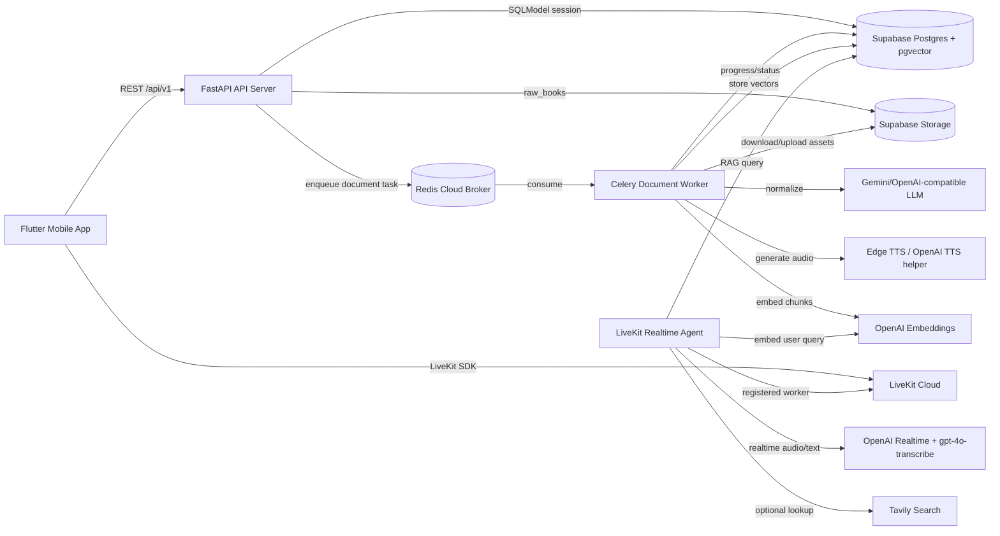
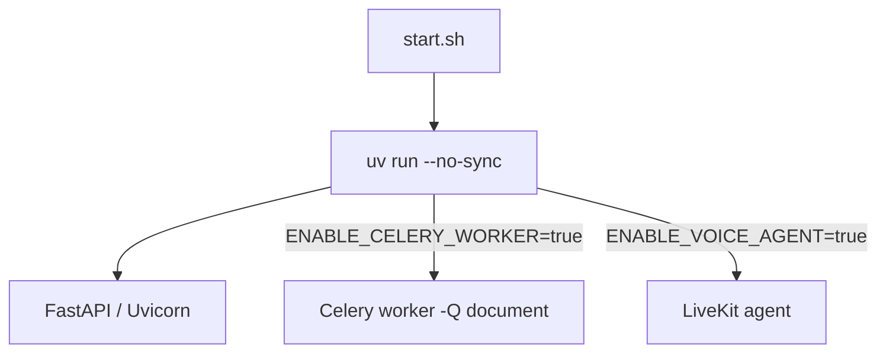
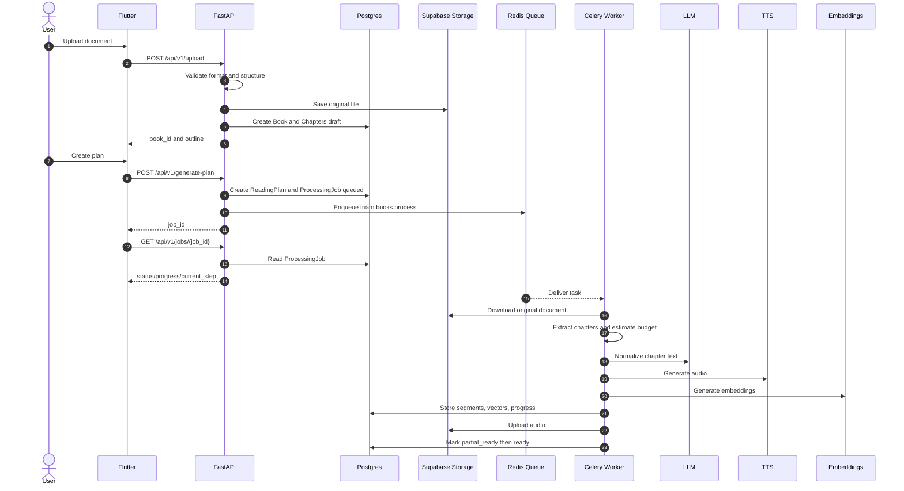
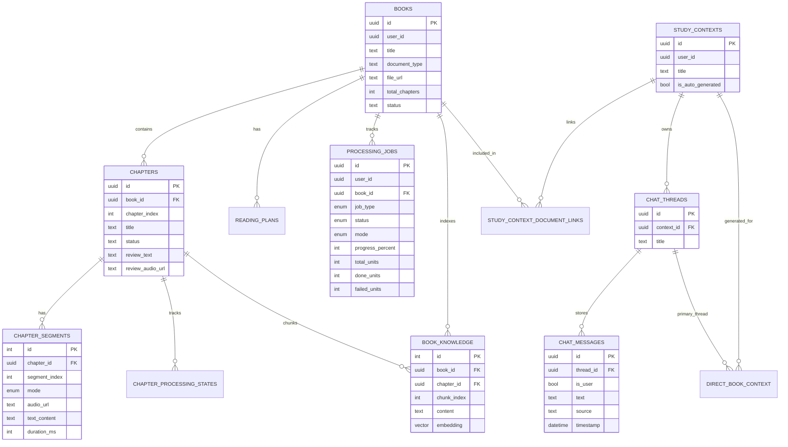

# SPEC TRIAM v1 - AI Assistant Hoc Tap Thong Minh

Document status: Capstone reporting spec  
Last updated: 2026-05-23  
Implementation baseline: TRIAM Backend Phase 1 -> Phase 3.1  
Main client: Flutter Mobile App  
Backend repo: triam-backend

---

## 1. Executive Summary

TRIAM la mot AI Learning Companion giup nguoi dung bien sach va tai lieu hoc tap thanh trai nghiem nghe, hoi dap va on tap co ngu canh.

Khac voi audiobook truyen thong, TRIAM khong chi doc lai noi dung. He thong xu ly tai lieu thanh cac chuong co cau truc, tao audio theo tung segment, sinh review audio, tao knowledge base de hoi dap, va ket noi voi realtime voice agent de user co the vua nghe vua hoi.

Muc tieu capstone:

- Giam thoi gian tiep can sach/tai lieu dai.
- Cho phep user nghe noi dung som trong khi backend van xu ly phan con lai.
- Duy tri ngu canh hoc tap theo tung sach, study context va chat thread.
- Ho tro hoi dap bang text/voice dua tren tai lieu user da upload.
- Xay dung backend co kha nang xu ly tac vu dai bang worker queue, progress polling va deploy duoc tren Hugging Face Space.

---

## 2. Product Vision

### 2.1 Product Name

TRIAM Assistant

### 2.2 Positioning

TRIAM la tro ly hoc tap thong minh danh cho sinh vien va nguoi tu hoc, dac biet la nguoi:

- Co nhieu sach/tai lieu nhung thieu thoi gian doc.
- Muon nghe tai lieu trong luc di chuyen hoac lam viec khac.
- Can hoi dap ngay trong pham vi tai lieu dang hoc.
- Can ke hoach hoc va on tap de duy tri tien do.

### 2.3 Core Value Proposition

TRIAM giup user di qua 4 buoc:

```text
Upload tai lieu -> Tao ke hoach hoc -> Nghe/hoi dap -> On tap va duy tri tien do
```

Gia tri can chung minh:

- User co the upload sach/tai lieu co cau truc.
- Backend validate tai lieu de tranh cat chuong sai.
- Backend xu ly audio va RAG trong background thay vi chan request.
- FE co the hien thi progress bar va unlock nghe som.
- Voice agent co the hoi dap theo ngu canh tai lieu va luu lich su hoi thoai.

---

## 3. Target Users

### 3.1 Primary Users

- Sinh vien can hoc giao trinh, slide, sach chuyen nganh.
- Nguoi tu hoc can bien tai lieu dai thanh noi dung nghe duoc.
- Nguoi thich hoc bang hoi dap thay vi doc tuyen tinh.

### 3.2 Secondary Users

- Giang vien hoac mentor muon chuan bi tai lieu hoc co audio.
- Nguoi di lam can doc nhanh tai lieu nghiep vu.
- Nguoi hoc ngoai ngu hoac nghien cuu can hoi dap theo context.

---

## 4. Current Implementation Scope

### 4.1 Implemented

He thong hien tai da co:

- Upload PDF, EPUB, DOCX.
- Validate cau truc tai lieu:
  - PDF can hidden outline/bookmarks.
  - EPUB can TOC/navigation.
  - DOCX can Heading/outline styles.
- Reject tai lieu khong co cau truc ro rang bang loi 422.
- Tao Book, Chapter, ReadingPlan.
- Tao ProcessingJob de FE poll progress.
- Enqueue generate-plan va switch-mode qua Celery queue `document`.
- Celery worker xu ly:
  - download document tu Supabase Storage,
  - re-extract chapter text,
  - estimate token/audio budget,
  - normalize text bang LLM,
  - generate audio bang TTS,
  - upload audio len Supabase Storage,
  - tao embeddings va luu vao pgvector,
  - update progress vao Postgres.
- Partial-ready unlock: user co the nghe khi chapter dau tien san sang.
- CRUD co ban cho books, study contexts, threads.
- Direct Book Context: tao chat thread mac dinh cho tung book.
- LiveKit token theo thread.
- Realtime agent:
  - nhan text qua `lk.chat`,
  - nhan audio microphone,
  - transcription tieng Viet bang OpenAI Realtime/gpt-4o-transcribe,
  - tra transcript chuan qua `lk.transcript`,
  - optional web search qua `lk.control`,
  - luu ChatMessage vao DB.
- Deploy Hugging Face Docker Space bang `start.sh`.
- Runtime hardening:
  - `uv run --no-sync`,
  - Celery worker toggle,
  - voice agent toggle,
  - LiveKit worker capacity control.

### 4.2 Not Fully Implemented Yet

Cac phan sau la roadmap, chua phai feature hoan chinh:

- Auth user_id that tren toan bo endpoint. Hien tai nhieu route van dung mock user id.
- Gioi han quota upload theo tung tai khoan.
- Notification reminder va spaced review production.
- Celery Beat/outbox cho reminder.
- Payment/subscription.
- Admin dashboard.
- Realtime progress push; hien tai progress chinh la polling.

---

## 5. Business Requirements

### 5.1 Upload Document

User upload mot tai lieu hoc tap.

Supported formats:

- PDF
- EPUB
- DOCX

Validation rules:

- File type phai nam trong allowlist.
- File size theo `MAX_FILE_SIZE_BYTES`, default 50MB.
- PDF phai co hidden outline/bookmarks.
- EPUB phai co TOC/navigation.
- DOCX phai co Heading/outline styles.
- Tai lieu scanned/OCR/no outline khong duoc fallback bang regex hoac chia theo token.

Reason:

- TRIAM can chapter boundary chinh xac de tao audio, progress va plan.
- Neu fallback theo text pattern, he thong co the cat sai chuong va lam sai trai nghiem hoc.

Success output:

- Tao `Book` status `draft`.
- Tao `Chapter` status `draft`.
- Upload original document vao Supabase Storage bucket `raw_books`.
- Tra ve `book_id`, `document_type`, `total_chapters`, `outline`.

Failure output:

- 400 cho file type/size sai.
- 422 cho tai lieu khong co cau truc hop le.
- 500 chi dung cho loi he thong that.

### 5.2 Generate Reading Plan

User tao plan cho book da upload.

Input:

- `book_id`
- `mode`: `full` hoac `pareto`
- `pace`
- `schedule_config`

Backend behavior:

- Validate book ton tai va dang `draft`.
- Tao `ReadingPlan`.
- Tao `ProcessingJob` status `queued`.
- Update book thanh `processing`.
- Enqueue Celery task `triam.books.process` vao queue `document`.
- Tra `job_id` cho FE.

FE behavior:

- Goi `GET /api/v1/jobs/{job_id}` de cap nhat progress bar.
- Khi status `partial_ready`, FE co the unlock nghe noi dung dau tien.
- Khi status `ready`, FE hien thi full playlist.

### 5.3 Study Modes

#### Full Mode

Full mode giu day du y chinh, thu tu lap luan va noi dung quan trong cua chuong goc, nhung chuyen thanh van noi tu nhien cho audio.

Full mode khong co nghia la doc nguyen van tung ky tu vi tai lieu co the co header/footer, so trang, dau ngat dong va loi format.

#### Pareto Mode

Pareto mode la che do hoc 80/20:

- Giu dinh nghia, luan diem, quy trinh, cong thuc, keyword, ket luan quan trong.
- Luoc bo vi du dai, doan lap lai va noi dung phu.
- Tao script ngan hon nhung van lien ket va de nghe.

Current implementation:

- Khac biet chinh nam o LLM normalization/prompt.
- RAG knowledge hien duoc tao tu raw chapter content, khong can regenerate khi switch mode.
- Switch mode chi regenerate audio segments cho mode moi.

Future improvement:

- Pareto nen co rubric/ranking kien thuc rieng thay vi chi prompt-level.
- Co the them score cho concepts: definition, formula, example, warning, conclusion.

### 5.4 Listen Early

TRIAM khong bat user doi toan bo sach xu ly xong.

Rule hien tai:

- Uu tien xu ly chapter dau tien truoc.
- Khi chapter dau tien co audio segment hop le, mark job/book `partial_ready`.
- FE co the unlock nghe.
- Worker tiep tuc xu ly cac chapter con lai.
- Khi xong tat ca, mark `ready`.

This improves UX:

- Giam thoi gian cho.
- Cho user thay gia tri som.
- Phu hop voi tai lieu dai.

### 5.5 Switch Mode

User co the chuyen tu `full` sang `pareto` hoac nguoc lai.

Backend behavior:

- Neu audio mode moi da co, tra ket qua ngay.
- Neu audio mode moi chua co:
  - tao ProcessingJob type `switch_mode`,
  - enqueue `triam.books.switch_mode`,
  - worker regenerate chapter segments cho mode moi.

Progress:

- FE poll `GET /api/v1/jobs/{job_id}` hoac `GET /api/v1/books/{book_id}/processing-status`.

### 5.6 Study Context

Study Context la workspace hoc tap cua user.

Rules:

- Mot Study Context co the gan nhieu Book.
- Mot Study Context co the co nhieu ChatThread.
- ChatThread chua lich su hoi dap.
- DirectBookContext la mapping dac biet giua user + book va context/thread mac dinh.

Purpose:

- Cho phep user hoi dap trong pham vi mot hoac nhieu tai lieu.
- FE co mot luong on dinh: Book Detail -> thread -> LiveKit token -> realtime chat.

### 5.7 Realtime Voice/Text Q&A

Realtime agent ho tro:

- Text input qua `lk.chat`.
- Voice input qua microphone.
- Transcript output qua `lk.transcript`.
- Optional web search control qua `lk.control`.

Business rules:

- Cau tra loi uu tien dua tren document scope cua thread.
- Chat history duoc load tu DB theo `thread_id`.
- User/assistant messages duoc persist vao `chat_messages`.
- Transcript JSON co `id` de FE dedupe bubble chat.
- Web search phai duoc bat/tat ro rang, khong nen always-on.

---

## 6. System Architecture

### 6.1 High Level Architecture



### 6.2 Runtime Process Model



Notes:

- `uv run --no-sync` tranh runtime tu cai them dependency khi deploy.
- `ENABLE_CELERY_WORKER` cho phep bat/tat worker cung Space.
- `ENABLE_VOICE_AGENT` cho phep bat/tat realtime agent.
- Hugging Face Space hien tai co the chay ca 3 process trong 1 container.

### 6.3 Background Processing Flow



---

## 7. Data Model

### 7.1 Main Tables



### 7.2 Important Constraints

- `chapters`: unique `(book_id, chapter_index)`.
- `chapter_segments`: unique `(chapter_id, mode, segment_index)`.
- `book_knowledge`: unique `(chapter_id, chunk_index)`.
- `direct_book_context`: primary key `(user_id, book_id)`.
- `chapter_processing_states`: unique `(chapter_id, mode)`.

Purpose:

- Prevent duplicate chapters/segments after retries.
- Make Celery tasks safer when redelivered.
- Keep FE playlist order stable.

---

## 8. API Overview

Base path:

```text
/api/v1
```

### 8.1 Health

| Method | Path | Purpose |
| --- | --- | --- |
| GET | `/health` | Basic API health |
| GET | `/health/background` | Check DB/Redis/background readiness |

### 8.2 Document Processing

| Method | Path | Purpose |
| --- | --- | --- |
| POST | `/upload` | Upload PDF/EPUB/DOCX and extract outline |
| POST | `/generate-plan` | Create plan and enqueue document processing |
| GET | `/jobs/{job_id}` | Poll processing progress |
| GET | `/books/{book_id}/processing-status` | Get latest processing job for book |

### 8.3 Books

| Method | Path | Purpose |
| --- | --- | --- |
| GET | `/books` | List books |
| POST | `/books` | Create manual book metadata |
| GET | `/books/{book_id}` | Get book metadata |
| PUT | `/books/{book_id}` | Update book metadata |
| DELETE | `/books/{book_id}` | Delete book and related assets |
| GET | `/books/{book_id}/details` | Get chapters, segments, review audio |
| POST | `/books/{book_id}/switch-mode` | Switch full/pareto mode |

### 8.4 Study Context And Threads

| Method | Path | Purpose |
| --- | --- | --- |
| GET | `/study-contexts` | List contexts |
| POST | `/study-contexts` | Create context |
| GET | `/study-contexts/{context_id}` | Get context |
| PATCH | `/study-contexts/{context_id}` | Rename/update context |
| DELETE | `/study-contexts/{context_id}` | Delete context |
| POST | `/study-contexts/{context_id}/documents` | Attach book to context |
| DELETE | `/study-contexts/{context_id}/documents/{book_id}` | Remove book from context |
| GET | `/study-contexts/{context_id}/threads` | List threads in context |
| POST | `/study-contexts/{context_id}/threads` | Create thread |
| GET | `/threads/for-book/{book_id}` | Get/create canonical book thread |
| GET | `/threads/{thread_id}/messages` | Get chat messages |
| PUT | `/threads/{thread_id}` | Rename thread |
| DELETE | `/threads/{thread_id}` | Delete thread |

### 8.5 LiveKit

| Method | Path | Purpose |
| --- | --- | --- |
| GET | `/live-token/thread/{thread_id}` | Create LiveKit token for persisted thread |
| GET | `/live-token/{book_id}` | Legacy/debug direct book token |

Recommended FE flow:

```text
GET /threads/for-book/{book_id}
GET /threads/{thread_id}/messages
GET /live-token/thread/{thread_id}
Connect LiveKit room
```

---

## 9. Realtime DataChannel Contract

### 9.1 Topics

| Topic | Direction | Payload | Purpose |
| --- | --- | --- | --- |
| `lk.chat` | Client <-> Server | plain UTF-8 text | Fast typed chat and assistant text preview |
| `lk.transcript` | Server -> Client | JSON | Official transcript for chat bubbles |
| `lk.control` | Client -> Server | JSON | Toggle optional controls such as web search |

### 9.2 Transcript Payload

```json
{
  "v": 1,
  "type": "transcript",
  "role": "assistant",
  "text": "...",
  "id": "<uuid>",
  "ts": "2026-05-23T10:00:00.000+00:00"
}
```

FE rule:

- Use `lk.transcript` as official chat timeline.
- Dedupe by `id`.
- `lk.chat` is useful for fast text preview, but not the source of truth.

---

## 10. System States

### 10.1 Book Status

```text
draft -> processing -> partial_ready -> ready
                         |
                         -> error
```

### 10.2 Chapter Status

```text
draft -> processing -> ready
                   -> error
```

### 10.3 Processing Job Status

```text
queued -> processing -> partial_ready -> ready
                         |
                         -> error
                         -> cancelled
```

### 10.4 Plan Status

```text
active -> inactive
       -> error
```

---

## 11. Technical Stack

| Area | Current Stack |
| --- | --- |
| API | FastAPI, Uvicorn |
| DB ORM | SQLModel, SQLAlchemy |
| Migrations | Alembic |
| Database | Supabase Postgres |
| Vector search | pgvector in Supabase Postgres |
| Storage | Supabase Storage |
| Background jobs | Celery |
| Broker | Redis Cloud |
| Document parsing | pypdf, pdfplumber, ebooklib, BeautifulSoup, python-docx |
| LLM normalization | Gemini/OpenAI-compatible endpoint through OpenAI SDK style |
| Embeddings | OpenAI text embeddings |
| Audio generation | Edge TTS, OpenAI TTS helper |
| Realtime | LiveKit Agents, OpenAI Realtime, gpt-4o-transcribe |
| Web search | Tavily |
| Deployment | Docker, Hugging Face Spaces |
| Tooling | uv, ruff, pytest |

Notes:

- `PINECONE_*` and some voice provider keys may still exist in settings for compatibility, but the active RAG path stores vectors in Supabase Postgres pgvector.
- Deepgram package may exist in dependencies, but current realtime transcription uses OpenAI Realtime transcription settings.

---

## 12. Non-Functional Requirements

### 12.1 Reliability

- Long-running tasks must run in Celery, not in request handler.
- Progress must be stored in Postgres, not only Redis.
- Worker tasks use JSON-serializable args: IDs and primitive values.
- Worker opens its own DB session.
- Idempotency checks avoid duplicate segments/knowledge after retries.

### 12.2 Performance And Latency

- Upload endpoint validates and returns quickly.
- Generate plan returns `job_id` immediately.
- First playable chapter is prioritized.
- FE uses polling to show progress.
- Realtime agent has capacity control for Hugging Face free deployment.

Current LiveKit deployment profile:

```env
LIVEKIT_AGENT_JOB_EXECUTOR_TYPE=thread
LIVEKIT_AGENT_NUM_IDLE_PROCESSES=1
LIVEKIT_AGENT_MAX_CONCURRENT_JOBS=2
LIVEKIT_AGENT_LOAD_THRESHOLD=0.95
LIVEKIT_AGENT_INITIALIZE_PROCESS_TIMEOUT=60
LIVEKIT_AGENT_SHUTDOWN_PROCESS_TIMEOUT=20
```

Interpretation:

- `thread` reduces process startup/RAM overhead on Hugging Face CPU Basic.
- `num_idle_processes=1` keeps one runner warm.
- `max_concurrent_jobs=2` allows limited concurrency while protecting FastAPI/Celery.
- If the Space becomes unstable, lower `max_concurrent_jobs` to 1.
- If worker/API are separated or hardware is upgraded, raise it after load testing.

### 12.3 Cost Control

- Estimate input tokens before LLM normalization.
- Estimate audio seconds before TTS generation.
- Reject documents that exceed hard limits.
- Limit concurrency for LLM/TTS/embeddings.
- Avoid regenerating RAG vectors on switch-mode because source content does not change.

### 12.4 Security

- Do not log request headers, bearer tokens, apikeys, service role keys, or full provider payloads.
- Third-party HTTP logs are reduced to warning level.
- `.env` is not committed.
- Runtime secrets are expected through local `.env` or Hugging Face Secrets.

### 12.5 Observability

- ProcessingJob stores:
  - status,
  - progress_percent,
  - current_step,
  - total_units,
  - done_units,
  - failed_units,
  - error_message,
  - estimated_input_tokens,
  - estimated_audio_seconds.
- Worker logs book/chapter/job ids and milestones.
- Health endpoint checks API/background readiness.

---

## 13. Deployment Spec

### 13.1 Local Development

Typical local setup uses three terminals:

```powershell
uv run uvicorn app.main:app --host 0.0.0.0 --port 8000 --reload
uv run celery -A app.core.celery_app.celery_app worker -Q document -l info --pool=solo --concurrency 1
uv run python -m app.services.agent_voice_gpt_realtime start
```

Notes:

- Windows local Celery should use `--pool=solo`.
- Local dev may run API, worker and voice agent separately.

### 13.2 Hugging Face Space

Dockerfile runs:

```text
./start.sh
```

`start.sh` can start:

- FastAPI/Uvicorn
- Celery document worker
- LiveKit realtime agent

Important env:

```env
BACKEND_PORT=7860
UV_NO_SYNC=true
ENABLE_CELERY_WORKER=true
ENABLE_VOICE_AGENT=true
UVICORN_RELOAD=false
RUN_MIGRATIONS_ON_START=false
CELERY_DOCUMENT_CONCURRENCY=1
```

Why `UV_NO_SYNC=true`:

- Dependencies are installed during Docker build.
- Runtime should not run dependency sync again.
- Prevents startup bug where `uv run` downloads dev packages such as ruff while starting multiple processes.

---

## 14. Testing Strategy

### 14.1 Automated Tests

Current focused tests include:

- Health API tests.
- Celery enqueue tests.
- Processing jobs API tests.
- Document parser tests.
- Study context/thread tests.
- Phase 3 generation guardrail tests.

Recommended commands:

```powershell
uv run ruff check app tests
uv run pytest tests/test_health_api.py tests/test_celery_enqueue.py tests/test_processing_jobs_api.py -q
uv run pytest tests/test_document_parsers.py tests/test_api_study_context.py tests/test_auth_user_isolation.py -q
```

### 14.2 Manual Integration Tests

Use real files:

- Success: `Chuong 4_ Phuong phap luan nghien cuu.pdf`
- Failure/no outline: `MGHP HK1(2025-2026).pdf`

Expected:

- Success file uploads, creates chapters, generates plan, processes audio/RAG.
- Failure file returns 422 with clear reason.

### 14.3 Production Smoke Test

Production smoke should verify:

- API health.
- Background health.
- Upload real PDF.
- Generate plan.
- Poll job until partial_ready/ready or error.

---

## 15. Known Limitations

Current known limitations:

- Auth is installed/planned, but many routes still use mock user id.
- Per-user quota is not implemented.
- Reminder notification system is not implemented in production yet.
- Celery Beat/outbox is planned for Phase 4.
- Realtime progress push is not implemented; FE polls DB-backed endpoint.
- One Hugging Face Space currently runs API + worker + voice agent together, so capacity is limited.
- Pareto mode currently depends mostly on normalization prompt; future quality needs ranking/rubric.
- Scanned PDF/OCR mode is intentionally not supported yet.

---

## 16. Roadmap

### Phase 1 - Progress Foundation

Done:

- Add ProcessingJob.
- Add polling endpoints.
- Store progress in DB.

### Phase 2 - Durable Worker Queue

Done:

- Add Celery + Redis broker.
- Move long-running generate-plan/switch-mode into worker tasks.
- Keep Postgres as source of truth for progress.

### Phase 3 - Generation Guardrails

Done:

- Estimate token/audio budget.
- Hard/soft limits.
- Chunk long chapters.
- Partial-ready unlock.
- Worker idempotency improvements.

### Phase 3.1 - Deploy Readiness

Done:

- Harden `start.sh`.
- Use `uv run --no-sync`.
- Add runtime toggles.
- Add LiveKit worker capacity controls.
- Keep shell script LF via `.gitattributes`.

### Phase 4 - Notification And Spaced Review

Planned:

- Notification outbox table.
- Celery Beat scanner.
- Study reminders.
- Recovery reminders.
- Spaced review intervals: 1, 3, 7, 14, 30 days.
- Daily caps, quiet hours, timezone-aware scheduling.

### Phase 5 - Auth And Quota

Planned:

- Replace mock user id with real auth user.
- Per-user upload quota.
- User plan/subscription limits.
- Audit log for uploads/jobs.

---

## 17. Capstone Evaluation Criteria

The project can be evaluated by:

- Correctness: document structure validation and no unsafe fallback.
- User value: first playable content unlock and realtime Q&A.
- Reliability: background jobs recover through DB progress.
- Architecture: router/service/repository/model separation.
- Scalability path: queue-based processing and future queue separation.
- Security: secret redaction and no raw provider payload logs.
- Deployability: Docker Space startup with API, worker and voice agent.
- Extensibility: notification outbox and auth/quota roadmap.

---

## 18. Final Scope Statement

TRIAM v1 hien tai la mot backend AI learning system da ho tro upload tai lieu co cau truc, tao ke hoach hoc, sinh audio/RAG trong background, theo doi progress, unlock nghe som, va realtime Q&A theo thread.

Trong bao cao capstone, nen trinh bay TRIAM nhu mot nen tang hoc tap thong minh co 3 tru cot:

1. Document Intelligence: validate, parse, normalize, chunk, embed.
2. Learning Audio Pipeline: generate audio, progress tracking, partial-ready playback.
3. Contextual AI Assistant: Study Context, Chat Thread, LiveKit realtime voice/text.

Nhung tinh nang reminder, spaced review, auth user_id that va quota nen duoc trinh bay la roadmap gan nhat, khong nen noi la da production-ready neu chua implement day du.

---

## 19. Agent Handoff Guide

This section is written for another AI/code agent or developer who needs to continue TRIAM without reading the whole chat history.

### 19.1 Current Mental Model

TRIAM Backend is a layered FastAPI system with durable background processing.

The most important idea:

```text
Postgres is the source of truth.
Redis/Celery only executes work.
LiveKit only transports realtime audio/text.
Supabase Storage only stores files.
```

Do not treat Redis, LiveKit room state, local files, or frontend memory as business truth.

### 19.2 Main User Flow

```text
1. FE uploads document
2. BE validates structure and creates Book + Chapters
3. FE creates reading plan
4. BE creates ProcessingJob and enqueues Celery task
5. FE polls ProcessingJob
6. Worker generates first playable chapter
7. FE unlocks playback at partial_ready
8. Worker finishes remaining chapters
9. FE opens Book Detail chat
10. FE resolves canonical thread and LiveKit token
11. User chats with realtime agent by text or microphone
```

### 19.3 Current Important Trade-offs

- Auth is not fully wired into every feature. Many endpoints still use `MOCK_USER_ID`.
- Progress is polling-based, not realtime push.
- Pareto mode is prompt-driven, not a full knowledge-ranking algorithm yet.
- Notification/reminder/spaced review is planned, not production-ready.
- Hugging Face free deployment runs API, Celery and LiveKit in one container, so capacity must be controlled.
- OCR/scanned PDF fallback is intentionally not supported.

---

## 20. Source Code Map

### 20.1 Top-level App Structure

```text
app/
  api/v1/routers/       FastAPI endpoints
  core/                 settings, constants, exceptions, logging, Celery app
  db/                   SQLModel engine/session and Alembic migrations
  models/               SQLModel database models
  repositories/         reusable DB access functions
  schemas/              request/response DTOs
  services/             business logic and external integrations
  services/workers/     long-running book/chapter/audio/RAG workflows
  tasks/                Celery task entrypoints
```

### 20.2 Important Files By Feature

| Feature | Primary Files |
| --- | --- |
| Upload PDF/EPUB/DOCX | `app/api/v1/routers/upload.py`, `app/services/upload_service.py`, `app/services/document_parser_service.py`, `app/services/pdf_service.py`, `app/services/epub_service.py`, `app/services/docx_service.py` |
| Generate plan | `app/api/v1/routers/upload.py`, `app/services/upload_service.py`, `app/tasks/book_tasks.py` |
| Background pipeline | `app/services/workers/book_pipeline.py`, `app/services/workers/chapter_worker.py`, `app/services/workers/tts_worker.py` |
| Celery config | `app/core/celery_app.py`, `app/tasks/book_tasks.py`, `start.sh` |
| Processing job progress | `app/api/v1/routers/jobs.py`, `app/services/processing_job_service.py`, `app/repositories/processing_job_repo.py`, `app/schemas/processing_job.py` |
| Book CRUD/detail/switch mode | `app/api/v1/routers/audiobooks.py`, `app/services/audiobook_service.py`, `app/repositories/audiobook_repo.py`, `app/schemas/audiobook.py` |
| Study Context | `app/api/v1/routers/study_context.py`, `app/services/study_context_service.py`, `app/repositories/study_context_repo.py`, `app/repositories/study_context_document_link_repo.py` |
| Threads | `app/api/v1/routers/threads.py`, `app/repositories/study_context_thread_repo.py` |
| LiveKit token | `app/api/v1/routers/live.py`, `app/services/live_service.py` |
| Realtime voice/text agent | `app/services/agent_voice_gpt_realtime.py` |
| RAG embeddings/search | `app/services/embed_service.py`, `app/services/rag_service.py`, `app/repositories/book_knowledge_repo.py` |
| TTS | `app/services/tts_service.py`, `app/services/workers/tts_worker.py` |
| Config/env | `app/core/config.py`, `.env.example`, `Dockerfile`, `start.sh` |
| DB schema | `app/models/db_models.py`, `app/db/migrations/versions/` |
| Logs/security | `app/core/logger.py`, `app/core/exceptions.py` |

### 20.3 Main Celery Tasks

```text
triam.books.process
  args: book_id, mode, job_id
  queue: document
  purpose: initial generate-plan document processing

triam.books.switch_mode
  args: book_id, mode, job_id
  queue: document
  purpose: generate audio for another study mode
```

### 20.4 Main Runtime Commands

Local Windows:

```powershell
uv run uvicorn app.main:app --host 0.0.0.0 --port 8000 --reload
uv run celery -A app.core.celery_app.celery_app worker -Q document -l info --pool=solo --concurrency 1
uv run python -m app.services.agent_voice_gpt_realtime start
```

Hugging Face Docker Space:

```text
Dockerfile -> CMD ["./start.sh"]
```

`start.sh` uses:

```text
uv run --no-sync
```

Runtime dependency sync must not happen after image build.

---

## 21. Development Rules For Future Agents

### 21.1 Architecture Rules

- Routers must stay thin.
- Services own business rules.
- Repositories own reusable DB reads/writes.
- Workers own long-running workflows and open their own DB session.
- DTOs live in `app/schemas`.
- DB truth lives in `app/models/db_models.py`.
- Config lives in `app/core/config.py`.
- New schema changes require Alembic migration.

### 21.2 Exception Rules

- Prefer domain exceptions from `app/core/exceptions.py`.
- Do not raise `HTTPException` deep inside services unless existing local code already does so and refactor is out of scope.
- Use:
  - 400 for invalid file type/size,
  - 404 for missing resource,
  - 409 for invalid state conflict,
  - 422 for semantically invalid document structure,
  - 500 for internal system errors.

### 21.3 Logging Rules

Never log:

- Authorization headers.
- Supabase apikey/service role.
- Bearer/JWT tokens.
- Full LLM payloads.
- Raw document text or file bytes.
- Full provider responses with secrets.

Useful logs:

- `book_id`
- `chapter_id`
- `job_id`
- current status
- progress milestone
- provider error summary without secrets

### 21.4 Background Job Rules

- Do not run multi-minute LLM/TTS work inside FastAPI request handlers.
- Create/update `ProcessingJob` before enqueueing.
- Return `job_id` to FE.
- FE-visible progress must be recoverable from Postgres.
- Celery task args must be JSON-serializable.
- Do not pass SQLModel objects or request DB sessions into Celery.
- Make tasks idempotent where possible.
- Use DB uniqueness constraints to avoid duplicated segments/vectors.

### 21.5 Document Parsing Rules

Do:

- Validate document structure before expensive processing.
- Use document parser dispatcher.
- Keep PDF/EPUB/DOCX behavior consistent.

Do not:

- Guess chapters by regex.
- Split by token as fallback for missing outline.
- Run OCR implicitly.
- Accept scanned PDF as normal structured document.

Business reason:

Wrong chapter boundaries create wrong audio, wrong progress and wrong learning context.

### 21.6 Realtime Agent Rules

- Keep DataChannel names stable:
  - `lk.chat`
  - `lk.transcript`
  - `lk.control`
- `lk.transcript` is the authoritative FE timeline.
- Do not make FE publish to `lk.transcript`.
- Persist messages to `chat_messages`.
- Thread-based token flow is preferred over legacy book token.
- Keep Vietnamese transcription settings unless intentionally changing language support.

### 21.7 Deployment Rules

- Keep `start.sh` LF, not CRLF.
- Keep `.gitattributes` rule for `*.sh text eol=lf`.
- Do not remove `uv run --no-sync` from `start.sh`.
- Do not set `UVICORN_RELOAD=true` in production.
- On Hugging Face free/shared CPU, be careful increasing:
  - `CELERY_DOCUMENT_CONCURRENCY`
  - `CHAPTER_PROCESSING_CONCURRENCY`
  - `TTS_GENERATION_CONCURRENCY`
  - `LIVEKIT_AGENT_MAX_CONCURRENT_JOBS`

---

## 22. Frontend Integration Contract

### 22.1 Upload And Generate Plan Flow

Recommended FE flow:

```text
POST /api/v1/upload
-> show extracted outline

POST /api/v1/generate-plan
-> receive job_id

GET /api/v1/jobs/{job_id}
-> poll until partial_ready or ready or error

GET /api/v1/books/{book_id}/details
-> render playlist from chapters/segments
```

Important:

- `POST /generate-plan` does not mean audio is ready.
- It means job was accepted.
- FE must poll.

### 22.2 Progress UI

Use `ProcessingJobSummaryResponse`.

Important fields:

- `status`
- `progress_percent`
- `current_step`
- `total_units`
- `done_units`
- `failed_units`
- `error_message`
- `estimated_input_tokens`
- `estimated_audio_seconds`

UI rules:

- `queued`: show waiting state.
- `processing`: show progress bar.
- `partial_ready`: unlock listening if book details contain playable segments.
- `ready`: show full ready state.
- `error`: show retry/help message using `error_message`.

### 22.3 Switch Mode Flow

```text
POST /api/v1/books/{book_id}/switch-mode
```

If response says `needs_generation=false`:

- Audio for requested mode already exists.
- FE can reload book details.

If response returns `job_id`:

- FE polls `/jobs/{job_id}`.
- Unlock when `partial_ready` or `ready`.

### 22.4 Book Detail Chat Flow

Recommended flow:

```text
GET /api/v1/threads/for-book/{book_id}
GET /api/v1/threads/{thread_id}/messages
GET /api/v1/live-token/thread/{thread_id}
Connect LiveKit room
```

Rules:

- Always use `/threads/for-book/{book_id}` for Book Detail chat.
- It is canonical and prevents fragmented chat history.
- On reopen, call it again; it should return the same primary thread for that book/user.

### 22.5 LiveKit DataChannel Rules

`lk.chat`:

- FE publishes plain text for typed chat.
- Server may publish assistant text preview.
- FE can use it as temporary fast UI, not final source of truth.

`lk.transcript`:

- FE only subscribes.
- Server publishes JSON transcript.
- FE should render official chat bubbles from this topic.
- FE dedupes by `id`.

`lk.control`:

- FE publishes JSON control commands.
- Current important command:

```json
{
  "type": "toggle_web_search",
  "enabled": true
}
```

### 22.6 Auth Caveat

Current backend routes often use:

```text
MOCK_USER_ID = 862d7c26-3160-4f76-9e77-07d91f7317cc
```

When auth is fully wired:

- FE must send access token.
- Routers should replace `MOCK_USER_ID` with authenticated user id.
- Existing service/repository functions should keep accepting `user_id`.

---

## 23. Common Change Recipes

### 23.1 Add A New Document Type

Steps:

1. Add document type enum/config.
2. Add MIME type to `ALLOWED_MIME_TYPES`.
3. Add parser service.
4. Register parser in `document_parser_service.py`.
5. Ensure upload and worker both use the same dispatcher.
6. Return stable outline structure.
7. Add parser tests.
8. Add FE contract note if page numbers are unavailable.

Never add upload-only support without worker support.

### 23.2 Change Upload Validation

Files to inspect:

- `app/services/upload_service.py`
- `app/services/document_parser_service.py`
- parser-specific service
- `app/core/exceptions.py`
- parser tests

Required checks:

- Success file still uploads.
- No-outline file still returns 422.
- Storage is not polluted by invalid files if validation should fail first.

### 23.3 Change Background Processing

Files to inspect:

- `app/tasks/book_tasks.py`
- `app/services/workers/book_pipeline.py`
- `app/services/workers/chapter_worker.py`
- `app/services/workers/tts_worker.py`
- `app/repositories/processing_job_repo.py`

Required rules:

- Update `ProcessingJob`.
- Preserve partial-ready behavior.
- Preserve idempotency.
- Avoid duplicate `chapter_segments`.
- Avoid duplicate `book_knowledge`.

### 23.4 Change Realtime Agent

Files to inspect:

- `app/services/agent_voice_gpt_realtime.py`
- `app/services/live_service.py`
- `app/services/rag_service.py`
- `app/services/web_search_service.py`
- Flutter realtime contract docs if available.

Required rules:

- Do not break topic names.
- Keep `lk.transcript` JSON stable.
- Keep thread metadata support.
- Do not make `modalities` include text unless there is a clear reason; current realtime model is audio-oriented and text chat has its own handling.

### 23.5 Add Notification/Reminder Phase

Recommended design:

```text
notification_outbox table
Celery Beat every minute
-> scan due rows
-> enqueue delivery task
-> mark sent/skipped/error
```

Do not create thousands of long ETA Celery tasks for future reminders.

Needed concepts:

- user timezone
- quiet hours
- daily cap
- idempotency key
- notification provider token
- retry policy

### 23.6 Replace Mock User ID With Auth User

Steps:

1. Identify routers using `MOCK_USER_ID`.
2. Inject current user dependency.
3. Pass authenticated `user_id` into services.
4. Ensure repositories filter by `user_id`.
5. Add tests for cross-user access denial.
6. Update FE to send token.

Do not remove user_id filtering from services/repositories.

---

## 24. Things Never To Do

- Never commit `.env` or real secrets.
- Never log Supabase keys, Bearer tokens or provider payloads.
- Never use Redis as the only place storing user-visible progress.
- Never put long-running LLM/TTS work inside a FastAPI request handler.
- Never pass DB sessions or SQLModel objects into Celery tasks.
- Never fallback to regex/OCR chapter splitting unless product explicitly adds an OCR mode.
- Never let FE publish to `lk.transcript`.
- Never render final chat timeline only from `lk.chat`.
- Never change API response shapes without updating FE contract docs.
- Never run production Uvicorn with reload.
- Never remove `uv --no-sync` from deployed startup without a build/runtime dependency plan.
- Never increase concurrency on Hugging Face free without testing health, upload and realtime together.

---

## 25. Minimum Verification Checklist

### 25.1 After Backend Code Changes

Run:

```powershell
uv run ruff check <changed files>
uv run python -m py_compile <changed python files>
```

If feature touches API/progress:

```powershell
uv run pytest tests/test_health_api.py tests/test_celery_enqueue.py tests/test_processing_jobs_api.py -q
```

If feature touches parsers:

```powershell
uv run pytest tests/test_document_parsers.py -q
```

If feature touches Study Context/Threads:

```powershell
uv run pytest tests/test_api_study_context.py tests/test_auth_user_isolation.py -q
```

### 25.2 After start.sh/Dockerfile Changes

Run:

```powershell
bash -n start.sh
uv run --no-sync python -c "from app.core.config import settings; print(settings.BACKEND_PORT if hasattr(settings, 'BACKEND_PORT') else 'config ok')"
```

Check:

- `start.sh` is LF.
- `UV_NO_SYNC=true` is present for deploy.
- `UVICORN_RELOAD=false` in production.

### 25.3 Manual Integration Checklist

Use real files:

- Success: structured chapter PDF.
- Failure: PDF without outline.

Expected:

- Success upload returns `book_id` and outline.
- Failure returns 422, not 500.
- Generate plan returns `job_id`.
- Poll job moves through `queued -> processing -> partial_ready -> ready`.
- Book details returns playable segments.
- Switch mode either returns existing mode or a new `job_id`.
- Book Detail chat resolves `/threads/for-book/{book_id}`.
- LiveKit token endpoint returns token and room name.

---

## 26. Quick Glossary

| Term | Meaning |
| --- | --- |
| Book | Uploaded learning document metadata |
| Chapter | Structured unit extracted from a document |
| ChapterSegment | Ordered audio/text segment for playback |
| ReadingPlan | User learning plan for a book |
| ProcessingJob | DB-backed progress record for long-running work |
| ChapterProcessingState | Per-chapter per-mode processing status |
| BookKnowledge | RAG chunk with embedding |
| StudyContext | Workspace containing one or more books |
| ChatThread | Conversation under a StudyContext |
| DirectBookContext | Canonical user/book -> context/thread mapping |
| `document` queue | Celery queue for book/audio/RAG processing |
| `partial_ready` | First playable content is ready; full job still processing |
| `lk.chat` | LiveKit DataChannel topic for text chat/preview |
| `lk.transcript` | LiveKit DataChannel topic for official transcript JSON |
| `lk.control` | LiveKit DataChannel topic for control messages |

---

## 27. Handoff Summary

If another agent only remembers one thing, remember this:

TRIAM is a FastAPI + Celery + Redis + Supabase + LiveKit learning backend. Upload validates structured documents, generate-plan creates a DB job and Celery task, worker creates audio/RAG and updates Postgres progress, FE polls job status and unlocks playback at partial_ready, realtime chat is thread-based through LiveKit with `lk.transcript` as the official UI timeline.

Protect these invariants:

1. Postgres owns progress and history.
2. Celery owns long-running work.
3. Parser structure validation must be strict.
4. FE contracts must stay stable.
5. Secrets must never enter logs.
