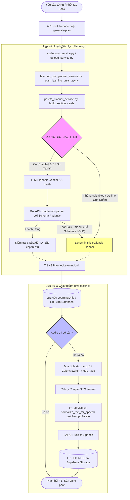

# Kiến trúc & Nguyên lý Xử lý Pareto Mode

Tài liệu này trình bày chi tiết về kiến trúc thiết kế, nguyên lý chấm điểm và luồng xử lý thực tế của chế độ **Pareto (Pareto Focus)** trong dự án Tri Âm. Chế độ này được nâng cấp toàn diện trong Phase 8 và Phase 8.1 nhằm mang lại kế hoạch học tập tối giản, cô đọng nhưng giữ nguyên cấu trúc lý thuyết cốt lõi của tài liệu gốc.

---

## 1. Sơ đồ Hoạt động

Dưới đây là sơ đồ luồng hoạt động từ khi người dùng kích hoạt đổi chế độ học tập (switch mode) hoặc tải tài liệu lên cho đến khi sinh ra các file audio học tập tương ứng.



---

## 2. Nguyên lý Xử lý Chi Tiết

Hành vi lập kế hoạch của Pareto Mode tuân thủ 2 thành phần chính: **LLM Planner** (Hành vi chính) và **Deterministic Fallback** (Hành vi dự phòng). Cả hai đều được bổ trợ bởi một bộ nhận diện tín hiệu song ngữ nằm tách biệt trong service tín hiệu.

### 2.1. Nhận Diện Tín Hiệu Học Thuật Song Ngữ (Bilingual Signals Taxonomy)
Được triển khai trong [pareto_signal_service.py](file:///w:/WorkSpace_IT/_CAPSTON_PROJECT/triam-backend/app/services/pareto_signal_service.py). Hệ thống định nghĩa một danh sách `PARETO_SIGNALS` chứa các nhóm tín hiệu đi kèm trọng số (`weight` từ `0.4` đến `1.0`) và từ khóa đối sánh:

* **Core Concept & Definition (`weight = 1.0`)**: 
  * *Tiếng Việt*: "khái niệm", "nền tảng", "cốt lõi", "tổng quan", "định nghĩa".
  * *Tiếng Anh*: "concept", "core concept", "fundamental", "overview", "introduction", "definition", "define".
* **Principle & Rule (`weight = 0.95` và `0.9`)**:
  * *Tiếng Việt*: "nguyên lý", "nguyên tắc", "quy tắc", "luật", "điều kiện".
  * *Tiếng Anh*: "principle", "law", "rule", "condition", "criteria".
* **Method & Procedure (`weight = 0.9` và `0.85`)**:
  * *Tiếng Việt*: "phương pháp", "cách làm", "kỹ thuật", "quy trình", "các bước", "hướng dẫn".
  * *Tiếng Anh*: "method", "technique", "approach", "procedure", "process", "steps", "workflow", "guide", "tutorial".
* **Formula & Theorem (`weight = 0.9`)**:
  * *Tiếng Việt*: "công thức", "biểu thức", "định lý", "bổ đề", "hệ quả".
  * *Tiếng Anh*: "formula", "equation", "theorem", "lemma", "corollary".
* **Reasoning (`weight = 0.85`)**:
  * *Tiếng Việt*: "suy luận", "lập luận", "chứng minh", "logic".
  * *Tiếng Anh*: "reasoning", "inference", "proof", "argument", "logic".
* **Example (`weight = 0.4` - Ưu tiên thấp)**:
  * *Tiếng Việt*: "ví dụ", "minh họa", "bài tập".
  * *Tiếng Anh*: "example", "case study", "exercise", "illustration".

> [!NOTE]
> Để chống trùng khớp sai (False-Positive) đối với các từ khóa tiếng Anh ngắn (ví dụ: từ `law` trùng trong `flaw`, `outlaw`), hệ thống sử dụng Regex biên giới từ:
> `(?<![a-z0-9]){normalized_term}(?![a-z0-9])`

---

### 2.2. Tiến Trình Lập Kế Hoạch Bằng LLM (Gemini)
Nằm trong [pareto_planner_service.py](file:///w:/WorkSpace_IT/_CAPSTON_PROJECT/triam-backend/app/services/pareto_planner_service.py):

1. **Xây dựng `SectionCard`**: Đọc danh sách các mục (`BookSection`) và chỉ trích xuất thông tin tóm tắt ngắn (bao gồm ID, title, level, path, child count, ngôn ngữ được đoán qua [guess_section_language](file:///w:/WorkSpace_IT/_CAPSTON_PROJECT/triam-backend/app/services/pareto_signal_service.py#L131), danh sách gợi ý tín hiệu và tối đa 700 ký tự đầu tiên của đoạn văn).
2. **Gọi LLM**:
   * Truyền danh sách `SectionCard` sang API OpenAI-compatible của Gemini.
   * Sử dụng cấu trúc đầu ra bắt buộc thông qua Pydantic `ParetoPlannerPayload` để lấy định dạng JSON chứa các `units`. Mỗi unit bao gồm: `title`, `source_section_ids` (danh sách ID các mục được gom lại), `unit_type` (loại bài học), `importance_score` (điểm từ 1 đến 5), `learning_objective` (mục tiêu học tập) và `planner_reason` (lý do chọn).
3. **Lọc và Chuẩn hóa**:
   * Khớp ID nhận được từ LLM với cơ sở dữ liệu thực tế.
   * Tự động sắp xếp lại các phần con theo trình tự gốc của sách.
   * Tính toán tổng dung lượng và tiến hành cắt bỏ các bài học có điểm ưu tiên thấp nếu tổng token vượt ngưỡng thiết lập trong cấu hình.

---

### 2.3. Thuật Toán Dự Phòng Deterministic Fallback
Nếu LLM bị lỗi hoặc timeout, hàm [fallback_pareto_learning_units](file:///w:/WorkSpace_IT/_CAPSTON_PROJECT/triam-backend/app/services/learning_unit_planner_service.py#L223) sẽ tự động chạy độc lập và không gọi API bên ngoài:

* **Công thức chấm điểm mục lục (`_pareto_score`)**:
  $$\text{Score} = \text{Signal Score} + \text{Capped Content Score} + \text{Hierarchy Score} + \text{Child Score}$$
  
  Trong đó:
  * $\text{Signal Score}$: Điểm tín hiệu học thuật được tính qua [score_pareto_signals](file:///w:/WorkSpace_IT/_CAPSTON_PROJECT/triam-backend/app/services/pareto_signal_service.py#L165). Tiêu đề chứa từ khóa chính được cộng $\text{weight} \times 5000$. Đoạn văn bản chứa từ khóa được cộng $\text{weight} \times 1200$. Nếu tiêu đề chứa từ khóa rác (noise terms như "phụ lục", "tham khảo", "appendix") sẽ bị trừ 2500 điểm.
  * $\text{Capped Content Score} = \min(\text{estimated\_tokens}, 2000) \times 0.4$: Đánh giá dung lượng phần lý thuyết của đề mục, nhưng khống chế giới hạn tối đa để tránh trường hợp các chương dài lê thê đè bẹp các mục ngắn hơn nhưng cô đọng khái niệm.
  * $\text{Hierarchy Score} = \max(0, 5 - \text{level}) \times 150$: Đề mục ở cấp độ càng cao trong tài liệu gốc (level 1, 2) càng được ưu tiên.
  * $\text{Child Score} = \text{subtree\_len} \times 250$: Đề mục có nhiều nhánh mục con thể hiện tính chất bao quát và là nền tảng cốt lõi của chương.

---

## 3. Ví dụ Minh họa Thực tế

Giả sử chúng ta có một chương mục lục của sách **Toán Rời Rạc** (`trr.docx`) với các phần sau:

```text
1. LOGIC MỆNH ĐỀ (Level 1)
   1.1 Mệnh đề (Level 2)
       1.1.1 Khái niệm mệnh đề và chân trị (Level 3) - 1,200 chars
       1.1.2 Phân loại mệnh đề sơ cấp và phức hợp (Level 3) - 600 chars
       1.1.3 Các phép toán mệnh đề (Level 3) - 1,500 chars
   1.2 Các phương pháp chứng minh (Level 2)
       1.2.1 Chứng minh phản chứng (Level 3) - 2,500 chars
       1.2.2 Nguyên lý quy nạp toán học (Level 3) - 3,800 chars
   1.3 Phụ lục bài giải mẫu (Level 2) - 4,000 chars
```

### Bước 1: Xây dựng Section Cards & So khớp Tín hiệu (Signals Matching)

Hệ thống sẽ duyệt qua từng đề mục và phân tích:
* Đề mục **1.1.1 Khái niệm mệnh đề và chân trị**:
  * Phát hiện từ khóa `"khái niệm"` -> Khớp tín hiệu `core_concept`.
  * Đoán ngôn ngữ: `vi`.
  * Thêm signal_hints: `["core_concept"]`.
* Đề mục **1.2 Các phương pháp chứng minh**:
  * Phát hiện từ khóa `"phương pháp"`, `"chứng minh"` -> Khớp tín hiệu `method`, `reasoning`.
  * Thêm signal_hints: `["method", "reasoning"]`.
* Đề mục **1.3 Phụ lục bài giải mẫu**:
  * Phát hiện từ khóa rác `"phụ lục"` -> Khớp `NOISE_TERMS`.
  * Bị trừ điểm nặng trong thuật toán chấm điểm dự phòng.

### Bước 2: LLM Planner chọn lọc và Gom nhóm

LLM đọc cấu trúc này và ra quyết định gom các mục nhỏ liên quan thành các bài học lớn hơn để giảm số lượng Unit và tăng tính mạch lạc:

```json
{
  "units": [
    {
      "title": "Khái niệm và Phép toán Logic Mệnh đề",
      "source_section_ids": [
        "1.1.1_ID_khai_niem_menh_de",
        "1.1.2_ID_phan_loai_menh_de",
        "1.1.3_ID_cac_phep_toan_menh_de"
      ],
      "unit_type": "pareto_core",
      "importance_score": 5,
      "learning_objective": "Hiểu định nghĩa mệnh đề toán học, cách phân biệt mệnh đề sơ cấp/phức hợp và quy tắc tính chân trị của các phép toán logic cơ bản.",
      "planner_reason": "Gom nhóm các bài học định nghĩa và quy tắc cơ bản cấu thành nên logic mệnh đề để học viên nắm vững lý thuyết nền tảng."
    },
    {
      "title": "Các Phương pháp Chứng minh & Quy nạp Toán học",
      "source_section_ids": [
        "1.2.1_ID_chung_minh_phan_chung",
        "1.2.2_ID_nguyen_ly_quy_nap"
      ],
      "unit_type": "pareto_method",
      "importance_score": 4,
      "learning_objective": "Nắm vững kỹ thuật chứng minh phản chứng và các bước thực hành phương pháp quy nạp toán học yếu/mạnh.",
      "planner_reason": "Lựa chọn các phương pháp chứng minh cốt lõi được áp dụng thường xuyên nhất trong toán học rời rạc."
    }
  ]
}
```

* **Kết quả**: Mục `1.3 Phụ lục bài giải mẫu` (dù rất dài - 4,000 ký tự) hoàn toàn bị LLM bỏ qua vì nó không đóng góp trực tiếp vào mục tiêu lý thuyết cốt lõi của chương, đúng theo nguyên lý Pareto 80/20.

---

## 4. Tổng kết So sánh giữa Hai Chế độ

| Tiêu chí | Chế độ Đầy đủ (Full Mode) | Chế độ Tinh gọn (Pareto Mode) |
| :--- | :--- | :--- |
| **Tiêu chí Lựa chọn** | Giữ lại tối đa tất cả các phần có văn bản. | Chỉ chọn lọc các phần mang tín hiệu định nghĩa, lý thuyết nền tảng hoặc phương pháp. |
| **Số lượng bài nghe** | Tương đương số chương/mục lớn trong sách (không giới hạn). | Giới hạn nghiêm ngặt từ **3 đến 8 bài nghe trọng tâm**. |
| **Cơ chế Gom nhóm** | Gom theo cấu trúc cây thư mục gốc hoặc cụm mục liền kề cho đủ kích thước. | Gom nhóm linh hoạt theo ngữ nghĩa và chủ đề dưới sự định hướng của LLM. |
| **Độ dài và Nội dung Audio** | Dài, đọc chi tiết, giữ nguyên toàn bộ các ví dụ và diễn giải bên lề. | Ngắn, cô đọng, loại bỏ các ví dụ dài dòng thông qua Prompt biên tập Pareto chuyên biệt. |

---

## 5. Bộ câu hỏi và Trả lời Phản biện (Q&A Defense Guide)

Dưới đây là các câu hỏi học thuật mà Hội đồng giám khảo hoặc Thầy/Cô hướng dẫn có thể đưa ra và gợi ý câu trả lời tối ưu nhất để bảo vệ thiết kế hệ thống.

### Câu hỏi 1: Tại sao lại cần thiết kế mô hình lai (LLM Planner + Deterministic Fallback)? Sao không dùng LLM 100%?
> [!TIP]
> **Câu trả lời phản biện:**
> * **Độ tin cậy và Tính chịu lỗi (Fault-tolerance):** LLM (như Gemini) có tỷ lệ lỗi nhất định (lỗi định dạng JSON, trả về sai ID do ảo giác - hallucination, hoặc bị nghẽn mạng/vượt giới hạn tần suất API). Để hệ thống luôn hoạt động ổn định và phản hồi tức thời cho người dùng, bộ Planner dự phòng (Deterministic Fallback) được xây dựng để xử lý hoàn toàn ngoại tuyến (offline) ngay lập tức khi LLM gặp sự cố hoặc timeout sau 8 giây.
> * **Tối ưu chi phí:** Với các tài liệu cực kỳ ngắn hoặc tài liệu kiểm thử, việc gọi LLM là không cần thiết. Hệ thống có cơ chế tự động chuyển sang chế độ fallback để tiết kiệm token và chi phí vận hành.

### Câu hỏi 2: Gửi `SectionCard` thay vì gửi toàn bộ văn bản của sách cho LLM Planner có làm giảm độ chính xác của kế hoạch học tập không?
> [!TIP]
> **Câu trả lời phản biện:**
> * **Không giảm độ chính xác:** LLM đóng vai trò là **người lập kế hoạch mục lục (Architect)** chứ không phải người viết nội dung bài giảng. Người lập kế hoạch chỉ cần nắm được tiêu đề mục, cấp độ thư mục, độ dài và tóm tắt ngắn (excerpt 700 ký tự) để hiểu được bố cục và phân bổ bài giảng.
> * **Lý do tối ưu:** Nếu truyền hàng trăm ngàn chữ của cuốn sách vào prompt, thời gian phản hồi của LLM sẽ cực kỳ lâu (vượt quá giới hạn timeout của HTTP request thông thường) và chi phí token sẽ tăng lên gấp hàng trăm lần. 

### Câu hỏi 3: Trong thuật toán tính điểm Fallback, tại sao lại cần khống chế dung lượng văn bản ở mức 2000 tokens (`min(estimated_tokens, 2000) * 0.4`)?
> [!TIP]
> **Câu trả lời phản biện:**
> * **Tránh bẫy độ dài (Length Bias):** Trong các cuốn sách, những phần không quan trọng như Phụ lục, Bài tập tổng hợp hoặc Hướng dẫn cài đặt công cụ thường có dung lượng ký tự rất lớn. Nếu tính điểm dựa trên độ dài tuyến tính thuần túy, các chương rác này sẽ luôn đạt điểm cao nhất và chiếm hết tài nguyên bài học của Pareto Mode.
> * **Cân bằng ngữ nghĩa:** Việc giới hạn ở mức 2000 tokens giúp các chương ngắn nhưng có mật độ khái niệm cốt lõi cao (ví dụ: Đại số Boole) có cơ hội cạnh tranh sòng phẳng và không bị các chương dài đè bẹp.

### Câu hỏi 4: Các thông tin phong phú như `learning_objective` (mục tiêu học tập) và `importance_score` (điểm quan trọng) có được lưu vào cơ sở dữ liệu không? Thiết kế database có bị thay đổi không?
> [!TIP]
> **Câu trả lời phản biện:**
> * **Không làm ảnh hưởng đến Database gốc (No DB Migration):** Để đảm bảo tính an toàn cho hệ thống đang vận hành, tránh việc phải chạy migration DB phức tạp, toàn bộ các metadata chi tiết này được tự động định dạng và lưu trữ gọn gàng vào trường văn bản `planner_reason` trong bảng `learning_units`. 
> * FE (Flutter) có thể dễ dàng hiển thị chuỗi ký tự này trực tiếp cho người học dưới dạng thông tin giải trình của trợ lý ảo, giúp hệ thống hoạt động vô cùng tinh gọn mà không làm phình to cấu trúc bảng dữ liệu.

### Câu hỏi 5: Thuật toán nhận diện song ngữ (Bilingual Signal) hoạt động như thế nào để đảm bảo không bị nhận diện nhầm từ khóa?
> [!TIP]
> **Câu trả lời phản biện:**
> * **Chuẩn hóa chữ viết:** Hệ thống sử dụng thư viện `unicodedata` để đưa các ký tự tiếng Việt có dấu về dạng phân tách NFD, sau đó loại bỏ toàn bộ dấu thanh và dấu phụ (ví dụ: `định nghĩa` -> `dinh nghia`). Nhờ đó, việc so khớp diễn ra đồng nhất cho cả tiếng Việt có dấu, không dấu và tiếng Anh.
> * **Chống False-Positive:** Sử dụng biểu thức chính quy (Regex) với thiết lập word-boundary `(?<![a-z0-9])...(?![a-z0-9])` để chắc chắn từ khóa được khớp độc lập. Ví dụ: từ khóa tiếng Anh `law` (nguyên lý) chỉ được tính điểm khi đứng riêng, tránh trường hợp khớp nhầm vào các từ có chứa cụm ký tự đó như `flaw` (lỗi) hay `outlaw` (ngoài vòng pháp luật).
