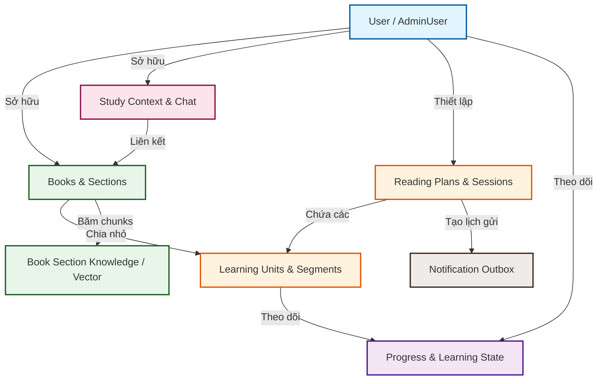
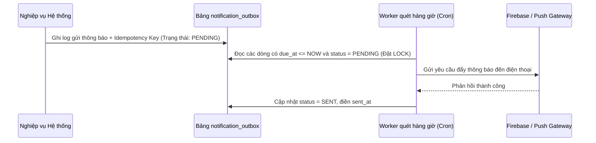
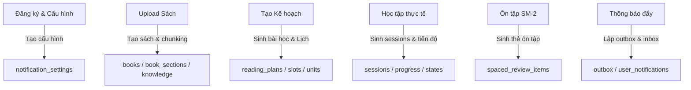

# Báo cáo Kiến trúc Cơ sở Dữ liệu TRIAM (TRIAM Database Architecture Report)

Tài liệu này cung cấp cái nhìn chi tiết và toàn diện nhất về thiết kế cơ sở dữ liệu (CSDL) của hệ thống **TRIAM Backend**. Báo cáo này được cấu trúc đặc biệt nhằm phục vụ cho các lập trình viên mới (onboarding developers) có thể nhanh chóng nắm bắt sơ đồ thực thể, nghiệp vụ liên quan, các ràng buộc CSDL và cách thức vận hành hệ thống.

---

## 1. Tổng quan Kiến trúc và Công nghệ CSDL

Hệ thống TRIAM sử dụng **PostgreSQL** làm cơ sở dữ liệu quan hệ chính, kết hợp với các công cụ và phần mở rộng sau:
*   **SQLModel (SQLAlchemy)**: Thư viện ORM chính trên Python giúp đồng bộ code models và schema CSDL.
*   **pgvector**: Phần mở rộng của PostgreSQL hỗ trợ lưu trữ và truy vấn vector đặc trưng (embeddings - 1536 chiều) phục vụ cho tính năng Tìm kiếm ngữ nghĩa và RAG (Retrieval-Augmented Generation).
*   **Supabase (Auth)**: Các bảng người dùng liên kết gián tiếp qua trường `user_id` (UUID) được đồng bộ hoặc đối chiếu trực tiếp từ bảng Auth của Supabase.

---

## 2. Phân nhóm Các Phân hệ Dữ liệu (Database Modules)

Dữ liệu của hệ thống được chia làm **8 phân hệ chính** có mối quan hệ chặt chẽ với nhau:



---

## 3. Chi Tiết Các Bảng Dữ Liệu Theo Phân Hệ

### 3.1 Phân hệ Người dùng & Cấu hình (User, Security & Configuration)

Phân hệ này quản lý quyền quản trị viên, vết kiểm thử bảo mật (audit logs), token thiết bị đẩy thông báo (push notifications) và cấu hình cá nhân hóa thời gian học tập.

#### Bảng `admin_users`
*   **Mô tả**: Lưu trữ danh sách tài khoản có quyền truy cập trang quản trị hệ thống.
*   **Khóa chính**: `user_id` (UUID) - Trùng với ID của người dùng hệ thống.
*   **Các trường chi tiết**:
    *   `role` (text, Not Null, Default "admin"): Vai trò quản trị.
    *   `is_active` (boolean, Not Null, Index, Default true): Trạng thái hoạt động của tài khoản admin.
    *   `note` (text, Nullable): Ghi chú bổ sung.
    *   `created_by` (UUID, Nullable): ID của admin tạo tài khoản này.
    *   `revoked_by` (UUID, Nullable): ID của admin thu hồi quyền.
    *   `created_at` (timestamptz, Not Null): Thời điểm bổ nhiệm quyền admin.
    *   `revoked_at` (timestamptz, Nullable): Thời điểm thu hồi quyền admin.

#### Bảng `admin_audit_logs`
*   **Mô tả**: Lưu lại lịch sử các thao tác nghiệp vụ quan trọng của admin nhằm mục đích bảo mật và giám sát hệ thống.
*   **Khóa chính**: `id` (UUID, Default uuid4)
*   **Các trường chi tiết**:
    *   `admin_user_id` (UUID, Not Null, Index): ID của admin thực hiện hành động.
    *   `action` (text, Not Null, Index): Tên hành động (ví dụ: "DELETE_BOOK", "REVOKE_ADMIN").
    *   `target_type` (text, Nullable, Index): Loại đối tượng bị tác động (ví dụ: "books", "users").
    *   `target_id` (UUID, Nullable, Index): ID cụ thể của đối tượng bị tác động.
    *   `metadata` (jsonb, Nullable): Dữ liệu chi tiết về thay đổi (trước/sau).
    *   `created_at` (timestamptz, Not Null, Index): Thời gian ghi nhận log.

#### Bảng `notification_settings`
*   **Mô tả**: Cấu hình khung giờ nhận nhắc nhở học tập và ôn tập ngắt quãng của từng người dùng.
*   **Khóa chính**: `user_id` (UUID)
*   **Các trường chi tiết**:
    *   `timezone` (text, Not Null, Default "Asia/Ho_Chi_Minh"): Múi giờ của người dùng.
    *   `reminders_enabled` (boolean, Not Null, Default true): Bật nhắc nhở đọc sách hàng ngày.
    *   `spaced_review_enabled` (boolean, Not Null, Default true): Bật nhắc nhở ôn tập Spaced Repetition.
    *   `reminder_time` (text, Not Null, Default "20:00"): Giờ gửi nhắc nhở mặc định.
    *   `quiet_hours_start` (text, Not Null, Default "22:00"): Khung giờ bắt đầu không làm phiền.
    *   `quiet_hours_end` (text, Not Null, Default "07:00"): Khung giờ kết thúc không làm phiền.
    *   `daily_cap` (integer, Not Null, Default 3): Giới hạn tối đa số lượng thông báo đẩy mỗi ngày.

#### Bảng `user_device_tokens`
*   **Mô tả**: Lưu trữ token thiết bị (FCM/APNS) để gửi thông báo đẩy qua di động.
*   **Khóa chính**: `id` (UUID, Default uuid4)
*   **Các trường chi tiết**:
    *   `user_id` (UUID, Not Null, Index): ID người dùng.
    *   `device_token` (text, Not Null, Unique, Index): Token định danh thiết bị duy nhất.
    *   `created_at` / `updated_at` (timestamptz, Not Null).

---

### 3.2 Phân hệ Tài liệu & RAG Engine (Documents & RAG Engine)

Quản lý thông tin sách tải lên, cấu trúc mục lục phân cấp của sách và các vector đặc trưng dùng để truy vấn RAG trong luồng chat.

#### Bảng `books`
*   **Mô tả**: Thực thể chứa thông tin tài liệu/sách do người dùng tải lên, hoặc được clone từ thư viện dùng chung của hệ thống.
*   **Khóa chính**: `id` (UUID, Default uuid4)
*   **Các trường chi tiết**:
    *   `user_id` (UUID, Not Null, Index): ID của người dùng sở hữu sách.
    *   `title` (text, Not Null): Tiêu đề sách.
    *   `author` (text, Nullable): Tác giả sách.
    *   `file_url` (text, Nullable): Đường dẫn lưu trữ file trên Supabase Storage.
    *   `document_type` (text, Nullable): Định dạng tài liệu (PDF, EPUB, DOCX).
    *   `total_sections` (integer, Nullable): Tổng số chương/phần phụ.
    *   `total_units` (integer, Nullable): Tổng số đơn vị học tập được sinh ra.
    *   `status` (text, Nullable): Trạng thái xử lý sách (`QUEUED`, `PROCESSING`, `COMPLETED`, `ERROR`).
    *   `error_message` (text, Nullable): Chi tiết lỗi nếu quá trình parse sách thất bại.
    *   `is_shared` (boolean, Not Null, Default false): `True` nếu đây là cuốn sách mẫu của hệ thống do Admin tải lên cho tất cả người dùng dùng chung.
    *   `parent_shared_id` (UUID, Nullable): Liên kết đến ID sách mẫu gốc nếu cuốn sách này được tạo ra bằng phương thức **Metadata Cloning** (chọn từ thư viện hệ thống).

#### Bảng `book_sections`
*   **Mô tả**: Lưu trữ cấu trúc cây thư mục (TOC - Table of Contents) của tài liệu sau khi được phân tích cú pháp.
*   **Khóa chính**: `id` (UUID, Default uuid4)
*   **Các trường chi tiết**:
    *   `book_id` (UUID, Not Null, ForeignKey -> `books.id`, CASCADE delete, Index): Thuộc cuốn sách nào.
    *   `parent_id` (UUID, Nullable, ForeignKey -> `book_sections.id`, CASCADE delete, Index): Liên kết phân cấp cha-con (chương con nằm trong chương cha).
    *   `section_index` (integer, Not Null): Thứ tự hiển thị của chương trong sách.
    *   `title` (text, Not Null): Tiêu đề của chương/phần.
    *   `level` (integer, Not Null): Độ sâu phân cấp mục lục (ví dụ: Chương = 1, Mục con = 2).
    *   `path` (text, Not Null): Đường dẫn phả hệ (ví dụ: "0/1/3").
    *   `text_content` (text, Nullable): Nội dung văn bản thô của chương.
    *   `text_char_count` (integer, Not Null, Default 0): Độ dài ký tự của văn bản.
    *   `page_start` / `page_end` (integer, Nullable): Số trang bắt đầu và kết thúc (chỉ áp dụng đối với định dạng PDF).
    *   `source_href` / `source_anchor` (text, Nullable): Liên kết định vị trong tài liệu EPUB/DOCX.
*   **Ràng buộc Unique**:
    *   `uq_book_sections_book_index`: Ràng buộc `book_id` + `section_index` đảm bảo thứ tự chương trong một cuốn sách không bị trùng lặp.
    *   `uq_book_sections_book_path`: Ràng buộc `book_id` + `path` đảm bảo tính duy nhất của đường dẫn mục lục trong sách.

#### Bảng `book_section_knowledge`
*   **Mô tả**: Lưu các đoạn văn bản ngắn (chunks) kèm theo vector nhúng (embeddings) được tạo ra từ nội dung của từng chương sách phục vụ tìm kiếm ngữ nghĩa RAG.
*   **Khóa chính**: `id` (integer, Auto-increment)
*   **Các trường chi tiết**:
    *   `book_id` (UUID, Not Null, ForeignKey -> `books.id`): Liên kết nhanh đến sách.
    *   `section_id` (UUID, Not Null, ForeignKey -> `book_sections.id`, CASCADE delete, Index): Liên kết đến chương cụ thể chứa văn bản.
    *   `chunk_index` (integer, Not Null): Thứ tự của chunk trong chương đó.
    *   `content` (text, Not Null): Đoạn văn bản thô.
    *   `search_text` (text, Not Null, Default ""): Văn bản chuẩn hóa loại bỏ dấu tiếng Việt để phục vụ tìm kiếm từ khóa (lexical search).
    *   `content_hash` (text, Not Null): Mã MD5 hash nội dung để kiểm tra trùng lặp.
    *   `embedding_model` / `embedding_version` (text, Not Null): Tên và phiên bản mô hình nhúng (ví dụ: `text-embedding-3-small`).
    *   `char_count` / `token_count` (integer): Số lượng ký tự và số token ước lượng.
    *   `embedding` (vector(1536), Nullable): Mảng vector 1536 chiều đại diện cho ngữ nghĩa của chunk.

> [!NOTE]
> **Lưu ý về tên cột**: Ở tầng CSDL vật lý và trong SQLModel định nghĩa, thuộc tính lưu vector nhúng được đặt tên chính xác là **`embedding`** (chứ không phải `embedding_vector`). Tên gọi này đồng bộ xuyên suốt từ schema, câu lệnh SQL cho đến mã nguồn Python API.

*   **Ràng buộc & Chỉ mục**:
    *   `uq_book_section_knowledge_section_chunk_version`: Đảm bảo một cặp `section_id` + `chunk_index` + `embedding_version` là duy nhất.
    *   `uq_book_section_knowledge_section_hash_version`: Tránh lưu trùng lắp nội dung text giống nhau cho cùng phiên bản mô hình.
    *   `ix_bsk_book_version`, `ix_bsk_section_version`, `ix_bsk_book_section_version`: Các chỉ mục tối ưu hóa tốc độ truy vấn RAG theo sách, chương và phiên bản mô hình.

---

### 3.3 Phân hệ Không gian thảo luận AI (AI Dialogue & Context)

Quản lý không gian thảo luận trực tiếp (Workspace), các luồng chat và nội dung tin nhắn giữa người dùng với trợ lý giọng nói/chatbot.

#### Bảng `study_contexts`
*   **Mô tả**: Đại diện cho một **Workspace** học tập. Một Workspace có thể chứa một hoặc nhiều cuốn sách liên kết lại để người dùng chat chéo thông tin.
*   **Khóa chính**: `id` (UUID, Default uuid4)
*   **Các trường chi tiết**:
    *   `user_id` (UUID, Not Null, Index): ID của người dùng sở hữu Workspace này.
    *   `title` (text, Not Null): Tiêu đề Workspace.
    *   `is_auto_generated` (boolean, Not Null, Default false): Workspace tự động sinh khi người dùng chọn chế độ học nhanh với một cuốn sách.

#### Bảng `study_context_document_links`
*   **Mô tả**: Bảng phụ giải quyết quan hệ Nhiều-Nhiều giữa `study_contexts` (Workspaces) và `books`.
*   **Khóa chính**: Cặp composite key (`context_id`, `book_id`).
*   **Các trường chi tiết**:
    *   `context_id` (UUID, ForeignKey -> `study_contexts.id`, CASCADE delete, Index).
    *   `book_id` (UUID, ForeignKey -> `books.id`, CASCADE delete, Index).

#### Bảng `chat_threads`
*   **Mô tả**: Một Workspace có thể chứa nhiều luồng trò chuyện khác nhau của người dùng.
*   **Khóa chính**: `id` (UUID, Default uuid4)
*   **Các trường chi tiết**:
    *   `context_id` (UUID, Not Null, ForeignKey -> `study_contexts.id`, CASCADE delete, Index): Thuộc Workspace nào.
    *   `title` (text, Not Null): Tên luồng trò chuyện (ví dụ: "Thảo luận chương 1").

#### Bảng `chat_messages`
*   **Mô tả**: Lưu chi tiết nội dung tin nhắn trong từng luồng trò chuyện.
*   **Khóa chính**: `id` (UUID, Default uuid4)
*   **Các trường chi tiết**:
    *   `thread_id` (UUID, Not Null, ForeignKey -> `chat_threads.id`, CASCADE delete, Index): Thuộc luồng nào. Trường này bắt buộc được đánh chỉ mục đơn (`index=True`) để Voice Agent có thể nhanh chóng truy xuất lịch sử ngữ cảnh gần nhất.
    *   `is_user` (boolean, Not Null): `true` nếu là tin nhắn của người dùng gửi, `false` nếu là phản hồi từ AI Assistant.
    *   `text` (text, Not Null): Nội dung tin nhắn dạng văn bản thô.
    *   `source` (text, Not Null): Nguồn sinh tin nhắn (ví dụ: `user`, `assistant_rag`, `assistant_web_search`).
    *   `timestamp` (timestamptz, Not Null, Default func.now()).

#### Bảng `direct_book_context`
*   **Mô tả**: Lối tắt lưu cấu hình liên kết trực tiếp giữa Người dùng và Sách khi truy cập nhanh một tài liệu riêng lẻ bên ngoài giao diện Workspace.
*   **Khóa chính**: Cặp composite key (`user_id`, `book_id`).
*   **Các trường chi tiết**:
    *   `user_id` (UUID, Not Null)
    *   `book_id` (UUID, Not Null, ForeignKey -> `books.id`, CASCADE delete)
    *   `context_id` (UUID, Not Null, ForeignKey -> `study_contexts.id`, CASCADE delete): Workspace mặc định tương ứng.
    *   `primary_thread_id` (UUID, Not Null, ForeignKey -> `chat_threads.id`, CASCADE delete): Luồng chat chính mặc định tương ứng.

> [!TIP]
> **Vai trò Realtime của `primary_thread_id`**: Bản thiết kế này cho phép LiveKit Voice Agent thực hiện tra cứu với độ phức tạp $O(1)$ để tìm ngay ra luồng hội thoại cũ mà không cần JOIN qua bảng liên kết nhiều-nhiều `study_context_document_links`. Nhờ đó, Voice Agent có thể khởi tạo phiên làm việc cực nhanh (dưới 10ms) ngay khi nhận được tín hiệu kết nối từ thiết bị người dùng.

---

### 3.4 Phân hệ Lập lịch & Kế hoạch học tập (Study Planning & Scheduling)

Bao gồm việc lưu trữ các tiến trình nền xử lý tài liệu, thiết lập thời gian biểu của kế hoạch học và chia nhỏ lịch trình học thành các phiên chi tiết hàng ngày.

#### Bảng `processing_jobs`
*   **Mô tả**: Theo dõi tiến độ của các tiến trình xử lý bất đồng bộ nền (Chapters processing, AI content rewriting, TTS audio generation).
*   **Khóa chính**: `id` (UUID, Default uuid4)
*   **Các trường chi tiết**:
    *   `user_id` (UUID, Not Null, Index)
    *   `book_id` (UUID, Nullable, ForeignKey -> `books.id`, CASCADE delete, Index): Tài liệu đang được xử lý.
    *   `job_type` (ProcessingJobType Enum, Not Null, Index): Phân loại job (`BOOK_PARSING`, `PLAN_GENERATION`, `AUDIO_GENERATION`).
    *   `status` (ProcessingJobStatus Enum, Not Null, Default QUEUED, Index): Trạng thái xử lý (`QUEUED`, `PROCESSING`, `COMPLETED`, `FAILED`).
    *   `mode` (PlanMode Enum, Nullable): Chế độ kế hoạch được chọn.
    *   `progress_percent` (integer, Not Null, Default 0): Phần trăm hoàn thành.
    *   `current_step` (text, Nullable): Mô tả ngắn bước hiện tại đang chạy.
    *   `total_units` / `done_units` / `failed_units` (integer): Bộ đếm tiến trình cho các đơn vị học tập cần xử lý.
    *   `estimated_input_tokens` / `estimated_audio_seconds` (integer): Thống kê ước lượng chi phí tài nguyên AI sử dụng.
    *   `error_message` (text, Nullable): Lý do chi tiết nếu job bị lỗi.

#### Bảng `reading_plans`
*   **Mô tả**: Lưu thông tin kế hoạch đọc sách của người dùng.
*   **Khóa chính**: `id` (UUID, Default uuid4)
*   **Các trường chi tiết**:
    *   `book_id` (UUID, Not Null, ForeignKey -> `books.id`, CASCADE delete, Index): Sách áp dụng kế hoạch.
    *   `mode` (PlanMode Enum, Not Null): Chế độ kế hoạch học (`PARETO` - học nhanh 20% trọng tâm, `DETAILED` - học chi tiết toàn bộ cuốn sách).
    *   `pace` (integer, Not Null): Số lượng đơn vị học tập cần hoàn thành trong một phiên học (ví dụ: 2 units/ngày).
    *   `status` (text, Not Null): Trạng thái kế hoạch (`active`, `paused`, `completed`).
    *   `reminder_time` (text, Not Null, Default "20:00"): Khung giờ nhắc nhở học hàng ngày của kế hoạch này.
    *   `started_at` / `paused_at` / `completed_at` (timestamptz).

#### Bảng `reading_plan_schedule_slots`
*   **Mô tả**: Định cấu hình cụ thể các ngày trong tuần người dùng đăng ký học theo kế hoạch (ví dụ: học Thứ 2, Thứ 4, Thứ 6).
*   **Khóa chính**: `id` (UUID, Default uuid4)
*   **Các trường chi tiết**:
    *   `user_id` (UUID, Not Null, Index)
    *   `plan_id` (UUID, Not Null, ForeignKey -> `reading_plans.id`, CASCADE delete, Index)
    *   `book_id` (UUID, Not Null, ForeignKey -> `books.id`, CASCADE delete, Index)
    *   `weekday` (integer, Not Null): Thứ trong tuần đại diện từ 0 (Chủ Nhật) đến 6 (Thứ Bảy).
    *   `reminder_time` (text, Not Null): Giờ nhắc nhở riêng biệt cho ngày học đó.
    *   `timezone` (text, Not Null, Default "Asia/Ho_Chi_Minh")
    *   `is_active` (boolean, Not Null, Default true, Index): Trạng thái bật/tắt của slot học.

#### Bảng `reading_plan_sessions`
*   **Mô tả**: Phiên học chi tiết hàng ngày được sinh ra tự động dựa trên cấu hình kế hoạch (`reading_plans`) và thời khóa biểu (`reading_plan_schedule_slots`).
*   **Khóa chính**: `id` (UUID, Default uuid4)
*   **Các trường chi tiết**:
    *   `user_id` (UUID, Not Null, Index)
    *   `plan_id` (UUID, Not Null, ForeignKey -> `reading_plans.id`, CASCADE delete, Index)
    *   `book_id` (UUID, Not Null, ForeignKey -> `books.id`, CASCADE delete, Index)
    *   `mode` (PlanMode Enum, Not Null, Index)
    *   `session_index` (integer, Not Null): Chỉ số thứ tự phiên học (Session 1, Session 2,...).
    *   `scheduled_at` (timestamptz, Not Null, Index): Thời điểm dự kiến diễn ra phiên học.
    *   `local_date` (text, Not Null, Index): Ngày theo định dạng cục bộ `YYYY-MM-DD` để đối chiếu lịch trình.
    *   `status` (text, Not Null, Default "scheduled", Index): Trạng thái phiên (`scheduled`, `completed`, `skipped`, `missed`).
    *   `completed_units` / `total_units` (integer, Default 0): Tiến độ hoàn thành bài học trong phiên.
    *   `started_at` / `completed_at` (timestamptz)
    *   `skipped_at` / `missed_at` (timestamptz)
    *   `missed_notified_at` (timestamptz, Nullable): Đánh dấu thời điểm đã gửi thông báo trễ hẹn học cho người dùng.
*   **Các chỉ mục tối ưu**:
    *   `ix_reading_plan_sessions_plan_index` (plan_id, session_index)
    *   `ix_reading_plan_sessions_user_status` (user_id, status)
    *   `ix_reading_plan_sessions_book_mode` (book_id, mode)
    *   `ix_reading_plan_sessions_plan_status` (plan_id, status)

#### Bảng `reading_plan_session_units`
*   **Mô tả**: Bảng liên kết trung gian Nhiều-Nhiều thể hiện danh sách các đơn vị học tập cần hoàn thành trong một phiên học cụ thể.
*   **Khóa chính**: `id` (UUID, Default uuid4)
*   **Các trường chi tiết**:
    *   `session_id` (UUID, Not Null, ForeignKey -> `reading_plan_sessions.id`, CASCADE delete, Index)
    *   `plan_id` (UUID, Not Null, ForeignKey -> `reading_plans.id`, CASCADE delete, Index)
    *   `book_id` (UUID, Not Null, ForeignKey -> `books.id`, CASCADE delete, Index)
    *   `learning_unit_id` (UUID, Not Null, ForeignKey -> `learning_units.id`, CASCADE delete, Index)
    *   `unit_order` (integer, Not Null): Thứ tự bài học cần nghe trong phiên học này.
    *   `status` (text, Not Null, Default "pending", Index): Trạng thái bài học (`pending`, `completed`).
    *   `completed_at` (timestamptz, Nullable, Index)
*   **Ràng buộc & Chỉ mục**:
    *   `uq_reading_plan_session_units_session_order`: Đảm bảo một `session_id` không chứa các dòng có trùng chỉ số `unit_order`.
    *   `ix_reading_plan_session_units_plan_unit` (plan_id, learning_unit_id)
    *   `ix_reading_plan_session_units_book_unit` (book_id, learning_unit_id)

---

### 3.5 Phân hệ Đơn vị học tập & Phân mảnh âm thanh (Learning Units & Auditory Pipeline)

Quản lý nội dung học tập đã được tinh gọn, biên soạn lại bởi AI và chuyển đổi sang dạng âm thanh (TTS).

#### Bảng `learning_units`
*   **Mô tả**: Đơn vị bài học được tạo ra sau khi hệ thống chia nhỏ sách theo phân mảnh cấu trúc và chạy mô hình AI để rút gọn kiến thức phù hợp với việc lắng nghe.
*   **Khóa chính**: `id` (UUID, Default uuid4)
*   **Các trường chi tiết**:
    *   `user_id` (UUID, Not Null, Index)
    *   `book_id` (UUID, Not Null, ForeignKey -> `books.id`, CASCADE delete, Index)
    *   `mode` (PlanMode Enum, Not Null, Index): Kế hoạch áp dụng đơn vị này.
    *   `unit_index` (integer, Not Null): Chỉ số bài học trong cuốn sách (Unit 1, Unit 2,...).
    *   `title` (text, Not Null): Tiêu đề bài học (do AI tự biên soạn dựa trên nội dung gốc).
    *   `unit_type` (text, Not Null): Loại đơn vị học tập (`main_audio` - nội dung nghe chính, `review_audio` - nội dung tóm tắt ôn tập).
    *   `status` (ProcessingJobStatus Enum, Not Null, Default QUEUED, Index): Trạng thái sinh nội dung bài học.
    *   `source_text_char_count` (integer, Default 0): Độ dài ký tự nguồn gốc.
    *   `estimated_tokens` / `estimated_audio_seconds` (integer): Số token ước tính và thời lượng audio đầu ra.
    *   `main_segment_count` (integer, Default 0): Tổng số phân mảnh âm thanh nhỏ tạo nên bài học.
    *   `review_audio_url` (text, Nullable): File tóm tắt ôn tập.
    *   `review_text` (text, Nullable): Nội dung tóm tắt ôn tập dạng văn bản.
    *   `planner_reason` (text, Nullable): Lý do lựa chọn nội dung này (hữu ích cho việc đánh giá thuật toán lọc Pareto).
*   **Ràng buộc**:
    *   `uq_learning_units_book_mode_index`: Bộ ba `book_id` + `mode` + `unit_index` là duy nhất.

#### Bảng `learning_unit_sources`
*   **Mô tả**: Bảng quan hệ Nhiều-Nhiều thể hiện nguồn gốc văn bản của bài học. Một bài học có thể được tổng hợp thông tin từ nhiều chương khác nhau trong `book_sections`.
*   **Khóa chính**: Cặp composite key (`learning_unit_id`, `section_id`).
*   **Các trường chi tiết**:
    *   `learning_unit_id` (UUID, ForeignKey -> `learning_units.id`, CASCADE delete)
    *   `section_id` (UUID, ForeignKey -> `book_sections.id`, CASCADE delete)
    *   `source_order` (integer, Not Null): Thứ tự tham chiếu tài liệu nguồn.

#### Bảng `learning_unit_segments`
*   **Mô tả**: Chứa các phân mảnh âm thanh nhỏ (mỗi phân mảnh tương ứng khoảng vài chục giây phát hoặc một đoạn văn ngắn) tạo nên một bài học hoàn chỉnh. Giúp việc tua nhanh, chuyển đoạn hoặc phát lại bài học diễn ra trơn tru.
*   **Khóa chính**: `id` (integer, Auto-increment)
*   **Các trường chi tiết**:
    *   `learning_unit_id` (UUID, Not Null, ForeignKey -> `learning_units.id`, CASCADE delete, Index)
    *   `segment_index` (integer, Not Null): Vị trí phân mảnh trong bài học.
    *   `audio_url` (text, Nullable): Đường dẫn lưu file âm thanh trên Storage.
    *   `text_content` (text, Nullable): Đoạn hội thoại/văn bản đã được AI viết lại dùng để đọc audio.
    *   `duration_ms` (integer, Nullable): Độ dài phân mảnh (mili giây).
*   **Ràng buộc**:
    *   `uq_learning_unit_segments_unit_index`: `learning_unit_id` + `segment_index` phải là duy nhất.

---

### 3.6 Phân hệ Theo dõi tiến độ học tập (Progress Tracking)

Theo dõi chặt chẽ tiến trình lắng nghe sách nói của người dùng từ mức chi tiết phân mảnh âm thanh đến tổng thể tiến độ cuốn sách.

#### Bảng `learning_unit_progress`
*   **Mô tả**: Theo dõi tiến độ chi tiết của người dùng đối với một bài học cụ thể (`learning_units`).
*   **Khóa chính**: `id` (UUID, Default uuid4)
*   **Các trường chi tiết**:
    *   `user_id` (UUID, Not Null, Index): ID người dùng.
    *   `book_id` (UUID, Not Null, ForeignKey -> `books.id`, CASCADE delete, Index): Sách tương ứng. Được gắn chỉ mục đơn (`index=True`) để quét tiến độ theo cuốn sách một cách nhanh chóng.
    *   `learning_unit_id` (UUID, Not Null, ForeignKey -> `learning_units.id`, CASCADE delete, Index): Bài học tương ứng.
    *   `mode` (PlanMode Enum, Not Null)
    *   `current_segment_id` (integer, Nullable, ForeignKey -> `learning_unit_segments.id`, SET NULL): Vị trí phân mảnh âm thanh cuối cùng người dùng đang nghe.
    *   `last_segment_index` (integer, Not Null, Default 0): Vị trí chỉ số phân mảnh âm thanh cuối cùng.
    *   `position_ms` (integer, Not Null, Default 0): Thời điểm dừng nghe cụ thể trong phân mảnh (mili giây).
    *   `listened_ms` (integer, Not Null, Default 0): Tổng thời lượng thực tế người dùng đã lắng nghe.
    *   `total_duration_ms` (integer, Not Null, Default 0): Tổng độ dài âm thanh bài học.
    *   `progress_percent` (integer, Not Null, Default 0): Phần trăm tiến độ học bài hiện tại.
    *   `max_progress_percent` (integer, Not Null, Default 0): Phần trăm tiến độ cao nhất từng đạt được.
    *   `status` (LearningProgressStatus Enum, Not Null, Default NOT_STARTED, Index): Trạng thái bài học (`NOT_STARTED`, `IN_PROGRESS`, `COMPLETED`).
    *   `started_at` / `last_activity_at` (timestamptz, Index)
    *   `completed_at` (timestamptz, Nullable, Index)
*   **Ràng buộc & Chỉ mục**:
    *   `uq_unit_progress_user_unit` (UniqueConstraint): Ràng buộc duy nhất trên cặp `(user_id, learning_unit_id)`. Ràng buộc này tự động tạo một Composite Index tương ứng trong CSDL giúp tối ưu hóa tuyệt đối tốc độ khi quét trạng thái tiến trình lúc người dùng ấn chuyển tiếp bài học ("Next") mà không gây ra Table Scan.

#### Bảng `book_learning_states`
*   **Mô tả**: Quản lý trạng thái học tập tổng thể của một người dùng đối với một cuốn sách theo một chế độ học nhất định.
*   **Khóa chính**: `id` (UUID, Default uuid4)
*   **Các trường chi tiết**:
    *   `user_id` (UUID, Not Null, Index)
    *   `book_id` (UUID, Not Null, ForeignKey -> `books.id`, CASCADE delete, Index)
    *   `mode` (PlanMode Enum, Not Null, Index)
    *   `status` (text, Not Null, Default "not_started", Index): Trạng thái tổng quan cuốn sách (`not_started`, `learning`, `completed`).
    *   `book_progress_percent` (integer, Default 0): Phần trăm hoàn thành cuốn sách.
    *   `completed_units` / `playable_units` (integer, Default 0): Số lượng đơn vị đã hoàn thành và số lượng đơn vị đã sẵn sàng để phát.
    *   `last_learning_unit_id` (UUID, Nullable, ForeignKey -> `learning_units.id`, SET NULL): Bài học gần nhất đang nghe dở.
    *   `last_segment_id` (integer, Nullable, ForeignKey -> `learning_unit_segments.id`, SET NULL): Phân mảnh âm thanh gần nhất đang nghe dở.
    *   `last_segment_index` / `position_ms` (integer): Chi tiết định vị phát audio.
    *   `started_at` / `last_activity_at` (timestamptz, Index)
    *   `completed_at` (timestamptz, Nullable, Index)
*   **Ràng buộc & Chỉ mục**:
    *   `uq_book_learning_state_user_book_mode`: Bộ ba `user_id` + `book_id` + `mode` xác định trạng thái học duy nhất.
    *   `ix_book_learning_states_user_status` (user_id, status)
    *   `ix_book_learning_states_book_mode` (book_id, mode)

---

### 3.7 Phân hệ Ôn tập ngắt quãng (Spaced Repetition Review)

Lưu trữ trạng thái các thẻ ôn tập, lịch trình và chu kỳ lặp lại kiến thức của người dùng dựa trên kỹ thuật Spaced Repetition (SuperMemo SM-2).

#### Bảng `spaced_review_items`
*   **Mô tả**: Thực thể quản lý các thẻ ôn tập kiến thức ngắt quãng liên kết đến bài học mà người dùng đã nghe qua.
*   **Khóa chính**: `id` (UUID, Default uuid4)
*   **Các trường chi tiết**:
    *   `user_id` (UUID, Not Null, Index)
    *   `book_id` (UUID, Not Null, ForeignKey -> `books.id`, CASCADE delete, Index)
    *   `learning_unit_id` (UUID, Nullable, ForeignKey -> `learning_units.id`, CASCADE delete, Index)
    *   `mode` (PlanMode Enum, Not Null)
    *   `interval_days` (integer, Not Null): Chu kỳ lặp lại sau bao nhiêu ngày (theo thuật toán SM-2, ví dụ: 1 ngày, 6 ngày, 14 ngày...).
    *   `sequence_index` (integer, Not Null): Lần ôn tập thứ mấy của thẻ này.
    *   `due_at` (timestamptz, Not Null, Index): Thời điểm thẻ đến hạn cần ôn tập.
    *   `status` (ReviewItemStatus Enum, Not Null, Default PENDING, Index): Trạng thái ôn tập (`PENDING` - đang đợi, `SKIPPED` - bỏ qua, `COMPLETED` - đã hoàn thành ôn tập).
    *   `review_text_snapshot` (text, Nullable): Đoạn văn bản kiến thức tóm tắt của bài học dùng để hiển thị khi ôn tập.
    *   `anchor_completed_at` (timestamptz, Nullable, Index): Thời điểm hoàn thành bài học gốc tạo mốc tính chu kỳ ôn tập.
    *   `source_unit_progress_id` (UUID, Nullable, ForeignKey -> `learning_unit_progress.id`, SET NULL, Index): Tham chiếu trực tiếp đến dòng tiến trình bài học.
    *   `notified_at` (timestamptz, Nullable): Đánh dấu thời điểm hệ thống đã gửi thông báo nhắc ôn tập thẻ này.
    *   `last_reviewed_at` / `completed_at` (timestamptz, Nullable).

---

### 3.8 Phân hệ Outbox & Gửi thông báo nhắc nhở (Outbox & Notifications Pipeline)

Kiến trúc này hoạt động theo mẫu **Outbox Pattern** để đảm bảo việc gửi thông báo reminders không bị mất mát dữ liệu và gửi trùng lặp (Idempotency).



#### Bảng `notification_outbox`
*   **Mô tả**: Hộp thư đi lưu các sự kiện cần gửi thông báo nhắc nhở, hoạt động như hàng đợi bền vững (durable queue).
*   **Khóa chính**: `id` (UUID, Default uuid4)
*   **Các trường chi tiết**:
    *   `user_id` (UUID, Not Null, Index)
    *   `type` (NotificationType Enum, Not Null, Index): Phân loại nhắc nhở (`DAILY_STUDY` - học hàng ngày, `SPACED_REVIEW` - ôn tập, `MISSED_SESSION` - cảnh báo trễ hẹn).
    *   `channel` (NotificationChannel Enum, Not Null, Default IN_APP, Index): Kênh gửi (`IN_APP` - lưu thông báo ứng dụng, `PUSH` - gửi thông báo đẩy thiết bị).
    *   `status` (NotificationStatus Enum, Not Null, Default PENDING, Index): Trạng thái hàng đợi (`PENDING`, `SENT`, `FAILED`).
    *   `payload` (jsonb, Not Null): Cấu trúc nội dung dữ liệu thông báo.
    *   `due_at` (timestamptz, Not Null, Index): Hạn định cần gửi thông báo đi.
    *   `next_retry_at` (timestamptz, Nullable, Index): Khung giờ thử lại nếu gửi thất bại.
    *   `locked_at` (timestamptz, Nullable): Mốc thời gian đặt khóa ghi khi worker đang xử lý dòng này.
    *   `locked_by` (text, Nullable): Tên instance worker đang xử lý khóa dòng này (tránh gửi trùng lặp trong hệ thống phân tán).
    *   `sent_at` (timestamptz, Nullable)
    *   `attempts` (integer, Not Null, Default 0): Số lần đã cố gắng gửi.
    *   `error_message` (text, Nullable)
    *   `idempotency_key` (text, Not Null): Khóa chống trùng lặp duy nhất.
*   **Ràng buộc Unique**:
    *   `uq_notification_outbox_idempotency_key`: Đảm bảo không tạo hai thông báo nhắc nhở giống nhau cho cùng một tác vụ nghiệp vụ.

#### Bảng `user_notifications`
*   **Mô tả**: Lưu trữ nội dung thông báo hiển thị tại mục "Hộp thư thông báo" trong ứng dụng của người dùng.
*   **Khóa chính**: `id` (UUID, Default uuid4)
*   **Các trường chi tiết**:
    *   `user_id` (UUID, Not Null, Index)
    *   `outbox_id` (UUID, Nullable, ForeignKey -> `notification_outbox.id`, SET NULL, Index): Tham chiếu từ sự kiện hàng đợi outbox tương ứng.
    *   `type` (NotificationType Enum, Not Null, Index)
    *   `title` / `body` (text, Not Null): Tiêu đề và nội dung chi tiết hiển thị.
    *   `action_type` / `action_payload` (text / jsonb, Nullable): Cấu hình sự kiện điều hướng màn hình khi người dùng bấm vào thông báo.
    *   `read_at` (timestamptz, Nullable): Đánh dấu thời điểm người dùng đã đọc thông báo này.
    *   `created_at` (timestamptz, Not Null, Default func.now()).
*   **Ràng buộc Unique**:
    *   `uq_user_notifications_outbox_id`: Mỗi thông báo ra lò từ outbox chỉ được ánh xạ đến một dòng hiển thị giao diện.

---

## 4. Vòng Đời Dữ Liệu và Sự Kiện Biến Đổi (Data Lifecycle & Event Pipeline)

Dữ liệu trong hệ thống TRIAM không tĩnh lặng mà liên tục biến đổi qua các giai đoạn khác nhau trong vòng đời của một phiên học tập. Dưới đây là phân tích chi tiết về **Thời điểm Tạo ra**, **Khi nào Thay đổi**, và **Khi nào Biến mất** của các bảng dữ liệu chính theo từng giai đoạn nghiệp vụ:



### 4.1 Giai đoạn 1: Đăng ký & Cá nhân hóa tài khoản (Onboarding & Setting Up)
Quản lý thiết lập nhắc nhở, đăng ký thiết bị nhận thông báo và tối ưu khung giờ gửi thông báo cá nhân.

*   **notification_settings** (Cấu hình nhắc nhở)
    *   *Thời điểm tạo ra*: Được tạo tự động ngay sau khi tài khoản người dùng được khởi tạo (nhờ trigger từ Supabase Auth hoặc khi Client lần đầu gọi API cấu hình `GET /notifications/settings`).
        - **Các trường khởi tạo ban đầu**:
          - `user_id` (UUID - Khóa chính, khớp với user_id của tài khoản).
          - `timezone` (Text - Múi giờ của người dùng, mặc định: `"Asia/Ho_Chi_Minh"`).
          - `reminders_enabled` (Boolean - Bật nhắc nhở đọc sách hàng ngày, mặc định: `true`).
          - `spaced_review_enabled` (Boolean - Bật nhắc nhở ôn tập ngắt quãng, mặc định: `true`).
          - `reminder_time` (Text - Giờ gửi nhắc nhở mặc định dạng `"HH:MM"`, mặc định: `"20:00"`).
          - `quiet_hours_start` (Text - Giờ bắt đầu không làm phiền dạng `"HH:MM"`, mặc định: `"22:00"`).
          - `quiet_hours_end` (Text - Giờ kết thúc không làm phiền dạng `"HH:MM"`, mặc định: `"07:00"`).
          - `daily_cap` (Integer - Giới hạn tối đa số thông báo đẩy mỗi ngày, mặc định: `3`).
          - `created_at` (DateTime với timezone - Thời điểm tạo bản ghi, mặc định: thời gian UTC hiện tại).
          - `updated_at` (DateTime với timezone - Thời điểm cập nhật bản ghi, mặc định: thời gian UTC hiện tại).
    *   *Khi nào thay đổi*: Khi người dùng truy cập màn hình Cài đặt (Settings) trên ứng dụng và thay đổi cấu hình.
        - **Các trường thay đổi**: `timezone`, `reminders_enabled`, `spaced_review_enabled`, `reminder_time`, `quiet_hours_start`, `quiet_hours_end`, `daily_cap`, `updated_at` (tự động cập nhật thời gian UTC hiện tại).
    *   *Ví dụ thực tế*: Người học A tại Paris cài đặt app lần đầu. Hệ thống tự động tạo dòng config với múi giờ mặc định Việt Nam. Sau đó người học A vào Settings đổi cấu hình: múi giờ được cập nhật thành `"Europe/Paris"`, tắt ôn tập ngắt quãng (`spaced_review_enabled = false`), đổi giờ học chung thành `"21:30"` và tăng giới hạn tin nhận hàng ngày `daily_cap = 5`.
    *   *Khi nào biến mất*: Khi người dùng yêu cầu xóa vĩnh viễn tài khoản (Cascade Delete theo `user_id`).
*   **user_device_tokens** (Token thiết bị nhận thông báo)
    *   *Thời điểm tạo ra*: Được tạo khi người dùng đăng nhập thành công trên điện thoại và Client gửi token đẩy tin qua API `POST /notifications/devices`.
        - **Các trường khởi tạo ban đầu**:
          - `id` (UUID - Khóa chính, tự sinh bằng uuid4).
          - `user_id` (UUID - ID người dùng sở hữu thiết bị).
          - `device_token` (Text - Token định danh thiết bị duy nhất từ APNS/FCM).
          - `created_at` & `updated_at` (DateTime với timezone - Thời điểm hiện tại).
    *   *Khi nào thay đổi*: Khi người dùng đổi thiết bị hoặc Push Token được làm mới (refresh) bởi hệ thống Firebase/Apple APNS.
        - **Các trường thay đổi**: `device_token` (cập nhật token mới), `updated_at` (thời điểm cập nhật).
    *   *Ví dụ thực tế*: Người học đăng nhập app trên điện thoại iPhone mới. Client gửi device token `"fcm_token_xyz_123"` lên. Backend tìm kiếm: nếu token chưa tồn tại thì ghi dòng mới với `user_id = user_id_A` và `device_token = "fcm_token_xyz_123"`.
    *   *Khi nào biến mất*: Khi người dùng đăng xuất khỏi thiết bị (Client gọi API xóa token tương ứng), khi worker phát hiện token không còn hiệu lực (bị Firebase trả về lỗi invalid) hoặc khi xóa tài khoản (Cascade Delete).

---

### 4.2 Giai đoạn 2: Tải sách lên & Phân tích cấu trúc (Book Uploading & Parsing)
Tải sách vật lý, băm nhỏ tài liệu, trích xuất cấu trúc đề mục và tính toán vector ngữ nghĩa.

*   **books** (Thông tin sách)
    *   *Thời điểm tạo ra*: Được khởi tạo ngay khi người dùng nhấn nút tải sách lên trên ứng dụng (Client gọi API `POST /upload`).
        - **Các trường khởi tạo ban đầu**:
          - `id` (UUID - Khóa chính, tự sinh).
          - `user_id` (UUID - ID của người dùng tải sách).
          - `title` (Text - Tiêu đề sách, mặc định lấy tên file tải lên hoặc user nhập).
          - `status` (Text - Trạng thái xử lý ban đầu, mặc định: `"queued"`).
          - `created_at` & `updated_at` (DateTime với timezone - Mốc thời gian hiện tại).
          - Các trường kỹ thuật được khởi tạo bằng `None` (Null): `author` (Tác giả), `file_url` (Đường dẫn lưu file), `document_type` (Định dạng file), `total_sections` (Số chương), `total_units` (Số bài học), `error_message` (Ghi lỗi).
    *   *Khi nào thay đổi*: Khi tiến trình nền Celery bắt đầu xử lý file và khi hoàn thành/lỗi.
        - **Các trường thay đổi**:
          - `status` (Chuyển từ `"queued"` -> `"processing"` -> `"completed"` hoặc `"error"`).
          - `file_url` (Đường dẫn lưu file vật lý trên Supabase Storage, ví dụ: `"https://storage.supabase.../books/bo_gia.epub"`).
          - `document_type` (Định dạng tài liệu được trích xuất: `"pdf"`, `"epub"`, hoặc `"docx"`).
          - `author` (Tên tác giả trích xuất từ metadata của sách).
          - `total_sections` (Tổng số chương/phần phụ được trích xuất vào cây đề mục).
          - `total_units` (Tổng số bài học học viên có thể học, được điền sau khi hoàn thành AI planning).
          - `error_message` (Lý do lỗi chi tiết nếu status chuyển thành `"error"`).
          - `updated_at` (Thời điểm cập nhật thay đổi).
    *   *Ví dụ thực tế*: Người dùng tải lên file *Nha_Gia_Kim.epub*. Hệ thống tạo dòng sách mới với `status = "queued"`. Khi Celery Task nhận việc, status chuyển thành `"processing"`. Sau khi giải nén và phân tích, hệ thống phát hiện sách định dạng EPUB, có 15 chương, tác giả Paulo Coelho. Hệ thống cập nhật: `document_type = "epub"`, `author = "Paulo Coelho"`, `total_sections = 15`, `file_url = "https://storage.supabase.../Nha_Gia_Kim.epub"`, và `status = "completed"`.
    *   *Khi nào biến mất*: Khi người dùng nhấn nút xóa sách khỏi ứng dụng. Bảng này sẽ bị xóa kéo theo toàn bộ dữ liệu phụ thuộc (Cascade Delete).
*   **processing_jobs** (Theo dõi tiến trình nền)
    *   *Thời điểm tạo ra*: Được tạo đồng thời cùng lúc khởi chạy Celery Task để xử lý phân tích sách (qua API `POST /upload`) hoặc lập kế hoạch học tập/âm thanh (qua API `POST /generate-plan`).
        - **Các trường khởi tạo ban đầu**:
          - `id` (UUID - Khóa chính, tự sinh).
          - `user_id` (UUID - ID người dùng yêu cầu).
          - `book_id` (UUID - ID sách liên quan, hoặc `None`).
          - `job_type` (Enum `ProcessingJobType` - Loại công việc: `BOOK_PARSING`, `PLAN_GENERATION`, hoặc `AUDIO_GENERATION`).
          - `status` (Enum `ProcessingJobStatus` - Trạng thái: `QUEUED`, `PROCESSING`, `COMPLETED`, hoặc `FAILED`, mặc định: `QUEUED`).
          - `progress_percent` (Integer - Phần trăm tiến độ hoàn thành, mặc định: `0`).
          - `total_units` (Integer - Tổng số đơn vị học tập cần xử lý, mặc định: `0`).
          - `done_units` (Integer - Số đơn vị đã hoàn thành, mặc định: `0`).
          - `failed_units` (Integer - Số đơn vị xử lý lỗi, mặc định: `0`).
          - `created_at` & `updated_at` (DateTime với timezone - Thời điểm hiện tại).
          - Các trường mặc định `None` (Null): `mode` (Chế độ kế hoạch), `current_step` (Bước xử lý thô), `estimated_input_tokens`, `estimated_audio_seconds`, `error_message`, `started_at`, `finished_at`.
    *   *Khi nào thay đổi*: Cập nhật liên tục bởi Celery worker trong quá trình xử lý nền để Client lấy dữ liệu hiển thị Progress Bar.
        - **Các trường thay đổi**:
          - `status` (Chuyển thành `PROCESSING` khi worker bắt đầu xử lý, và thành `COMPLETED` hoặc `FAILED` khi kết thúc).
          - `progress_percent` (Tăng từ 0% -> 100% dựa trên khối lượng công việc hoàn thành).
          - `current_step` (Mô tả ngắn bước đang thực hiện, ví dụ: `"Đang trích xuất văn bản"`, `"Đang chạy AI planning"`, `"Đang sinh audio cho bài học"`).
          - `total_units`, `done_units`, `failed_units` (Cập nhật tiến trình sinh âm thanh cho từng unit).
          - `estimated_input_tokens`, `estimated_audio_seconds` (Tính toán sau khi hoàn thành AI planning).
          - `started_at` & `finished_at` (Ghi nhận mốc thời gian bắt đầu và kết thúc job).
          - `error_message` (Điền lỗi nếu job thất bại).
          - `updated_at` (Thời điểm cập nhật).
    *   *Ví dụ thực tế*: Khi người dùng tạo một kế hoạch Pareto cho cuốn sách, một job `PLAN_GENERATION` được tạo ra. Khi worker nhận job, `status = PROCESSING`, `started_at = NOW()`. AI Planner xác định có 3 bài học cần tạo -> `total_units = 3`. Khi sinh xong âm thanh bài học 1, hệ thống cập nhật `done_units = 1`, `progress_percent = 33%`, `current_step = "Đang sinh âm thanh cho Unit 2"`. Khi cả 3 bài học sinh xong, `status = COMPLETED`, `progress_percent = 100%`, `finished_at = NOW()`.
    *   *Khi nào biến mất*: Tự động xóa (Cascade Delete) khi sách (`book_id`) bị xóa, hoặc dọn dẹp định kỳ bởi Admin.
*   **book_sections** (Mục lục sách)
    *   *Thời điểm tạo ra*: Được ghi hàng loạt bởi worker chạy ngầm sau khi Client gọi API `POST /upload` và file được giải nén thành công để trích xuất Outline cây đề mục (TOC).
        - **Các trường khởi tạo ban đầu**:
          - `id` (UUID - Khóa chính, tự sinh).
          - `book_id` (UUID - ID sách sở hữu).
          - `parent_id` (UUID - ID của chương cha nếu đây là chương con, hoặc `None` nếu là chương lớn cấp 1).
          - `section_index` (Integer - Thứ tự của chương trong sách, bắt đầu từ `0`).
          - `title` (Text - Tiêu đề chương/phần).
          - `level` (Integer - Độ sâu phả hệ mục lục: `1` cho chương lớn, `2` cho phần con).
          - `path` (Text - genealogy path đại diện phả hệ, ví dụ: `"0"` cho chương 1, `"0/1"` cho phần con đầu tiên của chương 1).
          - `text_content` (Text - Toàn bộ nội dung chữ thô trích xuất từ chương).
          - `text_char_count` (Integer - Số ký tự văn bản, mặc định `0`).
          - `page_start` & `page_end` (Integer - Trang bắt đầu và kết thúc trong bản PDF, hoặc `None` đối với EPUB/DOCX).
          - `source_href` & `source_anchor` (Text - Link neo liên kết định vị chương trong file EPUB/DOCX, hoặc `None`).
          - `created_at` & `updated_at` (DateTime với timezone - Thời điểm hiện tại).
    *   *Khi nào thay đổi*: Dữ liệu mục lục sách là tĩnh và KHÔNG thay đổi sau khi ghi nhận thành công.
    *   *Khi nào biến mất*: Tự động xóa sạch (Cascade Delete) khi sách (`book_id`) tương ứng bị xóa.
*   **book_section_knowledge** (Vector chunk ngữ nghĩa)
    *   *Thời điểm tạo ra*: Được ghi hàng loạt bởi worker chạy ngầm sau khi Client gọi API `POST /upload` và tiến trình trích xuất text/chunking hoàn thành để lấy vector embedding.
        - **Các trường khởi tạo ban đầu**:
          - `id` (Integer - Khóa chính tự tăng).
          - `book_id` (UUID - ID sách).
          - `section_id` (UUID - ID chương chứa đoạn văn).
          - `chunk_index` (Integer - Thứ tự của chunk trong chương đó, bắt đầu từ `0`).
          - `content` (Text - Đoạn văn bản thô của chunk).
          - `search_text` (Text - Đoạn văn bản thô được chuẩn hóa loại bỏ dấu tiếng Việt để phục vụ tìm kiếm lexical search nhanh).
          - `content_hash` (Text - Mã MD5 hash của `content` để kiểm tra trùng lắp).
          - `embedding_model` (Text - Tên mô hình nhúng, ví dụ: `"text-embedding-3-small"`).
          - `embedding_version` (Text - Phiên bản cấu trúc embedding).
          - `char_count` (Integer - Số ký tự của đoạn văn).
          - `token_count` (Integer - Số lượng token ước lượng, hoặc `None`).
          - `embedding` (Vector(1536) - Mảng float 1536 chiều biểu diễn ngữ nghĩa chunk).
          - `created_at` & `updated_at` (DateTime với timezone - Thời điểm hiện tại).
    *   *Khi nào thay đổi*: Dữ liệu vector chunk là tĩnh và KHÔNG thay đổi sau khi tạo lập.
    *   *Khi nào biến mất*: Tự động xóa sạch (Cascade Delete) khi chương sách (`section_id`) hoặc cuốn sách (`book_id`) bị xóa.

---

### 4.3 Giai đoạn 3: Lập kế hoạch học & AI Planning (Learning Paths Generation)
Phân hoạch bài nghe tóm tắt, cắt gộp chương sách thành các bài học và tạo lịch biểu học tập trong tuần.

*   **reading_plans** (Kế hoạch đọc sách)
    *   *Thời điểm tạo ra*: Khởi tạo khi người học cấu hình chế độ học tập và nhấn nút tạo kế hoạch cho một cuốn sách (Client gọi API `POST /generate-plan`).
        - **Các trường khởi tạo ban đầu**:
          - `id` (UUID - Khóa chính, tự sinh).
          - `book_id` (UUID - ID sách áp dụng).
          - `mode` (Enum `PlanMode` - Chế độ học: `PlanMode.DETAILED` hoặc `PlanMode.PARETO`).
          - `pace` (Integer - Số bài học cần hoàn thành trong một ngày học, ví dụ: `2`).
          - `status` (Text - Trạng thái kế hoạch: mặc định `"active"`).
          - `reminder_time` (Text - Giờ nhắc học chung dạng `"HH:MM"`, mặc định lấy từ `notification_settings.reminder_time`).
          - `started_at` (DateTime với timezone - Thời điểm kích hoạt kế hoạch).
          - `created_at` & `updated_at` (DateTime với timezone - Thời điểm hiện tại).
          - Các trường mặc định `None` (Null): `paused_at`, `completed_at`.
    *   *Khi nào thay đổi*: Khi người học điều chỉnh thông số kế hoạch (tạm dừng học, thay đổi giờ nhắc, đổi tốc độ) hoặc khi hoàn tất kế hoạch học tập.
        - **Các trường thay đổi**:
          - `status` (Chuyển `"active"` -> `"paused"` khi người học tạm dừng; chuyển thành `"completed"` khi hoàn thành bài học cuối cùng).
          - `pace` (Khi người học thay đổi số bài học học mỗi ngày).
          - `reminder_time` (Khi người học đổi giờ nhắc nhở học chung của kế hoạch).
          - `paused_at` (Điền thời điểm tạm dừng kế hoạch).
          - `completed_at` (Điền thời điểm học xong bài học cuối cùng).
          - `updated_at` (Thời điểm cập nhật thay đổi).
    *   *Khi nào biến mất*: Cascade Delete khi cuốn sách (`book_id`) bị xóa khỏi hệ thống.
*   **reading_plan_schedule_slots** (Slot lịch học trong tuần)
    *   *Thời điểm tạo ra*: Sinh ra đồng thời khi tạo `ReadingPlan` (Client gọi API `POST /generate-plan`). Hệ thống tự động tạo các dòng tương ứng với các ngày học được chọn trong tuần.
        - **Các trường khởi tạo ban đầu**:
          - `id` (UUID - Khóa chính, tự sinh).
          - `user_id` (UUID - ID người học).
          - `plan_id` (UUID - ID kế hoạch học tập tương ứng).
          - `book_id` (UUID - ID sách).
          - `weekday` (Integer - Thứ trong tuần: `0` là Chủ Nhật, `1` là Thứ 2, ..., `6` là Thứ 7).
          - `reminder_time` (Text - Giờ nhắc học riêng cho ngày đó, mặc định lấy từ `reading_plans.reminder_time`).
          - `timezone` (Text - Múi giờ của người học, lấy từ `notification_settings.timezone`).
          - `is_active` (Boolean - Trạng thái bật/tắt của slot học ngày đó, mặc định: `true`).
          - `created_at` & `updated_at` (DateTime với timezone - Thời điểm hiện tại).
    *   *Khi nào thay đổi*: Khi người học chỉnh sửa ngày học hoặc giờ học của từng ngày trên giao diện lịch học (ví dụ: đổi lịch chỉ học Thứ 2, 4, 6 thành Thứ 3, 5, 7, hoặc đổi giờ nhắc Thứ Bảy thành 09:00 thay vì 20:00).
        - **Các trường thay đổi**: `reminder_time`, `timezone`, `is_active`, `updated_at`.
    *   *Khi nào biến mất*: Cascade Delete khi kế hoạch học (`plan_id`) bị xóa.
*   **learning_units** (Đơn vị bài học chính)
    *   *Thời điểm tạo ra*: Được ghi hàng loạt bởi worker chạy ngầm sau khi Client gọi API `POST /generate-plan` và thuật toán AI Planner phân tách cấu trúc sách thành lộ trình các bài học phù hợp.
        - **Các trường khởi tạo ban đầu**:
          - `id` (UUID - Khóa chính, tự sinh).
          - `user_id` (UUID - ID người học).
          - `book_id` (UUID - ID sách).
          - `mode` (Enum `PlanMode` - Chế độ kế hoạch).
          - `unit_index` (Integer - Thứ tự bài học trong sách, bắt đầu từ `0`).
          - `title` (Text - Tiêu đề bài học do AI biên soạn dựa trên nội dung gốc).
          - `unit_type` (Text - Phân loại đơn vị học tập, ví dụ: `"main_audio"`, `"review_audio"`).
          - `status` (Enum `ProcessingJobStatus` - Trạng thái sinh âm thanh, mặc định: `QUEUED`).
          - `source_text_char_count` (Integer - Độ dài văn bản gốc, mặc định `0`).
          - `estimated_tokens` (Integer - Số lượng token ước tính, mặc định `0`).
          - `estimated_audio_seconds` (Integer - Thời lượng âm thanh ước tính, mặc định `0`).
          - `main_segment_count` (Integer - Số lượng segment âm thanh, mặc định `0`).
          - `created_at` & `updated_at` (DateTime với timezone - Thời điểm hiện tại).
          - Các trường mặc định `None` (Null): `review_audio_url`, `review_text` (Tóm tắt kiến thức ôn tập), `planner_reason` (Lý do chọn nội dung của AI), `error_message`, `started_at`, `finished_at`.
    *   *Khi nào thay đổi*: Khi tiến trình nền Celery bắt đầu tạo lời thoại, chạy TTS sinh file âm thanh chính/ôn tập và cắt nhỏ phân mảnh.
        - **Các trường thay đổi**:
          - `status` (Chuyển sang `PROCESSING` khi worker bắt đầu xử lý, và thành `COMPLETED` hoặc `ERROR` khi kết thúc).
          - `review_text` (Đoạn tóm tắt kiến thức ôn tập ngắn do AI sinh ra).
          - `review_audio_url` (Đường dẫn lưu file âm thanh ôn tập tóm tắt trên Supabase Storage).
          - `planner_reason` (Lý do thuật toán AI lựa chọn các chương sách này vào bài học).
          - `source_text_char_count`, `estimated_tokens`, `estimated_audio_seconds` (Các giá trị thực tế sau khi tính toán).
          - `main_segment_count` (Tổng số segment âm thanh con được tạo lập).
          - `started_at` & `finished_at` (Ghi vết thời gian bắt đầu và kết thúc xử lý).
          - `error_message` (Lý do lỗi chi tiết nếu sinh âm thanh thất bại).
          - `updated_at` (Thời điểm cập nhật thay đổi).
    *   *Khi nào biến mất*: Cascade Delete khi cuốn sách (`book_id`) bị xóa khỏi hệ thống.
*   **learning_unit_sources** (Liên kết chương nguồn)
    *   *Thời điểm tạo ra*: Ghi một lần duy nhất bởi worker chạy ngầm sau khi Client gọi API `POST /generate-plan` tại thời điểm tạo bài học.
        - **Các trường khởi tạo ban đầu**:
          - `learning_unit_id` (UUID - ID bài học).
          - `section_id` (UUID - ID chương sách nguồn).
          - `source_order` (Integer - Thứ tự chương sách tham chiếu trong bài học, bắt đầu từ `0`).
    *   *Khi nào biến mất*: Cascade Delete khi bài học hoặc chương sách tương ứng bị xóa.
*   **learning_unit_segments** (Phân đoạn âm thanh bài học)
    *   *Thời điểm tạo ra*: Được ghi hàng loạt bởi worker chạy ngầm sau khi Client gọi API `POST /generate-plan`, file âm thanh TTS chính của bài học được tạo lập và cắt nhỏ thành các phân đoạn ngắn (khoảng 30 giây) để tối ưu phát trực tuyến trên điện thoại.
        - **Các trường khởi tạo ban đầu**:
          - `id` (Integer - Khóa chính tự tăng).
          - `learning_unit_id` (UUID - ID bài học chủ quản).
          - `segment_index` (Integer - Thứ tự phân đoạn âm thanh trong bài học, bắt đầu từ `0`).
          - `audio_url` (Text - Link file phân đoạn âm thanh trên Supabase Storage).
          - `text_content` (Text - Đoạn văn bản lời thoại tương ứng của phân đoạn).
          - `duration_ms` (Integer - Thời lượng phân đoạn tính bằng mili giây).
          - `created_at` (DateTime với timezone - Thời điểm hiện tại).
    *   *Khi nào thay đổi*: Dữ liệu phân đoạn âm thanh là tĩnh và KHÔNG thay đổi sau khi tạo lập.
    *   *Khi nào biến mất*: Cascade Delete khi bài học (`learning_unit_id`) bị xóa.

*   **Ví dụ thực tế toàn bộ Giai đoạn 3**: Người học B tạo kế hoạch học tập Pareto cho cuốn sách *Bo Gia* (Pace: 2 bài/ngày, Lịch học: Thứ 2 và Thứ 4):
    1. Một bản ghi `reading_plans` được tạo: `mode = PlanMode.PARETO`, `pace = 2`, `status = "active"`.
    2. Hệ thống tạo 2 bản ghi `reading_plan_schedule_slots` cho người học: slot 1 có `weekday = 1` (Thứ 2), slot 2 có `weekday = 3` (Thứ 4).
    3. AI Planner phân tích cấu trúc sách và quyết định tạo ra 3 bài học (`learning_units`) chính.
    4. Hệ thống tạo 3 bản ghi `learning_units` có `unit_index` lần lượt là `0`, `1`, `2`. Bài học số 1 (`unit_index = 0`) được tổng hợp từ Chương 1 và Chương 2 của sách. Hệ thống tạo 2 bản ghi `learning_unit_sources` để liên kết: dòng thứ nhất liên kết `learning_unit_id` với `section_id` của Chương 1 (`source_order = 0`), dòng thứ hai liên kết với Chương 2 (`source_order = 1`).
    5. Khi worker chạy xử lý sinh âm thanh cho Bài học số 1, file âm thanh sinh ra dài 10 phút. Hệ thống cắt file thành 20 đoạn nhỏ và lưu vào bảng `learning_unit_segments` với `segment_index` từ `0` đến `19`, mỗi phân đoạn dài 30,000ms (`duration_ms = 30000`). Trạng thái của bài học chuyển thành `status = COMPLETED`.

---

### 4.4 Giai đoạn 4: Học tập hàng ngày & Đồng bộ tiến độ (Daily Study & Progress Tracking)
Định thời sinh phiên học thực tế và đồng bộ hóa vị trí nghe của học viên.

*   **reading_plan_sessions** (Phiên học hàng ngày)
    *   *Thời điểm tạo ra*: Sinh ra đồng thời cho **toàn bộ các bài học còn lại** (chứ không phải sinh theo tuần) ngay khi kế hoạch học được thiết lập (qua API `POST /generate-plan`) hoặc khi kế hoạch được cập nhật/tính toán lại lịch trình. Trong code không có Celery Beat định kỳ sinh sessions; Celery Beat chỉ chạy tác vụ bảo trì định kỳ quét để đánh dấu các session quá hạn thành `"missed"`. (FE lấy danh sách lịch trình qua API `GET /reading-plan/sessions`).
        - **Các trường khởi tạo ban đầu**:
          - `id` (PK), `user_id`, `plan_id`, `book_id`, `mode`.
          - `session_index` (Chỉ số phiên).
          - `scheduled_at` (Giờ học dự kiến dạng UTC datetime, tính toán dựa trên slot ngày học và timezone của user).
          - `local_date` (Ngày học dạng chuỗi cục bộ `"YYYY-MM-DD"`).
          - `reminder_time` & `timezone` (Snapshot từ slot tại thời điểm tạo).
          - `status` (Mặc định: `"scheduled"`).
          - `completed_units = 0`, `total_units` (Số bài nghe chỉ định trong phiên).
          - `created_at` & `updated_at`.
    *   *Khi nào thay đổi*: Khi người dùng tương tác học tập hoặc quá hạn.
        - **Các trường thay đổi**: `status` (chuyển `"scheduled"` -> `"in_progress"` khi user bắt đầu phát bài nghe đầu tiên; chuyển `"completed"` khi học xong tất cả bài nghe; chuyển `"missed"` nếu quá ngày local mà chưa hoàn thành; chuyển `"skipped"` nếu user bấm nút bỏ qua), `completed_units` (Tăng lên khi có bài học con hoàn thành), `started_at`, `completed_at`, `skipped_at`, `missed_at`, `updated_at`.
    *   *Ví dụ thực tế*: Ngày 22/06 user có phiên học lúc 20:00. Khi bắt đầu phát bài nghe 1 lúc 20:05, `status` phiên học chuyển thành `"in_progress"`, `started_at = 20:05:00`. Khi nghe xong bài nghe thứ 2 (hết số bài của phiên), `completed_units` cập nhật thành 2, `status = "completed"`, `completed_at = 20:35:00`.
*   **reading_plan_session_units** (Liên kết bài nghe trong phiên)
    *   *Thời điểm tạo ra*: Sinh ra cùng lúc với `ReadingPlanSession` khi lập kế hoạch (`POST /generate-plan`) hoặc tính toán lại lịch để chỉ định danh sách bài nghe của phiên đó.
        - **Các trường khởi tạo ban đầu**: `id` (PK), `session_id`, `plan_id`, `book_id`, `learning_unit_id`, `unit_order`, `status` (Mặc định: `"pending"`).
    *   *Khi nào thay đổi*: Khi người dùng bắt đầu nghe và hoàn thành bài học tương ứng.
        - **Các trường thay đổi**: `status` (chuyển `"pending"` -> `"in_progress"` -> `"completed"`), `completed_at`, `updated_at`.
*   **learning_unit_progress** (Tiến trình bài nghe cá nhân)
    *   *Thời điểm tạo ra*: Khởi tạo bản ghi lần đầu tiên ngay khi người dùng nhấn nút "Phát" (play) bài học (`LearningUnit`) đó lần đầu (Client gọi API `PUT /books/{book_id}/learning-units/{learning_unit_id}/progress`).
        - **Các trường khởi tạo ban đầu**:
          - `id` (UUID tự sinh làm PK).
          - `user_id` (UUID người dùng), `book_id` (UUID sách), `learning_unit_id` (UUID bài học), `mode` (`PlanMode`).
          - `started_at` (Thời điểm bắt đầu - UTC datetime hiện tại).
          - Các trường tiến độ mặc định bằng `0` hoặc `None`: `current_segment_id = None`, `last_segment_index = 0`, `position_ms = 0`, `listened_ms = 0`, `total_duration_ms = 0`, `progress_percent = 0`, `max_progress_percent = 0`, `status = LearningProgressStatus.NOT_STARTED`.
    *   *Khi nào thay đổi*: Cập nhật định kỳ (mỗi 3-5 giây) khi người dùng phát audio từ Client di động gửi lên.
        - **Các trường cập nhật liên tục**:
          - **`position_ms`**: Cập nhật vị trí đầu phát (playhead offset) hiện tại **bên trong phân đoạn âm thanh đó** (Segment-level position).
          - `current_segment_id` (ID của segment đang nghe), `last_segment_index` (Index vị trí của segment trong bài).
          - `listened_ms` (Thời lượng thực tế đã nghe qua công thức lấy giá trị lớn nhất: `max(listened_ms, payload.listened_ms)`).
          - `total_duration_ms` (Tổng thời lượng bài nghe, tính bằng tổng thời lượng các segment con).
          - `progress_percent` & `max_progress_percent` (Tính lũy kế tiến độ dựa trên index segment và position_ms hiện tại).
          - `status`: Chuyển sang `IN_PROGRESS` và tự động đổi thành `COMPLETED` (kèm `completed_at`) ngay khi `max_progress_percent >= 80` (ngưỡng 80% hoàn thành).
          - `last_activity_at` & `updated_at`: Ghi vết thời điểm hoạt động hiện tại.
    *   *Ví dụ thực tế*: Người dùng nghe Bài học số 5 (gồm 3 phân đoạn segment, mỗi phân đoạn dài 100,000ms, tổng bài nghe dài 300,000ms).
        - Người dùng nghe đến giây thứ 50 của Segment 2 (tức segment_index = 1).
        - Bản ghi `learning_unit_progress` cập nhật:
          - `current_segment_id` = ID Segment 2.
          - `last_segment_index` = 1.
          - **`position_ms` = 50,000 (ms)** (Tức là đang ở vị trí 50 giây của riêng Segment 2).
          - `progress_percent` = `(100,000 + 50,000) / 300,000 = 50%`. Trạng thái chuyển sang `IN_PROGRESS`.
    *   *Khi nào biến mất*: Tự động xóa vĩnh viễn (Cascade Delete) khi tài khoản người dùng hoặc cuốn sách bị xóa khỏi hệ thống.
*   **book_learning_states** (Trạng thái học tổng thể cuốn sách)
    *   *Thời điểm tạo ra*: Được tạo ra lần đầu tiên song song khi bản ghi `learning_unit_progress` đầu tiên của cuốn sách đó được tạo nhằm theo dõi trạng thái tổng thể (Client gọi API `PUT /books/{book_id}/learning-units/{learning_unit_id}/progress`).
        - **Các trường khởi tạo ban đầu**:
          - `id` (UUID tự sinh làm PK).
          - `user_id` (UUID người dùng), `book_id` (UUID sách), `mode` (`PlanMode`).
          - `status` (Trạng thái mặc định: `"not_started"`).
          - `book_progress_percent = 0`, `completed_units = 0`.
          - `playable_units` = Tổng số bài học sẵn có của cuốn sách.
          - `started_at` = null (sau đó lấy timestamp nhỏ nhất của các progress).
          - Các trường định vị resume mặc định bằng null/0: `last_learning_unit_id = None`, `last_segment_id = None`, `last_segment_index = None`, `position_ms = 0`.
    *   *Khi nào thay đổi*: Được đồng bộ ngay lập tức sau mỗi lần `learning_unit_progress` của người dùng được cập nhật thành công (đồng bộ thời gian thực).
        - **Các trường cập nhật liên tục**:
          - **`position_ms`**: Vị trí đầu phát hiện tại **bên trong phân đoạn âm thanh gần nhất đó** (sao chép trực tiếp từ `learning_unit_progress.position_ms` của bài học tương tác cuối cùng). Dùng làm điểm lưu vết resume ở cấp độ cuốn sách.
          - `last_learning_unit_id` (ID bài học nghe gần nhất), `last_segment_id` (ID segment gần nhất), `last_segment_index` (Index segment gần nhất).
          - `book_progress_percent` (Tính trung bình cộng phần trăm của tất cả playable units).
          - `completed_units` (Số bài học đã đạt trạng thái `COMPLETED`).
          - `status`: Chuyển sang `"learning"`, và tự động đổi sang `"completed"` (kèm `completed_at`) khi `completed_units >= playable_units`.
          - `last_activity_at`: Ghi vết thời điểm hoạt động gần nhất của sách.
    *   *Ví dụ thực tế*: Tiếp tục ví dụ học Bài học số 5 ở trên, sau khi `learning_unit_progress` cập nhật vị trí phát tại Segment 2 giây thứ 50, hệ thống lập tức cập nhật bảng `book_learning_states`:
        - `last_learning_unit_id` = ID Bài học số 5.
        - `last_segment_id` = ID Segment 2.
        - `last_segment_index` = 1.
        - **`position_ms` = 50,000 (ms)**.
        - Khi người dùng tắt app đi ngủ, ngày hôm sau mở lại app và bấm nút "Học tiếp Sách này": Client sẽ gọi API lấy `book_learning_states` và biết chính xác người dùng đang nghe dở bài học nào, phân đoạn nào và tại giây thứ bao nhiêu để tự động tải audio và nhảy (seek) đến giây thứ 50 của Segment 2, giúp trải nghiệm học tập diễn ra liền mạch.
    *   *Khi nào biến mất*: Tự động xóa vĩnh viễn (Cascade Delete) khi tài khoản người dùng hoặc cuốn sách bị xóa khỏi hệ thống.

---

### 4.5 Giai đoạn 5: Ôn tập ngắt quãng (Spaced Repetition Review)
Lập chu kỳ ôn tập củng cố kiến thức dựa trên kết quả hoàn thành bài học theo thuật toán Spaced Repetition (mốc cố định: 1, 3, 7, 14, 30 ngày).

*   **spaced_review_items** (Thẻ ôn tập ngắt quãng)
    *   *Thời điểm tạo ra*: Được tạo tự động khi Client gọi API cập nhật tiến trình `PUT /books/{book_id}/learning-units/{learning_unit_id}/progress` làm cho tiến độ đạt điều kiện hoàn thành `COMPLETED` (tức `max_progress_percent >= 80`).
        - **Các trường khởi tạo ban đầu**:
          - `id` (UUID - Khóa chính, tự sinh bằng uuid4).
          - `user_id` (UUID - ID người học).
          - `book_id` (UUID - ID sách).
          - `learning_unit_id` (UUID - ID bài học cần ôn tập).
          - `mode` (Enum `PlanMode` - Chế độ học tập).
          - `interval_days` (Integer - Khoảng cách số ngày ôn tập: lần lượt nhận giá trị `1`, `3`, `7`, `14`, và `30`).
          - `sequence_index` (Integer - Thứ tự lượt ôn tập trong chuỗi: từ `0` đến `4`).
          - `due_at` (DateTime với timezone - Thời điểm đến hạn ôn tập, tính bằng công thức: `completed_at` của progress gốc + `interval_days` ngày).
          - `status` (Enum `ReviewItemStatus` - Trạng thái ôn tập, mặc định: `ReviewItemStatus.PENDING`).
          - `review_text_snapshot` (Text - Bản sao văn bản tóm tắt ôn tập của unit gốc để hiển thị nhanh khi ôn).
          - `anchor_completed_at` (DateTime với timezone - Thời điểm hoàn thành bài học gốc để làm mốc tính chu kỳ).
          - `source_unit_progress_id` (UUID - ID bản ghi tiến độ `learning_unit_progress` gốc).
          - `created_at` & `updated_at` (DateTime với timezone - Thời điểm hiện tại).
          - Các trường khởi tạo bằng `None` (Null): `notified_at` (Đã báo tin), `last_reviewed_at` (Xem thẻ gần nhất), `completed_at` (Học xong thẻ).
    *   *Khi nào thay đổi*: Khi thẻ đến hạn cần ôn tập và người học thực hiện hành động ôn tập (hoặc bỏ qua) trên giao diện ứng dụng.
        - **Các trường thay đổi**:
          - `status` (Chuyển từ `"pending"` sang `"due"` khi cron job quét phát hiện đến hạn và gửi thông báo nhắc nhở; chuyển thành `"completed"` khi học viên đã học xong nội dung tóm tắt; chuyển thành `"skipped"` nếu học viên chọn bỏ qua thẻ này; chuyển thành `"cancelled"` nếu tiến độ học gốc bị reset/làm lại).
          - `notified_at` (Ghi nhận mốc thời gian hệ thống đã gửi thông báo nhắc ôn tập cho thẻ này).
          - `last_reviewed_at` (Ghi nhận thời điểm học viên bắt đầu nhấn vào xem nội dung thẻ).
          - `completed_at` (Ghi nhận thời điểm học viên hoàn thành thẻ ôn tập).
          - `updated_at` (Thời điểm cập nhật thay đổi).
    *   *Ví dụ thực tế*: Ngày 20/06 lúc 20:00 người học hoàn thành Unit 1 của sách *Bo Gia* (tiến độ đạt 80%).
        - Hệ thống tự động tạo 5 bản ghi `spaced_review_items` có `sequence_index` từ 0 đến 4.
        - Thẻ thứ nhất (`sequence_index = 0`, `interval_days = 1`) có `due_at = 21/06 20:00:00`.
        - Đúng 20:00 ngày 21/06, cron job quét qua phát hiện thẻ này đến hạn. Hệ thống cập nhật `status = "due"`, điền `notified_at = 21/06 20:00:03` và sinh thông báo nhắc nhở trong Outbox.
        - Đến 20:15 ngày 21/06, người học mở màn hình Ôn tập và học xong thẻ này. Hệ thống cập nhật thẻ: `status = "completed"`, `completed_at = 21/06 20:17:00`, `last_reviewed_at = 21/06 20:15:00`.
    *   *Khi nào biến mất*: Cascade Delete khi cuốn sách bị gỡ bỏ khỏi tài khoản người dùng, hoặc khi người dùng reset/xóa dữ liệu tiến trình học của cuốn sách đó.

---

### 4.6 Giai đoạn 6: Đẩy thông báo nhắc nhở (Notification Delivery Outbox)
Vận hành mô hình Outbox Pattern để lưu trữ hàng đợi sự kiện thông báo đẩy (Reminders) và quản lý Inbox hiển thị.

*   **notification_outbox** (Hàng đợi gửi thông báo)
    *   *Thời điểm tạo ra*: Được ghi nhận tự động bởi tiến trình lập lịch chạy ngầm (Celery Beat) khi phát hiện có phiên học hoặc thẻ ôn tập đến hạn, không cần FE gọi trực tiếp.
        - **Các trường khởi tạo ban đầu**:
          - `id` (UUID - Khóa chính, tự sinh).
          - `user_id` (UUID - ID người nhận thông báo).
          - `type` (Enum `NotificationType` - Loại sự kiện: `DAILY_STUDY`, `SPACED_REVIEW`, hoặc `MISSED_SESSION`).
          - `channel` (Enum `NotificationChannel` - Kênh gửi tin: `NotificationChannel.IN_APP` hoặc `NotificationChannel.PUSH`, mặc định: `PUSH`).
          - `status` (Enum `NotificationStatus` - Trạng thái hàng đợi: mặc định `NotificationStatus.PENDING`).
          - `payload` (JSONB - Nội dung dữ liệu thông báo, chứa tiêu đề, nội dung và sự kiện điều hướng màn hình).
          - `due_at` (DateTime với timezone - Thời điểm dự kiến cần đẩy tin đi).
          - `idempotency_key` (Text - Khóa chống gửi trùng duy nhất, được sinh bằng hash nghiệp vụ, ví dụ: `"spaced_review_userA_unitB_seq0"`).
          - `created_at` & `updated_at` (DateTime với timezone - Thời điểm hiện tại).
          - Các trường mặc định `None` hoặc `0`: `next_retry_at`, `locked_at`, `locked_by`, `sent_at`, `attempts = 0`, `error_message`.
    *   *Khi nào thay đổi*: Khi worker quét hàng đợi outbox để xử lý gửi tin và xử lý lỗi kết nối.
        - **Các trường thay đổi**:
          - `status` (Chuyển sang `NotificationStatus.SENT` khi gửi tin thành công qua Firebase FCM, hoặc `NotificationStatus.FAILED` khi lỗi và vượt quá số lần thử lại tối đa).
          - `locked_at` & `locked_by` (Điền thời gian và định danh worker đang khóa dòng này để tránh gửi trùng lặp).
          - `attempts` (Tăng thêm 1 sau mỗi lần worker thử gửi tin).
          - `sent_at` (Điền thời gian gửi tin thành công thực tế).
          - `error_message` & `next_retry_at` (Điền lỗi và lập lịch thử lại bằng cơ chế Exponential Backoff nếu quá trình gửi qua FCM bị lỗi mạng đột xuất).
          - `updated_at` (Thời điểm cập nhật thay đổi).
    *   *Khi nào biến mất*: Không tự động biến mất để phục vụ thống kê, nhưng hệ thống sẽ chạy tiến trình dọn dẹp (pruning) tự động xóa các outbox cũ hơn 30 ngày.
*   **user_notifications** (Thông báo inbox hiển thị)
    *   *Thời điểm tạo ra*: Được ghi nhận đồng thời ngay sau khi outbox gửi đi thành công (`status = "sent"`), đóng vai trò lưu trữ lịch sử tin nhắn hiển thị tại Hộp thư thông báo trong ứng dụng (Client lấy danh sách qua API `GET /notifications`).
        - **Các trường khởi tạo ban đầu**:
          - `id` (UUID - Khóa chính, tự sinh).
          - `user_id` (UUID - ID người dùng).
          - `outbox_id` (UUID - Liên kết trỏ về bản ghi outbox nguồn, hoặc `None`).
          - `type` (Enum `NotificationType` - Loại thông báo).
          - `title` & `body` (Text - Tiêu đề và nội dung thông báo hiển thị).
          - `action_type` & `action_payload` (Text & JSONB - Dữ liệu điều hướng màn hình khi người dùng click vào).
          - `created_at` (DateTime với timezone - Thời điểm hiện tại).
          - `read_at` (DateTime với timezone - Khởi tạo bằng `None`).
    *   *Khi nào thay đổi*: Khi người dùng mở app di động, nhấn vào xem thông báo trong danh sách Hộp thư.
        - **Các trường thay đổi**: `read_at` (Cập nhật mốc thời gian UTC thực tế khi người dùng đọc tin).
    *   *Ví dụ thực tế toàn bộ Giai đoạn 6*: Hệ thống cần nhắc nhở người học C học bài lúc 20:00 ngày 22/06.
        1. Lúc 19:30, worker tạo một dòng outbox: `type = "DAILY_STUDY"`, `due_at = 22/06 20:00:00`, `idempotency_key = "daily_study_userC_2026-06-22"`, `status = "pending"`.
        2. Đúng 20:00, worker quét dòng này, cập nhật: `locked_at = 20:00:00`, `locked_by = "worker_node_2"`, `attempts = 1`.
        3. Worker gọi API Firebase FCM để đẩy tin. Gửi thành công.
        4. Worker cập nhật: `status = "sent"`, `sent_at = 20:00:02`.
        5. Hệ thống lập tức insert dòng mới vào `user_notifications`: `title = "Giờ học đến rồi!"`, `body = "Hãy tiếp tục nghe Bo Gia hôm nay nhé."`, `read_at = None`.
        6. Lúc 20:10, người học chạm vào thông báo mở app, backend cập nhật `read_at = 20:10:15 UTC`.
    *   *Khi nào biến mất*: User có thể chủ động nhấn nút "Xóa thông báo" trên giao diện để xóa bản ghi hiển thị (xóa logic). Hoặc Cascade Delete khi xóa tài khoản.

---

## 5. Hướng dẫn Dành Cho Nhà Phát Triển Mới (Developer Cheat Sheet)

### 5.1 Quy trình Metadata Cloning & Xóa Sách An Toàn

Đối với tính năng chia sẻ sách mẫu từ Thư viện hệ thống sang tài khoản cá nhân, TRIAM sử dụng mô hình **Metadata Cloning**:
1. Hệ thống chỉ clone các dữ liệu metadata trong CSDL (`book_sections`, `book_section_knowledge`, `learning_units`, `learning_unit_segments`).
2. Sách cá nhân mới được liên kết thông qua trường `parent_shared_id` trỏ về ID sách mẫu gốc và sử dụng chung đường dẫn tệp âm thanh vật lý (`audio_url` và `file_url`).

> [!CAUTION]
> **Cảnh báo xóa sách clone ("Cắt đuôi")**:
> Khi người dùng xóa một cuốn sách, hàm `delete_book_storage` trong `audiobook_repo.py` bắt buộc phải kiểm tra thuộc tính `parent_shared_id`. 
> Nếu `parent_shared_id is not None` (tức là sách clone), **TUYỆT ĐỐI KHÔNG** được gọi API xóa folder file vật lý trên Supabase Storage, vì tệp vật lý đó đang được dùng chung cho nhiều tài khoản khác trong hệ thống. Chỉ được xóa bản ghi dữ liệu trong CSDL của người dùng hiện tại.

---

### 5.2 Thiết Kế Database Engine trong LiveKit Voice Agent

Trong phân hệ Realtime Voice Agent (`agent_voice_gpt_realtime.py` và `transcript_store.py`), các phiên hội thoại âm thanh đòi hỏi độ trễ cực thấp (dưới 1ms) và tránh tắc nghẽn Pool kết nối.

*   **Sử dụng Engine toàn cục**: Nghiêm cấm việc khởi tạo CSDL Engine mới (`create_engine`) trong các class handler/session. Việc này sẽ phá vỡ Connection Pool và nhanh chóng làm tràn số lượng kết nối tới PostgreSQL khi có nhiều Voice Agent chạy đồng thời.
*   **Quy tắc**: Bắt buộc import và sử dụng database engine toàn cục duy nhất được cấu hình sẵn trong dự án:
    ```python
    from app.db.database import engine
    ```
*   **Thiết lập chỉ mục**: Bắt buộc phải duy trì chỉ mục `index=True` trên khóa ngoại `thread_id` của bảng `chat_messages` để Voice Agent có thể nhanh chóng truy xuất $N$ tin nhắn ngữ cảnh gần nhất.

---

### 5.3 Tối ưu hóa Async/Sync và Tránh đóng băng Event Loop

FastAPI chạy hoàn toàn trên một Event Loop bất đồng bộ đơn luồng. Các tác vụ mạng I/O đồng bộ nếu không được xử lý đúng cách sẽ làm đứng hình toàn bộ ứng dụng.

*   **Vấn đề**: Các thư viện SDK đồng bộ (ví dụ: các lệnh gọi cũ của Supabase SDK như `supabase.storage.from_().upload()` hoặc `supabase.rpc().execute()`) là các thao tác I/O chặn (blocking). Nếu chạy trực tiếp bên dưới hàm `async def`, chúng sẽ chặn đứng Event Loop từ 100ms đến 2s, gây trễ mạng nghiêm trọng và làm giật lag/mất gói tin âm thanh truyền tải qua LiveKit.
*   **Giải pháp**: Bắt buộc phải bọc các tác vụ đồng bộ này trong luồng chạy riêng biệt bằng `asyncio.to_thread` để Event Loop có thể xử lý các task khác bất đồng bộ:
    ```python
    import asyncio

    # Thay vì gọi trực tiếp blocking:
    # res = supabase.storage.from_("audios").upload(path, data)
    
    # Bắt buộc chuyển sang đẩy qua Worker Thread:
    res = await asyncio.to_thread(
        lambda: supabase.storage.from_("audios").upload(path, data)
    )
    ```

---

### 5.4 Cách Viết Truy Vấn Vector Đặc Trưng (pgvector)
Để truy xuất dữ liệu ngữ nghĩa tương tự gần nhất từ bảng `book_section_knowledge` sử dụng Cosine Distance:
```python
from pgvector.sqlalchemy import Vector
from sqlalchemy import select

# Truy vấn vector 1536 chiều đại diện cho câu hỏi của người dùng
query_vector = [...]  # list float 1536 chiều
stmt = (
    select(BookSectionKnowledge)
    .where(BookSectionKnowledge.book_id == book_id)
    .order_by(BookSectionKnowledge.embedding.cosine_distance(query_vector))
    .limit(5)
)
results = session.exec(stmt).all()
```
*   Toán tử khoảng cách Cosine trong SQLAlchemy được sinh ra qua phương thức `.cosine_distance()`, tương ứng với toán tử `<=>` trong PostgreSQL.
*   **Lưu ý**: Hãy đảm bảo bạn sử dụng đúng tên thuộc tính là `embedding` (như được ánh xạ trong database) để tránh lỗi `AttributeError`.

---

### 5.5 Tạo Revision di trú CSDL với Alembic
Khi bạn có bất kỳ thay đổi nào trong file `app/models/db_models.py`, tuyệt đối không thay đổi trực tiếp trên DB production. Hãy làm theo quy trình:
1. Tạo file migration tự động:
   ```powershell
   uv run alembic revision --autogenerate -m "Mô tả ngắn thay đổi"
   ```
2. Mở file migration vừa sinh ra dưới thư mục `app/db/migrations/versions/` để rà soát mã SQL sinh ra có chính xác và có làm mất mát dữ liệu cũ hay không.
3. Chạy cập nhật lên DB local của bạn:
   ```powershell
   uv run alembic upgrade head
   ```
