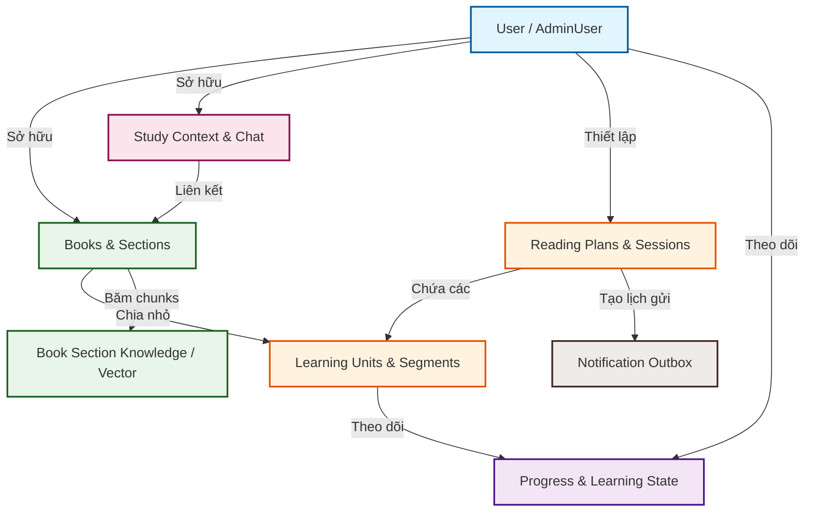
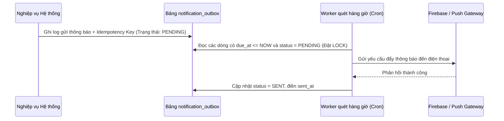

# Báo cáo Kiến trúc Cơ sở Dữ liệu TRIAM (TRIAM Database Architecture Report)

Tài liệu này cung cấp cái nhìn chi tiết và toàn diện nhất về thiết kế cơ sở dữ liệu (CSDL) của hệ thống **TRIAM Backend**. Báo cáo này được cấu trúc đặc biệt nhằm phục vụ cho các lập trình viên mới (onboarding developers) có thể nhanh chóng nắm bắt sơ đồ thực thể, nghiệp vụ liên quan, các ràng buộc CSDL và cách thức vận hành hệ thống.

---

## 1. Tổng quan Kiến trúc và Công nghệ CSDL

Hệ thống TRIAM sử dụng **PostgreSQL** làm cơ sở dữ liệu quan hệ chính, kết hợp với các công cụ và phần mở rộng sau:
*   **SQLModel (SQLAlchemy)**: Thư viện ORM chính trên Python giúp đồng bộ code models và schema CSDL.
*   **pgvector**: Phần mở rộng của PostgreSQL hỗ trợ lưu trữ và truy vấn vector đặc trưng (embeddings - 1536 chiều) phục vụ cho tính năng Tìm kiếm ngữ nghĩa và RAG (Retrieval-Augmented Generation).
*   **Supabase (Auth)**: Các bảng người dùng liên kết gián tiếp qua trường `user_id` (UUID) được đồng bộ hoặc đối chiếu trực tiếp từ bảng Auth của Supabase.

---

## 2. Phân nhóm Các Phân hệ Dữ liệu (Database Modules)

Dữ liệu của hệ thống được chia làm **8 phân hệ chính** có mối quan hệ chặt chẽ với nhau:



---

## 3. Chi Tiết Các Bảng Dữ Liệu Theo Phân Hệ

### 3.1 Phân hệ Người dùng & Cấu hình (User, Security & Configuration)

Phân hệ này quản lý quyền quản trị viên, vết kiểm thử bảo mật (audit logs), token thiết bị đẩy thông báo (push notifications) và cấu hình cá nhân hóa thời gian học tập.

#### Bảng `admin_users`
*   **Mô tả**: Lưu trữ danh sách tài khoản có quyền truy cập trang quản trị hệ thống.
*   **Khóa chính**: `user_id` (UUID) - Trùng với ID của người dùng hệ thống.
*   **Các trường chi tiết**:
    *   `role` (text, Not Null, Default "admin"): Vai trò quản trị.
    *   `is_active` (boolean, Not Null, Index, Default true): Trạng thái hoạt động của tài khoản admin.
    *   `note` (text, Nullable): Ghi chú bổ sung.
    *   `created_by` (UUID, Nullable): ID của admin tạo tài khoản này.
    *   `revoked_by` (UUID, Nullable): ID của admin thu hồi quyền.
    *   `created_at` (timestamptz, Not Null): Thời điểm bổ nhiệm quyền admin.
    *   `revoked_at` (timestamptz, Nullable): Thời điểm thu hồi quyền admin.

#### Bảng `admin_audit_logs`
*   **Mô tả**: Lưu lại lịch sử các thao tác nghiệp vụ quan trọng của admin nhằm mục đích bảo mật và giám sát hệ thống.
*   **Khóa chính**: `id` (UUID, Default uuid4)
*   **Các trường chi tiết**:
    *   `admin_user_id` (UUID, Not Null, Index): ID của admin thực hiện hành động.
    *   `action` (text, Not Null, Index): Tên hành động (ví dụ: "DELETE_BOOK", "REVOKE_ADMIN").
    *   `target_type` (text, Nullable, Index): Loại đối tượng bị tác động (ví dụ: "books", "users").
    *   `target_id` (UUID, Nullable, Index): ID cụ thể của đối tượng bị tác động.
    *   `metadata` (jsonb, Nullable): Dữ liệu chi tiết về thay đổi (trước/sau).
    *   `created_at` (timestamptz, Not Null, Index): Thời gian ghi nhận log.

#### Bảng `notification_settings`
*   **Mô tả**: Cấu hình khung giờ nhận nhắc nhở học tập và ôn tập ngắt quãng của từng người dùng.
*   **Khóa chính**: `user_id` (UUID)
*   **Các trường chi tiết**:
    *   `timezone` (text, Not Null, Default "Asia/Ho_Chi_Minh"): Múi giờ của người dùng.
    *   `reminders_enabled` (boolean, Not Null, Default true): Bật nhắc nhở đọc sách hàng ngày.
    *   `spaced_review_enabled` (boolean, Not Null, Default true): Bật nhắc nhở ôn tập Spaced Repetition.
    *   `reminder_time` (text, Not Null, Default "20:00"): Giờ gửi nhắc nhở mặc định.
    *   `quiet_hours_start` (text, Not Null, Default "22:00"): Khung giờ bắt đầu không làm phiền.
    *   `quiet_hours_end` (text, Not Null, Default "07:00"): Khung giờ kết thúc không làm phiền.
    *   `daily_cap` (integer, Not Null, Default 3): Giới hạn tối đa số lượng thông báo đẩy mỗi ngày.

#### Bảng `user_device_tokens`
*   **Mô tả**: Lưu trữ token thiết bị (FCM/APNS) để gửi thông báo đẩy qua di động.
*   **Khóa chính**: `id` (UUID, Default uuid4)
*   **Các trường chi tiết**:
    *   `user_id` (UUID, Not Null, Index): ID người dùng.
    *   `device_token` (text, Not Null, Unique, Index): Token định danh thiết bị duy nhất.
    *   `created_at` / `updated_at` (timestamptz, Not Null).

---

### 3.2 Phân hệ Tài liệu & RAG Engine (Documents & RAG Engine)

Quản lý thông tin sách tải lên, cấu trúc mục lục phân cấp của sách và các vector đặc trưng dùng để truy vấn RAG trong luồng chat.

#### Bảng `books`
*   **Mô tả**: Thực thể chứa thông tin tài liệu/sách do người dùng tải lên, hoặc được clone từ thư viện dùng chung của hệ thống.
*   **Khóa chính**: `id` (UUID, Default uuid4)
*   **Các trường chi tiết**:
    *   `user_id` (UUID, Not Null, Index): ID của người dùng sở hữu sách.
    *   `title` (text, Not Null): Tiêu đề sách.
    *   `author` (text, Nullable): Tác giả sách.
    *   `file_url` (text, Nullable): Đường dẫn lưu trữ file trên Supabase Storage.
    *   `document_type` (text, Nullable): Định dạng tài liệu (PDF, EPUB, DOCX).
    *   `total_sections` (integer, Nullable): Tổng số chương/phần phụ.
    *   `total_units` (integer, Nullable): Tổng số đơn vị học tập được sinh ra.
    *   `status` (text, Nullable): Trạng thái xử lý sách (`QUEUED`, `PROCESSING`, `COMPLETED`, `ERROR`).
    *   `error_message` (text, Nullable): Chi tiết lỗi nếu quá trình parse sách thất bại.
    *   `is_shared` (boolean, Not Null, Default false): `True` nếu đây là cuốn sách mẫu của hệ thống do Admin tải lên cho tất cả người dùng dùng chung.
    *   `parent_shared_id` (UUID, Nullable): Liên kết đến ID sách mẫu gốc nếu cuốn sách này được tạo ra bằng phương thức **Metadata Cloning** (chọn từ thư viện hệ thống).

#### Bảng `book_sections`
*   **Mô tả**: Lưu trữ cấu trúc cây thư mục (TOC - Table of Contents) của tài liệu sau khi được phân tích cú pháp.
*   **Khóa chính**: `id` (UUID, Default uuid4)
*   **Các trường chi tiết**:
    *   `book_id` (UUID, Not Null, ForeignKey -> `books.id`, CASCADE delete, Index): Thuộc cuốn sách nào.
    *   `parent_id` (UUID, Nullable, ForeignKey -> `book_sections.id`, CASCADE delete, Index): Liên kết phân cấp cha-con (chương con nằm trong chương cha).
    *   `section_index` (integer, Not Null): Thứ tự hiển thị của chương trong sách.
    *   `title` (text, Not Null): Tiêu đề của chương/phần.
    *   `level` (integer, Not Null): Độ sâu phân cấp mục lục (ví dụ: Chương = 1, Mục con = 2).
    *   `path` (text, Not Null): Đường dẫn phả hệ (ví dụ: "0/1/3").
    *   `text_content` (text, Nullable): Nội dung văn bản thô của chương.
    *   `text_char_count` (integer, Not Null, Default 0): Độ dài ký tự của văn bản.
    *   `page_start` / `page_end` (integer, Nullable): Số trang bắt đầu và kết thúc (chỉ áp dụng đối với định dạng PDF).
    *   `source_href` / `source_anchor` (text, Nullable): Liên kết định vị trong tài liệu EPUB/DOCX.
*   **Ràng buộc Unique**:
    *   `uq_book_sections_book_index`: Ràng buộc `book_id` + `section_index` đảm bảo thứ tự chương trong một cuốn sách không bị trùng lặp.
    *   `uq_book_sections_book_path`: Ràng buộc `book_id` + `path` đảm bảo tính duy nhất của đường dẫn mục lục trong sách.

#### Bảng `book_section_knowledge`
*   **Mô tả**: Lưu các đoạn văn bản ngắn (chunks) kèm theo vector nhúng (embeddings) được tạo ra từ nội dung của từng chương sách phục vụ tìm kiếm ngữ nghĩa RAG.
*   **Khóa chính**: `id` (integer, Auto-increment)
*   **Các trường chi tiết**:
    *   `book_id` (UUID, Not Null, ForeignKey -> `books.id`): Liên kết nhanh đến sách.
    *   `section_id` (UUID, Not Null, ForeignKey -> `book_sections.id`, CASCADE delete, Index): Liên kết đến chương cụ thể chứa văn bản.
    *   `chunk_index` (integer, Not Null): Thứ tự của chunk trong chương đó.
    *   `content` (text, Not Null): Đoạn văn bản thô.
    *   `search_text` (text, Not Null, Default ""): Văn bản chuẩn hóa loại bỏ dấu tiếng Việt để phục vụ tìm kiếm từ khóa (lexical search).
    *   `content_hash` (text, Not Null): Mã MD5 hash nội dung để kiểm tra trùng lặp.
    *   `embedding_model` / `embedding_version` (text, Not Null): Tên và phiên bản mô hình nhúng (ví dụ: `text-embedding-3-small`).
    *   `char_count` / `token_count` (integer): Số lượng ký tự và số token ước lượng.
    *   `embedding` (vector(1536), Nullable): Mảng vector 1536 chiều đại diện cho ngữ nghĩa của chunk.

> [!NOTE]
> **Lưu ý về tên cột**: Ở tầng CSDL vật lý và trong SQLModel định nghĩa, thuộc tính lưu vector nhúng được đặt tên chính xác là **`embedding`** (chứ không phải `embedding_vector`). Tên gọi này đồng bộ xuyên suốt từ schema, câu lệnh SQL cho đến mã nguồn Python API.

*   **Ràng buộc & Chỉ mục**:
    *   `uq_book_section_knowledge_section_chunk_version`: Đảm bảo một cặp `section_id` + `chunk_index` + `embedding_version` là duy nhất.
    *   `uq_book_section_knowledge_section_hash_version`: Tránh lưu trùng lắp nội dung text giống nhau cho cùng phiên bản mô hình.
    *   `ix_bsk_book_version`, `ix_bsk_section_version`, `ix_bsk_book_section_version`: Các chỉ mục tối ưu hóa tốc độ truy vấn RAG theo sách, chương và phiên bản mô hình.

---

### 3.3 Phân hệ Không gian thảo luận AI (AI Dialogue & Context)

Quản lý không gian thảo luận trực tiếp (Workspace), các luồng chat và nội dung tin nhắn giữa người dùng với trợ lý giọng nói/chatbot.

#### Bảng `study_contexts`
*   **Mô tả**: Đại diện cho một **Workspace** học tập. Một Workspace có thể chứa một hoặc nhiều cuốn sách liên kết lại để người dùng chat chéo thông tin.
*   **Khóa chính**: `id` (UUID, Default uuid4)
*   **Các trường chi tiết**:
    *   `user_id` (UUID, Not Null, Index): ID của người dùng sở hữu Workspace này.
    *   `title` (text, Not Null): Tiêu đề Workspace.
    *   `is_auto_generated` (boolean, Not Null, Default false): Workspace tự động sinh khi người dùng chọn chế độ học nhanh với một cuốn sách.

#### Bảng `study_context_document_links`
*   **Mô tả**: Bảng phụ giải quyết quan hệ Nhiều-Nhiều giữa `study_contexts` (Workspaces) và `books`.
*   **Khóa chính**: Cặp composite key (`context_id`, `book_id`).
*   **Các trường chi tiết**:
    *   `context_id` (UUID, ForeignKey -> `study_contexts.id`, CASCADE delete, Index).
    *   `book_id` (UUID, ForeignKey -> `books.id`, CASCADE delete, Index).

#### Bảng `chat_threads`
*   **Mô tả**: Một Workspace có thể chứa nhiều luồng trò chuyện khác nhau của người dùng.
*   **Khóa chính**: `id` (UUID, Default uuid4)
*   **Các trường chi tiết**:
    *   `context_id` (UUID, Not Null, ForeignKey -> `study_contexts.id`, CASCADE delete, Index): Thuộc Workspace nào.
    *   `title` (text, Not Null): Tên luồng trò chuyện (ví dụ: "Thảo luận chương 1").

#### Bảng `chat_messages`
*   **Mô tả**: Lưu chi tiết nội dung tin nhắn trong từng luồng trò chuyện.
*   **Khóa chính**: `id` (UUID, Default uuid4)
*   **Các trường chi tiết**:
    *   `thread_id` (UUID, Not Null, ForeignKey -> `chat_threads.id`, CASCADE delete, Index): Thuộc luồng nào. Trường này bắt buộc được đánh chỉ mục đơn (`index=True`) để Voice Agent có thể nhanh chóng truy xuất lịch sử ngữ cảnh gần nhất.
    *   `is_user` (boolean, Not Null): `true` nếu là tin nhắn của người dùng gửi, `false` nếu là phản hồi từ AI Assistant.
    *   `text` (text, Not Null): Nội dung tin nhắn dạng văn bản thô.
    *   `source` (text, Not Null): Nguồn sinh tin nhắn (ví dụ: `user`, `assistant_rag`, `assistant_web_search`).
    *   `timestamp` (timestamptz, Not Null, Default func.now()).

#### Bảng `direct_book_context`
*   **Mô tả**: Lối tắt lưu cấu hình liên kết trực tiếp giữa Người dùng và Sách khi truy cập nhanh một tài liệu riêng lẻ bên ngoài giao diện Workspace.
*   **Khóa chính**: Cặp composite key (`user_id`, `book_id`).
*   **Các trường chi tiết**:
    *   `user_id` (UUID, Not Null)
    *   `book_id` (UUID, Not Null, ForeignKey -> `books.id`, CASCADE delete)
    *   `context_id` (UUID, Not Null, ForeignKey -> `study_contexts.id`, CASCADE delete): Workspace mặc định tương ứng.
    *   `primary_thread_id` (UUID, Not Null, ForeignKey -> `chat_threads.id`, CASCADE delete): Luồng chat chính mặc định tương ứng.

> [!TIP]
> **Vai trò Realtime của `primary_thread_id`**: Bản thiết kế này cho phép LiveKit Voice Agent thực hiện tra cứu với độ phức tạp $O(1)$ để tìm ngay ra luồng hội thoại cũ mà không cần JOIN qua bảng liên kết nhiều-nhiều `study_context_document_links`. Nhờ đó, Voice Agent có thể khởi tạo phiên làm việc cực nhanh (dưới 10ms) ngay khi nhận được tín hiệu kết nối từ thiết bị người dùng.

---

### 3.4 Phân hệ Lập lịch & Kế hoạch học tập (Study Planning & Scheduling)

Bao gồm việc lưu trữ các tiến trình nền xử lý tài liệu, thiết lập thời gian biểu của kế hoạch học và chia nhỏ lịch trình học thành các phiên chi tiết hàng ngày.

#### Bảng `processing_jobs`
*   **Mô tả**: Theo dõi tiến độ của các tiến trình xử lý bất đồng bộ nền (Chapters processing, AI content rewriting, TTS audio generation).
*   **Khóa chính**: `id` (UUID, Default uuid4)
*   **Các trường chi tiết**:
    *   `user_id` (UUID, Not Null, Index)
    *   `book_id` (UUID, Nullable, ForeignKey -> `books.id`, CASCADE delete, Index): Tài liệu đang được xử lý.
    *   `job_type` (ProcessingJobType Enum, Not Null, Index): Phân loại job (`BOOK_PARSING`, `PLAN_GENERATION`, `AUDIO_GENERATION`).
    *   `status` (ProcessingJobStatus Enum, Not Null, Default QUEUED, Index): Trạng thái xử lý (`QUEUED`, `PROCESSING`, `COMPLETED`, `FAILED`).
    *   `mode` (PlanMode Enum, Nullable): Chế độ kế hoạch được chọn.
    *   `progress_percent` (integer, Not Null, Default 0): Phần trăm hoàn thành.
    *   `current_step` (text, Nullable): Mô tả ngắn bước hiện tại đang chạy.
    *   `total_units` / `done_units` / `failed_units` (integer): Bộ đếm tiến trình cho các đơn vị học tập cần xử lý.
    *   `estimated_input_tokens` / `estimated_audio_seconds` (integer): Thống kê ước lượng chi phí tài nguyên AI sử dụng.
    *   `error_message` (text, Nullable): Lý do chi tiết nếu job bị lỗi.

#### Bảng `reading_plans`
*   **Mô tả**: Lưu thông tin kế hoạch đọc sách của người dùng.
*   **Khóa chính**: `id` (UUID, Default uuid4)
*   **Các trường chi tiết**:
    *   `book_id` (UUID, Not Null, ForeignKey -> `books.id`, CASCADE delete, Index): Sách áp dụng kế hoạch.
    *   `mode` (PlanMode Enum, Not Null): Chế độ kế hoạch học (`PARETO` - học nhanh 20% trọng tâm, `DETAILED` - học chi tiết toàn bộ cuốn sách).
    *   `pace` (integer, Not Null): Số lượng đơn vị học tập cần hoàn thành trong một phiên học (ví dụ: 2 units/ngày).
    *   `status` (text, Not Null): Trạng thái kế hoạch (`active`, `paused`, `completed`).
    *   `reminder_time` (text, Not Null, Default "20:00"): Khung giờ nhắc nhở học hàng ngày của kế hoạch này.
    *   `started_at` / `paused_at` / `completed_at` (timestamptz).

#### Bảng `reading_plan_schedule_slots`
*   **Mô tả**: Định cấu hình cụ thể các ngày trong tuần người dùng đăng ký học theo kế hoạch (ví dụ: học Thứ 2, Thứ 4, Thứ 6).
*   **Khóa chính**: `id` (UUID, Default uuid4)
*   **Các trường chi tiết**:
    *   `user_id` (UUID, Not Null, Index)
    *   `plan_id` (UUID, Not Null, ForeignKey -> `reading_plans.id`, CASCADE delete, Index)
    *   `book_id` (UUID, Not Null, ForeignKey -> `books.id`, CASCADE delete, Index)
    *   `weekday` (integer, Not Null): Thứ trong tuần đại diện từ 0 (Chủ Nhật) đến 6 (Thứ Bảy).
    *   `reminder_time` (text, Not Null): Giờ nhắc nhở riêng biệt cho ngày học đó.
    *   `timezone` (text, Not Null, Default "Asia/Ho_Chi_Minh")
    *   `is_active` (boolean, Not Null, Default true, Index): Trạng thái bật/tắt của slot học.

#### Bảng `reading_plan_sessions`
*   **Mô tả**: Phiên học chi tiết hàng ngày được sinh ra tự động dựa trên cấu hình kế hoạch (`reading_plans`) và thời khóa biểu (`reading_plan_schedule_slots`).
*   **Khóa chính**: `id` (UUID, Default uuid4)
*   **Các trường chi tiết**:
    *   `user_id` (UUID, Not Null, Index)
    *   `plan_id` (UUID, Not Null, ForeignKey -> `reading_plans.id`, CASCADE delete, Index)
    *   `book_id` (UUID, Not Null, ForeignKey -> `books.id`, CASCADE delete, Index)
    *   `mode` (PlanMode Enum, Not Null, Index)
    *   `session_index` (integer, Not Null): Chỉ số thứ tự phiên học (Session 1, Session 2,...).
    *   `scheduled_at` (timestamptz, Not Null, Index): Thời điểm dự kiến diễn ra phiên học.
    *   `local_date` (text, Not Null, Index): Ngày theo định dạng cục bộ `YYYY-MM-DD` để đối chiếu lịch trình.
    *   `status` (text, Not Null, Default "scheduled", Index): Trạng thái phiên (`scheduled`, `completed`, `skipped`, `missed`).
    *   `completed_units` / `total_units` (integer, Default 0): Tiến độ hoàn thành bài học trong phiên.
    *   `started_at` / `completed_at` (timestamptz)
    *   `skipped_at` / `missed_at` (timestamptz)
    *   `missed_notified_at` (timestamptz, Nullable): Đánh dấu thời điểm đã gửi thông báo trễ hẹn học cho người dùng.
*   **Các chỉ mục tối ưu**:
    *   `ix_reading_plan_sessions_plan_index` (plan_id, session_index)
    *   `ix_reading_plan_sessions_user_status` (user_id, status)
    *   `ix_reading_plan_sessions_book_mode` (book_id, mode)
    *   `ix_reading_plan_sessions_plan_status` (plan_id, status)

#### Bảng `reading_plan_session_units`
*   **Mô tả**: Bảng liên kết trung gian Nhiều-Nhiều thể hiện danh sách các đơn vị học tập cần hoàn thành trong một phiên học cụ thể.
*   **Khóa chính**: `id` (UUID, Default uuid4)
*   **Các trường chi tiết**:
    *   `session_id` (UUID, Not Null, ForeignKey -> `reading_plan_sessions.id`, CASCADE delete, Index)
    *   `plan_id` (UUID, Not Null, ForeignKey -> `reading_plans.id`, CASCADE delete, Index)
    *   `book_id` (UUID, Not Null, ForeignKey -> `books.id`, CASCADE delete, Index)
    *   `learning_unit_id` (UUID, Not Null, ForeignKey -> `learning_units.id`, CASCADE delete, Index)
    *   `unit_order` (integer, Not Null): Thứ tự bài học cần nghe trong phiên học này.
    *   `status` (text, Not Null, Default "pending", Index): Trạng thái bài học (`pending`, `completed`).
    *   `completed_at` (timestamptz, Nullable, Index)
*   **Ràng buộc & Chỉ mục**:
    *   `uq_reading_plan_session_units_session_order`: Đảm bảo một `session_id` không chứa các dòng có trùng chỉ số `unit_order`.
    *   `ix_reading_plan_session_units_plan_unit` (plan_id, learning_unit_id)
    *   `ix_reading_plan_session_units_book_unit` (book_id, learning_unit_id)

---

### 3.5 Phân hệ Đơn vị học tập & Phân mảnh âm thanh (Learning Units & Auditory Pipeline)

Quản lý nội dung học tập đã được tinh gọn, biên soạn lại bởi AI và chuyển đổi sang dạng âm thanh (TTS).

#### Bảng `learning_units`
*   **Mô tả**: Đơn vị bài học được tạo ra sau khi hệ thống chia nhỏ sách theo phân mảnh cấu trúc và chạy mô hình AI để rút gọn kiến thức phù hợp với việc lắng nghe.
*   **Khóa chính**: `id` (UUID, Default uuid4)
*   **Các trường chi tiết**:
    *   `user_id` (UUID, Not Null, Index)
    *   `book_id` (UUID, Not Null, ForeignKey -> `books.id`, CASCADE delete, Index)
    *   `mode` (PlanMode Enum, Not Null, Index): Kế hoạch áp dụng đơn vị này.
    *   `unit_index` (integer, Not Null): Chỉ số bài học trong cuốn sách (Unit 1, Unit 2,...).
    *   `title` (text, Not Null): Tiêu đề bài học (do AI tự biên soạn dựa trên nội dung gốc).
    *   `unit_type` (text, Not Null): Loại đơn vị học tập (`main_audio` - nội dung nghe chính, `review_audio` - nội dung tóm tắt ôn tập).
    *   `status` (ProcessingJobStatus Enum, Not Null, Default QUEUED, Index): Trạng thái sinh nội dung bài học.
    *   `source_text_char_count` (integer, Default 0): Độ dài ký tự nguồn gốc.
    *   `estimated_tokens` / `estimated_audio_seconds` (integer): Số token ước tính và thời lượng audio đầu ra.
    *   `main_segment_count` (integer, Default 0): Tổng số phân mảnh âm thanh nhỏ tạo nên bài học.
    *   `review_audio_url` (text, Nullable): File tóm tắt ôn tập.
    *   `review_text` (text, Nullable): Nội dung tóm tắt ôn tập dạng văn bản.
    *   `planner_reason` (text, Nullable): Lý do lựa chọn nội dung này (hữu ích cho việc đánh giá thuật toán lọc Pareto).
*   **Ràng buộc**:
    *   `uq_learning_units_book_mode_index`: Bộ ba `book_id` + `mode` + `unit_index` là duy nhất.

#### Bảng `learning_unit_sources`
*   **Mô tả**: Bảng quan hệ Nhiều-Nhiều thể hiện nguồn gốc văn bản của bài học. Một bài học có thể được tổng hợp thông tin từ nhiều chương khác nhau trong `book_sections`.
*   **Khóa chính**: Cặp composite key (`learning_unit_id`, `section_id`).
*   **Các trường chi tiết**:
    *   `learning_unit_id` (UUID, ForeignKey -> `learning_units.id`, CASCADE delete)
    *   `section_id` (UUID, ForeignKey -> `book_sections.id`, CASCADE delete)
    *   `source_order` (integer, Not Null): Thứ tự tham chiếu tài liệu nguồn.

#### Bảng `learning_unit_segments`
*   **Mô tả**: Chứa các phân mảnh âm thanh nhỏ (mỗi phân mảnh tương ứng khoảng vài chục giây phát hoặc một đoạn văn ngắn) tạo nên một bài học hoàn chỉnh. Giúp việc tua nhanh, chuyển đoạn hoặc phát lại bài học diễn ra trơn tru.
*   **Khóa chính**: `id` (integer, Auto-increment)
*   **Các trường chi tiết**:
    *   `learning_unit_id` (UUID, Not Null, ForeignKey -> `learning_units.id`, CASCADE delete, Index)
    *   `segment_index` (integer, Not Null): Vị trí phân mảnh trong bài học.
    *   `audio_url` (text, Nullable): Đường dẫn lưu file âm thanh trên Storage.
    *   `text_content` (text, Nullable): Đoạn hội thoại/văn bản đã được AI viết lại dùng để đọc audio.
    *   `duration_ms` (integer, Nullable): Độ dài phân mảnh (mili giây).
*   **Ràng buộc**:
    *   `uq_learning_unit_segments_unit_index`: `learning_unit_id` + `segment_index` phải là duy nhất.

---

### 3.6 Phân hệ Theo dõi tiến độ học tập (Progress Tracking)

Theo dõi chặt chẽ tiến trình lắng nghe sách nói của người dùng từ mức chi tiết phân mảnh âm thanh đến tổng thể tiến độ cuốn sách.

#### Bảng `learning_unit_progress`
*   **Mô tả**: Theo dõi tiến độ chi tiết của người dùng đối với một bài học cụ thể (`learning_units`).
*   **Khóa chính**: `id` (UUID, Default uuid4)
*   **Các trường chi tiết**:
    *   `user_id` (UUID, Not Null, Index): ID người dùng.
    *   `book_id` (UUID, Not Null, ForeignKey -> `books.id`, CASCADE delete, Index): Sách tương ứng. Được gắn chỉ mục đơn (`index=True`) để quét tiến độ theo cuốn sách một cách nhanh chóng.
    *   `learning_unit_id` (UUID, Not Null, ForeignKey -> `learning_units.id`, CASCADE delete, Index): Bài học tương ứng.
    *   `mode` (PlanMode Enum, Not Null)
    *   `current_segment_id` (integer, Nullable, ForeignKey -> `learning_unit_segments.id`, SET NULL): Vị trí phân mảnh âm thanh cuối cùng người dùng đang nghe.
    *   `last_segment_index` (integer, Not Null, Default 0): Vị trí chỉ số phân mảnh âm thanh cuối cùng.
    *   `position_ms` (integer, Not Null, Default 0): Thời điểm dừng nghe cụ thể trong phân mảnh (mili giây).
    *   `listened_ms` (integer, Not Null, Default 0): Tổng thời lượng thực tế người dùng đã lắng nghe.
    *   `total_duration_ms` (integer, Not Null, Default 0): Tổng độ dài âm thanh bài học.
    *   `progress_percent` (integer, Not Null, Default 0): Phần trăm tiến độ học bài hiện tại.
    *   `max_progress_percent` (integer, Not Null, Default 0): Phần trăm tiến độ cao nhất từng đạt được.
    *   `status` (LearningProgressStatus Enum, Not Null, Default NOT_STARTED, Index): Trạng thái bài học (`NOT_STARTED`, `IN_PROGRESS`, `COMPLETED`).
    *   `started_at` / `last_activity_at` (timestamptz, Index)
    *   `completed_at` (timestamptz, Nullable, Index)
*   **Ràng buộc & Chỉ mục**:
    *   `uq_unit_progress_user_unit` (UniqueConstraint): Ràng buộc duy nhất trên cặp `(user_id, learning_unit_id)`. Ràng buộc này tự động tạo một Composite Index tương ứng trong CSDL giúp tối ưu hóa tuyệt đối tốc độ khi quét trạng thái tiến trình lúc người dùng ấn chuyển tiếp bài học ("Next") mà không gây ra Table Scan.

#### Bảng `book_learning_states`
*   **Mô tả**: Quản lý trạng thái học tập tổng thể của một người dùng đối với một cuốn sách theo một chế độ học nhất định.
*   **Khóa chính**: `id` (UUID, Default uuid4)
*   **Các trường chi tiết**:
    *   `user_id` (UUID, Not Null, Index)
    *   `book_id` (UUID, Not Null, ForeignKey -> `books.id`, CASCADE delete, Index)
    *   `mode` (PlanMode Enum, Not Null, Index)
    *   `status` (text, Not Null, Default "not_started", Index): Trạng thái tổng quan cuốn sách (`not_started`, `learning`, `completed`).
    *   `book_progress_percent` (integer, Default 0): Phần trăm hoàn thành cuốn sách.
    *   `completed_units` / `playable_units` (integer, Default 0): Số lượng đơn vị đã hoàn thành và số lượng đơn vị đã sẵn sàng để phát.
    *   `last_learning_unit_id` (UUID, Nullable, ForeignKey -> `learning_units.id`, SET NULL): Bài học gần nhất đang nghe dở.
    *   `last_segment_id` (integer, Nullable, ForeignKey -> `learning_unit_segments.id`, SET NULL): Phân mảnh âm thanh gần nhất đang nghe dở.
    *   `last_segment_index` / `position_ms` (integer): Chi tiết định vị phát audio.
    *   `started_at` / `last_activity_at` (timestamptz, Index)
    *   `completed_at` (timestamptz, Nullable, Index)
*   **Ràng buộc & Chỉ mục**:
    *   `uq_book_learning_state_user_book_mode`: Bộ ba `user_id` + `book_id` + `mode` xác định trạng thái học duy nhất.
    *   `ix_book_learning_states_user_status` (user_id, status)
    *   `ix_book_learning_states_book_mode` (book_id, mode)

---

### 3.7 Phân hệ Ôn tập ngắt quãng (Spaced Repetition Review)

Lưu trữ trạng thái các thẻ ôn tập, lịch trình và chu kỳ lặp lại kiến thức của người dùng dựa trên kỹ thuật Spaced Repetition (SuperMemo SM-2).

#### Bảng `spaced_review_items`
*   **Mô tả**: Thực thể quản lý các thẻ ôn tập kiến thức ngắt quãng liên kết đến bài học mà người dùng đã nghe qua.
*   **Khóa chính**: `id` (UUID, Default uuid4)
*   **Các trường chi tiết**:
    *   `user_id` (UUID, Not Null, Index)
    *   `book_id` (UUID, Not Null, ForeignKey -> `books.id`, CASCADE delete, Index)
    *   `learning_unit_id` (UUID, Nullable, ForeignKey -> `learning_units.id`, CASCADE delete, Index)
    *   `mode` (PlanMode Enum, Not Null)
    *   `interval_days` (integer, Not Null): Chu kỳ lặp lại sau bao nhiêu ngày (theo thuật toán SM-2, ví dụ: 1 ngày, 6 ngày, 14 ngày...).
    *   `sequence_index` (integer, Not Null): Lần ôn tập thứ mấy của thẻ này.
    *   `due_at` (timestamptz, Not Null, Index): Thời điểm thẻ đến hạn cần ôn tập.
    *   `status` (ReviewItemStatus Enum, Not Null, Default PENDING, Index): Trạng thái ôn tập (`PENDING` - đang đợi, `SKIPPED` - bỏ qua, `COMPLETED` - đã hoàn thành ôn tập).
    *   `review_text_snapshot` (text, Nullable): Đoạn văn bản kiến thức tóm tắt của bài học dùng để hiển thị khi ôn tập.
    *   `anchor_completed_at` (timestamptz, Nullable, Index): Thời điểm hoàn thành bài học gốc tạo mốc tính chu kỳ ôn tập.
    *   `source_unit_progress_id` (UUID, Nullable, ForeignKey -> `learning_unit_progress.id`, SET NULL, Index): Tham chiếu trực tiếp đến dòng tiến trình bài học.
    *   `notified_at` (timestamptz, Nullable): Đánh dấu thời điểm hệ thống đã gửi thông báo nhắc ôn tập thẻ này.
    *   `last_reviewed_at` / `completed_at` (timestamptz, Nullable).

---

### 3.8 Phân hệ Outbox & Gửi thông báo nhắc nhở (Outbox & Notifications Pipeline)

Kiến trúc này hoạt động theo mẫu **Outbox Pattern** để đảm bảo việc gửi thông báo reminders không bị mất mát dữ liệu và gửi trùng lặp (Idempotency).



#### Bảng `notification_outbox`
*   **Mô tả**: Hộp thư đi lưu các sự kiện cần gửi thông báo nhắc nhở, hoạt động như hàng đợi bền vững (durable queue).
*   **Khóa chính**: `id` (UUID, Default uuid4)
*   **Các trường chi tiết**:
    *   `user_id` (UUID, Not Null, Index)
    *   `type` (NotificationType Enum, Not Null, Index): Phân loại nhắc nhở (`DAILY_STUDY` - học hàng ngày, `SPACED_REVIEW` - ôn tập, `MISSED_SESSION` - cảnh báo trễ hẹn).
    *   `channel` (NotificationChannel Enum, Not Null, Default IN_APP, Index): Kênh gửi (`IN_APP` - lưu thông báo ứng dụng, `PUSH` - gửi thông báo đẩy thiết bị).
    *   `status` (NotificationStatus Enum, Not Null, Default PENDING, Index): Trạng thái hàng đợi (`PENDING`, `SENT`, `FAILED`).
    *   `payload` (jsonb, Not Null): Cấu trúc nội dung dữ liệu thông báo.
    *   `due_at` (timestamptz, Not Null, Index): Hạn định cần gửi thông báo đi.
    *   `next_retry_at` (timestamptz, Nullable, Index): Khung giờ thử lại nếu gửi thất bại.
    *   `locked_at` (timestamptz, Nullable): Mốc thời gian đặt khóa ghi khi worker đang xử lý dòng này.
    *   `locked_by` (text, Nullable): Tên instance worker đang xử lý khóa dòng này (tránh gửi trùng lặp trong hệ thống phân tán).
    *   `sent_at` (timestamptz, Nullable)
    *   `attempts` (integer, Not Null, Default 0): Số lần đã cố gắng gửi.
    *   `error_message` (text, Nullable)
    *   `idempotency_key` (text, Not Null): Khóa chống trùng lặp duy nhất.
*   **Ràng buộc Unique**:
    *   `uq_notification_outbox_idempotency_key`: Đảm bảo không tạo hai thông báo nhắc nhở giống nhau cho cùng một tác vụ nghiệp vụ.

#### Bảng `user_notifications`
*   **Mô tả**: Lưu trữ nội dung thông báo hiển thị tại mục "Hộp thư thông báo" trong ứng dụng của người dùng.
*   **Khóa chính**: `id` (UUID, Default uuid4)
*   **Các trường chi tiết**:
    *   `user_id` (UUID, Not Null, Index)
    *   `outbox_id` (UUID, Nullable, ForeignKey -> `notification_outbox.id`, SET NULL, Index): Tham chiếu từ sự kiện hàng đợi outbox tương ứng.
    *   `type` (NotificationType Enum, Not Null, Index)
    *   `title` / `body` (text, Not Null): Tiêu đề và nội dung chi tiết hiển thị.
    *   `action_type` / `action_payload` (text / jsonb, Nullable): Cấu hình sự kiện điều hướng màn hình khi người dùng bấm vào thông báo.
    *   `read_at` (timestamptz, Nullable): Đánh dấu thời điểm người dùng đã đọc thông báo này.
    *   `created_at` (timestamptz, Not Null, Default func.now()).
*   **Ràng buộc Unique**:
    *   `uq_user_notifications_outbox_id`: Mỗi thông báo ra lò từ outbox chỉ được ánh xạ đến một dòng hiển thị giao diện.

---

## 4. Hướng dẫn Dành Cho Nhà Phát Triển Mới (Developer Cheat Sheet)

### 4.1 Quy trình Metadata Cloning & Xóa Sách An Toàn

Đối với tính năng chia sẻ sách mẫu từ Thư viện hệ thống sang tài khoản cá nhân, TRIAM sử dụng mô hình **Metadata Cloning**:
1. Hệ thống chỉ clone các dữ liệu metadata trong CSDL (`book_sections`, `book_section_knowledge`, `learning_units`, `learning_unit_segments`).
2. Sách cá nhân mới được liên kết thông qua trường `parent_shared_id` trỏ về ID sách mẫu gốc và sử dụng chung đường dẫn tệp âm thanh vật lý (`audio_url` và `file_url`).

> [!CAUTION]
> **Cảnh báo xóa sách clone ("Cắt đuôi")**:
> Khi người dùng xóa một cuốn sách, hàm `delete_book_storage` trong `audiobook_repo.py` bắt buộc phải kiểm tra thuộc tính `parent_shared_id`. 
> Nếu `parent_shared_id is not None` (tức là sách clone), **TUYỆT ĐỐI KHÔNG** được gọi API xóa folder file vật lý trên Supabase Storage, vì tệp vật lý đó đang được dùng chung cho nhiều tài khoản khác trong hệ thống. Chỉ được xóa bản ghi dữ liệu trong CSDL của người dùng hiện tại.

---

### 4.2 Thiết Kế Database Engine trong LiveKit Voice Agent

Trong phân hệ Realtime Voice Agent (`agent_voice_gpt_realtime.py` và `transcript_store.py`), các phiên hội thoại âm thanh đòi hỏi độ trễ cực thấp (dưới 1ms) và tránh tắc nghẽn Pool kết nối.

*   **Sử dụng Engine toàn cục**: Nghiêm cấm việc khởi tạo CSDL Engine mới (`create_engine`) trong các class handler/session. Việc này sẽ phá vỡ Connection Pool và nhanh chóng làm tràn số lượng kết nối tới PostgreSQL khi có nhiều Voice Agent chạy đồng thời.
*   **Quy tắc**: Bắt buộc import và sử dụng database engine toàn cục duy nhất được cấu hình sẵn trong dự án:
    ```python
    from app.db.database import engine
    ```
*   **Thiết lập chỉ mục**: Bắt buộc phải duy trì chỉ mục `index=True` trên khóa ngoại `thread_id` của bảng `chat_messages` để Voice Agent có thể nhanh chóng truy xuất $N$ tin nhắn ngữ cảnh gần nhất.

---

### 4.3 Tối ưu hóa Async/Sync và Tránh đóng băng Event Loop

FastAPI chạy hoàn toàn trên một Event Loop bất đồng bộ đơn luồng. Các tác vụ mạng I/O đồng bộ nếu không được xử lý đúng cách sẽ làm đứng hình toàn bộ ứng dụng.

*   **Vấn đề**: Các thư viện SDK đồng bộ (ví dụ: các lệnh gọi cũ của Supabase SDK như `supabase.storage.from_().upload()` hoặc `supabase.rpc().execute()`) là các thao tác I/O chặn (blocking). Nếu chạy trực tiếp bên dưới hàm `async def`, chúng sẽ chặn đứng Event Loop từ 100ms đến 2s, gây trễ mạng nghiêm trọng và làm giật lag/mất gói tin âm thanh truyền tải qua LiveKit.
*   **Giải pháp**: Bắt buộc phải bọc các tác vụ đồng bộ này trong luồng chạy riêng biệt bằng `asyncio.to_thread` để Event Loop có thể xử lý các task khác bất đồng bộ:
    ```python
    import asyncio

    # Thay vì gọi trực tiếp blocking:
    # res = supabase.storage.from_("audios").upload(path, data)
    
    # Bắt buộc chuyển sang đẩy qua Worker Thread:
    res = await asyncio.to_thread(
        lambda: supabase.storage.from_("audios").upload(path, data)
    )
    ```

---

### 4.4 Cách Viết Truy Vấn Vector Đặc Trưng (pgvector)
Để truy xuất dữ liệu ngữ nghĩa tương tự gần nhất từ bảng `book_section_knowledge` sử dụng Cosine Distance:
```python
from pgvector.sqlalchemy import Vector
from sqlalchemy import select

# Truy vấn vector 1536 chiều đại diện cho câu hỏi của người dùng
query_vector = [...]  # list float 1536 chiều
stmt = (
    select(BookSectionKnowledge)
    .where(BookSectionKnowledge.book_id == book_id)
    .order_by(BookSectionKnowledge.embedding.cosine_distance(query_vector))
    .limit(5)
)
results = session.exec(stmt).all()
```
*   Toán tử khoảng cách Cosine trong SQLAlchemy được sinh ra qua phương thức `.cosine_distance()`, tương ứng với toán tử `<=>` trong PostgreSQL.
*   **Lưu ý**: Hãy đảm bảo bạn sử dụng đúng tên thuộc tính là `embedding` (như được ánh xạ trong database) để tránh lỗi `AttributeError`.

---

### 4.5 Tạo Revision di trú CSDL với Alembic
Khi bạn có bất kỳ thay đổi nào trong file `app/models/db_models.py`, tuyệt đối không thay đổi trực tiếp trên DB production. Hãy làm theo quy trình:
1. Tạo file migration tự động:
   ```powershell
   uv run alembic revision --autogenerate -m "Mô tả ngắn thay đổi"
   ```
2. Mở file migration vừa sinh ra dưới thư mục `app/db/migrations/versions/` để rà soát mã SQL sinh ra có chính xác và có làm mất mát dữ liệu cũ hay không.
3. Chạy cập nhật lên DB local của bạn:
   ```powershell
   uv run alembic upgrade head
   ```
