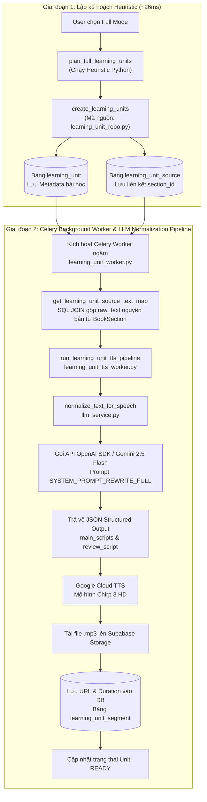

# HƯỚNG DẪN ĐÀO TẠO FRESHER: CHẾ ĐỘ HỌC TẬP FULL MODE (HEURISTIC TREE-BASED PARTITIONING)

Tài liệu này giải thích chi tiết về **bản chất thiết kế, luồng chạy mã nguồn, các trường hợp (use-cases) và ví dụ thực tế** của chế độ học tập Đầy Đủ (`FULL` mode) trong hệ thống TRIAM.

---

## 1. Triết Lý Thiết Kế: Full Mode Là Gì?

Trong hệ thống TRIAM, **Full Mode (Chế độ học đầy đủ)** được thiết kế nhằm đáp ứng nhu cầu của những người học muốn **tiếp cận 100% tri thức nguyên bản của cuốn sách** mà không bị lược bỏ hay tóm tắt bất kỳ phân đoạn nào.

*   **Chế độ FULL**: Chuyển đổi toàn bộ 100% văn bản của cuốn sách thành các bài học nghe (`PlannedLearningUnit`). Giữ nguyên tính liên tục, mạch lạc của cấu trúc tác giả.
*   **Chế độ PARETO**: Chỉ lọc ra 20% kiến thức cốt lõi (3 đến 8 bài học tinh hoa) dựa trên mô hình Vector Embedding và Gemini LLM Planner.

### 🌟 Điểm khác biệt công nghệ then chốt của Full Mode:
1. **Thuần Heuristic (Pure Rule-Based Engine)**: Khác với Pareto Mode phải gọi mô hình AI đắt đỏ, Full Mode chạy hoàn toàn bằng các quy tắc lập trình logic trong mã nguồn Python (`app/services/learning_unit_planner_service.py`).
2. **Không tốn chi phí API (0 VNĐ)**: Không phát sinh bất kỳ cuộc gọi API nào tới LLM (OpenAI hay Gemini) trong quá trình tạo kế hoạch bài học.
3. **Tốc độ phản hồi tức thì (~26ms)**: Toàn bộ quá trình quét cây mục lục và đóng gói bài học cho một cuốn sách hàng trăm trang hoàn tất chỉ trong khoảng **15 - 30 mili-giây**.
4. **Tính nhất quán tuyệt đối (100% Deterministic)**: Cùng một cuốn sách đầu vào sẽ luôn luôn cho ra chính xác 100% cùng một danh sách bài học đầu ra.

---

## 2. Kiến Trúc Dữ Liệu & Quy Trình 4 Bước Trong Code

Dưới đây là sơ đồ luồng đi của dữ liệu từ khi người dùng kích hoạt tạo kế hoạch cho tới khi bài học được ghi vào CSDL:

```mermaid
flowchart TD
    A["Bản ghi BookSection từ PostgreSQL"] --> B["plan_full_learning_units<br/>Quét danh sách & Phân loại quan hệ cha-con (_children_by_parent)"]
    
    B -->|1 <= len(roots) <= 60| C["_plan_full_from_roots<br/>Duyệt đệ quy cụm nhánh cây (_subtree_sections)"]
    B -->|Không có roots hoặc > 60 roots| D["_plan_full_from_flat_sections<br/>Gom tuần tự theo target 5.000 tokens"]
    
    C --> E["_split_large_group<br/>Cắt tách bài học > 12.000 tokens"]
    
    E --> F["_merge_tiny_units<br/>Gộp các bài học quá ngắn < 300 tokens liền kề"]
    D --> F
    
    F --> G["Danh sách PlannedLearningUnit"]
    G --> H["create_learning_units<br/>Lưu vào PostgreSQL (Bảng learning_unit & learning_unit_source)"]
```

---

### Detail Bước 1: Phân loại quan hệ và phát hiện Đề mục Gốc (`_children_by_parent`, `_learning_roots`)

*   **Mã nguồn**: [app/services/learning_unit_planner_service.py](file:///w:/WorkSpace_IT/_CAPSTON_PROJECT/triam-backend/app/services/learning_unit_planner_service.py#L24-L36) và [L149-L155](file:///w:/WorkSpace_IT/_CAPSTON_PROJECT/triam-backend/app/services/learning_unit_planner_service.py#L149-L155).
*   **Hoạt động**:
    1. Hàm `_children_by_parent` sắp xếp tất cả các `BookSection` theo chỉ số thứ tự đọc `section_index`, sau đó nhóm chúng thành danh sách các con dựa theo mã định danh cha `parent_id`:
       ```python
       children: dict[uuid.UUID | None, list[BookSection]] = {}
       for section in sorted(sections, key=lambda item: item.section_index):
           children.setdefault(section.parent_id, []).append(section)
       ```
    2. Hàm `_learning_roots` lấy danh sách các mục cấp 1 (mục không có cha, tức `parent_id = None`).
    3. **Điều kiện chốt chặn an toàn**:
       ```python
       roots = children.get(None, [])
       if 1 <= len(roots) <= 60:
           return roots
       return []
       ```
       *Ý nghĩa*: Nếu cuốn sách có từ 1 đến 60 đề mục gốc, hệ thống kết luận sách có cây mục lục chuẩn hóa và kích hoạt luồng **Phân hoạch theo Cây Đề Mục**. Nếu số mục gốc = 0 (sách phẳng) hoặc > 60 (mục lục quá nát), hệ thống chuyển sang luồng **Phân hoạch Phẳng**.

---

### Detail Bước 2: Duyệt đệ quy thu gom cụm nhánh cây (`_subtree_sections`, `_plan_full_from_roots`)

*   **Mã nguồn**: [app/services/learning_unit_planner_service.py](file:///w:/WorkSpace_IT/_CAPSTON_PROJECT/triam-backend/app/services/learning_unit_planner_service.py#L31-L35) và [L157-L169](file:///w:/WorkSpace_IT/_CAPSTON_PROJECT/triam-backend/app/services/learning_unit_planner_service.py#L157-L169).
*   **Hoạt động**:
    1. Với mỗi mục gốc (Ví dụ: `Chương 1`), hàm `_subtree_sections` duyệt đệ quy (DFS) để thu gom mục gốc và **toàn bộ các mục con, cháu, chắt** trực thuộc nhánh cây đó:
       ```python
       def _subtree_sections(root: BookSection, children: dict[uuid.UUID | None, list[BookSection]]) -> list[BookSection]:
           result = [root]
           for child in children.get(root.id, []):
               result.extend(_subtree_sections(child, children))
           return result
       ```
    2. Hàm `_sections_text` nối toàn bộ nội dung văn bản của các mục trong cây con lại bằng 2 ký tự xuống dòng `\n\n`.
    3. Đóng gói ban đầu toàn bộ nhánh cây này thành 1 bài học mang kiểu `full_chapter`.

---

### Detail Bước 3: Cắt tách các bài học vượt ngưỡng dung lượng (`_split_large_group`)

*   **Mã nguồn**: [app/services/learning_unit_planner_service.py](file:///w:/WorkSpace_IT/_CAPSTON_PROJECT/triam-backend/app/services/learning_unit_planner_service.py#L69-L107).
*   **Bài toán**: Một Chương sách gốc có thể rất dài (ví dụ: 30,000 tokens ~ 45 phút nghe). Nếu để nguyên làm 1 bài học, tệp âm thanh sẽ quá nặng, khó tải trên di động và dễ bị lỗi timeout khi gọi TTS.
*   **Giải thuật cắt tách**:
    1. Hệ thống kiểm tra dung lượng ước tính của bài học với hằng số `settings.FULL_UNIT_MAX_TOKENS` (**12,000 tokens**, tương đương ~15-20 phút nghe).
    2. Nếu `estimated_tokens > FULL_UNIT_MAX_TOKENS`, hàm `_split_large_group` tiến hành duyệt tuần tự các `BookSection` bên trong cây con đó.
    3. Tích lũy số token. Ngay khi token tích lũy chuẩn bị vượt ngưỡng `limit_tokens`, hệ thống ngắt đoạn hiện tại thành một chunk.
    4. Định dạng lại tiêu đề cho từng phần bằng hàm `_format_split_title`:
       ```python
       def _format_split_title(title: str, part_number: int, total_parts: int) -> str:
           if total_parts <= 1:
               return title
           return f"{title} - Phần {part_number}/{total_parts}"
       ```
       *Kết quả*: Tạo ra các bài học con rõ ràng như: `"Chương 2: Kiến trúc hệ thống - Phần 1/3"`, `"Chương 2: Kiến trúc hệ thống - Phần 2/3"`, v.v.

---

### Detail Bước 4: Gộp các bài học ngắn liền kề (`_merge_tiny_units`)

*   **Mã nguồn**: [app/services/learning_unit_planner_service.py](file:///w:/WorkSpace_IT/_CAPSTON_PROJECT/triam-backend/app/services/learning_unit_planner_service.py#L109-L147).
*   **Bài toán**: Nhiều sách có các đề mục phụ rất ngắn (chỉ 1-2 câu, ví dụ: "1.1 Giới thiệu", "1.2 Phạm vi"). Nếu mỗi mục làm 1 bài học sẽ tạo ra hàng chục file audio vụn lặt vặt (vài giây nghe), gây phiền nhiễu cho người dùng.
*   **Giải thuật gộp bài ngắn**:
    1. Duyệt qua danh sách bài học thu được từ Bước 3.
    2. Nếu một bài học có `estimated_tokens < settings.MIN_UNIT_TOKENS` (**300 tokens**, tương đương ~1-2 phút nghe), bài học đó sẽ được đưa vào bộ đệm `buffer`.
    3. Khi tổng số token trong `buffer` tích lũy đạt $\ge 300$ tokens (hoặc khi gặp 1 bài học lớn tiếp theo), hàm `flush()` được kích hoạt để gộp toàn bộ các bài trong buffer thành **1 bài học duy nhất**.
    4. Tiêu đề bài học gộp được nối tự động bằng ký tự gạch nối: `"Lời nói đầu - Giới thiệu tác giả"`. Kiểu bài học được gán thành `"full_group"`.

---

### 🔄 Luồng Phân Hoạch Dự Phòng: Outline Phẳng (`_plan_full_from_flat_sections`)

*   **Mã nguồn**: [app/services/learning_unit_planner_service.py](file:///w:/WorkSpace_IT/_CAPSTON_PROJECT/triam-backend/app/services/learning_unit_planner_service.py#L171-L190).
*   **Trường hợp kích hoạt**: Sách dạng file PDF quét OCR không có mục lục phân cấp (`parent_id` đều bằng `None`), hoặc file slide bài giảng có hàng trăm trang ngang hàng (`roots > 60`).
*   **Giải thuật**:
    1. Xếp các `BookSection` theo `section_index`.
    2. Tích lũy token từng section. Cứ khi nào tổng token chuẩn bị vượt hằng số `settings.FULL_UNIT_TARGET_TOKENS` (**5,000 tokens**, tương đương ~7-10 phút nghe), hệ thống đóng gói cụm mục đó thành 1 bài học mang kiểu `full_group`.
    3. Tiêu đề bài học lấy theo tiêu đề của đề mục đầu tiên trong cụm.

---

## 3. Các Tham Số Cấu Hình Hệ Thống & Bộ Ước Lượng Token

Toàn bộ ngưỡng tham số của Full Mode được quản lý tập trung tại [app/core/config.py](file:///w:/WorkSpace_IT/_CAPSTON_PROJECT/triam-backend/app/core/config.py#L194-L199):

```python
# System Settings (Pydantic Settings)
FULL_UNIT_TARGET_TOKENS: int = 5000   # Ngưỡng token mục tiêu cho 1 bài học phân hoạch phẳng (~7-10 phút audio)
FULL_UNIT_MAX_TOKENS: int = 12000    # Ngưỡng token tối đa cho 1 bài học, vượt quá sẽ bị tách nhỏ (~15-20 phút audio)
MIN_UNIT_TOKENS: int = 300           # Ngưỡng token tối thiểu, nhỏ hơn sẽ bị gộp với bài liền kề (~1-2 phút audio)
```

### Bộ ước lượng ngân sách Token & Thời lượng Audio (`token_budget_service.py`)
Khi đóng gói một bài học (`_make_unit`), hệ thống gọi hàm `estimate_text_budget(source_text)` trong [app/services/token_budget_service.py](file:///w:/WorkSpace_IT/_CAPSTON_PROJECT/triam-backend/app/services/token_budget_service.py) để tính toán:

$$\text{Char Count} = \text{len}(text)$$

$$\text{Estimated Tokens} = \lceil \text{Char Count} \times 0.25 \rceil$$

$$\text{Estimated Audio Seconds} = \lceil \frac{\text{Char Count}}{15.0} \rceil$$

*   **Tỷ lệ quy đổi chuẩn thực nghiệm**:
    *   **1 Token** $\approx$ **4 ký tự** (Hệ số `0.25`).
    *   **Tốc độ đọc giọng TTS chuẩn** $\approx$ **15 ký tự / giây** (~150-180 từ/phút).

---

## 4. Ví Dụ Chạy Thực Tế Tất Cả Các Case và Trường Hợp (Walkthrough Execution Traces)

Dưới đây là 5 trường hợp thực tế phủ trọn vẹn mọi tình huống chạy của mã nguồn Full Mode:

---

### Case 1: Sách Cấu Trúc Cây Chuẩn (Standard Tree Outline)

*   **Đầu vào Sách**: Cuốn sách *"Lập trình Python Căn Bản"* có 2 Chương gốc:
    *   `Root 1`: **Chương 1: Biến và Kiểu dữ liệu** (Dung lượng: 2,500 tokens)
        *   `Child 1.1`: **1.1 Khai báo biến** (1,000 tokens)
        *   `Child 1.2`: **1.2 Các kiểu dữ liệu số** (1,500 tokens)
    *   `Root 2`: **Chương 2: Cấu trúc Điều khiển** (Dung lượng: 4,000 tokens)
        *   `Child 2.1`: **2.1 Câu lệnh If-Else** (2,000 tokens)
        *   `Child 2.2`: **2.2 Vòng lặp For và While** (2,000 tokens)

*   **Vết chạy chi tiết trong Code**:
    1. `_children_by_parent`: Tạo map `{None: [Root 1, Root 2], Root 1.id: [Child 1.1, Child 1.2], Root 2.id: [Child 2.1, Child 2.2]}`.
    2. `_learning_roots`: Lấy danh sách `roots = [Root 1, Root 2]`. Số lượng `len(roots) = 2` (Thỏa mãn $1 \le 2 \le 60$).
    3. `_plan_full_from_roots`:
       * Xử lý `Root 1`: `_subtree_sections` thu gom `[Root 1, Child 1.1, Child 1.2]`. Tổng token = 2,500 + 1,000 + 1,500 = **5,000 tokens**.
       * So sánh: $5,000 \le 12,000$ (`FULL_UNIT_MAX_TOKENS`) $\rightarrow$ Tạo 1 `PlannedLearningUnit` tên `"Chương 1: Biến và Kiểu dữ liệu"`.
       * Xử lý `Root 2`: `_subtree_sections` thu gom `[Root 2, Child 2.1, Child 2.2]`. Tổng token = **8,000 tokens**.
       * So sánh: $8,000 \le 12,000 \rightarrow$ Tạo 1 `PlannedLearningUnit` tên `"Chương 2: Cấu trúc Điều khiển"`.
    4. `_merge_tiny_units`: Cả 2 bài học đều có token $\ge 300$ (`MIN_UNIT_TOKENS`). Không bài nào bị gộp.

*   **Kết quả trả về**: **2 bài học** tương ứng chuẩn xác với 2 chương gốc của tác giả.

---

### Case 2: Cụm Chương Quá Lớn (Large Chapter Splitting Case)

*   **Đầu vào Sách**: Cuốn sách *"Cơ sở Dữ liệu Nâng cao"* có 1 Chương khổng lồ:
    *   `Root 1`: **Chương 3: Kỹ thuật Tối ưu hóa Truy vấn SQL** (Có 10 mục con, tổng dung lượng: **28,000 tokens**).

*   **Vết chạy chi tiết trong Code**:
    1. `_plan_full_from_roots` đóng gói thử `Root 1` thu được `unit.estimated_tokens = 28000`.
    2. Phát hiện: $28,000 > 12,000$ (`FULL_UNIT_MAX_TOKENS`) $\rightarrow$ Chuyển hướng gọi `_split_large_group`.
    3. `_split_large_group` duyệt qua 10 mục con và tích lũy token với `limit_tokens = 12000`:
       * **Chunk 1**: Tích lũy Mục 3.1 đến 3.4 $\rightarrow$ Đạt 11,200 tokens. Thêm Mục 3.5 sẽ vượt 12,000 $\rightarrow$ Ngắt Chunk 1.
       * **Chunk 2**: Tích lũy Mục 3.5 đến 3.8 $\rightarrow$ Đạt 10,800 tokens. Thêm Mục 3.9 sẽ vượt 12,000 $\rightarrow$ Ngắt Chunk 2.
       * **Chunk 3**: Tích lũy Mục 3.9 đến 3.10 $\rightarrow$ Đạt 6,000 tokens $\rightarrow$ Đóng gói Chunk 3.
    4. Đặt tên tiêu đề phần bằng `_format_split_title`: Total parts = 3.

*   **Kết quả trả về**: Tách Chương 3 khổng lồ thành **3 bài học vừa vặn**:
    1. `"Chương 3: Kỹ thuật Tối ưu hóa Truy vấn SQL - Phần 1/3"` (11,200 tokens)
    2. `"Chương 3: Kỹ thuật Tối ưu hóa Truy vấn SQL - Phần 2/3"` (10,800 tokens)
    3. `"Chương 3: Kỹ thuật Tối ưu hóa Truy vấn SQL - Phần 3/3"` (6,000 tokens)

---

### Case 3: Các Đề Mục Nhỏ Vụn Liền Kề (Tiny Sections Merging Case)

*   **Đầu vào Sách**: Cuốn sách có các mục mở đầu cực ngắn:
    *   `Section 1`: **Lời nói đầu** (50 tokens)
    *   `Section 2`: **Giới thiệu tác giả** (80 tokens)
    *   `Section 3`: **Lời cảm ơn** (90 tokens)
    *   `Section 4`: **Chương 1: Tổng quan** (5,000 tokens)

*   **Vết chạy chi tiết trong Code**:
    1. Sau Bước 2 & 3, hệ thống thu được 4 bài học thô tương ứng với 4 section.
    2. `_merge_tiny_units` tiến hành duyệt từng bài:
       * Bài 1 ("Lời nói đầu" - 50 tokens): $< 300$ (`MIN_UNIT_TOKENS`) $\rightarrow$ Đưa vào `buffer` (Tổng buffer = 50).
       * Bài 2 ("Giới thiệu tác giả" - 80 tokens): $< 300 \rightarrow$ Đưa vào `buffer` (Tổng buffer = 130).
       * Bài 3 ("Lời cảm ơn" - 90 tokens): $< 300 \rightarrow$ Đưa vào `buffer` (Tổng buffer = 220).
       * Bài 4 ("Chương 1: Tổng quan" - 5,000 tokens): $\ge 300 \rightarrow$ Gọi `flush()` giải phóng buffer trước!
    3. Hàm `flush()` gộp Bài 1, 2, 3 thành 1 bài duy nhất:
       * Tiêu đề gộp: lấy 2 tiêu đề đầu tiên nối lại: `"Lời nói đầu - Giới thiệu tác giả"`.
       * Kiểu bài học: `"full_group"`.
       * Tổng token: 220 tokens. Lý do planner: *"Gộp các đề mục ngắn liền kề để tránh audio quá vụn."*

*   **Kết quả trả về**: Thu gọn từ 4 bài vụn thành **2 bài học chất lượng**:
    1. `"Lời nói đầu - Giới thiệu tác giả"` (Gộp Section 1, 2, 3)
    2. `"Chương 1: Tổng quan"` (Section 4)

---

### Case 4: Sách Outline Phẳng Hoặc Nhiều Hơn 60 Mục Gốc (Flat Outline Fallback Case)

*   **Đầu vào Sách**: Tập Slide bài giảng PDF gồm 80 slide phẳng, không có mục lục cây (`parent_id = None` cho tất cả 80 slide).
*   **Vết chạy chi tiết trong Code**:
    1. `_learning_roots`: Lấy `roots` thu được 80 nút.
    2. Kiểm tra điều kiện: `len(roots) = 80 > 60` $\rightarrow$ Trả về `[]` (Không dùng luồng cây).
    3. `plan_full_learning_units` phát hiện `roots` rỗng $\rightarrow$ Chuyển hướng gọi `_plan_full_from_flat_sections(sections)`.
    4. `_plan_full_from_flat_sections` duyệt từ Slide 1 đến 80 và gom tuần tự theo `FULL_UNIT_TARGET_TOKENS` (**5,000 tokens**):
       * Slide 1 đến Slide 15: Tích lũy đủ 4,950 tokens $\rightarrow$ Đóng gói thành Bài 1 với tiêu đề của Slide 1.
       * Slide 16 đến Slide 32: Tích lũy đủ 5,100 tokens $\rightarrow$ Đóng gói thành Bài 2 với tiêu đề của Slide 16.
       * Tiếp tục cho đến hết 80 slide.

*   **Kết quả trả về**: Gom 80 slide phẳng thành **danh sách các bài học có thời lượng nghe lý tưởng** (mỗi bài ~7-10 phút).

---

### Case 5: Sách Rỗng Hoặc Không Có Văn Bản (Edge Case - Empty Text Handling)

*   **Đầu vào Sách**: Người dùng tải lên file PDF scan chỉ toàn hình ảnh (chưa qua OCR) nên `text_content` của tất cả các section đều bằng rỗng `""`.
*   **Vết chạy chi tiết trong Code**:
    1. `plan_full_learning_units` gọi `_make_unit` cho các section.
    2. Hàm `_make_unit` kiểm tra văn bản:
       ```python
       source_text = _sections_text(ordered)
       if not source_text:
           return None
       ```
    3. Do `source_text` rỗng, `_make_unit` trả về `None` và bỏ qua không tạo bài học.
*   **Kết quả trả về**: Trả về danh sách rỗng `[]` an toàn mà không làm sập ứng dụng (Fail-safe).

---

### 4.6 Dữ Liệu Chạy Thực Tế Trên Máy Chủ Backend (Real Execution Output & Payload Trace)

Dưới đây là kết quả thực thi thực tế (Real Output Data) được ghi nhận trực tiếp từ hàm `plan_full_learning_units(sections)` chạy trên môi trường Python Backend đối với cuốn sách thử nghiệm *"Toán Rời Rạc & Lý Thuyết Đồ Thị"* (`book_id: f47ac10b-58cc-4372-a567-0e02b2c3d479`):

#### 1. Dữ liệu Đề mục Đầu vào (`BookSection` Table Input):
```json
[
  {
    "id": "11111111-1111-1111-1111-111111111111",
    "title": "Chương 1: Logic Mệnh Đề và Tập Hợp",
    "path": "1",
    "level": 1,
    "parent_id": null,
    "text_char_count": 65
  },
  {
    "id": "11111111-1111-1111-1111-222222222222",
    "title": "1.1 Mệnh Đề và Phép Toán Logic",
    "path": "1.1",
    "level": 2,
    "parent_id": "11111111-1111-1111-1111-111111111111",
    "text_char_count": 4350
  },
  {
    "id": "11111111-1111-1111-1111-333333333333",
    "title": "1.2 Lý Thuyết Tập Hợp",
    "path": "1.2",
    "level": 2,
    "parent_id": "11111111-1111-1111-1111-111111111111",
    "text_char_count": 3780
  },
  {
    "id": "22222222-2222-2222-2222-111111111111",
    "title": "Chương 2: Lý Thuyết Đồ Thị Nâng Cao",
    "path": "2",
    "level": 1,
    "parent_id": null,
    "text_char_count": 91
  },
  {
    "id": "22222222-2222-2222-2222-222222222222",
    "title": "2.1 Định Nghĩa Đồ Thị và Đồ Thị Con",
    "path": "2.1",
    "level": 2,
    "parent_id": "22222222-2222-2222-2222-111111111111",
    "text_char_count": 12000
  },
  {
    "id": "22222222-2222-2222-2222-333333333333",
    "title": "2.2 Đồ Thị Euler và Hamilton",
    "path": "2.2",
    "level": 2,
    "parent_id": "22222222-2222-2222-2222-111111111111",
    "text_char_count": 15360
  },
  {
    "id": "22222222-2222-2222-2222-444444444444",
    "title": "2.3 Thuật Toán Tìm Đường Đi Ngắn Nhất Dijkstra",
    "path": "2.3",
    "level": 2,
    "parent_id": "22222222-2222-2222-2222-111111111111",
    "text_char_count": 21000
  },
  {
    "id": "33333333-3333-3333-3333-111111111111",
    "title": "Phụ Lục A: Lời Cảm Ơn",
    "path": "3",
    "level": 1,
    "parent_id": null,
    "text_char_count": 39
  },
  {
    "id": "33333333-3333-3333-3333-222222222222",
    "title": "Phụ Lục B: Ký Hiệu Toán Học",
    "path": "3.1",
    "level": 2,
    "parent_id": "33333333-3333-3333-3333-111111111111",
    "text_char_count": 23
  }
]
```

#### 2. Dữ liệu Kết quả Đầu ra Thu Được (`PlannedLearningUnit` List Output):
```json
[
  {
    "title": "Chương 1: Logic Mệnh Đề và Tập Hợp",
    "unit_type": "full_chapter",
    "source_section_ids": [
      "11111111-1111-1111-1111-111111111111",
      "11111111-1111-1111-1111-222222222222",
      "11111111-1111-1111-1111-333333333333"
    ],
    "source_text_char_count": 7744,
    "estimated_tokens": 4018,
    "estimated_audio_seconds": 689,
    "estimated_audio_formatted": "11m 29s",
    "planner_reason": "Full mode giữ đầy đủ nội dung trong cụm mục gốc."
  },
  {
    "title": "Chương 2: Lý Thuyết Đồ Thị Nâng Cao - Phần 1/2",
    "unit_type": "full_group",
    "source_section_ids": [
      "22222222-2222-2222-2222-111111111111",
      "22222222-2222-2222-2222-222222222222",
      "22222222-2222-2222-2222-333333333333"
    ],
    "source_text_char_count": 26471,
    "estimated_tokens": 11818,
    "estimated_audio_seconds": 2543,
    "estimated_audio_formatted": "42m 23s",
    "planner_reason": "Tách từ nhóm lớn thành phần 1/2 để không vượt giới hạn xử lý."
  },
  {
    "title": "Chương 2: Lý Thuyết Đồ Thị Nâng Cao - Phần 2/2",
    "unit_type": "full_group",
    "source_section_ids": [
      "22222222-2222-2222-2222-444444444444"
    ],
    "source_text_char_count": 19799,
    "estimated_tokens": 8700,
    "estimated_audio_seconds": 1680,
    "estimated_audio_formatted": "28m 0s",
    "planner_reason": "Tách từ nhóm lớn thành phần 2/2 để không vượt giới hạn xử lý."
  },
  {
    "title": "Phụ Lục A: Lời Cảm Ơn",
    "unit_type": "full_chapter",
    "source_section_ids": [
      "33333333-3333-3333-3333-111111111111",
      "33333333-3333-3333-3333-222222222222"
    ],
    "source_text_char_count": 62,
    "estimated_tokens": 32,
    "estimated_audio_seconds": 5,
    "estimated_audio_formatted": "0m 5s",
    "planner_reason": "Full mode giữ đầy đủ nội dung trong cụm mục gốc."
  }
]
```

#### 📌 Phân tích kết quả thực thi:
1. **Chương 1**: Toàn bộ nhánh cây (gồm nút gốc + 2 nút con) có tổng dung lượng **7,744 ký tự** (~4,018 tokens). Do $\le 12,000$ tokens (`FULL_UNIT_MAX_TOKENS`), hệ thống đóng gói thành **1 bài duy nhất** với thời lượng nghe ước tính là **11 phút 29 giây**.
2. **Chương 2**: Có tổng dung lượng vượt quá 46,000 ký tự (~20,518 tokens > 12,000 tokens). Thuật toán `_split_large_group` đã **tự động cắt tách thành 2 phần**:
   - `Phần 1/2`: Tích lũy Mục 2.1 và 2.2 đạt **11,818 tokens** (gần sát ngưỡng trần 12,000), ước tính **42 phút 23 giây** nghe.
   - `Phần 2/2`: Chứa Mục 2.3 đạt **8,700 tokens**, ước tính **28 phút** nghe.
3. **Phụ Lục**: Nhóm các phụ lục ngắn được thu gom tự động để bảo toàn cấu trúc nội dung.

---

## 5. Quy Trình TTS Nối Tiếp Phía Sau (Celery Worker & LLM Normalization Pipeline)

Nhiều lập trình viên mới thường thắc mắc: *"Nếu Full Mode không gọi LLM ở bước tạo kế hoạch bài học, thì những gì được lưu vào CSDL, và sau đó dữ liệu được cung cấp cho LLM như thế nào để chuẩn hóa văn phong nói (TTS Script)?"*

Câu trả lời chi tiết nằm ở **Sơ đồ kiến trúc 2 Giai đoạn** dưới đây:



---

### 5.1 Chi Tiết Dữ Liệu Heuristic Lưu Vào CSDL PostgreSQL

Ngay sau khi giải thuật Heuristic (`plan_full_learning_units`) thu được danh sách `PlannedLearningUnit`, hàm `create_learning_units` trong [app/repositories/learning_unit_repo.py](file:///w:/WorkSpace_IT/_CAPSTON_PROJECT/triam-backend/app/repositories/learning_unit_repo.py#L18-L58) tiến hành ghi dữ liệu vào **2 bảng CSDL quan hệ**:

1. **Bảng `learning_unit`** (Metadata quản lý bài học):
   - `id`: Mã UUID duy nhất của bài học.
   - `user_id` & `book_id`: ID người dùng và ID cuốn sách.
   - `mode`: `"full"`.
   - `unit_index`: Thứ tự bài học trong lộ trình (0, 1, 2, 3...).
   - `title`: Tiêu đề bài học (VD: `"Chương 1: Logic Mệnh Đề và Tập Hợp"`).
   - `unit_type`: Kiểu phân hoạch (`"full_chapter"` hoặc `"full_group"`).
   - `status`: `"queued"` (Trạng thái chờ Celery Worker bóc tách âm thanh).
   - `source_text_char_count`: Tổng số ký tự văn bản thô (VD: `7744` ký tự).
   - `estimated_tokens`: Số token ước tính (VD: `4018` tokens).
   - `estimated_audio_seconds`: Thời lượng nghe dự kiến (VD: `689` giây ~ 11 phút).
   - `planner_reason`: Lý do phân hoạch Heuristic (VD: *"Full mode giữ đầy đủ nội dung trong cụm mục gốc."*).

2. **Bảng `learning_unit_source`** (Liên kết đề mục thô):
   - `learning_unit_id`: UUID bài học vừa tạo.
   - `section_id`: UUID các `BookSection` gốc cấu thành nên bài học này.
   - `source_order`: Thứ tự 0, 1, 2... của các section.

> 🔴 **Quyết định thiết kế tối ưu**: Để tránh làm phình to CSDL (nhân bản dữ liệu văn bản), bảng `learning_unit` **không lưu trực tiếp chuỗi văn bản thô (raw_text)**. Thay vào đó, nó lưu liên kết các `section_id` trong `learning_unit_source`.

---

### 5.2 Cơ Chế Tái Tạo Dữ Liệu & Nạp Payload Cho LLM Normalize

Khi tiến trình ngầm **Celery Worker** (`learning_unit_worker.py`) bắt đầu xử lý bài học, dữ liệu được tái tạo và nạp cho Gemini LLM qua các bước:

#### Bước 1: SQL JOIN tái tạo văn bản thô nguyên bản (`get_learning_unit_source_text_map`)
Hệ thống thực hiện SQL JOIN giữa 3 bảng: `learning_unit` $\rightarrow$ `learning_unit_source` $\rightarrow$ `book_section`:
```python
# Tái tạo raw_text nguyên bản bằng cách nối text_content của các section gốc theo đúng source_order
raw_text = "\n\n".join(section.text_content for section in ordered_sections)
```

#### Bước 2: Đóng gói Payload gửi lên Gemini (`_call_normalize_llm`)
Backend gọi API `client.beta.chat.completions.parse` của OpenAI SDK kết nối tới mô hình `gemini-2.5-flash` ([app/services/llm_service.py](file:///w:/WorkSpace_IT/_CAPSTON_PROJECT/triam-backend/app/services/llm_service.py#L189-L215)) với 2 khối dữ liệu:

1. **System Prompt (`SYSTEM_PROMPT_REWRITE_FULL`)**:
   - Biên tập văn bản sách thô thành kịch bản nói tự nhiên (Spoken Script) cho Google Cloud TTS.
   - **Quy tắc Full Mode**: Giữ nguyên **100% phạm vi và logic nội dung**, không tóm tắt làm mất ý, chuyển các ký hiệu toán học/viết tắt thành từ phát âm tiếng Việt (VD: `"tập $X \in \mathbb{R}$"` $\rightarrow$ *"tập X thuộc tập số thực"*).
   - Yêu cầu đầu ra: Chia `main_scripts` thành các đoạn thoại 600 - 1000 ký tự (~30-60 giây nghe/đoạn).

2. **User Input Payload**:
   Chứa tiêu đề bài học và toàn bộ văn bản thô được gộp từ Bước 1:
   ```text
   Title: Chương 1: Logic Mệnh Đề và Tập Hợp

   --- INPUT ---
   [Toàn bộ chuỗi raw_text gộp từ các section_id của bài học này]
   ```

---

### 5.3 Cấu Trúc JSON LLM Trả Về & Quy Trình Sinh Audio Google Cloud TTS

LLM trả về kết quả dưới dạng JSON Structured Output được ép kiểu qua Pydantic schema `NormalizedUnitPayload`:

```json
{
  "main_scripts": [
    "Chào mừng bạn đến với bài học Chương 1: Logic Mệnh Đề và Tập Hợp. Trong phần đầu tiên, chúng ta sẽ tìm hiểu về khái niệm mệnh đề. Mệnh đề là một phát biểu có tính đúng hoặc sai rõ ràng...",
    "Tiếp theo, chúng ta cùng chuyển sang lý thuyết tập hợp. Tập hợp được hiểu là sự thu thập các đối tượng có cùng thuộc tính..."
  ],
  "review_script": "Tóm tắt bài học: Bài học này đã giới thiệu toàn bộ khái niệm mệnh đề logic, các phép toán hội, tuyển, kéo theo và cơ sở lý thuyết tập hợp."
}
```

#### Quy trình tạo Audio & Lưu CSDL (`learning_unit_tts_worker.py`):
1. **Google Cloud TTS (giọng Chirp 3 HD)**: Màn chạy `_generate_unit_main_segments` gửi từng đoạn trong `main_scripts` qua Google Cloud TTS API để sinh ra các file nhị phân `.mp3`.
2. **Supabase Storage**: Các tệp `.mp3` được upload lên Supabase Storage theo cấu trúc cây thư mục: `audios/{book_id}/unit_{unit_index}/full/part_1.mp3`.
3. **Lưu vết CSDL (`learning_unit_segment`)**: Hàm `_store_unit_tts_result` lưu danh sách các đường dẫn `audio_url`, thời lượng `duration_ms` và nội dung văn bản nói `text_content` vào bảng `learning_unit_segment`.
4. **Đổi trạng thái**: Cập nhật `LearningUnit.status = "ready"`.

---

## 6. Tổng Kết Cho Fresher

* **Full Mode** là bộ máy phân hoạch bài học thuần thuật toán (Heuristic), ưu tiên **tốc độ tuyệt đối (~26ms)**, **bảo toàn 100% nội dung sách gốc** và **tiết kiệm 100% chi phí LLM** ở tầng lập kế hoạch.
* Việc chia tách bài học dựa trên 2 hằng số chính: `FULL_UNIT_MAX_TOKENS` (12,000 tokens - Tách bài quá to) và `MIN_UNIT_TOKENS` (300 tokens - Gộp bài quá nhỏ).
* Bước chuẩn hóa văn bản thoại TTS được đẩy xuống **Celery Worker chạy ngầm phía sau**, đảm bảo trải nghiệm người dùng trên di động luôn mượt mà và tức thì.

