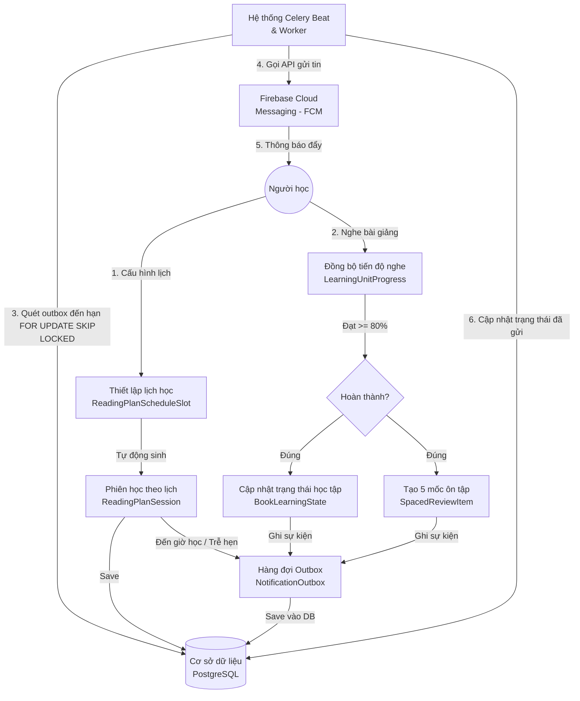

Tôi đã phân tích rất kỹ bức ảnh sơ đồ hiện tại của bạn và đối chiếu với nội dung của 5 mục trong Chương 7. 

Nhận định của bạn hoàn toàn chính xác: **Sơ đồ hiện tại đang bị lệch pha và thiếu sót nhiều cấu phần quan trọng so với nội dung chi tiết trong các mục của luận văn.**

Dưới đây là phân tích chi tiết các điểm chưa khớp và giải pháp cụ thể (bạn cần cập nhật gì trên ảnh hoặc nội dung chữ) để hai phần tương thích hoàn hảo với nhau.

---

## I. Phân Tích Các Điểm Chưa Khớp (Gaps)

### 1. Thiếu cấu phần của Mục 7.1 (Thiết lập lịch học và phiên học theo lịch)
*   **Trong nội dung**: Mục 7.1 viết rất kỹ về việc người học thiết lập lịch học (`ReadingPlanScheduleSlot`) và hệ thống sinh ra các phiên học tập (`ReadingPlanSession`) với các trạng thái `scheduled`, `due`, `missed`...
*   **Trên ảnh sơ đồ**: Hoàn toàn không có bất kỳ khối nào thể hiện luồng này. Người đọc nhìn vào ảnh sẽ chỉ thấy luồng nghe âm thanh tự do, không thấy luồng nhắc học theo lịch biểu đâu cả.

### 2. Thiếu bản chất của Mục 7.4 (Transactional Outbox Pattern)
*   **Trong nội dung**: Mục 7.4 viết về việc sử dụng bảng trung gian `Notification Outbox` trong cơ sở dữ liệu để ghi nhận thông báo cùng một giao dịch nghiệp vụ, tránh thất lạc tin, sau đó khóa dòng (`FOR UPDATE SKIP LOCKED`) để gửi đi.
*   **Trên ảnh sơ đồ**: 
    *   Ảnh đang vẽ Celery Beat quét Database rồi **gửi trực tiếp (Data Noti) sang Firebase FCM**. Luồng này bị sai kỹ thuật so với Outbox Pattern (đáng lẽ Celery Beat phải quét bảng Outbox, gửi thành công mới đánh dấu đã gửi trong Outbox).
    *   Thiếu khối thể hiện bảng **`Notification Outbox`** nằm trong cơ sở dữ liệu.

---

## II. Hướng Dẫn Cập Nhật Để Sơ Đồ Khớp Với Nội Dung

Để ảnh sơ đồ phản ánh đúng $100\%$ các mục từ 7.1 đến 7.4, bạn nên chỉnh sửa lại ảnh trên draw.io/Visio theo các bước sau:

### 1. Bổ sung Nhánh thiết lập lịch (Khớp với Mục 7.1)
*   Vẽ thêm một nhánh ở phía trên hoặc bên trái người dùng:
    `Người học` ── Giao diện cấu hình ──> `Thiết lập lịch học` (ReadingPlanScheduleSlot) ──> `Sinh các phiên học` (ReadingPlanSession) ── Save ──> `Database`.

### 2. Bổ sung bảng Outbox vào cơ sở dữ liệu (Khớp với Mục 7.4)
*   Trong biểu tượng chiếc trống **`Database`**, bạn chia ra làm 3 bảng/phần dữ liệu nhỏ nằm bên trong để trực quan hóa:
    1.  **Tiến độ học tập** (lưu `LearningUnitProgress` & `BookLearningState`).
    2.  **Mốc ôn tập / Lịch học** (lưu `SpacedReviewItem` & `ReadingPlanSession`).
    3.  **Hàng đợi Outbox** (lưu `NotificationOutbox`).
*   **Sửa luồng lưu**: 
    *   Khi `Đánh dấu hoàn thành tiến độ` (Mục 7.2) xảy ra: Hệ thống sẽ thực hiện:
        *   Tạo `Mốc ôn tập` (Mục 7.3) $\rightarrow$ Lưu vào **Mốc ôn tập** trong DB.
        *   Đồng thời ghi một bản ghi thông báo chờ gửi vào **Hàng đợi Outbox** trong DB (đây chính là Transactional Outbox).
    *   Khi có phiên học đến hạn (Mục 7.1): Hệ thống cũng ghi thông báo chờ vào **Hàng đợi Outbox**.

### 3. Sửa luồng Celery Beat & Firebase FCM (Khớp với Mục 7.4)
*   Sửa mũi tên quét: **`Celery Beat`** quét định kỳ **Hàng đợi Outbox** trong DB (sử dụng khóa dòng `FOR UPDATE SKIP LOCKED`).
*   Sửa mũi tên gửi: **`Celery Beat`** (hoặc Celery Worker) gọi API gửi tin đến **`Firebase Cloud Messaging (FCM)`** $\rightarrow$ FCM gửi thông báo đẩy đến **`Người học`**.
*   Vẽ thêm một mũi tên phản hồi: Sau khi FCM gửi xong, Worker cập nhật trạng thái đã gửi ngược lại **Hàng đợi Outbox** trong DB.

---

## III. Phác Thảo Sơ Đồ Mới (Mermaid) Để Bạn Dễ Hình Dung Và Vẽ Lại

Tôi đã phác thảo lại luồng chuẩn dưới dạng sơ đồ Mermaid. Bạn có thể xem trực quan luồng đi này để vẽ lại trên công cụ draw.io của mình:

Bạn thấy cấu trúc luồng mới này đã làm nổi bật và bao quát được toàn bộ 4 mục nội dung trong chương chưa? Bạn có muốn tôi hỗ trợ viết lại đoạn text giới thiệu đầu chương trong tệp [index_c7.tex](file:///W:/WorkSpace_IT/_CAPSTON_PROJECT/2022DoAnTN_KhoaDat/noidung/c7_he_thong_theo_doi_tien_do/index_c7.tex) cho khớp với thiết kế hoàn chỉnh này không?