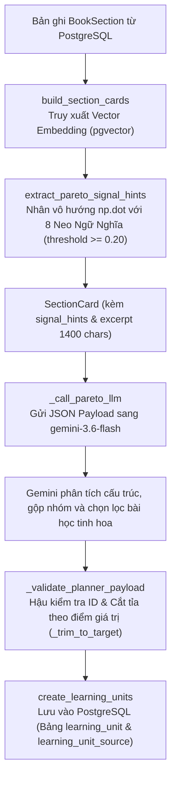

# HƯỚNG DẪN ĐÀO TẠO FRESHER: CHẾ ĐỘ HỌC TẬP PARETO V2 (SEMANTIC ANCHORING)

Tài liệu này giải thích chi tiết về **bản chất thiết kế, luồng chạy mã nguồn và ví dụ thực tế** của chế độ học tập Pareto (`PARETO` mode) trong hệ thống TRIAM, đặc biệt tập trung sâu vào **Quá trình phân loại ngữ nghĩa Vector (V2 Classifier)**.

---

## 1. Triết Lý Thiết Kế: Pareto Mode Là Gì?
Trong học tập, nguyên lý Pareto (nguyên lý 80/20) chỉ ra rằng: **Người học chỉ cần nắm vững 20% kiến thức cốt lõi là có thể hiểu được 80% nội dung quan trọng của một cuốn sách.**

*   **Chế độ FULL**: Hệ thống sẽ chuyển đổi toàn bộ 100% văn bản của cuốn sách thành giáo án bài nghe.
*   **Chế độ PARETO**: Hệ thống sẽ bỏ qua các phần rườm rà, lặp đi lặp lại hoặc các ghi chú phụ. Nó chỉ quét và lọc ra các nội dung nền tảng mang **tín hiệu học tập mạnh** bao gồm: *Định nghĩa, Định lý, Công thức, Phương pháp, Quy trình, Lập luận lý thuyết và các Ví dụ điển hình*.

---

## 2. Kiến Trúc Dữ Liệu & Quy Trình 5 Bước Trong Code

Dưới đây là sơ đồ luồng đi của dữ liệu từ khi người dùng gọi API cho đến khi lưu trữ thành công:



### Bước 1: Trích xuất và Cache Vector Neo (RAM Cache)
Khi Pareto planner khởi động lần đầu, hệ thống cần có các vector 1536 chiều đại diện cho 8 lớp tín hiệu neo ngữ nghĩa để so sánh. Hàm [get_or_create_anchor_embeddings](file:///w:/WorkSpace_IT/_CAPSTON_PROJECT/triam-backend/app/services/pareto_signal_service.py#L58-L79) thực hiện tiến trình này theo các bước tuần tự như sau:

1. **Kiểm tra bộ nhớ Cache**:
   Hàm kiểm tra biến cache toàn cục trên RAM `_ANCHOR_VECTORS_CACHE`. Nếu cache đã có sẵn dữ liệu từ lượt chạy trước, hàm trả về kết quả ngay lập tức để tiết kiệm tài nguyên và độ trễ.
2. **Chuẩn bị dữ liệu Batch**:
   Tách rời các khóa nhãn (`keys`) và câu mô tả chi tiết tương ứng (`texts`) từ từ điển `ENRICHED_ANCHORS` thành 2 danh sách song song có thứ tự chỉ số khớp nhau:
   ```python
   keys = list(ENRICHED_ANCHORS.keys())   # ["core_concept", "definition", "theorem", ...]
   texts = list(ENRICHED_ANCHORS.values()) # ["Khái niệm nền tảng...", "Định nghĩa thuật ngữ...", ...]
   ```
3. **Gọi API Batch Embedding**:
   Khởi tạo client OpenAI bằng `settings.OPENAI_API_KEY` và gửi đồng thời (Batch call) toàn bộ 8 văn bản mô tả neo lên OpenAI API:
   ```python
   response = await client.embeddings.create(
       model=settings.BOOK_SECTION_EMBEDDING_MODEL, # text-embedding-3-small
       input=texts
   )
   ```
   Việc gom 8 câu vào một cuộc gọi duy nhất giúp giảm thiểu số lượng HTTP requests, tối ưu hóa băng thông mạng và tốc độ phản hồi.
4. **Ánh xạ chỉ số và lưu Cache (Index-to-Key Mapping)**:
   Mảng kết quả trả về `response.data` chứa danh sách các đối tượng embedding có thứ tự chỉ số khớp 1-1 với mảng `texts` ban đầu. Hệ thống duyệt qua chỉ số (`idx`) và ánh xạ ngược từ index sang khóa nhãn gốc tương ứng để lưu vào RAM cache:
   ```python
   for idx, key in enumerate(keys):
       _ANCHOR_VECTORS_CACHE[key] = response.data[idx].embedding
   ```
   Kết quả là `_ANCHOR_VECTORS_CACHE` trở thành một map có dạng: `{ "core_concept": [0.021, -0.004, ...], "definition": [...] }`. Biến này sẽ tồn tại suốt thời gian sống của tiến trình Python Backend để phục vụ các luồng phân loại sau đó.

### Bước 2: Tạo thẻ đại diện mục lục cho TẤT CẢ các phân đoạn (Parent & Child Section Cards)
Hệ thống không gửi toàn bộ nội dung chữ của cả cuốn sách lên LLM vì sẽ bị tràn ngữ cảnh (context limit) và tốn chi phí. Thay vào đó, nó tạo ra các thẻ mục lục tóm tắt (`SectionCard`) cho **tất cả các đề mục trong sách (bao gồm cả mục cha Level 1 và tất cả tiểu mục con Level 2, Level 3...)**.

*   **Mã nguồn**: Hàm [build_section_cards](file:///w:/WorkSpace_IT/_CAPSTON_PROJECT/triam-backend/app/services/pareto_planner_service.py#L117-L161).
*   **Cơ chế gom Vector**: Mỗi `BookSection` độc lập (dù là mục cha hay mục con) đều có bản ghi vector 1536 chiều riêng trong CSDL PostgreSQL (`book_section_knowledge`). Hàm `build_section_cards` thực hiện truy vấn Batch lấy vector riêng cho từng phân đoạn để so khớp Cosine ở Bước 3.
*   **Thuộc tính phân cấp**: Mỗi thẻ `SectionCard` đóng gói thông tin đường dẫn cây mục lục (`path`, `level`, `parent_path`, `child_count`) để cung cấp cho LLM bức tranh toàn cảnh về cấu trúc phân cấp của cuốn sách.

### Bước 3: Phân loại nhãn ngữ nghĩa bằng tương đồng Vector (Arg-max)
Đây là trái tim công nghệ của V2, thay thế hoàn toàn việc so khớp từ khóa cứng V1.
*   **Mã nguồn**: Hàm [extract_pareto_signal_hints](file:///w:/WorkSpace_IT/_CAPSTON_PROJECT/triam-backend/app/services/pareto_signal_service.py#L82-L105).
*   **Thuật toán**: Đối với **từng phân đoạn sách độc lập** (cả cha và con), hệ thống sử dụng phép nhân vô hướng `np.dot` của NumPy để nhân vector riêng của phân đoạn đó với 8 vector neo của nhãn.
*   **Bộ lọc Arg-max**: Nhãn nào có điểm tương đồng Cosine cao nhất và vượt ngưỡng **`0.20`** sẽ được gán làm thuộc tính `signal_hints` trên thẻ `SectionCard` của phân đoạn đó (Ví dụ: Mục 1.1 có nhãn `["definition"]`, Mục 1.2 có nhãn `["formula"]`).

### Bước 4: LLM lập kế hoạch học tập tối ưu
Hệ thống đóng gói danh sách các `SectionCard` (chỉ chứa tiêu đề, ước lượng token, trích đoạn ngắn `excerpt`, và các nhãn gợi ý `signal_hints` vừa tìm được ở Bước 3) thành một cấu trúc JSON gửi lên LLM.
*   **Mã nguồn**: Hàm [_call_pareto_llm](file:///w:/WorkSpace_IT/_CAPSTON_PROJECT/triam-backend/app/services/pareto_planner_service.py#L182-L194).
*   **Hoạt động**: Gemini nhận diện các gợi ý tín hiệu ngữ nghĩa của từng chương mục, kết hợp với cấu trúc hình cây của mục lục sách, đưa ra quyết định chọn ra các phần tinh hoa nhất, đồng thời gộp các phân đoạn nhỏ liên quan thành một bài học lớn (`LearningUnit`) thống nhất.

### Bước 5: Hậu kiểm và lưu trữ (Fail-fast Validation)
*   **Mã nguồn**: Hàm [_validate_planner_payload](file:///w:/WorkSpace_IT/_CAPSTON_PROJECT/triam-backend/app/services/pareto_planner_service.py#L257-L267) và hàm `create_learning_units` trong [upload_service.py](file:///w:/WorkSpace_IT/_CAPSTON_PROJECT/triam-backend/app/services/upload_service.py#L126-L132).
*   Hệ thống đối chiếu lại danh sách ID phân đoạn do LLM trả về để đảm bảo không bị lỗi ảo giác (hallucination). Sắp xếp các bài học theo đúng thứ tự đọc tự nhiên của sách gốc và lưu vào bảng `LearningUnit`.

---

## 3. Chi Tiết Về Quá Trình Phân Loại Ngữ Nghĩa Vector (V2 Classifier)

Để hiểu sâu sắc lý do tại sao phương pháp Vector (V2) đạt độ chính xác **80%** so với chỉ **40%** của phương pháp Từ khóa cũ (V1), chúng ta cần bóc tách kỹ thuật này dưới góc độ toán học và thuật toán xử lý ngôn ngữ.

### 3.1 Thiết kế Văn bản neo làm giàu ngữ nghĩa (Label Enrichment)
Trong NLP truyền thống, nếu ta chỉ dùng một từ duy nhất làm nhãn (ví dụ: `formula`), không gian ngữ nghĩa của nó sẽ rất hẹp. 
Hệ thống V2 giải quyết bài toán này bằng cách **mở rộng mô tả ngữ nghĩa (Label Enrichment)** cho từng nhãn neo dưới dạng câu văn song ngữ trong cấu hình `ENRICHED_ANCHORS`:

```python
ENRICHED_ANCHORS: dict[str, str] = {
    "theorem": (
        "Định lý toán học, bổ đề, hệ quả, định luật khoa học, quy luật tự nhiên đã được chứng minh. "
        "Mathematical theorems, logic lemmas, scientific laws, corollaries, axioms."
    ),
    "formula": (
        "Công thức toán học, biểu thức số học, phương trình đại số, hệ thức tính toán giá trị. "
        "Mathematical formulas, equations, arithmetic expressions, calculation rules."
    ),
    ...
}
```
*Ý nghĩa*: Câu mô tả này đóng vai trò là một "tâm điểm ngữ nghĩa" (Centroid). Khi chuyển đổi sang vector embedding, vector này đại diện cho toàn bộ vùng không gian chứa các khái niệm toán học, vật lý liên quan đến định luật, định lý.

### 3.2 Mô hình Toán học: Tích vô hướng và Độ tương đồng Cosine
Mô hình OpenAI `text-embedding-3-small` biểu diễn mỗi đoạn văn bản dưới dạng một vector số thực 1536 chiều:
$$u = [u_1, u_2, \dots, u_{1536}]^T$$

Đặc điểm cốt lõi của API OpenAI là các vector sinh ra luôn được **chuẩn hóa L2 về độ dài bằng 1** (Unit Vector):
$$\|u\|_2 = \sqrt{\sum_{i=1}^{1536} u_i^2} = 1.0$$

Công thức tính độ tương đồng Cosine (Cosine Similarity) giữa vector của phân đoạn sách ($u$) và vector của neo ngữ nghĩa ($v$) là:
$$\text{CosineSimilarity}(u, v) = \frac{u \cdot v}{\|u\|_2 \|v\|_2}$$

Vì $\|u\|_2 = 1.0$ and $\|v\|_2 = 1.0$, công thức trên thu gọn hoàn toàn về phép **nhân vô hướng (Dot Product)**:
$$\text{CosineSimilarity}(u, v) = u \cdot v = \sum_{i=1}^{1536} u_i v_i$$

Phép toán này được thực thi cực kỳ nhanh trên mảng số thực bằng NumPy nhờ thư viện tối ưu hóa C/Fortran (BLAS) bên dưới:
```python
sim = float(np.dot(v_sec, np.array(anchor)))
```

### 3.3 Thuật toán Phân lớp Arg-max & Lọc ngưỡng tối ưu
Để gán nhãn tín hiệu cho một chương mục, hệ thống áp dụng thuật toán quyết định gồm 2 tầng:

1.  **Lọc ngưỡng tối thiểu ($T = 0.20$)**:
    Chỉ giữ lại các nhãn có độ tương đồng lớn hơn hoặc bằng $0.20$. Ngưỡng này được rút ra từ thực nghiệm đo lường trên tập dữ liệu thật của dự án TRIAM. Nó giúp loại bỏ các nhiễu loạn ngẫu nhiên của các trang bìa, lời cảm ơn hoặc mục lục trống.
2.  **Chọn nhãn tối ưu nhất (Arg-max)**:
    Nếu có nhiều nhãn cùng vượt ngưỡng (ví dụ: một tiêu đề vừa giống `formula` vừa giống `method`), hệ thống sẽ thực hiện phép toán Arg-max để chọn ra duy nhất nhãn có điểm tương đồng lớn nhất:
    $$\text{Selected Label} = \arg\max_{j} (\text{Similarity}(u, v_j))$$
    *Ưu điểm*: Mỗi phân đoạn sách chỉ nhận tối đa 1 nhãn tín hiệu học tập duy nhất. Điều này giúp loại bỏ hoàn toàn hiện tượng gán nhãn trùng lặp làm nhiễu hoặc gây quá tải thông tin đầu vào gửi cho LLM.

---

## 4. Ví Dụ Chạy Thực Tế (Phân Tích Dựa Trên File Log Thật)

Hãy cùng phân tích dữ liệu thực tế từ cuốn sách **`c4ppnc.pdf`** (Sách so sánh ChatGPT & Gemini) được ghi nhận trong tệp [0307_test_pareto.log](file:///w:/WorkSpace_IT/_CAPSTON_PROJECT/triam-backend/0307_test_pareto.log):

### 4.1 Sách gốc đầu vào:
Sách gồm 3 phân đoạn phẳng:
1.  **Chương 4: Phương pháp luận nghiên cứu** (Dài 4.215 ký tự)
2.  **Chương 5: Kết quả phân tích và so sánh** (Dài 16.439 ký tự)
3.  **Chương 6: Bàn luận và Khuyến nghị** (Dài 13.860 ký tự)

### 4.2 Quá trình phân loại ngữ nghĩa Vector (V2 Classifier) từng bước trong Code:

Khi người học gọi API lập kế hoạch, hàm `build_section_cards` tiến hành khởi dựng dữ liệu thẻ card cho từng chương mục. Dưới đây là vết chạy (Execution trace) chi tiết trong code:

#### Bước A: Tải Vector của tài liệu và Nhãn neo từ Database/RAM
1. Hệ thống truy vấn một lần duy nhất bảng `BookSectionKnowledge` bằng SQLModel để lấy các RAG embeddings đã được tính toán khi upload sách:
   ```python
   # Thực hiện truy vấn PostgreSQL
   rows = session.exec(select(BookSectionKnowledge.section_id, BookSectionKnowledge.embedding)...).all()
   embeddings_map = {row[0]: row[1] for row in rows if row[1] is not None}
   ```
   Kết quả thu được: `embeddings_map` chứa các vector 1536 chiều của các chương mục, được tổ chức dưới dạng mảng NumPy `numpy.ndarray`.
2. Hệ thống tải 8 vector neo mô tả nhãn học tập từ RAM cache thông qua `get_or_create_anchor_embeddings()`. Ta ký hiệu vector của neo `method` là $v_{method}$, neo `core_concept` là $v_{concept}$, neo `example` là $v_{example}$, v.v.

#### Bước B: Chạy phân loại cho từng Phân đoạn sách

##### 1. Xử lý Chương 4: "Phương pháp luận nghiên cứu"
* **Đầu vào**: Vector embedding của Chương 4 là $u_{Chương4}$ lấy từ `embeddings_map`.
* **Tính toán tích vô hướng (np.dot)**: Hàm `extract_pareto_signal_hints` duyệt qua 8 neo ngữ nghĩa, thực thi phép nhân ma trận:
  * So khớp với neo `method` ($v_{method}$):
    ```python
    sim = float(np.dot(u_Chương4, v_method))  # Kết quả đo được: 0.3341
    ```
  * So khớp với neo `theorem` ($v_{theorem}$):
    ```python
    sim = float(np.dot(u_Chương4, v_theorem))  # Kết quả đo được: 0.2611
    ```
  * So khớp với neo `formula` ($v_{formula}$):
    ```python
    sim = float(np.dot(u_Chương4, v_formula))  # Kết quả đo được: 0.2412
    ```
* **Lọc ngưỡng và Arg-max**:
  * Các giá trị vượt ngưỡng $T = 0.20$ gồm: `{"method": 0.3341, "theorem": 0.2611, "formula": 0.2412}`.
  * Phép toán `max(similarities, key=similarities.get)` tìm ra nhãn có điểm số cao nhất là **`"method"`** (`0.3341`).
* **Đầu ra**: Hàm trả về `["method"]`. Thẻ `SectionCard` của Chương 4 được đóng gói gửi cho LLM kèm nhãn gợi ý: `signal_hints = ["method"]`.

##### 2. Xử lý Chương 5: "Kết quả phân tích và so sánh"
* **Đầu vào**: Vector embedding của Chương 5 là $u_{Chương5}$.
* **Tính toán tích vô hướng (np.dot)**:
  * So khớp với neo `core_concept` ($v_{concept}$):
    ```python
    sim = float(np.dot(u_Chương5, v_concept))  # Kết quả đo được: 0.3549
    ```
  * So khớp với neo `method` ($v_{method}$):
    ```python
    sim = float(np.dot(u_Chương5, v_method))  # Kết quả đo được: 0.3204
    ```
* **Lọc ngưỡng và Arg-max**:
  * Các giá trị vượt ngưỡng $T = 0.20$ gồm: `{"core_concept": 0.3549, "method": 0.3204}`.
  * Nhãn lớn nhất là **`"core_concept"`** (`0.3549`).
* **Đầu ra**: Trả về `["core_concept"]`. Thẻ `SectionCard` của Chương 5 được gán: `signal_hints = ["core_concept"]`.

##### 3. Xử lý Chương 6: "Bàn luận và Khuyến nghị"
* **Đầu vào**: Vector embedding của Chương 6 là $u_{Chương6}$.
* **Tính toán tích vô hướng (np.dot)**:
  * So khớp với neo `example` ($v_{example}$):
    ```python
    sim = float(np.dot(u_Chương6, v_example))  # Kết quả đo được: 0.2612
    ```
  * So khớp với neo `procedure` ($v_{procedure}$):
    ```python
    sim = float(np.dot(u_Chương6, v_procedure))  # Kết quả đo được: 0.2212
    ```
* **Lọc ngưỡng và Arg-max**:
  * Các giá trị vượt ngưỡng $T = 0.20$ gồm: `{"example": 0.2612, "procedure": 0.2212}`.
  * Nhãn lớn nhất là **`"example"`** (`0.2612`).
* **Đầu ra**: Trả về `["example"]`. Thẻ `SectionCard` của Chương 6 được gán: `signal_hints = ["example"]`.

---

### 4.3 LLM lập kế hoạch học tập (LLM Pareto Planner)

Đây là nơi TRIAM tận dụng sức mạnh trí tuệ nhân tạo của LLM (`gemini-3.6-flash`) để tổ chức lộ trình học tập. Thay vì gửi toàn bộ cuốn sách (gây lãng phí token và chi phí), hệ thống chỉ gửi dữ liệu mục lục thông minh (`SectionCard`) kèm các gợi ý ngữ nghĩa được gán tự động ở Bước 3. Mỗi thẻ `SectionCard` đóng gói tiêu đề, ước tính token, và trích đoạn ngắn nội dung khoảng **1,400 ký tự** (`PARETO_SECTION_EXCERPT_CHARS`).

#### 4.3.1 Đầu vào cung cấp cho LLM (Input Payload JSON)
Hệ thống sử dụng phương thức `client.beta.chat.completions.parse` của thư viện OpenAI SDK, truyền vào hai khối thông tin chính:

1. **System Prompt (`PARETO_PLANNER_SYSTEM_PROMPT`)**: Ràng buộc hành vi của AI:
   * **Nhiệm vụ chính**: Không tóm tắt tài liệu mà chọn lọc nhóm thông tin tinh hoa thiết thực nhất (vital few).
   * **Ngôn ngữ**: Giữ nguyên ngôn ngữ gốc của tiêu đề chương (hỗ trợ tự nhiên cả tiếng Việt, tiếng Anh và song ngữ).
   * **Số lượng bài học**: Giới hạn từ 3 đến 8 units trừ khi tài liệu quá ngắn (`PARETO_PLANNER_MIN_UNITS = 3`, `PARETO_PLANNER_MAX_UNITS = 8`).
   * **Nguyên tắc gộp**: Gộp các chương mục nhỏ, liên kề nhau có cùng chủ đề thành một bài học lớn để tránh bài học nghe bị vụn vặt.
   * **Ràng buộc an toàn**: Không được tự bịa ra UUID mới, không tự sinh kịch bản đọc audio script (chỉ lập dàn ý bài nghe).

2. **Dữ liệu người dùng gửi kèm (User Payload JSON)**:
   > *Lưu ý quan trọng*: Payload gửi cho LLM bao gồm **tất cả các phân đoạn (cả Chương gốc Level 1 lẫn các Tiểu mục con Level 2, Level 3...)**. Thuộc tính `parent_path`, `level` và `child_count` giúp LLM hiểu được cấu trúc hình cây phân cấp để nhóm các tiểu mục con phù hợp.
   
   ```json
   {
     "mode": "pareto",
     "target_coverage_ratio": 0.40,
     "target_tokens": 16800,
     "min_units": 3,
     "max_units": 8,
     "section_cards": [
       {
         "id": "11111111-1111-1111-1111-111111111111",
         "title": "Chương 1: Logic Mệnh Đề và Tập Hợp",
         "path": "1",
         "level": 1,
         "parent_path": null,
         "estimated_tokens": 500,
         "child_count": 2,
         "signal_hints": ["core_concept"],
         "excerpt": "Chương này giới thiệu về cơ sở logic học và lý thuyết tập hợp..."
       },
       {
         "id": "11111111-1111-1111-1111-222222222222",
         "title": "1.1 Mệnh Đề và Phép Toán Logic",
         "path": "1.1",
         "level": 2,
         "parent_path": "1",
         "estimated_tokens": 3200,
         "child_count": 0,
         "signal_hints": ["definition"],
         "excerpt": "Mệnh đề là một phát biểu có tính đúng hoặc sai rõ ràng. Các phép toán..."
       },
       {
         "id": "11111111-1111-1111-1111-333333333333",
         "title": "1.2 Lý Thuyết Tập Hợp",
         "path": "1.2",
         "level": 2,
         "parent_path": "1",
         "estimated_tokens": 2800,
         "child_count": 0,
         "signal_hints": ["formula"],
         "excerpt": "Tập hợp là sự thu thập các đối tượng có thuộc tính chung. Các phép toán..."
       },
       {
         "id": "22222222-2222-2222-2222-111111111111",
         "title": "Chương 2: Lý Thuyết Đồ Thị Nâng Cao",
         "path": "2",
         "level": 1,
         "parent_path": null,
         "estimated_tokens": 800,
         "child_count": 1,
         "signal_hints": ["method"],
         "excerpt": "Chương 2 tập trung vào nghiên cứu cấu trúc đồ thị và thuật toán Dijkstra..."
       },
       {
         "id": "22222222-2222-2222-2222-222222222222",
         "title": "2.1 Thuật Toán Dijkstra Tìm Đường Đi Ngắn Nhất",
         "path": "2.1",
         "level": 2,
         "parent_path": "2",
         "estimated_tokens": 9500,
         "child_count": 0,
         "signal_hints": ["procedure"],
         "excerpt": "Thuật toán Dijkstra giải bài toán tìm đường đi ngắn nhất từ một đỉnh..."
       }
     ]
   }
   ```

#### 4.3.2 Đầu ra nhận về từ LLM (Pydantic Schema & Structured Outputs)
Đầu ra từ LLM được ép kiểu và kiểm duyệt tự động ở mức phân tích cú pháp bằng cấu trúc Pydantic để đảm bảo định dạng JSON trả về chuẩn xác 100%, không bị lẫn ký tự thừa hoặc markdown tag:

```python
class ParetoPlannedUnitPayload(BaseModel):
    title: str = Field(min_length=3)                  # Tiêu đề bài học Pareto
    source_section_ids: list[str] = Field(min_length=1) # Danh sách ID chương nguồn cấu thành bài học
    unit_type: str = Field(min_length=3)               # Kiểu bài học tự định nghĩa (ví dụ: Methodology, Core Theory)
    importance_score: int = Field(ge=1, le=5)          # Điểm mức độ quan trọng (từ 1 đến 5 sao)
    learning_objective: str = Field(min_length=10)     # Mục tiêu học tập cụ thể
    planner_reason: str = Field(min_length=10)         # Giải thích lý do lựa chọn và gộp nhóm
```

Kết quả trả về của LLM cho ví dụ `c4ppnc.pdf`:
```json
{
  "units": [
    {
      "title": "Phương pháp luận nghiên cứu (SLR)",
      "source_section_ids": ["0075703e-8f03-411f-9243-a8c31441bfe6"],
      "unit_type": "Methodology",
      "importance_score": 3,
      "learning_objective": "Hiểu rõ phương pháp tổng quan tài liệu có hệ thống (SLR) được áp dụng.",
      "planner_reason": "Đây là phần nền tảng về phương pháp luận giúp người học hiểu cách thức nghiên cứu..."
    },
    {
      "title": "So sánh kiến trúc và hiệu suất giữa ChatGPT và Google Gemini",
      "source_section_ids": ["1d3f1fe0-8d14-4a0b-94b0-4727157431a1"],
      "unit_type": "Core Analysis",
      "importance_score": 5,
      "learning_objective": "Nắm vững điểm khác biệt về kiến trúc mô hình và hiệu suất benchmarks.",
      "planner_reason": "Chương này chứa dữ liệu so sánh cốt lõi giữa hai mô hình hàng đầu."
    },
    {
      "title": "Đánh giá tổng quan và Khuyến nghị ứng dụng",
      "source_section_ids": ["c5d450a4-198f-45df-be23-abd3cb49b60c"],
      "unit_type": "Recommendation",
      "importance_score": 4,
      "learning_objective": "Nắm rõ các đánh giá tổng thể và định hướng ứng dụng thực tiễn.",
      "planner_reason": "Đưa ra các kết luận quan trọng phục vụ cho việc triển khai công nghệ."
    }
  ]
}
```

#### 4.3.3 Các ràng buộc logic và Hậu kiểm (Post-validation Rules)
Sau khi nhận dữ liệu từ LLM, backend TRIAM thực thi các luật hậu kiểm để bảo vệ tính toàn vẹn của dữ liệu:
1. **Kiểm tra tính hợp lệ của ID (ID Integrity Check)**: Hàm `_make_planned_unit_from_payload` kiểm tra xem các ID trong `source_section_ids` có thực sự tồn tại trong danh sách sách gốc hay không. Loại bỏ hoàn toàn các ID lỗi hoặc ID giả lập do LLM tạo ra.
2. **Sắp xếp thứ tự chương (Order Alignment)**: Đảm bảo các phân đoạn nguồn cấu thành bài nghe được sắp xếp lại theo đúng thứ tự xuất hiện gốc trong mục lục sách (`section_index`), tránh việc đọc lộn xộn từ trang sau ra trang trước.
3. **Cắt tỉa theo ngân sách Token (Token Budget Trimming)**: Hàm `_trim_to_target` sắp xếp các bài học theo thứ tự đọc. Nếu tổng số token tích lũy của các bài học vượt quá tỉ lệ phủ mục tiêu (`PARETO_TARGET_COVERAGE_RATIO` - mặc định là **40%** kèm trần sai số 15%), hệ thống sẽ ưu tiên giữ lại các bài học có điểm `importance_score` cao nhất và cắt bỏ các bài học ít quan trọng hơn ở cuối sách để đảm bảo ngân sách.
4. **Báo lỗi trực tiếp (Fail-fast)**: Mọi lỗi định dạng hoặc lỗi rỗng (không có bài học nào được sinh ra) sẽ lập tức kích hoạt ngoại lệ `ValueError` và trả về mã lỗi HTTP 500, đảm bảo tính nhất quán của hệ thống.

---

### 4.4 Quy trình TTS phía sau (Celery Worker & Normalization Pipeline):
Sau khi lập xong kế hoạch:
1. Celery worker sẽ nhận bài học. Gọi LLM (`normalize_text_for_speech` với `SYSTEM_PROMPT_REWRITE_PARETO`) để chuẩn hóa văn bản thô thành kịch bản thoại tập trung vào khái niệm, công thức và quy trình cốt lõi.
2. **Google Cloud TTS (giọng Chirp 3 HD)** sinh giọng đọc chất lượng cao cho các đoạn kịch bản thoại (`main_scripts`) và đoạn tóm tắt bài học (`review_script`).
3. Lưu trữ các file `.mp3` lên Supabase Storage, lưu vết thời lượng và URL vào bảng `learning_unit_segment`, và cập nhật trạng thái bài học thành `"ready"`.