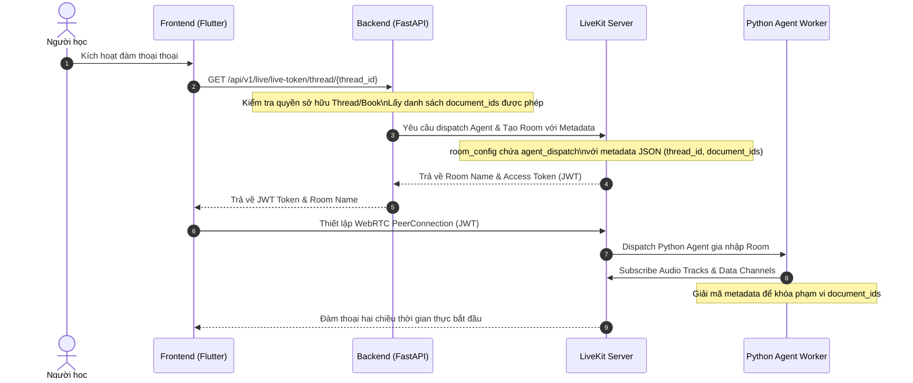
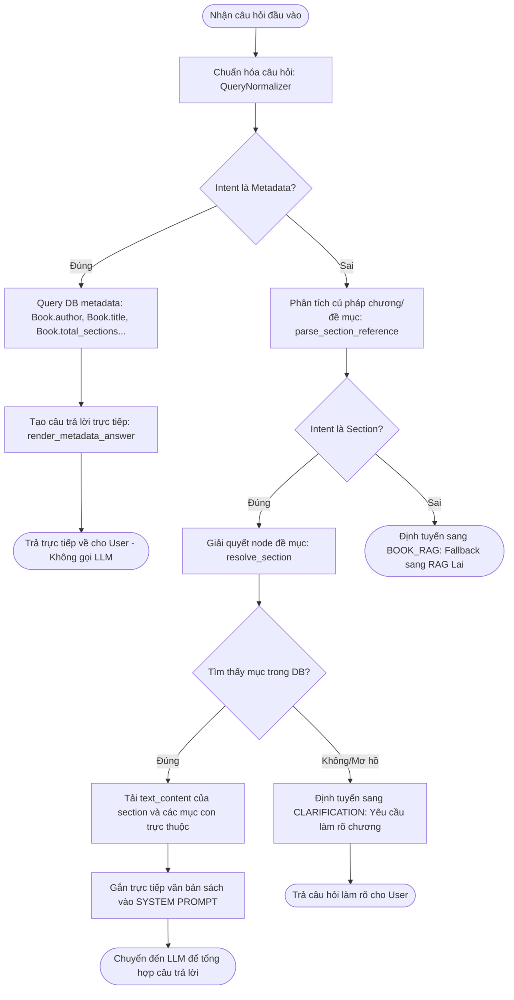
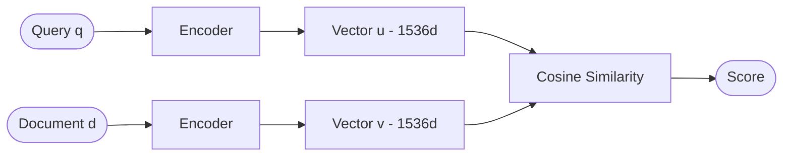
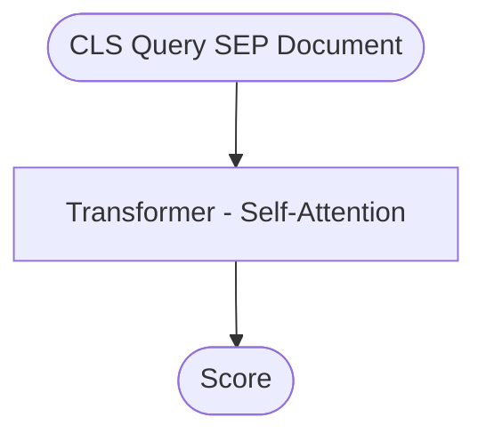
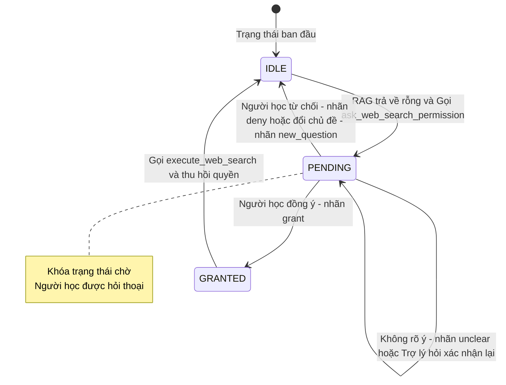

# BÁO CÁO NGHIÊN CỨU CHI TIẾT
## HỆ THỐNG TRỢ LÝ GIỌNG NÓI THỜI GIAN THỰC & CƠ CHẾ RAG (CHƯƠNG 8)

Hệ thống được thiết kế để giải quyết bài toán: **Làm sao để người học có thể tương tác thoại thời gian thực (độ trễ cực thấp) với tài liệu học tập, đảm bảo câu trả lời luôn bám sát tri thức sách gốc, loại bỏ ảo giác (hallucination), và kiểm soát an toàn luồng dữ liệu ngoài (Internet)**.

---

## 1. TẦNG GIAO TIẾP: WEBRTC, LIVEKIT VÀ ĐỒNG BỘ DỮ LIỆU (MỤC 8.1 & 8.2)

### A. Quy trình kết nối và cấp phát mã LiveKit Token
Khi người học kích hoạt phiên đàm thoại giọng nói từ ứng dụng di động (Frontend - FE), quy trình cấp phát quyền truy cập diễn ra qua các bước:



1. **Frontend gửi yêu cầu**: FE thực hiện một truy vấn `GET` đến endpoint `/api/v1/live/live-token/thread/{thread_id}` hoặc `/api/v1/live/live-token/{book_id}`.
2. **Backend xác thực và chuẩn bị Metadata**: 
   - Kiểm tra quyền sở hữu của người dùng hiện tại đối với Thread/Book.
   - Truy vấn cơ sở dữ liệu để lấy danh sách mã sách được phép đọc (`document_ids`) qua liên kết `StudyContextDocumentLink`.
   - Đóng gói thông tin phạm vi truy xuất vào cấu trúc JSON metadata:
     ```json
     {
       "thread_id": "uuid-cua-thread",
       "context_id": "uuid-cua-context",
       "document_ids": ["uuid-sach-1", "uuid-sach-2"]
     }
     ```
3. **Dispatch Agent**: Backend gọi LiveKit Server API, khởi tạo cấu hình phòng học (`RoomConfiguration`) bao gồm đối tượng `RoomAgentDispatch` chứa metadata JSON nói trên.
4. **Trả về Token**: LiveKit ký AccessToken (chứa VideoGrants cho phép gia nhập phòng `room_join=True` và cấu hình Agent). Backend trả JWT token này về cho FE.
5. **Giao tiếp Media qua WebRTC**: FE sử dụng token này để thiết lập kết nối WebRTC với LiveKit Server. LiveKit chịu trách nhiệm giải mã luồng âm thanh hai chiều (Opus codec):
   - **Âm thanh người dùng**: FE streaming audio track qua WebRTC đến LiveKit Server $\rightarrow$ chuyển đến Python Agent xử lý.
   - **Âm thanh trợ lý**: Python Agent tổng hợp giọng nói từ văn bản và stream ngược lại audio track qua WebRTC đến LiveKit $\rightarrow$ phát trên thiết bị người dùng.

### B. Đặc tả các kênh truyền dữ liệu (LiveKit Data Channels / Topics)
Bên cạnh luồng âm thanh (Audio tracks), hệ thống duy trì **3 kênh dữ liệu (Data Channels)** đáng tin cả (reliable) thông qua cơ chế phân chia chủ đề (Topics) của LiveKit SDK:

#### 1. Kênh Chat Văn Bản (`lk.chat` / `LK_CHAT_TOPIC`)
- **Mục đích**: Truyền tải dữ liệu tin nhắn dạng văn bản thô (raw string) theo cả hai chiều.
- **Sử dụng**: Frontend gửi các câu lệnh gõ text trực tiếp vào phòng, hoặc Agent gửi nội dung câu trả lời dạng văn bản thô để hiển thị ngay trên giao diện hộp thoại phụ.

#### 2. Kênh Điều Khiển (`lk.control` / `LK_CONTROL_TOPIC`)
- **Mục đích**: Đồng bộ hóa các tín hiệu trạng thái và cấu hình vận hành giữa FE và Agent.
- **Ví dụ payload**:
  ```json
  {
    "type": "toggle_web_search",
    "enabled": true
  }
  ```
  Khi người dùng Bật/Tắt nút "Tìm kiếm Web" trên ứng dụng di động, FE sẽ bắn gói tin JSON này qua kênh `lk.control`. Agent nhận được sẽ cập nhật trạng thái `WebSearchPermissionPolicy` ngay trong bộ nhớ để quyết định có đi xin quyền tìm kiếm ngoài sách hay không.

#### 3. Kênh Hội Thoại / Phân Bản (`lk.transcript` / `LK_TRANSCRIPT_TOPIC`)
- **Mục đích**: Đồng bộ hóa các phân bản thoại thời gian thực phục vụ hiển thị phụ đề chạy chữ và cơ chế đối khớp dữ liệu.
- **Cấu trúc JSON Payload**:
  ```json
  {
    "v": 1,
    "type": "transcript",
    "role": "user" | "assistant",
    "text": "Nội dung văn bản đã được chuẩn hóa",
    "id": "uuid-cua-transcript-temp",
    "message_id": "uuid-cua-tin-nhan-trong-db-postgresql",
    "thread_id": "uuid-cua-luong-hoi-thoai",
    "source": "livekit",
    "status": "committed",
    "ts": "2026-07-04T08:30:00.000Z"
  }
  ```

#### Cơ chế đối khớp hội thoại (Message Reconciliation)
Trong quá trình thoại, Whisper STT sẽ sinh ra các đoạn văn bản tạm thời (interim transcript) để hiển thị nhanh trên màn hình người dùng. Để tránh việc tin nhắn bị trùng lặp, đứt quãng hoặc biến mất sau khi hội thoại kết thúc, hệ thống áp dụng cơ chế:
1. Khi Agent hoặc User kết thúc phát ngôn, hệ thống đồng thời lưu tin nhắn đó vào bảng `message` của PostgreSQL để có định danh vĩnh viễn (`message_id`).
2. Gói tin gửi qua kênh `lk.transcript` mang theo trường `message_id` chính thức này.
3. Khi nhận được gói tin có `message_id`, Frontend sẽ thay thế tin nhắn tạm thời (được hiển thị bởi `id` tạm) bằng bản ghi chính thức từ cơ sở dữ liệu, đảm bảo dòng thời gian hội thoại đồng bộ tuyệt đối và không phát sinh lỗi lệch tin nhắn giữa ứng dụng và máy chủ.

---

## 2. BỘ ĐỊNH TUYẾN Ý ĐỊNH GROUNDING ROUTER & BỘ CHUẨN HÓA CÂU HỎI (MỤC 8.3)

### A. Bộ chuẩn hóa câu hỏi (`QueryNormalizer`)
Trước khi tiến hành phân tích ý định, câu hỏi thô của người dùng được chuẩn hóa qua các bước xử lý trong [query_normalizer.py](file:///w:/WorkSpace_IT/_CAPSTON_PROJECT/triam-backend/app/services/agent_grounding/query_normalizer.py):
1. **Chuẩn hóa Unicode (NFKC)**: Đưa các ký tự tiếng Việt dạng tổ hợp hoặc dựng sẵn về một chuẩn duy nhất để tránh lỗi so khớp chuỗi.
2. **Loại bỏ dấu tiếng Việt (Accent Folding)**: Hàm `fold_accents` chuyển đổi toàn bộ chuỗi sang dạng không dấu (Ví dụ: `"chương"` $\rightarrow$ `"chuong"`).
3. **Tách từ (Tokenization)**: Sử dụng biểu thức chính quy `\d+(?:\.\d+)+|[^\W_]+|\d+` để tách từ. Nó nhận diện được các số thập phân đại diện cho chương/mục con (Ví dụ: `"2.1"` được tách thành một token `"2.1"` duy nhất thay vì hai token độc lập).
4. **Kiểm tra cụm từ (`contains_phrase`)**: Thực hiện so khớp chuỗi trên mảng token không dấu để đảm bảo các câu hỏi tiếng Việt không dấu hoặc sai dấu nhẹ vẫn có thể được nhận dạng chính xác.

### B. Sơ đồ giải thuật Grounding Router



- **Metadata Route**: Các câu hỏi truy vấn trực tiếp thuộc tính của sách. Hệ thống trả câu trả lời tĩnh sau khi kết xuất dữ liệu DB, hoàn toàn bỏ qua việc gọi API của mô hình ngôn ngữ lớn để triệt tiêu độ trễ và chi phí.
- **Section Route**: Đối khớp chính xác chương/mục. Nội dung của `BookSection` được nạp trực tiếp để trả lời. Nếu người học hỏi về chương không tồn tại hoặc nói chung chung không rõ chương số mấy, hệ thống kích hoạt chế độ hỏi lại (`CLARIFICATION`).

---

## 3. CƠ CHẾ RAG LAI NÂNG CAO (MỤC 8.4)

### A. bypass cơ chế lọc Evidence Validation
> [!NOTE]
> Trong thiết lập mặc định của hệ thống hiện tại, bộ lọc **Evidence Validation đã được tắt** thông qua cấu hình `AGENT_HYBRID_VALIDATE_EVIDENCE_ENABLED: bool = False` tại tệp [config.py](file:///w:/WorkSpace_IT/_CAPSTON_PROJECT/triam-backend/app/core/config.py#L124).
>
> Lúc này, lớp kiểm tra này chỉ đóng vai trò tối giản: **Kiểm tra xem hệ thống có tìm thấy bất kỳ phân đoạn (candidate) nào từ Hybrid Search hay không**. Nếu danh sách candidates không rỗng, hệ thống sẽ bỏ qua việc lọc từ khóa (missing named entity) và lọc ngưỡng tin cậy thấp (low confidence), lập tức chuyển sang bước **Rerank** ngữ nghĩa sâu.

### B. Tìm kiếm song song Hybrid Search (Vector & Lexical Search)
Hệ thống sử dụng luồng tìm kiếm kép chạy song song trên cơ sở dữ liệu PostgreSQL (Supabase) nhằm tận dụng thế mạnh hỗ trợ lẫn nhau giữa hai phương pháp:

#### 1. Vector Search (Semantic Search)
- **Khái niệm**: Biểu diễn ngữ nghĩa câu hỏi và tài liệu dưới dạng các vector đậm đặc (dense vector) trong không gian cao chiều (1536 chiều từ mô hình GPT embedding - `text-embedding-3-small`).
- **Công thức tính toán**: Độ tương đồng ngữ nghĩa được đo bằng **độ tương đồng Cosine (Cosine Similarity)** giữa vector câu hỏi $\vec{Q}$ và vector phân đoạn tài liệu $\vec{D}$:
  $$\text{Cosine Similarity}(\vec{Q}, \vec{D}) = \frac{\vec{Q} \cdot \vec{D}}{\|\vec{Q}\| \|\vec{D}\|} = \frac{\sum_{i=1}^{n} Q_i D_i}{\sqrt{\sum_{i=1}^{n} Q_i^2} \sqrt{\sum_{i=1}^{n} D_i^2}}$$
- **Triển khai CSDL**: Trong PostgreSQL, chỉ mục pgvector hỗ trợ toán tử `<=>` đại diện cho **khoảng cách Cosine (Cosine Distance)**:
  $$\text{Cosine Distance}(\vec{Q}, \vec{D}) = 1 - \text{Cosine Similarity}(\vec{Q}, \vec{D})$$
- **Lý do ứng dụng**: Bắt được mối liên hệ ngữ nghĩa sâu sắc mà không phụ thuộc vào từ khóa trùng khớp (Ví dụ: người dùng nói về "lập trình bất đồng bộ" có thể tự động ánh xạ đến các phân đoạn chứa thuật ngữ "asyncio", "coroutine", "event loop").

#### 2. Lexical Search (Full-text Search & Trigram Search)
Lexical Search là sự kết hợp của hai giải pháp bổ trợ nhằm giải quyết bài toán khớp từ khóa và sửa lỗi chính tả:

##### a. Tìm kiếm toàn văn (Full-text Search - FTS)
- **Cách hoạt động**: PostgreSQL phân tích văn bản thành các token, chuyển về dạng lexeme (từ gốc) và lưu vào một chỉ mục ngược (`tsvector`). Khi truy vấn, hệ thống tìm kiếm các lexeme tương ứng bằng cách chuyển câu hỏi thành một `tsquery`.
- **Đánh giá mức độ liên quan**: Sử dụng hàm `ts_rank_cd` để tính toán mật độ từ khóa xuất hiện gần nhau trong văn bản (Cover Density):
  $$\text{FTS\_Score} \propto \text{Mật độ phân bổ của cụm từ khóa truy vấn trong chunk}$$
- **Lý do ứng dụng**: Cực kỳ chính xác cho các thực thể đặc định, mã code, con số, hoặc tên riêng (những thứ mà vector nén thường làm giảm độ sắc nét).

##### b. Tìm kiếm mờ dựa trên Trigram (`pg_trgm`)
- **Khái niệm**: Một trigram là một chuỗi gồm 3 ký tự liên tiếp trích xuất từ một từ. 
- **Tài liệu chính thức PostgreSQL**: [PostgreSQL pg_trgm Documentation](https://www.postgresql.org/docs/current/pgtrgm.html)
- **Cách hoạt động**:
  - Module `pg_trgm` của PostgreSQL tự động chia nhỏ chuỗi văn bản thành tập hợp các trigram. Ví dụ, chuỗi `"cat"` được phân tích thành tập hợp các trigram là: `{"  c", " ca", "at "}` (với tiền tố 2 khoảng trắng và hậu tố 1 khoảng trắng).
  - Độ tương đồng trigram (Jaccard Similarity) giữa hai chuỗi $x$ và $y$ được tính theo công thức:
    $$\text{Trigram Similarity}(x, y) = \frac{|T(x) \cap T(y)|}{|T(x) \cup T(y)|}$$
    Trong đó $T(x)$ và $T(y)$ lần lượt là tập hợp các trigram của $x$ và $y$.
  - Trong backend, hệ thống sử dụng hàm `word_similarity(normalized_query_text, bsk.search_text)` để tìm độ tương đồng cao nhất giữa trigram của câu hỏi với bất kỳ phân đoạn từ nào của văn bản sách. Toán tử `<%` được dùng kết hợp với chỉ mục GIN/GiST để lọc nhanh các dòng có độ tương đồng vượt ngưỡng quy định (mặc định là $0.6$).
- **Lý do ứng dụng (Đặc thù cho Voice STT)**: Khi người dùng nói, dịch vụ chuyển giọng nói thành văn bản (STT - Speech to Text) thường xuyên nhận diện sai các từ viết tắt chuyên ngành hoặc lỗi phát âm (Ví dụ: "web rtc" thay vì "webrtc", "crooks" thay vì "Brooks", hoặc mất dấu tiếng Việt "tieng viet" thay vì "tiếng việt"). Tìm kiếm toàn văn FTS sẽ thất bại hoàn toàn nếu từ khóa bị lệch ký tự. Tìm kiếm Trigram cho phép dung sai lỗi chính tả và nhận diện cực tốt các từ có độ tương đồng ký tự cao, giữ cho hệ thống hoạt động ổn định trong môi trường thoại thực tế.

### C. Thuật toán RRF (Reciprocal Rank Fusion)
Sau khi nhận kết quả từ cả hai nhánh, hệ thống gộp chúng lại bằng thuật toán RRF. Điểm số thô của các phân đoạn được bỏ qua để loại bỏ sai số thang đo của hai thuật toán tìm kiếm khác nhau. Điểm RRF của mảnh $d$ được tính theo công thức:
$$\text{RRF\_Score}(d) = \sum_{m \in \{\text{Vector}, \text{Lexical}\}} \frac{1}{60 + r_m(d)}$$
Trong đó $r_m(d)$ là vị trí xếp hạng của phân đoạn $d$ trong luồng kết quả tìm kiếm $m$ (nếu không xuất hiện, $r_m(d) = \infty$). Hằng số làm mịn $60$ ngăn các phân mảnh ở vị trí quá cao làm lệch hoàn toàn kết quả.

Hệ thống áp dụng **chính sách đa dạng hóa tri thức**: Giới hạn tối đa 2 chunks cho một đề mục sách (`AGENT_HYBRID_MAX_CHUNKS_PER_SECTION = 2`) nhằm tránh việc một chương dài chiếm toàn bộ ngữ cảnh học tập, đảm bảo tri thức được phân bổ đều.

### D. Vai Trò của Cohere Multilingual Rerank v3.0 (Cơ chế Tái Xếp Hạng)
Giai đoạn Rerank đóng vai trò then chốt trong việc lọc ra tri thức chính xác nhất. Hệ thống gửi tối đa 20 ứng viên RRF hàng đầu sang mô hình `rerank-multilingual-v3.0` của Cohere để đánh giá sự tương thích ngữ nghĩa sâu sắc.

Để hiểu tại sao bước này cải thiện mạnh mẽ độ chính xác của RAG và giảm ảo giác, ta cần phân tích sâu hai kiến trúc mạng nơ-ron: **Bi-Encoder** và **Cross-Encoder**.

#### 1. Kiến trúc Bi-Encoder (Áp dụng cho Cosine Similarity & GPT Embedding)
Trong kiến trúc Bi-Encoder, câu hỏi và tài liệu được xử lý **hoàn toàn độc lập** với nhau qua hai luồng mạng độc lập (hoặc một mạng dùng chung ở hai thời điểm khác nhau):



*   **Cách hoạt động**:
    1.  Mô hình (Ví dụ: `text-embedding-3-small` của OpenAI) nhận câu hỏi $q$ và nén nó thành một vector $\vec{u}$.
    2.  Tương tự, mỗi mảnh tài liệu $d$ được nén thành một vector $\vec{v}$ riêng biệt.
    3.  Mô hình nén **không hề biết** câu hỏi khi đang nén tài liệu, và ngược lại. Sự tương đồng chỉ được tính toán ở lớp cuối cùng bằng công thức toán học Cosine Similarity giữa hai vector đầu ra độc lập: $\text{Similarity}(q, d) = \text{Cosine}(\vec{u}, \vec{v})$.
*   **Tại sao Cosine Similarity là Bi-Encoder?**: Vì nó chỉ đo khoảng cách giữa hai biểu diễn vector đã được nén trước đó mà không có sự giao tiếp thời gian thực giữa các từ trong câu.
*   **Ưu điểm**: Cực kỳ nhanh. Vì vector tài liệu đã được tính toán và lưu sẵn (chỉ mục Vector như HNSW trong pgvector), khi có câu hỏi mới, ta chỉ cần sinh 1 vector cho câu hỏi và chạy phép nhân ma trận trên cơ sở dữ liệu. Nhờ đó có thể quét qua hàng triệu tài liệu trong vài mili giây.
*   **Nhược điểm**: Do phải nén toàn bộ văn bản của một chunk (khoảng 300-500 từ) thành một vector cố định, mô hình sẽ bị mất mát các chi tiết nhỏ, không hiểu rõ được các quan hệ phủ định hoặc thứ tự từ phức tạp (Ví dụ: `"không dùng docker"` và `"cách dùng docker"` có thể có vector biểu diễn rất gần nhau vì chứa chung các từ khóa ngữ nghĩa chính, dẫn đến Bi-Encoder đánh giá similarity rất cao).

#### 2. Kiến trúc Cross-Encoder (Áp dụng cho Cohere Rerank)
Khác với Bi-Encoder, kiến trúc Cross-Encoder đưa **câu hỏi và tài liệu vào cùng một mô hình Transformer đồng thời**:



*   **Cách hoạt động**:
    1.  Câu hỏi $q$ và đoạn văn bản $d$ được nối với nhau qua một ký tự phân tách đặc biệt (Ví dụ: `[CLS] q [SEP] d`).
    2.  Chuỗi nối này được đưa trực tiếp vào mạng Transformer. Lúc này, cơ chế **Self-Attention (Tự chú ý)** của Transformer cho phép mỗi token (từ/cụm từ) trong câu hỏi tương tác chéo thời gian thực với từng token trong tài liệu ở từng tầng ẩn của mô hình.
    3.  Mô hình phân tích trực tiếp mối quan hệ cú pháp và ngữ nghĩa để đưa ra một điểm số liên quan duy nhất.
*   **Tại sao Cohere Rerank là Cross-Encoder?**: Mô hình `rerank-multilingual-v3.0` hoạt động trên nguyên lý này. Nó nhận đồng thời cả câu hỏi của người học và nội dung thô của các phân đoạn sách để thực hiện tính toán độ tương đồng chéo.
*   **Ưu điểm**: Độ chính xác vượt trội. Nhờ cơ chế Self-Attention, Cross-Encoder cực kỳ nhạy bén với các quan hệ logic, các liên từ tương phản (Ví dụ: `"nhưng"`, `"không"`), các từ viết tắt chuyên ngành, và bối cảnh cụ thể của câu hỏi. Nó sẽ dễ dàng nhận diện ra `"không dùng docker"` là không liên quan đến bài viết hướng dẫn cài đặt Docker.
*   **Nhược điểm**: Chi phí tính toán cực kỳ lớn và độ trễ cao. Không thể áp dụng Cross-Encoder để quét trực tiếp trên hàng chục nghìn phân đoạn sách trong cơ sở dữ liệu vì mô hình sẽ bị quá tải phần cứng.

#### 3. Sự Kết Hợp Tối Ưu Trong Hệ Thống TRIAM
Hệ thống kết hợp cả hai phương pháp thành một **RAG Pipeline hai tầng (Two-stage Retrieval)** để đạt được cả tốc độ của Bi-Encoder và độ chính xác của Cross-Encoder:
1.  **Tầng 1 (Retrieval - Lọc thô)**: Sử dụng **Bi-Encoder (OpenAI GPT Embedding)** kết hợp với **Lexical Search (PostgreSQL FTS + Trigram)** để nhanh chóng tìm kiếm và sàng lọc ra top 20 ứng viên từ hàng nghìn phân đoạn sách với độ trễ tối thiểu.
2.  **Tầng 2 (Reranking - Lọc tinh)**: Chuyển tiếp 20 ứng viên hàng đầu qua **Cross-Encoder (Cohere Rerank API)** để so khớp ngữ nghĩa sâu sắc, sắp xếp lại thứ tự chính xác, chọn ra top 12 chunks tốt nhất để đưa vào ngữ cảnh của LLM tổng hợp câu trả lời.

---

## 4. CHÍNH SÁCH ĐIỀU PHỐI DÙNG CHUNG (SHARED AGENT POLICY - MỤC 8.5)
Hệ thống thiết kế cấu phần **`SharedAgentPolicy`** đóng vai trò là động cơ ra quyết định (decision engine) trung tâm. Cấu phần này thống nhất logic xử lý và chính sách truy xuất dữ liệu cho cả hai phương thức giao tiếp: **kênh chat văn bản (Text Chat)** và **kênh đàm thoại giọng nói thời gian thực (LiveKit Voice Agent)**.

### A. Lý do áp dụng Shared Agent Policy
Trước khi áp dụng chính sách dùng chung, luồng chat text và luồng thoại voice được xử lý bởi các khối logic độc lập. Điều này dẫn đến sự bất nhất về hành vi của Agent (Ví dụ: chat text trả lời trực tiếp câu hỏi metadata nhưng voice agent lại gọi RAG vector; chính sách yêu cầu cấp quyền tìm kiếm ngoài hoạt động khác nhau giữa hai bên).

Bằng cách đưa `SharedAgentPolicy` vào giữa làm trung gian điều phối, toàn bộ các quyết định lớn liên quan đến ý định, truy xuất sách và quyền truy cập Web đều tuân thủ các quy tắc bất biến chung:
1. **Consistency (Tính nhất quán)**: Cùng một câu hỏi ở cùng một ngữ cảnh sẽ trả về cùng một nguồn dữ liệu và hành động xử lý, bất kể người dùng nhập từ bàn phím hay nói qua micro.
2. **Loại bỏ sự trùng lặp**: Giảm thiểu việc bảo trì hai luồng code song song cho cùng một chức năng nghiệp vụ của Trợ lý.

### B. Cơ chế định tuyến và các Quyết định Hành động (Policy Actions)
Hàm `resolve` của `SharedAgentPolicy` nhận yêu cầu `AgentPolicyRequest` và trả về kết quả `AgentPolicyResult` chứa một trong các hành động nghiệp vụ sau:

*   **`DIRECT_ANSWER` (Trả lời trực tiếp)**:
    *   *Ngữ cảnh*: Khi Grounding Router xác định câu hỏi thuộc loại đặc tả (Metadata) như tác giả, tên sách, hoặc trạng thái xử lý; hoặc khi một chương sách được tìm thấy nhưng nội dung văn bản chưa được trích xuất.
    *   *Hành động*: Trả trực tiếp chuỗi văn bản tĩnh lấy từ DB cho người học, không gọi mô hình ngôn ngữ (LLM).
*   **`ASK_CLARIFICATION` (Yêu cầu làm rõ)**:
    *   *Ngữ cảnh*: Khi câu hỏi của người học bị mơ hồ (Ví dụ: thiếu chỉ định số chương cụ thể).
    *   *Hành động*: Phát ra câu thoại làm rõ để FE hiển thị hoặc Agent đọc lên hỏi người dùng.
*   **`ANSWER_WITH_SECTION_CONTEXT` (Trả lời bằng văn bản chương)**:
    *   *Ngữ cảnh*: Khi Grounding Router đối khớp chính xác chương/mục được yêu cầu (Ví dụ: "Tóm tắt chương 4").
    *   *Hành động*: Nạp trực tiếp nội dung văn bản gốc của chương đó, tạo prompt chỉ dẫn LLM tổng hợp câu trả lời dựa trên phạm vi duy nhất của chương sách được cung cấp.
*   **`ANSWER_WITH_RAG_CONTEXT` (Trả lời bằng kết quả RAG lai)**:
    *   *Ngữ cảnh*: Khi câu hỏi là câu hỏi kiến thức chung và bộ truy hồi Hybrid RAG + Cohere Rerank tìm thấy các phân mảnh tri thức liên quan.
    *   *Hành động*: Đóng gói các mảnh tri thức thành ngữ cảnh và ra lệnh cho LLM trả lời dựa trên tài liệu tham chiếu.
*   **`ASK_WEB_PERMISSION` (Yêu cầu xin quyền tìm kiếm ngoài)**:
    *   *Ngữ cảnh*: Khi RAG không tìm thấy thông tin phù hợp trong sách (`rag_context_not_found` hoặc điểm vector thô dưới ngưỡng tin cậy $0.25$) và cấu hình cho phép tìm kiếm web được bật (`allow_web_permission=True`).
    *   *Hành động*: Chuyển trạng thái sang chờ xác nhận và gửi câu hỏi xin phép tìm kiếm Internet.
*   **`WEB_DISABLED` (Tìm kiếm ngoài bị tắt)**:
    *   *Ngữ cảnh*: Khi RAG không tìm thấy thông tin nhưng quyền tìm kiếm web bị tắt trong cài đặt.
    *   *Hành động*: Trả về câu thông báo từ chối cung cấp thông tin ngoài sách.
*   **`ERROR` (Lỗi hệ thống)**:
    *   *Ngữ cảnh*: Gặp lỗi kết nối CSDL hoặc sự cố API.
    *   *Hành động*: Trả về câu thoại báo lỗi hệ thống tạm thời.

---

## 5. CƠ CHẾ CẤP QUYỀN TÌM KIẾM INTERNET (MỤC 8.6)

Khi RAG không tìm thấy thông tin phù hợp trong sách (`BOOK_CONTEXT_NOT_FOUND`), hệ thống sẽ kích hoạt quy trình xin quyền tìm kiếm Internet hai tầng.



### A. Phương pháp Heuristics Fast Path (Lọc nhanh)
Để giảm độ trễ và tránh lạm dụng LLM, hệ thống áp dụng bộ lọc nhanh Heuristics bằng cách so khớp từ khóa không dấu trong [voice_intent_classifier.py](file:///w:/WorkSpace_IT/_CAPSTON_PROJECT/triam-backend/app/services/voice_agent/voice_intent_classifier.py):
1. **Chuẩn hóa văn bản**: Chuyển chuỗi về chữ thường, bỏ dấu tiếng Việt, loại bỏ ký tự đặc biệt, thay thế `"đ"` thành `"d"`.
2. **So khớp các cụm từ đồng ý (`POSITIVE_ACTION_PHRASES` & `POSITIVE_SHORT_REPLIES`)**:
   - Các cụm từ hành động: `"dong y"`, `"tim di"`, `"cu tim"`, `"go ahead"`, `"do it"`, `"search it"`, `"tim giup"`, `"tim ho"`, `"u tim"`.
   - Các từ đồng ý ngắn: `"co"`, `"uh"`, `"ok"`, `"oke"`, `"yes"`, `"yep"`, `"yup"`, `"sure"`, `"duoc"`, `"vang"`.
   - **Ràng buộc nhạy cảm ngữ cảnh (Context-sensitive)**: Đối với các từ ngắn dễ bị nhầm lẫn (như `"co"`, `"duoc"`, `"dung"`, `"phai"`), hệ thống chỉ chấp nhận phân loại là `grant` nếu độ dài phản hồi tối đa là **2 từ**. Nếu người dùng nói câu dài chứa từ đó (Ví dụ: "Sách có chương này không?"), bộ heuristics sẽ bỏ qua để tránh nhận diện nhầm.
3. **So khớp cụm từ từ chối (`NEGATIVE_PHRASES`)**:
   - Các từ từ chối: `"khong"`, `"khong can"`, `"khoi"`, `"dung tim"`, `"dung search"`, `"thoi"`, `"bo qua"`, `"skip"`, `"nope"`, `"nah"`, `"no"`.
   - Các từ nhạy cảm như `"khong"` hoặc `"no"` chỉ được xác định trực tiếp là `deny` nếu độ dài câu thoại $\le 2$ từ.

### B. Fallback sang OpenAI LLM Classifier
Nếu câu thoại của người dùng vượt quá 4 từ hoặc bộ lọc Heuristics không thể đưa ra quyết định chắc chắn, hệ thống chuyển tiếp dữ liệu hội thoại sang mô hình `gpt-4o-mini`:
- Hệ thống gửi kèm theo: **Câu hỏi tìm kiếm đang chờ** (`pending_query`) và **Câu trả lời bằng giọng nói của người học** (`user_reply`).
- LLM được yêu cầu phân tích sâu ngữ nghĩa câu nói dựa trên ngữ cảnh để phân loại vào một trong 4 nhãn: `grant`, `deny`, `unclear`, `new_question` đi kèm điểm tin cậy `confidence`.
- Nếu điểm tin cậy nhỏ hơn ngữ cảnh quy định `VOICE_AGENT_PERMISSION_CLASSIFIER_CONFIDENCE_THRESHOLD = 0.85`, hệ thống tự động coi kết quả là `unclear` để đảm bảo tính an toàn tối đa.