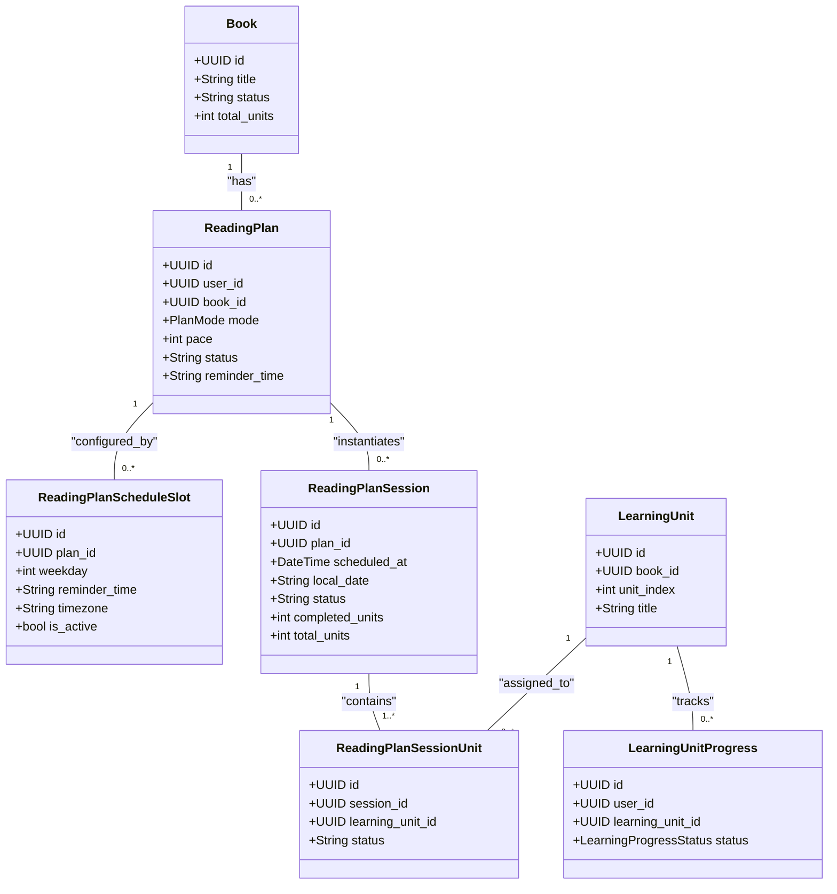
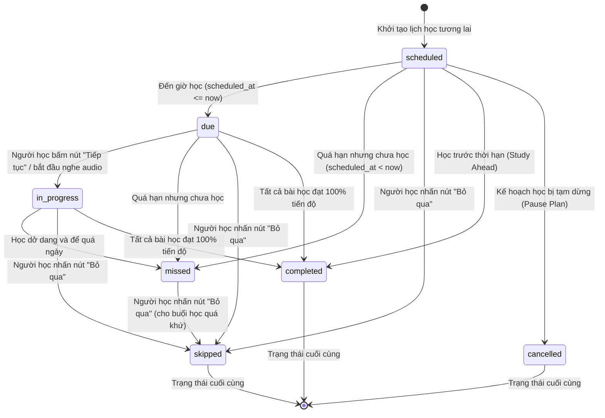

# Tài Liệu Đặc Tả Nghiệp Vụ Hệ Thống Lịch Học (Reading Plan System)

Tài liệu này trình bày toàn bộ kiến trúc, mô hình dữ liệu, các trạng thái vòng đời và các quy tắc nghiệp vụ (Business Rules) cốt lõi của hệ thống Lập lịch & Quản lý tiến trình học tập (Reading Plan) trên nền tảng TRIAM.

---

## 1. Kiến Trúc Thực Thể Dữ Liệu (Entity Relationship)

Hệ thống Reading Plan được xây dựng trên mô hình cơ sở dữ liệu quan hệ chặt chẽ nhằm đảm bảo tính nhất quán giữa lịch trình thời gian (Calendar) và tiến độ tiếp thu kiến thức thực tế.

### Chi tiết vai trò của các thực thể:
1. **`ReadingPlan`**: Kế hoạch tổng thể để học một cuốn sách. Người dùng chọn chế độ học (`mode` là `FULL` hoặc `PARETO`), tiến độ học (`pace` là số bài học trên mỗi buổi), giờ nhắc nhở học hàng ngày (`reminder_time`) và trạng thái hoạt động (`status` là `ACTIVE` hoặc `INACTIVE`).
2. **`ReadingPlanScheduleSlot`**: Cấu hình các ngày học trong tuần (ví dụ: Thứ 2, Thứ 4, Thứ 6 vào lúc 19:30). Mỗi slot chứa thông tin múi giờ (`timezone`) của thiết bị người học.
3. **`ReadingPlanSession`**: Buổi học thực tế trên lịch của một ngày cụ thể (ví dụ: ngày 10 tháng 7 năm 2026). Mỗi session được ánh xạ thành một mốc thời gian UTC (`scheduled_at`) và ngày địa phương (`local_date`).
4. **`ReadingPlanSessionUnit`**: Liên kết nhiều-nhiều giữa buổi học và bài học. Nó xác định cụ thể trong buổi học ngày hôm đó, người học cần nghe những bài học (`LearningUnit`) nào.
5. **`LearningUnitProgress`**: Trạng thái học thực tế của người dùng đối với một bài học. Đây là nguồn dữ liệu duy nhất xác định người dùng đã thực sự nghe xong bài học đó hay chưa.

---

## 2. Vòng Đời Trạng Thái Của Buổi Học (Session State Machine)

Một buổi học (`ReadingPlanSession`) có 7 trạng thái vòng đời được quản lý tự động dựa trên thời gian và hành vi của người dùng:

### Các nhóm trạng thái:
*   **Trạng thái hoạt động (`ACTIVE_SESSION_STATUSES`)**:
    *   `scheduled` (Đã lên lịch): Buổi học nằm trong tương lai, chờ đến giờ học.
    *   `due` (Đến hạn): Đã đến giờ học theo lịch hẹn, đang chờ người dùng kích hoạt.
    *   `in_progress` (Đang thực hiện): Người dùng đã bắt đầu nghe ít nhất một bài học trong buổi đó.
    *   `missed` (Trễ hạn): Buổi học có mốc thời gian `scheduled_at` nằm trong quá khứ nhưng tiến trình hoàn thành bài học chưa đạt $100\%$.
*   **Trạng thái cuối cùng (`FINAL_SESSION_STATUSES`)**:
    *   `completed` (Hoàn thành): Toàn bộ các bài học gán trong buổi học đó đã được nghe xong thực tế.
    *   `skipped` (Bỏ qua): Người dùng chủ động chọn bỏ qua buổi học này.
    *   `cancelled` (Đã hủy): Buổi học bị hủy do người dùng tạm dừng kế hoạch học (`pause_reading_plan`) hoặc thay đổi lịch trình.

---

## 3. Các Quy Tắc Nghiệp Vụ Cốt Lõi (Key Business Rules) Kèm Ví Dụ Minh Họa

### Rule 3.1: Cơ chế Phân nhóm Bài học (Pace & Chunking)
Khi tạo hoặc cập nhật lịch, hệ thống sẽ thực hiện phân nhóm các bài học chưa học theo bước tiến độ (`pace`) đã đăng ký:
$$\text{Số buổi cần tạo} = \left\lceil \frac{\text{Số bài học còn lại}}{\text{Pace}} \right\rceil$$
Các bài học được sắp xếp theo thứ tự `unit_index` tăng dần và chia nhỏ thành từng nhóm (chunk) để gán cho từng buổi học tương lai dựa theo lịch học của `ReadingPlanScheduleSlot`.

> [!NOTE]
> **Ví dụ minh họa:**
> * **Bối cảnh**: Cuốn sách có 5 bài học (`U1`, `U2`, `U3`, `U4`, `U5`).
> * **Thiết lập của user**: Tốc độ học `pace = 2` (2 bài/buổi). Lịch học: Thứ 2, Thứ 4 lúc 19:00.
> * **Kết quả chia nhóm**:
>   * **Buổi 1 (Thứ 2)**: Gán học `U1` và `U2`.
>   * **Buổi 2 (Thứ 4)**: Gán học `U3` và `U4`.
>   * **Buổi 3 (Thứ 2 tuần sau)**: Gán học bài cuối `U5`.
>   * *Tổng số buổi học tự động sinh ra*: $\lceil 5 / 2 \rceil = 3$ buổi.

---

### Rule 3.2: Cơ chế Kiểm tra Xung đột Lịch học (Conflict Detection)
Để tránh tình trạng quá tải lịch học của người dùng, hệ thống áp dụng hai lớp bảo vệ:
1. **Khi kích hoạt kế hoạch**: Kiểm tra tất cả các slot học trong tuần (`schedule_config` + `reminder_time`) không được phép trùng lặp giữa các cuốn sách khác nhau của cùng một người dùng.
2. **Khi dời lịch (`Reschedule`)**: Khi dời lịch một buổi học cụ thể sang giờ mới bằng hàm [reschedule_reading_plan_session](file:///w:/WorkSpace_IT/_CAPSTON_PROJECT/triam-backend/app/services/reading_plan_session_service.py#L494), hệ thống sẽ tìm kiếm trong DB xem có buổi học hoạt động nào khác trùng mốc thời gian đó không. Nếu phát hiện trùng lặp, hệ thống sẽ từ chối và bắn ra ngoại lệ `ReadingPlanScheduleConflictError`.

> [!NOTE]
> **Ví dụ minh họa:**
> * **Tình huống 1**: Bạn đang học sách *Algorithms* lịch cố định Thứ 2, Thứ 4 lúc 19:00. Bạn mở sách *C# Programming* và muốn cài lịch Thứ 4, Thứ 6 lúc 19:00. Hệ thống sẽ **báo lỗi ngay lập tức** vì trùng khung giờ 19:00 ngày Thứ 4.
> * **Tình huống 2**: Bạn có một buổi học riêng lẻ của sách *Algorithms* vào lúc 19:00 Thứ 2 ngày 13/07. Bạn muốn dùng chức năng Dời lịch (Reschedule) để chuyển buổi này sang 19:00 Thứ 4 ngày 15/07. Vì lúc 19:00 Thứ 4 đã có sẵn lịch của cuốn sách đó (hoặc sách khác), hệ thống sẽ **từ chối** dời lịch để tránh người học bị dồn 2 buổi học vào cùng một giờ.

---

### Rule 3.3: Cơ chế Dồn bài Tự động (Carry-over & Dynamic Rescheduling)
Nếu người học bấm **Bỏ qua (Skip)** một buổi học hoặc để một buổi học bị **Trễ hạn (Missed)**:
*   Trạng thái của `ReadingPlanSession` chuyển sang `skipped` hoặc `missed`, nhưng trạng thái `LearningUnitProgress` của các bài học trong buổi đó **vẫn giữ nguyên là chưa hoàn thành**.
*   Khi người dùng thực hiện **Dời lịch (Reschedule)** hoặc **Tiếp tục kế hoạch (Resume)** hoặc khi **Cập nhật kế hoạch (Update Plan)**, Backend chạy hàm `ensure_future_sessions_for_plan` với cờ `replace_unfinished=True`. Hàm này sẽ xóa toàn bộ các buổi học chưa hoàn thành và tái lập lịch học mới từ đầu. Các bài học chưa học (bao gồm bài học bị skip/missed trước đó) sẽ tự động được cuộn (carry-over) lên các buổi học đầu tiên của lịch trình mới.

> [!NOTE]
> **Ví dụ minh họa:**
> * **Bối cảnh**: Cuốn sách có 5 bài học (`U1`, `U2`, `U3`, `U4`, `U5`). Pace = 1. Lịch học từ Thứ 2 đến Thứ 6.
>   * Buổi 1 (Thứ 2 - Học `U1`): Trạng thái `completed`.
>   * Buổi 2 (Thứ 3 - Học `U2`): Người học bận đột xuất, bấm **Bỏ qua (Skip)**.
> * **Hành động**: Tối Thứ 3, người dùng cập nhật lại lịch học (hoặc pause rồi resume).
> * **Kết quả dồn bài mới**:
>   * Hệ thống quét DB thấy danh sách bài học chưa hoàn thành thực tế là: `U2`, `U3`, `U4`, `U5`.
>   * Lịch mới sinh ra sẽ tự động kéo `U2` lên học vào buổi gần nhất tiếp theo:
>     * **Thứ 4**: Học `U2` (bài bị skip đã được dồn lên).
>     * **Thứ 5**: Học `U3`.
>     * **Thứ 6**: Học `U4`.
>     * **Thứ 2 tuần sau**: Học `U5` (tự động kéo dài kế hoạch thêm 1 ngày để đảm bảo người dùng học đủ 5 bài).

---

### Rule 3.4: Trạng thái Cô lập khi Tạm dừng Kế hoạch (Pause State Isolation)
*   Khi người học nhấn **Tạm dừng học (Pause Plan)**, hệ thống sẽ chuyển trạng thái kế hoạch thành `INACTIVE`, giải phóng toàn bộ các slot trong tuần và gọi hàm `cancel_future_sessions_for_plan` để chuyển toàn bộ các buổi học chưa hoàn thành trong tương lai về trạng thái `cancelled`. 
*   Điều này giúp làm sạch cơ sở dữ liệu và màn hình lịch học của người dùng, tránh gây hoang mang và áp lực học tập. Khi người dùng bấm **Resume**, lịch học sẽ được tạo động lại dựa trên danh sách bài học chưa hoàn thành thực tế tại thời điểm đó.

> [!NOTE]
> **Ví dụ minh họa:**
> * **Bối cảnh**: Hôm nay là Thứ 3. Lịch học của bạn còn 2 buổi chưa diễn ra là Thứ 4 và Thứ 6 tuần này.
> * **Hành động**: Bạn nhấn nút **Tạm dừng**.
> * **Kết quả**:
>   * Trạng thái kế hoạch thành `INACTIVE`.
>   * Hai buổi học Thứ 4 và Thứ 6 lập tức đổi trạng thái sang `cancelled` dưới DB.
>   * Màn hình Calendar trên di động của bạn tại ô Thứ 4 và Thứ 6 sẽ trống trơn (không còn hiện lịch học dang dở).
>   * Khi bạn bấm **Resume** vào Thứ 2 tuần sau, hệ thống sẽ tự động vẽ lịch học mới bắt đầu từ Thứ 4 tuần sau nữa.

---

### Rule 3.5: Đồng bộ hóa Học trước Tiến độ (Study Ahead Syncing)
*   Nếu người học không mở app theo lịch trình mà chủ động mở thư viện sách ra học trước các bài của ngày tiếp theo: 
*   Khi một bài học chuyển sang trạng thái `completed`, hàm [sync_reading_plan_session_unit_completion](file:///w:/WorkSpace_IT/_CAPSTON_PROJECT/triam-backend/app/services/reading_plan_session_service.py#L221) sẽ tự động tìm kiếm bản ghi `ReadingPlanSessionUnit` tương ứng của kế hoạch học đó và cập nhật nó thành `completed`.
*   Tiếp theo, hàm `_recalculate_parent_session` tự động tính toán lại buổi học chứa bài học đó. Nếu toàn bộ các bài trong buổi học tương lai đó đã hoàn thành, trạng thái buổi học tự động chuyển sang `completed` trước thời hạn.

> [!NOTE]
> **Ví dụ minh họa:**
> * **Bối cảnh**: Lịch học của bạn quy định: Thứ 4 học `U2`, Thứ 6 học `U3`.
> * **Hành động**: Hôm nay là Thứ 2, bạn rất rảnh nên mở thẳng thư viện sách ra nghe hết bài `U2` và `U3`.
> * **Kết quả**:
>   * Hệ thống ghi nhận tiến độ thực tế của `U2` và `U3` là `completed`.
>   * Hàm đồng bộ sẽ tự động chuyển trạng thái của buổi học Thứ 4 và Thứ 6 tuần này từ `scheduled` thành `completed` trước thời hạn.
>   * Đến ngày Thứ 4 và Thứ 6, hệ thống sẽ **không gửi thông báo đẩy nhắc nhở** học nữa vì bạn đã học xong rồi, và trên giao diện lịch di động sẽ hiện sẵn dấu tích xanh hoàn thành.

---

## 4. Tác Vụ Nền Và Gửi Thông Báo Tự Động (Celery Beat & FCM)

Hệ thống kết hợp thư viện Celery và Firebase Cloud Messaging (FCM) để nhắc nhở người học đúng giờ:
1. **Quét lịch học định kỳ (`scan_due_notifications_task`)**: Chạy mỗi 60 giây để tìm các buổi học có mốc thời gian `scheduled_at` nhỏ hơn hoặc bằng hiện tại và đang ở trạng thái `scheduled` hoặc `due`.
2. **Quét trễ hạn**: Tự động chuyển các buổi học quá hạn sang trạng thái `missed` và tạo bản ghi thông báo trễ hạn trong bảng `notification_outbox`.
3. **Gửi tin nhắn đẩy**: Tác vụ nền bất đồng bộ lấy thông báo từ outbox, đóng gói payload chứa thông tin điều hướng (deep linking) như `action_type: open_plan_session`, `action_payload` (chứa `book_id`, `session_id`, `mode`) và gửi qua FCM Multicast đến tất cả thiết bị hoạt động của người dùng.

---

## 5. So Sánh Kiến Trúc Lịch Học TRIAM Với Các Nền Tảng Lớn

| Tính năng trong TRIAM | So khớp với hệ thống lớn | Phân tích nghiệp vụ & Tính đúng đắn |
| :--- | :--- | :--- |
| **Dời lịch (`Reschedule`)** | **Coursera / Udemy** *(Reset deadlines)* | **Giống 100%**: Cho phép dịch chuyển toàn bộ lịch học tương lai dịch chuyển theo thời gian thực tế của hôm nay để tránh bị trễ hạn dồn dập. |
| **Bỏ qua (`Skip`) giữ nguyên tiến độ bài** | **Duolingo** *(Streak Freeze)* | **Giống 100%**: Cho phép "bỏ qua" ngày học để không bị tính trễ hạn, giữ sạch lịch trình nhưng bắt buộc phải dồn bài học đó học lại sau để đảm bảo không bị hổng kiến thức. |
| **Học trước tiến độ (Study Ahead)** | **Coursera / Kindle** | **Nâng cao**: Tự động nhận diện bài học hoàn thành trước thời hạn và đánh dấu hoàn thành sớm cho buổi học tương lai trên lịch một cách tự động. |