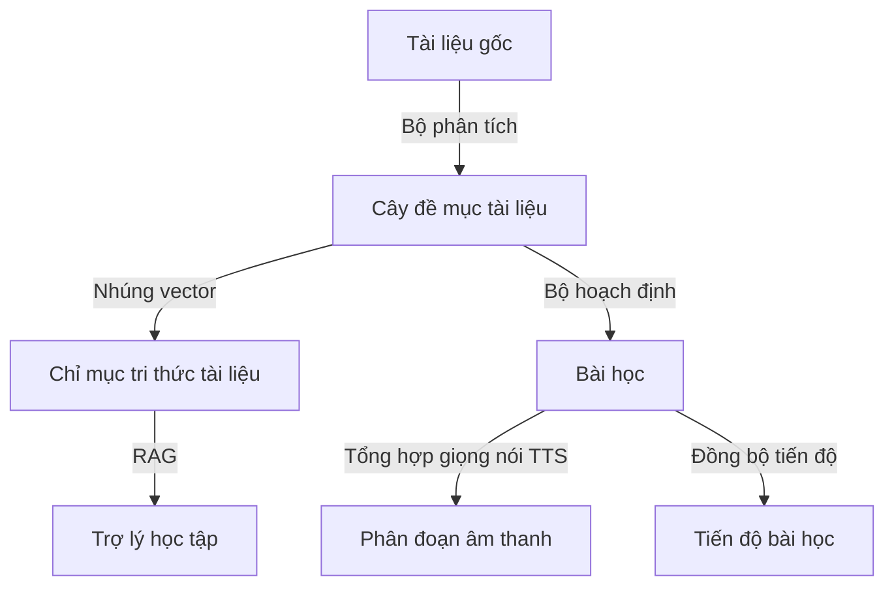
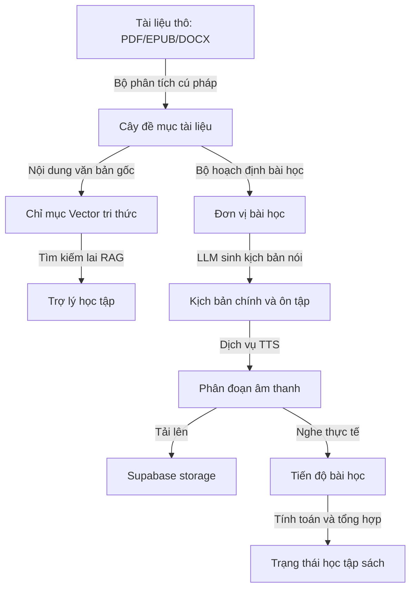
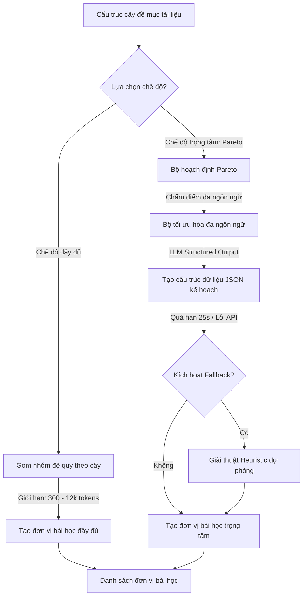
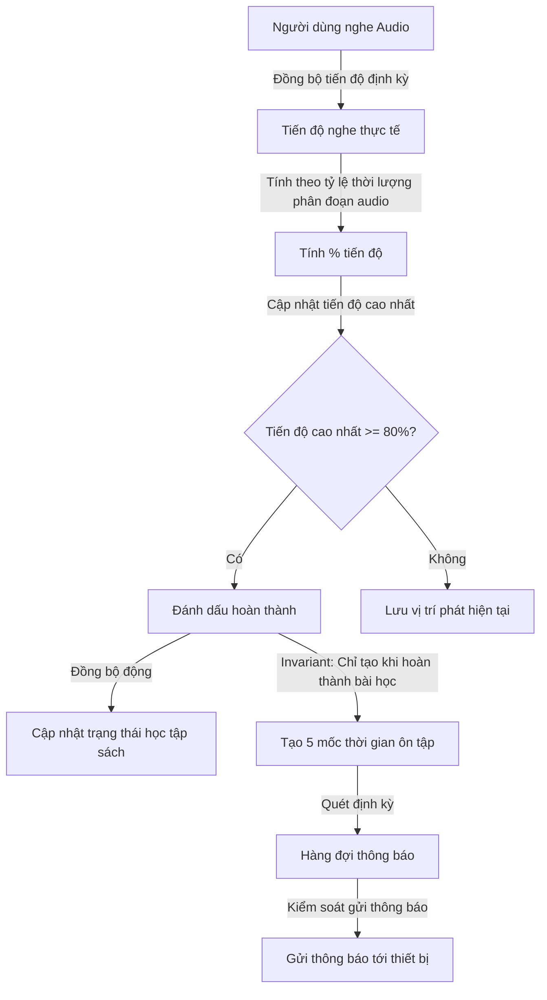
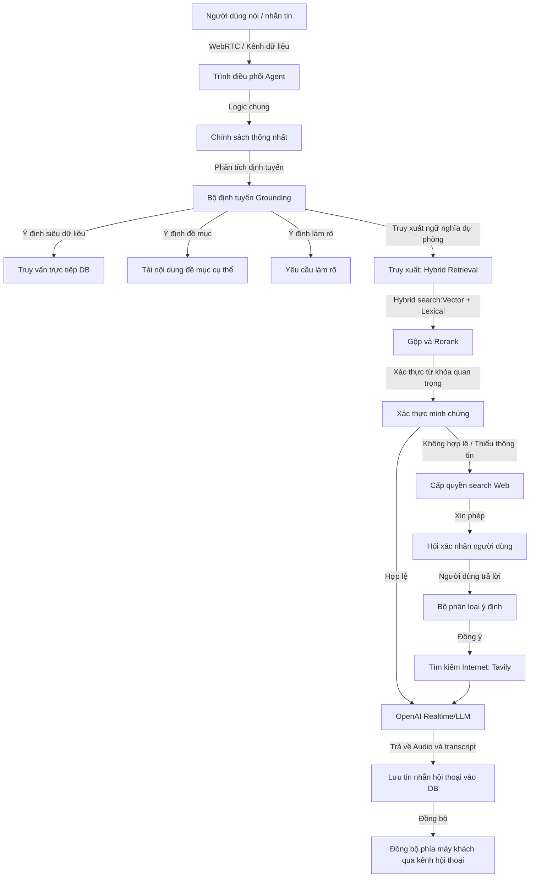
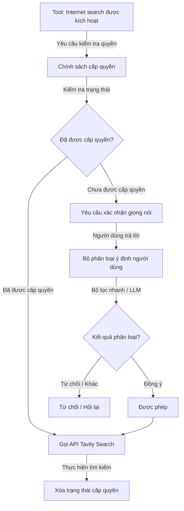

### ĐỀ XUẤT CƠ CẤU CHƯƠNG BÁO CÁO CAPSTONE (8 CHƯƠNG)

- **Chương 1: Lời mở đầu** (Đặt vấn đề, mục tiêu, đối tượng và phạm vi nghiên cứu).
- **Chương 2: Tổng quan đề tài và Cơ sở lý thuyết** (Giới thiệu các công nghệ sử dụng như RAG, WebRTC, Spaced Repetition, TTS, LLM).
- **Chương 3: Phân tích thiết kế hệ thống và Kiến trúc tổng quan** (Tổng quan kiến trúc, sơ đồ thực thể liên kết, thiết kế API và dữ liệu).
- **Chương 4: Quy trình Chuyển đổi tài liệu và Tiền xử lý âm thanh tự động** _(Tách riêng - Trọng tâm 1)_.
- **Chương 5: Cơ chế Lập kế hoạch học tập và Thiết lập chế độ Full / Pareto** _(Tách riêng - Trọng tâm 2)_.
- **Chương 6: Hệ thống Theo dõi tiến độ và Ôn tập ngắt quãng Spaced Repetition** _(Tách riêng - Trọng tâm 3)_.
- **Chương 7: Trợ lý giọng nói thời gian thực và Tìm kiếm tăng cường** _(Tách riêng - Trọng tâm 4)_.
- **Chương 8: Kết luận và Hướng phát triển**.

---

### MÔ TẢ CHI TIẾT NỘI DUNG CÁC CHƯƠNG TRỌNG TÂM DỰA TRÊN MÃ NGUỒN

Dưới đây là phần mô tả chi tiết nội dung học thuật cho từng chương lớn được bổ sung, tương ứng trực tiếp với cấu trúc thiết kế của hệ thống:

Trục kiến trúc cốt lõi của hệ thống được phân định rõ ràng giữa cấu trúc vật lý của tài liệu thô và tiến trình học tập logic của người học thông qua hai thực thể dữ liệu chính:

- **Cây đề mục tài liệu**: Đóng vai trò là nguồn sự thật duy nhất (source of truth) cho toàn bộ cấu trúc phân cấp và nội dung gốc của tài liệu sau khi qua bộ phân tích cấu trúc, đồng thời là cơ sở dữ liệu nền tảng để lập chỉ mục vector phục vụ tìm kiếm ngữ cảnh RAG.

- **Đơn vị bài học**: Đóng vai trò là nguồn sự thật cho kế hoạch học tập, quản lý các phân đoạn âm thanh tổng hợp và theo dõi tiến độ nghe thực tế của người dùng. Mối quan hệ ánh xạ linh hoạt qua cấu trúc trung gian lưu trữ nguồn gốc bài học giữa hai thực thể này giúp hệ thống tách biệt luồng xử lý tài liệu vật lý với vòng đời học tập của từng cá nhân.

---

## CHƯƠNG 4: QUY TRÌNH CHUYỂN ĐỔI TÀI LIỆU VÀ TIỀN XỬ LÝ ÂM THANH TỰ ĐỘNG

Chương này trình bày chi tiết quy trình xử lý dữ liệu bất đồng bộ của hệ thống, từ thời điểm người học tải tài liệu thô lên máy chủ cho đến khi tài liệu được cấu trúc hóa, tổng hợp thành các tệp âm thanh phân đoạn chất lượng cao và trích xuất lưu trữ vào cơ sở dữ liệu tri thức hỗ trợ hỏi đáp ngữ nghĩa.

### 4.1. Phân tích cấu trúc tài liệu đầu vào

Để xây dựng một lộ trình học tập cá nhân hóa chính xác, hệ thống không tiếp cận tài liệu dưới dạng văn bản phẳng mà thực hiện phân tích cấu trúc nhằm xây dựng cây thư mục phân cấp. Quy trình này được đảm nhiệm bởi dịch vụ phân tích cấu trúc tài liệu phối hợp với các bộ xử lý chuyên biệt cho từng định dạng tệp tin:

- **Xử lý tài liệu định dạng PDF**: Bộ phân tích cú pháp duyệt qua cấu trúc cây bookmark (outline) được nhúng trong tệp tin để xác định tiêu đề đề mục, cấp độ đề mục và chỉ số trang bắt đầu. Đoạn văn bản thuộc về một leaf node được khoanh vùng động từ trang bắt đầu của đề mục đó cho tới trang bắt đầu của đề mục kế tiếp theo thứ tự tài liệu.

- **Xử lý tài liệu định dạng sách điện tử EPUB**: Bộ phân tích duyệt cấu trúc cây mục lục (TOC - Table of Contents) gốc của tệp tin, xác định đường dẫn tài nguyên nội bộ và các mốc neo HTML để trích xuất chính xác khối văn bản tương ứng với từng tiểu mục nhỏ mà không bị lẫn lộn giữa các chương.

- **Xử lý tài liệu định dạng Microsoft Word (DOCX)**: Bộ phân tích thực hiện phân tích các phần tử định dạng văn bản trong cấu trúc XML của Word. Giải thuật quét tuần tự qua các phân đoạn văn bản, so khớp thuộc tính kiểu dáng tiêu đề (Heading Styles từ 1 đến 6) để phân cấp cây thư mục tương ứng, đồng thời tự động gom các đoạn văn bản nội dung thường gắn vào đề mục chi tiết gần nhất.

Sau khi trích xuất thành công, toàn bộ dữ liệu cấu trúc cây được chuyển đổi qua dịch vụ quản lý cấu trúc tài liệu. Tại đây, hệ thống thực hiện:

- **DFS Indexing**: Đánh chỉ mục duyệt theo chiều sâu (DFS) để gán thuộc tính chỉ mục phẳng và thuộc tính đường dẫn phân cấp.

- **Validation Gate**: Để đảm bảo ranh giới bài học chính xác tuyệt đối và loại bỏ các lỗi định dạng thô nghiêm trọng, hệ thống thiết lập cổng kiểm duyệt nghiêm ngặt. Định dạng PDF bắt buộc phải chứa cây bookmark/outline nhúng sẵn; định dạng EPUB phải có file TOC/navigation hoàn chỉnh; định dạng DOCX bắt buộc phải định nghĩa rõ ràng các Heading styles. Các tài liệu không thỏa mãn cấu trúc mục lục tối thiểu hoặc chỉ chứa ảnh quét dạng OCR mà không có cấu trúc sẽ bị hệ thống từ chối xử lý bằng mã lỗi 422 nhằm ưu tiên tính xác định (determinism) thay vì sử dụng thuật toán heuristic hay regex cắt chuỗi mơ hồ.

- **Lưu trữ bền vững**: Lưu trữ cấu trúc cây bền vững vào thực thể cơ sở dữ liệu cây đề mục tài liệu.

> **Ví dụ thực tế**: Khi người học tải lên tài liệu _"Toán rời rạc.docx"_, bộ phân tích cấu trúc tài liệu sẽ quét và phát hiện _"Chương 1: Cơ sở logic"_ được định dạng bằng Heading 1 và _"1.1. Mệnh đề"_ bằng Heading 2. Hệ thống sẽ xây dựng cây đề mục tương ứng với quan hệ cha-con rõ ràng. Nếu người học tải lên một file PDF scan ảnh tài liệu toán không có outline nhúng, cổng kiểm duyệt sẽ từ chối xử lý ngay lập tức và trả về mã lỗi 422 để yêu cầu người dùng định dạng lại mục lục chuẩn.

### 4.2. Chuẩn hóa ngôn ngữ văn bản cho TTS

Văn bản thô trích xuất trực tiếp từ tài liệu thường chứa các ký tự phi ngôn ngữ nói (như ký hiệu bảng biểu, số trang, tiêu đề đầu trang/chân trang, các ký tự viết tắt thuật ngữ học thuật hoặc công thức toán học). Nếu đưa trực tiếp các văn bản này vào bộ tổng hợp giọng nói (TTS) sẽ sinh ra âm thanh rời rạc, khó nghe và thiếu tự nhiên.

Hệ thống giải quyết bài toán này thông qua dịch vụ tiền xử lý bằng LLM. Khi một bài học cần chuẩn hóa, hệ thống gửi nội dung văn bản thô đến LLM kèm theo các "system prompts" nghiêm ngặt nhằm biên dịch văn bản sang văn phong nói tự nhiên:

- Biên dịch và viết rõ nghĩa các từ viết tắt chuyên ngành để đảm bảo tính dễ hiểu khi nghe.

- Chuyển đổi các chữ số, ký hiệu toán học, công thức logic thành dạng chữ viết phát âm được bằng tiếng Việt.

- Loại bỏ hoàn toàn các siêu dữ liệu nhiễu như số thứ tự trang, ký hiệu đầu đoạn danh sách mà không làm biến đổi nội dung khoa học của bài học.

| Văn bản gốc trong tài liệu                                                                       | Văn bản sau chuẩn hóa (Văn phong nói)                                                                    |
| :----------------------------------------------------------------------------------------------- | :------------------------------------------------------------------------------------------------------- |
| _Ví dụ 1 (tr. 42): Định nghĩa phép toán kéo theo $P \rightarrow Q$ (với $P, Q$ là 2 mệnh đề)..._ | _Ví dụ một trang bốn mươi hai: Định nghĩa phép toán kéo theo P kéo theo Q, với P và Q là hai mệnh đề..._ |
| _Các tc cơ bản của phép tuyển logic gồm..._                                                      | _Các tính chất cơ bản của phép tuyển logic bao gồm..._                                                   |

### 4.3. Tổng hợp giọng nói phân đoạn

Việc tổng hợp các tệp âm thanh có thời lượng quá dài sẽ gây ra các vấn đề nghiêm trọng về hiệu năng hệ thống như giới hạn ký tự của API tổng hợp giọng nói, độ trễ khi tải tệp của thiết bị di động lớn, và khó khăn trong việc lưu vết phát tiếp tục. Hệ thống áp dụng giải thuật phân đoạn âm thanh như sau:

- **Phân đoạn kịch bản và Token**: Tiến trình xử lý hệ thống sẽ gửi nội dung văn bản thô của đơn vị bài học qua mô hình ngôn ngữ lớn (LLM) để sinh ra hai trường dữ liệu kịch bản trong đối tượng JSON đầu ra: danh sách các đoạn kịch bản bài học đầy đủ và kịch bản tóm tắt ôn tập nhanh. Đối với các bài học có nội dung quá dài, hệ thống thực hiện chia nhỏ văn bản dựa trên giới hạn số lượng token đầu vào trước khi gọi API LLM để tránh lỗi vượt ngưỡng xử lý.

- **Chuyển đổi phân đoạn âm thanh**: Hệ thống không cắt âm thanh theo số ký tự cứng, mà yêu cầu LLM sinh các đoạn kịch bản nói mạch lạc theo từng ý hoàn chỉnh (mỗi phần tử tương ứng với 3 đến 5 câu). Mỗi phần tử trong danh sách kịch bản bài học chính được đưa qua API dịch vụ giọng nói dưới cơ chế giới hạn đồng thời để tạo một tệp âm thanh MP3 phân đoạn. Riêng phần kịch bản ôn tập nhanh được tổng hợp thành một tệp âm thanh ôn tập riêng và liên kết vào đường dẫn âm thanh ôn tập của bài học.

- **Lưu trữ và ánh xạ**: Các tệp âm thanh định dạng MP3 sau khi sinh ra được định danh duy nhất và tải lên kho lưu trữ đối tượng đám mây. Hệ thống tạo các bản ghi tương ứng trong cơ sở dữ liệu phân đoạn bài học để ánh xạ chính xác chỉ số phân đoạn, đường dẫn URL âm thanh, thời lượng phát tính bằng mili giây và văn bản tương ứng.

> **Ví dụ thực tế**: Một đơn vị bài học dài 5000 ký tự sẽ được gửi qua LLM để sinh ra kịch bản nói đầy đủ. LLM tự động chia nội dung này thành 5 đoạn kịch bản nhỏ có ý nghĩa hoàn chỉnh. Hệ thống lần lượt tạo các tệp âm thanh từ phân đoạn 1 đến phân đoạn 5, trong khi các yêu cầu dịch vụ giọng nói vẫn được bảo vệ bởi bộ khóa đồng thời (semaphore) để tránh vượt giới hạn nhà cung cấp. Đồng thời, kịch bản tóm tắt ôn tập nhanh được tổng hợp thành một tệp âm thanh ôn tập riêng biệt và liên kết trực tiếp vào trường URL ôn tập của bài học.

### 4.4. Lập chỉ mục Vector tri thức

Để cung cấp khả năng hỏi đáp ngữ nghĩa chính xác theo nội dung tài liệu, hệ thống cần chuyển hóa tri thức dạng chữ thành không gian vector. Tiến trình này được xử lý độc lập thông qua bộ lập chỉ mục tri thức tài liệu:

- **Text Chunking**: Bộ lập chỉ mục quét qua các đề mục có chứa nội dung chữ, tiến hành cắt văn bản trực tiếp từ nội dung văn bản gốc của đề mục sách - tức nội dung thô trích xuất từ tài liệu sau khi qua bộ phân tích, chứ hoàn toàn không sử dụng văn bản kịch bản nói đã chuẩn hóa của dịch vụ giọng nói. Kích thước cắt cấu hình mặc định là `3600` ký tự cho mỗi đoạn, kèm theo độ gối đầu trùng lặp (overlap) là `500` ký tự nhằm tránh mất mát ngữ cảnh tại ranh giới phân cắt đoạn.

- **Embedding Generation**: Gọi API mô hình embedding để chuyển đổi văn bản thành mảng vector số thực độ dài `1536` chiều, đại diện cho ngữ nghĩa của đoạn văn bản đó.

- **Lưu trữ pgvector**: Lưu trữ các đoạn văn bản thô cùng mảng vector tương ứng vào thực thể cơ sở dữ liệu tri thức tài liệu. Cột chứa vector được lưu trữ trong cơ sở dữ liệu bằng tiện ích mở rộng `pgvector` và được đánh chỉ mục tìm kiếm bằng thuật toán chuyên biệt để tối ưu hóa hiệu năng truy vấn tương đồng về sau.

### 4.5. Kiểm thử và đánh giá Chương 4

Hệ thống tiến hành thực hiện kiểm tra kiểm thử chất lượng phân tách cấu trúc tài liệu và chuyển đổi âm thanh để đảm bảo độ tin cậy của dữ liệu:

| Mục tiêu kiểm thử                   | Tình huống kiểm thử                               | Kết quả mong đợi                                                                           | Kết quả thực tế                                    |
| :---------------------------------- | :------------------------------------------------ | :----------------------------------------------------------------------------------------- | :------------------------------------------------- |
| Kiểm duyệt tài liệu thiếu mục lục   | Tải lên file PDF dạng scan ảnh không chứa outline | Hệ thống reject ngay lập tức, trả lỗi 422                                                  | Đã xác thực qua kiểm thử tích hợp (trả mã lỗi 422) |
| Độ chính xác của chunking tri thức  | Tách chương tài liệu toán dài 12000 ký tự         | Tạo ra các chunk kích thước tối đa 3600 ký tự, overlap đúng 500 ký tự                      | Đã kiểm thử ở mức unit test (đúng cấu hình chunk)  |
| Độ chính xác nguồn của Vector Index | Lập chỉ mục tri thức cho bài học                  | Sử dụng nội dung văn bản gốc của đề mục tài liệu thay vì văn bản chuẩn hóa phát âm của TTS | Đã xác thực qua kiểm thử đơn vị (khớp văn bản thô) |

---

## CHƯƠNG 5: CƠ CHẾ LẬP KẾ HOẠCH HỌC TẬP VÀ THIẾT LẬP CHẾ ĐỘ FULL / PARETO

Chương này đi sâu vào giải thuật thiết kế bài học và bộ hoạch định kế hoạch học tập thông minh, làm rõ cách thức phân tách và cấu trúc hóa nội dung phù hợp với các chế độ học tập khác nhau.

### 5.1. Thiết kế mô hình bài học

Trong hệ thống, thực thể học tập hiển thị trực tiếp trên trình phát nhạc của người dùng không phải là các đề mục thô mà là các bài học. Một bài học đại diện cho một phân đoạn kiến thức hoàn chỉnh, có ý nghĩa khoa học độc lập.

- **Mối quan hệ**: Một bài học có quan hệ ánh xạ với nhiều đề mục tài liệu gốc thông qua cấu trúc liên kết trung gian lưu trữ nguồn gốc bài học.

- **Mục đích**: Việc thiết kế mô hình này giúp che giấu đi sự phức tạp của cây thư mục quá vụn vặt. Thay vào đó, hệ thống sẽ gom các đề mục nhỏ này lại để phát chung trên một tệp âm thanh liên tục, mang lại trải nghiệm nghe giống như một chương sách nói thực tế, giúp người học dễ dàng theo dõi.

### 5.2. Thuật toán Lập kế hoạch Chế độ đầy đủ

Chế độ đầy đủ (Full Mode) có mục tiêu truyền tải toàn vẹn toàn bộ tri thức của tài liệu gốc nhưng được tổ chức lại một cách khoa học để tránh các bài học quá ngắn hoặc quá dài. Giải thuật lập kế hoạch bài học bao gồm các bước:

- **Xác định nút gốc học tập**: Giải thuật duyệt qua danh sách các đề mục để tìm các nút đại diện cho các chương lớn. Nếu số lượng nút gốc nằm trong khoảng hợp lệ, hệ thống sẽ chọn các nút này làm mốc phân chia bài học chính.

- **Duyệt cây con**: Đối với mỗi nút gốc, giải thuật duyệt đệ quy toàn bộ các đề mục con trực thuộc nút đó để thu thập toàn bộ văn bản của nhánh cây.

- **Tách nhóm lớn**: Nếu tổng lượng token dự kiến của một nhóm vượt quá giới hạn tối đa (ngưỡng mềm cấu hình mặc định là `12000` tokens nhằm tránh quá tải hệ thống xử lý), giải thuật sẽ tiến hành phân tách nhóm đó thành các phần nhỏ hơn, đặt tên theo định dạng phân đoạn tăng dần.

- **Gộp nhóm nhỏ**: Sau khi phân chia sơ bộ, hệ thống duyệt qua danh sách bài học. Nếu có các bài học liên tiếp có kích thước quá nhỏ dưới ngưỡng `300` tokens, giải thuật gộp nhóm sẽ thực hiện gộp chúng lại với nhau để tránh tạo ra các bài nghe siêu ngắn gây đứt gãy trải nghiệm.

> **Ví dụ thực tế**: Cuốn sách học tập có chương _"Chương 2: Cấu trúc dữ liệu mảng"_ dài tới 18000 tokens. Thuật toán chế độ đầy đủ sẽ tự động phân chia chương này thành 2 bài học nhỏ gồm _"Cấu trúc dữ liệu mảng - Phần 1/2"_ (độ dài 9000 tokens) và _"Cấu trúc dữ liệu mảng - Phần 2/2"_ (độ dài 9000 tokens) để đảm bảo tệp âm thanh không vượt giới hạn xử lý. Ngược lại, nếu hai chương phụ lục chỉ dài 150 tokens mỗi chương, hệ thống sẽ tự động gộp chúng thành một bài học duy nhất để người học nghe liên tục.

### 5.3. Quy trình Lập kế hoạch chế độ trọng tâm

Chế độ trọng tâm (Pareto Mode) hoạt động dựa trên nguyên lý 80/20, nhằm trích xuất ra nhóm bài học mang lại giá trị tiếp thu cao nhất trong thời gian ngắn nhất (nhắm mục tiêu độ bao phủ kiến thức tối ưu, cấu hình hiện tại ở mức `25%` tổng lượng tài liệu gốc thay vì tóm tắt toàn bộ sách, và khống chế tối đa trong khoảng 3 đến 8 bài học cốt lõi - đại diện cho nhóm "vital few" đem lại nhiều giá trị tiếp thu nhất). Quy trình này được hiện thực hóa qua cơ chế hoạch định lai trong dịch vụ hoạch định Pareto:

- **Bản chất học thuật**: Hệ thống không thực hiện việc "tóm tắt toàn bộ sách" một cách chung chung. Thay vào đó, nó phân tích để chọn lọc những nhánh nội dung có giá trị cao nhất (vital few) để xây dựng thành bài học hoàn chỉnh, giúp người học nắm bắt các khái niệm xương sống trong thời gian hạn hẹp.

- **Bộ lọc chấm điểm Heuristic**:
  Hệ thống chấm điểm mức độ quan trọng của từng nhánh đề mục dựa trên tổng hòa các tiêu chí:
  $$\text{Score} = \text{SignalScore} + \text{ContentScore} + \text{HierarchyScore} + \text{ChildScore}$$
  Trong đó điểm tín hiệu ($\text{SignalScore}$) tìm kiếm sự xuất hiện của các từ khóa mang tính học thuật cao trong tiêu đề và nội dung (như _"định nghĩa"_, _"nguyên lý"_, _"công thức"_); điểm nội dung ($\text{ContentScore}$) dựa trên độ dài văn bản; điểm phân cấp ($\text{HierarchyScore}$) ưu tiên các đề mục cấp cao; và điểm nhánh con ($\text{ChildScore}$) ưu tiên các cấu trúc chứa nhiều nhánh kiến thức liên quan.

- **Multilingual Signal Optimizer (Tối ưu hóa tín hiệu đa ngôn ngữ)**:
  Để nhận diện chính xác các tín hiệu khoa học mà không bị phụ thuộc hoàn toàn vào LLM, hệ thống sử dụng một bộ tối ưu phân loại tín hiệu đa ngôn ngữ Việt - Anh. Bộ lọc này sử dụng một từ điển phân loại đặc trưng bao gồm các lớp từ khóa học thuật:
  - Lớp khái niệm, định nghĩa (`core_concept`, `definition`): _"khái niệm"_, _"nền tảng"_, _"cốt lõi"_, _"tổng quan"_, _"định nghĩa"_, _"concept"_, _"definition"_.
  - Lớp nguyên lý, quy tắc, định lý (`principle`, `rule`, `theorem`): _"nguyên lý"_, _"nguyên tắc"_, _"quy tắc"_, _"định lý"_, _"bổ đề"_, _"hệ quả"_, _"principles"_, _"theorem"_, _"lemma"_.
  - Lớp phương pháp, quy trình (`method`, `procedure`): _"phương pháp"_, _"kỹ thuật"_, _"quy trình"_, _"các bước"_, _"method"_, _"procedure"_, _"workflow"_.
  - Lớp công thức (`formula`): _"công thức"_, _"biểu thức"_, _"formula"_, _"equation"_.
  - Lớp suy luận, chứng minh (`reasoning`): _"suy luận"_, _"chứng minh"_, _"lập luận"_, _"reasoning"_, _"proof"_.
  - Lớp ví dụ minh họa (`example`): _"ví dụ"_, _"minh họa"_, _"bài tập"_, _"example"_, _"case study"_.

- **Hoạch định thông minh qua LLM với Structured Outputs**:
  Khi LLM planner được bật và dữ liệu mục lục đạt điều kiện cấu hình, hệ thống đóng gói các thẻ tóm tắt đề mục (bao gồm các thẻ tín hiệu từ bộ Multilingual Signal Optimizer) và gửi tới LLM để lập kế hoạch. Hệ thống bắt buộc LLM phản hồi dưới dạng cấu trúc dữ liệu JSON chặt chẽ thông qua phương thức phản hồi có cấu trúc (định nghĩa các trường thông tin tiêu đề, danh sách mã định danh đề mục nguồn, mục tiêu học tập và điểm số quan trọng của bài học).

- **Cơ chế Fallback an toàn và kiểm soát Timeout**:
  Để quản trị rủi ro trễ mạng hoặc lỗi API LLM, hệ thống thiết lập thời gian chờ (timeout) nghiêm ngặt là `25.0` giây. Nếu quá thời gian này hoặc xảy ra lỗi phân tích cú pháp, hệ thống sẽ tự động kích hoạt tính năng dự phòng deterministic, sử dụng kết quả từ bộ lọc chấm điểm Heuristic để chọn ra các nhóm đề mục có điểm cao nhất sắp xếp theo trình tự xuất hiện gốc trong tài liệu để tạo kế hoạch học tập.

> **Ví dụ thực tế**: Khi người học lập kế hoạch học cuốn sách _"Toán rời rạc"_ trong chế độ Pareto. Bộ tối ưu hóa tín hiệu đa ngôn ngữ phát hiện mục _"Định lý Bayes"_ và _"Thuật toán Dijkstra"_ chứa các tín hiệu quan trọng (`theorem`, `method`). Hệ thống sẽ gửi mục lục này đến LLM. LLM tạo ra cấu trúc JSON đề xuất 5 bài học cốt lõi bao phủ đúng 25% nội dung sách. Nếu API LLM bị quá tải và không phản hồi trong vòng 25 giây, hệ thống tự động kích hoạt chế độ dự phòng, gom 5 bài học dựa trên điểm Heuristic cao nhất của các chương để trả về cho người học mà không hề báo lỗi hệ thống.

### 5.4. Kiểm thử và đánh giá Chương 5

Bảng dưới đây mô tả quá trình kiểm tra giải thuật lập kế hoạch bài học Full/Pareto:

| Mục tiêu kiểm thử                 | Tình huống kiểm thử                                               | Kết quả mong đợi                                                                       | Kết quả thực tế                                                 |
| :-------------------------------- | :---------------------------------------------------------------- | :------------------------------------------------------------------------------------- | :-------------------------------------------------------------- |
| Lập kế hoạch Full gộp chương ngắn | Tài liệu có 3 chương ngắn kế tiếp, mỗi chương 100 tokens          | Hệ thống gộp 3 chương này thành 1 đơn vị bài học                                       | Đã xác thực qua kiểm thử đơn vị (unit test)                     |
| Pareto Fallback khi LLM quá hạn   | Lập kế hoạch Pareto khi API LLM bị chặn kết nối hoặc phản hồi lâu | Hệ thống kích hoạt fallback heuristic để trả về kế hoạch học sau thời gian timeout 25s | Đã kiểm thử ở mức integration test (kích hoạt fallback sau 25s) |
| Tỷ lệ bao phủ Pareto              | Lập kế hoạch Pareto cho tài liệu                                  | Tổng số lượng bài học tạo ra chiếm tối đa 25% tổng số lượng token của tài liệu gốc     | Đã xác thực qua kiểm thử đơn vị (độ bao phủ ~25%)               |

---

## CHƯƠNG 6: HỆ THỐNG THEO DÕI TIẾN ĐỘ VÀ ÔN TẬP NGẮT QUÃNG

Chương này mô tả chi tiết vòng lặp học tập khép kín của người dùng, tập trung vào thiết kế cơ sở dữ liệu theo dõi tiến độ, thuật toán chấm điểm hoàn thành và hạ tầng nhắc nhở ôn tập tự động.

### 6.1. Thiết lập Lịch học và Phiên học tập theo lịch

Để giúp người dùng phân bổ thời gian học tập khoa học và tránh việc nhận nhắc nhở học dồn dập, hệ thống thiết kế cơ chế quản lý lịch trình học tập chặt chẽ:

- **Thiết lập lịch biểu**: Khi người dùng tạo một kế hoạch học tập, họ cấu hình các ngày trong tuần và khung giờ nhắc nhở. Hệ thống chuyển đổi cấu hình này thành các bản ghi khe thời gian học đi kèm múi giờ địa phương cụ thể của người học.

- **Quản lý phiên học tập theo lịch (Reading Plan Sessions)**: Hệ thống sinh lịch học chi tiết cho từng phiên học tập cụ thể thông qua thực thể phiên kế hoạch học tập và thực thể đơn vị phiên học tập dựa theo cấu hình ngày học, múi giờ và nhịp độ học. Hệ thống tự động theo dõi và chuyển đổi trạng thái của phiên học tập tương ứng (như _scheduled_, _due_, _missed_, _completed_, _skipped_), hỗ trợ người học dời lịch học, bỏ qua phiên học, và tự động kích hoạt thông báo đối với các phiên học tập bị quá hạn chưa hoàn thành.

### 6.2. Theo dõi tiến độ học tập và cơ chế chống tua ngược

Tiến độ học tập của người dùng được theo dõi chi tiết đến từng bài học cụ thể thông qua thực thể tiến độ bài học và được quản lý độc lập với trạng thái xử lý vật lý của sách:

- **Tách biệt trạng thái học tập của người dùng**: Hệ thống phân định rõ ràng trạng thái xử lý vật lý của sách (như _processing_, _ready_ khi backend trích xuất dữ liệu) với trạng thái học tập thực tế của người dùng đối với sách đó (với các trạng thái _not_started_, _in_progress_, _completed_). Trạng thái học tập được tổng hợp động từ tiến trình học tập của toàn bộ các đơn vị bài học trực thuộc.

- **Tính toán tiến độ học thật**: Hệ thống không tin tưởng hoàn toàn vào phần trăm tiến độ do thiết bị di động gửi lên để tránh việc người dùng cố tình tua nhanh tệp tin. Thay vào đó, máy chủ sử dụng dữ liệu thời lượng thực của từng phân đoạn âm thanh bài học đã phát để tính toán tỷ lệ phần trăm nghe thực tế.

- **Cơ chế hoàn thành chống tua ngược (Ngưỡng 80%)**: Bài học được đánh dấu trạng thái hoàn thành khi và chỉ khi giá trị tiến độ cao nhất từng đạt được đạt tối thiểu **80%**. Việc sử dụng chỉ số tiến độ cao nhất từng đạt được giúp ghi nhận chính xác trạng thái hoàn thành ngay cả khi người dùng tua ngược âm thanh để nghe lại một đoạn kiến thức chưa rõ trước đó, tránh việc thay đổi trạng thái bài học về chưa hoàn thành một cách vô lý.

- **Nguyên lý Invariant học tập**: Hệ thống thực thi ràng buộc logic: lịch ôn tập ngắt quãng chỉ được khởi tạo sau khi người dùng hoàn thành thực tế bài học đó. Việc hệ thống hoàn tất quá trình chuẩn bị tài liệu (sách ở trạng thái _ready_) không đồng nghĩa với việc người dùng đã hoàn tất việc học và tiếp thu tri thức (bài học ở trạng thái _completed_).

> **Ví dụ thực tế**: Người học nghe một bài học dài 10 phút. Khi họ nghe đến phút thứ 8 (đạt 80%), hệ thống tự động ghi nhận bài học đã hoàn thành. Nếu sau đó người học tua ngược lại phút thứ 2 để nghe lại định nghĩa, tiến độ hiện tại giảm về 20% nhưng tiến độ cao nhất từng đạt vẫn giữ nguyên ở mức 80%, đảm bảo trạng thái hoàn thành của bài học không bị mất đi. Lúc này hệ thống mới sinh ra các lịch trình ôn tập. Trạng thái học tập của người dùng đối với cuốn sách cập nhật từ _chưa học_ sang _đang học (20% hoàn thành)_.

### 6.3. Mô hình Ôn tập ngắt quãng

Ngay khi một bài học được đánh dấu hoàn thành lần đầu tiên, hệ thống sẽ tự động kích hoạt tiến trình lập lịch ôn tập ngắt quãng:

- Hệ thống dựa trên thời điểm hoàn thành thực tế để sinh ra 5 mốc ôn tập lý tưởng theo thời gian tăng dần:
  $$\text{due\_at} = \text{completed\_at} + \text{interval\_days}$$
  Với $\text{interval\_days} \in \{1, 3, 7, 14, 30\}$ ngày.

- Hệ thống ghi nhận 5 bản ghi ôn tập này vào thực thể ôn tập ngắt quãng ở trạng thái chờ. Mỗi bản ghi lưu trữ thêm ảnh chụp nội dung ôn tập được sinh ra từ quá trình chuẩn hóa tài liệu ban đầu để người học có thể đọc nhanh nội dung cốt lõi của bài học đó trực tiếp trên thông báo ôn tập.

> **Ví dụ thực tế**: Người học hoàn thành bài học _"Định lý Bayes"_ vào lúc `10:00 ngày 14/06/2026`. Hệ thống sẽ tự động lên lịch cho 5 bài ôn tập tương ứng vào lúc `10:00` các ngày: `15/06` (sau 1 ngày), `17/06` (sau 3 ngày), `21/06` (sau 7 ngày), `28/06` (sau 14 ngày) và `14/07` (sau 30 ngày) để tối ưu khả năng ghi nhớ dài hạn.

### 6.4. Hạ tầng thông báo nhắc nhở bền vững (Transactional Outbox Pattern)

Để vận hành luồng gửi thông báo nhắc học và ôn tập tự động theo thời gian thực mà không bị thất thoát thông tin do sự cố hệ thống, TRIAM áp dụng mô hình **Transactional Outbox**:

- **Trình lập lịch tác vụ định kỳ**: Được cấu hình chạy định kỳ mỗi 60 giây để đẩy tác vụ quét các sự kiện nhắc nhở ôn tập đến hạn vào hàng đợi.

- **Quét và Tạo Outbox**: Tác vụ quét sẽ kiểm tra các lịch học và lịch ôn tập trong cơ sở dữ liệu có thời gian đến hạn (`due_at` bằng hoặc nhỏ hơn thời gian hiện tại). Nếu thỏa mãn, hệ thống tạo bản ghi tương ứng trong hàng đợi thông báo ở trạng thái chờ.

- **Khóa chống trùng lặp (Idempotent Key)**: Mỗi bản ghi hàng đợi thông báo được bảo vệ nghiêm ngặt bằng một khóa duy nhất được tạo theo quy luật cụ thể để tránh việc tạo trùng thông báo khi tác vụ quét chạy lặp lại:
  - Thông báo ôn tập: `spaced-review:<review_item_id>`
  - Thông báo nhắc học theo lịch: `plan-session:<user_id>:<session_id>:<local_date>`
  - Thông báo buổi học trễ hẹn: `missed-session:<user_id>:<session_id>`

- **Cổng phân phối kiểm soát (Quiet Hours & Daily Cap)**: Trước khi lưu vào hàng đợi outbox để gửi, hệ thống tự động kiểm tra cấu hình của người dùng. Nếu rơi vào khung giờ yên tĩnh (Quiet Hours - ví dụ từ 22:00 đến 07:00), hệ thống sẽ dời thời gian gửi thông báo (`due_at`) ra ngoài khung giờ này. Đồng thời, hệ thống đếm số lượng thông báo đã gửi trong ngày để đảm bảo không vượt quá giới hạn tối đa (Daily Cap - mặc định là 3 thông báo/ngày) nhằm tránh làm phiền người học.

- **Chiếm dụng và Giao vận**: Tác vụ gửi thông báo sẽ lấy các bản ghi đang chờ bằng cơ chế khóa hàng của cơ sở dữ liệu để tránh xung đột giữa nhiều máy chủ xử lý song song. Tiến trình chuyển trạng thái bản ghi sang đang xử lý, gọi dịch vụ giao vận tạo bản ghi hiển thị thực tế trong bảng thông báo người dùng, và cuối cùng cập nhật trạng thái đã gửi. Nếu gặp sự cố kết nối, bản ghi thông báo được lưu vết để tự động thử lại sau (Retry Policy).

### 6.5. Kiểm thử và đánh giá Chương 6

Bảng dưới đây mô tả quá trình kiểm tra tiến độ học tập và cơ chế nhắc nhở ôn tập ngắt quãng:

| Mục tiêu kiểm thử                      | Tình huống kiểm thử                                                              | Kết quả mong đợi                                                             | Kết quả thực tế                                           |
| :------------------------------------- | :------------------------------------------------------------------------------- | :--------------------------------------------------------------------------- | :-------------------------------------------------------- |
| Ghi nhận hoàn thành chống tua ngược    | Người dùng nghe bài học đạt 85%, sau đó tua về 10%                               | Hệ thống giữ nguyên trạng thái hoàn thành của bài học                        | Đã xác thực qua kiểm thử đơn vị (unit test)               |
| Tránh gửi trùng thông báo (Idempotent) | Chạy tác vụ quét của Celery Beat 3 lần liên tiếp tại cùng một phút               | Chỉ có duy nhất 1 bản ghi outbox được tạo cho sự kiện nhắc nhở học tập       | Đã xác thực qua kiểm thử tích hợp (outbox database check) |
| Kiểm soát giờ yên tĩnh                 | Lên lịch thông báo ôn tập vào lúc 23:00 (trong khung giờ yên tĩnh 22:00 - 07:00) | Hệ thống tự động dời thời gian gửi thông báo sang 07:00 ngày hôm sau         | Đã xác thực qua kiểm thử tích hợp (quiet hours fallback)  |
| Giới hạn Daily Cap                     | Tạo 4 thông báo nhắc học trong cùng một ngày cho một người dùng có cap = 3       | Chỉ có 3 thông báo đầu tiên được gửi đi, thông báo thứ 4 bị từ chối/trì hoãn | Đã kiểm thử ở mức integration test                        |

---

## CHƯƠNG 7: TRỢ LÝ GIỌNG NÓI TƯƠNG TÁC THỜI GIAN THỰC VÀ TÌM KIẾM TĂNG CƯỜNG

Chương này phân tích thiết kế hệ thống đàm thoại giọng nói song hướng thời gian thực của TRIAM, làm rõ luồng truyền tải WebRTC, cơ chế tích hợp truy xuất ngữ cảnh tài liệu (RAG) và giải pháp kiểm soát an toàn truy cập internet ngoài sách.

### 7.1. Kiến trúc luồng kết nối WebRTC

Luồng đàm thoại thời gian thực bắt đầu khi người dùng kích hoạt phòng chat của cuốn sách hoặc không gian học tập trên ứng dụng di động:

- **Cấp phát Token**: Client gọi API máy chủ. Dịch vụ điều phối kết nối thời gian thực sẽ kiểm tra quyền sở hữu của tài khoản đối với luồng chat, truy vấn danh sách các cuốn sách liên kết trong không gian học tập đó, và gọi hạ tầng LiveKit để tạo một token truy cập chứa siêu dữ liệu đóng gói định dạng JSON bao gồm: ID của luồng chat và danh sách các ID của sách cần truy cập.

- **Khởi tạo Agent**: Client sử dụng token để kết nối trực tiếp vào phòng hội thoại thời gian thực. Sự kiện này kích hoạt lệnh điều phối khởi chạy tiến trình trợ lý đàm thoại giọng nói thời gian thực độc lập trên máy chủ.

- **Thiết lập phiên đàm thoại**: Tiến trình trợ lý tham gia phòng họp, giải mã siêu dữ liệu để xác định phạm vi tài liệu cần truy vấn tri thức và tải lịch sử hội thoại gần nhất nhằm đảm bảo tính liên tục của ngữ cảnh giao tiếp.

### 7.2. Đồng bộ hóa dữ liệu và cơ chế đối khớp hội thoại

Để tối ưu hóa trải nghiệm tương tác, luồng đàm thoại của TRIAM không chỉ dựa trên âm thanh mà luôn có sự đồng bộ hóa dữ liệu hiển thị trên màn hình chat thông qua bộ quản lý đồng bộ và lưu trữ nội dung thoại:

- **Đồng bộ thời gian thực**: Khi trợ lý phát ngôn hoặc người dùng nói, văn bản thoại được đẩy về ứng dụng di động qua kênh dữ liệu nhanh `lk.chat` nhằm hiển thị nội dung xem trước (preview) tức thời cho người dùng.

- **Cơ chế đối khớp dữ liệu thoại**: Kênh dữ liệu văn bản nhanh chỉ đóng vai trò hiển thị tạm thời hoặc xem trước phản hồi. Nguồn sự thật chính để đồng bộ hóa và lưu trữ hội thoại lâu dài là các thông điệp thoại có đính kèm mã định danh tin nhắn ổn định được lưu trữ bền vững trong cơ sở dữ liệu tin nhắn hội thoại. Máy khách sẽ tự động đối khớp các tin nhắn xem trước trên giao diện bằng mã định danh chính thức từ máy chủ trả về khi kết thúc câu thoại để đảm bảo tính nhất quán dữ liệu.

### 7.3. Grounding Router

Để nâng cao độ tin cậy và tốc độ phản hồi của trợ lý học tập, hệ thống tích hợp bộ định tuyến Grounding hoạt động trước khi thực hiện truy vấn RAG. Giải thuật phân tích ý định người học và định tuyến câu hỏi như sau:

1.  **Metadata Intent**: Nếu câu hỏi liên quan đến thông tin sách (Ví dụ: _"Cuốn sách này có bao nhiêu trang?"_), hệ thống trả lời trực tiếp từ dữ liệu DB mà không cần gọi RAG.
2.  **Section Intent**: Nếu câu hỏi chỉ định một chương hoặc đề mục cụ thể (Ví dụ: _"Nội dung chính của chương 3 là gì?"_), hệ thống chỉ định vị trí chính xác và nạp nội dung của chương/đề mục đó vào ngữ cảnh để trả lời.
3.  **Clarification Intent**: Nếu câu hỏi quá mơ hồ, hệ thống yêu cầu người dùng làm rõ trước khi thực hiện.
4.  **RAG Fallback**: Nếu câu hỏi yêu cầu kiến thức chung, hệ thống mới thực hiện truy vấn RAG ngữ nghĩa trên không gian vector.

### 7.4. Truy xuất tri thức nâng cao và giảm thiểu ảo giác

Khi hệ thống kích hoạt luồng tìm kiếm RAG ngữ nghĩa, để loại bỏ tối đa hiện tượng ảo giác và đảm bảo tính chính xác của dữ liệu, hệ thống áp dụng cơ chế truy xuất nâng cao tích hợp ba thành phần chính:

- **Hybrid Retrieval**: Hệ thống thực hiện song song hai tiến trình truy xuất tri thức nhằm tối ưu hóa thế mạnh của từng phương thức. Nhánh thứ nhất truy vấn không gian vector (Semantic Search) bằng độ tương đồng cosine (cosine similarity) trên thực thể chỉ mục tri thức đề mục tài liệu sử dụng vector 1536 chiều. Nhánh thứ hai truy vấn từ khóa thô (Lexical Search) bằng cách kết hợp tìm kiếm toàn văn FTS và tìm kiếm mờ dựa trên chỉ mục Trigram trên cột dữ liệu văn bản đã được chuẩn hóa. Toàn bộ kết quả từ hai luồng được hợp nhất và loại bỏ trùng lặp dựa trên mã định danh phân mảnh hoặc cặp thông tin ranh giới bao gồm mã định danh đề mục và chỉ số phân mảnh.

- **Deterministic Reranking**: Dữ liệu sau khi gộp được chấm điểm lại thông qua một thuật toán tái xếp hạng tất định để đảm bảo hiệu năng và khả năng kiểm thử ngoại tuyến. Điểm số của từng nguồn được chuẩn hóa về khoảng $[0.0, 1.0]$. Điểm số kết hợp (Blended Score) được tính toán theo tỷ lệ trọng số thực tế $\text{Weight}_{\text{vector}} = 0.60$ và $\text{Weight}_{\text{lexical}} = 0.30$:
  $$\text{BlendedScore} = \frac{0.60 \times \text{Score}_{\text{vector}} + 0.30 \times \text{Score}_{\text{lexical}}}{0.90}$$
  Điểm số cơ sở (Base Score) được xác định bằng giá trị lớn nhất:
  $$\text{BaseScore} = \max(\text{Score}_{\text{vector}}, \text{Score}_{\text{lexical}}, \text{BlendedScore})$$
  Điều này giúp bảo vệ các kết quả có điểm lexical cực cao khi vector search không tìm thấy. Tiếp theo, hệ thống cộng điểm thưởng khớp tiêu đề ($\text{TitleMatchBoost} = 0.07$) nếu câu hỏi chứa từ khóa trùng với tiêu đề đề mục, và điểm thưởng đa nguồn ($\text{MultiSourceBoost} = 0.03$) nếu chunk xuất hiện đồng thời ở cả hai luồng. Cuối cùng, hệ thống thực thi chính sách đa dạng hóa đề mục, chỉ giữ lại tối đa `2` phân đoạn cho mỗi đề mục và giới hạn tối đa `6` phân đoạn cho toàn bộ ngữ cảnh để tránh quá tải thông tin.

- **Evidence Validation**: Để ngăn chặn hoàn toàn việc mô hình ngôn ngữ tự bịa câu trả lời khi thông tin trong sách không tồn tại, hệ thống thực thi bộ kiểm duyệt minh chứng nghiêm ngặt trước khi gửi dữ liệu sang mô hình AI. Quy trình xác thực phân loại kết quả thành các trạng thái cụ thể:
  1.  `no_candidates`: Không tìm thấy bất kỳ phân đoạn nào phù hợp.
  2.  `low_confidence`: Điểm số của phân đoạn hàng đầu thấp hơn ngưỡng tối thiểu cấu hình $\text{FinalScore} < 0.25$.
  3.  `missing_named_entity`: Hệ thống trích xuất các từ khóa quan trọng (Important Tokens) từ câu hỏi (các từ viết tắt acronym như _WebRTC_, _SLR_, cụm từ trong dấu ngoặc kép, hoặc các từ dài trên 5 ký tự không phải stopword). Nếu tất cả các từ khóa quan trọng này hoàn toàn không xuất hiện trong nội dung của hai phân đoạn đứng đầu, hệ thống sẽ từ chối cung cấp ngữ cảnh nhằm tránh lỗi ảo giác.
      Chỉ khi vượt qua tất cả các bộ lọc và đạt trạng thái hợp lệ, ngữ cảnh mới được đóng gói dưới dạng dữ liệu ngữ cảnh tài liệu hợp lệ để gửi sang mô hình AI.

### 7.5. Shared Agent Policy

Hệ thống thiết kế một lớp chính sách dùng chung cho cả kênh chat văn bản và trợ lý giọng nói thời gian thực. Lớp chính sách này đảm bảo toàn bộ các quyết định định tuyến tri thức, RAG và cấp quyền tìm kiếm web đều đi qua một bộ lọc logic nhất quán, tránh việc phản hồi bất nhất hoặc lệch pha kiến thức giữa hai kênh giao tiếp.

### 7.6. Cơ chế cấp quyền tìm kiếm Internet

Để bảo vệ an toàn dữ liệu học tập nội bộ và tối ưu hóa chi phí, tránh việc AI liên tục thực hiện tìm kiếm internet không cần thiết, TRIAM thiết kế một lớp bảo vệ hai tầng nghiêm ngặt:

- **Tầng 1 - Máy trạng thái cấp quyền**:
  Được quản lý bởi máy trạng thái chính sách cấp quyền truy cập web. Quyền tìm kiếm là quyền sử dụng một lần và hoạt động theo máy trạng thái:
  - Khi thông tin trong tài liệu không đủ, trợ lý sẽ gọi công cụ xin quyền để chuyển trạng thái sang chờ xác nhận, đồng thời phát âm thanh hỏi người học có muốn tìm kiếm internet không.
  - Quyền tìm kiếm chỉ chuyển sang đã cấp phép khi câu trả lời tiếp theo của người dùng được xác nhận đồng ý. Sau khi thực hiện tìm kiếm internet một lần duy nhất qua công cụ tìm kiếm ngoài, quyền sẽ lập tức bị xóa để đảm bảo an toàn cho các câu hỏi tiếp theo.

- **Tầng 2 - Bộ phân loại ý định người dùng**:
  Khi người dùng trả lời câu hỏi xin phép bằng giọng nói, âm thanh được STT dịch thành văn bản và đưa vào mô hình phân loại ý định cấp quyền:
  - _Bộ lọc nhanh_: So khớp nhanh các từ ngữ đồng ý hoặc từ chối rõ ràng bằng cả tiếng Anh và tiếng Việt (ví dụ: _"ok"_, _"yup"_, _"tìm đi"_, _"đồng ý"_ quyết định ngay là `grant`; hoặc _"không"_, _"nope"_, _"khỏi"_ quyết định ngay là `deny`).
  - _Mô hình phân loại tự nhiên_: Nếu câu trả lời phức tạp, hệ thống gọi mô hình phân loại thông minh để phân tích ngữ nghĩa câu nói và trả về chính xác một trong các nhãn phân loại:
    1.  `grant` (Đồng ý): Chuyển trạng thái sang cho phép tìm kiếm.
    2.  `deny` (Từ chối): Hủy trạng thái chờ, trợ lý trả lời xác nhận sẽ không tìm kiếm internet.
    3.  `unclear` (Không rõ ý): Giữ trạng thái chờ, trợ lý chủ động hỏi lại người dùng để làm rõ ý.
    4.  `new_question` (Đặt câu hỏi mới): Người dùng bỏ qua việc cấp quyền và hỏi câu khác. Hệ thống lập tức hủy trạng thái chờ và quay lại luồng xử lý câu hỏi mới bình thường.
  - Cơ chế giải quyết bất đồng bộ được thực hiện ngay tại thời điểm gọi công cụ giúp loại bỏ hoàn toàn các lỗi chạy đua dữ liệu (race conditions) giữa việc nhận dữ liệu văn bản và việc gọi công cụ của mô hình AI.

> **Ví dụ thực tế**: Khi tài liệu không có thông tin về _"Lịch sử phát triển của WebRTC"_, Trợ lý giọng nói hỏi: _"Tôi không tìm thấy thông tin này trong sách, bạn có muốn tôi tìm trên internet không?"_.
>
> - Trường hợp 1: Người học trả lời: _"Ừ tìm hộ đi"_ hoặc _"Ok sure"_. Bộ phân loại ý định nhận diện là `grant`, máy trạng thái chuyển sang cấp quyền, cho phép công cụ tìm kiếm thực thi để trả về kết quả.
> - Trường hợp 2: Người học trả lời: _"Thôi khỏi đi"_. Bộ phân loại ý định nhận diện là `deny`, trợ lý giọng nói lập tức đáp lại: _"Được, tôi sẽ không tìm kiếm ngoài tài liệu"_ và dừng thực thi công cụ tìm kiếm.

### 7.7. Kiểm thử và đánh giá Chương 7

Bảng dưới đây mô tả chi tiết quá trình thực hiện kiểm thử và đánh giá cho toàn bộ các chức năng cốt lõi của Trợ lý giọng nói tương tác thời gian thực và Tìm kiếm tăng cường:

| Mục tiêu kiểm thử                           | Tình huống kiểm thử                                                                         | Kết quả mong đợi                                                                                                                        | Kết quả thực tế                                                     |
| :------------------------------------------ | :------------------------------------------------------------------------------------------ | :-------------------------------------------------------------------------------------------------------------------------------------- | :------------------------------------------------------------------ |
| Định tuyến câu hỏi chính xác chương         | Người dùng hỏi: _"Nội dung chương 2 nói về gì?"_                                            | Bộ định tuyến Grounding định tuyến chính xác sang đề mục tài liệu, nạp nội dung chương trực tiếp mà không đi qua RAG ngữ nghĩa          | Đã xác thực qua kiểm thử tích hợp (Grounding Router)                |
| Xác thực đồng ý tìm kiếm tự nhiên           | Người dùng phản hồi giọng nói: _"Ừ, tìm thử xem"_ khi được hỏi quyền web                    | Bộ phân loại ý định nhận diện đúng nhãn `grant` và thực thi search                                                                      | Đã xác thực theo kịch bản mô phỏng (LLM intent classifier)          |
| Đồng bộ Timeline và đối khớp tin nhắn       | Nhận chuỗi audio từ LiveKit, đồng thời lưu trữ DB và nhận callback                          | Giao diện client hiển thị text preview từ `lk.chat` tức thời, sau đó đối khớp (reconcile) bằng `message_id` chính thức từ DB            | Đã kiểm thử ở mức integration test (reconciliation bằng message_id) |
| Truy xuất lai (Hybrid Retrieval) từ khóa mờ | Người dùng hỏi từ khóa không dấu: _"crooks o chuong may"_ hoặc viết tắt _"webrtc"_          | Lexical search tìm kiếm trên cột `search_text` đã chuẩn hóa kết hợp với vector search tìm ra chính xác phân đoạn                        | Đã xác thực qua kiểm thử đơn vị (Hybrid Retrieval)                  |
| Kiểm chứng minh chứng (Evidence Validation) | Người dùng hỏi về thực thể ngoài sách: _"GPQA benchmark là gì?"_                            | Bộ kiểm chứng minh chứng phát hiện thiếu token thực thể quan trọng (`missing_named_entity`) trong top chunk, chặn không cho LLM trả lời | Đã kiểm thử ở mức unit test (chặn missing_named_entity)             |
| Lọc độ tin cậy thấp (Low Confidence Reject) | Người dùng hỏi câu hỏi không liên quan đến sách, score top chunk < 0.25                     | Validator gắn nhãn `low_confidence`, từ chối cung cấp ngữ cảnh                                                                          | Đã xác thực qua kiểm thử đơn vị (chặn low_confidence)               |
| Đa dạng hóa nguồn (Section Diversity)       | Tìm kiếm ngữ cảnh cho câu hỏi tổng quan có 10 chunks cùng thuộc 1 chương                    | Chỉ lấy tối đa 2 chunks của chương đó và tiếp tục lấy các chương khác (tối đa 6 chunks)                                                 | Đã xác thực qua kiểm thử đơn vị (đa dạng hóa đề mục)                |
| Xóa quyền tìm kiếm dùng một lần             | Người dùng đồng ý tìm kiếm internet cho câu hỏi A, sau đó hỏi tiếp câu hỏi B ngoài sách     | Quyền tìm kiếm bị tiêu thụ và xóa ngay lập tức sau câu hỏi A; câu hỏi B bắt buộc kích hoạt xin quyền mới                                | Đã kiểm thử ở mức integration test (single-use permission state)    |
| Hỏi lại khi ý định chưa rõ ràng             | Trợ lý hỏi quyền tìm kiếm, người dùng trả lời lấp lửng: _"sao cũng được"_                   | Intent classifier nhận nhãn `unclear`, trợ lý chủ động phát âm thanh hỏi lại người dùng để xác nhận                                     | Đã xác thực theo kịch bản mô phỏng (unclear intent)                 |
| Xử lý khi đổi chủ đề bất ngờ                | Trợ lý hỏi quyền tìm kiếm, người dùng hỏi sang câu khác: _"Chương 5 có bài tập nào không?"_ | Hệ thống nhận diện nhãn `new_question`, lập tức hủy trạng thái chờ cấp quyền và xử lý câu hỏi mới bình thường                           | Đã xác thực theo kịch bản mô phỏng (new_question intent)            |
