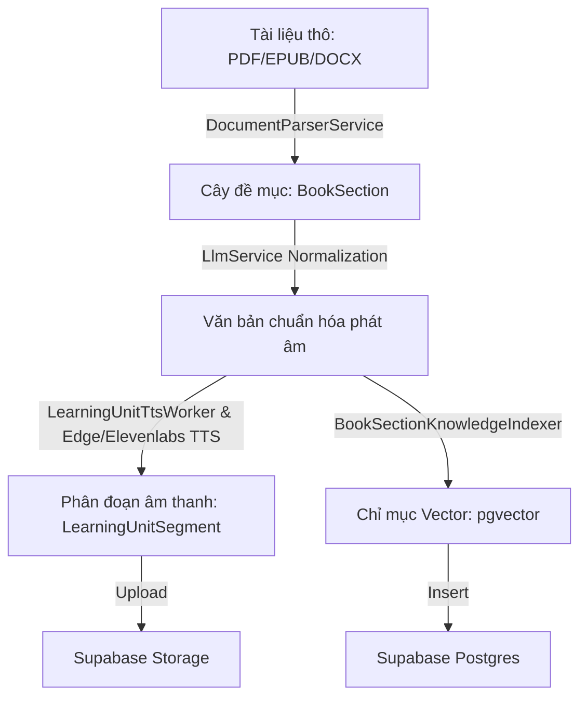
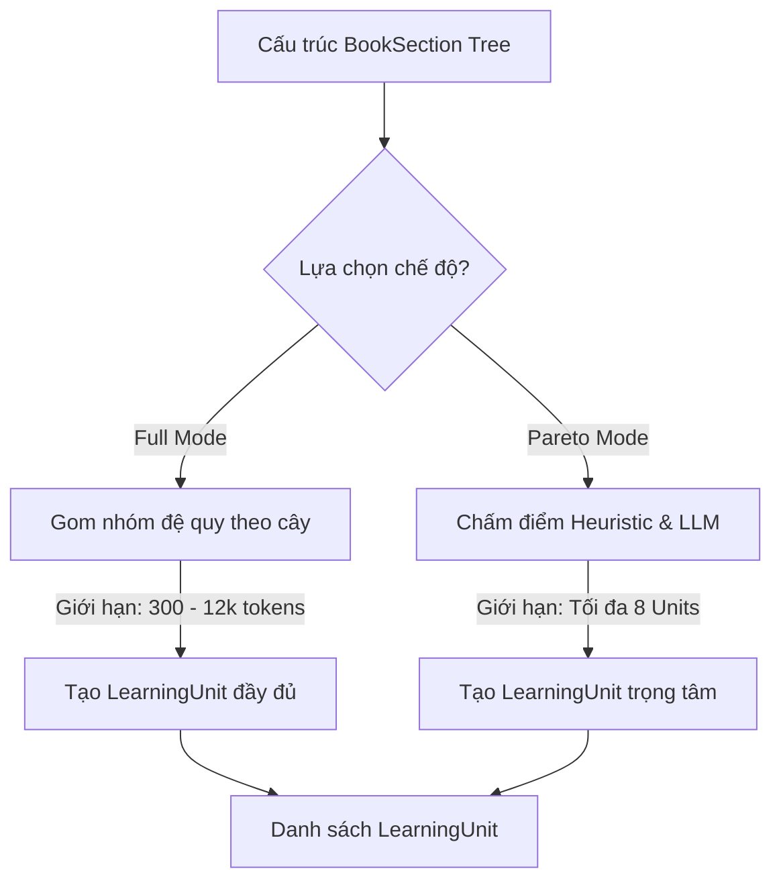
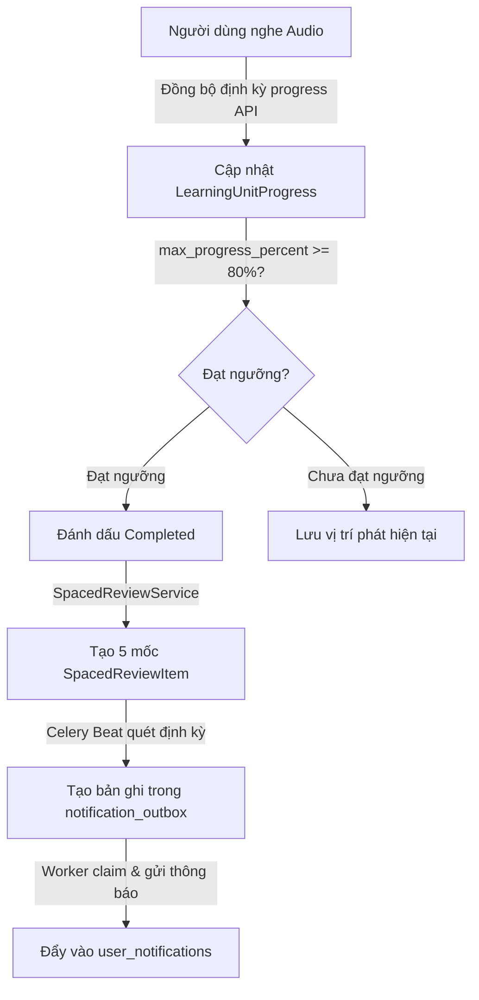
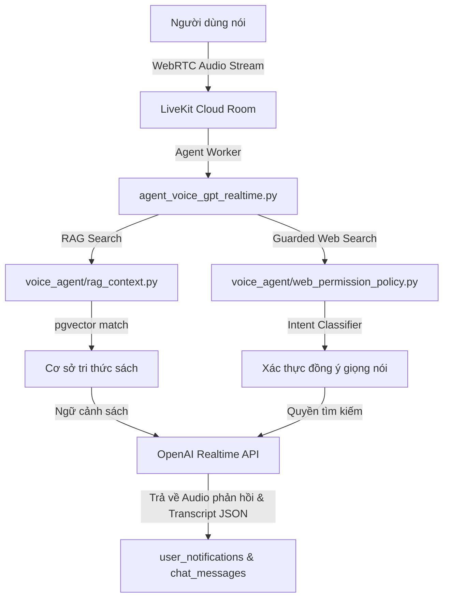
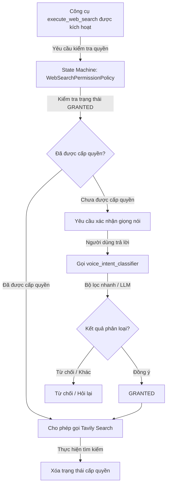

### ĐỀ XUẤT CƠ CẤU CHƯƠNG BÁO CÁO CAPSTONE (8 CHƯƠNG)

- **Chương 1: Lời mở đầu** (Đặt vấn đề, mục tiêu, đối tượng và phạm vi nghiên cứu).
- **Chương 2: Tổng quan đề tài và Cơ sở lý thuyết** (Giới thiệu các công nghệ sử dụng như RAG, WebRTC, Spaced Repetition, TTS, LLM).
- **Chương 3: Phân tích thiết kế hệ thống và Kiến trúc tổng quan** (Tổng quan kiến trúc, sơ đồ thực thể liên kết, thiết kế API và dữ liệu).
- **Chương 4: Quy trình Chuyển đổi tài liệu và Tiền xử lý âm thanh tự động** _(Tách riêng - Trọng tâm 1)_.
- **Chương 5: Cơ chế Lập kế hoạch học tập và Thiết lập chế độ Full / Pareto** _(Tách riêng - Trọng tâm 2)_.
- **Chương 6: Hệ thống Theo dõi tiến độ và Ôn tập ngắt quãng Spaced Repetition** _(Tách riêng - Trọng tâm 3)_.
- **Chương 7: Trợ lý giọng nói thời gian thực và Tìm kiếm tăng cường** _(Tách riêng - Trọng tâm 4)_.
- **Chương 8: Kết luận và Hướng phát triển**.

---

### MÔ TẢ CHI TIẾT NỘI DUNG CÁC CHƯƠNG TRỌNG TÂM DỰA TRÊN MÃ NGUỒN

Dưới đây là phần mô tả chi tiết nội dung học thuật cho từng chương lớn được bổ sung, tương ứng trực tiếp với cấu trúc file code hiện tại của bạn:

---

## CHƯƠNG 4: QUY TRÌNH CHUYỂN ĐỔI TÀI LIỆU VÀ TIỀN XỬ LÝ ÂM THANH TỰ ĐỘNG

Chương này trình bày chi tiết quy trình xử lý dữ liệu (data pipeline) bất đồng bộ của hệ thống TRIAM, từ thời điểm người học tải tài liệu thô lên máy chủ cho đến khi tài liệu được cấu trúc hóa, tổng hợp thành các tệp âm thanh phân đoạn chất lượng cao và trích xuất lưu trữ vào cơ sở dữ liệu tri thức hỗ trợ hỏi đáp ngữ nghĩa.

### 4.1. Phân tích cấu trúc tài liệu đầu vào (Document Parsing & Structure Tree)
Để xây dựng một lộ trình học tập cá nhân hóa chính xác, hệ thống TRIAM không tiếp cận tài liệu dưới dạng văn bản phẳng (flat text) mà thực hiện phân tích cú pháp để xây dựng cây cấu trúc phân cấp (Hierarchical Structure Tree). Quy trình này được đảm nhiệm bởi lớp `DocumentParserService` phối hợp với các dịch vụ chuyên biệt cho từng định dạng tệp tin:
*   **Xử lý tệp PDF (`pdf_service.py`)**: Hệ thống sử dụng thư viện `pypdf` và `pdfplumber` để duyệt qua cấu trúc cây Bookmark (Outline) được nhúng trong tệp tin. Giải thuật thực hiện duyệt đệ quy các nút (Recursive Node Traversal) để xác định tiêu đề đề mục, độ sâu (level) và chỉ số trang bắt đầu (`page_start`). Đoạn văn bản thuộc về một đề mục lá (leaf node) được khoanh vùng động từ trang bắt đầu của đề mục đó cho tới trang bắt đầu của đề mục kế tiếp theo thứ tự tài liệu.
*   **Xử lý tệp EPUB (`epub_service.py`)**: Sử dụng thư viện `ebooklib` kết hợp với bộ phân tích cú pháp HTML `BeautifulSoup`. Dịch vụ duyệt cây cấu trúc cây mục lục (TOC - Table of Contents), xác định đường dẫn tài nguyên nội bộ (`href`) và các mốc neo HTML (`anchors`) để trích xuất chính xác khối văn bản tương ứng với từng tiểu mục nhỏ mà không bị lẫn lộn giữa các chương.
*   **Xử lý tệp DOCX (`docx_service.py`)**: Sử dụng thư viện `python-docx` để phân tích các phần tử XML trong tài liệu Word. Giải thuật quét tuần tự qua các phân đoạn paragraph, so khớp thuộc tính kiểu dáng (Heading Styles) từ `Heading 1` tới `Heading 6` để phân cấp cây thư mục tương ứng từ cấp 1 đến cấp 6, đồng thời tự động gom các đoạn văn bản thường (Normal Paragraphs) gắn vào đề mục chi tiết gần nhất.

Sau khi trích xuất thành công, toàn bộ dữ liệu cấu trúc cây được chuyển đổi qua `document_structure_service.py`. Tại đây, dịch vụ thực hiện:
1.  **DFS Indexing**: Đánh chỉ mục duyệt theo chiều sâu (Depth-First Search) để gán thuộc tính chỉ mục phẳng (`section_index`) và thuộc tính đường dẫn phân cấp (`path` dạng chuỗi, ví dụ: `"1"`, `"1.1"`, `"1.1.2"`).
2.  **Validation Gate**: Kiểm tra tính hợp lệ của cây (không cho phép nhảy cấp độ sâu bất thường, ví dụ từ Level 1 xuống trực tiếp Level 3, hoặc tài liệu không có mục lục).
3.  **Persistence**: Lưu trữ cấu trúc cây bền vững vào thực thể cơ sở dữ liệu `BookSection` tương ứng với khóa ngoại `book_id`.

### 4.2. Chuẩn hóa ngôn ngữ văn bản cho phát âm (LLM Text Normalization)
Văn bản thô trích xuất trực tiếp từ tài liệu thường chứa các ký tự phi ngôn ngữ nói (như ký hiệu bảng biểu, số trang, tiêu đề đầu trang/chân trang, các ký tự viết tắt thuật ngữ học thuật hoặc công thức toán học). Nếu đưa trực tiếp các văn bản này vào bộ tổng hợp giọng nói (TTS) sẽ sinh ra âm thanh rời rạc, khó nghe và thiếu tự nhiên.

Hệ thống giải quyết bài toán này thông qua lớp dịch vụ chuẩn hóa `llm_service.py`. Khi một bài học cần chuẩn hóa, hệ thống sẽ gửi nội dung văn bản gốc đến mô hình ngôn ngữ lớn (Gemini LLM) kèm theo hệ thống chỉ thị (System Prompts) nghiêm ngặt nhằm biên dịch văn bản sang văn phong nói tự nhiên (Spoken Vietnamese):
*   Biên dịch và viết rõ nghĩa các từ viết tắt chuyên ngành (ví dụ: *"tc"* thành *"tính chất"*, *"nxb"* thành *"nhà xuất bản"*).
*   Chuyển đổi các chữ số, ký hiệu toán học, công thức logic thành dạng chữ viết phát âm được bằng tiếng Việt (ví dụ: *"x \in A"* thành *"x thuộc tập hợp A"*, *"80%"* thành *"tám mươi phần trăm"*).
*   Loại bỏ hoàn toàn các siêu dữ liệu nhiễu như số thứ tự trang, ký hiệu đầu đoạn danh sách mà không làm biến đổi nội dung khoa học của bài học.

### 4.3. Tổng hợp giọng nói phân đoạn (TTS Segmentation & Caching)
Việc tổng hợp các tệp âm thanh có thời lượng quá dài (ví dụ trên 30 phút) sẽ gây ra các vấn đề nghiêm trọng về hiệu năng hệ thống: giới hạn ký tự của API TTS bên thứ ba, độ trễ khi tải tệp của ứng dụng di động lớn, và khó khăn trong việc lưu vết phát tiếp tục (resume playback).

Hệ thống TRIAM áp dụng giải thuật phân đoạn âm thanh (Audio Segmentation):
1.  **Phân đoạn ký tự**: Văn bản sau khi chuẩn hóa nói sẽ được phân tách thành các đoạn hội thoại ngắn hơn giới hạn 1000 ký tự, ưu tiên cắt tại các điểm ngắt câu tự nhiên (dấu chấm, dấu phẩy, dấu chấm hỏi) để đảm bảo không bị đứt gãy ngữ điệu.
2.  **Xử lý luồng ngầm song song (`learning_unit_tts_worker.py`)**: Tiến trình Celery Worker điều phối việc tổng hợp giọng nói thông qua `tts_service.py`. Để tránh vượt giới hạn tần suất gọi API (Rate Limits) của nhà cung cấp TTS (Edge TTS/Elevenlabs), hệ thống áp dụng cơ chế giới hạn bất đồng bộ `asyncio.Semaphore` (được cấu hình qua thuộc tính `TTS_GENERATION_CONCURRENCY`).
3.  **Lưu trữ và Ánh xạ**: Các file âm thanh MP3 sau khi sinh ra được định danh duy nhất và tải lên Supabase Storage dưới đường dẫn dạng `/books/{book_id}/audio/{mode}/{segment_index}.mp3`. Hệ thống tạo các bản ghi tương ứng trong bảng `LearningUnitSegment` để ánh xạ chính xác chỉ số phân đoạn (`segment_index`), đường dẫn URL âm thanh (`audio_url`), thời lượng phát tính bằng mili giây (`duration_ms`) và văn bản thô tương ứng (`text_content`).

### 4.4. Trích xuất chỉ mục Vector tri thức (Knowledge Base Indexing)
Để cung cấp khả năng hỏi đáp ngữ nghĩa chính xác theo nội dung tài liệu, hệ thống cần chuyển hóa tri thức dạng chữ thành không gian vector. Tiến trình này được xử lý độc lập thông qua `book_section_knowledge_indexer.py`:
1.  **Text Chunking**: Quét qua các `BookSection` có chứa nội dung chữ, tiến hành cắt văn bản thành các đoạn nhỏ hơn (chunks) có kích thước cố định khoảng 500-1000 ký tự, kèm theo độ gối đầu trùng lặp (overlap) khoảng 100-200 ký tự nhằm tránh mất mát ngữ cảnh tại ranh giới phân cắt đoạn.
2.  **Embedding Generation**: Gọi API OpenAI Embeddings để chuyển đổi từng đoạn văn bản thành mảng vector số thực 1536 chiều đại diện cho ngữ nghĩa của đoạn văn bản đó.
3.  **Postgres pgvector Storage**: Lưu trữ các đoạn văn bản thô cùng mảng vector tương ứng vào thực thể cơ sở dữ liệu `BookKnowledge`. Cột `embedding` được định nghĩa kiểu dữ liệu `vector(1536)` trong Supabase Postgres và được đánh chỉ mục tìm kiếm bằng thuật toán HNSW (Hierarchical Navigable Small World) để tối ưu hóa hiệu năng truy vấn cosine tương đồng về sau.

---

## CHƯƠNG 5: CƠ CHẾ LẬP KẾ HOẠCH HỌC TẬP VÀ THIẾT LẬP CHẾ ĐỘ FULL / PARETO

Chương này đi sâu vào giải thuật thiết kế bài học và bộ hoạch định kế hoạch học tập thông minh (Learning Unit Planner), làm rõ cách thức phân tách và cấu trúc hóa nội dung phù hợp với các chế độ học tập khác nhau.

### 5.1. Thiết kế Mô hình Bài học (Learning Unit Model)
Trong hệ thống TRIAM, thực thể học tập hiển thị trực tiếp trên trình phát nhạc của người dùng không phải là các `BookSection` thô mà là các bài học `LearningUnit`. Một bài học `LearningUnit` đại diện cho một phân đoạn kiến thức hoàn chỉnh, có ý nghĩa khoa học độc lập. 
*   **Mối quan hệ**: Một `LearningUnit` có quan hệ một-nhiều hoặc nhiều-nhiều với các `BookSection` thông qua bảng trung gian `LearningUnitSource`. 
*   **Mục đích**: Việc thiết kế mô hình này giúp che giấu đi sự phức tạp của cây thư mục quá vụn vặt (ví dụ một chương có 50 tiểu mục nhỏ). Thay vào đó, hệ thống sẽ gom các đề mục nhỏ này lại để phát chung trên một tệp âm thanh lớn liên tục, mang lại trải nghiệm nghe giống như một chương sách nói thực tế.

### 5.2. Thuật toán Lập kế hoạch Chế độ đầy đủ (Full Mode Planner)
Chế độ đầy đủ (Full Mode) có mục tiêu truyền tải toàn vẹn toàn bộ tri thức của tài liệu gốc nhưng được tổ chức lại một cách khoa học để tránh các bài học quá ngắn hoặc quá dài. Giải thuật lập kế hoạch được định nghĩa trong [learning_unit_planner_service.py](file:///w:/WorkSpace_IT/_CAPSTON_PROJECT/triam-backend/app/services/learning_unit_planner_service.py) bao gồm các bước:
1.  **Xác định nút gốc học tập (Learning Roots)**: Giải thuật duyệt qua danh sách các đề mục để tìm các nút thuộc Level 1 đại diện cho các chương lớn (ví dụ: các chương bắt đầu bằng chữ *"Chương"*, *"Phần"*, *"Bài"*). Nếu số lượng nút gốc nằm trong khoảng từ 1 đến 60, hệ thống sẽ chọn các nút này làm mốc phân chia bài học chính.
2.  **Duyệt cây con (Subtree Traversal)**: Đối với mỗi nút gốc, giải thuật duyệt đệ quy toàn bộ các đề mục con trực thuộc nút đó (`_subtree_sections`) để thu thập toàn bộ văn bản của nhánh cây.
3.  **Tách nhóm lớn (Splitting Logic)**: Nếu tổng lượng token dự kiến của một nhóm vượt quá giới hạn tối đa `FULL_UNIT_MAX_TOKENS = 12000` (nhằm tránh quá tải LLM và TTS), giải thuật sẽ tiến hành phân tách nhóm đó thành các phần nhỏ hơn (`_split_large_group`), đặt tên theo định dạng *"Tên Chương - Phần X/Y"*.
4.  **Gộp nhóm nhỏ (Merging Logic)**: Sau khi phân chia sơ bộ, hệ thống duyệt qua danh sách bài học. Nếu có các bài học liên tiếp có kích thước quá nhỏ dưới ngưỡng `MIN_UNIT_TOKENS = 300`, giải thuật `_merge_tiny_units` sẽ thực hiện gộp chúng lại với nhau để tránh tạo ra các bài nghe siêu ngắn gây đứt gãy trải nghiệm.

### 5.3. Quy trình Lập kế hoạch Chế độ trọng tâm (Pareto Mode Planner)
Chế độ trọng tâm (Pareto Mode) hoạt động dựa trên nguyên lý 80/20, nhằm trích xuất ra nhóm bài học mang lại giá trị tiếp thu cao nhất trong thời gian ngắn nhất (nhắm mục tiêu độ bao phủ kiến thức khoảng 40% tổng tài liệu gốc, giới hạn tối đa trong 8 bài học cốt lõi). 

Quy trình này được hiện thực hóa qua cơ chế hoạch định lai (Hybrid Planner) trong [pareto_planner_service.py](file:///w:/WorkSpace_IT/_CAPSTON_PROJECT/triam-backend/app/services/pareto_planner_service.py):
*   **Bộ lọc chấm điểm Heuristic (Fast-Path Scorer)**:
    Hệ thống chấm điểm mức độ quan trọng (`_pareto_score`) của từng nhánh đề mục dựa trên tổng hòa các tiêu chí:
    $$\text{Score} = \text{SignalScore} + \text{ContentScore} + \text{HierarchyScore} + \text{ChildScore}$$
    Trong đó:
    *   $\text{SignalScore}$: Sử dụng [pareto_signal_service.py](file:///w:/WorkSpace_IT/_CAPSTON_PROJECT/triam-backend/app/services/pareto_signal_service.py) tìm kiếm sự xuất hiện của các từ khóa mang tính tín hiệu học thuật cao trong tiêu đề và nội dung (ví dụ: *"định nghĩa"*, *"nguyên lý"*, *"công thức"*, *"quy trình"*, *"phương pháp"*).
    *   $\text{ContentScore}$: Điểm thưởng dựa trên độ dài ký tự của nhánh (tối đa 2000 ký tự) để đảm bảo nhánh có đủ nội dung diễn giải.
    *   $\text{HierarchyScore}$: Điểm thưởng cho vị trí đề mục gần nút gốc cấp cao (Level thấp có điểm ưu tiên lớn hơn).
    *   $\text{ChildScore}$: Điểm dựa trên số lượng đề mục con để ưu tiên các cấu trúc chứa nhiều phân nhánh kiến thức liên quan.
*   **Hoạch định thông minh qua LLM (Structured Outputs)**:
    Nếu số lượng đề mục lớn hơn ngưỡng cấu hình, hệ thống sẽ đóng gói thông tin các đề mục thành các "Section Cards" (chứa ID, tiêu đề, vị trí, đoạn văn bản mẫu ngắn, điểm tín hiệu) và gửi tới Gemini LLM.
    *   *Chi tiết giải thuật*: Hệ thống gọi phương thức API `client.beta.chat.completions.parse` của OpenAI SDK truyền kèm định nghĩa dữ liệu Pydantic `ParetoPlannerPayload`. Mô hình LLM sẽ phân tích logic mối quan hệ giữa các Section và trả về cấu trúc JSON chuẩn xác ánh xạ danh sách các `LearningUnit` đề xuất, lý do lựa chọn (`planner_reason`), mục tiêu học tập (`learning_objective`), và danh sách các ID đề mục gốc cần gom nhóm.
*   **Cơ chế Fallback an toàn**:
    Trong trường hợp kết nối LLM gặp sự cố, lỗi định dạng JSON hoặc bị quá thời gian chờ (cấu hình qua `PARETO_PLANNER_TIMEOUT_SECONDS`), hệ thống sẽ tự động kích hoạt hàm `fallback_pareto_learning_units`. Hàm này sử dụng kết quả từ bộ lọc chấm điểm Heuristic để chọn ra các nhóm đề mục có điểm cao nhất sắp xếp theo trình tự xuất hiện gốc trong tài liệu để lưu vào cơ sở dữ liệu.

---

## CHƯƠNG 6: HỆ THỐNG THEO DÕI TIẾN ĐỘ VÀ ÔN TẬP NGẮT QUÃNG SPACED REPETITION

Chương này mô tả chi tiết vòng lặp học tập (Learning Loop) khép kín của người học, tập trung vào thiết kế cơ sở dữ liệu theo dõi tiến độ, thuật toán chấm điểm hoàn thành và hạ tầng nhắc nhở ôn tập tự động.

### 6.1. Thiết lập Lịch học và Phân bổ thời gian (Schedule Slots)
Để giúp người học phân bổ thời gian học tập khoa học và tránh việc nhận quá nhiều thông báo nhắc nhở dồn dập trong cùng một thời điểm, hệ thống thiết kế cơ chế phân bổ lịch trình thông qua `reading_plan_schedule_service.py`:
*   Khi người dùng tạo một kế hoạch học tập (`ReadingPlan`), họ sẽ cấu hình các ngày trong tuần và khung giờ mong muốn nhận nhắc nhở học (ví dụ: Thứ Hai và Thứ Tư lúc `20:00`).
*   Hệ thống chuyển đổi cấu hình này thành các bản ghi cụ thể trong bảng `reading_plan_schedule_slots`. Bản ghi này ghi nhận múi giờ địa phương (`timezone`, ví dụ: `"Asia/Ho_Chi_Minh"`) và tự động kiểm tra xung đột thời gian (Time Conflict Validation) với các kế hoạch học tập khác của cùng một tài khoản để đảm bảo tính phân bổ đều đặn.

### 6.2. Theo dõi tiến độ nghe và Cơ chế chống tua ngược (Progress Tracking & Resume)
Tiến độ học tập của người dùng đối với từng bài học được theo dõi chi tiết và đồng bộ thông qua `learning_progress_service.py` với các nghiệp vụ chính:
*   **Khôi phục trạng thái phát (Resume Playback)**: Khi người dùng nghe âm thanh, ứng dụng di động gửi request cập nhật tiến độ định kỳ. Hệ thống ghi nhận ID phân đoạn hiện tại (`current_segment_id`), chỉ số phân đoạn (`last_segment_index`) và thời điểm miligiây phát hiện tại (`position_ms`) vào bảng `LearningUnitProgress`. Khi người dùng quay lại học, hệ thống sẽ truy xuất bản ghi này để khôi phục trình phát nhạc ngay lập tức.
*   **Tính toán tiến độ học thật**: Hệ thống không tin tưởng hoàn toàn vào phần trăm tiến độ do Client gửi lên để tránh việc người học cố tình tua nhanh tệp tin. Thay vào đó, Backend sử dụng dữ liệu thời lượng thực của từng segment (`duration_ms`) lưu trong DB để tính toán tỷ lệ phần trăm nghe thực tế.
*   **Completion Gate (Ngưỡng hoàn thành 80%)**: Bài học được đánh dấu trạng thái hoàn thành (`completed_at`) khi và chỉ khi giá trị tiến độ cao nhất từng đạt được (`max_progress_percent`) đạt tối thiểu **80%**. Việc sử dụng chỉ số `max_progress_percent` thay vì `progress_percent` hiện tại giúp ghi nhận chính xác trạng thái hoàn thành ngay cả khi người dùng tua ngược âm thanh để nghe lại một đoạn kiến thức chưa rõ trước đó.

### 6.3. Mô hình Ôn tập ngắt quãng (Spaced Repetition Model)
Ngay khi một bài học được đánh dấu hoàn thành lần đầu tiên, hệ thống sẽ tự động kích hoạt tiến trình lập lịch ôn tập ngắt quãng thông qua lớp `spaced_review_service.py`.
*   Hệ thống dựa trên thời điểm hoàn thành thực tế (`completed_at`) để sinh ra 5 mốc ôn tập lý tưởng theo thời gian tăng dần:
    $$\text{due\_at} = \text{completed\_at} + \text{interval\_days}$$
    Với $\text{interval\_days} \in \{1, 3, 7, 14, 30\}$ ngày.
*   Hệ thống ghi nhận 5 bản ghi ôn tập này vào bảng `spaced_review_items` ở trạng thái chờ (`pending`). Mỗi bản ghi lưu trữ thêm bản chụp nội dung ôn tập (`review_text_snapshot`) được sinh ra từ quá trình chuẩn hóa tài liệu ban đầu để người học có thể đọc nhanh nội dung cốt lõi của bài học đó trực tiếp trên thông báo ôn tập.

### 6.4. Hạ tầng Thông báo nhắc nhở bền vũ (Outbox Pattern & Celery Beat)
Để vận hành luồng gửi thông báo nhắc học và ôn tập tự động theo thời gian thực mà không bị thất thoát thông tin do sự cố hệ thống, TRIAM áp dụng mô hình **Transactional Outbox Pattern**:
*   **Celery Beat Scheduler**: Được cấu hình chạy định kỳ mỗi 60 giây để đẩy tác vụ quét `scan_due_notifications_task` vào Redis.
*   **Quét và Tạo Outbox**: Tác vụ quét sẽ kiểm tra các lịch học (`reading_plan_schedule_slots`) và lịch ôn tập (`spaced_review_items`) trong Postgres có thời gian đến hạn (`due_at` bằng hoặc nhỏ hơn thời gian hiện tại). Nếu thỏa mãn, hệ thống tạo bản ghi tương ứng trong bảng `notification_outbox` ở trạng thái `pending`.
*   **Idempotency Key (Khóa chống trùng lặp)**: Mỗi bản ghi outbox được bảo vệ nghiêm ngặt bằng một khóa duy nhất được tạo theo quy luật cụ thể để tránh việc tạo trùng thông báo khi tác vụ quét chạy lặp lại:
    *   Thông báo ôn tập: `spaced-review:<review_item_id>`
    *   Thông báo nhắc học: `plan:<user_id>:<book_id>:<local_date>`
*   **Claim & Delivery**: Tác vụ gửi thông báo (`deliver_due_notifications_task`) sẽ lấy các bản ghi outbox đang chờ bằng từ khóa khóa hàng `SELECT ... FOR UPDATE SKIP LOCKED` (nhằm tránh xung đột giữa nhiều worker cùng chạy). Worker chuyển trạng thái outbox sang `processing`, gọi dịch vụ giao vận tạo bản ghi hiển thị thực tế trong bảng `user_notifications`, và cuối cùng cập nhật outbox sang trạng thái `sent`. Nếu gặp sự cố mạng, outbox được lưu vết để tự động thử lại sau (retry).

---

## CHƯƠNG 7: TRỢ LÝ GIỌNG NÓI TƯƠNG TÁC THỜI GIAN THỰC VÀ TÌM KIẾM TĂNG CƯỜNG

Chương này phân tích thiết kế hệ thống đàm thoại giọng nói song hướng thời gian thực của TRIAM, làm rõ luồng truyền tải WebRTC, cơ chế tích hợp truy xuất ngữ cảnh tài liệu (RAG) và giải pháp kiểm soát an toàn truy cập internet ngoài sách.

### 7.1. Kiến trúc luồng kết nối WebRTC (Realtime Connection Bootstrap)
Luồng đàm thoại thời gian thực bắt đầu khi người dùng kích hoạt phòng chat của cuốn sách hoặc không gian học tập trên ứng dụng di động:
1.  **Cấp phát Token**: Client gọi API `/api/v1/live-token/thread/{thread_id}`. Dịch vụ `live_service.py` sẽ kiểm tra quyền sở hữu của tài khoản đối với luồng chat, truy vấn danh sách các cuốn sách liên kết trong không gian học tập đó, và gọi LiveKit SDK để tạo một JWT Token có chứa siêu dữ liệu (metadata) đóng gói định dạng JSON bao gồm: `thread_id` và danh sách các ID của sách cần truy cập (`document_ids`).
2.  **Khởi tạo Agent**: Client sử dụng token để kết nối trực tiếp vào LiveKit Cloud Room. Sự kiện này kích hoạt lệnh dispatch để khởi chạy một tiến trình Python độc lập `agent_voice_gpt_realtime.py` (vận hành thông qua LiveKit Agent SDK co-hosted trên máy chủ).
3.  **Thiết lập phiên đàm thoại**: Agent tham gia phòng họp, giải mã siêu dữ liệu để xác định phạm vi tài liệu cần truy vấn tri thức và tải lịch sử hội thoại gần nhất nhằm đảm bảo tính liên tục của ngữ cảnh giao tiếp.

### 7.2. Đồng bộ hóa dữ liệu thời gian thực (DataChannel Sync)
Để tối ưu hóa trải nghiệm tương tác, luồng đàm thoại của TRIAM không chỉ dựa trên âm thanh mà luôn có sự đồng bộ hóa dữ liệu hiển thị trên màn hình chat thông qua dịch vụ `transcript_store.py`:
*   Khi người học nói, Agent nhận luồng âm thanh từ LiveKit, gửi đến OpenAI Realtime API. Khi OpenAI trả về kết quả nhận diện giọng nói (Speech-To-Text) dạng văn bản tạm thời hoặc cuối cùng, Agent lập tức phát sự kiện JSON qua kênh `lk.transcript` để ứng dụng di động cập nhật trực tiếp nội dung người dùng đang nói lên màn hình.
*   Khi Agent trả lời bằng giọng nói, văn bản thoại tương ứng được đẩy về ứng dụng di động qua kênh `lk.transcript` dưới dạng tin nhắn của trợ lý kèm theo khóa định danh tin nhắn duy nhất (`id`).
*   **Lưu trữ bền vững**: Dữ liệu tin nhắn thoại không bị biến mất khi phiên kết nối kết thúc. Lớp `VoiceTranscriptStore` tự động gom nhóm các sự kiện thoại, gọi ngầm phương thức ghi nhận vào bảng `chat_messages` trong Postgres để người học có thể xem lại toàn bộ lịch sử trò chuyện dưới dạng chat văn bản truyền thống khi mở lại ứng dụng.

### 7.3. Truy xuất Tri thức tăng cường (Book-grounded RAG Search)
Khi người dùng đặt câu hỏi kiến thức, Agent không trả lời dựa trên kiến thức tự do của mô hình AI để tránh hiện tượng ảo tưởng (hallucination). Agent hoạt động dựa trên cơ chế RAG được thiết kế trong `voice_agent/rag_context.py`:
*   Hệ thống đăng ký một công cụ chuyên biệt (Function Tool) tên là `search_book_knowledge` cho Agent.
*   Khi người dùng hỏi về kiến thức chuyên ngành, Agent sẽ trích xuất từ khóa hoặc câu hỏi của người dùng và gọi công cụ `search_book_knowledge`.
*   Công cụ này thực hiện gọi OpenAI Embeddings để chuyển câu hỏi thành vector, thực hiện truy vấn cosine tương đồng ngữ nghĩa trên bảng `book_knowledge` giới hạn trong phạm vi các khóa ngoại `book_id` nằm trong danh sách tài liệu được cấp quyền (`document_ids`).
*   Kết quả trả về được định dạng có cấu trúc rõ ràng:
    *   Nếu tìm thấy thông tin: Trả về văn bản đính kèm tiêu đề đề mục nguồn để Agent nạp vào Prompt hệ thống.
    *   Nếu không có thông tin phù hợp: Trả về mã tín hiệu chuyên biệt `"BOOK_CONTEXT_NOT_FOUND"`.

### 7.4. Cơ chế Cấp quyền tìm kiếm Internet (Guarded Web Search & Intent Classification)
Để bảo vệ an toàn dữ liệu học tập nội bộ và tối ưu hóa chi phí (tránh việc AI liên tục thực hiện tìm kiếm internet bằng Tavily Search không cần thiết), TRIAM thiết kế một lớp bảo vệ hai tầng nghiêm ngặt:

*   **Tầng 1 - Máy trạng thái cấp quyền (State Machine Policy)**:
    Được quản lý bởi lớp `WebSearchPermissionPolicy` trong [web_permission_policy.py](file:///w:/WorkSpace_IT/_CAPSTON_PROJECT/triam-backend/app/services/voice_agent/web_permission_policy.py). Quyền tìm kiếm là **quyền một lần (single-use)** và hoạt động theo máy trạng thái:
    *   Khi thông tin trong tài liệu không đủ (`BOOK_CONTEXT_NOT_FOUND`), Agent sẽ gọi công cụ `ask_web_search_permission(query)` để chuyển trạng thái sang `pending_permission`, đồng thời phát âm thanh hỏi người học có muốn tìm kiếm internet không.
    *   Quyền tìm kiếm chỉ chuyển sang `granted` khi câu trả lời tiếp theo của người dùng được xác nhận đồng ý. Sau khi thực hiện tìm kiếm internet một lần duy nhất qua công cụ `execute_web_search`, quyền sẽ lập tức bị xóa (clear) để đảm bảo an toàn cho các câu hỏi tiếp theo.
*   **Tầng 2 - Bộ phân loại ý định người dùng (Intent Classifier)**:
    Khi người dùng trả lời câu hỏi xin phép bằng giọng nói, âm thanh được STT dịch thành văn bản và đưa vào bộ phân loại ý định `web_permission_intent_classifier.py`:
    *   *Bộ lọc nhanh (Fast-path Patterns)*: So khớp nhanh các từ ngữ đồng ý hoặc từ chối rõ ràng bằng cả tiếng Anh và tiếng Việt (ví dụ: *"ok"*, *"yup"*, *"tìm đi"*, *"đồng ý"* -> quyết định ngay là `grant`; hoặc *"không"*, *"nope"*, *"khỏi"* -> quyết định ngay là `deny`).
    *   *Mô hình phân loại tự nhiên (LLM Classifier)*: Nếu câu trả lời phức tạp (ví dụ: *"Ừ nếu sách không có thì tìm thử xem"* hoặc *"Thôi khỏi cần đâu để tôi tự đọc"*), hệ thống gọi mô hình phân loại thông minh để trả về chính xác một trong các nhãn phân loại:
        1.  `grant` (Đồng ý): Chuyển trạng thái sang cho phép tìm kiếm.
        2.  `deny` (Từ chối): Hủy trạng thái chờ, Agent trả lời xác nhận sẽ không tìm kiếm internet.
        3.  `unclear` (Không rõ ý): Giữ trạng thái chờ, Agent chủ động hỏi lại người dùng để làm rõ ý.
        4.  `new_question` (Đặt câu hỏi mới): Người dùng bỏ qua việc cấp quyền và hỏi câu khác. Hệ thống lập tức hủy trạng thái chờ và quay lại luồng xử lý câu hỏi mới bình thường.
    *   Cơ chế giải quyết bất đồng bộ (Just-in-time Resolution) được thực hiện bên trong công cụ `execute_web_search` giúp loại bỏ hoàn toàn các lỗi chạy đua dữ liệu (race conditions) giữa việc nhận transcript văn bản và việc gọi công cụ của mô hình AI.
