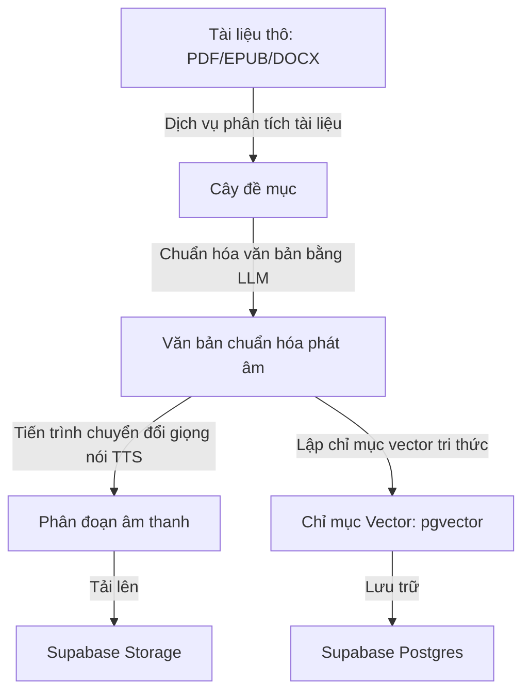
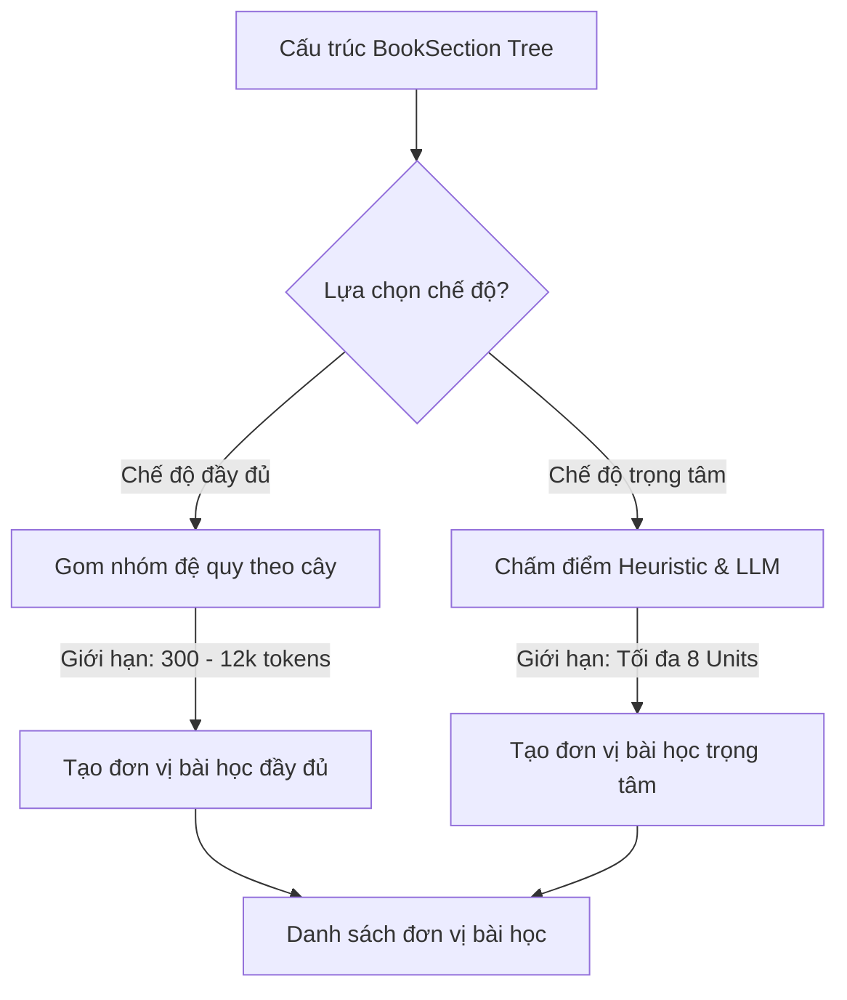
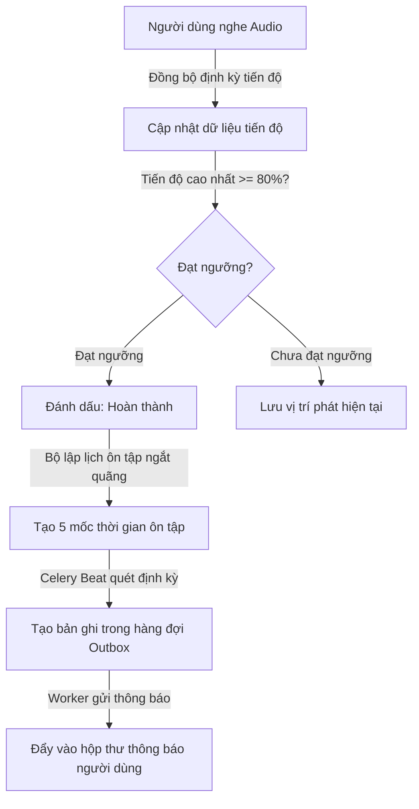
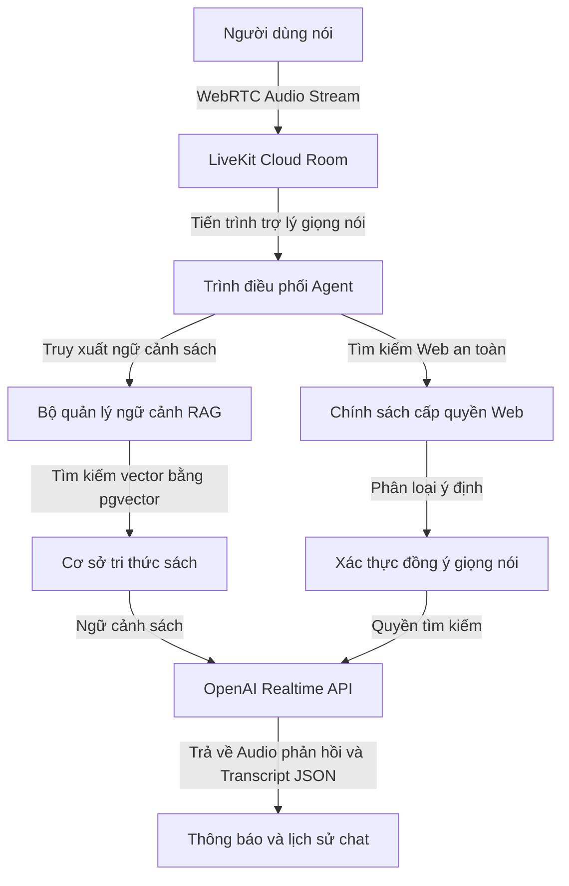
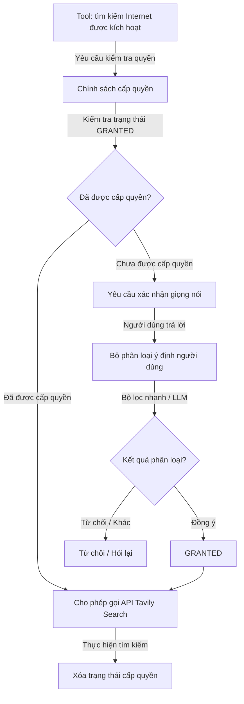

### ĐỀ XUẤT CƠ CẤU CHƯƠNG BÁO CÁO CAPSTONE (8 CHƯƠNG)

- **Chương 1: Lời mở đầu** (Đặt vấn đề, mục tiêu, đối tượng và phạm vi nghiên cứu).
- **Chương 2: Tổng quan đề tài và Cơ sở lý thuyết** (Giới thiệu các công nghệ sử dụng như RAG, WebRTC, Spaced Repetition, TTS, LLM).
- **Chương 3: Phân tích thiết kế hệ thống và Kiến trúc tổng quan** (Tổng quan kiến trúc, sơ đồ thực thể liên kết, thiết kế API và dữ liệu).
- **Chương 4: Quy trình Chuyển đổi tài liệu và Tiền xử lý âm thanh tự động** _(Tách riêng - Trọng tâm 1)_.
- **Chương 5: Cơ chế Lập kế hoạch học tập và Thiết lập chế độ Full / Pareto** _(Tách riêng - Trọng tâm 2)_.
- **Chương 6: Hệ thống Theo dõi tiến độ và Ôn tập ngắt quãng Spaced Repetition** _(Tách riêng - Trọng tâm 3)_.
- **Chương 7: Trợ lý giọng nói thời gian thực và Tìm kiếm tăng cường** _(Tách riêng - Trọng tâm 4)_.
- **Chương 8: Kết luận và Hướng phát triển**.

---

### MÔ TẢ CHI TIẾT NỘI DUNG CÁC CHƯƠNG TRỌNG TÂM DỰA TRÊN MÃ NGUỒN

Dưới đây là phần mô tả chi tiết nội dung học thuật cho từng chương lớn được bổ sung, tương ứng trực tiếp với cấu trúc thiết kế của hệ thống:

---

## CHƯƠNG 4: QUY TRÌNH CHUYỂN ĐỔI TÀI LIỆU VÀ TIỀN XỬ LÝ ÂM THANH TỰ ĐỘNG

Chương này trình bày chi tiết quy trình xử lý dữ liệu bất đồng bộ của hệ thống, từ thời điểm người học tải tài liệu thô lên máy chủ cho đến khi tài liệu được cấu trúc hóa, tổng hợp thành các tệp âm thanh phân đoạn chất lượng cao và trích xuất lưu trữ vào cơ sở dữ liệu tri thức hỗ trợ hỏi đáp ngữ nghĩa.

### 4.1. Phân tích cấu trúc tài liệu đầu vào

Để xây dựng một lộ trình học tập cá nhân hóa chính xác, hệ thống không tiếp cận tài liệu dưới dạng văn bản phẳng mà thực hiện phân tích cú pháp để xây dựng cây cấu trúc phân cấp. Quy trình này được đảm nhiệm bởi dịch vụ phân tích tài liệu phối hợp với các cấu phần xử lý chuyên biệt cho từng định dạng tệp tin:

- **Xử lý tài liệu định dạng PDF**: Hệ thống sử dụng các thư viện xử lý tài liệu PDF để duyệt qua cấu trúc cây bookmark (outline) được nhúng trong tệp tin. Giải thuật thực hiện duyệt đệ quy các nút để xác định tiêu đề đề mục, cấp độ đề mục và chỉ số trang bắt đầu. Đoạn văn bản thuộc về một đề mục lá (leaf node) được khoanh vùng động từ trang bắt đầu của đề mục đó cho tới trang bắt đầu của đề mục kế tiếp theo thứ tự tài liệu.
- **Xử lý tài liệu định dạng sách điện tử EPUB**: Dịch vụ duyệt cấu trúc cây mục lục (TOC - Table of Contents) gốc của tệp tin, xác định đường dẫn tài nguyên nội bộ (`href`) và các mốc neo HTML (`anchors`) để trích xuất chính xác khối văn bản tương ứng với từng tiểu mục nhỏ mà không bị lẫn lộn giữa các chương.
- **Xử lý tài liệu định dạng Microsoft Word (DOCX)**: Dịch vụ thực hiện phân tích các phần tử định dạng văn bản trong cấu trúc XML của Word. Giải thuật quét tuần tự qua các phân đoạn paragraph, so khớp thuộc tính kiểu dáng tiêu đề (Heading Styles từ 1 đến 6) để phân cấp cây thư mục tương ứng, đồng thời tự động gom các đoạn văn bản nội dung thường gắn vào đề mục chi tiết gần nhất.

Sau khi trích xuất thành công, toàn bộ dữ liệu cấu trúc cây được chuyển đổi qua dịch vụ quản lý cấu trúc tài liệu. Tại đây, hệ thống thực hiện:

1.  **DFS Indexing**: Đánh chỉ mục duyệt theo chiều sâu (DFS) để gán thuộc tính chỉ mục phẳng và thuộc tính đường dẫn phân cấp.
2.  **Cổng kiểm thử tính hợp lệ**: Kiểm tra cấu trúc phân cấp cây tài liệu nhằm phát hiện các lỗi định dạng nghiêm trọng như nhảy cấp đề mục bất thường hoặc tài liệu thô hoàn toàn thiếu cấu trúc mục lục.
3.  **Lưu trữ bền vững**: Lưu trữ cấu trúc cây bền vững vào thực thể cơ sở dữ liệu cây đề mục tài liệu.

> **Ví dụ thực tế**: Khi người học tải lên cuốn tài liệu _"Toán rời rạc.docx"_, mục lục tài liệu chứa _"Chương 1: Cơ sở logic"_ (Heading 1) và các mục con _"1.1. Mệnh đề"_ (Heading 2), _"1.1.1. Định nghĩa"_ (Heading 3). Bộ phân tích sẽ xây dựng một cây đề mục phân cấp có cấu trúc cha-con rõ ràng. Mục _"1.1.1. Định nghĩa"_ sẽ được gán với cấp độ cây thư mục bằng 3, đường dẫn phân cấp là `"1.1.1"` và chỉ mục phẳng là vị trí tương đối của nó trong toàn bộ tài liệu.

### 4.2. Chuẩn hóa ngôn ngữ văn bản cho TTS

Văn bản thô trích xuất trực tiếp từ tài liệu thường chứa các ký tự phi ngôn ngữ nói (như ký hiệu bảng biểu, số trang, tiêu đề đầu trang/chân trang, các ký tự viết tắt thuật ngữ học thuật hoặc công thức toán học). Nếu đưa trực tiếp các văn bản này vào bộ tổng hợp giọng nói (TTS) sẽ sinh ra âm thanh rời rạc, khó nghe và thiếu tự nhiên.

Hệ thống giải quyết bài toán này thông qua dịch vụ tiền xử lý bằng mô hình ngôn ngữ lớn (LLM). Khi một bài học cần chuẩn hóa, hệ thống sẽ gửi nội dung văn bản gốc đến LLM kèm theo hệ thống chỉ thị (System Prompts) nghiêm ngặt nhằm biên dịch văn bản sang văn phong nói tự nhiên:

- Biên dịch và viết rõ nghĩa các từ viết tắt chuyên ngành để đảm bảo tính dễ hiểu khi nghe.
- Chuyển đổi các chữ số, ký hiệu toán học, công thức logic thành dạng chữ viết phát âm được bằng tiếng Việt.
- Loại bỏ hoàn toàn các siêu dữ liệu nhiễu như số thứ tự trang, ký hiệu đầu đoạn danh sách mà không làm biến đổi nội dung khoa học của bài học.

| Văn bản gốc trong tài liệu                                                                       | Văn bản sau chuẩn hóa (Văn phong nói)                                                                    |
| :----------------------------------------------------------------------------------------------- | :------------------------------------------------------------------------------------------------------- |
| _Ví dụ 1 (tr. 42): Định nghĩa phép toán kéo theo $P \rightarrow Q$ (với $P, Q$ là 2 mệnh đề)..._ | _Ví dụ một trang bốn mươi hai: Định nghĩa phép toán kéo theo P kéo theo Q, với P và Q là hai mệnh đề..._ |
| _Các tc cơ bản của phép tuyển logic gồm..._                                                      | _Các tính chất cơ bản của phép tuyển logic bao gồm..._                                                   |

### 4.3. Tổng hợp giọng nói phân đoạn

Việc tổng hợp các tệp âm thanh có thời lượng quá dài sẽ gây ra các vấn đề nghiêm trọng về hiệu năng hệ thống như giới hạn ký tự của API tổng hợp giọng nói, độ trễ khi tải tệp của thiết bị di động lớn, và khó khăn trong việc lưu vết phát tiếp tục. Hệ thống áp dụng giải thuật phân đoạn âm thanh như sau:

1.  **Phân đoạn ký tự**: Văn bản sau khi chuẩn hóa nói sẽ được phân tách thành các đoạn hội thoại ngắn dưới khoảng 1000 ký tự, ưu tiên cắt tại các điểm ngắt câu tự nhiên (dấu chấm, dấu phẩy, dấu chấm hỏi) để đảm bảo không bị đứt gãy ngữ điệu.
2.  **Xử lý luồng ngầm song song**: Tiến trình xử lý chuyển đổi văn bản thành giọng nói (TTS) ngầm điều phối việc tổng hợp giọng nói. Để tránh vượt giới hạn tần suất gọi API, hệ thống áp dụng cơ chế giới hạn bất đồng bộ để điều phối số lượng luồng xử lý đồng thời một cách an toàn.
3.  **Lưu trữ và ánh xạ**: Các file âm thanh định dạng MP3 sau khi sinh ra được định danh duy nhất và tải lên kho lưu trữ đối tượng đám mây, cụ thể vào Supabase Storage. Hệ thống tạo các bản ghi tương ứng trong cơ sở dữ liệu phân đoạn bài học để ánh xạ chính xác chỉ số phân đoạn, đường dẫn URL âm thanh, thời lượng phát tính bằng mili giây và văn bản thô tương ứng.

> **Ví dụ thực tế**: Một bài học dài 4500 ký tự sẽ được hệ thống phân tách tự động thành 5 phân đoạn âm thanh nhỏ (mỗi phân đoạn dài khoảng 800 - 950 ký tự để không làm ngắt đôi câu thoại). Các phân đoạn này được gửi song song đến dịch vụ TTS để sinh ra 5 tệp MP3 tương ứng (ví dụ: từ `segment_0.mp3` đến `segment_4.mp3`) với tổng thời lượng lưu vết chính xác trên database.

### 4.4. Trích xuất chỉ mục Vector tri thức

Để cung cấp khả năng hỏi đáp ngữ nghĩa chính xác theo nội dung tài liệu, hệ thống cần chuyển hóa tri thức dạng chữ thành không gian vector. Tiến trình này được xử lý độc lập thông qua bộ lập chỉ mục tri thức tài liệu:

1.  **Text Chunking**: Quét qua các đề mục có chứa nội dung chữ, tiến hành cắt văn bản thành các đoạn nhỏ hơn (chunks) có kích thước cố định khoảng 500-1000 ký tự, kèm theo độ gối đầu trùng lặp (overlap) khoảng 100-200 ký tự nhằm tránh mất mát ngữ cảnh tại ranh giới phân cắt đoạn.
2.  **Embedding Generation**: Gọi API chuyển đổi văn bản thành mảng vector số thực, ví dụ: độ dài 1536 chiều, đại diện cho ngữ nghĩa của đoạn văn bản đó.
3.  **Postgres pgvector Storage**: Lưu trữ các đoạn văn bản thô cùng mảng vector tương ứng vào thực thể cơ sở dữ liệu tri thức. Cột chứa vector được lưu trữ trong cơ sở dữ liệu và được đánh chỉ mục tìm kiếm bằng thuật toán chuyên biệt để tối ưu hóa hiệu năng truy vấn tương đồng về sau.

---

## CHƯƠNG 5: CƠ CHẾ LẬP KẾ HOẠCH HỌC TẬP VÀ THIẾT LẬP CHẾ ĐỘ FULL / PARETO

Chương này đi sâu vào giải thuật thiết kế bài học và bộ hoạch định kế hoạch học tập thông minh, làm rõ cách thức phân tách và cấu trúc hóa nội dung phù hợp với các chế độ học tập khác nhau.

### 5.1. Thiết kế mô hình bài học

Trong hệ thống, thực thể học tập hiển thị trực tiếp trên trình phát nhạc của người dùng không phải là các đề mục thô mà là các bài học. Một bài học đại diện cho một phân đoạn kiến thức hoàn chỉnh, có ý nghĩa khoa học độc lập.

- **Mối quan hệ**: Một bài học có quan hệ ánh xạ với nhiều đề mục tài liệu gốc thông qua bảng trung gian lưu trữ nguồn gốc bài học.
- **Mục đích**: Việc thiết kế mô hình này giúp che giấu đi sự phức tạp của cây thư mục quá vụn vặt. Thay vào đó, hệ thống sẽ gom các đề mục nhỏ này lại để phát chung trên một tệp âm thanh liên tục, mang lại trải nghiệm nghe giống như một chương sách nói thực tế, giúp người học dễ dàng theo dõi.

### 5.2. Thuật toán Lập kế hoạch Chế độ đầy đủ

Chế độ đầy đủ (Full Mode) có mục tiêu truyền tải toàn vẹn toàn bộ tri thức của tài liệu gốc nhưng được tổ chức lại một cách khoa học để tránh các bài học quá ngắn hoặc quá dài. Giải thuật lập kế hoạch được định nghĩa trong cấu phần lập kế hoạch bài học bao gồm các bước:

1.  **Xác định nút gốc học tập**: Giải thuật duyệt qua danh sách các đề mục để tìm các nút đại diện cho các chương lớn. Nếu số lượng nút gốc nằm trong khoảng hợp lệ, hệ thống sẽ chọn các nút này làm mốc phân chia bài học chính.
2.  **Duyệt cây con**: Đối với mỗi nút gốc, giải thuật duyệt đệ quy toàn bộ các đề mục con trực thuộc nút đó để thu thập toàn bộ văn bản của nhánh cây.
3.  **Tách nhóm lớn**: Nếu tổng lượng token dự kiến của một nhóm vượt quá giới hạn tối đa (ngưỡng khoảng 12000 tokens nhằm tránh quá tải hệ thống xử lý), giải thuật sẽ tiến hành phân tách nhóm đó thành các phần nhỏ hơn, đặt tên theo định dạng phân đoạn tăng dần.
4.  **Gộp nhóm nhỏ**: Sau khi phân chia sơ bộ, hệ thống duyệt qua danh sách bài học. Nếu có các bài học liên tiếp có kích thước quá nhỏ dưới ngưỡng 300 tokens, giải thuật gộp nhóm sẽ thực hiện gộp chúng lại với nhau để tránh tạo ra các bài nghe siêu ngắn gây đứt gãy trải nghiệm.

> **Ví dụ thực tế**: Cuốn sách học tập có chương _"Chương 2: Cấu trúc điều khiển"_ dài tới 18000 tokens. Thuật toán chế độ đầy đủ sẽ tự động phân chia chương này thành 2 bài học nhỏ gồm _"Cấu trúc điều khiển - Phần 1/2"_ (độ dài 9000 tokens) và _"Cấu trúc điều khiển - Phần 2/2"_ (độ dài 9000 tokens) để đảm bảo tệp âm thanh không vượt giới hạn xử lý. Ngược lại, nếu hai chương phụ lục chỉ dài 150 tokens mỗi chương, hệ thống sẽ tự động gộp chúng thành một bài học duy nhất để người học nghe liên tục.

### 5.3. Quy trình Lập kế hoạch chế độ trọng tâm

Chế độ trọng tâm (Pareto Mode) hoạt động dựa trên nguyên lý 80/20, nhằm trích xuất ra nhóm bài học mang lại giá trị tiếp thu cao nhất trong thời gian ngắn nhất (nhắm mục tiêu độ bao phủ kiến thức khoảng 40% tổng tài liệu gốc, giới hạn tối đa trong 8 bài học cốt lõi). Quy trình này được hiện thực hóa qua cơ chế hoạch định lai trong dịch vụ hoạch định Pareto:

- **Bộ lọc chấm điểm Heuristic**:
  Hệ thống chấm điểm mức độ quan trọng của từng nhánh đề mục dựa trên tổng hòa các tiêu chí:
  $$\text{Score} = \text{SignalScore} + \text{ContentScore} + \text{HierarchyScore} + \text{ChildScore}$$
  Trong đó điểm tín hiệu ($\text{SignalScore}$) tìm kiếm sự xuất hiện của các từ khóa mang tính học thuật cao trong tiêu đề và nội dung (như _"định nghĩa"_, _"nguyên lý"_, _"công thức"_); điểm nội dung ($\text{ContentScore}$) dựa trên độ dài văn bản; điểm phân cấp ($\text{HierarchyScore}$) ưu tiên các đề mục cấp cao; và điểm nhánh con ($\text{ChildScore}$) ưu tiên các cấu trúc chứa nhiều nhánh kiến thức liên quan.
- **Hoạch định thông minh qua LLM**:
  Nếu số lượng đề mục lớn hơn ngưỡng cấu hình, hệ thống sẽ đóng gói thông tin các đề mục thành các thẻ tóm lược cấu trúc mục lục và gửi tới mô hình ngôn ngữ lớn. Hệ thống gọi phương thức phân tích cấu trúc của API mô hình ngôn ngữ truyền kèm định nghĩa dữ liệu Pydantic. Mô hình sẽ phân tích logic mối quan hệ giữa các đề mục và trả về cấu trúc JSON chuẩn xác ánh xạ danh sách các bài học đề xuất, lý do lựa chọn, mục tiêu học tập và danh sách các ID đề mục gốc cần gom nhóm.
- **Cơ chế Fallback an toàn**:
  Trong trường hợp kết nối mô hình ngôn ngữ gặp sự cố hoặc bị quá thời gian chờ, hệ thống sẽ tự động kích hoạt tính năng dự phòng. Tính năng này sử dụng kết quả từ bộ lọc chấm điểm Heuristic để chọn ra các nhóm đề mục có điểm cao nhất sắp xếp theo trình tự xuất hiện gốc trong tài liệu để lưu vào cơ sở dữ liệu.

---

## CHƯƠNG 6: HỆ THỐNG THEO DÕI TIẾN ĐỘ VÀ ÔN TẬP NGẮT QUÃNG

Chương này mô tả chi tiết vòng lặp học tập khép kín của người dùng, tập trung vào thiết kế cơ sở dữ liệu theo dõi tiến độ, thuật toán chấm điểm hoàn thành và hạ tầng nhắc nhở ôn tập tự động.

### 6.1. Thiết lập Lịch học và Phân bổ thời gian

Để giúp người dùng phân bổ thời gian học tập khoa học và tránh việc nhận quá nhiều thông báo nhắc nhở dồn dập trong cùng một thời điểm, hệ thống thiết kế cơ chế phân bổ lịch trình thông qua dịch vụ cấu hình lịch học:

- Khi người dùng tạo một kế hoạch học tập, họ sẽ cấu hình các ngày trong tuần và khung giờ mong muốn nhận nhắc nhở học.
- Hệ thống chuyển đổi cấu hình này thành các bản ghi cụ thể trong cơ sở dữ liệu. Bản ghi này ghi nhận múi giờ địa phương của người dùng và tự động kiểm tra xung đột thời gian với các kế hoạch học tập khác của cùng một tài khoản để đảm bảo tính phân bổ đều đặn.

### 6.2. Theo dõi tiến độ nghe và cơ chế chống tua ngược

Tiến độ học tập của người dùng đối với từng bài học được theo dõi chi tiết và đồng bộ thông qua dịch vụ theo dõi tiến độ với các nghiệp vụ chính:

- **Khôi phục trạng thái phát**: Khi người dùng nghe âm thanh, ứng dụng di động gửi yêu cầu cập nhật tiến độ định kỳ. Hệ thống ghi nhận ID phân đoạn hiện tại, chỉ số phân đoạn và thời điểm mili giây phát hiện tại vào bảng tiến độ học tập bài học. Khi người dùng quay lại học, hệ thống sẽ truy xuất bản ghi này để khôi phục trình phát nhạc ngay lập tức.
- **Tính toán tiến độ học thật**: Hệ thống không tin tưởng hoàn toàn vào phần trăm tiến độ do thiết bị di động gửi lên để tránh việc người dùng cố tình tua nhanh tệp tin. Thay vào đó, máy chủ sử dụng dữ liệu thời lượng thực của từng phân đoạn âm thanh lưu trong cơ sở dữ liệu để tính toán tỷ lệ phần trăm nghe thực tế.
- **Cổng kiểm soát hoàn thành (Ngưỡng 80%)**: Bài học được đánh dấu trạng thái hoàn thành khi và chỉ khi giá trị tiến độ cao nhất từng đạt được đạt tối thiểu **80%**. Việc sử dụng chỉ số tiến độ cao nhất từng đạt được thay vị tiến độ hiện tại giúp ghi nhận chính xác trạng thái hoàn thành ngay cả khi người dùng tua ngược âm thanh để nghe lại một đoạn kiến thức chưa rõ trước đó.

> **Ví dụ thực tế**: Người học nghe một bài học dài 10 phút. Khi họ nghe đến phút thứ 8 (đạt 80%), hệ thống tự động ghi nhận bài học đã hoàn thành. Nếu sau đó người học tua ngược lại phút thứ 2 để nghe lại định nghĩa, tiến độ hiện tại giảm về 20% nhưng tiến độ cao nhất từng đạt vẫn giữ nguyên ở mức 80%, đảm bảo trạng thái hoàn thành của bài học không bị mất đi.

### 6.3. Mô hình Ôn tập ngắt quãng

Ngay khi một bài học được đánh dấu hoàn thành lần đầu tiên, hệ thống sẽ tự động kích hoạt tiến trình lập lịch ôn tập ngắt quãng thông qua dịch vụ ôn tập ngắt quãng:

- Hệ thống dựa trên thời điểm hoàn thành thực tế để sinh ra 5 mốc ôn tập lý tưởng theo thời gian tăng dần:
  $$\text{due\_at} = \text{completed\_at} + \text{interval\_days}$$
  Với $\text{interval\_days} \in \{1, 3, 7, 14, 30\}$ ngày.
- Hệ thống ghi nhận 5 bản ghi ôn tập này vào bảng ôn tập ngắt quãng ở trạng thái chờ. Mỗi bản ghi lưu trữ thêm "snapshot" nội dung ôn tập được sinh ra từ quá trình chuẩn hóa tài liệu ban đầu để người học có thể đọc nhanh nội dung cốt lõi của bài học đó trực tiếp trên thông báo ôn tập.

> **Ví dụ thực tế**: Người học hoàn thành bài học _"Định lý Bayes"_ vào lúc `10:00 ngày 14/06/2026`. Hệ thống sẽ tự động lên lịch cho 5 bài ôn tập tương ứng vào lúc `10:00` các ngày: `15/06` (sau 1 ngày), `17/06` (sau 3 ngày), `21/06` (sau 7 ngày), `28/06` (sau 14 ngày) và `14/07` (sau 30 ngày) để tối ưu khả năng ghi nhớ dài hạn.

### 6.4. Hạ tầng thông báo nhắc nhở bền vững

Để vận hành luồng gửi thông báo nhắc học và ôn tập tự động theo thời gian thực mà không bị thất thoát thông tin do sự cố hệ thống, TRIAM áp dụng mô hình **Transactional Outbox Pattern**:

- **Trình lập lịch tác vụ định kỳ**: Được cấu hình chạy định kỳ mỗi 60 giây để đẩy tác vụ quét các sự kiện đến hạn vào hàng đợi.
- **Quét và Tạo Outbox**: Tác vụ quét sẽ kiểm tra các lịch học và lịch ôn tập trong cơ sở dữ liệu có thời gian đến hạn (`due_at` bằng hoặc nhỏ hơn thời gian hiện tại). Nếu thỏa mãn, hệ thống tạo bản ghi tương ứng trong bảng hàng đợi thông báo ở trạng thái chờ.
- **Khóa chống trùng lặp**: Mỗi bản ghi hàng đợi thông báo được bảo vệ nghiêm ngặt bằng một khóa duy nhất được tạo theo quy luật cụ thể để tránh việc tạo trùng thông báo khi tác vụ quét chạy lặp lại:
  - Thông báo ôn tập: `spaced-review:<review_item_id>`
  - Thông báo nhắc học: `plan:<user_id>:<book_id>:<local_date>`
- **Chiếm dụng và Giao vận**: Tác vụ gửi thông báo sẽ lấy các bản ghi đang chờ bằng cơ chế khóa hàng của hệ quản trị cơ sở dữ liệu nhằm tránh xung đột giữa nhiều máy chủ xử lý song song. Tiến trình chuyển trạng thái bản ghi sang đang xử lý, gọi dịch vụ giao vận tạo bản ghi hiển thị thực tế trong bảng thông báo người dùng, và cuối cùng cập nhật trạng thái đã gửi. Nếu gặp sự cố kết nối, bản ghi thông báo được lưu vết để tự động thử lại sau.

---

## CHƯƠNG 7: TRỢ LÝ GIỌNG NÓI TƯƠNG TÁC THỜI GIAN THỰC VÀ TÌM KIẾM TĂNG CƯỜNG

Chương này phân tích thiết kế hệ thống đàm thoại giọng nói song hướng thời gian thực của TRIAM, làm rõ luồng truyền tải WebRTC, cơ chế tích hợp truy xuất ngữ cảnh tài liệu (RAG) và giải pháp kiểm soát an toàn truy cập internet ngoài sách.

### 7.1. Kiến trúc luồng kết nối WebRTC

Luồng đàm thoại thời gian thực bắt đầu khi người dùng kích hoạt phòng chat của cuốn sách hoặc không gian học tập trên ứng dụng di động:

1.  **Cấp phát Token**: Client gọi API máy chủ. Dịch vụ điều phối kết nối thời gian thực sẽ kiểm tra quyền sở hữu của tài khoản đối với luồng chat, truy vấn danh sách các cuốn sách liên kết trong không gian học tập đó, và gọi hạ tầng thời gian thực để tạo một token truy cập chứa "metadata" đóng gói định dạng JSON bao gồm: ID của luồng chat và danh sách các ID của sách cần truy cập.
2.  **Khởi tạo Agent**: Client sử dụng token để kết nối trực tiếp vào phòng hội thoại thời gian thực. Sự kiện này kích hoạt lệnh điều phối khởi chạy tiến trình trợ lý đàm thoại giọng nói thời gian thực độc lập trên máy chủ.
3.  **Thiết lập phiên đàm thoại**: Tiến trình trợ lý tham gia phòng họp, giải mã siêu dữ liệu để xác định phạm vi tài liệu cần truy vấn tri thức và tải lịch sử hội thoại gần nhất nhằm đảm bảo tính liên tục của ngữ cảnh giao tiếp.

### 7.2. Đồng bộ hóa dữ liệu thời gian thực

Để tối ưu hóa trải nghiệm tương tác, luồng đàm thoại của TRIAM không chỉ dựa trên âm thanh mà luôn có sự đồng bộ hóa dữ liệu hiển thị trên màn hình chat thông qua bộ quản lý đồng bộ và lưu trữ nội dung thoại:

- Khi người học nói, tiến trình trợ lý nhận luồng âm thanh từ máy chủ thời gian thực, gửi đến API đàm thoại thời gian thực. Khi dịch vụ trả về kết quả nhận diện giọng nói (STT) dạng văn bản tạm thời hoặc cuối cùng, tiến trình trợ lý lập tức phát sự kiện JSON qua kênh dữ liệu truyền dẫn để ứng dụng di động cập nhật trực tiếp nội dung người dùng đang nói lên màn hình.
- Khi trợ lý trả lời bằng giọng nói, văn bản thoại tương ứng được đẩy về ứng dụng di động qua kênh dữ liệu dưới dạng tin nhắn của trợ lý kèm theo khóa định danh tin nhắn duy nhất.
- **Lưu trữ bền vững**: Dữ liệu tin nhắn thoại không bị biến mất khi phiên kết nối kết thúc. Bộ quản lý đồng bộ tự động gom nhóm các sự kiện thoại, gọi ngầm phương thức ghi nhận vào bảng lưu trữ tin nhắn hội thoại để người học có thể xem lại toàn bộ lịch sử trò chuyện dưới dạng chat văn bản truyền thống khi mở lại ứng dụng.

### 7.3. Truy xuất tri thức tăng cường - RAG

Khi người dùng đặt câu hỏi kiến thức, trợ lý không trả lời dựa trên kiến thức tự do của mô hình AI để tránh hiện tượng ảo giác. Trợ lý hoạt động dựa trên cơ chế RAG được thiết kế trong bộ quản lý ngữ cảnh truy xuất RAG:

- Hệ thống đăng ký một công cụ chuyên biệt (Function Tool) cho trợ lý giọng nói.
- Khi người dùng hỏi về kiến thức chuyên ngành, trợ lý sẽ trích xuất từ khóa hoặc câu hỏi của người dùng và gọi công cụ truy vấn tri thức sách.
- Công cụ này thực hiện chuyển câu hỏi thành vector, thực hiện truy vấn tương đồng ngữ nghĩa trên bảng tri thức tài liệu giới hạn trong phạm vi các tài liệu được cấp quyền.
- Kết quả trả về được định dạng có cấu trúc rõ ràng:
  - Nếu tìm thấy thông tin: Trả về văn bản đính kèm tiêu đề đề mục nguồn để trợ lý nạp vào Prompt hệ thống.
  - Nếu không có thông tin phù hợp: Trả về mã tín hiệu chuyên biệt báo không tìm thấy ngữ cảnh trong tài liệu.

> **Ví dụ thực tế**: Người học hỏi: _"Phép hội logic là gì?"_. Trợ lý giọng nói sẽ gọi công cụ truy vấn ngữ cảnh để tìm các vector có độ tương đồng cao trong cuốn sách _"Toán rời rạc"_. Hệ thống trả về đoạn văn bản định nghĩa của mục _"1.2. Phép hội logic"_. Trợ lý dựa vào nội dung này để phát âm thanh trả lời chính xác, tránh việc tự bịa ra câu trả lời không có trong tài liệu.

### 7.4. Cơ chế cấp quyền tìm kiếm Internet

Để bảo vệ an toàn dữ liệu học tập nội bộ và tối ưu hóa chi phí, tránh việc AI liên tục thực hiện tìm kiếm internet không cần thiết, TRIAM thiết kế một lớp bảo vệ hai tầng nghiêm ngặt:

- **Tầng 1 - Máy trạng thái cấp quyền**:
  Được quản lý bởi máy trạng thái chính sách cấp quyền truy cập web. Quyền tìm kiếm là quyền sử dụng một lần và hoạt động theo máy trạng thái:
  - Khi thông tin trong tài liệu không đủ, trợ lý sẽ gọi công cụ xin quyền để chuyển trạng thái sang chờ xác nhận, đồng thời phát âm thanh hỏi người học có muốn tìm kiếm internet không.
  - Quyền tìm kiếm chỉ chuyển sang đã cấp phép khi câu trả lời tiếp theo của người dùng được xác nhận đồng ý. Sau khi thực hiện tìm kiếm internet một lần duy nhất qua công cụ tìm kiếm ngoài, quyền sẽ lập tức bị xóa để đảm bảo an toàn cho các câu hỏi tiếp theo.
- **Tầng 2 - Bộ phân loại ý định người dùng**:
  Khi người dùng trả lời câu hỏi xin phép bằng giọng nói, âm thanh được STT dịch thành văn bản và đưa vào mô hình phân loại ý định cấp quyền:
  - _Bộ lọc nhanh_: So khớp nhanh các từ ngữ đồng ý hoặc từ chối rõ ràng bằng cả tiếng Anh và tiếng Việt (ví dụ: _"ok"_, _"yup"_, _"tìm đi"_, _"đồng ý"_ quyết định ngay là `grant`; hoặc _"không"_, _"nope"_, _"khỏi"_ quyết định ngay là `deny`).
  - _Mô hình phân loại tự nhiên_: Nếu câu trả lời phức tạp, hệ thống gọi mô hình phân loại thông minh để phân tích ngữ nghĩa câu nói và trả về chính xác một trong các nhãn phân loại:
    1.  `grant` (Đồng ý): Chuyển trạng thái sang cho phép tìm kiếm.
    2.  `deny` (Từ chối): Hủy trạng thái chờ, trợ lý trả lời xác nhận sẽ không tìm kiếm internet.
    3.  `unclear` (Không rõ ý): Giữ trạng thái chờ, trợ lý chủ động hỏi lại người dùng để làm rõ ý.
    4.  `new_question` (Đặt câu hỏi mới): Người dùng bỏ qua việc cấp quyền và hỏi câu khác. Hệ thống lập tức hủy trạng thái chờ và quay lại luồng xử lý câu hỏi mới bình thường.
  - Cơ chế giải quyết bất đồng bộ được thực hiện ngay tại thời điểm gọi công cụ giúp loại bỏ hoàn toàn các lỗi chạy đua dữ liệu (race conditions) giữa việc nhận dữ liệu văn bản và việc gọi công cụ của mô hình AI.

> **Ví dụ thực tế**: Khi tài liệu không có thông tin về _"Lịch sử phát triển của WebRTC"_, Trợ lý giọng nói hỏi: _"Tôi không tìm thấy thông tin này trong sách, bạn có muốn tôi tìm trên internet không?"_.
>
> - Trường hợp 1: Người học trả lời: _"Ừ tìm hộ đi"_ hoặc _"Ok sure"_. Bộ phân loại ý định nhận diện là `grant`, máy trạng thái chuyển sang cấp quyền, cho phép công cụ tìm kiếm thực thi để trả về kết quả.
> - Trường hợp 2: Người học trả lời: _"Thôi khỏi đi"_. Bộ phân loại ý định nhận diện là `deny`, trợ lý giọng nói lập tức đáp lại: _"Được, tôi sẽ không tìm kiếm ngoài tài liệu"_ và dừng thực thi công cụ tìm kiếm.
