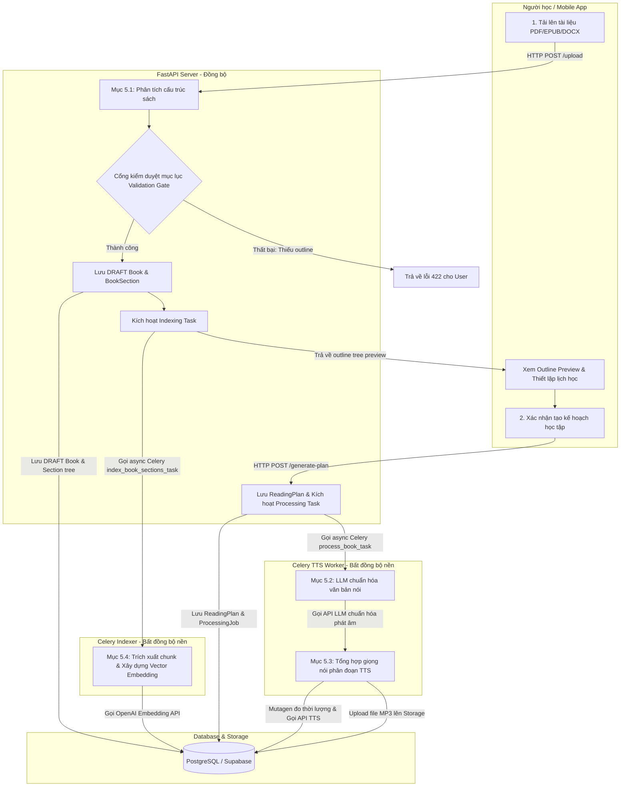
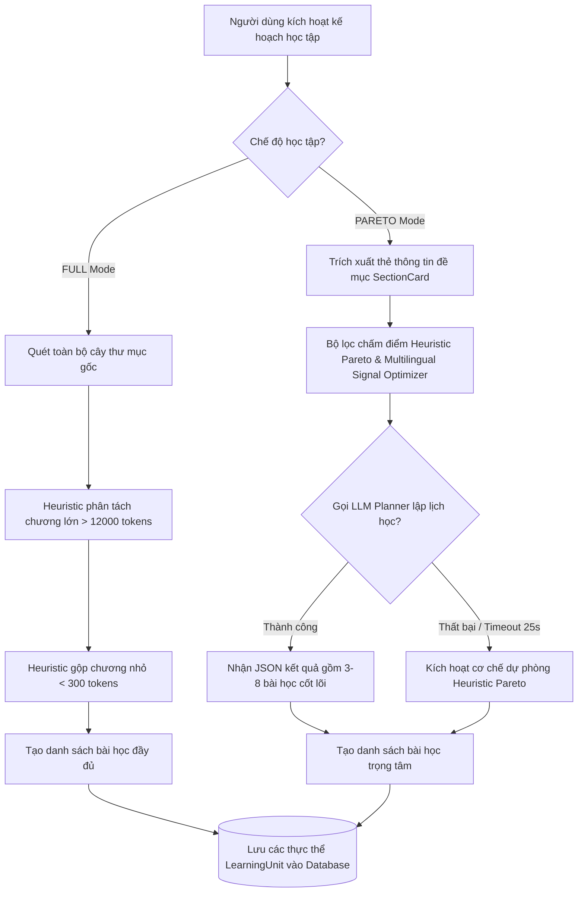
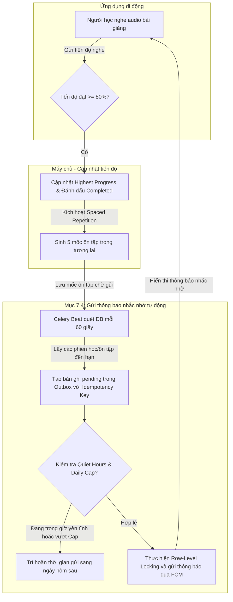
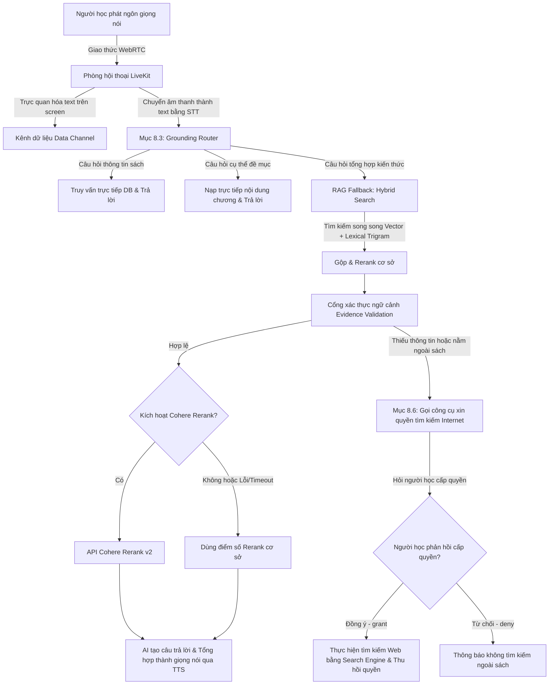

## I. Phân tích sự bất tương thích hiện tại

### 1. Phân tích hình vẽ bạn đính kèm trong chat

Hình vẽ bạn đính kèm là một sơ đồ kiến trúc thô ở mức hệ thống (System Architecture) rất cũ hoặc mang tính chung chung:

- **Điểm không khớp công nghệ:** Sơ đồ hiển thị các logo của **PHP**, **LangChain**, **Machine Learning Studio Workspaces**... Trong khi thực tế mã nguồn của hệ thống hiện tại sử dụng **FastAPI (Python)**, **Celery**, **LiveKit WebRTC**, **mutagen** và **Supabase**.
- **Điểm không khớp luồng nghiệp vụ:** Sơ đồ này vẽ vai trò của "Cán bộ", "Giảng viên", "Sinh viên" gửi PDF và hỏi đáp. Trong khi nội dung thực tế của Chương 5 đến Chương 8 mô tả **quy trình tiền xử lý âm thanh tự động, lập kế hoạch học tập cá nhân hóa, Spaced Repetition và Voice Agent thời gian thực**.

### 2. Phân tích tệp `.mmd` hiện tại của Chương 5 ([c5_intro_diagram_1.mmd](file:///W:/WorkSpace_IT/_CAPSTON_PROJECT/2022DoAnTN_KhoaDat/hinhve/c5_quy_trinh_chuyen_doi_tai_lieu/c5_intro_diagram_1.mmd))

Tệp Mermaid hiện tại thực chất đã mô tả đúng các bước nghiệp vụ trong code, nhưng nó đang ở dạng **luồng dữ liệu phẳng (Data Flow)**, chưa thể hiện rõ **sự tương tác của người học (User)** và **ranh giới xử lý (FastAPI Server vs Celery Worker)**.

---

## II. Giải pháp chuẩn hóa sơ đồ quy trình cho từng chương

Đối với luận văn tốt nghiệp ứng dụng kỹ thuật, cách vẽ sơ đồ chuẩn nhất cho các chương thiết kế/quy trình là **Sơ đồ quy trình tương tác phân làn (Swimlane Flowchart)** hoặc **Sơ đồ trình tự (Sequence Diagram)**. Sơ đồ này phải chỉ rõ:

1.  **Hành động của Người học (User / Flutter App)** kích hoạt quy trình.
2.  **Xử lý đồng bộ của API Server (FastAPI)** (Phản hồi nhanh).
3.  **Xử lý bất đồng bộ của Worker (Celery)** (Tiền xử lý âm thanh, AI).
4.  **Lưu trữ (Database / Supabase Storage)**.

Dưới đây là thiết kế chi tiết lại sơ đồ cho từng chương để khớp hoàn hảo 100% với nội dung text:

### 1. Thiết kế sơ đồ mới cho Chương 5 (Quy trình chuyển đổi và tiền xử lý âm thanh)

Sơ đồ này chia làn rõ ràng để người đọc nhìn hình là biết khối nào tương ứng với mục nào trong Chương 5 (Mục 5.1 đến 5.4):

- **Cách map vào nội dung Chương 5:**
  - Khối **A1 & A2** ánh xạ trực tiếp vào **Mục 5.1 (Phân tích cấu trúc sách và Validation Gate)**.
  - Khối **W4** ánh xạ trực tiếp vào **Mục 5.4 (Xây dựng vector embedding)**.

---

### 2. Định hướng sơ đồ cho Chương 6 (Cơ chế lập kế hoạch và thiết lập chế độ học tập)

Sơ đồ của Chương 6 cần làm nổi bật sự khác biệt về thuật toán phân chia bài học giữa hai chế độ:

---

### 3. Định hướng sơ đồ cho Chương 7 (Hệ thống theo dõi tiến độ và ôn tập ngắt quãng)

Sơ đồ Chương 7 cần làm rõ vòng lặp học tập khép kín từ khi nghe nhạc, tính tiến độ chống tua, lập lịch nhắc nhở cho đến khi chạy Outbox gửi thông báo:

---

### 4. Định hướng sơ đồ cho Chương 8 (Trợ lý giọng nói và RAG)

Sơ đồ Chương 8 mô tả luồng hội thoại giọng nói thời gian thực và cơ chế kiểm soát RAG/Internet Search:

---

## 📢 Báo cáo đề xuất hành động:

Tôi đề xuất chúng ta sẽ **cập nhật lại mã nguồn sơ đồ Mermaid** (các tệp `.mmd`) trong thư mục `hinhve` của bạn theo các sơ đồ quy trình tương tác phân làn ở trên. Việc này giúp:

1.  Người đọc luận văn có thể đối chiếu chính xác từng khối trong hình vẽ với các mục nhỏ trong văn bản.
2.  Làm nổi bật tính logic kỹ thuật của ứng dụng thay vì vẽ các hình vẽ hệ thống chung chung lỗi thời.

Bạn có muốn tôi tiến hành cập nhật tệp [c5_intro_diagram_1.mmd](file:///W:/WorkSpace_IT/_CAPSTON_PROJECT/2022DoAnTN_KhoaDat/hinhve/c5_quy_trinh_chuyen_doi_tai_lieu/c5_intro_diagram_1.mmd) thành sơ đồ quy trình phân làn mới này không?
