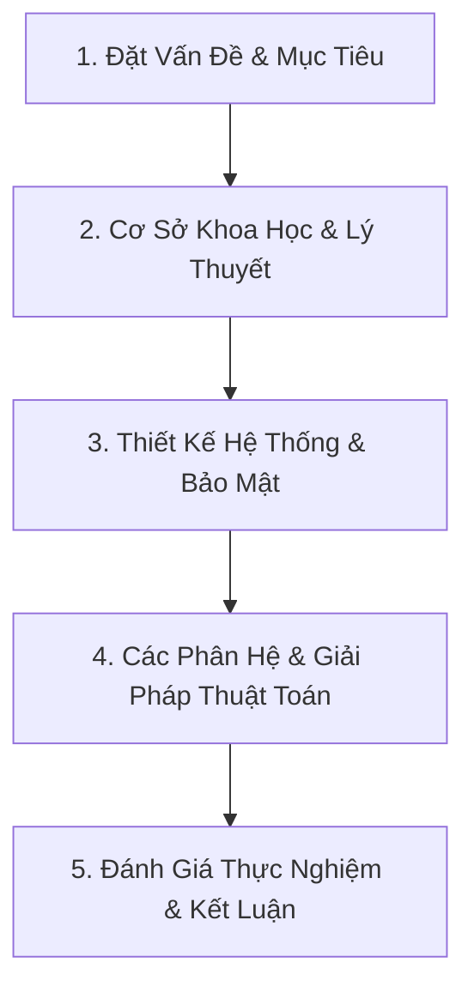

<!--  Lưu ý đọc kỹ phần này
Quy định tối đa 15 slide
Slide gồm: Thuyết trình + chiếu video demo trong 15 phút
-->

# PHÁT TRIỂN NỀN TẢNG SÁCH NÓI TƯƠNG TÁC THÔNG MINH HỖ TRỢ HỌC TẬP (TRI ÂM)

> **Đề tài:** Thiết kế và Hiện thực Hệ thống Trợ lý Học tập qua Sách nói tương tác sử dụng Voice-to-Voice LLM, Spaced Repetition và Pareto Principle.
> **Sinh viên thực hiện:** Nguyễn Trần Anh Khoa - HTTT2211026, Nguyễn Thành Đạt - HTTT2211003
> **Giảng viên hướng dẫn:** TS. Nguyễn Trung Việt
> **Tài liệu thuyết trình:** Đồ án Tốt nghiệp Đại học Công nghệ Thông tin (CTUT).

---

## 🧭 CẤU TRÚC TỔNG QUAN BÀI THUYẾT TRÌNH (AGENDA)

---

## PHẦN 1: MỞ ĐẦU & ĐẶT VẤN ĐỀ (3 SLIDES)

### Slide 1: Trang bìa & Định danh Đề tài
*   **Tiêu đề tên đề tài:** PHÁT TRIỂN NỀN TẢNG SÁCH NÓI TƯƠNG TÁC THÔNG MINH HỖ TRỢ HỌC TẬP
*   **Gợi ý hình ảnh/Layout:** Slide trang trọng, logo trường Đại học CTUT, trung tâm là hình ảnh Mockup giao diện ứng dụng di động chạy trợ lý thoại thông minh.
*   **Nội dung hiển thị:**
    *   **Sinh viên thực hiện:** Nguyễn Trần Anh Khoa - HTTT2211026, Nguyễn Thành Đạt - HTTT2211003
    *   **Giảng viên hướng dẫn:** TS. Nguyễn Trung Việt
*   **Speaker Notes (Lời thoại):** 
    > "Kính thưa Hội đồng cùng toàn thể các thầy cô giáo. Hôm nay chúng em xin phép được trình bày đề tài tốt nghiệp của mình: 'Phát triển nền tảng sách nói tương tác thông minh hỗ trợ học tập'. Dự án hướng tới giải quyết bài toán tiếp thu kiến thức thụ động từ sách nói truyền thống, đưa công nghệ AI đàm thoại hai chiều thời gian thực vào quy trình học tập cá nhân hóa."

---

### Slide 2: Tính cấp thiết của đề tài & User Pain Points
*   **Tiêu đề:** Nỗi Đau Người Dùng & Hạn Chế Của Sách Nói Truyền Thống
*   **Gợi ý hình ảnh/Layout:** Chia 2 cột. Bên trái là hình ảnh người dùng nghe kiến thức đến ngủ quên. Bên phải là 3 biểu tượng tượng trưng cho 3 nỗi đau chính của người học.
*   **Nội dung hiển thị:**
    *   **Nghe thụ động và dễ xao nhãng:** Người nghe chỉ tiếp thu 10% kiến thức (Tháp Dale) do nghe một chiều, dễ buồn ngủ, không thể hỏi đáp khi gặp kiến thức khó.
    *   **Quá tải thông tin và thiếu thời gian:** Giáo trình tài liệu quá dày (hàng trăm trang), người bận rộn không có thời gian nghe hết nhưng thiếu công cụ chắt lọc kiến thức cốt lõi.
    *   **Học trước quên sau:** Quên 80% kiến thức sau 48 giờ (Đường cong Ebbinghaus). Sách nói truyền thống không theo dõi tiến độ và không biết khi nào người học cần ôn tập lại.
*   **Speaker Notes (Lời thoại):** 
    > "Mặc dù sách nói đang bùng nổ, việc học qua sách nói truyền thống gặp 3 rào cản lớn: Thứ nhất là sự xao nhãng do nghe thụ động một chiều, chỉ lưu giữ 10% kiến thức. Thứ hai là quá tải thông tin khi sách quá dài nhưng thiếu thời gian chắt lọc. Thứ ba là học trước quên sau do tác động của đường cong quên lãng Ebbinghaus. TriÂm ra đời nhằm giải quyết triệt để 3 nỗi đau này của người học."

---

### Slide 3: Mục tiêu & Giải pháp của Hệ thống
*   **Tiêu đề:** Giải Pháp TriÂm: Cá Nhân Hóa & Học Tập Chủ Động
*   **Gợi ý hình ảnh/Layout:** Sơ đồ 3 nhánh giải pháp chính tương ứng 1-1 để giải quyết 3 nỗi đau ở Slide 2.
*   **Nội dung hiển thị:**
    *   **Trợ lý thoại Voice-to-Voice thời gian thực:** Đàm thoại hai chiều trực tiếp qua WebRTC, bám sát tri thức sách (Grounding RAG). Cho phép ngắt lời AI để hỏi và nhận phản hồi tức thì với độ trễ < 1.5s (Giải quyết *Nghe thụ động*).
    *   **Ingestion Pipeline và chế độ Pareto (80/20):** Tự động phân tích cấu trúc tài liệu thô, sinh bài giảng âm thanh và cho phép chuyển đổi sang chế độ Pareto, chỉ học 20% cốt lõi để thu về 80% kết quả (Giải quyết *Quá tải thông tin*).
    *   **Lập lịch ôn tập ngắt quãng (Spaced Repetition):** Tự động hóa việc theo dõi tiến độ học tập và tính toán chu kỳ ôn tập tối ưu bằng thuật toán SM-2, gửi nhắc nhở chủ động (Giải quyết *Học trước quên sau*).
*   **Speaker Notes (Lời thoại):** 
    > "Để giải quyết 3 vấn đề trên, TriÂm xây dựng 3 giải pháp cốt lõi: Trợ lý đàm thoại giọng nói thời gian thực giúp học tương tác; Bộ hoạch định Pareto chắt lọc 20% kiến thức trọng tâm; Và hệ thống ôn tập ngắt quãng tự động hóa hoàn toàn lịch trình nhắc nhở học viên đúng thời điểm rơi trí nhớ."

---

## PHẦN 2: CƠ SỞ LÝ THUYẾT & CÔNG NGHỆ SỬ DỤNG (4 SLIDES)

### Slide 4: Cơ sở Khoa học: Spaced Repetition, Ebbinghaus & Pareto 80/20
*   **Tiêu đề:** Phương Pháp Học Ngắt Quãng & Nguyên Lý Pareto
*   **Gợi ý hình ảnh/Layout:** Biểu đồ đường cong quên lãng Ebbinghaus và các đỉnh hồi phục trí nhớ. Sơ đồ phễu lọc Pareto 80/20 chuyển hóa từ 100% dữ liệu thô sang 20% core.
*   **Nội dung hiển thị:**
    *   **Đường cong quên lãng Ebbinghaus:** Giải thích khoa học về sự suy giảm trí nhớ và sự cần thiết của ôn tập chủ động đúng thời điểm.
    *   **Thuật toán SuperMemo-2 (SM-2):** Tự động tính toán khoảng cách ngày ôn tập tiếp theo ($I$) dựa trên điểm đánh giá chất lượng ghi nhớ ($q$) và hệ số dễ ($EF$):
        *   $I(1) = 1$, $I(2) = 6$, $I(n) = I(n-1) \times EF$.
    *   **Nguyên lý Pareto 80/20:** 20% lượng kiến thức cốt lõi quyết định 80% kết quả học tập.
*   **Speaker Notes (Lời thoại):** 
    > "Về cơ sở khoa học, hệ thống áp dụng thuật toán học ngắt quãng SM-2 cải tiến để tự động hóa việc đưa ra lịch ôn tập cá nhân hóa, giúp tri thức chuyển từ trí nhớ ngắn hạn sang dài hạn. Đồng thời, nguyên lý Pareto 80/20 được áp dụng để chắt lọc nội dung cốt lõi của sách, giúp người học nắm bắt trọng tâm nhanh nhất."

---

### Slide 5: Tìm kiếm lai (Hybrid Search) & Tại sao cần kết hợp?
*   **Tiêu đề:** Cơ Chế Tìm Kiếm Lai (Hybrid Search RAG)
*   **Gợi ý hình ảnh/Layout:** Sơ đồ so sánh 2 cột: Lexical Search (BM25) vs Semantic Search (Dense Vector).
*   **Nội dung hiển thị:**
    *   **Lexical Search (BM25/FTS):** Tìm kiếm dựa trên từ khóa chính xác. Ưu điểm: chính xác với mã code, thuật ngữ, tên riêng. Nhược điểm: không hiểu ngữ nghĩa, lỗi đồng âm/đồng nghĩa.
    *   **Semantic Search (Dense Vector):** Tìm kiếm dựa trên biểu diễn không gian nhúng (embeddings). Ưu điểm: hiểu ngữ cảnh, ý đồ câu hỏi. Nhược điểm: dễ bị trôi ngữ cảnh (semantic drift) và tìm sai từ khóa kỹ thuật.
    *   **Tại sao dùng Hybrid Search?** Kết hợp cả hai để bổ trợ khuyết điểm của nhau, mang lại kết quả truy xuất bám nguồn tri thức sách chính xác và toàn diện nhất.
*   **Speaker Notes (Lời thoại):** 
    > "Để phục vụ RAG đàm thoại, chúng em sử dụng giải thuật Tìm kiếm lai. Các phương pháp RAG truyền thống thường chỉ dùng tìm kiếm vector ngữ nghĩa, dễ bị trôi ngữ nghĩa và bỏ sót các thuật ngữ kỹ thuật chính xác. Bằng cách kết hợp tìm kiếm từ khóa BM25 và tìm kiếm vector, TriÂm đảm bảo kết quả tìm kiếm vừa đúng ngữ cảnh vừa chính xác tuyệt đối các thuật ngữ chuyên môn."

---

### Slide 6: Xếp hạng lại (Cohere Rerank) & Thuật toán RRF (Reciprocal Rank Fusion)
*   **Tiêu đề:** Thuật Toán Ghép Hàng RRF & Xếp Hạng Lại Reranker
*   **Gợi ý hình ảnh/Layout:** Lưu đồ luồng dữ liệu: Kết quả BM25 + Kết quả Vector ➔ RRF Fusion ➔ Cohere Rerank ➔ Evidence Validation ➔ LLM.
*   **Nội dung hiển thị:**
    *   **Reciprocal Rank Fusion (RRF):** Giải thuật phi tham số để kết hợp thứ hạng từ tìm kiếm từ khóa và tìm kiếm vector dựa trên công thức:
        *   $RRF\_Score(d) = \sum_{m \in M} \frac{1}{k + r_m(d)}$ (với $k = 60$).
    *   **Cohere Rerank:** Mô hình Cross-Encoder chuyên sâu để tính toán điểm tương đồng ngữ nghĩa thực sự của Top 20 kết quả hàng đầu, lọc ra 12 ứng viên tốt nhất.
    *   **Kiến trúc Grounding RAG hoàn chỉnh:** Tích hợp sinh Vector cục bộ (local embeddings) -> RRF -> Rerank -> Chốt chặn Evidence Validation (kiểm định thực thể gốc) để chống ảo giác (hallucination) 100%.
*   **Speaker Notes (Lời thoại):** 
    > "Sau khi có kết quả từ hai luồng tìm kiếm, chúng em áp dụng thuật toán Reciprocal Rank Fusion để kết hợp thứ hạng một cách khách quan. Tiếp theo, mô hình Cohere Reranker đóng vai trò là một Cross-Encoder để xếp hạng lại độ liên quan ngữ nghĩa chi tiết. Cuối cùng, một chốt chặn Evidence Validation kiểm tra chéo các thực thể trong câu trả lời của LLM so với văn bản gốc để loại bỏ hoàn toàn ảo giác kiến thức."

---

## PHẦN 3: THIẾT KẾ HỆ THỐNG & BẢO MẬT (3 SLIDES)

### Slide 7: Sơ đồ Kiến trúc Tổng quan Hệ thống (REST vs WebRTC)
*   **Tiêu đề:** Sơ Đồ Kiến Trúc Hệ Thống REST & Realtime WebRTC
*   **Gợi ý hình ảnh/Layout:** Sơ đồ kiến trúc 5 khối: Client (Flutter) ⇄ API Gateway (FastAPI) ⇄ DB (Supabase pgvector) ⇄ WebRTC Engine (LiveKit) ⇄ Worker (Celery/Redis).
*   **Nội dung hiển thị:**
    *   **Luồng REST (HTTP/JSON):** Xử lý CRUD sách, quản lý đồng bộ tiến độ học tập, lập lịch học của user.
    *   **Luồng Realtime (WebRTC/UDP):** LiveKit Server làm SFU điều phối luồng âm thanh hai chiều cực thấp giữa di động và Voice Agent.
    *   **Tác vụ chạy ngầm bất đồng bộ:** Celery Beat + Redis Broker điều phối trích xuất PDF/EPUB, sinh embeddings và nạp TTS.
*   **Speaker Notes (Lời thoại):** 
    > "Đây là sơ đồ kiến trúc tổng quan của hệ thống. Chúng em tách biệt hoàn toàn luồng nghiệp vụ REST truyền thống chạy qua HTTP để đồng bộ tiến độ và luồng đàm thoại giọng nói truyền qua giao thức WebRTC sử dụng LiveKit Server nhằm triệt tiêu độ trễ. Các tác vụ nặng như xử lý tài liệu hay sinh audio được đẩy vào Celery để xử lý bất đồng bộ ngầm."

---

### Slide 8: Sơ đồ Usecase & Mô hình Dữ liệu cốt lõi (Class Diagram)
*   **Tiêu đề:** Thiết Kế Nghiệp Vụ Sơ Đồ Usecase & Mô Hình Dữ Liệu
*   **Gợi ý hình ảnh/Layout:** Chia 2 phần: Bên trái là Sơ đồ Usecase (Đọc sách, Đàm thoại, Ôn tập, Upload tài liệu). Bên phải là Class Diagram rút gọn của DB.
*   **Nội dung hiển thị:**
    *   **Tác nhân chính (User):** Thực hiện tải tài liệu cá nhân, nghe audio sách nói, trò chuyện thoại thời gian thực và thực hiện ôn tập.
    *   **Cấu trúc dữ liệu cây đệ quy:** Bảng `BookSection` (`parent_id`) mô hình hóa mục lục đa cấp tự nhiên của cuốn sách.
    *   **Thực thể lập lịch biểu:** `ReadingPlan` kết nối với `ReadingPlanSession` để phân mảnh các bài học (`LearningUnit`) theo chu kỳ thời gian thực tế của người dùng.
*   **Speaker Notes (Lời thoại):** 
    > "Để hiện thực hóa nghiệp vụ hệ thống, sơ đồ Usecase thể hiện các hoạt động chính của người học từ việc tải sách đến tương tác đàm thoại. Ở bên phải là mô hình dữ liệu cốt lõi. Chúng em sử dụng cấu trúc cây tự liên kết trong bảng BookSection để lưu trữ mục lục và văn bản sách phục vụ RAG, kết hợp với các bảng lập lịch học để quản lý tiến trình học tập cá nhân hóa."

---

### Slide 9: Bảo mật đa tầng trong kỷ nguyên AI & Trợ lý ảo
*   **Tiêu đề:** Giải Pháp Bảo Mật Đa Tầng Chủ Động (AI-Era Security)
*   **Gợi ý hình ảnh/Layout:** Sơ đồ 3 lớp bảo vệ đồng tâm bao bọc dữ liệu người dùng: Prompt Guardrail ➔ LiveKit Token JWT ➔ PostgreSQL RLS.
*   **Nội dung hiển thị:**
    *   **Tầng AI (System Instructions & Guardrail):** Chặn đứng Prompt Injection và tấn công jailbreak bằng cấu trúc prompt nghiêm ngặt bắt buộc bám nguồn tài liệu.
    *   **Tầng Truyền thông (LiveKit Token Auth):** Cấp token WebRTC JWT có chữ ký số mã hóa, thời gian sống ngắn (TTL 5 phút), giới hạn quyền theo đúng phòng học.
    *   **Tầng Vật lý (PostgreSQL Row Level Security):** Kích hoạt chính sách RLS trên DB để đảm bảo cô lập dữ liệu tuyệt đối giữa các người dùng, ngăn chặn AI Agent truy xuất chéo tài liệu trái phép.
*   **Speaker Notes (Lời thoại):** 
    > "Hệ thống áp dụng chính sách bảo mật đa tầng chủ động. Ở tầng AI, prompt guardrail ngăn chặn jailbreak và prompt injection. Ở tầng truyền thông, token WebRTC được ký số JWT với thời gian sống ngắn. Và chốt chặn cuối cùng là PostgreSQL Row Level Security (RLS) bảo vệ dữ liệu ở tầng vật lý, đảm bảo an toàn tuyệt đối cho tài liệu cá nhân của người học."

---

## PHẦN 4: CÁC PHÂN HỆ GIẢI PHÁP CỐT LÕI (3 SLIDES)

### Slide 10: Quy trình Ingestion Pipeline & Sinh Audio tự động
*   **Tiêu đề:** Quy Trình Ingestion Pipeline & Tự Động Hóa Sinh Audio
*   **Gợi ý hình ảnh/Layout:** Sơ đồ luồng: File Upload ➔ DFS Outline Parser ➔ Smart Chunking ➔ LLM Normalizer ➔ TTS Engine ➔ Audio File Saving.
*   **Nội dung hiển thị:**
    *   **Thuật toán DFS Outline Extraction:** Duyệt cây theo chiều sâu để bóc tách chính xác cấu trúc mục lục đa tầng của sách PDF/EPUB.
    *   **Chuẩn hóa văn bản bằng LLM:** Sử dụng LLM để dọn dẹp các ký tự nhiễu, chuyển đổi các công thức toán học, ký tự đặc biệt hoặc mã code thành dạng văn bản có thể phát âm tự nhiên.
    *   **TTS Engine:** Chuyển đổi văn bản chuẩn hóa thành giọng đọc AI chất lượng cao theo từng bài học, chia nhỏ theo chế độ học (Full vs Pareto).
*   **Speaker Notes (Lời thoại):** 
    > "Quy trình Ingestion Pipeline của chúng em biến tài liệu thô thành bài giảng âm thanh qua các bước tự động hóa. Hệ thống duyệt mục lục bằng thuật toán DFS, sau đó sử dụng LLM để chuẩn hóa văn bản - chuyển đổi các công thức hoặc ký tự nhiễu thành văn bản nói tự nhiên - trước khi đưa vào TTS Engine để sinh ra file audio chất lượng cao."

---

### Slide 11: Bộ hoạch định Pareto Planner & Nghiệp vụ Pareto 80/20
*   **Tiêu đề:** Hiện Thực Nghiệp Vụ Pareto Planner & Fallback dự phòng
*   **Gợi ý hình ảnh/Layout:** Sơ đồ logic: Input Text ➔ LLM Structured Output (JSON) ➔ Lỗi cấu trúc? ➔ [Có] Heuristic Parser Fallback ➔ Lưu trữ database bài học.
*   **Nội dung hiển thị:**
    *   **Nghiệp vụ Pareto 80/20:** Sử dụng AI để phân tích và chắt lọc ra các phần quan trọng nhất (như định nghĩa cốt lõi, công thức nền tảng, sơ đồ tư duy) để sinh ra `LearningUnit` cho chế độ học nhanh.
    *   **Gemini Structured Outputs:** Ép buộc LLM trả về cấu trúc JSON nghiêm ngặt khớp 100% với Pydantic schema bài học.
    *   **Heuristic Fallback Gate:** Cơ chế dự phòng khi LLM lỗi hoặc quá tải (Rate Limit), hệ thống tự chuyển sang giải thuật Heuristic dựa trên cấu trúc đề mục để đảm bảo hệ thống luôn vận hành ổn định.
*   **Speaker Notes (Lời thoại):** 
    > "Để đưa nguyên lý Pareto 80/20 vào nghiệp vụ thực tế, chúng em xây dựng bộ Pareto Planner. Hệ thống sử dụng cơ chế Structured Outputs của Gemini để ép xuất dữ liệu tóm tắt cốt lõi dạng JSON. Đồng thời, chúng em phát triển luồng dự phòng Heuristic Fallback để tự động xử lý mục lục sách trong trường hợp LLM gặp sự cố hoặc vượt quá hạn ngạch gọi API, đảm bảo ứng dụng luôn chạy mượt mà."

---

### Slide 12: Trợ lý thoại Voice Agent & Bảo mật Quyền Web Search
*   **Tiêu đề:** Trợ Lý Thoại Voice Agent & Web Search Permission Policy
*   **Gợi ý hình ảnh/Layout:** Sơ đồ trạng thái đàm thoại (State Machine) của luồng hỏi đáp, ngắt lời thoại và xin quyền Web.
*   **Nội dung hiển thị:**
    *   **LiveKit Voice Agent:** Tích hợp bộ phát hiện giọng nói (VAD Silero) để tự động ngắt Agent khi phát hiện người dùng nói xen vào (Interruption), mang lại trải nghiệm thoại tự nhiên.
    *   **Web Search Permission State Machine:**
        *   *Topic Shift:* Hủy trạng thái chờ cấp quyền Web hoặc chờ làm rõ nếu người dùng đột ngột hỏi sang câu hỏi mới.
        *   *One-time Token:* Quyền tìm kiếm web chỉ có hiệu lực một lần duy nhất cho câu thoại hiện tại và bị thu hồi lập tức để đảm bảo an toàn thông tin.
*   **Speaker Notes (Lời thoại):** 
    > "Trợ lý thoại Voice Agent được tích hợp bộ lọc ngắt lời VAD Silero giúp cuộc trò chuyện diễn ra tự nhiên. Đặc biệt, chúng em thiết kế máy trạng thái quản lý quyền tìm kiếm Web. Nếu người dùng hỏi thông tin thời gian thực, hệ thống sẽ chặn và xin quyền. Quyền này chỉ có hiệu lực một lần duy nhất và sẽ tự động bị thu hồi ngay sau đó để bảo mật thông tin tối đa."

---

## PHẦN 5: HIỆN THỰC & ĐÁNH GIÁ THỰC NGHIỆM (3 SLIDES)

### Slide 13: Minh họa vài Giao diện cốt lõi trên ứng dụng di động
*   **Tiêu đề:** Giao Diện Thực Tế Ứng Dụng Di Động TriÂm
*   **Gợi ý hình ảnh/Layout:** Trình bày 3 ảnh chụp màn hình thực tế của ứng dụng Flutter:
    1.  Màn hình chính "Hôm nay" hiển thị lộ trình học trong ngày.
    2.  Trình nghe Audio Player tích hợp nút đàm thoại trực tiếp.
    3.  Giao diện cuộc gọi Voice Agent thời gian thực.
*   **Nội dung hiển thị:**
    *   **Ngôn ngữ thiết kế Glassmorphism:** Giao diện tối hiện đại, tinh giản, tối ưu cho việc học tập rảnh tay.
    *   **drift SQLite Cache:** Lưu trữ ngoại tuyến toàn bộ thông tin bài học và file audio, giúp học tập không gián đoạn ngay cả khi không có mạng.
*   **Speaker Notes (Lời thoại):** 
    > "Đây là giao diện ứng dụng di động TriÂm được phát triển trên nền tảng Flutter. Thiết kế theo phong cách tối giản hiện đại. Ứng dụng tích hợp bộ lưu cache SQLite ngoại tuyến bằng thư viện Drift, giúp lưu trữ bài học và audio trực tiếp trên thiết bị để người học có thể ôn tập mọi lúc mọi nơi không cần mạng internet."

---

### Slide 14: Đánh giá Thực nghiệm: Độ trễ thoại & Chất lượng RAG
*   **Tiêu đề:** Kết Quả Thực Nghiệm Đánh Giá Độ Trễ & RAG
*   **Gợi ý hình ảnh/Layout:** Biểu đồ phân rã độ trễ thoại và bảng so sánh độ chính xác của các giải thuật RAG.
*   **Nội dung hiển thị:**
    *   **Phân rã độ trễ đàm thoại thoại trung bình (~1.16 giây):**
        *   VAD (Nhận diện dứt câu): ~150ms.
        *   RAG Retrieval & Reranker: ~240ms.
        *   LLM & TTS Streaming (Tạo giọng): ~650ms.
        *   Mạng WebRTC: ~120ms.
    *   **Độ chính xác định vị RAG (RAG Accuracy):**
        *   Chỉ Vector Search: 81.2%
        *   Chỉ Lexical Search (FTS): 68.4%
        *   Hybrid RAG + Cohere Rerank: **94.8%** (Tối ưu nhất, triệt tiêu lỗi trích xuất sai ngữ cảnh).
*   **Speaker Notes (Lời thoại):** 
    > "Chúng em đã thực hiện đo đạc thực nghiệm kỹ lưỡng. Tổng độ trễ đàm thoại trung bình duy trì ổn định ở mức 1.16 giây, đạt chuẩn giao tiếp tự nhiên của con người (< 1.5 giây). Về chất lượng RAG, giải thuật kết hợp Hybrid Search và xếp hạng lại bằng Cohere Reranker mang lại độ chính xác định vị kiến thức lên tới 94.8%, vượt trội hoàn toàn so với tìm kiếm vector đơn thuần."

---

### Slide 15: Kết luận & Hướng phát triển tương lai
*   **Tiêu đề:** Kết Luận Đồ Án & Hướng Phát Triển Tương Lai
*   **Gợi ý hình ảnh/Layout:** Trang cảm ơn ban giám khảo trang trọng, kèm mã QR để tải ứng dụng demo.
*   **Nội dung hiển thị:**
    *   **Đóng góp chính:** Hiện thực hóa thành công trợ lý học tập đàm thoại sách nói qua WebRTC bám nguồn tiếng Việt đầu tiên, tối ưu hóa chu kỳ học ngắt quãng và cá nhân hóa lộ trình học.
    *   **Hướng phát triển:** Trích xuất tri thức đa phương tiện (video bài giảng, đồ thị/công thức toán học phức tạp); Cá nhân hóa giọng đọc thông qua công nghệ clone giọng nói.
    *   **XIN CHÂN THÀNH CẢM ƠN HỘI ĐỒNG PHẢN BIỆN!**
*   **Speaker Notes (Lời thoại):** 
    > "Đồ án đã hiện thực hóa thành công nền tảng sách nói học tập tương tác chủ động thông minh đầu tiên hỗ trợ tiếng Việt. Trong tương lai, chúng em hướng tới trích xuất tri thức từ các video bài giảng và hỗ trợ clone giọng nói cá nhân. Sau đây chúng em xin phép trình chiếu video demo thực tế ứng dụng. Chúng em xin chân thành cảm ơn thầy cô đã lắng nghe."
