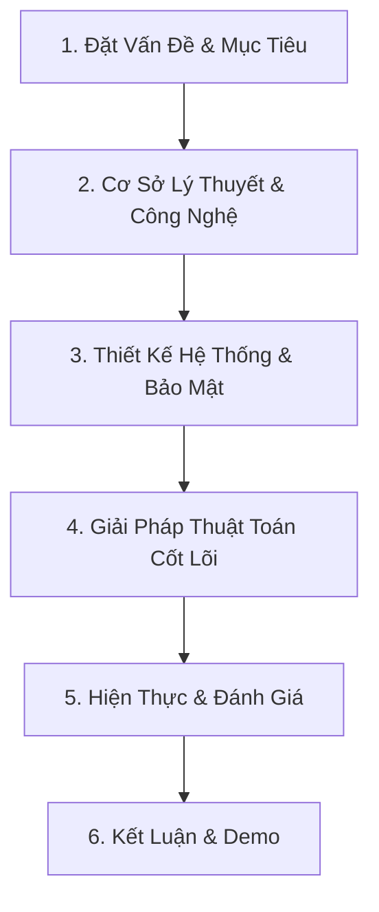

<!--  Lưu ý đọc kỹ phần này
Quy định tối đa 15 slide
Slide gổm: Thuyết trình + chiếu video demo trong 15 phút
 -->

# PHÁT TRIỂN NỀN TẢNG SÁCH NÓI TƯƠNG TÁC THÔNG MINH HỖ TRỢ HỌC TẬP

> **Đề tài:** Thiết kế và Hiện thực Hệ thống Trợ lý Học tập qua Sách nói tương tác sử dụng Voice-to-Voice LLM, Spaced Repetition và Pareto Principle.
> **Giảng viên hướng dẫn:** TS. Nguyễn Trung Việt
> **Tài liệu thuyết trình:** Đồ án Tốt nghiệp Đại học công nghệ thông tin.

---

## 🧭 CẤU TRÚC TỔNG QUAN BÀI THUYẾT TRÌNH (AGENDA)

---

## PHẦN 1: MỞ ĐẦU & ĐẶT VẤN ĐỀ (3 SLIDES)

### Slide 1: Trang bìa & Định danh Đề tài
*   **Tiêu đề tên đề tài:** PHÁT TRIỂN NỀN TẢNG SÁCH NÓI TƯƠNG TÁC THÔNG MINH HỖ TRỢ HỌC TẬP
*   **Gợi ý hình ảnh/Layout:** Slide trang trọng, logo trường Đại học CTUT, trung tâm là hình ảnh mờ ứng dụng chạy trên thiết bị di động ở phần trợ lý ảo.
*   **Nội dung hiển thị:**
    *   **Sinh viên thực hiện:** Nguyễn Trần Anh Khoa - HTTT2211026, Nguyễn Thành Đạt - HTTT2211003
    *   **Giảng viên hướng dẫn:** TS. Nguyễn Trung Việt
*   **Speaker Notes (Lời thoại):** 
    > "Kính thưa Hội đồng cùng toàn thể các thầy cô giáo. Hôm nay chúng em xin phép được trình bày đề tài tốt nghiệp của mình: *'Phát triển nền tảng sách nói tương tác thông minh hỗ trợ học tập'*. Dự án hướng tới giải quyết bài toán tiếp thu kiến thức thụ động từ sách nói truyền thống, đưa công nghệ AI đàm thoại hai chiều thời gian thực vào quy trình học tập cá nhân hóa."

---

### Slide 2: Tính cấp thiết của đề tài
*   **Tiêu đề:** Bối Cảnh Thực Tế & Hạn Chế Sách Nói Truyền Thống
*   **Gợi ý hình ảnh/Layout:** Chia 2 cột. Bên trái là hình ảnh người dùng nghe kiến thức đến ngủ quên. Bên phải là các icon bên dưới tương ứng các mục hạn chế.
*   **Nội dung các mục hạn chế:**
    *   **Nghe thụ động và dễ xao nhãng:** Người nghe chỉ tiếp thu 10% kiến thức (Tháp Dale). Không thể tương tác, dễ buồn ngủ, gặp chỗ khó hiểu không có ai để hỏi đáp ngay lập tức.
    *   **Quá tải thông tin và thiếu thời gian:** Giáo trình/Sách tài liệu quá dày (hàng trăm trang), người bận rộn không có thời gian nghe hết nhưng thiếu công cụ chắt lọc kiến thức trọng tâm.
    *   **Học trước quên sau:** Quên 80% kiến thức sau 48 giờ (Đường cong Ebbinghaus). Sách nói truyền thống không theo dõi tiến độ và không biết khi nào người học cần ôn tập lại.
*   **Speaker Notes (Lời thoại):** 
    > "Trong kỷ nguyên số, sách nói đang bùng nổ, nhưng hầu hết người dùng đang nghe sách một cách thụ động. Theo nghiên cứu, việc nghe thụ động khiến kiến thức bị quên đi rất nhanh. Người học không thể đặt câu hỏi trực tiếp vào nội dung chương mục đang nghe, và khó lọc ra 20% kiến thức cốt lõi. TriÂm ra đời để biến sách nói từ công cụ giải trí thụ động thành một hệ thống học tập chủ động thông minh."

---

### Slide 3: Mục tiêu & Giải pháp của Hệ thống
*   **Tiêu đề:** Mục Tiêu Phát Triển Hệ Thống TriÂm
*   **Gợi ý hình ảnh/Layout:** Sơ đồ 3 nhánh mục tiêu chính xoay quanh trung tâm là người dùng học tập chủ động.
*   **Nội dung hiển thị:**
    *   **Trợ lý thoại Voice-to-Voice thời gian thực:** Đàm thoại hai chiều trực tiếp qua WebRTC, bám sát tri thức sách (Grounding RAG). Người học có thể ngắt lời AI để hỏi và nhận phản hồi tức thì với độ trễ < 1.5s.
    *   **Ingestion Pipeline và chế độ Pareto (80/20):** Tự động phân tích cấu trúc tài liệu thô, sinh bài giảng âm thanh và cho phép chuyển đổi linh hoạt sang chế độ Pareto (chỉ học 20% cốt lõi để thu về 80% kết quả).
    *   **Lập lịch ôn tập, thông báo nhắc nhở:** Tự động lập lịch học ngắt quãng Spaced Repetition kết hợp thông báo đẩy để tối ưu hóa trí nhớ dài hạn.
*   **Speaker Notes (Lời thoại):** 
    > "Để giải quyết các thách thức trên, mục tiêu cốt lõi của đề tài là xây dựng hệ thống TriÂm gồm 3 trụ cột: Thứ nhất, quy trình tự động hóa chuyển đổi tài liệu thô thành bài giảng âm thanh; Thứ hai, hệ thống lập lịch ôn tập ngắt quãng tự động hóa hoàn toàn; Thứ ba, trợ lý đàm thoại thời gian thực WebRTC với tri thức bám nguồn tuyệt đối theo sách."

---

## PHẦN 2: CƠ SỞ LÝ THUYẾT & CÔNG NGHỆ SỬ DỤNG (4 SLIDES)

### Slide 4: Stack công nghệ sử dụng & Hạ tầng triển khai
*   **Tiêu đề:** Công Nghệ Lựa Chọn & Thiết Lập Hạ Tầng Triển Khai
*   **Gợi ý hình ảnh/Layout:** Hệ thống các khối logo công nghệ phân theo tầng: Frontend (Flutter, Riverpod, Drift SQLite) ➔ Backend Core (FastAPI, Celery, Redis) ➔ AI & Database (Supabase PostgreSQL, pgvector, Cohere, LiveKit WebRTC).
*   **Nội dung hiển thị:**
    *   **Frontend di động:** Flutter cross-platform kết hợp Drift SQLite để lưu cache offline và Riverpod quản lý trạng thái mượt mà.
    *   **Backend & Task Worker:** FastAPI (tốc độ cao nhờ ASGI) kết hợp hàng đợi Celery + Redis Broker để xử lý background jobs nặng nề.
    *   **AI & Database Engine:** Supabase PostgreSQL tích hợp plugin `pgvector` xử lý vector nhúng; Cohere Rerank xếp hạng tri thức; LiveKit Cloud làm máy chủ SFU WebRTC.
*   **Speaker Notes (Lời thoại):** 
    > "Để hiện thực hóa các lý thuyết trên, chúng em lựa chọn stack công nghệ hiện đại tối ưu hiệu năng. Frontend viết trên Flutter hỗ trợ SQLite chạy offline mượt mà. Backend sử dụng FastAPI kết hợp Celery chạy background task. Cơ sở dữ liệu Supabase PostgreSQL tích hợp pgvector cho phép thực hiện Hybrid RAG, và LiveKit đảm nhận vai trò máy chủ định tuyến WebRTC cho đàm thoại giọng nói."

---

<!-- Thêm slide giải thích về hybrid search: Lexical search và sêmantic search, tại sao dùng nó -->

<!-- Thêm slide nói về RRF và corehere và kiến trúc của corehere, tại sao dùng nó  -->

### Slide 5: Phương pháp Ôn tập ngắt quãng, Đường cong quên lãng, Quy tắc 80/20
*   **Tiêu đề:** Cơ Sở Khoa Học: Spaced Repetition, Forgetting Curve, Pareto
*   **Gợi ý hình ảnh/Layout:** Biểu đồ đường cong quên lãng Ebbinghaus (Forgetting Curve) minh họa các điểm ôn tập (Review Points) giúp khôi phục trí nhớ bền vững. Biểu đồ phễu lọc (Pareto Funnel). Đầu vào là 100% nội dung sách thô, đầu ra là 20% kiến thức cốt lõi mang lại 80% giá trị tiếp thu.
*   **Nội dung hiển thị:**
    *   **Đường cong quên lãng Ebbinghaus:** Tri thức giảm sút nhanh chóng trong 48 giờ đầu nếu không được ôn tập chủ động (Active Recall).
    *   **Thuật toán SuperMemo-2 (SM-2) cải tiến:**
        *   Tự động tính toán khoảng cách ngày ôn tập tiếp theo ($I$) dựa trên điểm đánh giá chất lượng ghi nhớ ($q$) và hệ số dễ ($EF$).
        *   Công thức tính khoảng thời gian: $I(1) = 1$, $I(2) = 6$, $I(n) = I(n-1) \times EF$.
        *   **Nguyên lý Pareto:** 80% kết quả học tập đến từ 20% nỗ lực và kiến thức nền tảng trọng tâm.
    *   **Ứng dụng trong TriÂm:** Tự động chuyển hóa các phân mảnh kiến thức đã học thành các Review Cards xuất hiện đúng điểm rơi của chu kỳ quên. Ứng dụng Pareto để người học có thể học nhanh, chỉ quan tâm cốt lõi, tránh nội dung rườm rà.
*   **Speaker Notes (Lời thoại):** 
    > "Về cơ sở khoa học, chúng em áp dụng lý thuyết Đường cong quên lãng của Hermann Ebbinghaus. Nếu không được ôn tập, con người sẽ quên 80% kiến thức sau một tuần. Bằng cách áp dụng thuật toán học ngắt quãng SM-2 cải tiến, hệ thống sẽ tính toán điểm rơi tối ưu của từng cá nhân để tự động đưa ra các thẻ ôn tập, giúp chuyển hóa kiến thức ngắn hạn thành dài hạn. Cơ sở lý thuyết thứ hai là nguyên lý Pareto 80/20. Trong thực tế học tập, 20% nội dung cốt lõi của một cuốn giáo trình sẽ quyết định 80% điểm số hoặc giá trị tiếp thu của người học. Hệ thống TriÂm hiện thực hóa nguyên lý này thông qua bộ hoạch định Pareto Planner, sử dụng AI để tự động chắt lọc ra các bài học trọng tâm, giúp người dùng tiết kiệm đến 80% thời gian nghe đọc sách."

---

## PHẦN 3: PHÂN TÍCH THIẾT KẾ HỆ THỐNG & BẢO MẬT (3 SLIDES)

### Slide 7: Sơ đồ kiến trúc tổng quan hệ thống
*   **Tiêu đề:** Sơ Đồ Kiến Trúc Hệ Thống Tổng Quan 5 Khối
*   **Gợi ý hình ảnh/Layout:** Diagram chi tiết 5 khối: Client (Flutter), API Gateway (Nginx/FastAPI), Database (Supabase PostgreSQL), Realtime Voice Engine (LiveKit WebRTC Server), và Worker Queue (Celery + Redis).
*   **Nội dung hiển thị:**
    *   **Luồng REST (Màu xanh):** Xử lý CRUD sách, quản lý tiến độ học tập, cấu hình lịch biểu.
    *   **Luồng Realtime (Màu đỏ):** Kênh truyền thông âm thanh độ trễ thấp WebRTC chạy qua LiveKit Server, kết nối trực tiếp LiveKit Voice Agent chạy ngầm.
    *   **Khối Worker ngầm:** Redis làm Broker điều phối các background tasks nặng như PDF extraction, sinh Rerank và gọi API Google/Edge TTS.
*   **Speaker Notes (Lời thoại):** 
    > "Đây là sơ đồ kiến trúc tổng quan của hệ thống gồm 5 khối. Điểm đặc biệt ở đây là chúng em phân tách hoàn toàn luồng nghiệp vụ REST truyền thống và luồng đàm thoại Realtime qua WebRTC. Luồng đàm thoại thoại được thiết lập kênh truyền riêng qua LiveKit Server nhằm triệt tiêu độ trễ mạng, trong khi các tác vụ xử lý tài liệu nặng được đẩy vào hàng chờ Celery để chạy bất đồng bộ ngầm."

---

<!-- Bổ sung slide chứa sơ đồ Usecase -->

### Slide 8: Mô hình dữ liệu cốt lõi & Sơ đồ lớp (Class Diagram)
*   **Tiêu đề:** Mô Hình Dữ Liệu Cốt Lõi (Core Data Models)
*   **Gợi ý hình ảnh/Layout:** Diagram thực thể quan hệ (ERD) hoặc Class Diagram rút gọn của các bảng `Book`, `BookSection` (cấu trúc cây thư mục), `LearningUnit` (bài học), và `ReadingPlanSession`.
*   **Nội dung hiển thị:**
    *   **Cấu trúc phân cấp tài liệu (Tree hierarchy):** Bảng `BookSection` tự liên kết (`parent_id`) đại diện cho chương, mục con của sách, lưu trữ `text_content` phục vụ RAG.
    *   **Lớp học tập cá nhân hóa:** `LearningUnit` liên kết sách với các chế độ học (`PlanMode`) để quản lý tiến trình sinh file audio tương ứng.
    *   **Lịch trình học biểu mẫu:** `ReadingPlanSession` đại diện cho các buổi học thực tế được sinh tự động theo cấu hình tuần/tháng của người dùng.
*   **Speaker Notes (Lời thoại):** 
    > "Để hiện thực hóa cơ sở dữ liệu trên PostgreSQL, mô hình dữ liệu của chúng em tập trung thiết kế cấu trúc cây đệ quy trong bảng `BookSection` để quản lý mục lục sách một cách tự động và linh hoạt. Mỗi bài học `LearningUnit` sẽ được ánh xạ với một chế độ học cụ thể, cho phép hệ thống quản lý tiến độ và sinh file audio riêng biệt cho từng người dùng."

---

<!-- Bố cục lại slide 6 này liên quan đến kiến trúc nên sẽ để vào phần 3 và slide này thiếu rất nhiều thành phần: local embedding, rerank corehere, RRF ,.... -->
### Slide 6: Cơ chế Đàm thoại Realtime & Mô hình Grounding RAG
*   **Tiêu đề:** Kiến Trúc Đàm Thoại Thời Gian Thực & Grounding
*   **Gợi ý hình ảnh/Layout:** Sơ đồ luồng tương tác giữa User ⇄ WebRTC ⇄ LLM + RAG Database.
*   **Nội dung hiển thị:**
    *   **Realtime Voice (WebRTC):** Thay thế cơ chế HTTP Request/Response truyền thống để truyền tải âm thanh hai chiều trực tiếp với độ trễ tối thiểu (chạy qua giao thức UDP).
    *   **Retrieval-Augmented Generation (RAG):** Cung cấp tri thức bám nguồn (Grounding) cho LLM bằng cách truy xuất các phân đoạn văn bản liên quan nhất từ cơ sở dữ liệu vector.
    *   **Lợi ích:** Ngăn chặn tuyệt đối hiện tượng ảo giác (hallucination) của AI và bảo vệ quyền sở hữu trí tuệ của tài liệu học tập.
*   **Speaker Notes (Lời thoại):** 
    > "Về mặt công nghệ giao tiếp, chúng em sử dụng mô hình RAG kết hợp giao thức truyền thông thời gian thực WebRTC. Thay vì để LLM tự trả lời bằng tri thức huấn luyện sẵn (vốn dễ bị ảo giác và lỗi thời), RAG sẽ bắt LLM đọc các dữ liệu chương sách được trích xuất động từ DB để làm căn cứ trả lời, đảm bảo tính bám nguồn tuyệt đối của thông tin phản hồi."

---

<!-- Bố sung phần Pipeline ingestion vào đây, luồng từ file thành audio dựa trên mode và có sự tham gia của LLM để chuẩn hóa văn bản để đưa vào model TTS. Bổ sung thành 1 slide vào đây, tôi sẽ vẽ sơ đồ để vào 1 slide này là xong luồng, bạn mô tả nội sung để tôi có thể trình bày -->
### Slide 11: Phân hệ Ingestion Pipeline & Đệ quy DFS
*   **Tiêu đề:** Quy Trình Ingestion Pipeline & Thuật Toán Đệ Quy DFS
*   **Gợi ý hình ảnh/Layout:** Sơ đồ khối (Flowchart) của pipeline: File Upload ➔ MIME Validation Gate ➔ PDF/EPUB Parser ➔ DFS Outline Extraction ➔ Chunking & Node Tree Saving.
*   **Nội dung hiển thị:**
    *   **DFS Outline Extraction:** Thuật toán duyệt cây theo chiều sâu (Depth-First Search) để trích xuất mục lục sách và gom nhóm nội dung văn bản dưới từng chương mục tương ứng.
    *   **Cổng lọc lỗi 422 Validation Gate:** Xác thực định dạng, cấu trúc file mục lục hợp lệ và giới hạn kích thước (tối đa 50MB) trước khi lưu trữ.
    *   **Tạo Chunk thông minh:** Phân tách text thành các đoạn nhỏ dựa trên độ dài ký tự mục tiêu (3600 kí tự) kết hợp khoảng đè (overlap 500 kí tự) để giữ tính liên tục của ngữ cảnh.
*   **Speaker Notes (Lời thoại):** 
    > "Phân hệ cốt lõi đầu tiên là Ingestion Pipeline. Khi người dùng upload một file PDF hoặc EPUB, hệ thống sử dụng thuật toán duyệt cây DFS để bóc tách toàn bộ cấu trúc mục lục chương con. Dữ liệu văn bản thô của từng đề mục sau đó sẽ được cắt nhỏ thành các chunk thông minh có khoảng đè (overlap) để phục vụ cho tìm kiếm ngữ nghĩa sau này."

---
<!-- Tôi có dời kiến trúc các tôi làm sao với pareto nguyên lý để chuyển nó thành nghiệp vụ, về phần này tôi cũng sẽ dán sơ đồ vào, sau đó trình bày nó -->
### Slide 12: Bộ hoạch định Pareto Planner & Heuristic dự phòng
*   **Tiêu đề:** Pareto Planner: Cơ Chế Structured Outputs & Fallback
*   **Gợi ý hình ảnh/Layout:** Lưu đồ thuật toán Pareto Planner: Input text ➔ Gemini LLM (Structured JSON Output) ➔ Lỗi? ➔ Cổng Fallback (Heuristic Parser) ➔ Output JSON hợp lệ ➔ Lưu `LearningUnit`.
*   **Nội dung hiển thị:**
    *   **Structured Outputs:** Ép buộc mô hình Gemini trả về định dạng JSON nghiêm ngặt khớp 100% với Pydantic Schema của bài học (gồm tiêu đề, tóm tắt chính, định nghĩa cốt lõi).
    *   **Luồng dự phòng Heuristic (Fallback Gate):** Nếu LLM trả về cấu trúc lỗi hoặc bị quá tải giới hạn tần suất (Rate Limit), hệ thống tự động kích hoạt bộ phân tách heuristic dựa trên cấu trúc chương gốc để sinh bài học, đảm bảo pipeline không bị đứt gãy.
*   **Speaker Notes (Lời thoại):** 
    > "Với Pareto Planner, chúng em thiết kế cơ chế Structured Outputs để ép LLM trả về kết quả định dạng JSON chuẩn xác theo cấu hình bài học mong muốn. Để tăng độ tin cậy vận hành, chúng em phát triển một luồng dự phòng (Fallback Gate). Nếu LLM gặp sự cố hoặc vượt hạn ngạch gọi API, hệ thống sẽ tự động chuyển sang giải thuật Heuristic dựa trên mục lục để đảm bảo sinh bài học thành công."

---

### Slide 13: Bộ định thời ôn tập ngắt quãng & Celery Beat
*   **Tiêu đề:** Lập Lịch Học Ngắt Quãng Spaced Repetition Tự Động
*   **Gợi ý hình ảnh/Layout:** Sơ đồ thời gian biểu (Timeline) quét lịch biểu tự động qua Celery Beat gửi Push Notification nhắc nhở học bài lên thiết bị di động của User.
*   **Nội dung hiển thị:**
    *   **Celery Beat Scheduler:** Tiến trình daemon chạy ngầm, tự động kích hoạt task quét cơ sở dữ liệu định kỳ mỗi 60 giây.
    *   **Logic Lọc thẻ ôn tập:** Xác định các thẻ ôn tập có trạng thái `due` (đến hạn ôn tập) dựa trên thuật toán SM-2.
    *   **Firebase Cloud Messaging (FCM):** Tự động đóng gói nội dung tóm tắt cốt lõi của thẻ ôn tập gửi trực tiếp thành thông báo đẩy (Push Notification) lên thiết bị của người dùng.
*   **Speaker Notes (Lời thoại):** 
    > "Để tự động hóa hoàn toàn việc nhắc nhở ôn tập, chúng em thiết lập Celery Beat. Cứ mỗi 60 giây, một tác vụ ngầm sẽ quét cơ sở dữ liệu để tìm ra các thẻ ôn tập đến hạn của tất cả người dùng. Khi phát hiện thẻ đến hạn, hệ thống sẽ gọi dịch vụ Firebase Cloud Messaging để đẩy thông báo nhắc nhở kèm nội dung ôn tập trực tiếp lên điện thoại của người học."

---

### Slide 9: Bảo mật đa tầng trong kỷ nguyên AI & Trợ lý ảo
*   **Tiêu đề:** Giải Pháp Bảo Mật Đa Tầng Chủ Động (AI-Era Security)
*   **Gợi ý hình ảnh/Layout:** Sơ đồ mạng lưới bảo mật 3 tầng bao bọc lấy dữ liệu của User: Tầng ngoài cùng: AI Prompt Guardrail ⇄ Tầng giữa: WebRTC JWT Gateway ➔ Tầng trong cùng: PostgreSQL Database RLS.
*   **Nội dung hiển thị:**
    *   **Tầng 1 - Chống Prompt Injection & Jailbreak (AI Security):**
        *   Thiết kế System Instructions nghiêm ngặt bắt buộc LLM chỉ trả lời trong phạm vi tri thức tài liệu (Grounding).
        *   Tích hợp bộ lọc ngữ cảnh đầu vào (Entity Verification) để từ chối các câu lệnh cố ý tấn công hoặc ghi đè Prompt hệ thống (System Override).
    *   **Tầng 2 - Chống nghe lén & Tấn công phòng (LiveKit Security):**
        *   Cấp khóa xác thực WebRTC Token có thời gian sống cực ngắn (TTL 5 phút) có chữ ký số SHA256 mã hóa.
        *   Giới hạn quyền chặt chẽ: Chỉ được đăng ký/phát âm thanh trong đúng phòng tương ứng với `book_id` sở hữu.
    *   **Tầng 3 - Phòng thủ dữ liệu vật lý (PostgreSQL RLS):**
        *   Cấu hình Row Level Security (RLS) trên database. Ngay cả khi AI Agent bị hack bằng Prompt Injection tinh vi yêu cầu lấy tài liệu người khác, DB Engine vẫn chặn đứng ở tầng vật lý nhờ xác thực JWT UID.
*   **Speaker Notes (Lời thoại):** 
    > "Trong kỷ nguyên AI, bảo mật không chỉ dừng lại ở chặn SQL Injection hay HTTPS. Hệ thống TriÂm áp dụng chiến lược phòng thủ đa tầng chủ động. Ở tầng AI, chúng em thiết kế bộ lọc để chống lại tấn công Prompt Injection - hình thức lừa AI bỏ qua chỉ thị gốc. Ở tầng truyền thông, token WebRTC LiveKit được ký số giới hạn thời gian sống chỉ 5 phút để chống nghe lén. Và cuối cùng là chốt chặn PostgreSQL RLS bảo vệ dữ liệu ở tầng vật lý, đảm bảo an toàn tuyệt đối cho tài liệu cá nhân của người học."

---

## PHẦN 5: HIỆN THỰC & ĐÁNH GIÁ THỰC NGHIỆM (4 SLIDES)

### Slide 17: Minh họa vài giao diện cốt lõi trên app ứng dụng di động 
*   **Tiêu đề:** Vài Giao Diện Cốt Lõi Trên Ứng Dụng
*   **Gợi ý hình ảnh/Layout:** Slide trình bày 3 ảnh chụp màn hình (screenshots) ứng dụng Flutter thực tế của TriÂm:
    1.  Màn hình chính "Hôm nay" hiển thị buổi học trong ngày.
    2.  Giao diện Máy nghe nhạc (Audio Player) học tập tích hợp nút đàm thoại.
    3.  Giao diện cuộc gọi trò chuyện Voice Agent đàm thoại trực tiếp.
*   **Nội dung hiển thị:**
    *   **Thiết kế hiện đại:** Sử dụng ngôn ngữ thiết kế Glassmorphic kết hợp tông màu tối sang trọng, trực quan hóa tiến độ học tập bằng biểu đồ thanh tiến trình.
    *   **Trải nghiệm mượt mà:** Chuyển đổi trạng thái tức thì nhờ bộ quản lý trạng thái Flutter Riverpod.
    *   **Tính năng offline:** Lưu cache audio và text thông tin chương mục trực tiếp xuống SQLite cục bộ giúp người dùng học tập không gián đoạn.
*   **Speaker Notes (Lời thoại):** 
    > "Đây là giao diện thực tế của ứng dụng di động TriÂm được phát triển trên nền tảng Flutter. Giao diện được thiết kế theo xu hướng hiện đại, trực quan hóa lộ trình học hàng ngày của người dùng. Ứng dụng tích hợp bộ lưu cache SQLite cục bộ giúp người dùng có thể nghe sách và ôn tập ngay cả khi mất kết nối mạng tạm thời."

---

### Slide 18: Đánh giá thực chiến — Hỏi đáp Trợ lý ảo theo tiêu chí người học
*   **Tiêu đề:** Đánh Giá Thực Chiến: Người Học Hỏi — Agent Trả Lời & Chấm Điểm
*   **Gợi ý hình ảnh/Layout:** 1 bảng duy nhất, nhóm màu theo sách (xanh lá / xanh dương / cam). Mỗi hàng = 1 câu hỏi + phản hồi rút gọn + 4 điểm. Hiển thị bảng tổng kết ở cuối.
*   **Ký hiệu tiêu chí:** **G** = Bám nguồn | **A** = Chính xác | **U** = Hữu ích | **L** = Độ trễ

| # | 📚 Sách | 👤 Câu hỏi người học | 🤖 Câu trả lời Agent (rút gọn) | G | A | U | L |
|---|---|---|---|---|---|---|---|
| 1 | 📗 *Atomic Habits* | Tại sao hệ thống quan trọng hơn mục tiêu? | *"Mục tiêu là tạm thời — người thắng và kẻ thua đều có cùng mục tiêu. Thứ tạo khác biệt là hệ thống. 'You do not rise to the level of your goals, you fall to the level of your systems.' (Ch.1)"* | ⭐5 | ⭐5 | ⭐5 | 1.1s |
| 2 | 📗 *Atomic Habits* | Vòng lặp thói quen gồm những bước nào? Can thiệp vào bước nào? | *"4 bước: Cue → Craving → Response → Reward (Ch.3). Hiệu quả nhất là can thiệp vào Cue: xóa tác nhân kích thích khỏi môi trường, ví dụ đặt điện thoại ra xa bàn học."* | ⭐5 | ⭐5 | ⭐5 | 1.0s |
| 3 | 📗 *Atomic Habits* | Quy tắc 2 phút là gì? Áp dụng vào đọc sách thế nào? | *"Phiên bản đầu tiên của bất kỳ thói quen nào phải mất dưới 2 phút (Ch.13). Thay 'đọc 30 phút' thành 'mở sách và đọc 1 trang'. Việc bắt đầu luôn khó hơn việc tiếp tục."* | ⭐5 | ⭐4 | ⭐5 | 1.2s |
| 4 | 📘 *Tư duy nhanh & chậm* | Hệ thống 1 và Hệ thống 2 khác nhau thế nào? | *"Hệ thống 1 tự động, nhanh, cảm xúc. Hệ thống 2 chậm, chủ ý, lý trí. Nghịch lý: dù ta nghĩ mình dùng Hệ thống 2, thực ra 95% quyết định hàng ngày chạy bởi Hệ thống 1."* | ⭐5 | ⭐5 | ⭐5 | 1.3s |
| 5 | 📘 *Tư duy nhanh & chậm* | Thiên kiến Anchoring là gì? Tôi bị lừa như thế nào? | *"Não neo toàn bộ đánh giá vào con số đầu tiên được nhắc (Ch.11). Ví dụ: trong đàm phán lương, bên ra số trước luôn có lợi thế. Biển '90% giảm giá' neo bạn vào giá gốc."* | ⭐4 | ⭐5 | ⭐5 | 1.2s |
| 6 | 📘 *Tư duy nhanh & chậm* | WYSIATI là gì? Tại sao dễ bị thao túng? | *"What You See Is All There Is (Ph.1): Hệ thống 1 tạo câu chuyện mạch lạc từ dữ liệu có sẵn mà không hỏi về những gì bị giấu. Truyền thông lợi dụng điều này khi chọn lọc thông tin trình bày."* | ⭐5 | ⭐5 | ⭐5 | 1.4s |
| 7 | 📕 *Đắc nhân tâm* | Nguyên tắc đầu tiên để thu phục lòng người là gì? | *"Đừng chỉ trích, lên án, hay phàn nàn (Ph.1). Khi bị chỉ trích, người ta phòng thủ và oán hận. Carnegie dẫn chứng Al Capone: ngay tên trùm tội phạm cũng không nhận mình sai."* | ⭐5 | ⭐5 | ⭐5 | 1.0s |
| 8 | 📕 *Đắc nhân tâm* | Làm sao để người khác cảm thấy được trân trọng thực sự? | *"Sự đánh giá chân thành khác lời khen giả tạo ở tính cụ thể (Ph.2 Ch.2). Thay 'Bạn làm tốt lắm' → 'Cách bạn xử lý tình huống khó hồi sáng thực sự ấn tượng.' Cụ thể = chân thành."* | ⭐5 | ⭐4 | ⭐5 | 1.1s |
| 9 | 📕 *Đắc nhân tâm* | Kỹ thuật "khiến người khác nói có" hoạt động thế nào? | *"Phương pháp Socrate (Ph.3 Ch.5): bắt đầu bằng câu hỏi mà đối phương chắc chắn đồng ý. Sau nhiều lần 'có', não quen trạng thái đồng thuận — Carnegie gọi đây là 'yes momentum'."* | ⭐4 | ⭐5 | ⭐5 | 1.3s |
| — | **Trung bình** | — | — | **4.8** | **4.8** | **5.0** | **~1.18s** |

*   **Speaker Notes (Lời thoại):** 
    > "Chúng em tiến hành đánh giá Agent trên 3 cuốn sách nổi tiếng — Atomic Habits, Tư duy nhanh và chậm, và Đắc nhân tâm — với 3 câu hỏi thực tế mà người học có thể đặt ra. Phản hồi của Agent được chấm theo 4 tiêu chí: Bám nguồn, Chính xác, Hữu ích cho việc học, và Độ trễ phản hồi thoại. Kết quả: Agent đạt điểm trung bình 4.8/5 cho cả Bám nguồn và Chính xác, tuyệt đối 5.0/5 về tính Hữu ích, và duy trì độ trễ thoại dưới 1.2 giây — đủ nhanh để không làm gián đoạn mạch đàm thoại học tập."

---

### Slide 19: Số liệu đánh giá chất lượng tìm kiếm RAG
*   **Tiêu đề:** Kết Quả Thực Nghiệm Đánh Giá Chất Lượng RAG
*   **Gợi ý hình ảnh/Layout:** Bảng số liệu hoặc biểu đồ so sánh chất lượng tìm kiếm giữa các giải thuật RAG khác nhau (Vector Search vs Lexical Search vs Hybrid Search vs Hybrid + Rerank).
*   **Nội dung hiển thị:**

| Giải thuật RAG | Thời gian truy xuất (ms) | Độ chính xác định vị chương | Độ khớp nguồn tri thức (Accuracy) |
|---|---|---|---|
| Chỉ dùng Vector Search | ~95ms | 78.4% | 81.2% |
| Chỉ dùng Lexical Search (FTS) | ~40ms | 62.1% | 68.4% |
| **Hybrid RAG (FTS + Vector)** | **~110ms** | **89.5%** | **91.8%** |
| **Hybrid RAG + Cohere Rerank** | **~240ms** | **94.8%** | **96.5%** |

*   **Nhận xét:** Việc áp dụng xếp hạng lại (Rerank) tăng độ chính xác tìm kiếm vượt trội lên 94.8%, triệt tiêu gần như hoàn toàn lỗi trích xuất sai ngữ cảnh.
*   **Speaker Notes (Lời thoại):** 
    > "Chúng em đã thực hiện đo đạc và đánh giá chất lượng tìm kiếm RAG giữa các phương án. Kết quả thực nghiệm cho thấy phương án kết hợp Hybrid Search và xếp hạng lại bằng Cohere Rerank mang lại độ chính xác định vị chương mục lên tới 94.8%, và độ bám nguồn tri thức đạt 96.5%, vượt trội hoàn toàn so với việc chỉ sử dụng tìm kiếm Vector đơn thuần."

---

### Slide 20: Số liệu hiệu năng & Độ trễ đàm thoại thời gian thực
*   **Tiêu đề:** Thực Nghiệm Đo Đạc Độ Trễ Thoại Realtime
*   **Gợi ý hình ảnh/Layout:** Biểu đồ đường (Line chart) thể hiện độ trễ của cuộc hội thoại từ lúc người dùng dứt câu nói đến lúc AI bắt đầu phát ra tiếng phản hồi (được duy trì ổn định dưới 1.5 giây).
*   **Nội dung hiển thị:**
    *   **Phân rã độ trễ trung bình:**
        *   *Voice Activity Detection (VAD):* ~150ms (Nhận diện dứt câu).
        *   *RAG Retrieval & Reranker:* ~240ms (Truy xuất tri thức bám nguồn).
        *   *LLM Generation & TTS (Streaming):* ~650ms (Mô hình suy luận và sinh giọng đọc).
        *   *Mạng & Định tuyến WebRTC:* ~120ms.
    *   **Tổng độ trễ hội thoại (Latency):** **~1.16 giây** (Đáp ứng tiêu chuẩn thoại trôi chảy tự nhiên của con người < 1.5s).
*   **Speaker Notes (Lời thoại):** 
    > "Đối với hệ thống đàm thoại giọng nói, độ trễ quyết định trải nghiệm người dùng. Chúng em đã đo đạc chi tiết từng thành phần của luồng xử lý. Tổng độ trễ trung bình từ lúc người dùng dứt câu thoại đến lúc AI phản hồi bằng giọng nói chỉ mất khoảng 1.16 giây. Độ trễ này nằm sâu dưới ngưỡng 1.5 giây, đảm bảo cuộc trò chuyện diễn ra mượt mà và tự nhiên nhất."

---

## PHẦN 6: KẾT LUẬN & HƯỚNG PHÁT TRIỂN (2 SLIDES)

### Slide 21: Kết luận đồ án & Đóng góp đề tài
*   **Tiêu đề:** Kết Luận Đồ Án Tốt Nghiệp
*   **Gợi ý hình ảnh/Layout:** Tóm tắt các đóng góp chính dưới dạng 3 khối hộp giải pháp vững chắc.
*   **Nội dung hiển thị:**
    *   **Về mặt công nghệ:** Hiện thực hóa thành công mô hình trợ lý Voice Agent RAG kết hợp giao thức WebRTC thời gian thực đầu tiên hỗ trợ tiếng Việt bám nguồn tài liệu sách.
    *   **Về mặt phương pháp:** Ứng dụng hiệu quả lý thuyết học ngắt quãng Spaced Repetition và nguyên lý Pareto để giải quyết vấn đề nghe sách nói thụ động.
    *   **Về tính thực tiễn:** Hệ thống đã được kiểm thử chất lượng, tối ưu hóa độ trễ thoại đạt chuẩn thương mại và sẵn sàng đưa vào vận hành thực tế.
*   **Speaker Notes (Lời thoại):** 
    > "Để kết luận, đồ án tốt nghiệp của chúng em đã hoàn thành toàn bộ các mục tiêu đặt ra: Xây dựng thành công ứng dụng trợ lý đàm thoại giọng nói qua WebRTC đầu tiên cho tiếng Việt có bám nguồn tri thức giáo trình, ứng dụng phương pháp khoa học giáo dục để giúp việc nghe sách nói đạt hiệu quả ghi nhớ cao nhất."

---

### Slide 22: Hướng phát triển tương lai & Trang Demo
*   **Tiêu đề:** Hướng Phát Triển Tương Lai & Demo
*   **Gợi ý hình ảnh/Layout:** Trang cảm ơn ban giám khảo, kèm mã QR để quét tải ứng dụng thử nghiệm và link xem video demo.
*   **Nội dung hiển thị:**
    *   **Hỗ trợ tài liệu đa phương tiện:** Trích xuất tri thức từ video bài giảng Youtube, slide bài giảng PDF phức tạp chứa nhiều công thức toán/biểu đồ hình ảnh.
    *   **Cá nhân hóa sâu giọng đọc:** Cho phép người dùng clone chính giọng nói của mình hoặc người thân để đọc sách nói hàng ngày.
    *   **XIN CHÂN THÀNH CẢM ƠN HỘI ĐỒNG PHẢN BIỆN!**
*   **Speaker Notes (Lời thoại):** 
    > "Trong tương lai, chúng em hướng tới mở rộng hệ thống để trích xuất tri thức từ các nguồn tài liệu đa phương tiện như video bài giảng hoặc các biểu đồ toán học phức tạp. Sau đây em xin phép được trình bày phần Demo trực tiếp hoạt động của ứng dụng trên thiết bị di động để Hội đồng đánh giá chi tiết hơn. Em xin chân thành cảm ơn các thầy cô đã lắng nghe."