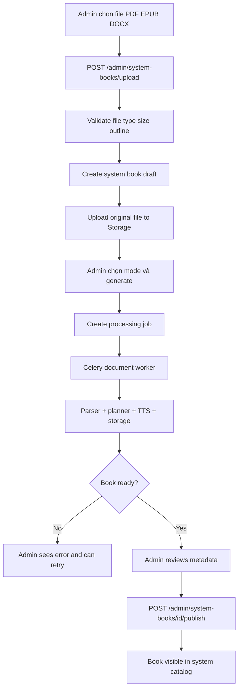
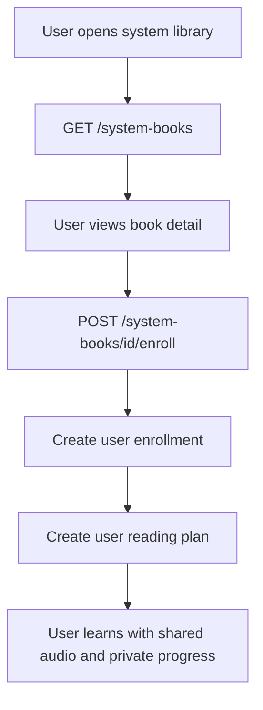

# Phase Admin 2 Implementation Guide - System Book Ingest And Publish

Date: 2026-06-02  
Status: **Planned - BE implementation next**  
Scope: Backend design for admin-managed system books  
Admin FE status: Phase 2 shell can be implemented safely before BE APIs exist  
Audience: Backend developer, Admin Web developer, capstone reviewer

---

## 1. Vì Sao Cần Phase 2

Hiện tại Tri Âm đã có:

- user upload sách cá nhân;
- backend parse tài liệu;
- tạo learning units;
- sinh audio;
- lưu progress/job;
- admin xem dashboard, books, jobs, audit logs.

Nhưng trong mô tả sản phẩm có một ý quan trọng:

```text
User có thể upload sách của họ hoặc lấy sách từ hệ thống.
```

Muốn có “sách từ hệ thống”, backend cần một luồng riêng cho admin:

```text
Admin upload/ingest sách
-> hệ thống xử lý một lần
-> admin kiểm tra
-> admin publish
-> user mobile có thể chọn sách đó để học
```

Phase Admin 2 giải quyết phần nền tảng này.

---

## 2. Phạm Vi Phase 2

Phase 2 nên chia thành 2 lớp rõ ràng:

### 2.1 Admin System Book Ingest

Mục tiêu:

- admin upload sách hệ thống;
- backend xử lý bằng pipeline hiện có;
- admin xem trạng thái xử lý;
- admin chỉnh metadata catalog;
- admin publish/unpublish sách.

### 2.2 Reader Catalog Enrollment

Mục tiêu:

- user app xem danh sách sách hệ thống;
- user thêm sách hệ thống vào thư viện học của mình;
- user có kế hoạch học/progress riêng, không ảnh hưởng user khác.

Ghi chú quan trọng:

```text
Không nên publish sách hệ thống ra app mobile nếu chưa chốt user-specific reading plan/progress cho system book.
```

Lý do: `reading_plans` hiện chưa có `user_id`; trước đây sách luôn thuộc một user nên plan có thể gắn theo `book_id`. Với sách hệ thống dùng chung, một `book_id` sẽ có nhiều user học khác nhau, nên plan phải gắn theo user.

---

## 3. Business Flow Chuẩn



Reader flow sau khi publish:



---

## 4. Data Model Recommendation

### 4.1 Extend `books`

Hiện `books` đang là bảng trung tâm cho cả sách, asset, status và processing. Phase 2 nên mở rộng bảng này thay vì tạo bảng content hoàn toàn mới, vì pipeline hiện tại đã dựa trên `book_id`.

Thêm field:

```python
visibility: str = "user_private"
published_at: datetime | None
published_by: uuid.UUID | None
is_listed: bool = False
catalog_description: str | None
catalog_category: str | None
catalog_tags: list[str] | None
cover_image_url: str | None
language: str | None
```

Giá trị `visibility`:

```text
user_private  = sách cá nhân user upload
system_draft  = admin upload nhưng chưa publish
system_public = sách hệ thống đã publish
```

Why use `str` instead of Postgres enum initially:

- `books.status` và `document_type` hiện cũng đang là text;
- dễ migration hơn;
- tránh enum rewrite khi capstone còn đổi business logic;
- sau này ổn định có thể chuyển sang enum/check constraint.

Index cần có:

```text
ix_books_visibility
ix_books_is_listed
ix_books_catalog_category
ix_books_published_at
```

Backfill:

```sql
update books set visibility = 'user_private' where visibility is null;
```

### 4.2 Add `user_book_enrollments`

Mục tiêu:

```text
Một system book có thể được nhiều user thêm vào thư viện riêng.
```

Model đề xuất:

```python
class UserBookEnrollment(SQLModel, table=True):
    __tablename__ = "user_book_enrollments"

    user_id: uuid.UUID
    book_id: uuid.UUID
    source: str = "system_catalog"
    status: str = "active"
    active_mode: PlanMode = PlanMode.FULL
    created_at: datetime
    updated_at: datetime

    __table_args__ = (
        PrimaryKeyConstraint("user_id", "book_id", name="user_book_enrollment_pk"),
    )
```

Status:

```text
active
archived
removed
```

### 4.3 Fix `reading_plans` User Ownership Gap

Current gap:

```text
ReadingPlan currently belongs to book_id only.
```

Với sách cá nhân cũ, điều này tạm ổn vì `book_id` chỉ thuộc một user.

Với sách hệ thống, phải thêm:

```python
user_id: uuid.UUID | None
```

Backfill:

```text
For existing private books:
reading_plans.user_id = books.user_id
```

Constraint dài hạn:

```text
unique(user_id, book_id, mode)
```

Trade-off:

- Có migration rộng hơn.
- Cần update service reading plan hiện tại.
- Nhưng đây là hướng đúng để system books dùng được thật.

Nếu muốn tách scope:

```text
Phase 2A: admin ingest/publish only.
Phase 2B: reader enrollment + reading_plans.user_id.
```

---

## 5. Admin API Contract

Base path:

```text
/api/v1/admin/system-books
```

All endpoints require:

```http
Authorization: Bearer <admin_supabase_access_token>
```

### 5.1 List System Books

```http
GET /api/v1/admin/system-books
```

Query:

```text
limit
offset
visibility=system_draft|system_public
status=draft|processing|partial_ready|ready|error
document_type=pdf|epub|docx
q=<title>
category=<category>
```

Response:

```json
{
  "total": 1,
  "limit": 20,
  "offset": 0,
  "items": [
    {
      "id": "uuid",
      "title": "Logic học đại cương",
      "author": "Unknown",
      "document_type": "docx",
      "status": "ready",
      "visibility": "system_public",
      "is_listed": true,
      "catalog_category": "logic",
      "catalog_tags": ["logic", "toán rời rạc"],
      "published_at": "2026-06-02T10:00:00Z",
      "created_at": "2026-06-02T09:00:00Z",
      "updated_at": "2026-06-02T10:00:00Z"
    }
  ]
}
```

### 5.2 Upload System Book

```http
POST /api/v1/admin/system-books/upload
Content-Type: multipart/form-data
```

Form data:

```text
file
title
author
catalog_description?
catalog_category?
catalog_tags?     # JSON string or comma-separated string
language?
```

Rule:

- Validate document structure before DB publish.
- PDF requires outline/bookmarks.
- EPUB requires TOC.
- DOCX requires Heading styles.
- Do not fallback to regex detection.

Response:

```json
{
  "book_id": "uuid",
  "status": "draft",
  "visibility": "system_draft",
  "message": "System book uploaded. Generate processing plan to continue."
}
```

### 5.3 Generate System Book Audio

```http
POST /api/v1/admin/system-books/{book_id}/generate-plan
```

Body:

```json
{
  "mode": "full",
  "pace": 1
}
```

Notes:

- Admin ingest should reuse Celery document queue.
- Return `job_id`.
- Admin FE can track via `/api/v1/admin/jobs?book_id=<book_id>`.

Response:

```json
{
  "book_id": "uuid",
  "job_id": "uuid",
  "status": "queued"
}
```

### 5.4 Update Catalog Metadata

```http
PATCH /api/v1/admin/system-books/{book_id}/metadata
```

Body:

```json
{
  "title": "Logic học đại cương",
  "author": "Nguyễn Văn A",
  "catalog_description": "Giáo trình nhập môn logic mệnh đề và đại số Bool.",
  "catalog_category": "logic",
  "catalog_tags": ["logic", "mệnh đề", "đại số bool"],
  "language": "vi",
  "cover_image_url": null
}
```

Response:

```json
{
  "id": "uuid",
  "message": "System book metadata updated."
}
```

### 5.5 Publish

```http
POST /api/v1/admin/system-books/{book_id}/publish
```

Rules:

- Only publish if book status is `ready`.
- `partial_ready` should not be public by default for production catalog.
- `error`, `draft`, `processing` cannot publish.

Response:

```json
{
  "id": "uuid",
  "visibility": "system_public",
  "is_listed": true,
  "published_at": "2026-06-02T10:00:00Z",
  "message": "System book published."
}
```

Audit log:

```text
action = "system_book.publish"
target_type = "book"
target_id = book_id
```

### 5.6 Unpublish

```http
POST /api/v1/admin/system-books/{book_id}/unpublish
```

Rules:

- Hide from new users.
- Do not remove from users who already enrolled unless product explicitly requires it.

Response:

```json
{
  "id": "uuid",
  "visibility": "system_draft",
  "is_listed": false,
  "message": "System book unpublished."
}
```

Audit log:

```text
action = "system_book.unpublish"
target_type = "book"
target_id = book_id
```

---

## 6. Reader API Contract - Phase 2B

Base path:

```text
/api/v1/system-books
```

Requires normal user auth.

### 6.1 List Public Books

```http
GET /api/v1/system-books
```

Only returns:

```text
visibility = system_public
is_listed = true
status = ready
```

### 6.2 Detail

```http
GET /api/v1/system-books/{book_id}
```

No raw text, no private admin metadata.

### 6.3 Enroll

```http
POST /api/v1/system-books/{book_id}/enroll
```

Body:

```json
{
  "mode": "full",
  "pace": 1,
  "schedule_config": ["Mon", "Wed"],
  "reminder_time": "20:00"
}
```

Response:

```json
{
  "book_id": "uuid",
  "enrollment_status": "active",
  "reading_plan_id": "uuid"
}
```

---

## 7. Backend Implementation Files

Recommended files:

```text
app/api/v1/routers/admin_system_books.py
app/api/v1/routers/system_books.py
app/schemas/admin_system_book.py
app/schemas/system_book.py
app/repositories/system_book_repo.py
app/services/admin_system_book_service.py
app/services/system_book_service.py
tests/test_admin_system_books_api.py
tests/test_system_books_api.py
```

Keep existing admin router clean. If `app/api/v1/routers/admin.py` grows too large, split Phase 2 into `admin_system_books.py`.

---

## 8. Audit Rules

Admin mutations must write `admin_audit_logs`:

```text
system_book.upload
system_book.generate_plan
system_book.metadata_update
system_book.publish
system_book.unpublish
```

Do not store:

- raw file bytes;
- full text content;
- provider secrets;
- signed storage URLs.

---

## 9. Security Rules

1. Admin endpoints require `require_admin_user`.
2. Reader system-book endpoints require normal user auth.
3. Public catalog must never include private user books.
4. Admin upload cannot publish automatically.
5. Publishing requires explicit admin action.
6. Unpublish does not delete data.
7. Deleting system books should be a later phase with stricter policy.

---

## 10. Testing Plan

### Admin tests

```text
non-admin cannot call /admin/system-books
admin can upload valid DOCX/PDF/EPUB
invalid no-outline document returns 422
admin can generate plan and gets job_id
admin cannot publish processing/error book
admin can publish ready book
admin can unpublish public book
publish/unpublish creates audit logs
```

### Reader tests

```text
user sees only system_public + ready + listed books
user cannot see system_draft books
user can enroll public book
enroll is idempotent
user progress is private per user
user reading plan does not overwrite another user's plan
```

---

## 11. Admin FE Phase 2 Requirements

Admin Web can safely prepare these screens before BE implementation:

```text
/system-books
```

Current safe implementation:

- show Phase 2 overview;
- show ingest workflow;
- show planned API contract;
- show disabled upload/publish buttons with "BE pending" label;
- link to current Books/Jobs pages for operational tracking.

After BE implements endpoints:

- enable upload form;
- call `/admin/system-books/upload`;
- show system books list;
- enable publish/unpublish actions.

---

## 12. Trade-offs

### Trade-off 1: Reusing `books`

Pros:

- reuses current parser, worker, TTS, learning unit, storage pipeline;
- simpler capstone explanation;
- fewer duplicate tables.

Cons:

- `books.user_id` becomes "owner/uploader" for system books, not learner;
- requires clear `visibility` semantics.

Recommendation:

```text
Reuse books, add visibility/catalog fields.
```

### Trade-off 2: ReadingPlan migration

Pros:

- makes system book learning correct for many users;
- fixes long-term ownership logic.

Cons:

- touches existing reading plan services and tests;
- must backfill existing plans.

Recommendation:

```text
Do it before exposing system books to mobile users.
```

### Trade-off 3: Publish only `ready`

Pros:

- stable production UX;
- users do not see half-generated content.

Cons:

- admin waits longer before publishing large books.

Recommendation:

```text
Publish only ready in Phase 2.
```

---

## 13. Done Criteria

Phase Admin 2 BE is done when:

- [ ] `books` has visibility/catalog fields.
- [ ] existing private books are backfilled to `user_private`.
- [ ] admin can upload system book draft.
- [ ] admin can generate processing job for system book.
- [ ] admin can update system book metadata.
- [ ] admin can publish ready system book.
- [ ] admin can unpublish system book.
- [ ] audit logs are created for admin mutations.
- [ ] FE contract for `/admin/system-books` is finalized.
- [ ] tests pass.

Phase 2B reader catalog is done when:

- [ ] reader can list public system books.
- [ ] reader can enroll a system book.
- [ ] reading plans are user-scoped.
- [ ] progress is private per user.
- [ ] user cannot mutate system book source content.
