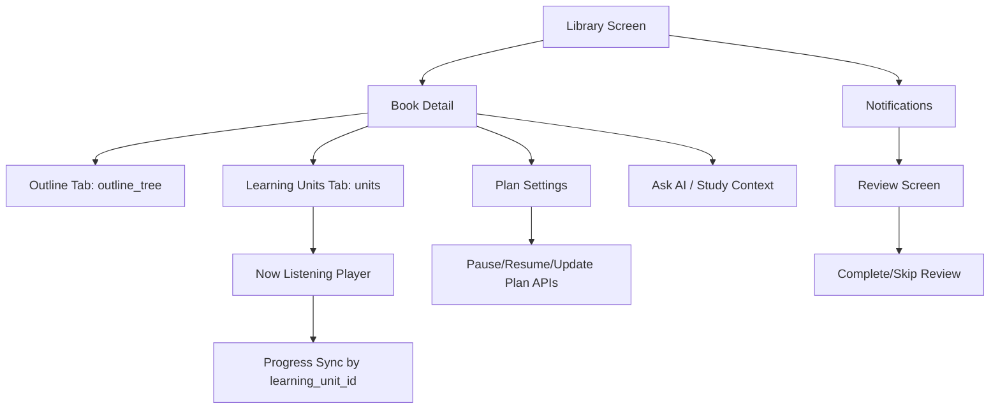

# TRIAM Flutter Phase 6 Backend Contract And Refactor Guide

Ngày cập nhật: 2026-05-30  
Audience: Flutter team, backend maintainer, capstone reviewer  
Backend scope: Phase 1 -> Phase 6 cleanup, Phase 5 document structure, update API 30/05  
Mục tiêu: Hướng dẫn FE refactor từ contract Phase 4 sang contract backend hiện tại sau khi BE đã cleanup `chapter` legacy.

---

## 1. Đọc Tài Liệu Này Khi Nào?

FE đã implement theo:

```text
_docs_implemented/doc_setup_flutter/flutter_phase_4_backend_contract_uiux_guide.md
```

Nhưng tài liệu Phase 4 hiện còn nhiều đoạn lịch sử dùng `chapter`, `chapters`, `total_chapters`, `chapter_segments`. Sau Phase 5 và Phase 6, backend đã chuyển contract chính sang:

```text
book_sections      = cấu trúc/mục lục gốc của tài liệu
learning_units     = bài học/bài nghe mà user thật sự học
learning_unit_segments = các đoạn audio trong một bài học
learning_unit_progress = tiến độ nghe theo bài học
```

Vì vậy tài liệu này là bản refactor guide mới cho FE. Khi có mâu thuẫn giữa Phase 4 guide và file này, ưu tiên file này.

Sau khi refactor Phase 6 xong, FE đọc tiếp realtime permission guide:

```text
_docs_implemented/doc_setup_flutter/flutter_phase_7_1_realtime_web_permission_uiux_guide.md
```

---

## 2. Tóm Tắt Git Markdown Đã Rà

Các markdown đang thay đổi trên branch:

```text
_docs_implemented/doc_setup_flutter/flutter_phase_4_backend_contract_uiux_guide.md
_docs_implemented/phase_6_cleanup_refactor_stabilization_plan.md
```

Các markdown mới chưa track hiện tại:

```text
_docs_implemented/doc_ingest/outline_x_y.md
_docs_implemented/doc_setup_flutter/flutter_fcm_integration_guide.md
update_api_3005.md
```

Thông tin chính đã gom vào doc này:

- Phase 5: backend tách outline gốc thành `book_sections`, bài nghe thành `learning_units`.
- Phase 6: backend cleanup code/schema legacy `chapter`.
- `outline_x_y.md`: PDF parser đã cải thiện tách nội dung theo tọa độ bookmark, giúp nội dung section chính xác hơn.
- `update_api_3005.md`: có thêm pause/resume/update reading plan và `reminder_time` riêng cho từng sách.
- `flutter_fcm_integration_guide.md`: có API đăng ký/hủy FCM device token.

---

## 3. Điều Quan Trọng Nhất FE Phải Đổi

### 3.1 Không Gọi Mọi Thứ Là Chương

Trước đây FE có thể đang render như sau:

```text
Book -> chapters -> chapter_segments -> progress by chapter_id
```

Sau Phase 6 phải đổi thành:

```text
Book -> outline_tree/book_sections -> units -> segments -> progress by learning_unit_id
```

Ý nghĩa:

| Khái niệm                        | Dùng cho                                   | FE label gợi ý    |
| -------------------------------- | ------------------------------------------ | ----------------- |
| `book_sections` / `outline_tree` | Mục lục gốc, đề mục, heading, TOC          | Mục lục, đề mục   |
| `learning_units` / `units`       | Bài học/bài nghe được tạo từ nhiều section | Bài học, bài nghe |
| `segments`                       | Audio chunks trong một unit                | Đoạn nghe         |
| `learning_unit_progress`         | Resume/progress theo unit và segment       | Tiến độ học       |

Không hiển thị:

```text
93 chương
```

Hãy hiển thị:

```text
93 đề mục
4 bài nghe trọng tâm
```

### 3.2 Những Field Cũ Không Được Dùng Nữa

FE cần tìm và xóa/refactor các field/model sau:

```text
total_chapters
chapters
chapter_id
chapter_index
chapter_segments
current_chapter_id
last_chapter_id
completed_chapters
playable_chapters
```

Thay bằng:

```text
total_sections
total_units
units
learning_unit_id
unit_index
segments
last_learning_unit_id
completed_units
playable_units
```

### 3.3 Endpoint Cũ Cần Bỏ

Không dùng nữa:

```http
PUT  /api/v1/books/{book_id}/chapters/{chapter_id}/progress
POST /api/v1/books/{book_id}/chapters/{chapter_id}/complete
```

Dùng endpoint hiện tại:

```http
PUT  /api/v1/books/{book_id}/learning-units/{learning_unit_id}/progress
POST /api/v1/books/{book_id}/learning-units/{learning_unit_id}/complete
```

---

## 4. Kiến Trúc FE Sau Phase 6



FE nên tách state rõ:

```text
Document structure state:
  outline_tree, total_sections

Playback state:
  units, segments, active_unit_id, active_segment_index

Processing state:
  job_id, job_status, progress_percent, done_units, total_units

Learning state:
  learning-progress response, resume position, completed units

Notification state:
  in-app notifications, optional FCM registration
```

---

## 5. Auth Contract

Authorization: Bearer <supabase_access_token>

## 6. Canonical Models Cho Flutter

### 6.1 Book

```dart
class Book {
  final String id;
  final String title;
  final String? author;
  final int? totalSections;
  final int? totalUnits;
  final BookStatus? status;
  final DocumentType? documentType;
  final String? fileUrl;
  final DateTime createdAt;
  final DateTime updatedAt;
}
```

Backend response:

```json
{
  "id": "uuid",
  "title": "trr",
  "author": null,
  "total_sections": 122,
  "total_units": 4,
  "status": "ready",
  "document_type": "docx",
  "file_url": "https://...",
  "created_at": "...",
  "updated_at": "..."
}
```

### 6.2 BookSection / Outline Node

```dart
class BookSectionNode {
  final String id;
  final String title;
  final int level;
  final String path;
  final int? pageStart;
  final int? pageEnd;
  final int textCharCount;
  final List<BookSectionNode> children;
}
```

Backend response:

```json
{
  "book_id": "uuid",
  "total_sections": 122,
  "outline_tree": [
    {
      "id": "uuid",
      "title": "Chương 1 LOGIC MỆNH ĐỀ",
      "level": 1,
      "path": "1",
      "page_start": null,
      "page_end": null,
      "text_char_count": 2400,
      "children": []
    }
  ]
}
```

### 6.3 LearningUnit

```dart
class LearningUnit {
  final String id;
  final String title;
  final ProcessingJobStatus status;
  final int unitIndex;
  final String unitType;
  final int sourceTextCharCount;
  final int estimatedAudioSeconds;
  final int mainSegmentCount;
  final String reviewText;
  final String reviewAudioUrl;
  final String? plannerReason;
  final List<LearningUnitSegment> segments;
}
```

Backend response item:

```json
{
  "id": "uuid",
  "title": "LOGIC MỆNH ĐỀ - Phần 1/2",
  "status": "ready",
  "unit_index": 0,
  "unit_type": "pareto_focus",
  "source_text_char_count": 8120,
  "estimated_audio_seconds": 600,
  "main_segment_count": 6,
  "review_text": "...",
  "review_audio_url": "https://...",
  "planner_reason": "Gom các đề mục liên quan.",
  "segments": []
}
```

### 6.4 LearningUnitSegment

```dart
class LearningUnitSegment {
  final int id;
  final int segmentIndex;
  final String? audioUrl;
  final String? textContent;
  final int? durationMs;
}
```

### 6.5 Enums

```dart
enum BookStatus { draft, processing, partialReady, ready, error }
enum ProcessingJobStatus { queued, processing, partialReady, ready, error, cancelled }
enum PlanMode { full, pareto }
enum LearningProgressStatus { notStarted, inProgress, completed }
enum DocumentType { pdf, epub, docx }
```

Parser rule:

```text
Backend dùng snake_case.
Flutter model dùng camelCase.
Enum phải có fallback unknown để tránh crash nếu backend thêm value mới.
```

---

## 7. API Contract Hiện Tại

Base URL production:

```text
https://khoasinoo-tri-am-backend.hf.space/api/v1
```

### 7.1 Upload Document

```http
POST /api/v1/upload
Authorization: Bearer <access_token>
Content-Type: multipart/form-data

file=<PDF|DOCX|EPUB>
```

Response:

```json
{
  "book_id": "uuid",
  "total_sections": 122,
  "max_depth": 6,
  "outline_tree": [],
  "warnings": [
    "Tài liệu có outline phẳng với nhiều đề mục. TRIAM sẽ tự gom các đề mục liên quan thành bài nghe."
  ],
  "document_type": "docx"
}
```

FE rule:

- Upload chỉ tạo sách ở `draft`.
- Sau upload, show outline preview.
- Không vào player ngay.
- Không show `total_chapters`.
- Với `warnings`, show neutral warning card, không phải error.

File rule:

| Type | Backend yêu cầu             |
| ---- | --------------------------- |
| PDF  | có hidden outline/bookmarks |
| DOCX | có Heading/outline styles   |
| EPUB | có TOC/navigation           |

Không support:

```text
scanned PDF
OCR tự động
regex đoán chương
file không có cấu trúc
```

Timeout FE:

```text
upload timeout nên đặt 120-180 giây.
Nếu FE timeout, refresh Library trước khi upload lại để tránh tạo cảm giác mất dữ liệu.
```

### 7.2 Generate Plan

```http
POST /api/v1/generate-plan
Authorization: Bearer <access_token>
Content-Type: application/json
```

Request:

```json
{
  "book_id": "uuid",
  "mode": "pareto",
  "pace": 1,
  "schedule_config": ["Mon", "Wed", "Fri"],
  "reminder_time": "20:30"
}
```

`reminder_time` là field mới sau update 30/05:

- Nếu gửi: kế hoạch của sách dùng giờ đó.
- Nếu không gửi: backend fallback từ notification settings của user.
- Format: `HH:MM`, 24-hour.

Response:

```json
{
  "message": "Kế hoạch học tập đã được tạo! Chúng tôi đang xử lý sách của bạn.",
  "book_id": "uuid",
  "plan_id": "uuid",
  "job_id": "uuid",
  "mode": "pareto",
  "plan_status": "active",
  "pace": 1,
  "schedule_config": ["Mon", "Wed", "Fri"],
  "reminder_time": "20:30",
  "status": "queued",
  "progress_percent": 0,
  "active_slots": [
    {
      "id": "uuid",
      "weekday": 0,
      "weekday_label": "monday",
      "reminder_time": "20:30",
      "timezone": "Asia/Ho_Chi_Minh",
      "is_active": true
    }
  ],
  "planned_units": [
    {
      "unit_index": 0,
      "title": "LOGIC MỆNH ĐỀ - Phần 1/2",
      "unit_type": "pareto_focus",
      "source_section_count": 32,
      "estimated_audio_seconds": 600
    }
  ]
}
```

FE rule:

- Show planned units preview if available.
- Store `job_id`.
- Store `plan_id`, `schedule_config`, `reminder_time`, and `active_slots` from backend response.
- Do not silently replace `reminder_time` with a FE default after generate-plan. Backend response is the source of truth.
- Before user confirms schedule, FE should call `GET /api/v1/reading-plan-slots` and warn/disable exact day-time slots already occupied by another active book.
- Navigate to processing screen.
- Start polling job.

### 7.3 Job Polling

```http
GET /api/v1/jobs/{job_id}
Authorization: Bearer <access_token>
```

Recovery:

```http
GET /api/v1/books/{book_id}/processing-status
Authorization: Bearer <access_token>
```

Response shape:

```json
{
  "id": "uuid",
  "book_id": "uuid",
  "job_type": "generate_plan",
  "status": "partial_ready",
  "mode": "full",
  "progress_percent": 33,
  "current_step": "Đã có nội dung đầu tiên có thể nghe. Phần còn lại đang được xử lý.",
  "total_units": 3,
  "done_units": 1,
  "failed_units": 0,
  "estimated_input_tokens": 16453,
  "estimated_audio_seconds": 3382,
  "error_message": null
}
```

Polling interval gợi ý:

| Status                  | Interval          |
| ----------------------- | ----------------- |
| `queued`                | 2s                |
| `processing`            | 2-3s              |
| `partial_ready`         | 5-10s             |
| app background          | pause hoặc 30-60s |
| `ready/error/cancelled` | stop              |

### 7.4 Book List

```http
GET /api/v1/books
Authorization: Bearer <access_token>
```

Response:

```json
[
  {
    "id": "uuid",
    "title": "trr",
    "author": null,
    "total_sections": 122,
    "total_units": 4,
    "status": "partial_ready",
    "document_type": "docx",
    "file_url": "https://...",
    "created_at": "...",
    "updated_at": "..."
  }
]
```

Library phải hiển thị cả:

```text
draft
processing
partial_ready
ready
error
```

CTA gợi ý:

| Status          | Primary CTA             |
| --------------- | ----------------------- |
| `draft`         | Tạo kế hoạch            |
| `processing`    | Xem tiến độ             |
| `partial_ready` | Nghe ngay               |
| `ready`         | Tiếp tục nghe           |
| `error`         | Xem lỗi / thử lại / xoá |

### 7.5 Book Outline

```http
GET /api/v1/books/{book_id}/outline
Authorization: Bearer <access_token>
```

Response:

```json
{
  "book_id": "uuid",
  "total_sections": 122,
  "outline_tree": []
}
```

Phase 6 BE đã tối ưu endpoint này:

```text
Không load full text_content.
Chỉ trả metadata: id, title, level, path, page_start, page_end, text_char_count, children.
```

FE có thể gọi endpoint này cho màn outline mà không sợ kéo text lớn.

### 7.6 Learning Units List

```http
GET /api/v1/books/{book_id}/learning-units?mode=full
Authorization: Bearer <access_token>
```

Response:

```json
{
  "book_id": "uuid",
  "mode": "full",
  "total_units": 3,
  "units": [
    {
      "id": "uuid",
      "title": "Chương 4: Phương pháp luận nghiên cứu",
      "status": "ready",
      "unit_index": 0,
      "unit_type": "full_chapter",
      "source_text_char_count": 4215,
      "estimated_audio_seconds": 420,
      "main_segment_count": 7,
      "review_text": "...",
      "review_audio_url": "https://...",
      "planner_reason": null,
      "segments": []
    }
  ]
}
```

Endpoint này dùng cho list/playlist metadata. Nếu cần audio segments để play, dùng details.

### 7.7 Book Details / Player

```http
GET /api/v1/books/{book_id}/details?mode=full
Authorization: Bearer <access_token>
```

Nếu không truyền `mode`, backend dùng active mode trong ReadingPlan.

Response:

```json
{
  "book_id": "uuid",
  "book_status": "ready",
  "mode": "full",
  "total_sections": 122,
  "total_units": 4,
  "units": [
    {
      "id": "uuid",
      "title": "PHÉP ĐẾM - Phần 1/2",
      "status": "ready",
      "unit_index": 0,
      "unit_type": "pareto_focus",
      "source_text_char_count": 9400,
      "estimated_audio_seconds": 900,
      "main_segment_count": 16,
      "review_text": "...",
      "review_audio_url": "https://...",
      "planner_reason": "...",
      "segments": [
        {
          "id": 123,
          "segment_index": 0,
          "audio_url": "https://...",
          "text_content": "...",
          "duration_ms": 18000
        }
      ]
    }
  ]
}
```

Player rule:

- Sort `units` by `unit_index`.
- Sort `segments` by `segment_index`.
- Skip unit chưa có playable segment nếu book đang `partial_ready`.
- Refresh details khi job `done_units` tăng hoặc status đổi.
- Không reset audio player nếu user đang nghe và refresh details trả thêm segments mới.

### 7.8 Switch Mode

```http
POST /api/v1/books/{book_id}/switch-mode
Authorization: Bearer <access_token>
Content-Type: application/json
```

Request:

```json
{
  "mode": "pareto"
}
```

Response nếu mode mới chưa có audio:

```json
{
  "message": "Đã chuyển sang mode pareto. Hệ thống đang sinh audio trong background.",
  "needs_generation": true,
  "job_id": "uuid",
  "status": "queued",
  "progress_percent": 0
}
```

Response nếu mode đã có audio:

```json
{
  "message": "Đã chuyển sang mode pareto. Audio đã có sẵn.",
  "needs_generation": false,
  "job_id": null,
  "status": null,
  "progress_percent": null
}
```

UX rule đã chốt:

```text
Giữ mode cũ đang phát cho tới khi mode mới partial_ready hoặc ready.
Không xoá/hide playlist cũ trong lúc mode mới generate.
```

### 7.9 Learning Progress

Get resume/progress:

```http
GET /api/v1/books/{book_id}/learning-progress?mode=full
Authorization: Bearer <access_token>
```

Update progress:

```http
PUT /api/v1/books/{book_id}/learning-units/{learning_unit_id}/progress
Authorization: Bearer <access_token>
Content-Type: application/json
```

Body:

```json
{
  "mode": "full",
  "segment_id": 123,
  "segment_index": 0,
  "position_ms": 15000,
  "listened_ms": 15000,
  "progress_percent": 12,
  "total_duration_ms": 120000,
  "force_persist": false
}
```

Manual complete:

```http
POST /api/v1/books/{book_id}/learning-units/{learning_unit_id}/complete
Authorization: Bearer <access_token>
Content-Type: application/json
```

Body:

```json
{
  "mode": "full"
}
```

FE debounce rule:

```text
Gửi progress mỗi 10-30 giây khi đang phát.
Gửi ngay khi đổi segment.
Gửi force_persist=true khi pause, app background, app close, user đổi bài.
Luôn dùng response backend làm source of truth.
```

Backend throttle hiện chỉ ghi DB khi:

```text
lần đầu tạo progress
đổi segment
progress tăng >= 5%
đạt ngưỡng completed
record cũ hơn 30s
force_persist=true
```

### 7.10 Pause / Resume / Update Reading Plan

Đây là API mới theo update 30/05.

Get all active reading-plan slots:

```http
GET /api/v1/reading-plan-slots
Authorization: Bearer <access_token>
```

Use this endpoint before create/update schedule pickers. It lets FE disable exact duplicate slots for the current user.

Response:

```json
[
  {
    "id": "uuid",
    "plan_id": "uuid",
    "book_id": "uuid",
    "weekday": 0,
    "weekday_label": "monday",
    "reminder_time": "20:30",
    "timezone": "Asia/Ho_Chi_Minh",
    "is_active": true
  }
]
```

Get current reading plan:

```http
GET /api/v1/books/{book_id}/reading-plan
Authorization: Bearer <access_token>
```

Response:

```json
{
  "plan_id": "uuid",
  "book_id": "uuid",
  "mode": "full",
  "pace": 1,
  "schedule_config": ["Mon", "Wed", "Fri"],
  "reminder_time": "20:30",
  "status": "active",
  "active_slots": [
    {
      "id": "uuid",
      "weekday": 0,
      "weekday_label": "monday",
      "reminder_time": "20:30",
      "timezone": "Asia/Ho_Chi_Minh",
      "is_active": true
    }
  ],
  "created_at": "2026-06-01T10:00:00Z",
  "updated_at": "2026-06-01T10:00:00Z"
}
```

FE must call this endpoint before opening the edit schedule screen. This avoids stale/default `reminder_time` bugs where UI shows one time but request sends another time.

If the book is still `draft` and has no plan yet, backend returns `404` with:

```json
{
  "detail": "Chưa có ReadingPlan cho sách này."
}
```

Pause:

```http
POST /api/v1/books/{book_id}/pause
Authorization: Bearer <access_token>
```

Response:

```json
{
  "message": "Đã tạm dừng kế hoạch học tập.",
  "plan_id": "uuid",
  "status": "inactive"
}
```

Resume:

```http
POST /api/v1/books/{book_id}/resume
Authorization: Bearer <access_token>
```

Response:

```json
{
  "message": "Đã tiếp tục kế hoạch học tập.",
  "plan_id": "uuid",
  "status": "active"
}
```

Update plan:

```http
PUT /api/v1/books/{book_id}/reading-plan
Authorization: Bearer <access_token>
Content-Type: application/json
```

Body:

```json
{
  "pace": 1,
  "schedule_config": ["Mon", "Wed", "Fri"],
  "reminder_time": "20:30"
}
```

Response:

```json
{
  "message": "Đã cập nhật kế hoạch học tập.",
  "plan_id": "uuid",
  "book_id": "uuid",
  "mode": "full",
  "pace": 1,
  "schedule_config": ["Mon", "Wed", "Fri"],
  "reminder_time": "20:30",
  "status": "active",
  "active_slots": [
    {
      "id": "uuid",
      "weekday": 0,
      "weekday_label": "monday",
      "reminder_time": "20:30",
      "timezone": "Asia/Ho_Chi_Minh",
      "is_active": true
    }
  ],
  "created_at": "2026-06-01T10:00:00Z",
  "updated_at": "2026-06-01T10:10:00Z"
}
```

UX rule:

- Show pause/resume on active learning book.
- Pause giải phóng lịch học của sách đó.
- Resume có thể trả `409` nếu lịch bị trùng với sách khác.
- Update plan không regenerate audio.
- Update plan chỉ đổi lịch học, pace, reminder time.
- `reminder_time` riêng theo sách sẽ override notification settings chung cho plan reminder của sách đó.
- When user edits schedule, prefill from `GET /books/{book_id}/reading-plan`, not from local defaults.
- When user creates a new plan, check occupied slots from `GET /reading-plan-slots`.
- When submitting update, send both the selected `schedule_config` and selected `reminder_time`.
- If backend returns `409`, refresh current plan and ask user to choose another day/time. Conflict message may include the duplicated weekday/time.

---

## 8. Notifications And Review

### 8.1 In-App Notifications

```http
GET /api/v1/notifications?limit=30&unread_only=false
Authorization: Bearer <access_token>
```

```http
PATCH /api/v1/notifications/{notification_id}/read
PATCH /api/v1/notifications/read-all
```

Notification item:

```json
{
  "id": "uuid",
  "type": "spaced_review_due",
  "title": "Đến lúc ôn lại rồi",
  "body": "Ôn nhanh: LOGIC MỆNH ĐỀ - Phần 1/2.",
  "action_type": "open_review",
  "action_payload": {
    "book_id": "uuid",
    "review_item_id": "uuid",
    "learning_unit_id": "uuid",
    "mode": "full"
  },
  "read_at": null,
  "created_at": "..."
}
```

Action mapping:

| action_type          | FE navigation            |
| -------------------- | ------------------------ |
| `open_book`          | Book detail              |
| `open_learning_unit` | Player tại learning unit |
| `open_review`        | Review detail/screen     |

### 8.2 Notification Settings

```http
GET /api/v1/notifications/settings
PUT /api/v1/notifications/settings
```

Body:

```json
{
  "timezone": "Asia/Ho_Chi_Minh",
  "reminders_enabled": true,
  "spaced_review_enabled": true,
  "reminder_time": "20:00",
  "quiet_hours_start": "22:00",
  "quiet_hours_end": "07:00",
  "daily_cap": 3
}
```

Lưu ý sau update 30/05:

```text
notification_settings.reminder_time là default.
reading_plan.reminder_time là override riêng theo sách.
```

### 8.3 Reviews

```http
POST /api/v1/reviews/{review_item_id}/complete
POST /api/v1/reviews/{review_item_id}/skip
```

Review được tạo sau khi user hoàn thành learning unit, không tạo local ở FE.

FE cần Review screen riêng:

```text
Ôn tập hôm nay
Sắp tới
Đã hoàn thành
Bỏ qua
```

Nếu backend chưa có list review endpoint riêng, FE có thể mở review từ notification trước. Khi cần màn Review đầy đủ, cần thêm BE endpoint list reviews.

### 8.4 FCM Push Notification

Backend hiện có API device token:

Register:

```http
POST /api/v1/notifications/devices
Authorization: Bearer <access_token>
Content-Type: application/json

{
  "device_token": "<fcm_device_token>"
}
```

Response:

```json
{
  "device_token": "<fcm_device_token>",
  "user_id": "uuid",
  "created_at": "..."
}
```

Unregister:

```http
DELETE /api/v1/notifications/devices/{device_token}
Authorization: Bearer <access_token>
```

Response:

```json
{
  "status": "success"
}
```

FE gọi register trong 3 lúc:

```text
sau login thành công
khi app launch mà session còn hợp lệ
khi Firebase onTokenRefresh phát token mới
```

FE gọi unregister trước khi logout.

Payload FCM data:

```json
{
  "outbox_id": "uuid",
  "notification_type": "spaced_review_due",
  "action_type": "open_learning_unit",
  "action_payload": "{\"book_id\":\"uuid\",\"learning_unit_id\":\"uuid\",\"mode\":\"full\"}"
}
```

FE phải `jsonDecode(action_payload)` vì FCM data values đều là string.

---

## 9. Study Context And Voice Agent

Book quick chat:

```http
GET /api/v1/threads/for-book/{book_id}
Authorization: Bearer <access_token>
```

LiveKit token:

```http
GET /api/v1/live-token/thread/{thread_id}
Authorization: Bearer <access_token>
```

Không ưu tiên endpoint legacy:

```http
GET /api/v1/live-token/{book_id}
```

Realtime topics:

| Topic           | Direction                  | Payload                    |
| --------------- | -------------------------- | -------------------------- |
| `lk.chat`       | FE -> server, server -> FE | plain text                 |
| `lk.transcript` | server -> FE only          | normalized JSON transcript |
| `lk.control`    | FE -> server               | JSON control message       |

Transcript rule:

```json
{
  "v": 1,
  "type": "transcript",
  "role": "assistant",
  "text": "...",
  "id": "uuid",
  "ts": "2026-05-30T10:00:00.000+00:00"
}
```

FE dùng `id` để dedupe.

---

## 10. UI/UX Refactor Checklist

### 10.1 Library

- [ ] Render `total_sections` và `total_units`, không render `total_chapters`.
- [ ] Hiển thị tất cả trạng thái: draft, processing, partial_ready, ready, error.
- [ ] CTA theo status.
- [ ] Có continue listening dựa trên learning progress.
- [ ] Có badge notification unread.

### 10.2 Upload

- [ ] Upload field name là `file`.
- [ ] Show requirement: PDF bookmark, DOCX Heading, EPUB TOC.
- [ ] Show outline preview bằng `outline_tree`.
- [ ] Label là `đề mục`, không phải `chương`.
- [ ] Show warnings nếu backend trả.
- [ ] Sau upload, vào Reading Plan Setup.

### 10.3 Reading Plan Setup

- [ ] Mode segmented control: `Đầy đủ` / `Tinh gọn`.
- [ ] Weekday multi-select.
- [ ] Pace selector.
- [ ] Reminder time picker riêng cho sách.
- [ ] Nếu user không chọn reminder time, nói rõ sẽ dùng giờ nhắc mặc định.
- [ ] Estimate bottom sheet: total_sections, planned mode, warning sách lớn.
- [ ] Submit xong vào Processing screen.

### 10.4 Processing

- [ ] Poll `/jobs/{job_id}`.
- [ ] Recover bằng `/books/{book_id}/processing-status`.
- [ ] Show progress percent, current_step, done_units/total_units.
- [ ] Unlock nghe khi `partial_ready`.
- [ ] Stop polling khi `ready/error/cancelled`.

### 10.5 Book Detail

- [ ] Có tab/section `Mục lục` dùng outline.
- [ ] Có tab/section `Bài nghe` dùng units.
- [ ] Không show `chapters`.
- [ ] Có mode switch full/pareto.
- [ ] Có pause/resume/update plan.
- [ ] Có ask AI CTA.

### 10.6 Player

- [ ] Build playlist từ `units[].segments`.
- [ ] Sort theo `unit_index` và `segment_index`.
- [ ] Resume bằng `last_learning_unit_id`, `last_segment_id`, `position_ms`.
- [ ] Progress update theo `learning_unit_id`.
- [ ] Không reset audio khi details refresh.
- [ ] Khi switch mode đang generate, giữ mode cũ đang phát.

### 10.7 Review And Notification

- [ ] Notification center list/read/read-all.
- [ ] Navigate theo `action_type`.
- [ ] Review complete/skip.
- [ ] Không tự tạo review local.
- [ ] FCM token register/unregister nếu bật push.

---

## 11. FE Clean Code Checklist

FE nên cleanup theo tinh thần Phase 6 của BE:

### 11.1 Domain Models

Xoá hoặc deprecate:

```text
ChapterModel
ChapterSegmentModel
ChapterProgressModel
```

Tạo hoặc đổi sang:

```text
BookSectionNode
LearningUnit
LearningUnitSegment
LearningUnitProgress
ProcessingJob
ReadingPlanUpdate
```

Nếu FE cần giữ alias tạm để ít vỡ UI:

```dart
@Deprecated('Use LearningUnit instead')
typedef Chapter = LearningUnit;
```

Nhưng không nên để alias này sống lâu.

### 11.2 Repository Layer

Không để widget gọi HTTP trực tiếp.

Nên có các repository/service:

```text
AuthRepository
BookRepository
UploadRepository
ProcessingJobRepository
LearningProgressRepository
NotificationRepository
ReviewRepository
StudyContextRepository
VoiceAgentService
```

### 11.3 State Management

Tách state:

```text
LibraryState
UploadState
BookDetailState
PlayerState
ProcessingJobState
LearningProgressState
NotificationState
ReviewState
```

Không nhét tất cả vào một provider/bloc lớn.

### 11.4 API Parser

FE cần parser chung cho error:

```dart
String parseApiError(dynamic body) {
  final detail = body?['detail'];
  if (detail is String) return detail;
  if (detail is List && detail.isNotEmpty) {
    final first = detail.first;
    if (first is Map && first['msg'] != null) return first['msg'].toString();
  }
  return 'Có lỗi xảy ra. Vui lòng thử lại.';
}
```

### 11.5 Polling Manager

Không viết polling rải rác trong nhiều widget.

Nên có một helper:

```text
JobPollingController
start(jobId)
stop()
recoverByBook(bookId)
onPartialReady
onReady
onError
```

### 11.6 Audio Progress Sync

Không gửi progress mỗi giây.

Rule:

```text
10-30s một lần khi đang phát
force_persist=true khi pause/background/close/đổi bài
gửi ngay khi đổi segment
```

FE phải dùng response backend để cập nhật resume state.

---

## 12. Breaking Changes Summary

| Phase 4 cũ                   | Phase 6 hiện tại                                          |
| ---------------------------- | --------------------------------------------------------- |
| `total_chapters`             | `total_sections`, `total_units`                           |
| `chapters`                   | `units`                                                   |
| `chapter_id`                 | `learning_unit_id`                                        |
| `chapter_index`              | `unit_index`                                              |
| `chapter_segments`           | `segments`                                                |
| `GET details -> chapters[]`  | `GET details -> units[]`                                  |
| progress by chapter          | progress by learning unit                                 |
| complete chapter             | complete learning unit                                    |
| notification `chapter_title` | notification `unit_title`, fallback cũ vẫn có thể tồn tại |
| global reminder only         | per-book `reminder_time` supported                        |

---

## 13. Manual QA Flow Cho FE

Test bằng 3 file:

```text
Chương 4_ Phương pháp luận nghiên cứu.pdf
trr.docx
phase5_sample.epub
```

Flow bắt buộc:

```text
1. Login bằng Supabase.
2. Upload DOCX trr.docx.
3. Confirm upload response có total_sections, outline_tree.
4. Generate plan mode pareto, có reminder_time.
5. Poll job tới partial_ready.
6. Open player, thấy units chứ không thấy chapters.
7. Play segment đầu, gửi progress.
8. Pause app, gửi force_persist=true.
9. Mở lại app, resume đúng unit/segment/position.
10. Poll tới ready.
11. Switch mode full hoặc pareto ngược lại.
12. Giữ mode cũ phát trong lúc mode mới generate.
13. Complete một learning unit.
14. Notification/review action mở đúng màn.
15. Pause plan, resume plan, update reminder time.
16. Logout, unregister FCM token nếu push đã bật.
```

Expected với `trr.docx`:

```text
Không được hiện 122 chương.
Được hiện 122 đề mục trong outline.
Pareto tạo ít bài học hơn nhiều, ví dụ 4 learning units trong test backend.
```

---

## 14. Những Việc FE Không Nên Làm

- Không tự split tài liệu.
- Không tự đoán chương từ title/path.
- Không tự tạo progress completed nếu backend chưa xác nhận.
- Không tự tạo review item.
- Không hard-code `chapter`.
- Không gửi `user_id`.
- Không poll vô hạn sau terminal status.
- Không xóa mode cũ khỏi player khi switch mode mới đang generate.
- Không gọi FCM register khi chưa có auth session.

---

## 15. Golden Path Refactor Từ Phase 4 Sang Phase 6

Thứ tự đề xuất:

```text
1. Refactor model: Chapter -> LearningUnit, ChapterSegment -> LearningUnitSegment.
2. Refactor API parser: total_chapters/chapters -> total_sections/total_units/units.
3. Refactor Book Detail UI: thêm Mục lục và Bài nghe riêng.
4. Refactor Player: playlist từ units[].segments.
5. Refactor Progress: learning_unit_id endpoint.
6. Refactor Processing UI: done_units/total_units.
7. Refactor Plan Setup: thêm reminder_time per book.
8. Add pause/resume/update reading plan UI.
9. Refactor Notification action payload theo learning_unit_id.
10. Add FCM register/unregister nếu push nằm trong scope.
11. QA với PDF/DOCX/EPUB thật.
12. Xoá hẳn code FE legacy chapter nếu không còn màn nào dùng.
```

---

## 16. Một Câu Định Hướng Cho FE

```text
Outline là cấu trúc gốc của tài liệu.
Learning unit là thứ user học và nghe.
Flutter chỉ render đúng state từ backend, không tự đoán business rule.
```

Đây là nguyên tắc quan trọng nhất sau Phase 6.
