# Hướng Dẫn Tích Hợp & Kiểm Thử API Cho Mobile App (FE vs BE Mapping Guide)

Tài liệu này ánh xạ chi tiết các **chức năng/màn hình trên Mobile Frontend** sang **các API tương ứng trên Backend** (không bao gồm các router admin). Bạn có thể dựa vào hướng dẫn này để rà soát xem Frontend đã gọi đúng và đủ API hay chưa.

---

## 🧭 BẢN ĐỒ PHÂN CHIA THEO MÀN HÌNH / LUỒNG CHỨC NĂNG (USER FLOWS)

```mermaid
graph TD
    A["Màn hình Chính / Hôm nay"] -->|Lấy bài học trong ngày| B["GET /reading-plan/sessions/today"]
    C["Màn hình Thư viện"] -->|Lấy sách cá nhân| D["GET /books"]
    C -->|Lấy sách mẫu hệ thống| E["GET /books/library"]
    C -->|Chọn sách mẫu| F["POST /books/{shared_book_id}/select"]
    G["Luồng Upload & Tạo Lịch"] -->|Bước 1: Upload| H["POST /upload"]
    G -->|Bước 2: Tạo kế hoạch| I["POST /generate-plan"]
    G -->|Theo dõi tiến độ xử lý| J["GET /books/{book_id}/processing-status"]
    K["Màn hình Player / Nghe Sách"] -->|Gửi tiến độ audio liên tục| L["PUT /books/{book_id}/learning-units/{unit_id}/progress"]
    K -->|Hoàn thành thủ công| M["POST /books/{book_id}/learning-units/{unit_id}/complete"]
    N["Màn hình Trợ lý ảo Live Voice"] -->|Lấy Token LiveKit| O["GET /live-token/{book_id}"]
    P["Màn hình Ôn tập Spaced Repetition"] -->|Lấy bài ôn tập| Q["GET /reviews"]
```



---

## 1. Luồng 1: Màn hình chính (Dashboard / Màn hình "Hôm nay")

Màn hình này hiển thị tiến độ học tập tổng quan và các buổi học (sessions) mà người dùng cần hoàn thành trong ngày hiện tại.

### Chức năng 1: Hiển thị danh sách các buổi học cần học trong ngày
*   **API:** `GET /api/v1/reading-plan/sessions/today`
*   **Tham số truy vấn (Query Params):**
    *   `local_date` (Tùy chọn, kiểu `YYYY-MM-DD`): Ngày cục bộ của thiết bị di động (nếu không truyền, BE sẽ tự động lấy ngày hiện tại theo timezone của user).
*   **Response:** Trả về danh sách các buổi học của ngày hôm đó, mỗi buổi chứa thông tin sách, chế độ học (`mode`), các `learning_units` cần nghe, trạng thái hoàn thành (`status`: `scheduled`, `completed`, `skipped`).
*   **Checklist Kiểm thử:**
    *   FE có truyền đúng định dạng ngày `local_date` để tránh lệch múi giờ không?
    *   Các buổi học có trạng thái `completed` hoặc `skipped` phải được hiển thị tương ứng (ví dụ: gạch ngang hoặc ẩn nút học).

---

## 2. Luồng 2: Màn hình Thư viện (Library) & Chi tiết sách (Book Details)

Nơi người dùng quản lý sách cá nhân và khám phá kho sách mẫu của hệ thống.

### Chức năng 1: Lấy danh sách sách cá nhân (đang học)
*   **API:** `GET /api/v1/books`
*   **Response:** Trả về danh sách sách của user bao gồm: Tiến độ tổng thể (`book_progress_percent`), Trạng thái học (`learning_status`), và các chế độ khả dụng (`has_full_mode`, `has_pareto_mode`).

### Chức năng 2: Khám phá kho sách mẫu chung (System Shared Library)
*   **API:** `GET /api/v1/books/library`
*   **Response:** Danh sách các cuốn sách mẫu được quản trị viên tải lên cho mọi tài khoản.

### Chức năng 3: Chọn sách mẫu vào tủ sách cá nhân
*   **API:** `POST /api/v1/books/{shared_book_id}/select`
*   **Response:** Bản sao cuốn sách mới được nhân bản cho user để bắt đầu học.
*   **Checklist Kiểm thử:** FE phải gọi API này khi user bấm nút "Thêm vào tủ sách" từ kho sách chung. Sau khi thành công, chuyển hướng người dùng về màn hình lập kế hoạch học tập.

### Chức năng 4: Xem thông tin cơ bản của cuốn sách
*   **API:** `GET /api/v1/books/{book_id}`
*   **Mô tả:** Lấy thông tin cơ bản (title, author, cover_url,...) của một cuốn sách cụ thể.

### Chức năng 5: Xem chi tiết sách & Cấu trúc chương mục (Outline)
*   **API 1 (Chi tiết tiến trình):** `GET /api/v1/books/{book_id}/details?mode={mode}`
    *   *Mô tả:* Lấy thông tin chi tiết và tiến trình học của sách theo chế độ `"full"` hoặc `"pareto"`.
*   **API 2 (Cây chương mục gốc):** `GET /api/v1/books/{book_id}/outline`
    *   *Mô tả:* Trả về cây thư mục tiêu đề (chương/mục con) để vẽ UI Outline của cuốn sách.

### Chức năng 6: Lấy danh sách toàn bộ bài học (Learning Units) của sách
*   **API:** `GET /api/v1/books/{book_id}/learning-units?mode={mode}`
    *   *Mô tả:* Lấy danh sách các bài học (`learning_units`) của cuốn sách tương ứng với chế độ học đã chọn (được sinh ra từ Reading Plan). FE cần API này để vẽ danh sách bài học trên giao diện để người dùng click chọn nghe trực tiếp.

### Chức năng 7: Đổi chế độ học (Switch Mode - Full vs Pareto)
*   **API:** `POST /api/v1/books/{book_id}/switch-mode`
*   **Request Body:** `{"mode": "pareto"}` hoặc `{"mode": "full"}`
*   **Mô tả:** Đổi chế độ học hiện tại. Nếu đây là lần đầu tiên người dùng chuyển sang chế độ này, BE sẽ kích hoạt Celery Job để sinh danh sách bài học và sinh file audio TTS tương ứng.
*   **Checklist Kiểm thử:** Khi đổi mode, FE phải hiển thị trạng thái Loading hoặc tiến trình sinh audio (`ProcessingJob`) nếu bài học chưa sẵn sàng.

### Chức năng 8: Xóa cuốn sách cá nhân
*   **API:** `DELETE /api/v1/books/{book_id}`
*   **Response:** `{"message": "Book deleted"}`
*   **Mô tả:** Xóa cuốn sách khỏi thư viện cá nhân, đồng thời dọn dẹp toàn bộ file audio và dữ liệu tiến độ học liên quan trong hệ thống.

---

## 3. Luồng 3: Màn hình Nhập sách mới (Upload Book) & Lập kế hoạch (Generate Plan)

Luồng 2 bước để người dùng tải tài liệu cá nhân lên hệ thống học tập.

### Bước 1: Tải tài liệu lên hệ thống
*   **API:** `POST /api/v1/upload` (Dùng định dạng `multipart/form-data`)
*   **Request:** Gửi file tài liệu (PDF, EPUB, DOCX).
*   **Response:** Trả về `book_id` và cây Outline chương mục được trích xuất tự động từ file.
*   **Checklist Kiểm thử:** FE hiển thị cây Outline để user kiểm tra cấu trúc tài liệu trước khi sang bước tiếp theo.

### Bước 2: Kiểm tra các khung giờ học đã đăng ký để tránh chọn trùng
*   **API:** `GET /api/v1/reading-plan-slots`
*   **Response:** Trả về danh sách tất cả các slot học (`days` và `slots`) đang active của các cuốn sách khác mà user đang học.
*   **Checklist Kiểm thử:** FE nên dùng thông tin này để cảnh báo/chặn người dùng thiết lập lịch trùng khung giờ học với sách khác.

### Bước 3: Thiết lập cấu hình lịch học ban đầu
*   **API:** `POST /api/v1/generate-plan`
*   **Request Body:**
    ```json
    {
      "book_id": "uuid-cua-sach",
      "pace": "standard", // standard, fast, hoặc intensive
      "schedule_config": {
        "days": [1, 3, 5], // 1=Thứ 2, ..., 7=Chủ Nhật
        "slots": ["08:00", "20:00"] // các khung giờ học
      },
      "reminder_time": "20:00"
    }
    ```
*   **Response:** Xác nhận đã lưu kế hoạch và trả về `job_id` của Celery Worker đang xử lý ngầm.

### Bước 4: Theo dõi trạng thái sinh bài học & Audio (Polling Status)
*   **API:** `GET /api/v1/books/{book_id}/processing-status`
*   **Response:**
    *   `status`: `"running"`, `"completed"`, hoặc `"failed"`.
    *   `progress_percent`: Tiến độ sinh audio thực tế (từ 0% đến 100%).
*   **Checklist Kiểm thử:** FE cần chạy cơ chế Polling (gọi định kỳ mỗi 5-10 giây) hoặc sử dụng push notification khi nhận được thông báo hoàn thành để đổi trạng thái UI của sách từ "Đang xử lý" sang "Sẵn sàng nghe".

---

## 4. Luồng 4: Màn hình Cấu hình lịch học & Điều chỉnh kế hoạch (Reading Plan Settings)

### Chức năng 1: Lấy thông tin cấu hình lịch học hiện tại của sách
*   **API:** `GET /api/v1/books/{book_id}/reading-plan`
*   **Response:** Trả về thông tin `pace`, `schedule_config`, và `reminder_time` của sách để FE hiển thị (pre-fill) lên màn hình cài đặt kế hoạch học tập.

### Chức năng 2: Cập nhật cấu hình lịch học (pace, slots, reminder_time)
*   **API:** `PUT /api/v1/books/{book_id}/reading-plan`
*   **Request Body:** `PlanUpdateRequest` (chứa các trường `pace`, `schedule_config`, `reminder_time`).
*   **Mô tả:** Cập nhật lại lịch học và cấu hình nhắc nhở mà không cần sinh lại file audio.

### Chức năng 3: Tạm dừng / Tiếp tục học cuốn sách
*   **API Tạm dừng:** `POST /api/v1/books/{book_id}/pause`
    *   *Mô tả:* Tạm dừng kế hoạch học tập, giải phóng các slot lịch học đã đăng ký.
*   **API Tiếp tục:** `POST /api/v1/books/{book_id}/resume`
    *   *Mô tả:* Tiếp tục học và tự động đăng ký lại các slot lịch (BE sẽ kiểm tra xem slot có bị trùng lịch mới hay không).

### Chức năng 4: Xem danh sách các buổi học cụ thể đã lên lịch của sách
*   **API:** `GET /api/v1/books/{book_id}/reading-plan/sessions?mode={mode}`
    *   *Mô tả:* Trả về danh sách tất cả các buổi học (sessions) đã sinh ra từ kế hoạch học tập của cuốn sách để FE vẽ giao diện lộ trình học từng ngày của riêng cuốn sách đó.

---

## 5. Luồng 5: Lịch học tổng quan dạng Lịch (Calendar View Screen)

Màn hình hiển thị kế hoạch học tập dưới dạng lịch tuần/tháng.

### Chức năng 1: Lấy danh sách các buổi học theo khoảng thời gian
*   **API:** `GET /api/v1/reading-plan/sessions`
*   **Tham số truy vấn (Query Params):**
    *   `from_date` (Kiểu `YYYY-MM-DD`): Ngày bắt đầu.
    *   `to_date` (Kiểu `YYYY-MM-DD`): Ngày kết thúc.
    *   `book_id` (Tùy chọn): Lọc theo sách.
    *   `mode` (Tùy chọn): Lọc theo chế độ học.
    *   `status` (Tùy chọn): Lọc theo trạng thái (`scheduled`, `completed`, `skipped`).
*   **Response:** Danh sách các buổi học phục vụ vẽ giao diện lịch tuần/tháng.

### Chức năng 2: Bỏ qua (Skip) một buổi học cụ thể
*   **API:** `POST /api/v1/reading-plan/sessions/{session_id}/skip`
*   **Request Body:** `{"reason": "Lý do bỏ qua"}`
*   **Mô tả:** FE gọi khi user bấm nút "Bỏ qua" buổi học này trên màn hình Lịch. BE sẽ đánh dấu trạng thái buổi học là `skipped` mà không ảnh hưởng đến tiến độ học thực tế.

### Chức năng 3: Dời lịch (Reschedule) một buổi học cụ thể
*   **API:** `PUT /api/v1/reading-plan/sessions/{session_id}/schedule`
*   **Request Body:**
    ```json
    {
      "local_date": "2026-07-15",
      "reminder_time": "09:00",
      "timezone": "Asia/Ho_Chi_Minh"
    }
    ```
*   **Mô tả:** Thay đổi thời gian học của riêng một buổi học cụ thể mà không làm thay đổi các buổi học khác trong kế hoạch.

---

## 6. Luồng 6: Trình phát Audio (Audio Player Screen)

Luồng gửi tương tác tiến trình của máy nghe nhạc lên máy chủ để phục vụ Spaced Repetition và lưu trữ tiến độ.

### Chức năng 1: Cập nhật tiến độ nghe tự động (Đồng bộ chạy ngầm)
*   **API:** `PUT /api/v1/books/{book_id}/learning-units/{learning_unit_id}/progress`
*   **Request Body:**
    ```json
    {
      "listen_seconds": 45, // Số giây đã nghe thực tế trong phân đoạn này
      "total_seconds": 180, // Tổng độ dài file audio của unit
      "mode": "pareto"
    }
    ```
*   **Checklist Kiểm thử:** 
    *   FE nên tự động gọi API này ngầm (ví dụ: mỗi khi user dừng nghe, thoát app, chuyển bài hoặc định kỳ 15-30 giây một lần).
    *   Tránh gọi quá dày đặc (từng giây một) gây quá tải server DB.

### Chức năng 2: Đánh dấu hoàn thành thủ công bài học
*   **API:** `POST /api/v1/books/{book_id}/learning-units/{learning_unit_id}/complete`
*   **Request Body:** `{"mode": "pareto"}`
*   **Mô tả:** Sử dụng khi người dùng bấm nút "Đánh dấu đã hoàn thành" thủ công mà không cần nghe hết audio.

---

## 7. Luồng 7: Trợ lý học tập Voice ảo thời gian thực (LiveKit Voice Assistant)

Kết nối vào phòng LiveKit để trò chuyện trực tiếp bằng giọng nói với AI.

### Chức năng 1: Lấy token LiveKit theo sách (Đàm thoại trong ngữ cảnh sách)
*   **API:** `GET /api/v1/live-token/{book_id}`
*   **Response:** Trả về LiveKit Access Token (`lk_token`) và tên phòng.
*   **Mô tả:** FE dùng token này khởi tạo kết nối LiveKit client SDK trên thiết bị di động. Trợ lý AI sẽ tự động join phòng và có toàn bộ tri thức của cuốn sách này để trả lời user.

### Chức năng 2: Lấy token LiveKit theo Thread cũ (Tiếp tục cuộc đàm thoại cũ)
*   **API:** `GET /api/v1/live-token/thread/{thread_id}`
*   **Mô tả:** Kết nối vào phòng hội thoại dựa trên một cuộc trò chuyện đã có sẵn để tiếp tục lưu trữ hội thoại vào Thread đó.

---

## 8. Luồng 8: Ôn tập ngắt quãng (Spaced Repetition Reviews)

Hiển thị danh sách các khái niệm hoặc phân đoạn cần ôn tập hôm nay dựa trên thuật toán Spaced Repetition.

### Chức năng 1: Lấy danh sách toàn bộ các mục cần ôn tập (Chung hoặc theo Sách)
*   **API 1 (Danh sách chung):** `GET /api/v1/reviews?status=due`
    *   *Query Params:* `status` (due/completed/skipped), `book_id` (tùy chọn lọc), `mode` (tùy chọn lọc), `limit`, `offset`.
*   **API 2 (Danh sách riêng của một cuốn sách):** `GET /api/v1/books/{book_id}/reviews?status=due`
*   **Response:** Danh sách các thẻ ôn tập, bao gồm nội dung tóm tắt chính cần nhớ.

### Chức năng 2: Lấy chi tiết thẻ ôn tập
*   **API:** `GET /api/v1/reviews/{review_item_id}`

### Chức năng 3: Đánh dấu đã ôn tập thành công
*   **API:** `POST /api/v1/reviews/{review_item_id}/complete`
*   **Mô tả:** User bấm "Đã thuộc/Đã nhớ". Thuật toán sẽ tính chu kỳ ôn tiếp theo dài hơn (ví dụ: +3 ngày, +7 ngày).

### Chức năng 4: Bỏ qua / Quên nội dung thẻ ôn tập
*   **API:** `POST /api/v1/reviews/{review_item_id}/skip`
*   **Mô tả:** User bấm "Quên/Chưa nhớ". Thẻ ôn tập này sẽ được lập lịch xuất hiện lại sớm hơn.

---

## 9. Luồng 9: Lịch sử đàm thoại & Quản lý Thread / Học theo Nhóm (Study Context)

### Chức năng 1: Xem lịch sử tin nhắn trong Thread
*   **API:** `GET /api/v1/threads/{thread_id}/messages`
*   **Response:** Trả về toàn bộ lịch sử các câu hỏi của user và câu trả lời của AI dưới dạng text để FE vẽ lại màn hình chat dạng tin nhắn.

### Chức năng 2: Lấy hoặc tự động tạo Chat Thread cho sách
*   **API:** `GET /api/v1/threads/for-book/{book_id}`
*   **Mô tả:** Lấy luồng chat text gần nhất hoặc tự động khởi tạo luồng mới cho cuốn sách được chọn.

### Chức năng 3: Thay đổi tiêu đề Thread
*   **API:** `PUT /api/v1/threads/{thread_id}` (Body: `{"title": "Tiêu đề mới"}`)

### Chức năng 4: Xóa Thread
*   **API:** `DELETE /api/v1/threads/{thread_id}`

### Chức năng 5: Quản lý nhóm sách chung (Study Context)
*   **API 1 (Lấy danh sách nhóm):** `GET /api/v1/study-contexts`
*   **API 2 (Tạo nhóm mới):** `POST /api/v1/study-contexts` (Body: `{"title": "Tên ngữ cảnh học tập"}`)
*   **API 3 (Thêm sách vào nhóm):** `POST /api/v1/study-contexts/{context_id}/documents` (Body: `{"book_id": "id-sach"}`)
*   **API 4 (Xóa sách khỏi nhóm):** `DELETE /api/v1/study-contexts/{context_id}/documents/{book_id}`
*   **API 5 (Xóa nhóm):** `DELETE /api/v1/study-contexts/{context_id}`
*   **API 6 (Lấy các Thread trong nhóm):** `GET /api/v1/study-contexts/{context_id}/threads`
*   **API 7 (Tạo Thread mới trong nhóm):** `POST /api/v1/study-contexts/{context_id}/threads` (Body: `{"title": "Tiêu đề Thread"}`)

---

## 10. Luồng 10: Cài đặt ứng dụng & Nhận thông báo Push (Notifications)

### Chức năng 1: Đăng ký thiết bị nhận Push Notification
*   **API:** `POST /api/v1/notifications/devices`
*   **Request Body:** `{"device_token": "fcm-registration-token-cua-dien-thoai"}`
*   **Checklist Kiểm thử:** Gọi API này ngay khi user vừa đăng nhập thành công và cấp quyền nhận thông báo trên điện thoại.

### Chức năng 2: Hủy đăng ký thiết bị khi Đăng xuất (Logout)
*   **API:** `DELETE /api/v1/notifications/devices/{device_token}`
*   **Checklist Kiểm thử:** Bắt buộc gọi API này trước khi xóa dữ liệu session ở local khi logout để tránh gửi nhầm thông báo push sang thiết bị khác.

### Chức năng 3: Xem & Cập nhật cấu hình thông báo
*   **API (Lấy cấu hình):** `GET /api/v1/notifications/settings`
*   **API (Cập nhật cấu hình):** `PUT /api/v1/notifications/settings`
    *   *Request Body:* Cho phép chỉnh sửa thời gian nhận nhắc nhở học, giờ yên lặng (quiet hours) không làm phiền, múi giờ timezone mặc định.
