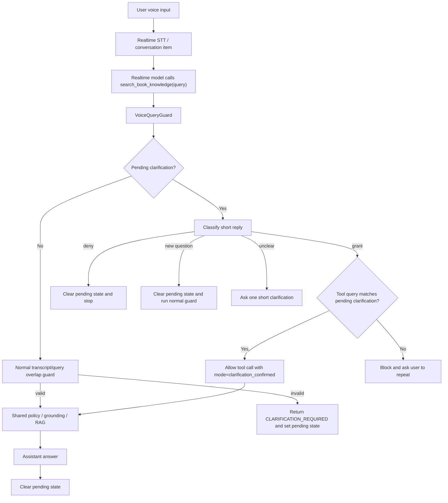

# Phase 10.10 Implementation Guide - Voice Clarification State And Query Guard Latency Optimization

Date: 2026-06-06  
Status: Implemented and offline-tested  
Depends on: Phase 10.4, Phase 10.5, Phase 10.7, Phase 10.8, Phase 10.9  
Primary scope: realtime voice clarification loop, query guard latency, safe confirmation handling, trace observability

---

## 0. Implementation Result - 2026-06-06

Phase 10.10 đã được implement theo hướng deterministic-first:

- thêm pending clarification state trong `VoiceTurnState`;
- tách voice reply intent classifier dùng chung cho web permission và clarification confirmation;
- cho phép các câu xác nhận ngắn như "đúng rồi", "yup làm đi", "ok" tiếp tục câu hỏi đang pending nếu tool query vẫn khớp với clarification trước đó;
- vẫn chặn các trường hợp reply phủ định, reply mơ hồ, hoặc model sinh tool query lệch với clarification đang pending;
- ghi thêm trace cho query guard gồm `reason_code`, `guard_mode`, overlap và important overlap;
- giữ assistant-text heuristic ở trạng thái tắt mặc định để tránh nhận diện nhầm câu trả lời của agent là câu hỏi làm rõ;
- không thay đổi contract LiveKit DataChannel và không yêu cầu Flutter update UI/API.

Verification đã chạy:

```powershell
uv run ruff check app/services/voice_agent app/services/agent_observability app/services/rag_service.py app/services/agent_voice_gpt_realtime.py tests/services/voice_agent tests/services/agent_observability
uv run pytest tests/services/voice_agent tests/services/agent_observability tests/services/agent_policy -q
uv run pytest tests -q --maxfail=1 --durations=20
```

Kết quả:

```text
Ruff: All checks passed
Focused tests: 116 passed
Full default tests: 272 passed
```

Chưa chạy trong lượt này:

- `uv run python -m app.services.agent_voice_gpt_realtime console`
- LiveKit production/manual voice room test

Manual voice test vẫn cần chạy trước deploy để xác nhận latency thực tế với realtime SDK, microphone và network.

---

## 1. Mục Tiêu

Phase 10.10 xử lý lỗi latency nặng trong voice agent khi user trả lời ngắn cho một câu hỏi làm rõ.

Ví dụ luồng lỗi:

```text
User: Chương 5 xảy ra chuyện gì?
Agent: Bạn muốn tóm tắt chương 5 đúng không?
User: Đúng rồi.
Realtime model gọi tool: search_book_knowledge(query="tóm tắt chương 5")
VoiceQueryGuard so query với transcript mới nhất "đúng rồi"
-> overlap = 0
-> block tool
-> model bị kẹt trong vòng clarification/tool retry
-> latency có thể lên 55-66 giây
```

Kết quả cần đạt:

- user trả lời xác nhận ngắn sau một clarification hợp lệ thì agent không bị treo;
- vẫn giữ `VoiceQueryGuard` để chặn tool query lệch transcript;
- không cho phép bypass chỉ vì câu user ngắn;
- có trace latency đủ chi tiết để biết chậm ở query guard, tool, grounding hay realtime turn;
- không thay đổi Flutter DataChannel contract;
- không hard-code theo một sách, một chương, một file audio hay một câu test.

---

## 2. Kết Luận Verify Hiện Tại

### 2.1 Vấn đề là thật

Code hiện tại trong `app/services/agent_voice_gpt_realtime.py` đang xử lý voice tool call theo luồng:

```text
search_book_knowledge()
-> resolve_book_query()
-> guard_voice_book_query(query, recent_transcript)
-> nếu invalid thì trả CLARIFICATION_REQUIRED
```

`VoiceQueryGuard` trong `app/services/voice_agent/query_guard.py` so sánh:

```text
tool query do realtime model sinh ra
vs
recent transcript của lượt user hiện tại
```

Với lượt reply ngắn như:

```text
đúng rồi
yup
ok
phải
```

tool query hợp lệ của model có thể là:

```text
tóm tắt chương 5
```

Hai chuỗi này không có token overlap, nên guard block dù ý hội thoại đúng.

### 2.2 Đây không chỉ là vấn đề console

`console` có thể làm latency tệ hơn vì audio I/O và debug loop khác production, nhưng core path giống production:

```text
Realtime model
-> function tool
-> backend query guard
-> tool output
-> model answer
```

Nếu guard trả `CLARIFICATION_REQUIRED` trong lúc model đang cố tiếp tục câu đã được xác nhận, production cũng có rủi ro kẹt hoặc trả lời rất chậm.

### 2.3 Không nên tắt guard

`VOICE_AGENT_QUERY_GUARD_ENABLED=false` làm voice nhanh hơn nhưng mở lại lỗi nghiêm trọng:

```text
user nói một câu
model tự gọi tool bằng câu khác
backend vẫn chạy RAG
agent trả lời sai câu hỏi
```

Vì Triam là app học tập, trả lời đúng nguồn quan trọng hơn giảm latency bằng cách bỏ guard.

---

## 3. Không Làm Trong Phase Này

Không làm:

- không đổi RAG/hybrid retrieval;
- không đổi model realtime;
- không đổi prompt lớn nếu chưa cần;
- không đổi `lk.chat`, `lk.transcript`, `lk.control`;
- không thêm FE API mới;
- không dùng LLM classifier cho mọi lượt thoại;
- không bật preemptive TTS trong phase này.

Lý do:

- lỗi hiện tại nằm ở voice clarification state và query guard;
- nếu trộn thêm RAG/model/TTS sẽ khó đo được cải thiện đến từ đâu;
- preemptive TTS có thể giảm cảm giác chờ nhưng tăng compute/token/audio bị bỏ phí khi tool hoặc transcript thay đổi.

---

## 4. Thiết Kế Đề Xuất

### 4.1 Nguyên tắc

Không bypass theo rule đơn giản:

```text
waiting_for_clarification == true AND transcript word_count <= 3
```

Rule đó quá rộng.

Thay vào đó dùng:

```text
Pending clarification state
+ short reply intent classifier
+ query-to-clarification overlap check
+ TTL
```

Chỉ cho bypass khi cả ba điều kiện đúng:

1. hệ thống thật sự đang chờ user trả lời clarification;
2. user reply là xác nhận rõ ràng;
3. tool query hiện tại khớp với câu clarification/candidate query đang chờ.

### 4.2 Mermaid Flow



---

## 5. Data Model Trong Runtime State

File:

```text
app/services/voice_agent/turn_state.py
```

Thêm dataclass runtime, không lưu DB:

```python
@dataclass(frozen=True)
class PendingVoiceClarification:
    prompt_text: str
    candidate_query: str | None
    reason_code: str
    created_monotonic: float
    source: str = "query_guard"
```

Thêm vào `VoiceTurnState`:

```python
self._pending_clarification: PendingVoiceClarification | None = None
```

Thêm methods:

```python
def set_pending_clarification(
    self,
    *,
    prompt_text: str,
    reason_code: str,
    candidate_query: str | None = None,
    source: str = "query_guard",
) -> None:
    ...

def recent_pending_clarification(self, ttl_seconds: float) -> PendingVoiceClarification | None:
    ...

def clear_pending_clarification(self) -> None:
    ...
```

### Vì sao runtime state là đủ?

Clarification state chỉ dùng trong một realtime room/session ngắn. Nó không phải lịch sử hội thoại chính thức, không cần lưu DB.

Nếu user reconnect, pending clarification mất là chấp nhận được. Agent có thể hỏi lại thay vì dùng state cũ dễ sai.

---

## 6. Reply Intent Cho Clarification

Không duplicate logic với `web_permission_intent_classifier`.

Hiện tại `app/services/voice_agent/web_permission_intent_classifier.py` đã có nhiều phần generic:

- normalize tiếng Việt/tiếng Anh;
- detect positive short replies;
- detect negative replies;
- detect ambiguous replies;
- detect new question.

Nếu tạo riêng một classifier mới mà copy lại phrase lists thì code sẽ khó bảo trì. Khi thêm một cách nói mới như `yup`, `đúng đó`, `nope`, ta phải sửa nhiều nơi.

Khuyến nghị tốt hơn:

```text
app/services/voice_agent/voice_intent_classifier.py
```

File này chứa phần generic cho voice reply intent:

```python
@dataclass(frozen=True)
class VoiceReplyIntentResult:
    intent: Literal["grant", "deny", "unclear", "new_question"]
    confidence: float
    reason: str
    source: Literal["fast_path", "llm"]
```

Generic fast path:

```python
def normalize_voice_intent_text(text: str) -> str:
    ...

def classify_voice_reply_intent_fast_path(text: str) -> VoiceReplyIntentResult | None:
    ...
```

Sau đó giữ backward-compatible wrapper trong `web_permission_intent_classifier.py`:

```python
def classify_web_permission_intent_fast_path(user_reply: str) -> WebPermissionIntentResult | None:
    result = classify_voice_reply_intent_fast_path(user_reply)
    if result is None:
        return None
    return WebPermissionIntentResult(result.intent, result.confidence, result.reason, result.source)
```

Clarification guard dùng trực tiếp:

```python
reply = classify_voice_reply_intent_fast_path(transcript.text)
```

### Fast Path Examples

Grant:

```text
đúng rồi
đúng
phải
ừ
ừm
ok
oke
okay
yep
yup
yub
yes
chính xác
làm đi
tiếp đi
```

Deny:

```text
không
không phải
khỏi
thôi
bỏ qua
no
nope
nah
cancel
```

New question:

```text
chương 6 thì sao
ai là tác giả
tóm tắt chương 4
bitcoin hiện tại sao rồi
```

Unclear:

```text
gì cũng được
tùy
không biết
hả
```

### Không hard-code theo một case

Danh sách phrase chỉ là fast path cho reply ngắn phổ biến. Logic vẫn phải:

- normalize dấu tiếng Việt;
- detect câu hỏi mới bằng question markers;
- giới hạn token count cho reply xác nhận;
- fallback sang classifier nếu không rõ.

### LLM fallback

Không bật LLM fallback mặc định trong Phase 10.10.

Lý do:

- mục tiêu chính là giảm latency;
- phần lớn reply xác nhận/phủ định là ngắn và deterministic;
- LLM fallback vừa tốn token vừa có thể làm turn chậm lại.

Nếu sau test thật có nhiều reply tự nhiên bị `unclear`, có thể bật sau bằng:

```env
VOICE_AGENT_CLARIFICATION_LLM_FALLBACK_ENABLED=true
```

---

## 7. Query Guard Nâng Cấp

File:

```text
app/services/voice_agent/query_guard.py
```

Thêm input optional:

```python
def guard_voice_book_query(
    query: str,
    transcript: VoiceTranscriptSnapshot | None,
    *,
    config: VoiceQueryGuardConfig | None = None,
    pending_clarification: PendingVoiceClarification | None = None,
    reply_intent: VoiceReplyIntentResult | None = None,
) -> VoiceQueryGuardResult:
    ...
```

Thêm fields vào `VoiceQueryGuardResult`:

```python
guard_mode: str = "normal"
pending_reason_code: str | None = None
```

Reason codes mới:

```text
valid_clarification_confirmation
clarification_denied
clarification_reply_unclear
clarification_query_mismatch
clarification_expired
```

### Logic Bypass An Toàn

Pseudo-code:

```python
if pending_clarification is not None and transcript is not None:
    reply = classify_short_reply_intent_fast_path(transcript.text)

    if reply.intent == "grant":
        if _query_matches_pending_clarification(query, pending_clarification):
            return VoiceQueryGuardResult(
                valid=True,
                reason_code="valid_clarification_confirmation",
                guard_mode="clarification_confirmed",
                ...
            )
        return _invalid("clarification_query_mismatch", ...)

    if reply.intent == "deny":
        return _invalid("clarification_denied", "Được, bạn muốn hỏi nội dung nào khác?", ...)

    if reply.intent == "new_question":
        # Caller clears pending and reruns normal guard once.
        return VoiceQueryGuardResult(
            valid=False,
            reason_code="clarification_new_question",
            clarification=None,
            guard_mode="clarification_new_question",
            ...
        )

    if reply.intent == "unclear":
        return _invalid("clarification_reply_unclear", "Bạn xác nhận hay muốn hỏi câu khác?", ...)
```

### Query Matching Với Pending Clarification

Không chỉ check transcript ngắn.

Phải check query hiện tại có khớp với pending prompt/candidate:

```text
query: "tóm tắt chương 5"
pending prompt: "Bạn muốn tóm tắt chương 5 đúng không?"
-> allow

query: "tóm tắt chương 6"
pending prompt: "Bạn muốn tóm tắt chương 5 đúng không?"
-> block
```

Hàm gợi ý nên reuse `_content_tokens(text)` hiện có trong `query_guard.py`, không tạo tokenizer mới.

Lý do:

- `_content_tokens` đã dùng chung stopword và normalizer của guard hiện tại;
- tránh hai logic token overlap khác nhau trong cùng một module;
- dễ test hơn vì query/transcript/pending matching dùng cùng một định nghĩa token.

```python
def _query_matches_pending_clarification(
    query: str,
    pending: PendingVoiceClarification,
    *,
    min_ratio: float,
) -> bool:
    query_tokens = _content_tokens(query)
    if not query_tokens:
        return False

    candidates = [pending.prompt_text]
    if pending.candidate_query:
        candidates.append(pending.candidate_query)

    for candidate in candidates:
        candidate_tokens = _content_tokens(candidate)
        if not candidate_tokens:
            continue
        overlap_ratio = len(query_tokens & candidate_tokens) / max(1, len(query_tokens))
        if overlap_ratio >= min_ratio:
            return True

    return False
```

Nên ưu tiên token quan trọng:

- số chương;
- tên chương;
- từ khóa như `tóm tắt`, `đại ý`, `nội dung`, `giải thích`;
- tiếng Anh tương ứng: `summary`, `chapter`, `explain`, `content`.

---

## 8. Realtime Assistant Changes

File:

```text
app/services/agent_voice_gpt_realtime.py
```

### 8.1 Trong `resolve_book_query`

Hiện tại:

```python
guard_result = guard_voice_book_query(query, transcript, config=...)
```

Sau phase này:

```python
started = time.perf_counter()
pending = self.voice_turn_state.recent_pending_clarification(
    settings.VOICE_AGENT_CLARIFICATION_STATE_TTL_SECONDS
)

guard_result = guard_voice_book_query(
    query,
    transcript,
    config=self._voice_query_guard_config(),
    pending_clarification=pending,
)

self.tracer.record_latency(
    input_mode,
    "query_guard",
    int((time.perf_counter() - started) * 1000),
)
```

Nếu `guard_result.reason_code == "valid_clarification_confirmation"`:

```python
self.voice_turn_state.clear_pending_clarification()
```

Nếu `guard_result.reason_code == "clarification_denied"`:

```python
self.voice_turn_state.clear_pending_clarification()
return "CLARIFICATION_REQUIRED:\nĐược, bạn muốn hỏi nội dung nào khác?"
```

Nếu `guard_result.reason_code == "clarification_new_question"`:

```python
self.voice_turn_state.clear_pending_clarification()
# rerun normal guard once without pending state
```

Nếu guard invalid vì cần clarification:

```python
self.voice_turn_state.set_pending_clarification(
    prompt_text=guard_result.clarification or "Bạn vui lòng nói rõ câu hỏi.",
    candidate_query=query if guard_result.reason_code in CANDIDATE_SAFE_REASONS else None,
    reason_code=guard_result.reason_code,
)
return f"CLARIFICATION_REQUIRED:\n{...}"
```

Candidate safe reasons cần rất cẩn thận.

Khuyến nghị ban đầu:

```text
missing_section_reference -> candidate_query allowed but incomplete
too_short_or_ack_only -> no candidate_query
tool_query_transcript_mismatch -> candidate_query only if pending assistant confirmation exists and query matches it
tool_query_important_token_mismatch -> same as above
```

### 8.2 Không dùng assistant text heuristic làm mặc định

Không nên mặc định phân tích text assistant bằng `_looks_like_assistant_clarification(text)`.

Lý do:

- heuristic trên câu tự nhiên dễ nhận nhầm câu hỏi tu từ hoặc nội dung sách thành clarification;
- state chính xác nhất là state do backend tạo khi `resolve_book_query()` trả `CLARIFICATION_REQUIRED`;
- query guard là nơi biết rõ `reason_code`, `candidate_query`, `overlap`, `transcript_source`.

Do đó Phase 10.10 nên đặt pending clarification **trực tiếp trong `resolve_book_query()`** khi backend thật sự trả marker:

```python
if not guard_result.valid:
    marker = f"CLARIFICATION_REQUIRED:\n{guard_result.clarification or 'Bạn vui lòng nói rõ câu hỏi.'}"
    self.voice_turn_state.set_pending_clarification(
        prompt_text=guard_result.clarification or "Bạn vui lòng nói rõ câu hỏi.",
        candidate_query=_safe_candidate_query_for_pending(query, guard_result),
        reason_code=guard_result.reason_code,
        source="query_guard",
    )
    return marker
```

Với clarification phát sinh từ shared policy hoặc grounding router, cũng đặt state tại chính nhánh tạo marker, không đợi event assistant text:

```python
if tool_result.startswith("CLARIFICATION_REQUIRED:"):
    voice_turn_state.set_pending_clarification(...)
```

Khi assistant trả lời bình thường:

```python
voice_turn_state.clear_pending_clarification()
```

### 8.3 Optional Assistant Heuristic Safety Net

Nếu sau test thật thấy realtime model tự hỏi clarification mà không đi qua tool marker, có thể bổ sung heuristic sau, nhưng phải để sau flag riêng và mặc định tắt:

```env
VOICE_AGENT_ASSISTANT_CLARIFICATION_HEURISTIC_ENABLED=false
```

Chỉ bật nếu có log chứng minh model thường xuyên tự hỏi confirmation ngoài tool path.

Nếu bật, heuristic vẫn phải rất chặt:

- assistant text ngắn;
- có dấu hỏi hoặc marker xác nhận;
- có cụm như `bạn muốn`, `ý bạn là`, `đúng không`, `phải không`, `do you mean`, `which chapter`;
- lượt sau vẫn phải reply intent là `grant`;
- tool query vẫn phải match pending prompt.

---

## 9. Trace Và Logging

Files:

```text
app/services/agent_observability/contracts.py
app/services/agent_observability/turn_trace.py
app/services/agent_observability/model_eval_report.py
```

Thêm trace fields nếu cần:

```python
query_guard_reason_code: str | None = None
query_guard_mode: str | None = None
query_guard_overlap_ratio: float | None = None
query_guard_important_overlap_ratio: float | None = None
```

Stage latency:

```text
query_guard
tool_total
grounding_total
retrieval
turn_total
```

Không log:

- full transcript;
- full query nếu production;
- full answer;
- source chunk text;
- token/header/secret.

Log an toàn:

```text
Voice query guard decision |
mode=clarification_confirmed |
reason=valid_clarification_confirmation |
query_chars=18 |
transcript_source=committed_user_item |
query_guard_ms=2
```

---

## 10. Config Mới

File:

```text
app/core/config.py
.env.example
```

Đề xuất:

```python
VOICE_AGENT_CLARIFICATION_STATE_ENABLED: bool = True
VOICE_AGENT_CLARIFICATION_STATE_TTL_SECONDS: float = 30.0
VOICE_AGENT_CLARIFICATION_CONFIRMATION_MAX_TOKENS: int = 4
VOICE_AGENT_CLARIFICATION_MIN_QUERY_PROMPT_OVERLAP: float = 0.45
VOICE_AGENT_CLARIFICATION_LLM_FALLBACK_ENABLED: bool = False
VOICE_AGENT_CLARIFICATION_CLASSIFIER_TIMEOUT_SECONDS: float = 1.2
VOICE_AGENT_ASSISTANT_CLARIFICATION_HEURISTIC_ENABLED: bool = False
```

Default nên an toàn:

```text
STATE_ENABLED=true
LLM_FALLBACK_ENABLED=false
```

Lý do:

- fast path đủ cho phần lớn reply xác nhận/phủ định;
- không thêm latency/cost mặc định;
- nếu sau này gặp reply phức tạp có thể bật LLM fallback.

---

## 11. Test Plan

### 11.1 Unit Tests - `VoiceTurnState`

File:

```text
tests/services/voice_agent/test_turn_state.py
```

Cases:

```text
set/recent pending clarification works
pending clarification expires by TTL
clear pending clarification works
record normal assistant answer clears pending
```

### 11.2 Unit Tests - Shared Voice Intent

File mới:

```text
tests/services/voice_agent/test_voice_intent_classifier.py
```

Cases:

```text
"đúng rồi" -> grant
"yup làm đi" -> grant
"không phải" -> deny
"thôi bỏ qua" -> deny
"chương 6 thì sao" -> new_question
"ai là tác giả" -> new_question
"tùy" -> unclear
```

Regression compatibility:

```text
classify_web_permission_intent_fast_path("yup làm đi") still returns grant
classify_web_permission_intent_fast_path("không") still returns deny
```

### 11.3 Unit Tests - Query Guard

File:

```text
tests/services/voice_agent/test_query_guard.py
```

Must-have cases:

```text
pending confirmation + "đúng rồi" + query matches pending prompt -> valid_clarification_confirmation
pending confirmation + "yup làm đi" + query matches pending prompt -> valid_clarification_confirmation
pending confirmation + "không" -> clarification_denied
pending confirmation + "chương 6 thì sao" -> clarification_new_question
pending confirmation + grant but query does not match pending prompt -> clarification_query_mismatch
no pending + "đúng rồi" remains too_short_or_ack_only or permission_reply according to current policy
mismatched tool query still blocked without pending clarification
```

### 11.4 Unit Tests - `TriamAssistant.resolve_book_query`

File:

```text
tests/services/voice_agent/test_agent_voice_query_guard.py
```

Cases:

```text
pending assistant confirmation + user says "đúng rồi"
-> RAG/shared policy is called once
-> pending state is cleared

pending assistant confirmation + user says "không"
-> RAG is not called
-> pending state is cleared

pending assistant confirmation + user asks a new question
-> pending state is cleared
-> normal guard path is used

guard latency is recorded as query_guard
```

Additional deterministic-state cases:

```text
resolve_book_query returns CLARIFICATION_REQUIRED
-> pending state is set immediately in resolve_book_query

normal assistant answer
-> pending state is cleared

assistant text heuristic flag false
-> conversation_item_added assistant text does not create pending state by itself
```

### 11.5 Manual Console Test

Run:

```powershell
uv run python -m app.services.agent_voice_gpt_realtime console
```

Manual scenario:

```text
User: Chương 5 xảy ra chuyện gì?
Agent: Bạn muốn tóm tắt chương 5 đúng không?
User: Đúng rồi.
Expected:
- no 55-66s stall;
- tool runs once;
- answer source is book section or book RAG;
- no repeated clarification loop.
```

Also test:

```text
User: Chương 5 xảy ra chuyện gì?
Agent asks confirmation.
User: Không phải.
Expected:
- no RAG call;
- agent asks what user wants instead.
```

```text
User: Chương 5 xảy ra chuyện gì?
Agent asks confirmation.
User: Chương 6 thì sao?
Expected:
- pending state clears;
- normal guard handles new question.
```

### 11.6 Manual Integration Eval

After offline tests pass, run voice eval:

```powershell
uv run python scripts/manual_integration/phase10_agent_eval.py `
  --base-url http://127.0.0.1:8000/api/v1 `
  --access-token "<token>" `
  --mode voice `
  --profile baseline `
  --isolate-voice-cases `
  --voice-isolation-strategy case_thread_new_room `
  --case-thread-map tests/fixtures/agent_eval/voice_case_threads.local.json `
  --report-prefix phase10_10_eval
```

Expected:

- no regression in Phase 10.9 cases;
- no `VOICE_TOOL_BYPASS`;
- no web search without permission;
- new clarification-confirmation case passes;
- voice latency p95 improves for clarification flow.

---

## 12. Acceptance Criteria

Offline:

```text
uv run pytest tests/services/voice_agent tests/services/agent_observability -q
uv run ruff check app/services/voice_agent app/services/agent_observability app/services/agent_voice_gpt_realtime.py
```

Expected:

```text
All focused tests pass.
No new ruff errors.
```

Behavior:

```text
Short confirmation after valid clarification does not stall.
Negative reply does not run RAG.
New question after clarification does not reuse stale query.
Mismatched voice tool query is still blocked.
No FE contract changes.
```

Observability:

```text
Trace includes query_guard latency.
Logs include reason codes but no raw sensitive text by default.
Manual report can show whether latency is guard/tool/realtime.
```

---

## 13. Trade-off

### Trade-off 1: Thêm state runtime

Ưu điểm:

- xử lý đúng hội thoại nhiều lượt;
- giảm vòng lặp clarification/tool retry;
- không cần FE thay đổi.

Nhược điểm:

- code voice state phức tạp hơn;
- cần clear state rất kỹ để tránh stale query.

Giảm rủi ro bằng:

- TTL ngắn;
- clear khi assistant trả lời bình thường;
- clear khi deny/new question;
- test state expiration.

### Trade-off 2: Fast path phrase vẫn có rule

Ưu điểm:

- nhanh;
- deterministic;
- không tốn token.

Nhược điểm:

- không bắt hết mọi cách nói tự nhiên.

Giảm rủi ro bằng:

- chỉ dùng fast path cho reply ngắn;
- không hard-code theo sách/câu hỏi;
- cho phép bật LLM fallback sau nếu cần.

### Trade-off 3: Không mặc định bắt assistant clarification bằng heuristic

Ưu điểm:

- state machine deterministic hơn;
- giảm nguy cơ nhận nhầm câu hỏi tu từ hoặc nội dung sách;
- dễ debug vì state chỉ sinh ra từ tool marker/backend decision.

Nhược điểm:

- nếu realtime model tự hỏi confirmation ngoài tool path, pending state sẽ không được set.

Giảm rủi ro bằng:

- prompt đã yêu cầu book-content questions phải đi qua tool;
- nếu gặp log thực tế chứng minh model tự hỏi ngoài tool, bật optional heuristic bằng feature flag;
- không bật heuristic trước khi có evidence.

### Trade-off 4: Latency thấp hơn nhưng vẫn không phải tức thì

Phase này loại vòng kẹt 55-66 giây. Nó không đảm bảo mọi câu voice còn dưới 2 giây, vì Realtime model, tool calling, grounding, TTS/audio scheduling vẫn có latency tự nhiên.

Muốn tối ưu sâu hơn sau phase này cần phase riêng:

- realtime model tuning;
- turn detection/preemptive generation;
- retrieval cache;
- response length control;
- provider latency benchmark.

---

## 14. Rollback Plan

Nếu production có hành vi lạ:

```env
VOICE_AGENT_CLARIFICATION_STATE_ENABLED=false
```

Khi tắt flag:

```text
VoiceQueryGuard quay về behavior Phase 10.9.
Không ảnh hưởng chat text.
Không ảnh hưởng FE.
```

Nếu chỉ classifier fallback gây chậm:

```env
VOICE_AGENT_CLARIFICATION_LLM_FALLBACK_ENABLED=false
```

---

## 15. Recommended Implementation Order

1. Add `PendingVoiceClarification` and state methods in `turn_state.py`.
2. Extract shared voice reply intent logic into `voice_intent_classifier.py` and keep web permission wrapper compatible.
3. Extend query guard contract and tests.
4. Integrate pending state in `TriamAssistant.resolve_book_query`.
5. Set pending state only from deterministic backend/tool marker paths.
6. Add optional assistant clarification heuristic flag, default false, only if implementation needs a safety net.
7. Add query guard trace fields and latency recording.
8. Add `.env.example` config.
9. Run focused tests.
10. Run console test with clarification flow.
11. Run manual integration voice eval.

---

## 16. References

- OpenAI Realtime conversations: function calling requires the app to run custom code and return function output before the model responds. This explains why repeated tool block/retry can create large latency.  
  https://platform.openai.com/docs/guides/realtime-conversations

- OpenAI Realtime overview: voice-agent sessions are meant for low-latency speech-to-speech agents that can call tools and manage conversation state.  
  https://platform.openai.com/docs/guides/realtime

- LiveKit turn-taking tuning: turn detection, endpointing, interruption, and preemptive generation affect naturalness and latency.  
  https://docs.livekit.io/agents/logic/turns/tuning/

- LiveKit preemptive generation: can reduce perceived latency, but can waste compute if the response is discarded after transcript/tool changes.  
  https://docs.livekit.io/agents/multimodality/audio/
