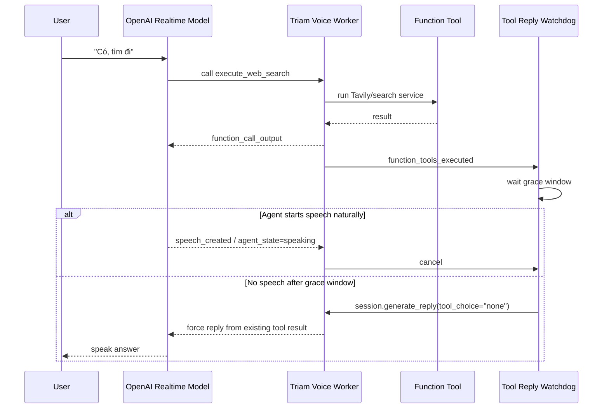

# Phase 10.11 Implementation Guide - Voice Tool Reply Watchdog

Date: 2026-06-07  
Status: Approved with Enhancements (Hủy watchdog khi user transcribes, kiểm tra session.room.isconnected, dọn dẹp task triệt để)  
Depends on: Phase 10.4 -> 10.10  
Primary scope: realtime voice tool-result latency, post-tool reply orchestration, watchdog trace observability

---

## 1. Mục Tiêu

Phase 10.11 xử lý lỗi voice agent bị im lặng hoặc phản hồi rất chậm sau khi function tool đã chạy xong.

Case thực tế từ `log_real_test-0606_feedback.md`:

```text
User hỏi giá Bitcoin
Agent xin quyền tìm web
User nói "tìm"
Model gọi execute_web_search(query="giá Bitcoin hôm nay")
Tool web_search chạy xong trong 1518ms
Nhưng turn_total lên 33421ms
User phải hỏi lại thì agent mới phản hồi rõ hơn
```

Kết luận chính:

```text
Vấn đề không phải Tavily chậm.
Vấn đề là tool result đã có nhưng realtime session không đảm bảo tạo speech ngay sau đó.
```

Kết quả cần đạt:

- giữ nguyên luồng tool tự nhiên của realtime model;
- không hard-code backend tự nhận diện "tìm/ok/yup" để tự chạy Tavily ngoài tool lifecycle;
- sau khi monitored tool hoàn thành, nếu agent chưa bắt đầu nói trong một grace window ngắn thì backend gọi `session.generate_reply(...)` để đánh thức agent;
- không tạo duplicate speech nếu model thực ra đã bắt đầu nói;
- không gọi lại tool vòng lặp trong forced reply;
- có trace đủ để biết latency nằm ở tool, tool-result-to-speech, speech generation hay user interruption.

---

## 2. Vì Sao Không Chọn Backend-Orchestrated Web Search

Giải pháp cũ từng được cân nhắc:

```text
Backend tự bắt câu user đồng ý
-> tự gọi Tavily
-> tự ép realtime model nói
```

Không nên chọn làm hướng chính vì:

- hard-code hành vi hội thoại theo từng loại tool;
- khi thêm tool mới như calculator, external API, quiz generator, lại phải viết flow riêng;
- làm giảm vai trò tự nhiên của realtime model trong tool calling;
- dễ phát sinh lỗi khi user vừa đồng ý vừa đổi ý định trong cùng câu;
- dễ làm lệch giữa text chat policy và voice policy.

Hướng Phase 10.11 tốt hơn:

```text
Vẫn để realtime model tự gọi tool
Backend chỉ thêm watchdog sau sự kiện tool hoàn thành
Nếu model không nói sau grace window thì gọi generate_reply
```

Đây là orchestration, không phải rule-based conversation.

---

## 3. Nguồn Verify Kỹ Thuật

### 3.1 LiveKit local SDK hiện tại

Đã verify bằng introspection trên môi trường local:

```text
livekit-agents: 1.5.17

FunctionToolsExecutedEvent annotations:
- function_calls: list[FunctionCall]
- function_call_outputs: list[FunctionCallOutput | None]
- created_at: float

FunctionCall:
- id
- call_id
- name
- arguments
- created_at

FunctionCallOutput:
- call_id
- name
- output
- is_error
- created_at

AgentSession events:
- user_state_changed
- agent_state_changed
- user_input_transcribed
- conversation_item_added
- function_tools_executed
- speech_created
- agent_false_interruption
- overlapping_speech
- metrics_collected
- error
- close

AgentSession.generate_reply signature:
generate_reply(
  *,
  user_input=...,
  instructions=...,
  tool_choice=...,
  tools=...,
  allow_interruptions=...,
  chat_ctx=...,
  input_modality="text",
) -> SpeechHandle
```

Quan trọng:

```text
Trong SDK hiện tại, generate_reply trả về SpeechHandle.
Không await trực tiếp self.session.generate_reply(...).
Nếu cần đợi playout thì await SpeechHandle.
```

### 3.2 Official LiveKit references

LiveKit docs xác nhận:

- `function_tools_executed` được emit sau khi function tools chạy xong cho một user input;
- `speech_created` được emit khi agent speech được tạo bởi user input, `session.say`, hoặc `session.generate_reply`;
- `agent_state_changed` có thể dùng để theo dõi agent chuyển sang speaking;
- `generate_reply` hỗ trợ `tool_choice`, trong đó có thể dùng `"none"` để tránh gọi tool ở lượt forced reply.

References:

- https://docs.livekit.io/agents/build/events/
- https://docs.livekit.io/agents/multimodality/audio/
- https://docs.livekit.io/reference/python/livekit/agents/

---

## 4. Kiến Trúc Đề Xuất

### 4.1 Tổng quan



### 4.2 Design principle

Watchdog chỉ làm một việc:

```text
Nếu tool đã xong mà agent vẫn chưa tạo speech sau grace window,
hãy yêu cầu session tạo reply một lần.
```

Watchdog không được:

- tự parse câu hỏi user để chạy tool;
- tự gọi Tavily/RAG;
- tự đọc raw tool output cho user;
- tự tạo nội dung answer;
- bypass web permission policy;
- thay đổi DataChannel contract với Flutter.

---

## 5. Config Mới

Thêm vào `app/core/config.py`:

```python
VOICE_AGENT_TOOL_REPLY_WATCHDOG_ENABLED: bool = True
VOICE_AGENT_TOOL_REPLY_WATCHDOG_GRACE_SECONDS: float = 1.0
VOICE_AGENT_TOOL_REPLY_WATCHDOG_TOOLS: str = (
    "search_book_knowledge,ask_web_search_permission,execute_web_search"
)
VOICE_AGENT_TOOL_REPLY_WATCHDOG_ALLOW_ERROR_OUTPUTS: bool = False
VOICE_AGENT_TOOL_REPLY_WATCHDOG_FORCE_TOOL_CHOICE_NONE: bool = True
```

Thêm vào `.env.example`:

```env
VOICE_AGENT_TOOL_REPLY_WATCHDOG_ENABLED=true
VOICE_AGENT_TOOL_REPLY_WATCHDOG_GRACE_SECONDS=1.0
VOICE_AGENT_TOOL_REPLY_WATCHDOG_TOOLS=search_book_knowledge,ask_web_search_permission,execute_web_search
VOICE_AGENT_TOOL_REPLY_WATCHDOG_ALLOW_ERROR_OUTPUTS=false
VOICE_AGENT_TOOL_REPLY_WATCHDOG_FORCE_TOOL_CHOICE_NONE=true
```

Giải thích:

- `ENABLED`: rollback nhanh nếu production có duplicate speech.
- `GRACE_SECONDS`: chờ model tự tạo speech trước khi force. Bắt đầu với `1.0`.
- `TOOLS`: danh sách tool cần đảm bảo user-facing reply.
- `ALLOW_ERROR_OUTPUTS`: mặc định `false` để không ép đọc raw exception.
- `FORCE_TOOL_CHOICE_NONE`: mặc định `true` để tránh vòng lặp gọi lại tool.

Trade-off:

```text
Grace quá ngắn: dễ duplicate.
Grace quá dài: user vẫn thấy chậm.
Khuyến nghị bắt đầu 1.0s, sau đó tune bằng trace.
```

---

## 6. File Và Code Cần Implement

### 6.1 Tạo service mới

File mới:

```text
app/services/voice_agent/tool_reply_watchdog.py
```

Mục tiêu:

- đóng gói toàn bộ logic watchdog;
- không làm `agent_voice_gpt_realtime.py` phình thêm;
- test offline bằng fake session/tracer;
- không phụ thuộc vào raw LiveKit network.

Skeleton đề xuất:

```python
from __future__ import annotations

import asyncio
import time
from dataclasses import dataclass
from typing import Any

from app.core.logger import log
from app.services.agent_observability import AgentInputMode, AgentTurnTracer


@dataclass(frozen=True)
class VoiceToolReplyWatchdogConfig:
    enabled: bool
    grace_seconds: float
    monitored_tools: set[str]
    allow_error_outputs: bool = False
    force_tool_choice_none: bool = True


class VoiceToolReplyWatchdog:
    def __init__(
        self,
        *,
        session: Any,
        tracer: AgentTurnTracer,
        config: VoiceToolReplyWatchdogConfig,
    ) -> None:
        self.session = session
        self.tracer = tracer
        self.config = config
        self._watch_tasks: dict[str, asyncio.Task[None]] = {}
        self._speech_generation_counter = 0
        self._last_tool_completed_monotonic: float | None = None

    def close(self) -> None:
        self.cancel_all("session_close")

    def cancel_all(self, reason: str) -> None:
        for task in self._watch_tasks.values():
            if not task.done():
                task.cancel()
        self._watch_tasks.clear()
        self.tracer.record_tool_reply_watchdog_cancelled(
            AgentInputMode.VOICE,
            reason=reason,
        )

    def record_speech_created(self, *, source: str | None = None) -> None:
        self._speech_generation_counter += 1
        self.cancel_all("speech_created")
        self.tracer.record_tool_reply_speech_created(
            AgentInputMode.VOICE,
            source=source,
        )

    def record_agent_state_changed(self, *, new_state: str) -> None:
        if new_state == "speaking":
            self._speech_generation_counter += 1
            self.cancel_all("agent_speaking")

    def record_user_state_changed(self, *, new_state: str) -> None:
        if new_state == "speaking":
            self.cancel_all("user_started_speaking")

    def record_user_transcribed(self) -> None:
        self.cancel_all("user_input_transcribed")

    def schedule_after_tools_executed(self, ev: Any) -> None:
        if not self.config.enabled:
            return
        for call, output in _zipped_tool_outputs(ev):
            tool_name = str(getattr(call, "name", ""))
            if not self._should_watch(tool_name, output):
                continue
            event_id = _tool_event_id(call)
            self._schedule_one(event_id, tool_name)

    def _should_watch(self, tool_name: str, output: Any) -> bool:
        if tool_name not in self.config.monitored_tools:
            return False
        if output is not None and getattr(output, "is_error", False):
            return self.config.allow_error_outputs
        return True

    def _schedule_one(self, event_id: str, tool_name: str) -> None:
        existing = self._watch_tasks.pop(event_id, None)
        if existing and not existing.done():
            existing.cancel()
        self._last_tool_completed_monotonic = time.monotonic()
        generation_marker = self._speech_generation_counter
        self.tracer.record_tool_reply_watchdog_scheduled(
            AgentInputMode.VOICE,
            tool_name=tool_name,
            grace_ms=int(self.config.grace_seconds * 1000),
        )
        self._watch_tasks[event_id] = asyncio.create_task(
            self._watch_and_force_reply(
                event_id=event_id,
                tool_name=tool_name,
                generation_marker=generation_marker,
            )
        )

    async def _watch_and_force_reply(
        self,
        *,
        event_id: str,
        tool_name: str,
        generation_marker: int,
    ) -> None:
        try:
            await asyncio.sleep(self.config.grace_seconds)
            if generation_marker != self._speech_generation_counter:
                self.tracer.record_tool_reply_watchdog_bypassed(
                    AgentInputMode.VOICE,
                    reason="speech_created_before_grace",
                    tool_name=tool_name,
                )
                return

            elapsed_ms = self._elapsed_since_tool_completed_ms()
            self.tracer.record_tool_reply_watchdog_fired(
                AgentInputMode.VOICE,
                tool_name=tool_name,
                elapsed_ms=elapsed_ms,
                reason="no_speech_after_tool",
            )
            self._speech_generation_counter += 1
            self._generate_reply_after_tool()
        except asyncio.CancelledError:
            raise
        except Exception as exc:
            self.tracer.record_error(AgentInputMode.VOICE, "tool_reply_watchdog_error")
            log.warning(
                "Voice tool reply watchdog failed | "
                f"tool={tool_name} | error_type={type(exc).__name__}"
            )
        finally:
            self._watch_tasks.pop(event_id, None)

    def _generate_reply_after_tool(self) -> None:
        if not hasattr(self.session, "room") or not self.session.room.isconnected():
            log.info("[Watchdog] Session room is disconnected. Aborting force reply.")
            return

        kwargs: dict[str, Any] = {
            "instructions": POST_TOOL_REPLY_INSTRUCTIONS,
            "allow_interruptions": True,
        }
        if self.config.force_tool_choice_none:
            kwargs["tool_choice"] = "none"
        self.session.generate_reply(**kwargs)

    def _elapsed_since_tool_completed_ms(self) -> int | None:
        if self._last_tool_completed_monotonic is None:
            return None
        return max(0, int((time.monotonic() - self._last_tool_completed_monotonic) * 1000))
```

Helper functions:

```python
def _zipped_tool_outputs(ev: Any) -> list[tuple[Any, Any]]:
    if hasattr(ev, "zipped"):
        return list(ev.zipped())
    calls = list(getattr(ev, "function_calls", []) or [])
    outputs = list(getattr(ev, "function_call_outputs", []) or [])
    return list(zip(calls, outputs or [None] * len(calls), strict=False))


def _tool_event_id(call: Any) -> str:
    return str(
        getattr(call, "call_id", None)
        or getattr(call, "id", None)
        or f"{getattr(call, 'name', 'unknown')}:{getattr(call, 'created_at', '')}"
    )
```

Instruction dùng cho forced reply:

```python
POST_TOOL_REPLY_INSTRUCTIONS = """
Answer the user now using the most recent tool result already present in the conversation.
Do not call any tools.
Do not ask for web permission again.
Do not say you are still searching.
Reply in Vietnamese, naturally and briefly, in 1-2 short sentences.
"""
```

Lưu ý:

```text
Không log raw tool output.
Không log raw query.
Chỉ log tool_name, elapsed_ms, reason_code.
```

### 6.2 Mở rộng tracer

Files:

```text
app/services/agent_observability/contracts.py
app/services/agent_observability/turn_trace.py
```

Thêm vào `AgentTurnTrace`:

```python
tool_reply_watchdog_scheduled: bool | None = None
tool_reply_watchdog_fired: bool | None = None
tool_reply_watchdog_tool_names: list[str] = field(default_factory=list)
tool_reply_watchdog_reason: str | None = None
tool_result_to_speech_ms: int | None = None
forced_reply_reason: str | None = None
```

Thêm methods vào `AgentTurnTracer`:

```python
def record_tool_reply_watchdog_scheduled(...): ...
def record_tool_reply_watchdog_fired(...): ...
def record_tool_reply_watchdog_bypassed(...): ...
def record_tool_reply_watchdog_cancelled(...): ...
def record_tool_reply_speech_created(...): ...
```

Output summary cần thêm các field trên.

Trace expected:

```json
{
  "tool_names": ["execute_web_search"],
  "stage_latency_ms": {
    "web_search": 1518,
    "tool_reply_watchdog_grace": 1000,
    "turn_total": 4500
  },
  "tool_reply_watchdog_scheduled": true,
  "tool_reply_watchdog_fired": true,
  "tool_reply_watchdog_reason": "no_speech_after_tool",
  "tool_result_to_speech_ms": 1023,
  "forced_reply_reason": "no_speech_after_tool"
}
```

### 6.3 Tích hợp vào realtime worker

File:

```text
app/services/agent_voice_gpt_realtime.py
```

#### Step 1 - import event classes

Hiện tại đã import `FunctionToolsExecutedEvent`. Cần import thêm:

```python
from livekit.agents import AgentStateChangedEvent, SpeechCreatedEvent, UserStateChangedEvent
```

#### Step 2 - tạo config factory

```python
def _tool_reply_watchdog_config() -> VoiceToolReplyWatchdogConfig:
    return VoiceToolReplyWatchdogConfig(
        enabled=settings.VOICE_AGENT_TOOL_REPLY_WATCHDOG_ENABLED,
        grace_seconds=settings.VOICE_AGENT_TOOL_REPLY_WATCHDOG_GRACE_SECONDS,
        monitored_tools={
            item.strip()
            for item in settings.VOICE_AGENT_TOOL_REPLY_WATCHDOG_TOOLS.split(",")
            if item.strip()
        },
        allow_error_outputs=settings.VOICE_AGENT_TOOL_REPLY_WATCHDOG_ALLOW_ERROR_OUTPUTS,
        force_tool_choice_none=settings.VOICE_AGENT_TOOL_REPLY_WATCHDOG_FORCE_TOOL_CHOICE_NONE,
    )
```

#### Step 3 - khởi tạo sau khi tạo `session`

Vì `VoiceToolReplyWatchdog` cần `session`, khởi tạo sau:

```python
session = AgentSession(...)
tool_reply_watchdog = VoiceToolReplyWatchdog(
    session=session,
    tracer=tracer,
    config=_tool_reply_watchdog_config(),
)
_attach_session_handlers(session, tool_reply_watchdog)
```

Nếu `_attach_session_handlers` hiện tại không nhận tham số thì refactor và tích hợp đầy đủ các event cho watchdog như sau:

```python
def _attach_session_handlers(sess: AgentSession, watchdog: VoiceToolReplyWatchdog) -> None:
    @sess.on("user_input_transcribed")  # type: ignore[arg-type]
    def on_user_input_transcribed(ev):
        # Cải tiến 1: Hủy watchdog ngay khi nhận được transcription mới từ user
        watchdog.record_user_transcribed()
        _handle_user_input_transcribed(ev)

    @sess.on("conversation_item_added")  # type: ignore[arg-type]
    def on_conversation_item_added(ev: ConversationItemAddedEvent):
        _handle_conversation_item_added(ev)

    @sess.on("function_tools_executed")  # type: ignore[arg-type]
    def on_function_tools_executed(ev: FunctionToolsExecutedEvent):
        _handle_function_tools_executed(ev, watchdog)

    @sess.on("speech_created")  # type: ignore[arg-type]
    def on_speech_created(ev: SpeechCreatedEvent):
        # Cải tiến: record_speech_created giúp hủy watchdog khi agent bắt đầu nói
        watchdog.record_speech_created(source=str(getattr(ev, "source", "")))

    @sess.on("agent_state_changed")  # type: ignore[arg-type]
    def on_agent_state_changed(ev: AgentStateChangedEvent):
        watchdog.record_agent_state_changed(new_state=str(getattr(ev, "new_state", "")))

    @sess.on("user_state_changed")  # type: ignore[arg-type]
    def on_user_state_changed(ev: UserStateChangedEvent):
        watchdog.record_user_state_changed(new_state=str(getattr(ev, "new_state", "")))

    @sess.on("close")  # type: ignore[arg-type]
    def on_close(_ev):
        # Cải tiến 3: Close watchdog để dọn dẹp toàn bộ asyncio tasks đang chạy
        watchdog.close()
```

#### Step 4 - refactor `_handle_function_tools_executed` để nhận thêm watchdog

```python
def _handle_function_tools_executed(
    ev: FunctionToolsExecutedEvent,
    watchdog: VoiceToolReplyWatchdog,
) -> None:
    if tracer.has_active_turn(AgentInputMode.VOICE):
        for function_call in ev.function_calls:
            tracer.record_tool(
                AgentInputMode.VOICE,
                str(getattr(function_call, "name", "unknown_tool")),
            )
    watchdog.schedule_after_tools_executed(ev)
```

Không nên `return` sớm khi không có active turn, vì có thể tool event đến trước trace active trong edge case. Nhưng tracer methods vẫn best-effort.

### 6.4 Không đụng Flutter contract

Không cần thêm API hoặc UI mới cho FE.

Các kênh:

```text
lk.chat
lk.transcript
lk.control
```

giữ nguyên.

---

## 7. Tool Nào Nên Được Monitor

Default:

```text
search_book_knowledge
ask_web_search_permission
execute_web_search
```

Lý do:

- `search_book_knowledge`: nếu RAG hoặc section router trả context nhưng realtime không nói, user bị im lặng.
- `ask_web_search_permission`: nếu xin phép tool trả câu hỏi nhưng model không đọc lên, user không biết cần xác nhận.
- `execute_web_search`: case bug thực tế, tool xong nhưng agent phản hồi rất muộn.

Không monitor mọi tool bằng default vì:

- một số tool tương lai có thể là background side effect;
- không phải tool nào cũng cần user-facing speech;
- forced reply sau tool background có thể gây nhiễu hội thoại.

---

## 8. Duplicate Speech Guardrails

Watchdog phải có đủ các lớp chống duplicate:

1. Grace window.
2. Cancel khi `speech_created`.
3. Cancel khi `agent_state_changed.new_state == "speaking"`.
4. Cancel khi `user_state_changed.new_state == "speaking"`.
5. Dedupe theo `call_id` hoặc `id` của function call.
6. `speech_generation_counter` để tránh race condition:

```text
Tool done -> schedule watchdog marker=5
Agent speech_created -> counter=6
Watchdog wake up -> marker != counter -> không force
```

7. Forced reply dùng `tool_choice="none"`.

---

## 9. Test Plan

### 9.1 Unit tests cho watchdog

Tạo file:

```text
tests/services/voice_agent/test_tool_reply_watchdog.py
```

Cases bắt buộc:

1. Monitored tool + no speech after grace:

```text
schedule execute_web_search
sleep grace
expect fake_session.generate_reply called once
expect tool_choice == "none"
```

2. Monitored tool + speech before grace:

```text
schedule execute_web_search
record_speech_created
sleep grace
expect generate_reply not called
```

3. User starts speaking before grace:

```text
schedule execute_web_search
record_user_state_changed("speaking")
sleep grace
expect generate_reply not called
```

4. Non-monitored tool:

```text
schedule non_user_facing_tool
sleep grace
expect generate_reply not called
```

5. Error output default:

```text
output.is_error = True
allow_error_outputs = False
expect no generate_reply
```

6. Duplicate tool event id:

```text
schedule same call_id twice
expect at most one generate_reply
```

7. `generate_reply` raises:

```text
watchdog catches/logs/traces error
test does not crash event loop
```

### 9.2 Unit tests cho tracer

Update:

```text
tests/services/agent_observability/test_turn_trace.py
```

Cases:

- scheduled fields appear in summary;
- fired fields appear in summary;
- cancelled/bypassed reason does not expose raw content;
- `tool_result_to_speech_ms` is non-negative when available.

### 9.3 Offline worker tests

Update or add:

```text
tests/services/voice_agent/test_agent_voice_tool_reply_watchdog.py
```

Use fake event objects matching LiveKit shape:

```python
class FakeCall:
    name = "execute_web_search"
    call_id = "call_1"
    id = "fc_1"
    created_at = 1.0

class FakeOutput:
    name = "execute_web_search"
    call_id = "call_1"
    output = "short result"
    is_error = False
    created_at = 2.0
```

### 9.4 Required commands

```powershell
uv run ruff check app/services/voice_agent app/services/agent_observability app/services/rag_service.py app/services/agent_voice_gpt_realtime.py tests/services/voice_agent tests/services/agent_observability
uv run pytest tests/services/voice_agent tests/services/agent_observability tests/services/agent_policy -q
uv run pytest tests -q --maxfail=1 --durations=20
```

### 9.5 Manual realtime test

Sau khi offline tests pass:

```powershell
uv run python -m app.services.agent_voice_gpt_realtime console
```

Manual cases:

```text
Case A:
User: giá Bitcoin hôm nay
Agent: hỏi xin phép web
User: tìm
Expected:
- execute_web_search runs
- web_search latency logged
- watchdog scheduled
- if model silent, watchdog fired after about 1s
- agent replies without user asking again
- no duplicate answer

Case B:
User: tác giả quyển sách là ai
Expected:
- search_book_knowledge
- agent replies normally
- watchdog scheduled or bypassed if speech_created quickly
- no duplicate answer

Case C:
User interrupts during grace
Expected:
- watchdog cancelled reason=user_started_speaking
- no forced reply over user's new turn
```

Expected trace improvement:

```text
Before:
web_search=1518ms
turn_total=33421ms

After:
web_search about 1500ms
tool_reply_watchdog_grace about 1000ms if needed
tool_result_to_speech_ms about 1000-1500ms
turn_total should drop significantly
```

---

## 10. Rollout Plan

### Step 1 - Local default enabled

Set:

```env
VOICE_AGENT_TOOL_REPLY_WATCHDOG_ENABLED=true
VOICE_AGENT_TOOL_REPLY_WATCHDOG_GRACE_SECONDS=1.0
```

Run console test.

### Step 2 - Production canary

Deploy with enabled but watch logs:

```text
tool_reply_watchdog_fired count
duplicate assistant messages
turn_total p50/p95
web_search p50/p95
tool_result_to_speech_ms p50/p95
```

### Step 3 - Tune grace

If duplicate speech:

```env
VOICE_AGENT_TOOL_REPLY_WATCHDOG_GRACE_SECONDS=1.5
```

If still too slow and no duplicate:

```env
VOICE_AGENT_TOOL_REPLY_WATCHDOG_GRACE_SECONDS=0.7
```

### Rollback

```env
VOICE_AGENT_TOOL_REPLY_WATCHDOG_ENABLED=false
```

No DB migration required.

---

## 11. Trade-offs Và Cách Kiểm Soát

### Trade-off 1 - Duplicate speech

Risk:

```text
Realtime model tự nói chậm đúng lúc watchdog gọi generate_reply.
```

Mitigation:

- grace window;
- cancel on `speech_created`;
- cancel on `agent_state_changed=speaking`;
- speech generation counter;
- production canary log.

### Trade-off 2 - Forced reply có thể thiếu tự nhiên

Risk:

```text
generate_reply dùng instructions ngắn có thể tạo câu trả lời hơi cứng.
```

Mitigation:

- instructions chỉ áp dụng khi model im lặng sau tool;
- prompt yêu cầu tiếng Việt tự nhiên, 1-2 câu;
- không tự tạo answer ở backend.

### Trade-off 3 - Tool loop

Risk:

```text
Forced reply lại gọi execute_web_search/search_book_knowledge.
```

Mitigation:

- `tool_choice="none"`;
- config rollback;
- unit test assert `tool_choice == "none"`.

### Trade-off 4 - Error output

Risk:

```text
Tool exception thành output lỗi, forced reply đọc lỗi thô.
```

Mitigation:

- `ALLOW_ERROR_OUTPUTS=false`;
- tool code hiện nên return user-safe error strings khi muốn user nghe.

### Trade-off 5 - Console khác production

Risk:

```text
Console audio I/O có timing khác LiveKit mobile production.
```

Mitigation:

- test console để bắt logic;
- test LiveKit room thật để đo latency;
- trace dùng event SDK, không phụ thuộc console text.

---

## 12. Acceptance Criteria

Offline:

- ruff pass;
- voice_agent tests pass;
- agent_observability tests pass;
- full default pytest pass.

Manual voice:

- web search result được nói ra mà user không cần hỏi lại;
- không có duplicate answer trong 5 lần test liên tiếp;
- `tool_reply_watchdog_fired=true` chỉ xuất hiện khi agent không tự tạo speech trong grace window;
- `tool_choice="none"` được dùng trong forced reply;
- không log raw tool output, raw web result, raw transcript ở production default.

Production smoke:

- deploy không yêu cầu FE update;
- existing voice chat, RAG, web permission vẫn chạy;
- nếu có lỗi, tắt bằng env `VOICE_AGENT_TOOL_REPLY_WATCHDOG_ENABLED=false`.

---

## 13. Những Việc Không Làm Trong Phase Này

Không làm:

- bật preemptive generation mặc định;
- refactor RAG retrieval latency;
- đổi model realtime;
- đổi Flutter contract;
- tự chạy Tavily ở backend ngoài tool lifecycle;
- viết classifier grant/deny mới cho watchdog.

Các việc này nếu cần sẽ nằm ở phase riêng.

---

## 14. Recommended Implementation Order

1. Add config fields.
2. Add `tool_reply_watchdog.py`.
3. Add tracer fields and methods.
4. Wire `speech_created`, `agent_state_changed`, `user_state_changed`, `user_input_transcribed`, `function_tools_executed` in `agent_voice_gpt_realtime.py`.
5. Add unit tests for watchdog.
6. Add tracer tests.
7. Run focused tests.
8. Run full default tests.
9. Run console manual test.
10. Deploy canary and check logs.

---

## 15. Senior Notes Cho Fresher

Điểm quan trọng của phase này không phải là "ép agent nói".

Điểm quan trọng là:

```text
Tool result là một boundary bất đồng bộ.
Sau boundary đó, realtime model đôi khi không tự resume speech.
Watchdog là cơ chế an toàn để resume khi model im lặng.
```

Tư duy đúng:

- để model quyết định tool;
- để backend giám sát lifecycle;
- chỉ can thiệp khi có bằng chứng im lặng;
- can thiệp một lần, có rollback, có trace.

Đây là cách giữ hệ thống vừa thông minh, vừa production-safe.

