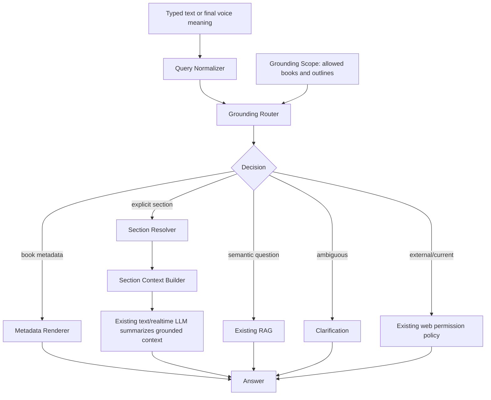

# Phase 10.1 Implementation Guide - Deterministic Metadata And Section Router

Date: 2026-06-04  
Status: Implemented and verified locally; known realtime voice orchestration trade-offs deferred
Depends on: Phase 5 document structure, Phase 7 realtime stabilization, Phase 10.0 evaluation baseline  
Primary scope: book-grounded text chat and realtime voice

Implementation result:

- Added a shared deterministic grounding router for metadata, explicit sections, clarification, semantic RAG fallback, and external-information policy.
- Added scoped repository reads for allowed books and canonical `BookSection` content.
- Integrated the router directly into typed chat and into the realtime voice `search_book_knowledge` tool.
- Extended safe agent traces with grounding route and reason code.
- Preserved the existing Flutter DataChannel contract and required no database migration.
- Verified by unit, full regression, real typed-chat, and supervised realtime voice evaluation.

Detailed result:

```text
_docs_implemented/phase_10_1_deterministic_metadata_section_router_test_report.md
```

---

## 1. Mục Tiêu

Phase 10.1 sửa hai lỗi có mức ưu tiên cao nhất đã được chứng minh trong baseline Phase 10.0:

1. Câu hỏi metadata như tác giả, tên sách hoặc số phần chính vẫn đi qua vector RAG.
2. Câu hỏi chỉ rõ chương hoặc đề mục chưa resolve sang `BookSection`, nên có thể lấy sai chương hoặc xin tìm web dù nội dung có trong sách.

Luồng mục tiêu:

```text
User question
-> normalize
-> load allowed book scope
-> deterministic route
-> metadata lookup OR section resolution OR existing semantic RAG
-> answer or clarification
```

Kết quả cần đạt:

- metadata lấy trực tiếp từ database, không embedding và không vector search;
- câu hỏi chỉ rõ chương/section lấy đúng `BookSection`;
- câu hỏi thiếu thông tin quan trọng phải hỏi lại;
- text và voice dùng chung quyết định routing;
- không thay đổi contract Flutter hiện tại;
- không thay đổi cấu trúc database;
- không hard-code cho một sách hoặc một câu test.

---

## 2. Baseline Và Lý Do Cần Phase Này

Phase 10.0 ghi nhận:

| Metric | Text | Voice |
| --- | ---: | ---: |
| Content accuracy | 90% | 40% |
| Intent accuracy | 0% | 0% |
| Answer source accuracy | 30% | 20% |
| Section resolution accuracy | 0% | 0% |

Các kết quả này cho thấy model đôi khi trả đúng nội dung, nhưng kiến trúc chưa chọn đúng nguồn dữ liệu.

Ví dụ hiện tại:

```text
"Tác giả của sách là ai?"
-> embedding
-> match_book_knowledge
-> LLM đoán hoặc đọc từ chunk
```

Luồng đúng:

```text
"Tác giả của sách là ai?"
-> metadata route
-> books.author
-> deterministic answer
```

Ví dụ hiện tại:

```text
"Tóm tắt chương 4"
-> vector search toàn sách
-> có thể trả chunk chương khác
-> có thể xin tìm web
```

Luồng đúng:

```text
"Tóm tắt chương 4"
-> parse explicit section reference
-> resolve BookSection path/title/tree
-> load canonical section text
-> summarize only from resolved section context
```

---

## 3. Kết Luận Sau Khi Rà Source Hiện Tại

### 3.1 Dữ liệu cần thiết đã tồn tại

`Book` đã có:

```text
id
user_id
title
author
document_type
total_sections
total_units
status
```

`BookSection` đã có:

```text
id
book_id
parent_id
section_index
title
level
path
text_content
text_char_count
```

Phase 10.1 không cần migration.

### 3.2 `BookSection` là nguồn nội dung gốc

`BookSection.text_content` là nội dung trích xuất từ cấu trúc tài liệu gốc.

`LearningUnit` và `BookKnowledge` hiện phục vụ trải nghiệm học/nghe và RAG theo learning unit. Chúng không phải nguồn tốt nhất để giải quyết một câu hỏi chỉ rõ section.

Quy tắc:

```text
Explicit section question -> BookSection
Semantic book question -> current RAG
```

### 3.3 LiveKit token đã khóa phạm vi sách trước khi dispatch

`app/services/live_service.py`:

- xác thực ownership của book hoặc thread;
- lấy `document_ids` từ Study Context;
- đưa `document_ids` vào LiveKit agent metadata.

Agent chỉ được query trong danh sách `document_ids` này.

Tuy nhiên, repository của Phase 10.1 vẫn phải kiểm tra `Book.id IN allowed_book_ids` và `BookSection.book_id IN allowed_book_ids`. Không được tin một `section_id` tùy ý.

### 3.4 Trace Phase 10.0 đã chuẩn bị sẵn field

`AgentTurnTrace` đã có:

```text
detected_intent
resolved_book_ids
resolved_section_ids
answer_source
```

Phase 10.1 cần bổ sung method ghi các field này. Không tạo hệ trace mới.

### 3.5 RAG hiện tại chưa đủ để giải quyết explicit section

`app/services/rag_service.py` hiện:

- embedding query;
- gọi `match_book_knowledge`;
- filter theo book IDs;
- không filter theo `BookSection`;
- dùng learning-unit chunks;
- threshold và result count cố định.

Không refactor sâu RAG trong Phase 10.1. Canonical section index và hybrid retrieval thuộc Phase 10.2 và 10.3.

---

## 4. Business Rules Đã Chốt

### 4.1 Chọn nguồn theo loại câu hỏi

| Loại câu hỏi | Nguồn bắt buộc |
| --- | --- |
| Tác giả, tên sách, loại tài liệu, trạng thái | `Book` metadata |
| Tổng số đề mục | `Book.total_sections` |
| Số phần/chương chính | Đếm root `BookSection` |
| Câu hỏi chỉ rõ chương/section/path/title | `BookSection` |
| Câu hỏi semantic không chỉ rõ section | RAG hiện tại |
| Câu hỏi mơ hồ, thiếu book hoặc section | Clarification |
| Thông tin ngoài sách hoặc thời sự | Web permission flow hiện tại |

### 4.2 Không đồng nhất "tổng số đề mục" và "số phần chính"

`Book.total_sections` là tổng số node trong outline, gồm cả mục con.

Ví dụ:

```text
6 chương chính
32 đề mục con
Book.total_sections = 38
root_section_count = 6
```

Do đó:

- "Sách có bao nhiêu đề mục?" -> `Book.total_sections`;
- "Sách có bao nhiêu phần chính/chương chính?" -> đếm `parent_id IS NULL`.

Không được trả `total_sections` cho mọi câu hỏi count.

### 4.3 Metadata thiếu không được bịa

Ví dụ `Book.author is None`:

```text
Tôi chưa có thông tin tác giả trong dữ liệu của sách này.
```

Không tự trả lời bằng model memory.

Không tự tìm web. Chỉ đi qua permission flow nếu user yêu cầu tìm thêm bên ngoài.

### 4.4 Full và Pareto không ảnh hưởng routing

Routing metadata/section không phụ thuộc:

- mode hiện tại;
- learning unit nào đang phát;
- audio đã tạo tới đâu;
- Full hay Pareto.

Nguồn sự thật vẫn là `Book` và `BookSection`.

### 4.5 Section không tồn tại hoặc không đủ rõ phải hỏi lại

Ví dụ:

```text
"Tóm tắt chương."
-> "Bạn muốn tôi tóm tắt chương nào?"

"Tóm tắt phần phương pháp."
-> có hai section cùng tên gần giống
-> hỏi user chọn section/path, không tự chọn

"Tóm tắt chương 20."
-> sách không có chương 20
-> thông báo không tìm thấy và hỏi user chọn lại
```

Không chuyển sang web chỉ vì section không resolve được.

### 4.6 Context nhiều sách phải xử lý rõ ràng

Nếu Study Context có một sách:

- metadata hoặc section reference có thể mặc định vào sách đó.

Nếu Study Context có nhiều sách:

- query chỉ rõ tên sách duy nhất -> resolve sách đó;
- query không chỉ rõ sách nhưng chỉ có một match section duy nhất toàn context -> có thể dùng match đó nếu rule cho kết quả duy nhất và rõ ràng;
- query metadata không chỉ rõ sách -> hỏi user muốn hỏi sách nào;
- nhiều section cùng match -> clarification.

Không chọn sách đầu tiên trong danh sách.

---

## 5. Phạm Vi Và Không Phạm Vi

### 5.1 Implement trong Phase 10.1

- shared deterministic grounding router;
- query normalization;
- metadata intent detection cho domain hữu hạn;
- explicit section reference parser;
- book và section resolver;
- canonical section context builder;
- text/voice integration;
- safe trace integration;
- feature flag và rollback;
- unit, integration và real-flow evaluation.

### 5.2 Không implement trong Phase 10.1

- không tạo canonical embedding table;
- không reindex sách;
- không hybrid search hoặc reranker;
- không thay model;
- không sửa STT tổng quát;
- không thay đổi Flutter API/DataChannel;
- không thay đổi web permission policy;
- không thêm migration;
- không giải quyết mọi cách diễn đạt ngôn ngữ tự nhiên bằng một danh sách pattern rất lớn.

---

## 6. Target Architecture



### 6.1 Kiến trúc package đề xuất

```text
app/services/agent_grounding/
  __init__.py
  contracts.py
  query_normalizer.py
  intent_router.py
  section_reference_parser.py
  section_resolver.py
  section_context_builder.py
  grounding_router.py
  response_renderer.py

app/repositories/
  agent_grounding_repo.py
```

Lý do tạo package riêng:

- tránh tiếp tục phình `agent_voice_gpt_realtime.py`;
- policy dùng chung cho text và voice;
- test offline từng lớp;
- Phase 10.2/10.3 có thể mở rộng mà không phá LiveKit wiring.

### 6.2 Không tạo thêm nhiều tool cho realtime model

Không expose riêng:

```text
get_book_metadata
resolve_section
search_book_rag
```

Nếu expose nhiều tool cấp thấp, realtime model vẫn có thể chọn sai tool.

Khuyến nghị:

- giữ function tool `search_book_knowledge` để tương thích;
- thay implementation bên trong bằng shared grounding router;
- tool tự quyết định metadata, section hoặc RAG;
- text chat gọi cùng router trực tiếp.

Sau Phase 10.5 có thể đổi tên tool thành `resolve_book_query` khi shared policy đã ổn định.

---

## 7. Domain Contracts

### 7.1 Intent và route

Đề xuất `app/services/agent_grounding/contracts.py`:

```python
from dataclasses import dataclass, field
from enum import Enum


class GroundingIntent(str, Enum):
    BOOK_METADATA_TITLE = "book_metadata.title"
    BOOK_METADATA_AUTHOR = "book_metadata.author"
    BOOK_METADATA_DOCUMENT_TYPE = "book_metadata.document_type"
    BOOK_METADATA_SECTION_COUNT = "book_metadata.section_count"
    BOOK_METADATA_ROOT_SECTION_COUNT = "book_metadata.root_section_count"
    BOOK_METADATA_STATUS = "book_metadata.status"
    BOOK_SECTION_SUMMARY = "book_section.summary"
    BOOK_SECTION_CONTENT = "book_section.content"
    BOOK_SEMANTIC_QUESTION = "book_semantic_question"
    EXTERNAL_CURRENT_INFO = "external_current_info"
    CLARIFICATION_REQUIRED = "clarification_required"


class GroundingRoute(str, Enum):
    BOOK_METADATA = "book_metadata"
    BOOK_SECTION = "book_section"
    BOOK_RAG = "book_rag"
    WEB_POLICY = "web_policy"
    CLARIFICATION = "clarification"


class ResolutionQuality(str, Enum):
    EXACT = "exact"
    UNIQUE = "unique"
    AMBIGUOUS = "ambiguous"
    NOT_FOUND = "not_found"
```

Không dùng một confidence float tùy ý làm quyết định chính trong Phase 10.1. Rule deterministic nên trả chất lượng giải quyết có nghĩa rõ ràng.

### 7.2 Grounding scope

```python
@dataclass(frozen=True)
class GroundingBook:
    id: str
    title: str
    author: str | None
    document_type: str | None
    total_sections: int | None
    status: str | None
    root_section_count: int


@dataclass(frozen=True)
class GroundingSection:
    id: str
    book_id: str
    parent_id: str | None
    section_index: int
    title: str
    level: int
    path: str
    text_char_count: int


@dataclass(frozen=True)
class GroundingScope:
    allowed_book_ids: tuple[str, ...]
    books: tuple[GroundingBook, ...]
    sections: tuple[GroundingSection, ...]
```

Scope chỉ chứa outline metadata, không load toàn bộ `text_content` vào RAM khi room khởi động.

### 7.3 Section reference

```python
@dataclass(frozen=True)
class SectionReference:
    explicit_path: str | None = None
    explicit_ordinal: int | None = None
    title_hint: str | None = None
    book_title_hint: str | None = None
    asks_for_summary: bool = False
```

### 7.4 Grounding decision

```python
@dataclass(frozen=True)
class GroundingDecision:
    intent: GroundingIntent
    route: GroundingRoute
    quality: ResolutionQuality
    reason_code: str
    resolved_book_ids: tuple[str, ...] = field(default_factory=tuple)
    resolved_section_ids: tuple[str, ...] = field(default_factory=tuple)
    clarification: str | None = None
```

`reason_code` phải là machine-readable, ví dụ:

```text
single_book_metadata_match
exact_section_path
unique_section_title
missing_section_reference
multiple_books_require_selection
section_not_found
```

Không ghi raw query vào trace.

### 7.5 Router result

```python
@dataclass(frozen=True)
class GroundingResult:
    decision: GroundingDecision
    deterministic_answer: str | None = None
    section_context: str | None = None
    rag_result: VoiceRagResult | None = None
```

---

## 8. Repository Design

### 8.1 Repository mới

Đề xuất `app/repositories/agent_grounding_repo.py`.

Repository chịu trách nhiệm:

- load allowed books;
- load outline rows cho allowed books;
- load text của các section đã được resolve;
- luôn scope query theo allowed book IDs.

Không đưa intent parsing hoặc response formatting vào repository.

### 8.2 Contract đề xuất

```python
def load_grounding_scope(
    session: Session,
    allowed_book_ids: list[uuid.UUID],
) -> GroundingScope:
    ...


def load_scoped_sections_with_text(
    session: Session,
    *,
    book_id: uuid.UUID,
    section_ids: list[uuid.UUID],
    allowed_book_ids: list[uuid.UUID],
) -> list[BookSection]:
    ...
```

Query bắt buộc:

```python
select(Book).where(Book.id.in_(allowed_book_ids))
```

và:

```python
select(BookSection).where(
    BookSection.book_id == book_id,
    BookSection.book_id.in_(allowed_book_ids),
    BookSection.id.in_(section_ids),
)
```

Không dùng trực tiếp `list_book_sections_by_ids()` cho input không tin cậy vì hàm hiện tại chưa validate book scope.

### 8.3 Đếm root section

Root section count được tính từ:

```text
BookSection.parent_id IS NULL
```

Không lưu thêm column trong Phase 10.1.

### 8.4 Async safety trong LiveKit agent

Database layer hiện dùng SQLModel sync engine. Gọi sync DB trực tiếp trong async tool sẽ block event loop.

Khuyến nghị:

```text
Room start
-> await asyncio.to_thread(load_grounding_scope_with_fresh_session)

Section selected
-> await asyncio.to_thread(load_scoped_section_text_with_fresh_session)
```

Mỗi callback tạo `Session(engine)` ngắn hạn và đóng ngay sau query.

Điều này phù hợp với cấu hình Supabase pooler + `NullPool` hiện tại và tránh giữ connection theo mỗi LiveKit room.

Không dùng global mutable cache giữa các room/process.

---

## 9. Query Normalization

### 9.1 Mục tiêu

Normalization giúp matching ổn định nhưng không được làm mất original query dùng cho RAG hoặc LLM.

Đề xuất trả cả hai:

```python
@dataclass(frozen=True)
class NormalizedQuery:
    original: str
    normalized: str
    tokens: tuple[str, ...]
```

### 9.2 Rule

```text
Unicode NFKC
-> casefold
-> chuẩn hóa whitespace
-> chuẩn hóa dấu phân cách path
-> giữ chữ số
-> tạo token có word boundary
```

Không bỏ dấu tiếng Việt trong bản normalized chính. Có thể tạo thêm một bản accent-folded chỉ để matching fallback.

Không dùng substring thô:

```python
"law" in text
```

Phải dùng token/word boundary để tránh match nhầm:

```text
law -> flaw
```

### 9.3 Không dùng pattern khổng lồ

Metadata là domain hữu hạn nên được phép có một lexicon nhỏ, song ngữ và có test:

```text
author -> tác giả, người viết, ai viết, author, wrote, written by
title -> tên sách, tựa sách, title
document type -> loại tài liệu, định dạng, format, document type
```

Đây không phải hard-code theo một cuốn sách. Đây là vocabulary của domain metadata.

Không tiếp tục thêm hàng trăm câu nguyên văn của user vào pattern.

---

## 10. Metadata Intent Router

### 10.1 Quy tắc

Metadata intent chỉ được chọn khi có tín hiệu rõ ràng.

Ví dụ:

```text
"Tác giả của sách là ai?"
-> BOOK_METADATA_AUTHOR

"Who wrote this book?"
-> BOOK_METADATA_AUTHOR

"Sách có bao nhiêu phần chính?"
-> BOOK_METADATA_ROOT_SECTION_COUNT

"Sách có bao nhiêu đề mục?"
-> BOOK_METADATA_SECTION_COUNT
```

Nếu query chứa từ "tác giả" nhưng đang hỏi nội dung:

```text
"Tác giả giải thích khái niệm này như thế nào?"
```

Không route sang metadata author. Query này là semantic book question.

Intent detector cần kết hợp:

- metadata entity;
- question action;
- negative/exclusion context;
- section reference có hay không.

### 10.2 Response renderer

Metadata đơn giản nên render deterministic, không gọi LLM:

```text
Tác giả của "Of Mice and Men" là John Steinbeck.
Tên sách là "Of Mice and Men".
Tài liệu này có 6 phần chính.
```

Lợi ích:

- giảm latency;
- không tốn token;
- không hallucinate;
- test chính xác.

Status nội bộ phải map sang ngôn ngữ sản phẩm, không đọc raw enum:

```text
draft -> đã tải lên, chưa tạo kế hoạch
processing -> đang xử lý
partial_ready -> đã có thể nghe một phần
ready -> đã xử lý xong
error -> xử lý gặp lỗi
```

---

## 11. Section Reference Parser

### 11.1 Các dạng phải hỗ trợ

```text
chương 4
chương bốn
chapter 4
chapter four
phần IV
mục 1.2
section 1.2.3
tóm tắt "Phương pháp nghiên cứu"
```

### 11.2 Number parser phải là module riêng

Không viết một regex lớn trong `agent_voice_gpt_realtime.py`.

Parser nên hỗ trợ:

- Arabic numbers: `4`, `12`;
- hierarchical paths: `1.2`, `1.2.3`;
- strict Roman numerals: `IV`, `XII`;
- Vietnamese number words theo rule tổng quát;
- English number words theo rule tổng quát.

Không tạo mapping thủ công riêng cho chỉ `một` tới `sáu`.

Ví dụ contract:

```python
def parse_positive_integer_phrase(value: str) -> int | None:
    ...


def parse_section_reference(query: NormalizedQuery) -> SectionReference | None:
    ...
```

### 11.3 Phân biệt ordinal và `section_index`

`BookSection.section_index` là thứ tự zero-based nội bộ toàn outline.

User nói "chương 4" không có nghĩa `section_index == 4`.

Resolver phải ưu tiên:

1. explicit structural path/number trong title;
2. root path hoặc root ordinal hợp lệ;
3. exact normalized title;
4. unique conservative title match;
5. clarification.

Không expose `section_index` cho user.

---

## 12. Section Resolver

### 12.1 Resolution order

Với một book đã resolve:

```text
1. Exact path match
2. Exact normalized title match
3. Explicit chapter/section number represented uniquely in title/path
4. Unique conservative title phrase match
5. Ambiguous or not found
```

Không dùng nearest-vector hoặc edit-distance để tự chọn section trong Phase 10.1.

### 12.2 Resolve theo tree

Resolver phải hiểu:

```text
path=1
path=1.2
path=1.2.3
```

Khi user hỏi `mục 1.2`, target là chính xác path `1.2`.

Khi user hỏi `chương 4`, ưu tiên root section phù hợp với chapter label/path. Không được match một mục con có `path=1.4` chỉ vì có số 4.

### 12.3 Duplicate title

Nếu hai section cùng title:

```text
1.2 Khái niệm
3.1 Khái niệm
```

Query `"giải thích mục Khái niệm"` là ambiguous.

Clarification nên đưa thông tin ngắn:

```text
Tôi tìm thấy hai mục tên "Khái niệm": mục 1.2 và mục 3.1. Bạn muốn hỏi mục nào?
```

### 12.4 Multiple books

Resolver chọn book theo thứ tự:

1. một book duy nhất trong scope;
2. exact normalized title được nhắc trong query;
3. unique section match chỉ thuộc một book;
4. clarification.

Không dùng book đầu tiên.

---

## 13. Section Context Builder

### 13.1 Mục tiêu

Khi resolve một section, cần tạo context canonical từ:

- section được chọn;
- các descendant của section theo document order;
- path và title để model hiểu cấu trúc.

Ví dụ:

```text
[Book: Of Mice and Men]
[Section: 4 - Chapter 4]

...canonical text...
```

### 13.2 Không load toàn bộ sách

Room startup chỉ load outline metadata.

Khi cần section:

1. xác định target section và descendant IDs từ scope;
2. query text theo IDs và allowed book scope;
3. sort theo `section_index`;
4. build bounded context.

### 13.3 Exact duplicate block handling

Parser các định dạng có thể lưu text cha/con khác nhau. Context builder chỉ được loại bỏ block trùng hoàn toàn sau normalization.

Không dùng fuzzy deduplication vì có thể xóa mất nội dung thật.

### 13.4 Context budget

Thêm config:

```env
AGENT_SECTION_CONTEXT_MAX_CHARS=24000
```

Nếu section vượt budget:

- không chỉ lấy prefix đầu tiên;
- phân bổ context theo target section và descendant order;
- trace `section_context_truncated=true`;
- answer phải nói rõ nếu chỉ dựa trên một phần nội dung;
- không tự chuyển sang web.

Map-reduce summarization hoàn chỉnh cho section rất dài có thể được bổ sung sau khi đo thực tế. Không đưa vào Phase 10.1 nếu chưa có regression case.

---

## 14. Shared Grounding Router

### 14.1 Public service contract

Đề xuất:

```python
class GroundingRouter:
    def __init__(self, scope: GroundingScope, repository: GroundingRepository):
        ...

    async def resolve(
        self,
        query: str,
        *,
        input_mode: AgentInputMode,
        tracer: AgentTurnTracer | None = None,
    ) -> GroundingResult:
        ...
```

### 14.2 Decision flow

```python
normalized = normalize_query(query)

metadata_intent = detect_metadata_intent(normalized)
if metadata_intent:
    return resolve_metadata(...)

section_reference = parse_section_reference(normalized)
if section_reference:
    return resolve_section(...)

if asks_for_section_but_missing_reference(normalized):
    return clarification(...)

if clearly_external_current_info(normalized):
    return web_policy(...)

return semantic_rag(...)
```

Router chỉ claim route khi rule đủ rõ.

Khi không chắc:

- section-like nhưng thiếu reference -> clarification;
- còn lại -> semantic RAG hiện tại;
- không tự web search.

`clearly_external_current_info()` trong Phase 10.1 chỉ được nhận các trường hợp có tín hiệu hiện thời/ngoài sách rõ ràng. Nó không phải một intent classifier tổng quát mới. Cách diễn đạt chưa chắc chắn phải tiếp tục đi qua policy hiện tại để tránh mở rộng scope và tạo web fallback sai.

### 14.3 Semantic RAG fallback

Phase 10.1 tiếp tục dùng:

```python
search_voice_book_context(query, document_ids, ...)
```

Không thay threshold, embedding model hoặc RPC trong phase này.

Mục tiêu là đo riêng mức cải thiện do routing.

---

## 15. Text Chat Integration

### 15.1 Vấn đề hiện tại

Text naive mode luôn gọi RAG.

Text agentic mode để LLM tự chọn giữa book RAG và web permission.

### 15.2 Luồng mới

Trước cả naive và agentic loop:

```text
permission reply handling
-> shared grounding router
-> deterministic metadata/section/clarification handled immediately
-> semantic/external fallback tiếp tục flow hiện tại
```

Pseudo-flow:

```python
grounding = await grounding_router.resolve(user_text, input_mode=AgentInputMode.TEXT, tracer=tracer)

if grounding.decision.route == GroundingRoute.BOOK_METADATA:
    return grounding.deterministic_answer

if grounding.decision.route == GroundingRoute.CLARIFICATION:
    return grounding.decision.clarification

if grounding.decision.route == GroundingRoute.BOOK_SECTION:
    return await answer_from_section_context(grounding.section_context)

if grounding.decision.route == GroundingRoute.BOOK_RAG:
    return await existing_rag_flow(...)

return await existing_web_permission_flow(...)
```

Metadata text response không cần LLM.

Section response dùng LLM nhưng system context bắt buộc:

```text
Answer only from SECTION_CONTEXT.
Do not use model memory.
If context is incomplete, say so.
Do not request web search for a resolved section.
```

---

## 16. Voice Integration

### 16.1 Giữ realtime architecture hiện tại

Không chặn audio flow để chờ một orchestrator mới trong Phase 10.1.

Giữ:

- `RealtimeModel`;
- `TriamAssistant`;
- `search_book_knowledge` tool;
- conversation persistence;
- web permission policy;
- DataChannel contract.

### 16.2 Thay implementation của book tool

`TriamAssistant.search_book_knowledge()` sẽ:

```text
query
-> shared grounding router
-> metadata fact OR section context OR current RAG OR clarification marker
```

Tool output ổn định:

```text
BOOK_METADATA_FOUND:
...

BOOK_SECTION_FOUND:
...

BOOK_CONTEXT_FOUND:
...

CLARIFICATION_REQUIRED:
...
```

Voice instructions cần sửa:

```text
- Call `search_book_knowledge` for any question about the selected books.
- Treat BOOK_METADATA_FOUND as authoritative metadata.
- Treat BOOK_SECTION_FOUND as the only source for the requested section.
- If the tool returns CLARIFICATION_REQUIRED, read the clarification and stop.
- Never request web search for CLARIFICATION_REQUIRED or a resolved section.
- Do not answer book facts from memory.
```

Prompt dùng tiếng Anh ngắn gọn, nhưng business enforcement nằm trong router và tool result, không chỉ nằm trong prompt.

### 16.3 Hạn chế còn lại của voice

Realtime model vẫn là bên quyết định có gọi function tool hay không. Nếu STT làm mất intent hoặc model không gọi tool, Phase 10.1 chưa giải quyết hoàn toàn.

Phần đó thuộc:

- Phase 10.4: STT robustness;
- Phase 10.5: shared orchestration policy.

Phase 10.1 vẫn phải đo tỷ lệ tool call và source selection bằng runner Phase 10.0.

---

## 17. Trace Integration

### 17.1 Method cần bổ sung

Đề xuất trong `AgentTurnTracer`:

```python
def record_grounding_decision(
    self,
    input_mode: AgentInputMode,
    *,
    intent: str,
    resolved_book_ids: list[str],
    resolved_section_ids: list[str],
    route: str,
    reason_code: str,
) -> None:
    ...
```

Trace chỉ ghi:

- intent;
- route/reason code;
- book IDs;
- section IDs;
- latency;
- answer source.

Không ghi:

- raw query;
- section text;
- metadata answer;
- full transcript;
- full response.

### 17.2 Answer source mapping

| Route | `AgentAnswerSource` |
| --- | --- |
| metadata | `BOOK_METADATA` |
| section | `BOOK_SECTION` |
| semantic RAG | `BOOK_RAG` |
| clarification | `CLARIFICATION` |
| web permission | `POLICY` |

### 17.3 Latency stages

Thêm:

```text
scope_load
intent_route
section_resolve
section_context_load
grounding_total
```

---

## 18. Config Và Feature Flag

Thêm vào `app/core/config.py` và `.env.example`:

```env
AGENT_GROUNDING_ROUTER_ENABLED=false
AGENT_SECTION_CONTEXT_MAX_CHARS=24000
```

### 18.1 Tại sao mặc định ban đầu là `false`

Phase 10.1 thay đổi behavior của cả text và voice. Rollout nên:

1. local test với flag `true`;
2. real-flow evaluation;
3. production canary;
4. bật production sau khi metrics đạt acceptance.

Rollback chỉ cần set:

```env
AGENT_GROUNDING_ROUTER_ENABLED=false
```

Sau khi production ổn định, có thể đổi default thành `true` ở phase cleanup sau.

### 18.2 Không biến mọi rule thành env

Không đưa lexicon, resolution order hoặc mọi threshold vào `.env`.

Chỉ operator-tunable settings mới ở config. Business rules phải nằm trong code có tên rõ ràng và unit test.

---

## 19. File Changes Dự Kiến

### 19.1 File mới

```text
app/services/agent_grounding/__init__.py
app/services/agent_grounding/contracts.py
app/services/agent_grounding/query_normalizer.py
app/services/agent_grounding/intent_router.py
app/services/agent_grounding/section_reference_parser.py
app/services/agent_grounding/section_resolver.py
app/services/agent_grounding/section_context_builder.py
app/services/agent_grounding/grounding_router.py
app/services/agent_grounding/response_renderer.py
app/repositories/agent_grounding_repo.py
```

### 19.2 File sửa

```text
app/core/config.py
.env.example
app/services/agent_voice_gpt_realtime.py
app/services/agent_observability/turn_trace.py
tests/fixtures/agent_eval/book_grounding_cases.json
tests/fixtures/agent_eval/voice_manifest.json
scripts/manual_integration/phase10_agent_eval.py
```

### 19.3 Không sửa

```text
database schema
Alembic migrations
Flutter DataChannel contract
public REST API contract
Full/Pareto planner
Celery document pipeline
```

---

## 20. Implementation Order

### Step 1 - Regression fixtures trước behavior

Mở rộng golden dataset:

- metadata author/title/document type/status;
- total outline count và root section count;
- explicit path `1.2`;
- chapter number bằng số/chữ/Roman;
- exact title;
- invalid section;
- missing section number;
- duplicate section title;
- multiple-book ambiguity;
- metadata missing.

### Step 2 - Contracts và normalizer

Implement dataclasses/enums và query normalization. Chưa nối agent.

### Step 3 - Grounding repository

Implement scoped DB reads và tests ownership/scope.

### Step 4 - Metadata intent và renderer

Implement deterministic metadata path, test song ngữ và negative cases.

### Step 5 - Section parser và resolver

Implement number/path/title/tree resolution, test ambiguous/not-found.

### Step 6 - Section context builder

Implement descendant gathering, scoped text load, exact dedupe và budget.

### Step 7 - Shared grounding router

Nối metadata, section, clarification và existing RAG.

### Step 8 - Trace integration

Ghi intent, resolved IDs, source và latency.

### Step 9 - Text integration

Route deterministic paths trước naive/agentic fallback.

### Step 10 - Voice tool integration

Đổi implementation của `search_book_knowledge`, giữ tool name và FE contract.

### Step 11 - Local unit/integration test

Chạy focused tests, full tests và ruff.

### Step 12 - Real text/voice evaluation

Chạy cùng runner và fixtures Phase 10.0, so sánh baseline.

---

## 21. Test Plan

### 21.1 Unit tests mới

```text
tests/services/agent_grounding/test_query_normalizer.py
tests/services/agent_grounding/test_intent_router.py
tests/services/agent_grounding/test_section_reference_parser.py
tests/services/agent_grounding/test_section_resolver.py
tests/services/agent_grounding/test_section_context_builder.py
tests/services/agent_grounding/test_grounding_router.py
tests/services/agent_grounding/test_response_renderer.py
```

### 21.2 Các case bắt buộc

#### Metadata

```text
Tác giả của sách là ai?
Who wrote this book?
Tên sách là gì?
Tài liệu này là PDF hay DOCX?
Sách có bao nhiêu đề mục?
Sách có bao nhiêu phần chính?
```

Expected:

- đúng intent;
- source `book_metadata`;
- không gọi embedding/RAG;
- metadata thiếu không hallucinate.

#### Section

```text
Tóm tắt chương 4.
Tóm tắt chương bốn.
What happens in chapter four?
Tóm tắt mục 1.2.
Giải thích mục "Phương pháp nghiên cứu".
```

Expected:

- đúng book;
- đúng section/path;
- source `book_section`;
- không vector search;
- không web permission.

#### Ambiguous

```text
Tóm tắt chương.
Giải thích mục Khái niệm.  # có nhiều mục trùng tên
Tác giả là ai?             # context có nhiều sách
Tóm tắt chương 99.
```

Expected:

- clarification;
- không RAG;
- không web;
- không chọn nearest section.

#### Semantic fallback

```text
Crooks cảm thấy như thế nào và vì sao?
```

Expected:

- route `book_rag`;
- behavior RAG hiện tại không regression.

#### Security

- section ID ngoài allowed books không load được text;
- book ngoài `document_ids` không xuất hiện trong scope;
- empty/invalid document IDs không làm query toàn bộ database.

### 21.3 Integration tests

Mock repository và RAG để chứng minh:

```text
metadata -> RAG call count = 0
explicit section -> RAG call count = 0
semantic -> RAG call count = 1
ambiguous -> RAG call count = 0
```

### 21.4 Commands

```powershell
uv run pytest tests/services/agent_grounding tests/services/voice_agent tests/services/agent_observability -q
uv run pytest -q
uv run ruff check app/services/agent_grounding app/repositories/agent_grounding_repo.py app/services/agent_voice_gpt_realtime.py app/services/agent_observability
```

### 21.5 Real-flow evaluation

Prerequisites:

```text
FastAPI server running
LiveKit voice worker running
valid access token
AGENT_TRACE_ENABLED=true
AGENT_GROUNDING_ROUTER_ENABLED=true
```

Commands:

```powershell
uv run python scripts/manual_integration/phase10_agent_eval.py --mode text
uv run python scripts/manual_integration/phase10_agent_eval.py --mode voice
```

Chạy thêm một suite isolated single-turn để conversation history hoặc pending web permission không ảnh hưởng case kế tiếp.

---

## 22. Acceptance Criteria

Phase 10.1 chỉ hoàn thành khi:

### Accuracy

- metadata fixtures: intent/source đúng 100%;
- metadata fixtures: vector search call count bằng 0;
- explicit valid section fixtures: resolve đúng 100%;
- explicit valid section fixtures: vector search call count bằng 0;
- invalid/ambiguous section fixtures: clarification đúng 100%;
- không có book/section ngoài allowed scope được trả về.

### Behavior

- metadata thiếu không hallucinate;
- section resolve thành công không xin web;
- section không resolve được không tự chọn section gần nhất;
- semantic question vẫn đi RAG;
- web permission policy không regression;
- Full/Pareto không ảnh hưởng route.

### Text và voice

- cùng intent rõ ràng chọn cùng source;
- voice vẫn giữ `lk.chat`, `lk.transcript`, `lk.control`;
- persistence không duplicate;
- final transcript correlation không regression.

### Performance

- metadata p50 thấp hơn baseline text metadata đáng kể vì không gọi embedding/LLM;
- section resolve DB/read latency được trace;
- không load toàn bộ source text của mọi sách khi room khởi động;
- không giữ DB connection theo room.

### Quality

- focused tests pass;
- full tests pass;
- focused ruff pass;
- manual text/voice report được lưu;
- có rollback bằng feature flag.

---

## 23. Trade-off Và Hướng Xử Lý

### 23.1 Deterministic router không hiểu mọi cách diễn đạt

Trade-off:

- rule bảo thủ giúp tránh route sai;
- một số cách hỏi mới có thể rơi về RAG thay vì metadata.

Hướng xử lý:

- ghi regression case từ production;
- mở rộng domain lexicon theo concept, không theo câu nguyên văn;
- chỉ cân nhắc classifier nhỏ sau khi deterministic path đã đo được.

### 23.2 Voice vẫn phụ thuộc model gọi tool

Trade-off:

- tool bên trong đúng hơn nhưng realtime model vẫn có thể không gọi tool.

Hướng xử lý:

- đo tool-call rate trong Phase 10.1;
- xử lý STT ở Phase 10.4;
- chuyển orchestration sang shared policy sâu hơn ở Phase 10.5.

### 23.3 Context section rất dài

Trade-off:

- truncate có thể thiếu nội dung;
- map-reduce tăng latency và cost.

Hướng xử lý:

- bounded context có trace rõ ràng trước;
- không tuyên bố tóm tắt đầy đủ nếu context bị cắt;
- dùng canonical section index/hybrid retrieval ở Phase 10.2/10.3.

### 23.4 Multiple-book clarification tăng thêm một turn

Trade-off:

- UX chậm hơn một lượt;
- đổi lại không trả lời nhầm sách.

Đây là trade-off đúng cho sản phẩm học tập cần độ chính xác.

### 23.5 Scope cache không tự cập nhật trong room hiện tại

Nếu user thay đổi sách trong Study Context sau khi LiveKit room đã được tạo, scope trong room không tự đổi.

Khuyến nghị:

- FE lấy token/room mới sau khi thay đổi context documents;
- không thêm polling scope trong Phase 10.1.

---

## 24. Những Quyết Định Không Được Làm Sai Khi Implement

1. Không route metadata qua embedding.
2. Không dùng `section_index` như số chương user nói.
3. Không dùng nearest/fuzzy match để tự chọn section khi ambiguous.
4. Không query section ngoài `document_ids`.
5. Không load toàn bộ `BookSection.text_content` khi room start.
6. Không gọi sync DB trực tiếp trên async event loop.
7. Không tự tìm web vì metadata thiếu hoặc section không resolve.
8. Không thay đổi DataChannel contract.
9. Không hard-code `Of Mice and Men`, John Steinbeck hoặc chương 4.
10. Không nâng model để che lỗi router.

---

## 25. Rollout Plan

### Local

```text
AGENT_GROUNDING_ROUTER_ENABLED=true
-> unit/integration tests
-> real text suite
-> real voice suite
-> compare Phase 10.0 baseline
```

### Production canary

1. Deploy code với flag `false`.
2. Smoke test flow cũ.
3. Bật flag trên một runtime/test context.
4. Theo dõi:
   - route counts;
   - metadata/section accuracy;
   - clarification rate;
   - book-answerable web fallback rate;
   - latency;
   - errors.
5. Bật rộng khi đạt acceptance.

### Rollback

```text
AGENT_GROUNDING_ROUTER_ENABLED=false
```

Không cần rollback migration vì Phase 10.1 không có migration.

---

## 26. Definition Of Done

Phase 10.1 được xem là hoàn thành khi hệ thống chứng minh được:

```text
"Tác giả của sách là ai?"
-> Book metadata
-> không RAG

"Tóm tắt chương 4"
-> đúng BookSection path/title/tree
-> không RAG toàn sách
-> không web

"Tóm tắt chương"
-> clarification

Câu hỏi semantic không chỉ rõ section
-> RAG hiện tại
```

Đồng thời text và voice phải ghi được:

```text
detected_intent
resolved_book_ids
resolved_section_ids
answer_source
route latency
```

Sau khi đạt Definition of Done, phase tiếp theo là:

```text
Phase 10.2 - Canonical BookSection Knowledge Index
```
