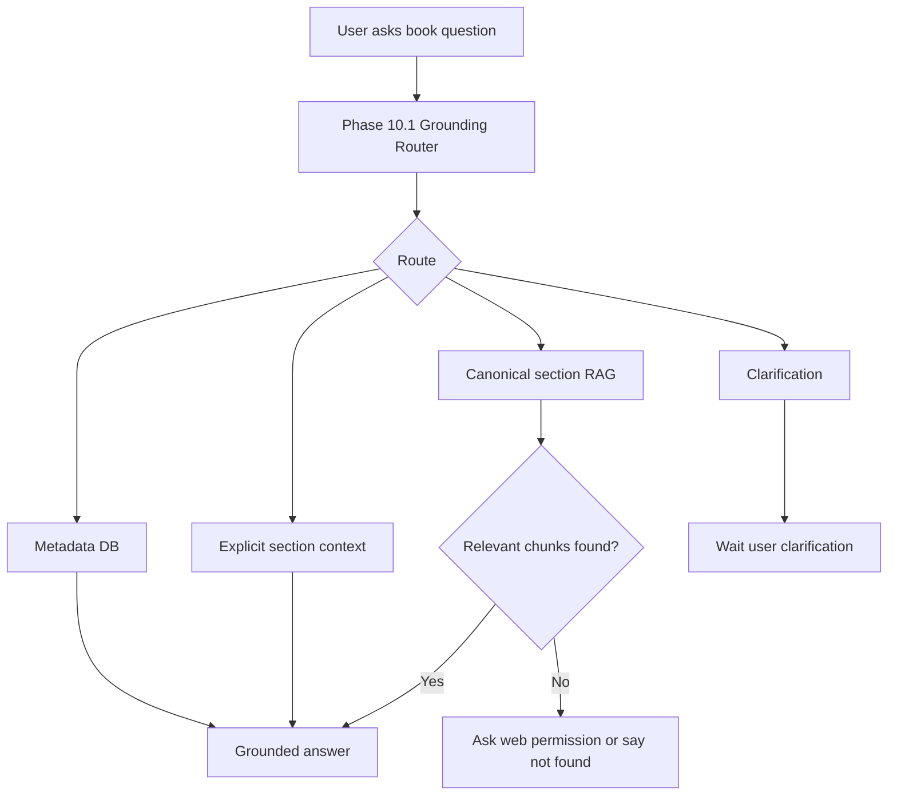

# Phase 10.2 Implementation Guide - Canonical BookSection Knowledge Index

## 1. Mục Tiêu

Phase 10.1 đã giúp agent phân biệt tốt hơn giữa:

- câu hỏi metadata như tác giả, tên sách;
- câu hỏi chỉ rõ chương/mục;
- câu hỏi mơ hồ cần hỏi lại;
- câu hỏi nội dung sách cần RAG.

Nhưng Phase 10.1 vẫn còn một giới hạn lớn: khi user hỏi nội dung theo ngữ nghĩa nhưng không nói rõ chương, hệ thống vẫn dùng bảng `book_knowledge` cũ. Bảng này đang được tạo từ `LearningUnit`, tức là từ nội dung đã được biến đổi để học/nghe ở mode `full` hoặc `pareto`, không phải từ cấu trúc gốc của sách.

Vì vậy Phase 10.2 sẽ tạo một lớp chỉ mục tri thức chuẩn theo `BookSection`.

Mục tiêu cuối cùng:

```text
BookSection.text_content
-> chunk theo từng section gốc
-> embedding
-> lưu kèm book_id, section_id, section path/title
-> semantic RAG trả về được đúng section_id
-> agent biết câu trả lời đến từ chương/mục nào
```

Nói ngắn gọn: từ Phase 10.2 trở đi, hỏi nội dung sách phải dựa trên cấu trúc gốc của sách, không dựa vào audio learning unit.

---

## 2. Vấn Đề Hiện Tại

### 2.1 `BookKnowledge` đang gắn với `LearningUnit`

Hiện tại bảng:

```python
class BookKnowledge(SQLModel, table=True):
    __tablename__ = "book_knowledge"

    id: Optional[int]
    book_id: uuid.UUID
    learning_unit_id: Optional[uuid.UUID]
    chunk_index: int
    content: str
    embedding: Optional[list[float]]
```

Vấn đề:

- không có `section_id`;
- không biết chunk đó đến từ chương/mục nào trong sách gốc;
- `learning_unit_id` có thể là Full hoặc Pareto;
- Pareto có thể gom nhiều mục nhỏ thành một đơn vị học;
- Full/Pareto là sản phẩm học tập, không phải chỉ mục nguồn chuẩn để hỏi đáp.

Kết quả trong Phase 10.1:

```text
Text eval content/intent/source: tốt
Nhưng một số semantic case fail strict vì retrieval_section_ids rỗng.
```

Điều này nghĩa là agent có thể trả lời đúng ý, nhưng hệ thống chưa chứng minh được câu trả lời lấy từ đúng `BookSection`.

### 2.2 Full/Pareto không nên quyết định khả năng hỏi sách

User có thể:

- chưa generate audio;
- đang ở mode `full`;
- đang switch sang `pareto`;
- nghe một phần sách;
- hỏi nội dung nằm ở section chưa được TTS xong.

Nếu RAG phụ thuộc `LearningUnit`, khả năng hỏi đáp sẽ bị lệ thuộc vào tiến trình tạo audio. Đây là sai về business logic.

Business rule mới:

```text
BookSection là source of truth cho hỏi đáp sách.
LearningUnit là source of truth cho trải nghiệm nghe/học.
```

---

## 3. Quyết Định Kiến Trúc

### 3.1 Thêm bảng mới, không vá trực tiếp `book_knowledge`

Khuyến nghị tạo bảng mới:

```text
book_section_knowledge
```

Không nên thêm `section_id` vào `book_knowledge` cũ ngay ở Phase 10.2.

Lý do:

- tránh phá flow audio/TTS hiện tại;
- giữ rollback đơn giản;
- tách rõ hai loại tri thức:
  - `book_knowledge`: learning-unit/audio index cũ;
  - `book_section_knowledge`: canonical source index mới;
- dễ đo chất lượng hai retrieval path song song;
- tránh migration phức tạp trên dữ liệu cũ.

### 3.2 Feature flag bắt buộc

Thêm config:

```python
AGENT_CANONICAL_SECTION_RAG_ENABLED: bool = False
BOOK_SECTION_INDEXING_ENABLED: bool = True
BOOK_SECTION_EMBEDDING_MODEL: str = "text-embedding-3-small"
BOOK_SECTION_EMBEDDING_DIMENSION: int = 1536
BOOK_SECTION_CHUNK_SIZE_CHARS: int = 3600
BOOK_SECTION_CHUNK_OVERLAP_CHARS: int = 500
BOOK_SECTION_EMBEDDING_BATCH_SIZE: int = 64
```

Rollout đúng:

```text
Deploy schema + code
-> backfill index
-> chạy eval
-> bật AGENT_CANONICAL_SECTION_RAG_ENABLED=true
-> nếu lỗi rollback flag về false
```

### 3.3 Không thay đổi FE contract ở Phase 10.2

Phase này là backend quality improvement.

Không cần FE đổi UI/API ngay.

Các kênh hiện tại vẫn giữ:

```text
lk.chat
lk.transcript
lk.control
REST chat/thread/book APIs
```

Nếu sau này muốn FE hiển thị "AI lấy nguồn từ Chương 4", đó là Phase khác vì cần contract hiển thị citation/source.

---

## 4. Schema Đề Xuất

Thêm model mới vào `app/models/db_models.py`:

```python
class BookSectionKnowledge(SQLModel, table=True):
    __tablename__ = "book_section_knowledge"

    id: Optional[int] = Field(default=None, primary_key=True)
    book_id: uuid.UUID = Field(
        sa_column=Column(
            UUID(as_uuid=True),
            ForeignKey("books.id", ondelete="CASCADE"),
            index=True,
            nullable=False,
        )
    )
    section_id: uuid.UUID = Field(
        sa_column=Column(
            UUID(as_uuid=True),
            ForeignKey("book_sections.id", ondelete="CASCADE"),
            index=True,
            nullable=False,
        )
    )
    chunk_index: int = Field(sa_column=Column(Integer, nullable=False))
    content: str = Field(sa_column=Column(Text, nullable=False))
    content_hash: str = Field(sa_column=Column(Text, nullable=False))
    embedding_model: str = Field(sa_column=Column(Text, nullable=False))
    embedding_version: str = Field(sa_column=Column(Text, nullable=False))
    char_count: int = Field(default=0, sa_column=Column(Integer, nullable=False))
    token_count: Optional[int] = Field(default=None, sa_column=Column(Integer))
    embedding: Optional[list[float]] = Field(
        default=None,
        sa_column=Column(Vector(1536)),
    )
    created_at: datetime = Field(
        default_factory=lambda: datetime.now(timezone.utc),
        sa_column=Column(DateTime(timezone=True), server_default=func.now(), nullable=False),
    )
    updated_at: datetime = Field(
        default_factory=lambda: datetime.now(timezone.utc),
        sa_column=Column(DateTime(timezone=True), server_default=func.now(), onupdate=func.now(), nullable=False),
    )

    __table_args__ = (
        UniqueConstraint(
            "section_id",
            "chunk_index",
            "embedding_version",
            name="uq_book_section_knowledge_section_chunk_version",
        ),
        UniqueConstraint(
            "section_id",
            "content_hash",
            "embedding_version",
            name="uq_book_section_knowledge_section_hash_version",
        ),
    )
```

### Vì sao cần `content_hash`

`content_hash` giúp idempotency:

```text
cùng section + cùng nội dung + cùng embedding_version
-> không embed lại
```

Nếu parser hoặc chunker thay đổi:

```text
embedding_version đổi
-> hệ thống tạo index mới
-> có thể rollback về version cũ nếu cần
```

### Vì sao cần `embedding_model` và `embedding_version`

Không nên chỉ lưu vector mà không biết nó được tạo bằng gì.

Ví dụ:

```text
text-embedding-3-small / section-v1
text-embedding-3-large / section-v2
```

Khi đổi model hoặc chunking strategy, mình không bị lẫn dữ liệu.

---

## 5. Alembic Migration

Tạo migration:

```powershell
uv run alembic revision --autogenerate -m "phase 10.2 book section knowledge index"
```

Sau đó phải đọc file migration trước khi upgrade.

### 5.1 Những điểm bắt buộc kiểm tra

Không được để Alembic tự sinh thao tác phá bảng cũ:

```text
drop_table
drop_column
drop_constraint không rõ lý do
enum rewrite không cần thiết
```

### 5.2 Lưu ý lỗi từng gặp trong dự án

Dự án từng gặp hai lỗi migration Postgres:

```text
type ... already exists
cannot change return type of existing function
```

Vì vậy nếu tạo hoặc sửa Postgres function, luôn dùng:

```sql
drop function if exists match_book_section_knowledge(
  vector,
  double precision,
  integer,
  uuid[],
  uuid[]
);
```

Không dùng `create or replace function` khi return table đổi shape mà chưa drop function.

### 5.3 RPC mới cho Supabase/Postgres

Tạo function mới, không sửa ngay `match_book_knowledge` cũ:

```sql
create or replace function match_book_section_knowledge(
  query_embedding vector(1536),
  match_threshold float,
  match_count int,
  filter_book_ids uuid[],
  filter_section_ids uuid[] default null
)
returns table (
  id integer,
  book_id uuid,
  section_id uuid,
  section_path text,
  section_title text,
  chunk_index integer,
  content text,
  similarity float
)
language sql stable
as $$
  select
    bsk.id,
    bsk.book_id,
    bsk.section_id,
    bs.path as section_path,
    bs.title as section_title,
    bsk.chunk_index,
    bsk.content,
    1 - (bsk.embedding <=> query_embedding) as similarity
  from book_section_knowledge bsk
  join book_sections bs on bs.id = bsk.section_id
  where bsk.embedding is not null
    and bsk.book_id = any(filter_book_ids)
    and (filter_section_ids is null or bsk.section_id = any(filter_section_ids))
    and 1 - (bsk.embedding <=> query_embedding) > match_threshold
  order by bsk.embedding <=> query_embedding
  limit match_count;
$$;
```

### 5.4 Vector index

Phase 10.2 implementation hiện tạo cả B-Tree filter indexes và HNSW vector index.

B-Tree indexes:

```sql
create index if not exists ix_bsk_book_version
on book_section_knowledge (book_id, embedding_version);

create index if not exists ix_bsk_section_version
on book_section_knowledge (section_id, embedding_version);

create index if not exists ix_bsk_book_section_version
on book_section_knowledge (book_id, section_id, embedding_version);
```

Các index này không đảm bảo Postgres luôn "lọc B-Tree trước rồi mới vector search" trong mọi query plan, nhưng vẫn cần cho:

- filter theo sách;
- filter theo section;
- backfill/check coverage;
- cleanup dữ liệu theo book/section;
- giảm chi phí query khi dữ liệu tăng.

Vector index:

```sql
create index if not exists ix_bsk_embedding_hnsw
on book_section_knowledge
using hnsw (embedding vector_cosine_ops);
```

Giai đoạn rất nhỏ có thể chạy không HNSW, nhưng code migration hiện đã thêm HNSW vì bảng mới ban đầu rỗng nên chi phí build thấp.

Trade-off:

- HNSW query nhanh hơn;
- tốn storage/RAM hơn;
- index build có thể lâu nếu dữ liệu lớn.

---

## 6. Chunking Strategy

### 6.1 Chunk theo từng `BookSection`

Không chunk xuyên section.

Sai:

```text
Section 1.3 cuối + Section 1.4 đầu -> một chunk
```

Đúng:

```text
Mỗi chunk phải thuộc đúng một section_id.
```

Lý do:

- trace source rõ ràng;
- agent biết chunk thuộc chương/mục nào;
- eval có thể kiểm tra `retrieval_section_ids`.

### 6.2 Text dùng để embedding khác text lưu hiển thị

Khuyến nghị:

```text
embedding_text = metadata prefix + section text chunk
stored content = heading/path ngắn + chunk nội dung
```

Ví dụ:

```text
Embedding input:
Book: Of Mice and Men
Author: John Steinbeck
Section path: Chapter 4 > Crooks's room
Section title: Crooks's room
Content:
...
```

Stored content:

```text
[Chapter 4 > Crooks's room]
...
```

Không nên lưu metadata quá dài lặp lại quá nhiều lần, vì context đưa vào LLM sẽ phình lên.

### 6.3 Chunk size đề xuất

Config ban đầu:

```text
BOOK_SECTION_CHUNK_SIZE_CHARS=3600
BOOK_SECTION_CHUNK_OVERLAP_CHARS=500
```

Lý do:

- đủ dài để giữ ngữ cảnh;
- đủ nhỏ để embedding ổn;
- overlap giúp không mất ý ở ranh giới chunk.

Nếu sau này chuyển sang tokenizer-based chunking:

```text
900-1200 tokens/chunk
150-250 tokens overlap
```

Nhưng Phase 10.2 có thể dùng char-based splitter để ít rủi ro hơn, vì codebase hiện đã dùng `RecursiveCharacterTextSplitter`.

---

## 7. Repository Và Service

### 7.1 Repository mới

Tạo:

```text
app/repositories/book_section_knowledge_repo.py
```

Các hàm đề xuất:

```python
def delete_section_knowledge(
    session: Session,
    *,
    section_id: uuid.UUID,
    embedding_version: str,
) -> None:
    ...


def bulk_create_section_knowledge(
    session: Session,
    records: list[BookSectionKnowledge],
) -> None:
    ...


def count_indexed_sections(
    session: Session,
    *,
    book_id: uuid.UUID,
    embedding_version: str,
) -> int:
    ...


def list_sections_missing_index(
    session: Session,
    *,
    book_id: uuid.UUID,
    embedding_version: str,
) -> list[BookSection]:
    ...
```

Repository chỉ làm DB. Không gọi OpenAI, không chunk text trong repository.

### 7.2 Service indexer mới

Tạo:

```text
app/services/book_section_knowledge_indexer.py
```

Nhiệm vụ:

- nhận `book_id`;
- load `Book` và `BookSection`;
- bỏ qua section rỗng;
- chunk từng section;
- embed theo batch;
- lưu `BookSectionKnowledge`;
- idempotent bằng `content_hash`;
- log count, không log full content.

Pseudo flow:

```python
async def index_book_sections(session: Session, *, book_id: uuid.UUID) -> BookSectionIndexResult:
    book = get_book_or_raise(...)
    sections = list_non_empty_sections(...)

    for section in sections:
        chunks = chunk_section(book, section)
        records = await embed_chunks(book, section, chunks)
        replace_changed_section_records(...)

    session.commit()
    return result
```

### 7.3 Không làm request-time indexing

Không được để khi user hỏi thì backend mới embed section.

Sai:

```text
User hỏi -> phát hiện thiếu index -> embed ngay trong request -> trả lời
```

Đúng:

```text
Upload/generate/backfill worker -> index trước
User hỏi -> query vector có sẵn
```

Lý do:

- tránh latency rất cao;
- tránh request timeout;
- tránh race condition khi nhiều user hỏi cùng lúc;
- dễ tracking progress.

---

## 8. Celery Task Và Backfill

### 8.1 Task mới

Thêm task:

```text
triam.books.index_sections
```

Queue hiện tại trong code Phase 10.2:

```text
document
```

Lý do: production hiện đã chạy document worker, nên route vào `document` giúp deploy Phase 10.2 không cần thêm worker process mới.

Khuyến nghị dài hạn vẫn là tách:

```text
document: parse/planning/TTS orchestration
embedding: indexing/RAG embedding
tts: audio generation
notification: notification delivery
maintenance: scanners
```

### 8.2 Khi nào enqueue

Phase 10.2 nên enqueue ở các điểm:

1. Sau upload tạo `BookSection` thành công.
2. Khi backfill sách cũ.
3. Khi parser/index version đổi.

Không nên phụ thuộc `generate-plan`.

Lý do:

```text
User upload sách xong là đã có thể hỏi nội dung text.
Không cần chờ tạo audio.
```

### 8.3 Backfill command/script

Tạo script manual:

```text
scripts/backfill_book_section_knowledge.py
```

Use case:

```powershell
uv run python scripts/backfill_book_section_knowledge.py --book-id <book_id>
uv run python scripts/backfill_book_section_knowledge.py --all-ready
```

Script chỉ enqueue task hoặc chạy eager theo flag local.

Không để script in secrets hoặc full text.

---

## 9. Retrieval Service

### 9.1 Hàm search mới

Trong `app/services/rag_service.py`, thêm hàm mới:

```python
async def search_book_section_knowledge(
    query: str,
    document_ids: list[str],
    *,
    section_ids: list[str] | None = None,
) -> list[dict[str, Any]] | str:
    ...
```

Hàm này:

- tạo query embedding;
- gọi RPC `match_book_section_knowledge`;
- trả payload có `section_id`;
- không swallow lỗi provider thành câu trả lời giả;
- không log query đầy đủ ở production.

Payload tối thiểu:

```json
{
  "id": 123,
  "book_id": "uuid",
  "section_id": "uuid",
  "section_path": "Chapter 4 > Crooks",
  "section_title": "Crooks",
  "chunk_index": 0,
  "content": "...",
  "similarity": 0.74
}
```

### 9.2 Wrapper giữ tương thích

Không xoá `search_book_knowledge` cũ.

Triển khai routing:

```python
if settings.AGENT_CANONICAL_SECTION_RAG_ENABLED:
    return await search_book_section_knowledge(...)
return await search_book_knowledge(...)
```

Rollback:

```text
AGENT_CANONICAL_SECTION_RAG_ENABLED=false
```

### 9.3 Tích hợp với `voice_agent/rag_context.py`

`AgentTurnTracer.record_retrieval()` hiện đã đọc được:

```python
section_id
learning_unit_id
```

Do đó Phase 10.2 phải đảm bảo payload mới có `section_id`.

Khi format context, nên đổi label từ `Unit ID` sang source rõ hơn nếu payload mới có section:

```text
--- Source 1 (Section: Chapter 4 > Crooks, Chunk: 0) ---
...
```

Nhưng vẫn giữ tương thích với payload cũ:

```text
Nếu không có section_id/section_path -> fallback format cũ.
```

---

## 10. Agent Routing Sau Phase 10.2

Luồng mới:



Rule:

```text
Explicit section question
-> dùng direct BookSection context trước.

Semantic question không rõ section
-> dùng canonical section RAG.

Metadata question
-> không RAG.
```

---

## 11. Test Plan

### 11.1 Unit tests

Thêm tests:

```text
tests/services/test_book_section_knowledge_chunker.py
tests/services/test_book_section_knowledge_indexer.py
tests/services/test_rag_section_knowledge.py
```

Case cần có:

- section rỗng bị skip;
- một section dài được chia nhiều chunk;
- chunk không vượt quá size config;
- overlap hoạt động;
- `content_hash` ổn định;
- reindex cùng nội dung không duplicate;
- đổi `embedding_version` tạo index version mới;
- payload retrieval có `section_id`, `section_path`, `section_title`;
- fallback về `search_book_knowledge` cũ khi flag false.

### 11.2 Repository tests

Nếu dùng DB test:

- insert `Book`, `BookSection`, `BookSectionKnowledge`;
- query theo `book_id`;
- query theo `section_id`;
- constraint duplicate hoạt động.

Nếu không có DB integration trong default pytest:

- mock repository ở service test;
- giữ real DB test trong manual integration.

### 11.3 Manual integration

Chạy với sách thật:

```text
Of Mice and Men
trr.docx
Chương 4_ Phương pháp luận nghiên cứu.pdf
```

Flow:

```text
upload hoặc chọn book đã có
-> backfill section index
-> hỏi semantic question
-> kiểm tra trace retrieval_section_ids
```

Expected:

```text
retrieval_section_ids không rỗng
web fallback không xuất hiện nếu sách có nội dung
answer_source = book_context
```

### 11.4 Regression từ Phase 10.1

Các case đã fail strict vì thiếu `section_id` phải được rerun:

```text
mice-crooks-semantic-vi-text
mice-curley-wife-death-vi-text
```

Kỳ vọng:

```text
strict pass tăng từ 8/10 lên 10/10 nếu nội dung vẫn đúng.
```

### 11.5 Voice test

Phase 10.2 không giải quyết triệt để vấn đề realtime model bỏ qua tool.

Voice test vẫn cần chạy để đảm bảo:

- tool output khi được gọi có `section_id`;
- không tăng duplicate transcript;
- không tự web search;
- không phá permission classifier.

Những lỗi voice còn lại sẽ xử lý ở Phase 10.4/10.5.

---

## 12. Acceptance Criteria

Phase 10.2 được xem là hoàn thành khi:

1. Mỗi `BookSection` có `text_content` hợp lệ đều có index trong `book_section_knowledge`.
2. Reindex không tạo duplicate chunk.
3. Semantic RAG payload có:
   - `book_id`;
   - `section_id`;
   - `section_path`;
   - `section_title`;
   - `chunk_index`;
   - `similarity`.
4. `AgentTurnTracer` ghi được `retrieval_section_ids`.
5. Câu hỏi semantic có trong sách không bị chuyển sang web fallback.
6. Full/Pareto mode không ảnh hưởng khả năng hỏi đáp nội dung sách.
7. Có feature flag rollback về RAG cũ.
8. Focused tests pass.
9. Manual integration report có latency, count indexed, retrieval IDs, source selection.

---

## 13. Trade-off

### 13.1 Tốn thêm storage và embedding cost

Vì sẽ tồn tại song song:

```text
book_knowledge
book_section_knowledge
```

Trade-off này chấp nhận được trong Phase 10.2 để rollback an toàn.

Sau khi Phase 10 ổn định, có thể cân nhắc:

- xoá hoặc giảm vai trò `book_knowledge`;
- dùng `book_section_knowledge` làm RAG chính;
- `LearningUnit` chỉ giữ audio/script/progress.

### 13.2 Backfill có thể lâu

Sách dài sẽ cần nhiều embedding call.

Giải pháp:

- chạy Celery task;
- batch embedding;
- progress/log theo count;
- không chạy trong request.

### 13.3 Section-level chunk có thể thiếu câu hỏi tổng hợp toàn sách

Ví dụ:

```text
"Chủ đề xuyên suốt của sách là gì?"
```

Section index vẫn hữu ích, nhưng retrieval có thể cần hybrid/rerank để gom nhiều section đúng.

Đây là scope Phase 10.3.

### 13.4 Chưa xử lý source citation UI

Backend có section source nhưng FE chưa hiển thị.

Đây không phải blocker cho Phase 10.2.

---

## 14. Những Việc Không Làm Trong Phase 10.2

1. Không xoá `book_knowledge` cũ.
2. Không rewrite Full/Pareto planner.
3. Không đổi DataChannel contract.
4. Không tự động web search khi index thiếu.
5. Không hard-code theo sách `Of Mice and Men`.
6. Không nâng model để che lỗi retrieval.
7. Không OCR hoặc sửa parser PDF/DOCX/EPUB trong phase này.
8. Không chạy embedding trong request chat/voice.

---

## 15. Implementation Order

### Step 1 - Config

Thêm settings và `.env.example`:

```text
AGENT_CANONICAL_SECTION_RAG_ENABLED=false
BOOK_SECTION_INDEXING_ENABLED=true
BOOK_SECTION_EMBEDDING_MODEL=text-embedding-3-small
BOOK_SECTION_EMBEDDING_DIMENSION=1536
BOOK_SECTION_CHUNK_SIZE_CHARS=3600
BOOK_SECTION_CHUNK_OVERLAP_CHARS=500
BOOK_SECTION_EMBEDDING_BATCH_SIZE=64
BOOK_SECTION_EMBEDDING_VERSION=section-v1
```

### Step 2 - Model + migration

Thêm:

```text
BookSectionKnowledge
```

Tạo migration:

```text
book_section_knowledge table
match_book_section_knowledge RPC
indexes
```

### Step 3 - Chunker

Tạo:

```text
app/services/book_section_chunker.py
```

Hoặc đặt trong indexer nếu còn nhỏ.

Rule:

- input là một `BookSection`;
- output là list chunk object;
- không gọi DB;
- không gọi OpenAI.

### Step 4 - Repository

Tạo:

```text
app/repositories/book_section_knowledge_repo.py
```

### Step 5 - Indexer service

Tạo:

```text
app/services/book_section_knowledge_indexer.py
```

### Step 6 - Celery task

Tạo task:

```text
triam.books.index_sections
```

Route queue:

```text
document trong Phase 10.2 hiện tại
embedding trong phase scale-out sau này
```

### Step 7 - Backfill script

Tạo:

```text
scripts/backfill_book_section_knowledge.py
```

### Step 8 - RAG service

Update:

```text
app/services/rag_service.py
app/services/voice_agent/rag_context.py
```

Giữ fallback cũ bằng flag.

### Step 9 - Agent integration

Không cần đổi router Phase 10.1 nhiều.

Chỉ cần khi route là `BOOK_RAG`:

```text
canonical section RAG nếu flag bật
old book_knowledge RAG nếu flag tắt
```

### Step 10 - Tests + manual report

Chạy:

```powershell
uv run ruff check app/services app/repositories app/models app/tasks
uv run pytest tests/services/voice_agent tests/services/agent_grounding tests/services/agent_observability -q
uv run pytest tests/services/test_book_section_knowledge_chunker.py tests/services/test_book_section_knowledge_indexer.py -q
```

Sau đó chạy manual real eval.

---

## 16. Production Rollout

### Deploy 1

```text
AGENT_CANONICAL_SECTION_RAG_ENABLED=false
BOOK_SECTION_INDEXING_ENABLED=true
```

Mục tiêu:

- schema migrate thành công;
- worker index section chạy được;
- agent vẫn dùng RAG cũ.

### Backfill

Chạy backfill cho sách test:

```text
Of Mice and Men
trr.docx
Chương 4_ Phương pháp luận nghiên cứu.pdf
```

Theo dõi:

- số section có text;
- số section indexed;
- số chunks;
- embedding latency;
- lỗi provider.

### Canary

Bật:

```text
AGENT_CANONICAL_SECTION_RAG_ENABLED=true
```

Chạy:

- text chat eval;
- voice eval;
- production smoke test.

### Rollback

```text
AGENT_CANONICAL_SECTION_RAG_ENABLED=false
```

Không cần rollback DB.

---

## 17. Senior Notes Cho Em

Điểm quan trọng nhất của Phase 10.2 không phải là "thêm một bảng vector nữa".

Điểm quan trọng là mình tách được hai miền dữ liệu:

```text
BookSection
-> sự thật gốc của sách
-> dùng cho hỏi đáp, grounding, citation, eval

LearningUnit
-> trải nghiệm học/nghe
-> dùng cho audio, Pareto, progress, reminder
```

Nếu không tách, về sau mọi lỗi RAG sẽ bị lẫn với lỗi Pareto, lỗi TTS, lỗi progress. Khi đó debug rất khó.

Sau Phase 10.2, câu hỏi "tại sao AI nói chương 4 không có?" sẽ dễ trace hơn:

```text
BookSection có text không?
BookSectionKnowledge có chunk không?
Vector query có trả section_id không?
Similarity bao nhiêu?
Agent có dùng tool output không?
FE có hiển thị đúng message không?
```

Đó là nền tảng để Phase 10.3 tối ưu retrieval sâu hơn.

---

## 18. Phase Tiếp Theo Sau 10.2

Sau khi Phase 10.2 ổn định, phase tiếp theo là:

```text
Phase 10.3 - Hybrid Retrieval, Reranking And Evidence Validation
```

Mục tiêu Phase 10.3:

- kết hợp vector search với lexical/BM25-like search;
- rerank top chunks;
- validate evidence trước khi agent trả lời;
- giảm hallucination và giảm web fallback sai.

---

## 19. Implementation Status - 2026-06-05

Phase 10.2 đã được implement trong backend với feature flag an toàn.

### Files đã thêm

```text
app/db/migrations/versions/f0a1b2c3d4e5_phase_10_2_book_section_knowledge.py
app/repositories/book_section_knowledge_repo.py
app/services/book_section_chunker.py
app/services/book_section_knowledge_indexer.py
scripts/backfill_book_section_knowledge.py
tests/services/test_book_section_chunker.py
tests/services/test_rag_service.py
```

### Files đã cập nhật

```text
app/core/config.py
app/core/celery_app.py
app/models/db_models.py
app/services/rag_service.py
app/services/upload_service.py
app/services/voice_agent/rag_context.py
app/tasks/book_tasks.py
.env.example
.env
tests/services/voice_agent/test_rag_context.py
```

### Runtime behavior hiện tại

```text
Upload thành công
-> tạo Book + BookSection
-> best-effort enqueue triam.books.index_sections vào queue document
-> worker build book_section_knowledge theo từng BookSection
```

RAG behavior:

```text
AGENT_CANONICAL_SECTION_RAG_ENABLED=false
-> dùng legacy book_knowledge như cũ

AGENT_CANONICAL_SECTION_RAG_ENABLED=true
-> ưu tiên match_book_section_knowledge
-> nếu không có chunk và AGENT_CANONICAL_SECTION_RAG_FALLBACK_LEGACY=true
-> fallback về match_book_knowledge cũ
```

### Config mới

```text
AGENT_CANONICAL_SECTION_RAG_ENABLED=false
AGENT_CANONICAL_SECTION_RAG_FALLBACK_LEGACY=true
BOOK_SECTION_INDEXING_ENABLED=true
BOOK_SECTION_EMBEDDING_MODEL=text-embedding-3-small
BOOK_SECTION_EMBEDDING_DIMENSION=1536
BOOK_SECTION_EMBEDDING_VERSION=section-v1
BOOK_SECTION_CHUNK_SIZE_CHARS=3600
BOOK_SECTION_CHUNK_OVERLAP_CHARS=500
BOOK_SECTION_EMBEDDING_BATCH_SIZE=64
BOOK_SECTION_RAG_MATCH_THRESHOLD=0.3
BOOK_SECTION_RAG_MATCH_COUNT=10
```

### Verification đã chạy

```powershell
uv run ruff check app/core/config.py app/core/celery_app.py app/models/db_models.py app/repositories/book_section_knowledge_repo.py app/services/book_section_chunker.py app/services/book_section_knowledge_indexer.py app/services/rag_service.py app/services/voice_agent/rag_context.py app/tasks/book_tasks.py app/services/upload_service.py scripts/backfill_book_section_knowledge.py tests/services/test_book_section_chunker.py tests/services/test_rag_service.py tests/services/voice_agent/test_rag_context.py
```

Kết quả:

```text
All checks passed
```

```powershell
uv run pytest tests/services/test_book_section_chunker.py tests/services/test_rag_service.py tests/services/voice_agent/test_rag_context.py -q
```

Kết quả:

```text
10 passed
```

```powershell
uv run pytest tests/services/agent_grounding tests/services/agent_observability tests/services/voice_agent -q
```

Kết quả:

```text
71 passed
```

```powershell
uv run pytest -q tests --ignore=tests/test_phase7_realtime_voice_chat.py --ignore=tests/test_phase7_1_voice_web_permission.py
```

Kết quả:

```text
183 passed in 232.14s
```

Hai file bị ignore là manual LiveKit integration tests, cần server/LiveKit thật nên không nên nằm trong default deterministic test run.

```powershell
uv run python -m py_compile app/core/config.py app/core/celery_app.py app/models/db_models.py app/repositories/book_section_knowledge_repo.py app/services/book_section_chunker.py app/services/book_section_knowledge_indexer.py app/services/rag_service.py app/services/voice_agent/rag_context.py app/tasks/book_tasks.py app/services/upload_service.py scripts/backfill_book_section_knowledge.py
```

Kết quả:

```text
pass
```

```powershell
uv run alembic heads
```

Kết quả:

```text
f0a1b2c3d4e5 (head)
```

```powershell
uv run ruff check app tests scripts/backfill_book_section_knowledge.py --exclude app/db/migrations/versions
uv run ruff check app/db/migrations/versions/f0a1b2c3d4e5_phase_10_2_book_section_knowledge.py
```

Kết quả:

```text
All checks passed
```

Ghi chú: `ruff check app tests ...` không exclude migration history sẽ fail ở một số migration legacy cũ vì import order/trailing whitespace. Phase 10.2 không sửa các file legacy đó để tránh churn không liên quan.

### Chưa chạy trong lượt implement này

Chưa chạy:

```powershell
uv run alembic upgrade head
```

Lý do: `.env` có thể đang trỏ DB thật. Migration nên được chạy chủ động trên DB dev trước, sau đó mới deploy production.

### Manual test đề xuất sau khi migrate DB dev

```powershell
uv run alembic upgrade head
uv run python scripts/backfill_book_section_knowledge.py --book-id <book_id> --run-now
```

Sau đó bật local:

```text
AGENT_CANONICAL_SECTION_RAG_ENABLED=true
```

Và test:

```text
"Tác giả của sách là ai?"
-> metadata route

"Tóm tắt chương 4"
-> explicit section route

"Crooks sống ở đâu?"
-> canonical section RAG, retrieval_section_ids phải có giá trị
```
