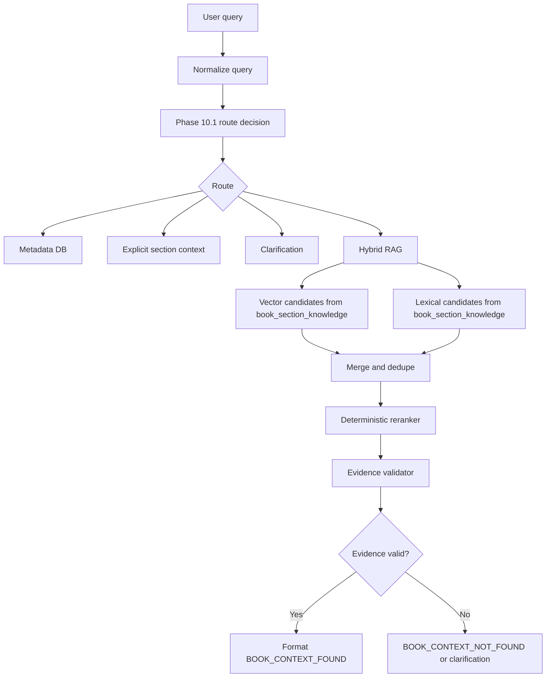

# Phase 10.3 Implementation Guide - Hybrid Retrieval, Reranking And Evidence Validation

## 1. Mục Tiêu

Phase 10.2 đã tạo canonical RAG index từ `BookSection.text_content`, giúp agent có thể truy xuất nội dung sách theo đúng section gốc thay vì phụ thuộc `LearningUnit`/Full/Pareto.

Phase 10.3 tiếp tục nâng chất lượng retrieval:

```text
Vector retrieval
+ Lexical retrieval
+ Reranking
+ Evidence validation
= Context đáng tin hơn trước khi agent trả lời
```

Mục tiêu sản phẩm:

- giảm lỗi "sách có nội dung nhưng AI báo không có";
- giảm việc agent xin web search sai;
- tăng khả năng tìm đúng section khi câu hỏi có tên riêng, thuật ngữ, số chương, trích dẫn hoặc từ khóa cụ thể;
- giúp typed chat và voice dùng cùng một retrieval policy;
- không dùng model mạnh hơn để che lỗi retrieval.

---

## 2. Vì Sao Cần Phase 10.3

### 2.1 Vector search mạnh về ý nghĩa nhưng yếu với chi tiết chính xác

Vector search giỏi khi user hỏi theo ý:

```text
"Nhân vật này cảm thấy cô đơn như thế nào?"
"Phần này nói gì về phương pháp nghiên cứu?"
```

Nhưng vector search có thể yếu khi câu hỏi cần exact match:

```text
"Crooks ở chương mấy?"
"SLR là gì?"
"GPQA là benchmark gì?"
"Tác giả có nhắc đến thuật ngữ X không?"
```

Các câu hỏi này cần bắt đúng token/tên riêng/thuật ngữ, không chỉ gần nghĩa.

### 2.2 Lexical search mạnh về từ khóa nhưng yếu về diễn đạt tự nhiên

Lexical search giỏi khi query và sách có cùng từ:

```text
Crooks
Curley
systematic literature review
logic mệnh đề
```

Nhưng lexical yếu nếu user hỏi diễn đạt khác:

```text
"người sống cô lập trong phòng riêng là ai?"
```

Vì vậy dùng lexical một mình cũng không đủ.

### 2.3 Reranking giúp chọn bằng chứng tốt nhất

Phase 10.2 hiện nhận top chunks từ vector RPC. Phase 10.3 cần gom candidates từ nhiều nguồn rồi xếp hạng lại:

```text
vector candidates
lexical candidates
section/title/path boosts
query intent hints
source diversity
=> final ranked evidence
```

### 2.4 Evidence validation giúp không trả lời bừa

Không được xem "có chunk trả về" là đủ.

Phase 10.3 phải kiểm tra:

- top chunk có đủ liên quan không;
- score có vượt ngưỡng không;
- có section/source rõ không;
- các chunks có mâu thuẫn hoặc quá phân tán không;
- query có vẻ hỏi sách nhưng retrieval yếu thì nên hỏi lại hoặc nói không tìm thấy, không được tự bịa.

---

## 3. Phạm Vi

### Làm trong Phase 10.3

- Thêm lexical retrieval cho `book_section_knowledge`.
- Thêm normalized search text để hỗ trợ tiếng Việt có dấu/không dấu và tiếng Anh.
- Merge candidates từ vector + lexical.
- Rerank bằng deterministic scoring.
- Validate evidence trước khi format context cho agent.
- Ghi trace an toàn:
  - retrieval method;
  - candidate counts;
  - final scores;
  - rejection reason;
  - selected section ids.
- Thêm regression tests cho semantic + exact term cases.

### Không làm trong Phase 10.3

- Không đổi FE contract.
- Không đổi `lk.chat`, `lk.transcript`, `lk.control`.
- Không nâng model để che retrieval yếu.
- Không sửa parser PDF/DOCX/EPUB.
- Không rewrite Full/Pareto.
- Không tự động web search khi retrieval yếu.
- Không hard-code theo `Of Mice and Men`, Crooks, John Steinbeck hoặc bất kỳ sách/test case cụ thể nào.

---

## 4. Kiến Trúc Đề Xuất



Phase 10.3 chỉ thay phần `Hybrid RAG`. Các route metadata/explicit section/clarification của Phase 10.1 giữ nguyên.

---

## 5. DB Và Search Index

### 5.1 Thêm `search_text` vào `book_section_knowledge`

Phase 10.2 đã có:

```text
content
content_hash
embedding
embedding_model
embedding_version
```

Phase 10.3 nên thêm:

```python
search_text: str
```

`search_text` là text đã normalize để lexical search:

```text
section path + section title + content
-> lowercase
-> fold accents
-> normalize whitespace
```

Ví dụ:

```text
"Chương 4 > Crooks\nCrooks sống một mình..."
```

thành:

```text
"chuong 4 crooks crooks song mot minh"
```

Lý do:

- user voice STT có thể thiếu dấu;
- user chat có thể gõ không dấu;
- tiếng Anh vẫn giữ token quan trọng;
- tránh phụ thuộc hoàn toàn vào `unaccent()` trong query runtime.

### 5.2 Index đề xuất

Migration Phase 10.3:

```sql
create extension if not exists pg_trgm;

alter table book_section_knowledge
add column if not exists search_text text not null default '';

create index if not exists ix_bsk_search_text_trgm
on book_section_knowledge
using gin (search_text gin_trgm_ops);

create index if not exists ix_bsk_content_fts_simple
on book_section_knowledge
using gin (to_tsvector('simple', content));
```

Giải thích:

- `search_text gin_trgm_ops` hỗ trợ fuzzy/exact lexical trên text normalized.
- `to_tsvector('simple', content)` hỗ trợ full-text search cơ bản cho nội dung raw.
- `simple` config an toàn hơn cho dữ liệu song ngữ Việt/Anh vì không stemming aggressive.

### 5.3 Backfill `search_text`

Sau migration, cần backfill rows cũ:

```text
book_section_knowledge.search_text = normalized_key(section_path + " " + section_title + " " + content)
```

Không làm trong request chat/voice.

Có hai lựa chọn:

1. Re-run `scripts/backfill_book_section_knowledge.py --run-now`.
2. Viết migration/backfill script riêng cập nhật `search_text` không gọi embedding lại.

Khuyến nghị:

```text
Backfill search_text riêng, không embed lại nếu content_hash chưa đổi.
```

Lý do: tiết kiệm cost embedding.

---

## 6. Lexical Retrieval RPC

Thêm function mới, không sửa function vector hiện tại:

```sql
create or replace function match_book_section_knowledge_lexical(
  query_text text,
  normalized_query_text text,
  match_count int,
  filter_book_ids uuid[],
  filter_section_ids uuid[] default null
)
returns table (
  id integer,
  book_id uuid,
  section_id uuid,
  section_path text,
  section_title text,
  chunk_index integer,
  content text,
  lexical_score float
)
language sql stable
as $$
  with fts_candidates as (
    select
      bsk.id,
      bsk.book_id,
      bsk.section_id,
      bs.path as section_path,
      bs.title as section_title,
      bsk.chunk_index,
      bsk.content,
      ts_rank_cd(
        to_tsvector('simple', bsk.content),
        websearch_to_tsquery('simple', query_text)
      )::float as score
    from book_section_knowledge bsk
    join book_sections bs on bs.id = bsk.section_id
    where bsk.book_id = any(filter_book_ids)
      and (filter_section_ids is null or bsk.section_id = any(filter_section_ids))
      and to_tsvector('simple', bsk.content) @@ websearch_to_tsquery('simple', query_text)
    order by score desc
    limit match_count
  ),
  trigram_candidates as (
    select
      bsk.id,
      bsk.book_id,
      bsk.section_id,
      bs.path as section_path,
      bs.title as section_title,
      bsk.chunk_index,
      bsk.content,
      similarity(bsk.search_text, normalized_query_text)::float as score
    from book_section_knowledge bsk
    join book_sections bs on bs.id = bsk.section_id
    where bsk.book_id = any(filter_book_ids)
      and (filter_section_ids is null or bsk.section_id = any(filter_section_ids))
      and bsk.search_text % normalized_query_text
    order by score desc
    limit match_count
  )
  select
    merged.id,
    merged.book_id,
    merged.section_id,
    merged.section_path,
    merged.section_title,
    merged.chunk_index,
    merged.content,
    max(merged.score) as lexical_score
  from (
    select * from fts_candidates
    union all
    select * from trigram_candidates
  ) merged
  group by
    merged.id,
    merged.book_id,
    merged.section_id,
    merged.section_path,
    merged.section_title,
    merged.chunk_index,
    merged.content
  order by max(merged.score) desc
  limit match_count;
$$;
```

Lưu ý:

- `query_text` dùng cho FTS raw.
- `normalized_query_text` dùng cho trigram trên `search_text`.
- Không dùng `OR` trực tiếp giữa FTS và trigram trong một WHERE lớn vì có thể làm query plan kém ổn định.
- Dùng CTE riêng rồi `union all` để dễ debug và tối ưu.

---

## 7. Service Layer

### 7.1 Tạo module retrieval riêng

Không nên để `app/services/rag_service.py` phình thành junk drawer.

Tạo:

```text
app/services/agent_grounding/hybrid_retrieval.py
```

Các object đề xuất:

```python
@dataclass(frozen=True)
class RetrievalCandidate:
    id: int
    book_id: str
    section_id: str
    section_path: str
    section_title: str
    chunk_index: int
    content: str
    vector_score: float | None = None
    lexical_score: float | None = None
    final_score: float = 0.0
    sources: tuple[str, ...] = ()


@dataclass(frozen=True)
class HybridRetrievalResult:
    found: bool
    chunks: list[dict]
    method: str
    reason_code: str
    candidate_count: int
```

### 7.2 Public API giữ tương thích

`search_book_knowledge(query, document_ids)` vẫn là entrypoint cũ cho voice/text.

Nội bộ:

```python
if settings.AGENT_HYBRID_RAG_ENABLED:
    return await search_book_hybrid_knowledge(...)

if settings.AGENT_CANONICAL_SECTION_RAG_ENABLED:
    return await search_book_section_knowledge(...)

return await search_learning_unit_knowledge(...)
```

Không đổi nơi gọi ở `agent_voice_gpt_realtime.py` trong Phase 10.3.

---

## 8. Candidate Merge Và Dedup

Vector payload:

```json
{
  "id": 1,
  "section_id": "...",
  "similarity": 0.74
}
```

Lexical payload:

```json
{
  "id": 1,
  "section_id": "...",
  "lexical_score": 0.32
}
```

Merge key:

```text
id
```

Fallback merge key nếu thiếu id:

```text
section_id + chunk_index
```

Rule:

- một chunk xuất hiện ở cả vector và lexical thì merge thành một candidate;
- giữ cả `vector_score` và `lexical_score`;
- `sources=("vector", "lexical")`;
- không duplicate context đưa vào LLM.

---

## 9. Reranking

### 9.1 Scoring ban đầu

Config đề xuất:

```python
AGENT_HYBRID_RAG_ENABLED: bool = False
AGENT_HYBRID_VECTOR_WEIGHT: float = 0.60
AGENT_HYBRID_LEXICAL_WEIGHT: float = 0.30
AGENT_HYBRID_TITLE_MATCH_BOOST: float = 0.07
AGENT_HYBRID_MULTI_SOURCE_BOOST: float = 0.03
AGENT_HYBRID_MIN_FINAL_SCORE: float = 0.25
AGENT_HYBRID_MAX_CONTEXT_CHUNKS: int = 6
AGENT_HYBRID_MAX_CHUNKS_PER_SECTION: int = 2
```

Pseudo:

```python
final_score = (
    vector_weight * normalized_vector_score
    + lexical_weight * normalized_lexical_score
    + title_match_boost
    + multi_source_boost
)
```

### 9.2 Title/path boost

Nếu query chứa token trùng với `section_title` hoặc `section_path`, boost nhẹ.

Ví dụ:

```text
query: "tóm tắt chương 4"
section_path: "Chapter 4"
```

Nhưng không boost quá mạnh, vì explicit section route của Phase 10.1 đã xử lý câu hỏi chỉ rõ chương.

### 9.3 Multi-source boost

Nếu chunk xuất hiện ở cả vector và lexical:

```text
sources=("vector", "lexical")
```

thì tăng nhẹ vì đây là dấu hiệu evidence ổn hơn.

### 9.4 Section diversity

Không để top context bị một section chiếm hết.

Rule:

```text
max 2 chunks/section
max 6 chunks total
```

Lý do:

- tránh context trùng lặp;
- tăng khả năng trả lời câu hỏi tổng hợp;
- giảm token vào LLM.

---

## 10. Evidence Validation

### 10.1 Không có candidate

Trả:

```text
BOOK_CONTEXT_NOT_FOUND
reason_code=no_candidates
```

Không tự web search.

### 10.2 Top score quá thấp

Nếu:

```text
top_final_score < AGENT_HYBRID_MIN_FINAL_SCORE
```

Trả not found hoặc ask clarification tùy route:

```text
reason_code=low_confidence
```

### 10.3 Query có named entity nhưng evidence không chứa token

Nếu query có token/tên riêng rõ ràng:

```text
Crooks
SLR
GPQA
Curley
```

mà top evidence không chứa token hoặc biến thể normalized của token, cần hạ confidence.

Không hard-code danh sách tên riêng. Dùng heuristic:

- uppercase acronym;
- quoted phrase;
- rare token dài;
- token không thuộc stopwords;
- số chương/mục.

### 10.4 Top chunks quá phân tán

Nếu top candidates từ nhiều section không liên quan và score gần nhau:

```text
reason_code=ambiguous_evidence
```

Khi đó agent nên hỏi lại:

```text
"Mình tìm thấy nhiều phần có thể liên quan. Bạn muốn hỏi về chương/mục nào?"
```

### 10.5 Evidence valid

Chỉ khi evidence valid mới format:

```text
BOOK_CONTEXT_FOUND
```

Mỗi chunk nên có metadata:

```text
retrieval_method=hybrid
vector_score
lexical_score
final_score
section_id
section_path
```

---

## 11. Observability

Hiện `AgentTurnTracer.record_retrieval()` đã hỗ trợ:

```text
method
retrieval_result_count
retrieval_chunk_ids
retrieval_section_ids
retrieval_scores
```

Phase 10.3 nên mở rộng trace an toàn:

```text
retrieval_method=hybrid
vector_candidate_count
lexical_candidate_count
merged_candidate_count
evidence_reason_code
```

Không log:

- raw query nếu production;
- full content chunk;
- embedding;
- prompt;
- access token;
- raw transcript.

Nếu chưa muốn thay đổi trace schema lớn, có thể nhét `method="hybrid"` trước, rồi mở rộng trace ở phase nhỏ sau.

---

## 12. Code Changes Đề Xuất

### 12.1 Config

File:

```text
app/core/config.py
.env.example
.env
```

Thêm:

```python
AGENT_HYBRID_RAG_ENABLED: bool = False
AGENT_HYBRID_VECTOR_WEIGHT: float = 0.60
AGENT_HYBRID_LEXICAL_WEIGHT: float = 0.30
AGENT_HYBRID_TITLE_MATCH_BOOST: float = 0.07
AGENT_HYBRID_MULTI_SOURCE_BOOST: float = 0.03
AGENT_HYBRID_MIN_FINAL_SCORE: float = 0.25
AGENT_HYBRID_VECTOR_CANDIDATES: int = 12
AGENT_HYBRID_LEXICAL_CANDIDATES: int = 12
AGENT_HYBRID_MAX_CONTEXT_CHUNKS: int = 6
AGENT_HYBRID_MAX_CHUNKS_PER_SECTION: int = 2
```

### 12.2 Model

File:

```text
app/models/db_models.py
```

Add:

```python
search_text: str = Field(default="", sa_column=Column(Text, nullable=False, server_default=""))
```

### 12.3 Migration

Tạo:

```text
app/db/migrations/versions/<revision>_phase_10_3_hybrid_retrieval.py
```

Nội dung:

- enable `pg_trgm`;
- add `search_text`;
- create trigram index;
- create FTS index;
- create lexical RPC;
- drop lexical RPC on downgrade.

### 12.4 Indexer

File:

```text
app/services/book_section_knowledge_indexer.py
```

Update `_build_records()` để lưu:

```python
search_text=normalized_key(
    f"{section_path} {section_title} {chunk.content}"
)
```

Nên reuse:

```text
app/services/agent_grounding/query_normalizer.py
```

### 12.5 Backfill script

Update:

```text
scripts/backfill_book_section_knowledge.py
```

Thêm option:

```powershell
--search-text-only
```

Để cập nhật `search_text` mà không gọi embedding lại.

### 12.6 RAG service

File:

```text
app/services/rag_service.py
```

Thêm:

```python
async def search_book_hybrid_knowledge(...)
```

Entry decision:

```python
if settings.AGENT_HYBRID_RAG_ENABLED:
    return await search_book_hybrid_knowledge(query, document_ids)
```

### 12.7 New module

Tạo:

```text
app/services/agent_grounding/hybrid_retrieval.py
```

Nên chứa:

- dataclasses;
- merge candidates;
- normalize scores;
- title/path boost;
- evidence validation;
- context candidate selection.

Không gọi Supabase/OpenAI trực tiếp trong pure helper functions để test offline dễ.

---

## 13. Test Plan

### 13.1 Unit tests

Tạo:

```text
tests/services/agent_grounding/test_hybrid_retrieval.py
```

Cases:

- merge vector + lexical candidates without duplicate;
- candidate appearing in both sources gets multi-source boost;
- title/path match gives small boost;
- max chunks per section is enforced;
- low score is rejected;
- named entity query rejects evidence that does not contain entity token;
- no candidates returns `no_candidates`;
- ambiguous evidence returns `ambiguous_evidence`.

### 13.2 RAG service tests

Update:

```text
tests/services/test_rag_service.py
```

Cases:

- `AGENT_HYBRID_RAG_ENABLED=false` keeps Phase 10.2 behavior;
- `AGENT_HYBRID_RAG_ENABLED=true` calls hybrid path;
- hybrid no evidence returns not found, not legacy unless explicitly configured;
- payload includes `section_id`, `final_score`, `retrieval_method`.

### 13.3 DB/RPC manual tests

Sau migration dev:

```powershell
uv run alembic upgrade head
uv run python scripts/backfill_book_section_knowledge.py --book-id <book_id> --search-text-only
```

Test SQL:

```sql
select *
from match_book_section_knowledge_lexical(
  'Crooks',
  'crooks',
  10,
  array['<book_id>'::uuid],
  null
);
```

### 13.4 Agent eval

Rerun Phase 10 eval set:

```text
metadata cases
explicit section cases
semantic cases
unavailable content cases
web permission cases
voice transcript cases
```

Expected:

- metadata route không đổi;
- explicit section route không đổi;
- semantic exact-term cases cải thiện;
- web fallback sai giảm;
- `retrieval_method=hybrid`;
- `retrieval_section_ids` không rỗng khi sách có nội dung.

---

## 14. Acceptance Criteria

Phase 10.3 hoàn thành khi:

1. Hybrid retrieval bật/tắt được bằng feature flag.
2. Không breaking Phase 10.2 canonical vector path.
3. Lexical retrieval query được `book_section_knowledge`.
4. Search hỗ trợ tốt hơn cho:
   - tên riêng;
   - acronym;
   - thuật ngữ;
   - câu hỏi có số chương/mục;
   - tiếng Việt có dấu/không dấu.
5. Reranker deterministic, test offline được.
6. Evidence validator có reason code rõ:
   - `no_candidates`;
   - `low_confidence`;
   - `missing_named_entity`;
   - `ambiguous_evidence`;
   - `valid`.
7. Agent không tự xin web search nếu retrieval fail do index chưa backfill.
8. Regression deterministic tests pass.
9. Manual DB/RPC test pass trên dev.
10. Có rollout/rollback plan.

---

## 15. Rollout Plan

### Deploy 1

```text
AGENT_HYBRID_RAG_ENABLED=false
```

Mục tiêu:

- migration chạy ổn;
- `search_text` column/index/RPC có sẵn;
- system behavior không đổi.

### Backfill

```powershell
uv run python scripts/backfill_book_section_knowledge.py --all --search-text-only
```

Nếu cần rebuild toàn bộ canonical chunks:

```powershell
uv run python scripts/backfill_book_section_knowledge.py --all --run-now
```

### Canary

```text
AGENT_HYBRID_RAG_ENABLED=true
```

Theo dõi:

- retrieval latency p50/p95;
- vector/lexical candidate counts;
- evidence rejection rate;
- web fallback rate;
- wrong-section rate;
- no-context rate.

### Rollback

```text
AGENT_HYBRID_RAG_ENABLED=false
```

Nếu cần rollback sâu hơn:

```text
AGENT_CANONICAL_SECTION_RAG_ENABLED=false
```

---

## 16. Trade-off

### 16.1 Latency tăng

Hybrid retrieval gọi thêm lexical RPC.

Giảm rủi ro:

- chạy vector và lexical song song bằng `asyncio.gather`;
- giới hạn candidate count;
- log latency theo stage;
- cân nhắc timeout riêng cho lexical.

### 16.2 Query phức tạp hơn

DB có thêm FTS/trigram indexes và RPC.

Giảm rủi ro:

- migration riêng;
- rollback flag;
- test RPC trên DB dev;
- không xoá vector path.

### 16.3 Reranking ban đầu vẫn heuristic

Reranker deterministic có thể chưa hoàn hảo.

Nhưng đây là trade-off đúng trước khi dùng model reranker vì:

- rẻ;
- nhanh;
- test offline dễ;
- không thêm provider dependency.

Model reranker chỉ nên cân nhắc sau khi có metrics Phase 10.3.

### 16.4 Lexical có thể bias exact term quá mạnh

Nếu boost quá cao, exact word không quan trọng có thể lấn semantic meaning.

Giải pháp:

- boost nhỏ;
- final score weight config;
- test semantic cases;
- section diversity.

---

## 17. Senior Notes Cho Em

Phase 10.3 là bước biến RAG từ "tìm đoạn gần nghĩa" thành "chọn bằng chứng đáng tin".

Điểm tư duy quan trọng:

```text
Retrieval không phải chỉ là lấy top 10 vector chunks.
Retrieval đúng là:
1. lấy nhiều nguồn candidate;
2. hiểu query cần exact term hay semantic meaning;
3. chấm lại bằng luật rõ ràng;
4. loại evidence yếu;
5. chỉ đưa context sạch cho agent.
```

Khi hệ thống sai, mình phải trace được:

```text
Vector có tìm ra không?
Lexical có tìm ra không?
Candidate nào bị loại?
Vì sao bị loại?
Final evidence đến từ section nào?
Agent có dùng evidence đó không?
```

Đây là nền tảng để Phase 10.4 xử lý voice robustness. Nếu retrieval đã đúng mà voice vẫn sai, lúc đó mình mới chứng minh được lỗi nằm ở STT/tool-call/realtime orchestration.

---

## 18. Phase Tiếp Theo Sau 10.3

Sau Phase 10.3:

```text
Phase 10.4 - Voice STT And Tool-Call Robustness
```

Mục tiêu Phase 10.4:

- giảm lỗi voice transcript làm lệch câu hỏi;
- phát hiện transcript mơ hồ;
- ép voice dùng cùng retrieval policy với text;
- giảm tình trạng realtime model bỏ qua tool hoặc trả lời từ model memory.
