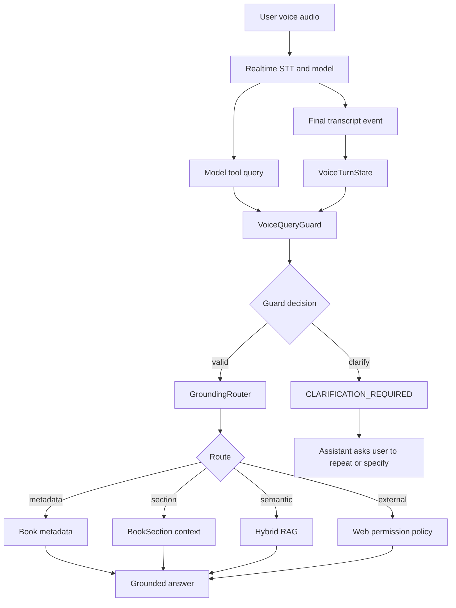

# Phase 10.4 Implementation Guide - Voice STT Robustness And Tool-Call Guardrails

Date: 2026-06-05  
Status: Draft for implementation approval  
Depends on: Phase 7 realtime stabilization, Phase 10.0 trace baseline, Phase 10.1 grounding router, Phase 10.2 canonical BookSection index, Phase 10.3 hybrid retrieval  
Primary scope: realtime voice agent accuracy, STT ambiguity, tool-call query validation, clarification behavior

---

## 1. Mục Tiêu

Phase 10.3 đã làm retrieval chắc hơn:

```text
BookSection canonical index
+ hybrid vector/lexical retrieval
+ evidence validation
```

Nếu sau Phase 10.3 voice vẫn trả lời lệch trong khi typed chat đúng hơn, nguyên nhân thường không còn nằm chủ yếu ở RAG nữa mà nằm ở:

- STT nghe sai hoặc thiếu từ quan trọng;
- realtime model tự diễn giải câu hỏi trước khi tool call;
- query mà realtime model gửi vào tool không còn giống ý user nói;
- voice trả lời từ model memory khi tool context yếu;
- transcript cuối đến muộn hoặc không được dùng đúng để kiểm tra intent.

Mục tiêu Phase 10.4:

```text
Voice transcript
-> kiểm tra đủ rõ chưa
-> so khớp với query mà realtime model đưa vào tool
-> nếu mơ hồ thì hỏi lại
-> nếu rõ thì đi qua GroundingRouter + Hybrid RAG
-> không tự bịa, không xin web sai khi sách có nội dung
```

Kết quả cần đạt:

- voice không trả lời bừa khi transcript ngắn, méo nghĩa hoặc thiếu tham chiếu chương/mục;
- voice tool-call query phải được guard trước khi gọi metadata/section/RAG;
- voice và typed chat vẫn dùng chung grounding/retrieval policy;
- không thay đổi Flutter DataChannel contract;
- không hard-code theo một file audio, một cuốn sách hoặc một câu hỏi test.

---

## 2. Vấn Đề Hiện Tại

### 2.1 Voice khác typed chat ở tầng input

Typed chat:

```text
FE text -> backend text chat handler -> GroundingRouter -> RAG/tool policy
```

Voice:

```text
audio -> realtime STT/model -> model tự gọi tool bằng query nó hiểu -> GroundingRouter/RAG
```

Điểm khác biệt quan trọng:

```text
Tool query trong voice không chắc là transcript gốc của user.
```

Realtime model có thể nghe hoặc diễn giải sai:

```text
"đại ý chương 4"
-> transcript/tool query có thể lệch thành câu khác
-> agent đi tìm sai section hoặc xin web
```

Phase 10.4 không cố sửa mọi lỗi STT. Nó tạo guard để khi input chưa đủ tin cậy thì hệ thống hỏi lại thay vì trả lời bừa.

### 2.2 Transcript final có thể đến muộn

LiveKit/OpenAI realtime có thể phát sinh:

- assistant bắt đầu trả lời trước khi transcript final được ghi nhận;
- `user_input_transcribed` và `conversation_item_added` không đến theo thứ tự trực quan;
- tool call query có thể được tạo từ trạng thái nội bộ của model.

Vì vậy không được chỉ dựa vào thời điểm event.

Phase 10.4 cần lưu một trạng thái voice-turn nhẹ:

```text
recent final transcript
recent committed user item
tool query
timestamp
correlation quality
```

Sau đó guard query bằng so khớp token/intent an toàn.

### 2.3 RAG fail không đồng nghĩa được phép web search

Nếu voice transcript mơ hồ, retrieval yếu là hệ quả tự nhiên. Không được biến lỗi STT thành:

```text
"Tôi không tìm thấy trong sách. Bạn có muốn tìm web không?"
```

Luồng đúng:

```text
transcript/query mơ hồ
-> hỏi lại câu ngắn
-> không gọi web
```

---

## 3. Phạm Vi

### Làm trong Phase 10.4

- Thêm voice query guard trước khi `TriamAssistant.resolve_book_query`.
- Thêm module pure để đánh giá transcript/tool query:
  - quá ngắn;
  - thiếu token quan trọng;
  - có tham chiếu chương/mục nhưng không đủ số/tên;
  - tool query lệch nhiều so với recent transcript;
  - query giống permission reply thay vì câu hỏi sách.
- Thêm clarification templates cho voice.
- Thêm trace/log an toàn cho:
  - query guard decision;
  - reason code;
  - token counts;
  - overlap score;
  - whether clarification was returned.
- Giữ typed chat behavior hiện tại.
- Thêm tests offline deterministic.
- Thêm manual voice test checklist dùng fixtures trong `tests/fixtures`.

### Không làm trong Phase 10.4

- Không đổi model realtime mặc định.
- Không đổi FE DataChannel contract.
- Không thêm endpoint mới.
- Không tự động web search.
- Không dùng LLM classifier mặc định cho mọi voice query.
- Không lưu raw audio hoặc full transcript vào log production.
- Không sửa parser, upload, Pareto planner hoặc TTS.

---

## 4. Kiến Trúc Đề Xuất



Điểm chính:

```text
VoiceQueryGuard đứng trước GroundingRouter/RAG.
```

Nó không thay thế GroundingRouter. Nó chỉ trả lời câu hỏi:

```text
"Query voice này có đủ tin cậy để đi tiếp không?"
```

---

## 5. Business Rules

### 5.1 Query quá ngắn hoặc không phải câu hỏi học tập

Ví dụ:

```text
"ừ"
"rồi"
"ok"
"tiếp"
"có"
```

Nếu không phải đang ở flow xin phép web hoặc control playback, không đưa các câu này vào RAG.

Decision:

```text
CLARIFICATION_REQUIRED
reason=too_short_or_ack_only
```

Clarification:

```text
"Bạn muốn hỏi nội dung nào trong sách?"
```

### 5.2 Câu hỏi nhắc chương/mục nhưng thiếu tham chiếu

Ví dụ:

```text
"tóm tắt chương"
"đại ý chương"
"phần đó nói gì"
```

GroundingRouter Phase 10.1 đã có logic hỏi lại khi thiếu section reference. Phase 10.4 cần đảm bảo voice không bypass logic này.

Decision:

```text
CLARIFICATION_REQUIRED
reason=missing_section_reference
```

Clarification:

```text
"Bạn muốn hỏi chương hoặc đề mục nào?"
```

### 5.3 Tool query lệch nhiều so với transcript gần nhất

Nếu recent final transcript có token quan trọng nhưng tool query mất hết token đó, khả năng realtime model đã diễn giải sai.

Ví dụ tổng quát:

```text
transcript important tokens: ["chuong", "4", "crooks"]
tool query important tokens: ["dai", "ly"]
overlap thấp
```

Overlap không được tính theo độ dài transcript gốc, vì voice transcript thường dài và lịch sự hơn tool query.

Sai:

```text
overlap = matched_tokens / transcript_tokens
```

Ví dụ:

```text
transcript: "Bạn có thể vui lòng tóm tắt giúp mình nội dung chương 4 được không ạ?"
tool query: "tóm tắt chương 4"
```

Nếu chia theo transcript, câu hợp lệ này có thể bị chấm thấp vì transcript có nhiều từ đệm lịch sự.

Đúng:

```text
overlap = matched_query_tokens / query_tokens
important_overlap = matched_query_important_tokens / query_important_tokens
```

Lý do:

```text
Tool query thường là bản rút gọn có chủ đích của câu nói.
Guard chỉ cần kiểm tra tool query có còn nằm trong ý chính của transcript không.
```

Decision:

```text
CLARIFICATION_REQUIRED
reason=tool_query_transcript_mismatch
```

Clarification:

```text
"Mình nghe chưa chắc câu hỏi. Bạn nói lại ngắn gọn giúp mình nhé."
```

### 5.4 Transcript có đủ nghĩa thì cho đi tiếp

Nếu query rõ:

```text
"Tác giả của sách là ai?"
"Tóm tắt chương 4."
"Crooks cảm thấy cô đơn như thế nào?"
"SLR là gì trong tài liệu này?"
```

Decision:

```text
valid
```

Sau đó gọi:

```text
GroundingRouter -> metadata / section / hybrid RAG
```

### 5.5 Permission reply không phải book query

Khi agent vừa hỏi xin phép web, user có thể trả lời:

```text
"yup làm đi"
"được tìm đi"
"không cần"
```

Các câu này thuộc web permission policy, không phải RAG query.

Phase 10.4 phải tránh đưa permission reply vào book retrieval.

Decision:

```text
permission_reply
```

Luồng xử lý vẫn thuộc `WebSearchPermissionPolicy` và classifier Phase 7.1.

---

## 6. Code Changes Đề Xuất

### 6.1 Config

File:

```text
app/core/config.py
.env.example
.env
```

Thêm:

```python
VOICE_AGENT_QUERY_GUARD_ENABLED: bool = True
VOICE_AGENT_QUERY_GUARD_MIN_CHARS: int = 6
VOICE_AGENT_QUERY_GUARD_MIN_TOKENS: int = 2
VOICE_AGENT_QUERY_GUARD_TRANSCRIPT_TTL_SECONDS: float = 15.0
VOICE_AGENT_QUERY_GUARD_MIN_OVERLAP_RATIO: float = 0.34
VOICE_AGENT_QUERY_GUARD_MIN_IMPORTANT_OVERLAP_RATIO: float = 0.25
VOICE_AGENT_QUERY_GUARD_LOG_DETAILS: bool = True
```

Trade-off:

- Bật mặc định giúp voice an toàn hơn.
- Nếu guard quá conservative, rollback bằng:

```env
VOICE_AGENT_QUERY_GUARD_ENABLED=false
```

### 6.2 New module: `voice_agent/query_guard.py`

Tạo:

```text
app/services/voice_agent/query_guard.py
```

Object đề xuất:

```python
@dataclass(frozen=True)
class VoiceTranscriptSnapshot:
    text: str
    created_monotonic: float
    language: str | None = None


@dataclass(frozen=True)
class VoiceQueryGuardResult:
    valid: bool
    reason_code: str
    clarification: str | None = None
    token_count: int = 0
    important_token_count: int = 0
    overlap_ratio: float | None = None
    important_overlap_ratio: float | None = None
```

Pure functions:

```python
assess_voice_query(query: str) -> VoiceQueryGuardResult
compare_query_with_transcript(query: str, transcript: VoiceTranscriptSnapshot | None) -> VoiceQueryGuardResult
guard_voice_book_query(query: str, transcript: VoiceTranscriptSnapshot | None) -> VoiceQueryGuardResult
```

Rules:

- dùng `normalize_query`, `normalized_key`, `tokenize` hiện có;
- tính overlap bằng denominator là token của tool query, không phải token của transcript;
- không hard-code tên sách/nhân vật;
- stopwords song ngữ chỉ dùng để tìm important tokens;
- acronym, số chương, token dài, quoted phrase là important tokens;
- không tự viết regex thay số tiếng Việt thô;
- reuse `parse_positive_integer_phrase()` và `parse_section_reference()` từ `app/services/agent_grounding/section_reference_parser.py` để hiểu `chương bốn`, `chương mười bốn`, `chapter four`, `mục 1.2.3`;
- không gọi LLM trong default path.

Pseudo overlap:

```python
query_tokens = important_or_content_tokens(tool_query)
transcript_tokens = important_or_content_tokens(recent_transcript.text)
matched = query_tokens & transcript_tokens
overlap_ratio = len(matched) / max(1, len(query_tokens))
```

Important overlap cũng dùng cùng hướng:

```python
important_overlap_ratio = len(matched_important_query_tokens) / max(1, len(important_query_tokens))
```

Nếu query không có important token rõ ràng thì chỉ dùng `overlap_ratio` tổng quát và các rule mơ hồ khác.

### 6.3 New lightweight state: `VoiceTurnState`

Có hai lựa chọn:

1. Tạo class riêng trong `voice_agent/query_guard.py`.
2. Tạo module `voice_agent/turn_state.py`.

Khuyến nghị:

```text
app/services/voice_agent/turn_state.py
```

Object:

```python
class VoiceTurnState:
    def record_final_transcript(text, language)
    def record_committed_user_text(text)
    def recent_transcript(ttl_seconds)
```

Mục tiêu:

- không phụ thuộc LiveKit SDK trong test;
- chỉ lưu text normalized/timestamp trong memory session;
- không persist state này vào DB.

### 6.4 Update `agent_voice_gpt_realtime.py`

File:

```text
app/services/agent_voice_gpt_realtime.py
```

Thay đổi chính:

1. Tạo `voice_turn_state` trong `entrypoint`.
2. Trong `_handle_user_input_transcribed`:

```python
if is_final and transcript:
    voice_turn_state.record_final_transcript(transcript, language)
```

3. Trong `_handle_conversation_item_added` với role user:

```python
voice_turn_state.record_committed_user_text(text)
```

4. Inject guard/state vào `TriamAssistant`.

```python
agent_instance = TriamAssistant(
    document_ids=document_ids,
    web_search_policy=web_search_policy,
    tracer=tracer,
    grounding_router=grounding_router,
    voice_turn_state=voice_turn_state,
)
```

5. Trong `TriamAssistant.resolve_book_query`:

```python
if input_mode == AgentInputMode.VOICE and settings.VOICE_AGENT_QUERY_GUARD_ENABLED:
    guard_result = guard_voice_book_query(
        query,
        self.voice_turn_state.recent_transcript(settings.VOICE_AGENT_QUERY_GUARD_TRANSCRIPT_TTL_SECONDS),
    )
    if not guard_result.valid:
        self.tracer.record_answer_source(input_mode, AgentAnswerSource.CLARIFICATION)
        log.info(...)
        return f"CLARIFICATION_REQUIRED:\n{guard_result.clarification}"
```

Không guard typed chat ở Phase 10.4 vì typed chat đã là text rõ từ FE.

### 6.5 Prompt update

Update `VOICE_AGENT_INSTRUCTIONS` ngắn gọn hơn, tập trung vào behavior:

```text
If a tool returns CLARIFICATION_REQUIRED, ask exactly that clarification and stop.
Never turn unclear book questions into web-search permission requests.
For book questions, always call search_book_knowledge before answering.
Do not answer book facts from model memory.
```

Không thêm prompt dài để cố dạy model sửa STT. Guard ở code phải là lớp quyết định.

### 6.6 Trace/log

Không cần đổi DB schema.

Log an toàn:

```text
Voice query guard | valid=false | reason=tool_query_transcript_mismatch | query_chars=... | transcript_chars=... | overlap=...
```

Không log:

- full transcript;
- raw query;
- audio bytes;
- chunk content;
- token;
- provider payload.

Nếu muốn mở rộng `AgentTurnTracer`, có thể thêm stage:

```text
voice_query_guard
```

Nhưng Phase 10.4 có thể chỉ dùng `record_latency` + `record_error/answer_source` trước để tránh phình trace schema.

---

## 7. Test Plan

### 7.1 Unit tests cho query guard

Tạo:

```text
tests/services/voice_agent/test_query_guard.py
```

Cases:

- short ack-only text bị clarification;
- clear metadata query pass;
- clear section query pass;
- missing section reference bị clarification;
- tool query/transcript overlap thấp bị clarification;
- polite long transcript with concise matching tool query pass;
- acronym/số chương được tính là important tokens;
- Vietnamese number phrase như `chương mười bốn` không bị normalize sai thành `10 4`;
- no recent transcript không block clear query;
- permission reply không bị đưa vào book query.

### 7.2 Unit tests cho turn state

Tạo:

```text
tests/services/voice_agent/test_turn_state.py
```

Cases:

- stores recent final transcript;
- expires transcript after TTL;
- committed user item can be recorded without DB;
- empty transcript ignored.

### 7.3 Focused tests cho `TriamAssistant.resolve_book_query`

Có thể tạo test không cần LiveKit server bằng cách mock:

- `search_voice_book_context`;
- `GroundingRouter`;
- `VoiceTurnState`;
- `AgentTurnTracer`.

Cases:

- voice unclear query returns `CLARIFICATION_REQUIRED`;
- voice clear query calls existing GroundingRouter/RAG path;
- text mode bypasses voice guard;
- guard clarification does not call web search.

### 7.4 Manual voice integration

Fixtures hiện có:

```text
tests/fixtures/Có-những-phương-pháp.wav
tests/fixtures/yub-làm-đi.wav
```

Nên bổ sung thêm sau nếu có thời gian:

```text
tests/fixtures/tac-gia-cua-sach.wav
tests/fixtures/tom-tat-chuong-4.wav
tests/fixtures/dai-y-chuong-4.wav
tests/fixtures/crooks-cam-thay-the-nao.wav
```

Manual flow:

```text
1. Start server
2. Start realtime agent
3. Join LiveKit room with known thread/book
4. Play fixture audio or speak manually
5. Capture:
   - final transcript char count;
   - guard decision;
   - grounding route;
   - retrieval method;
   - answer source;
   - DB message delta.
```

Không đưa manual provider/LiveKit tests vào default pytest.

---

## 8. Acceptance Criteria

Phase 10.4 hoàn thành khi:

1. Voice query guard có feature flag.
2. Query quá ngắn/mơ hồ không đi vào RAG.
3. Query nhắc chương/mục nhưng thiếu tham chiếu hỏi lại rõ ràng.
4. Tool query lệch mạnh so với recent transcript bị chặn và hỏi lại.
5. Permission replies không bị hiểu là câu hỏi sách.
6. Typed chat behavior không đổi.
7. Voice vẫn dùng GroundingRouter + Hybrid RAG khi query hợp lệ.
8. Không thay đổi `lk.chat`, `lk.transcript`, `lk.control`.
9. Logs không chứa raw transcript hoặc nội dung sách dài.
10. Focused tests pass.
11. Full deterministic pytest pass.

---

## 9. Rollout Plan

### Step 1: Deploy code với guard bật

```env
VOICE_AGENT_QUERY_GUARD_ENABLED=true
```

Theo dõi logs:

```text
Voice query guard | valid=false | reason=...
```

### Step 2: Test voice trên dev/prod

Golden cases:

- metadata: tác giả;
- explicit section: tóm tắt chương 4;
- semantic: nhân vật/khái niệm cụ thể;
- ambiguous: "tóm tắt chương";
- permission: "yup làm đi".

### Step 3: Tune threshold

Nếu guard hỏi lại quá nhiều:

```env
VOICE_AGENT_QUERY_GUARD_MIN_OVERLAP_RATIO=0.25
VOICE_AGENT_QUERY_GUARD_MIN_IMPORTANT_OVERLAP_RATIO=0.15
```

Nếu guard còn để lọt câu lệch:

```env
VOICE_AGENT_QUERY_GUARD_MIN_OVERLAP_RATIO=0.45
VOICE_AGENT_QUERY_GUARD_MIN_IMPORTANT_OVERLAP_RATIO=0.34
```

### Rollback

```env
VOICE_AGENT_QUERY_GUARD_ENABLED=false
```

Rollback không cần migration.

---

## 10. Trade-off

### 10.1 Có thể hỏi lại nhiều hơn

Guard conservative sẽ làm user phải nói lại trong một số case.

Nhưng với voice learning app, hỏi lại một câu ngắn tốt hơn trả lời sai dài và làm mất niềm tin.

### 10.2 Không sửa tận gốc STT

Phase 10.4 không thay STT provider hoặc realtime model.

Nó giảm hậu quả của STT sai.

Sau khi có logs guard, nếu lỗi STT thật sự nhiều, Phase 10.7 mới nên cân nhắc:

- đổi transcription model;
- thêm language/domain prompt;
- thêm noise/audio UX guidance;
- đổi realtime model.

### 10.3 Heuristic không hoàn hảo

Deterministic guard có thể bỏ sót một số câu lệch tinh vi.

Nhưng ưu điểm:

- rẻ;
- nhanh;
- test offline được;
- không thêm provider latency;
- dễ giải thích trong báo cáo capstone.

Nếu cần model-based guard sau này, thêm sau dưới feature flag riêng, không thay thế ngay deterministic guard.

### 10.4 TTL transcript dài hơn một chút

Default `VOICE_AGENT_QUERY_GUARD_TRANSCRIPT_TTL_SECONDS=15.0`.

Lý do:

- mạng di động yếu có thể làm STT/tool-call trễ;
- câu hỏi voice dài có thể mất vài giây để VAD/STT/model xử lý;
- state chỉ giữ một chuỗi text ngắn trong RAM nên chi phí bộ nhớ rất nhỏ.

Trade-off:

- TTL dài hơn có thể làm guard so với transcript cũ nếu nhiều turn xảy ra rất sát nhau.

Giảm rủi ro:

- cập nhật transcript snapshot mỗi final transcript mới;
- ưu tiên committed user item mới nhất nếu có;
- expire bằng monotonic time;
- log correlation quality khi mismatch.

---

## 11. Implementation Order

Khuyến nghị implement theo thứ tự:

1. Add config flags.
2. Add `voice_agent/query_guard.py` pure helper.
3. Add `voice_agent/turn_state.py`.
4. Add tests cho query guard và turn state.
5. Wire vào `agent_voice_gpt_realtime.py`.
6. Update prompt ngắn gọn.
7. Add focused tests cho `TriamAssistant.resolve_book_query`.
8. Run:

```powershell
uv run ruff check app/services/voice_agent app/services/agent_voice_gpt_realtime.py tests/services/voice_agent
uv run pytest tests/services/voice_agent tests/services/agent_observability tests/services/agent_grounding -q
uv run pytest tests -q
```

9. Manual voice test với fixtures.
10. Update implementation status trong doc này.

---

## 12. Senior Notes Cho Em

Phase 10.4 là bước rất quan trọng về tư duy production:

```text
Không phải lúc nào model trả lời sai cũng do model ngu.
Nhiều khi input vào model đã sai hoặc tool query đã lệch.
```

Với voice, mình cần một lớp bảo vệ trước khi truy xuất tri thức:

```text
"Tôi có nghe đủ rõ để tìm sách chưa?"
```

Nếu chưa rõ, hỏi lại.

Điều này làm app có vẻ "cẩn thận" hơn, nhưng thực tế đó là hành vi chuyên nghiệp của một trợ lý học tập. Một câu hỏi lại ngắn giúp tránh một câu trả lời sai dài.

Sau Phase 10.4, nếu voice vẫn sai, mình sẽ có trace để phân biệt:

- STT nghe sai;
- tool query lệch transcript;
- router chọn sai route;
- RAG lấy sai evidence;
- model không tuân tool result.

Khi phân lớp được lỗi như vậy, tối ưu tiếp mới đúng hướng.

---

## 13. Implementation Status - 2026-06-05

### 13.1 Code đã implement

Đã thêm cấu hình Phase 10.4:

```text
VOICE_AGENT_QUERY_GUARD_ENABLED
VOICE_AGENT_QUERY_GUARD_MIN_CHARS
VOICE_AGENT_QUERY_GUARD_MIN_TOKENS
VOICE_AGENT_QUERY_GUARD_TRANSCRIPT_TTL_SECONDS
VOICE_AGENT_QUERY_GUARD_MIN_OVERLAP_RATIO
VOICE_AGENT_QUERY_GUARD_MIN_IMPORTANT_OVERLAP_RATIO
VOICE_AGENT_QUERY_GUARD_LOG_DETAILS
```

Đã thêm `app/services/voice_agent/turn_state.py`.

Vai trò:

- giữ final transcript gần nhất từ sự kiện `user_input_transcribed`;
- giữ committed user text gần nhất từ `conversation_item_added`;
- ưu tiên committed text mới hơn;
- expire bằng monotonic time để tránh so sánh nhầm theo clock hệ thống.

Đã thêm `app/services/voice_agent/query_guard.py`.

Vai trò:

- chặn câu quá ngắn hoặc chỉ là câu xác nhận;
- chặn câu trả lời permission kiểu `ok`, `yup`, `yub làm đi` khỏi bị đưa vào book RAG;
- bắt câu hỏi section thiếu target như `Tóm tắt chương.`;
- so sánh tool query do realtime model tạo với transcript voice gần nhất;
- nếu tool query lệch transcript, trả `CLARIFICATION_REQUIRED` để AI hỏi lại thay vì tìm sách hoặc xin web sai.

Đã wire vào `app/services/agent_voice_gpt_realtime.py`:

- `TriamAssistant` nhận `VoiceTurnState`;
- `resolve_book_query(...)` chỉ bật guard cho `AgentInputMode.VOICE`;
- text chat không bị guard này chặn;
- prompt voice biết xử lý marker `WEB_PERMISSION_REPLY_DETECTED`;
- handler final transcript và committed user item đều cập nhật voice turn state;
- log guard chỉ ghi metadata như `reason`, số token, overlap, không ghi raw transcript/query.

### 13.2 Behavior quan trọng

Voice:

```text
STT final: "Đại lý chương."
Realtime tool query: "tóm tắt chương 4"
=> guard thấy query lệch transcript
=> trả CLARIFICATION_REQUIRED
=> AI hỏi user nói lại
```

Web permission:

```text
User: "Yub làm đi"
Realtime lỡ gọi search_book_knowledge("Yub làm đi")
=> guard trả WEB_PERMISSION_REPLY_DETECTED
=> AI phải tiếp tục permission flow, không RAG sách
```

Text chat:

```text
User typed text qua lk.chat
=> không áp dụng voice query guard
=> vẫn dùng router/RAG/web permission flow hiện tại
```

### 13.3 Tests đã thêm

```text
tests/services/voice_agent/test_turn_state.py
tests/services/voice_agent/test_query_guard.py
tests/services/voice_agent/test_agent_voice_query_guard.py
```

Coverage chính:

- recent transcript ưu tiên committed user text mới nhất;
- transcript hết TTL thì không dùng;
- câu xác nhận web không bị coi là câu hỏi sách;
- câu hỏi metadata hợp lệ không bị chặn;
- câu hỏi section thiếu target bị hỏi lại;
- tool query ngắn gọn vẫn match transcript voice dài hơn;
- tool query lệch intent bị chặn trước RAG;
- text query không bị voice guard chặn.

### 13.4 Verification đã chạy

```powershell
uv run python -m py_compile app\services\voice_agent\query_guard.py app\services\voice_agent\turn_state.py app\services\agent_voice_gpt_realtime.py
uv run pytest tests\services\voice_agent\test_agent_voice_query_guard.py tests\services\voice_agent\test_query_guard.py tests\services\voice_agent\test_turn_state.py -q
uv run ruff check app\services\voice_agent app\services\agent_voice_gpt_realtime.py tests\services\voice_agent
uv run pytest tests\services\voice_agent tests\services\agent_observability tests\services\agent_grounding -q
uv run ruff check app\services app\api app\core app\repositories tests\services\voice_agent tests\services\agent_observability tests\services\agent_grounding
uv run pytest tests -q
```

Kết quả tại lúc implement:

```text
12 passed
91 passed
207 passed
All checks passed
```

Ghi chú: `uv run ruff check app tests` toàn repo vẫn báo lỗi style cũ trong một số migration Alembic lịch sử. Các lỗi này không thuộc Phase 10.4 và không ảnh hưởng runtime. Lượt này chỉ xác nhận ruff cho runtime/API/service/repository và tests liên quan.

### 13.5 Manual production checklist

Khi deploy, cần test ít nhất:

1. Voice hỏi rõ: `Tác giả của sách là ai?` -> trả từ metadata/book context, không xin web.
2. Voice hỏi rõ: `Tóm tắt chương 4` -> tìm đúng section nếu sách có chương 4.
3. Voice nói mơ hồ: `Đại lý chương` -> AI hỏi lại, không xin web.
4. Voice sau khi AI xin web: `Yub làm đi` -> AI tiếp tục web permission flow.
5. Text chat hỏi các câu trên -> vẫn hoạt động như trước, không bị voice guard can thiệp.

Log cần thấy khi guard chặn:

```text
Voice query guard blocked | reason=...
```

Không được thấy raw transcript/query trong log production.
