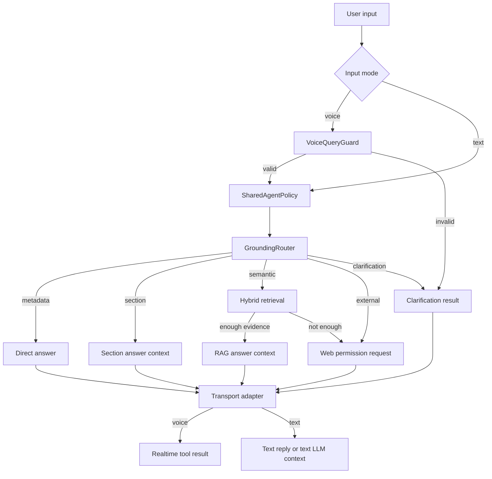

# Phase 10.5 Implementation Guide - Shared Chat And Voice Agent Policy

Date: 2026-06-06  
Status: Proposed implementation guide  
Depends on: Phase 10.1, Phase 10.2, Phase 10.3, Phase 10.4  
Primary scope: `app/services/agent_voice_gpt_realtime.py`, shared agent policy, text chat and realtime voice consistency

---

## 1. Why Phase 10.5 Exists

Sau Phase 10.1 -> 10.4, hệ thống đã có các mảnh quan trọng:

- deterministic metadata/section router;
- canonical `BookSection` knowledge index;
- hybrid retrieval + confidence guardrails;
- voice query guard để giảm lỗi STT/tool-call lệch.

Nhưng orchestration hiện vẫn còn rải trong `app/services/agent_voice_gpt_realtime.py`:

```text
voice tool search_book_knowledge
-> TriamAssistant.resolve_book_query(...)

text chat agentic loop
-> local function search_book_knowledge_text(...)
-> TriamAssistant.resolve_book_query(...)

text chat non-agentic / naive mode
-> _chat_naive_rag(...)
-> search_voice_book_context(...) trực tiếp

text direct grounding
-> _try_chat_grounding_route(...)
-> _chat_from_grounding_result(...)
```

Điều này tạo rủi ro:

- voice và text có thể chọn nguồn khác nhau;
- text mode web off có thể bypass deterministic router;
- logic xin web, context không đủ, clarification bị viết ở nhiều nơi;
- worker realtime phình to và khó debug;
- sau này đổi policy phải sửa nhiều nhánh.

Mục tiêu Phase 10.5 là gom quyết định policy thành một service dùng chung.

---

## 2. Goal

Tạo một shared policy layer để cả text chat và realtime voice đi qua cùng một luồng quyết định:

```text
raw user input
-> optional voice guard
-> shared agent policy
-> deterministic grounding
-> semantic retrieval when needed
-> context sufficiency decision
-> clarification / direct answer / answer context / web permission
```

Transport chỉ còn chịu trách nhiệm:

- nhận input từ LiveKit/DataChannel;
- gọi shared policy;
- gọi LLM khi policy yêu cầu synthesize answer;
- publish `lk.chat`, `lk.transcript`, `lk.control`;
- lưu DB transcript.

---

## 3. Non-Goals

Phase 10.5 không làm:

- không đổi API public;
- không đổi `lk.chat`, `lk.transcript`, `lk.control`;
- không đổi FE contract;
- không đổi model realtime;
- không đổi retrieval algorithm Phase 10.3;
- không thay web permission classifier;
- không xử lý bubble duplicate ở FE, vì đó là Phase 10.6.

---

## 4. Current Architecture Issue

### 4.1 Voice path

Voice đang dùng tool-based flow:

```text
Realtime model
-> search_book_knowledge(query)
-> TriamAssistant.resolve_book_query(query, VOICE)
-> GroundingRouter or RAG
-> tool marker string
-> model speaks answer
```

Sau Phase 10.4, voice còn có guard:

```text
voice transcript state
-> compare with tool query
-> block mismatch
```

Điểm tốt:

- voice đã được bảo vệ trước STT/tool-call lệch;
- deterministic router đã dùng được.

Điểm còn yếu:

- logic trả marker string nằm lẫn trong assistant class;
- web permission marker phụ thuộc prompt và tool flow;
- khó unit test toàn bộ policy mà không import LiveKit worker.

### 4.2 Text path

Text chat hiện có nhiều nhánh:

```text
if web enabled:
    agentic loop with text tools
else:
    naive RAG
```

Rủi ro lớn nhất:

```text
web off -> _chat_naive_rag -> search_voice_book_context trực tiếp
```

Nhánh này có thể bỏ qua:

- metadata route;
- section route;
- clarification khi thiếu target;
- web policy route.

Vì vậy text và voice có thể khác hành vi dù cùng câu hỏi.

---

## 5. Target Architecture



---

## 6. Proposed Module Layout

Thêm package mới:

```text
app/services/agent_policy/
  __init__.py
  contracts.py
  shared_policy.py
  renderers.py
```

Lý do không đặt trong `voice_agent`:

- policy dùng cho cả text và voice;
- `voice_agent` nên giữ các phần realtime-specific như transcript state, query guard, permission UI control;
- `agent_grounding` hiện chỉ làm routing/grounding, chưa phải orchestration đầy đủ.

---

## 7. Data Contracts

### 7.1 `AgentPolicyAction`

```python
from enum import Enum


class AgentPolicyAction(str, Enum):
    DIRECT_ANSWER = "direct_answer"
    ANSWER_WITH_SECTION_CONTEXT = "answer_with_section_context"
    ANSWER_WITH_RAG_CONTEXT = "answer_with_rag_context"
    ASK_CLARIFICATION = "ask_clarification"
    ASK_WEB_PERMISSION = "ask_web_permission"
    WEB_DISABLED = "web_disabled"
    ERROR = "error"
```

Ý nghĩa:

- `DIRECT_ANSWER`: metadata hoặc deterministic answer có thể trả ngay.
- `ANSWER_WITH_SECTION_CONTEXT`: cần LLM synthesize từ section context.
- `ANSWER_WITH_RAG_CONTEXT`: cần LLM synthesize từ RAG chunks.
- `ASK_CLARIFICATION`: hỏi lại user, không web.
- `ASK_WEB_PERMISSION`: sách không đủ thông tin hoặc câu hỏi external.
- `WEB_DISABLED`: cần web nhưng config đang tắt.
- `ERROR`: lỗi retrieval/router an toàn.

### 7.2 `AgentPolicyRequest`

```python
from dataclasses import dataclass

from app.services.agent_observability import AgentInputMode


@dataclass(frozen=True)
class AgentPolicyRequest:
    query: str
    input_mode: AgentInputMode
    document_ids: list[str]
    allow_web_permission: bool
```

### 7.3 `AgentPolicyResult`

```python
from dataclasses import dataclass, field


@dataclass(frozen=True)
class AgentPolicyResult:
    action: AgentPolicyAction
    answer_source: str
    reason_code: str
    user_message: str | None = None
    tool_marker: str | None = None
    llm_system_context: str | None = None
    resolved_book_ids: tuple[str, ...] = field(default_factory=tuple)
    resolved_section_ids: tuple[str, ...] = field(default_factory=tuple)
    retrieval_chunk_ids: tuple[str, ...] = field(default_factory=tuple)
```

Quy ước:

- `user_message`: có thể trả thẳng cho text hoặc đọc thẳng bằng voice.
- `tool_marker`: marker cho realtime tool, ví dụ `BOOK_METADATA_FOUND`, `BOOK_SECTION_FOUND`, `CLARIFICATION_REQUIRED`.
- `llm_system_context`: context đưa vào LLM để synthesize answer.
- Không lưu full chunks trong result nếu không cần; tránh trace/log phình.

---

## 8. Shared Policy Flow

### 8.1 Pseudocode

```python
class SharedAgentPolicy:
    async def resolve(self, request: AgentPolicyRequest) -> AgentPolicyResult:
        grounding_result = await self.grounding_router.resolve(
            request.query,
            input_mode=request.input_mode,
            tracer=self.tracer,
        )

        if grounding_result.decision.route == GroundingRoute.BOOK_METADATA:
            return direct_answer_from_metadata(grounding_result)

        if grounding_result.decision.route == GroundingRoute.CLARIFICATION:
            return clarification(grounding_result.decision.clarification)

        if grounding_result.decision.route == GroundingRoute.BOOK_SECTION:
            return section_context_or_direct_answer(grounding_result)

        if grounding_result.decision.route == GroundingRoute.WEB_POLICY:
            return web_permission_or_disabled(request)

        rag_result = await search_voice_book_context(...)
        if rag_result.found:
            return rag_context(rag_result)

        return web_permission_or_not_found(request)
```

### 8.2 Important rule

`SharedAgentPolicy` không tự gọi web search.

Nó chỉ quyết định:

```text
Câu này cần xin phép web.
```

Việc user đồng ý/từ chối và execute web vẫn thuộc `WebSearchPermissionPolicy` và web tools hiện tại.

---

## 9. Rendering Strategy

Policy result cần render ra hai kiểu:

### 9.1 Voice tool result

Realtime model vẫn cần marker rõ ràng:

```text
BOOK_METADATA_FOUND:
...

BOOK_SECTION_FOUND:
...

BOOK_CONTEXT_FOUND:
...

CLARIFICATION_REQUIRED:
...

EXTERNAL_INFO_REQUIRED:
...
```

Vì vậy tạo renderer:

```python
def render_voice_tool_result(result: AgentPolicyResult) -> str:
    ...
```

### 9.2 Text chat response

Text chat có hai loại:

1. Trả thẳng:

```text
metadata
clarification
web permission question
web disabled message
section unavailable
```

2. Cần LLM synthesize:

```text
section context
rag context
web result after permission
```

Tạo helper:

```python
def should_call_llm(result: AgentPolicyResult) -> bool:
    return result.llm_system_context is not None
```

Sau đó text handler gọi `chat_llm` với system context đã chuẩn hóa.

---

## 10. Implementation Steps

### Step 1 - Add contracts

File:

```text
app/services/agent_policy/contracts.py
```

Add:

- `AgentPolicyAction`;
- `AgentPolicyRequest`;
- `AgentPolicyResult`.

Tests:

```text
tests/services/agent_policy/test_contracts.py
```

Không cần DB.

### Step 2 - Add renderers

File:

```text
app/services/agent_policy/renderers.py
```

Functions:

```python
render_voice_tool_result(result)
build_text_llm_messages_or_context(result)
```

Không import LiveKit ở đây.

Tests:

- direct answer render đúng;
- clarification render đúng;
- section context marker đúng;
- web permission marker đúng;
- không render raw object/debug info.

### Step 3 - Add shared policy service

File:

```text
app/services/agent_policy/shared_policy.py
```

Dependencies inject qua constructor:

```python
class SharedAgentPolicy:
    def __init__(
        self,
        *,
        document_ids: list[str],
        grounding_router: GroundingRouter | None,
        web_search_policy: WebSearchPermissionPolicy,
        tracer: AgentTurnTracer,
        search_book_context: Callable[..., Awaitable[VoiceRagResult]] = search_voice_book_context,
    ) -> None:
        ...
```

Lý do inject:

- dễ unit test;
- không gọi DB/network trong unit test;
- rollback dễ.

### Step 4 - Refactor `TriamAssistant.resolve_book_query`

Hiện tại:

```python
resolve_book_query(...)
-> voice guard
-> grounding router
-> RAG
-> format string
```

Sau refactor:

```python
resolve_book_query(...)
-> voice guard only if voice
-> shared_policy.resolve(...)
-> render_voice_tool_result(...)
```

Quan trọng:

- giữ nguyên tên tool `search_book_knowledge`;
- giữ marker cũ để prompt realtime không vỡ;
- giữ `WEB_PERMISSION_REPLY_DETECTED` từ Phase 10.4.

### Step 5 - Refactor text chat direct path

Thay `_try_chat_grounding_route(...)` và `_chat_from_grounding_result(...)` bằng shared policy:

```python
policy_result = await shared_policy.resolve(
    AgentPolicyRequest(
        query=normalized_text,
        input_mode=AgentInputMode.TEXT,
        document_ids=document_ids,
        allow_web_permission=web_search_policy.enabled,
    )
)
```

Nếu result trả thẳng:

```python
full_reply = result.user_message
```

Nếu result cần LLM:

```python
temp_ctx = session.history.copy()
temp_ctx.add_message(role="system", content=result.llm_system_context)
response = await chat_llm.chat(chat_ctx=temp_ctx).collect()
full_reply = response.text
```

### Step 6 - Replace naive text RAG

`_chat_naive_rag` hiện là điểm lệch policy.

Đổi thành:

```text
web disabled text path
-> shared policy
-> metadata/section/clarification still work
-> if semantic RAG not found and web disabled, say book does not contain enough info
```

Tên function nên đổi:

```text
_chat_with_shared_policy_no_web
```

Không nên còn chữ `naive`.

### Step 7 - Keep agentic text loop but simplify tools

Agentic loop vẫn có thể giữ vì nó giúp model tự gọi web permission tool.

Nhưng `search_book_knowledge_text(...)` phải gọi shared policy renderer thay vì gọi trực tiếp `TriamAssistant.resolve_book_query`.

Lý do:

- cùng policy result;
- cùng marker;
- trace dễ đối chiếu text/voice.

### Step 8 - Add feature flag

Config đề xuất:

```python
AGENT_SHARED_POLICY_ENABLED: bool = True
AGENT_TEXT_SHARED_POLICY_ENABLED: bool = True
```

Rollback:

```env
AGENT_SHARED_POLICY_ENABLED=false
```

Tuy nhiên nếu code refactor sạch và tests đủ, có thể chỉ giữ một flag để giảm config noise.

Recommendation:

```text
Chỉ thêm AGENT_SHARED_POLICY_ENABLED.
Default true.
```

### Step 9 - Remove dead code after tests

Sau khi tests pass:

- xóa `_chat_from_grounding_result`;
- xóa `_try_chat_grounding_route`;
- đổi `_chat_naive_rag` thành shared no-web path;
- giữ helper LLM answer context nếu còn dùng.

Không xóa prompt/tool contract nếu realtime model còn cần.

---

## 11. Test Plan

### 11.1 Unit tests cho shared policy

Folder:

```text
tests/services/agent_policy/
```

Cases:

1. Metadata author:

```text
query: "Tác giả của sách là ai?"
expected action: DIRECT_ANSWER
expected source: book_metadata
no RAG call
no web permission
```

2. Section summary:

```text
query: "Tóm tắt chương 4"
expected action: ANSWER_WITH_SECTION_CONTEXT
expected source: book_section
no semantic RAG call
```

3. Missing section target:

```text
query: "Tóm tắt chương."
expected action: ASK_CLARIFICATION
no RAG
no web
```

4. Semantic question with RAG hit:

```text
expected action: ANSWER_WITH_RAG_CONTEXT
expected source: book_rag
```

5. Semantic question with RAG miss and web enabled:

```text
expected action: ASK_WEB_PERMISSION
```

6. Semantic question with RAG miss and web disabled:

```text
expected action: WEB_DISABLED or DIRECT_ANSWER with no-book-info message
```

### 11.2 Consistency tests for text and voice

Add test matrix:

```text
same query + same document_ids
-> TEXT policy result.action == VOICE policy result.action
-> same answer_source
-> same resolved_book_ids
-> same resolved_section_ids
```

Exceptions:

- voice can be blocked before policy by `VoiceQueryGuard`;
- voice transcript ambiguity can ask clarification earlier.

### 11.3 Regression tests for realtime worker

Keep focused tests:

```text
tests/services/voice_agent/test_agent_voice_query_guard.py
```

Add:

- voice `resolve_book_query` uses shared policy renderer;
- text `search_book_knowledge_text` uses same policy;
- web permission reply marker still preserved.

### 11.4 Full tests

Run:

```powershell
uv run pytest tests/services/agent_policy tests/services/voice_agent tests/services/agent_grounding tests/services/agent_observability -q
uv run pytest tests -q
uv run ruff check app/services app/api app/core app/repositories tests/services
uv run python -m py_compile app/services/agent_voice_gpt_realtime.py
```

Không dùng `uv run ruff check app tests` làm acceptance chính nếu migration lịch sử vẫn còn style lỗi cũ.

---

## 12. Manual Test Checklist

Dùng cùng một sách/context/thread đã test Phase 10:

```text
book: 195d9623-03d0-483a-ac09-52d9137f2471
context: dd123da9-95ed-4736-8c79-3161262c2a15
thread: 07be00b9-c6da-4801-8ba2-7558205b92b2
```

Test text chat:

1. `Tác giả của sách là ai?`
2. `Tóm tắt chương 4`
3. `Đại ý chương.`
4. `Thông tin này có mới nhất không?`

Test voice:

1. hỏi câu tác giả;
2. hỏi câu chương rõ;
3. nói mơ hồ để kiểm tra clarification;
4. đồng ý web bằng câu tự nhiên như `Yup làm đi`.

Expected:

- text và voice chọn cùng nguồn khi input rõ;
- voice mơ hồ hỏi lại;
- không tự search web khi thiếu chương;
- không trả lời bằng model memory cho câu hỏi sách.

---

## 13. Logging And Trace

Shared policy log chỉ nên ghi:

```text
input_mode
action
answer_source
reason_code
resolved_book_count
resolved_section_count
retrieval_count
latency_ms
```

Không log:

- full transcript;
- full query ở production;
- full chunks;
- full web result;
- token, secret, auth header.

Ví dụ:

```text
Agent shared policy resolved | mode=voice | action=answer_with_section_context | source=book_section | reason=section_exact | sections=1 | latency_ms=42
```

---

## 14. Rollout Plan

### Local

```env
AGENT_SHARED_POLICY_ENABLED=true
```

Run full tests.

### Dev production

Deploy with flag true.

Manual test:

- one text session;
- one realtime voice session;
- one web permission flow.

### Rollback

```env
AGENT_SHARED_POLICY_ENABLED=false
```

Rollback should restore old path temporarily.

Important:

Rollback flag chỉ cần giữ trong 1-2 phases. Sau khi Phase 10.6/10.7 ổn, có thể xóa old path để giảm code thừa.

---

## 15. Trade-offs

### 15.1 Refactor có blast radius

Đây là phase refactor orchestration, dễ ảnh hưởng cả text và voice.

Giảm rủi ro:

- thêm tests trước;
- giữ marker cũ;
- giữ feature flag;
- không đổi FE contract.

### 15.2 Có thể tạm thời nhiều abstraction hơn

Thêm `agent_policy` package làm code có nhiều file hơn.

Đổi lại:

- worker realtime bớt phình;
- logic dùng chung test được offline;
- sau này đổi model/prompt/retrieval dễ hơn.

### 15.3 Text agentic loop vẫn còn LLM quyết định

Ngay cả khi shared policy tốt hơn, text agentic loop vẫn có thể gọi tool theo cách model quyết định.

Giảm rủi ro:

- tool `search_book_knowledge_text` phải dùng shared policy;
- system prompt text phải yêu cầu tuân marker;
- tests kiểm tra khi tool trả `CLARIFICATION_REQUIRED`, model không xin web.

### 15.4 Không xử lý FE duplicate bubble

Phase này không sửa UI duplicate.

Lý do:

- Phase 10.5 là BE policy;
- FE reconciliation thuộc Phase 10.6.

---

## 16. Acceptance Criteria

Phase 10.5 hoàn thành khi:

1. Có package `app/services/agent_policy`.
2. Text và voice dùng chung `SharedAgentPolicy`.
3. `_chat_naive_rag` không còn bypass deterministic router.
4. Cùng query rõ ràng ở text và voice chọn cùng `answer_source`.
5. Web permission policy vẫn bắt buộc.
6. Voice query guard Phase 10.4 vẫn hoạt động trước shared policy.
7. Không đổi FE contract.
8. Focused tests và full pytest pass.
9. Có manual test report hoặc implementation status trong doc này.

---

## 17. Suggested Implementation Status Template

Sau khi implement, append:

```markdown
## 18. Implementation Status - YYYY-MM-DD

### Code changed

- ...

### Tests run

```text
...
```

### Manual result

- Text:
- Voice:
- Web permission:

### Remaining trade-offs

- ...
```

---

## 18. Senior Note Cho Em

Phase 10.5 là lúc mình chuyển từ:

```text
chat có một cách xử lý
voice có một cách xử lý
```

sang:

```text
chat và voice chỉ khác đường nhập/xuất,
còn quyết định học thuật phải giống nhau.
```

Đây là tư duy production quan trọng. Khi user hỏi cùng một câu về sách, hệ thống không được vì user gõ hay nói mà chọn nguồn khác nhau. Nếu khác, phải có lý do rõ ràng, ví dụ voice transcript mơ hồ nên hỏi lại.

Điểm cần nhớ:

```text
Shared policy không làm app thông minh hơn ngay lập tức.
Nó làm hành vi ổn định, test được, và dễ tối ưu tiếp.
```

Khi nền này ổn, Phase 10.6 mới xử lý trải nghiệm FE transcript/bubble, và Phase 10.7 mới đánh giá model/rollout production một cách có số liệu.
