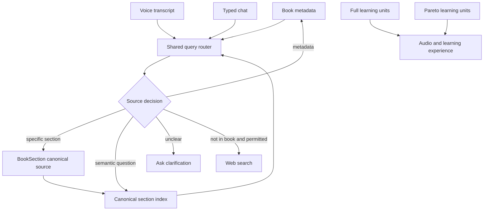
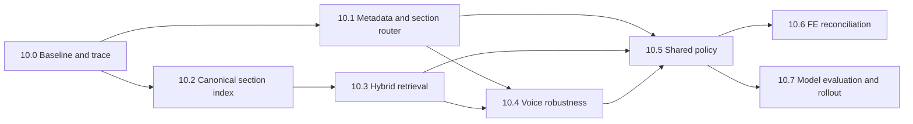

# Phase 10 Roadmap - Grounded Book Agent And Voice Accuracy

Date: 2026-06-04  
Status: Phase 10.0 completed; Phase 10.1 implementation guide ready, not implemented  
Depends on: Phase 5 document structure, Phase 7 realtime stabilization, Phase 8 Pareto planner  
Primary scope: Book-grounded chat, realtime voice, RAG accuracy, STT robustness

---

## 1. Mục Tiêu Tổng Thể

Phase 10 giải quyết chênh lệch chất lượng giữa chat text và voice, đồng thời sửa nguyên nhân khiến Agent:

- trả lời sai câu hỏi về tác giả;
- lấy nội dung sai chương;
- yêu cầu tìm web dù thông tin có trong sách;
- trả lời dựa trên kiến thức sẵn có của model thay vì dữ liệu sách;
- xử lý không ổn định khi STT nhận sai một vài từ quan trọng.

Kết quả cuối cùng cần đạt:

```text
User question
-> hiểu đúng intent hoặc hỏi lại khi chưa rõ
-> chọn đúng nguồn dữ liệu
-> lấy đúng sách và đúng section
-> trả lời có căn cứ
-> chỉ đề nghị tìm web khi sách thực sự không có thông tin
```

Phase 10 không bắt đầu bằng việc nâng model. Model mạnh hơn không thể sửa dữ liệu RAG bị thiếu hoặc lấy sai chương.

---

## 2. Kết Luận Kiến Trúc Đã Chốt

### 2.1 RAG không thuộc Full hoặc Pareto

Full và Pareto là cách tạo trải nghiệm học/nghe. Chúng không phải nguồn tri thức gốc.

Kiến trúc mục tiêu:



### 2.2 Chat và voice phải dùng chung policy

Chat và voice có thể dùng model và transport khác nhau, nhưng phải dùng chung:

- intent routing;
- metadata lookup;
- chapter/section resolution;
- book retrieval;
- confidence rules;
- web permission policy;
- answer-source contract.

### 2.3 Không suy đoán khi voice transcript mơ hồ

Nếu transcript bị mất thông tin quan trọng như số chương hoặc loại câu hỏi, Agent phải hỏi lại thay vì:

- tự chọn một chương;
- lấy kết quả RAG gần nhất;
- tự động chuyển sang web search.

---

## 3. Nguyên Tắc Thực Hiện

1. Mỗi phase phải có regression test trước khi chuyển sang phase tiếp theo.
2. Giữ ổn định API và LiveKit DataChannel contract nếu không thật sự cần breaking change.
3. Tách lỗi thành bốn tầng: STT, routing, retrieval và answer generation.
4. Không hard-code theo một cuốn sách, một tác giả hoặc một câu hỏi test.
5. Không log toàn bộ nội dung sách, token hoặc transcript nhạy cảm trong production.
6. PostgreSQL là nguồn sự thật; embedding index chỉ là lớp hỗ trợ tìm kiếm.
7. Mọi web search vẫn phải tuân theo permission policy hiện tại.
8. Có feature flag và đường rollback cho thay đổi retrieval/model quan trọng.

---

## 4. Thứ Tự Các Phase

| Phase | Tên | Priority | Kết quả chính |
| --- | --- | --- | --- |
| 10.0 | Evaluation Baseline And Agent Trace | P0 | Đo được lỗi nằm ở STT, router, RAG hay model |
| 10.1 | Deterministic Metadata And Section Router | P0 | Tác giả và câu hỏi theo chương đi đúng nguồn |
| 10.2 | Canonical BookSection Knowledge Index | P0 | Mọi section hợp lệ đều có thể được tìm thấy, độc lập Full/Pareto |
| 10.3 | Hybrid Retrieval And Confidence Guardrails | P1 | Giảm lấy sai chương và giảm web fallback sai |
| 10.4 | Voice STT Robustness And Clarification | P1 | Voice không trả lời bừa khi transcript sai hoặc thiếu |
| 10.5 | Shared Chat And Voice Agent Policy | P1 | Chat và voice có hành vi nhất quán |
| 10.6 | FE Transcript Reconciliation | P1 | Không lặp bubble hoặc nối trùng câu trả lời |
| 10.7 | Model Evaluation And Production Rollout | P2 | Chọn model bằng dữ liệu đo, triển khai an toàn |

---

## 5. Phase 10.0 - Evaluation Baseline And Agent Trace

### Mục tiêu

Tạo khả năng chứng minh một câu trả lời sai vì tầng nào trước khi sửa hành vi.

### Phạm vi

- Tạo golden evaluation dataset cho cùng một nhóm câu hỏi ở chat và voice.
- Bao phủ:
  - metadata: tác giả, tên sách, số section;
  - câu hỏi theo section/chương;
  - câu hỏi semantic toàn sách;
  - câu hỏi không có trong sách;
  - transcript voice đúng, sai nhẹ và mơ hồ.
- Bổ sung structured trace an toàn:
  - request/turn ID;
  - detected intent;
  - resolved book/section ID;
  - retrieval source;
  - top chunk IDs và scores;
  - answer source: `metadata`, `section`, `rag`, `web`;
  - latency từng bước.
- Không log full source text hoặc secret.

### Metrics baseline

```text
voice intent accuracy
metadata route accuracy
section resolver accuracy
retrieval Hit@K
wrong-section rate
book-answerable web fallback rate
answer groundedness
retrieval latency p50/p95
end-to-end latency p50/p95
```

### Acceptance

- Có thể phân loại từng lỗi test thành STT, routing, retrieval hoặc generation.
- Có báo cáo baseline trước khi thay đổi thuật toán.
- Không thay đổi response contract hiện tại.

### Trade-off

- Chưa trực tiếp cải thiện câu trả lời.
- Tốn thời gian đầu nhưng ngăn việc sửa theo cảm tính và khó chứng minh hiệu quả.

---

## 6. Phase 10.1 - Deterministic Metadata And Section Router

### Mục tiêu

Không dùng vector search cho câu hỏi có nguồn dữ liệu xác định.

### Phạm vi

Tạo shared query router cho cả chat và voice:

```text
metadata question -> Book repository
specific chapter/section question -> BookSection resolver
semantic book question -> RAG
ambiguous question -> clarification
external question -> existing web permission flow
```

Metadata route tối thiểu:

- tác giả;
- tên sách;
- loại tài liệu;
- số section/mục;
- trạng thái xử lý.

Section resolver phải hỗ trợ:

- số dạng chữ và số: `chương bốn`, `chương 4`, `chapter four`, `chapter 4`;
- `path`, `section_index`, title và cấu trúc cha-con;
- chỉ trả về section thuộc đúng book/context của user.

### Acceptance

- Metadata fixtures trả lời đúng 100% mà không gọi vector search.
- Câu hỏi hợp lệ theo section resolve đúng 100% trên test fixtures.
- Section không tồn tại hoặc câu hỏi thiếu số phải hỏi lại, không lấy section gần nhất.
- Chat và voice gọi chung router.

### Trade-off

- Intent classification không thể hoàn hảo tuyệt đối.
- Cần conservative fallback: không chắc thì hỏi lại, không suy đoán.

---

## 7. Phase 10.2 - Canonical BookSection Knowledge Index

### Mục tiêu

Tạo nguồn RAG từ nội dung sách gốc, không phụ thuộc learning unit Full/Pareto.

### Kiến trúc đề xuất

Khuyến nghị tạo bảng canonical riêng, ví dụ `book_section_knowledge`, thay vì tiếp tục ép `book_knowledge` phụ thuộc `learning_unit_id`.

Thông tin tối thiểu:

```text
id
book_id
section_id
chunk_index
content
embedding
content_hash
embedding_model
embedding_version
created_at
```

Constraint chính:

```text
unique(section_id, chunk_index, embedding_version)
```

Embedding content cần có context tổng quát, không hard-code:

```text
book title
author when available
section path
section title
parent titles
canonical section text chunk
```

### Workflow

```text
Validated upload
-> persist BookSection tree
-> enqueue canonical indexing job
-> index every eligible non-empty section
-> persist indexing progress/status
-> mark canonical index ready/error
```

Switch Full/Pareto không được xoá hoặc tạo lại canonical index nếu source content không đổi.

### Migration và backfill

- Giữ index learning-unit cũ trong thời gian chuyển đổi để rollback.
- Tạo reindex job cho sách cũ.
- Dùng `content_hash` và `embedding_version` để tránh embed lại dữ liệu không đổi.
- Sau khi production verification đạt yêu cầu mới xem xét loại bỏ index cũ.

### Acceptance

- 100% section hợp lệ, có text đều có canonical chunks.
- Full/Pareto và switch mode không làm thay đổi canonical coverage.
- Chapter 4 của sách kiểm thử được tìm thấy mà không cần web.
- Reindex có progress, retry và idempotency.

### Trade-off

- Tạm thời tăng dung lượng DB và embedding cost trong giai đoạn migration.
- Cần thêm background job và trạng thái index.
- Đổi lại, dữ liệu RAG đúng bản chất và không còn phụ thuộc audio mode.

---

## 8. Phase 10.3 - Hybrid Retrieval And Confidence Guardrails

### Mục tiêu

Không xem mọi vector result là câu trả lời hợp lệ.

### Phạm vi

- Kết hợp keyword/full-text search và vector search.
- Cho phép filter theo `book_id`, `section_id` và section subtree.
- Dùng rank fusion hoặc reranking cho candidate set.
- Chuẩn hóa retrieval result:

```text
found
chunks
book_id
section_ids
retrieval_method
vector_score
keyword_score
final_score
confidence
reason
```

- Giảm số chunk đưa vào model, ưu tiên ít chunk nhưng đúng.
- Tách:
  - có kết quả kỹ thuật;
  - có context đủ liên quan để trả lời.
- Chỉ đề nghị web search khi context sách thực sự không đủ.

### Acceptance

- Golden set đạt Retrieval Hit@5 tối thiểu 90%.
- Wrong-section rate không vượt quá 5%.
- Book-answerable web fallback rate không vượt quá 5%.
- Không trả nội dung chương 2/3 cho câu hỏi rõ ràng về chương 4.
- Retrieval latency được đo và không regression ngoài budget đã chốt.

### Trade-off

- Hybrid search và reranking tăng độ phức tạp và có thể tăng latency.
- Cần benchmark trước khi thêm external reranker có chi phí.

---

## 9. Phase 10.4 - Voice STT Robustness And Clarification

### Mục tiêu

Giảm chênh lệch chất lượng giữa voice và typed chat.

### Phạm vi

- Tạo vocabulary/context động từ:
  - tên sách;
  - tác giả;
  - section titles/path;
  - thuật ngữ và tên riêng quan trọng có trong tài liệu.
- Cung cấp context này cho realtime/STT provider ở nơi API hỗ trợ.
- Chuẩn hóa transcript theo rule tổng quát:
  - số dạng nói thành số chuẩn;
  - Unicode và khoảng trắng;
  - title/path matching không phân biệt hoa thường.
- Chỉ dùng final transcript cho routing/persistence.
- Thêm ambiguity policy:
  - thiếu section number;
  - intent không rõ;
  - transcript quá ngắn;
  - transcript có confidence thấp nếu provider cung cấp.
- Agent hỏi lại một câu ngắn, không tự tìm web.

### Acceptance

- Voice intent accuracy trên golden fixtures đạt tối thiểu 90%.
- Transcript mơ hồ không tạo answer sai hoặc web search request.
- Cùng một intent rõ ràng ở chat và voice resolve cùng source.
- Không hard-code tên sách hoặc câu test cụ thể.

### Trade-off

- Hỏi lại làm tăng một lượt hội thoại.
- Context STT quá dài có thể tăng chi phí hoặc giảm chất lượng, nên phải có budget.

---

## 10. Phase 10.5 - Shared Chat And Voice Agent Policy

### Mục tiêu

Loại bỏ khác biệt hành vi do chat và voice dùng orchestration riêng.

### Phạm vi

Tạo policy/orchestrator dùng chung:

```text
normalize input
-> route intent
-> retrieve deterministic or semantic context
-> validate confidence
-> build grounded answer context
-> decide clarification or web permission
```

Transport/model chỉ chịu trách nhiệm:

- nhận input;
- gọi shared policy;
- tạo câu trả lời;
- publish output.

Policy bắt buộc:

- Khi đang hỏi nội dung sách, không dùng model memory làm nguồn chính.
- Mọi câu trả lời phải có `answer_source`.
- Web search không được chạy nếu chưa có permission hợp lệ.
- Không có context đủ mạnh thì hỏi lại hoặc thông báo không tìm thấy.

### Acceptance

- Chat và voice vượt qua cùng một agent policy test suite.
- Cùng câu hỏi và cùng context phải chọn cùng nguồn dữ liệu.
- Không phá contract `lk.chat`, `lk.transcript`, `lk.control`.
- Permission classifier vẫn có thể dùng model nhỏ riêng.

### Trade-off

- Refactor orchestration có blast radius lớn.
- Phải triển khai sau khi router và retrieval contract đã ổn định.

---

## 11. Phase 10.6 - FE Transcript Reconciliation

### Mục tiêu

Không hiển thị trùng hoặc nối lặp câu trả lời dù FE nhận nhiều realtime event.

### Contract đề xuất

- `lk.transcript` là timeline chính thức.
- `lk.chat` assistant response chỉ là optimistic/temporary content nếu FE cần hiển thị sớm.
- Khi transcript chính thức đến:
  - replace temporary message;
  - không append lần hai;
  - deduplicate bằng message/transcript ID.
- FE phải xử lý event đến sai thứ tự.

### Acceptance

- Một DB assistant message chỉ tạo một bubble.
- Không lặp nội dung khi nhận cả `lk.chat` và `lk.transcript`.
- Reconnect hoặc retry không nhân đôi timeline.
- Có Flutter contract/update guide riêng nếu contract thay đổi.

### Trade-off

- Cần phối hợp FE.
- Nếu backend chưa cung cấp stable correlation ID, có thể cần bổ sung field nhưng phải giữ tương thích ngược.

---

## 12. Phase 10.7 - Model Evaluation And Production Rollout

### Mục tiêu

Chỉ nâng model khi có bằng chứng model là bottleneck còn lại.

### Phạm vi

- A/B test các model candidate thông qua config, không hard-code.
- Đánh giá riêng:
  - typed chat generation;
  - voice realtime model;
  - permission/intent classifier.
- So sánh:
  - tool selection accuracy;
  - groundedness;
  - hallucination rate;
  - latency p50/p95;
  - token/audio cost;
  - web fallback rate.
- Production rollout bằng feature flag/canary.
- Có rollback nhanh về model ổn định trước đó.

### Acceptance

- Chỉ chọn model mới nếu cải thiện metrics đã định nghĩa.
- Không dùng model upgrade để che lỗi retrieval/STT.
- Production smoke test bao phủ chat, voice, RAG và web permission.

### Trade-off

- Model mạnh hơn có thể tăng cost và latency.
- Model mới vẫn có thể thay đổi hành vi tool calling, nên cần regression suite.

---

## 13. Dependency Và Thứ Tự Implement



Thứ tự thực hiện khuyến nghị:

```text
10.0
-> 10.1
-> 10.2
-> 10.3
-> 10.4
-> 10.5
-> 10.6
-> 10.7
```

Phase 10.1 và 10.2 có thể được thiết kế song song sau khi baseline đã ổn định, nhưng nên merge tuần tự để dễ xác định regression.

---

## 14. Definition Of Done Cho Toàn Phase 10

Phase 10 chỉ được xem là hoàn thành khi:

- metadata question không đi qua vector search;
- mọi BookSection hợp lệ đều có canonical index;
- Full/Pareto không ảnh hưởng khả năng hỏi nội dung sách;
- câu hỏi theo chapter/section lấy đúng nguồn;
- voice transcript mơ hồ dẫn tới clarification, không dẫn tới answer sai;
- chat và voice dùng chung policy;
- web fallback chỉ xảy ra khi sách thực sự không có thông tin;
- FE không hiển thị duplicate assistant message;
- có regression suite và production smoke test;
- model được chọn dựa trên metrics, không dựa trên cảm giác.

---

## 15. Những Việc Không Làm Trong Phase 10

- Không thay đổi business logic Full/Pareto đã ổn định.
- Không viết lại parser PDF/DOCX/EPUB nếu lỗi không đến từ parser.
- Không tự động cho phép web search.
- Không nâng model trước khi sửa canonical RAG và routing.
- Không hard-code cách sửa riêng cho `Of Mice and Men`.
- Không xoá index cũ trước khi canonical index đã được backfill và kiểm chứng.

---

## 16. Bước Tiếp Theo

Phase nên implement tiếp theo là:

```text
Phase 10.1 - Deterministic Metadata And Section Router
```

Tài liệu implementation:

```text
_docs_implemented/phase_10_1_deterministic_metadata_section_router_implementation_guide.md
```
