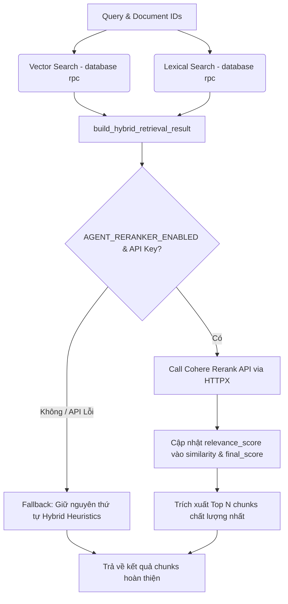

# Hướng Dẫn Triển Khai - Phase 16: Tích Hợp Cohere Multilingual Rerank v3.0 Vào Luồng RAG

Tài liệu này được biên soạn bởi **Senior Developer (20+ năm kinh nghiệm)** nhằm hướng dẫn chi tiết cho Fresher triển khai tích hợp bộ định tuyến xếp hạng lại (Reranker) bằng **Cohere Multilingual Rerank API v3.0** vào hệ thống TriÂm. 

---

## 🎯 Mục Tiêu & Kiến Trúc Thiết Kế

Sau các nghiên cứu đo lường độ chính xác thực tế, chúng ta quyết định loại bỏ hoàn toàn giải pháp chạy Reranker cục bộ bằng FlashRank do:
1. **Độ trễ quá lớn trên CPU:** Gây nghẽn luồng xử lý giọng nói thời gian thực (độ trễ lên đến >6.8 giây đối với văn bản dài).
2. **Độ chính xác tiếng Việt trung bình:** Có xu hướng xếp hạng sai lệch các mệnh đề phủ định hoặc câu hỏi ngữ nghĩa phức tạp.

Thay vào đó, hệ thống sẽ sử dụng **Cohere Multilingual Rerank v3.0** thông qua kết nối API trực tiếp bằng thư viện không đồng bộ `httpx` (không cài thêm SDK Cohere cồng kềnh để giữ hệ thống siêu nhẹ).

### 🛠️ Sơ Đồ Hoạt Động (Data Flow)



---

## 📂 1. Chi Tiết Các Tệp Cần Chỉnh Sửa & Tạo Mới

### Tệp 1: Cấu hình hệ thống

#### [MODIFY] [app/core/config.py](file:///w:/WorkSpace_IT/_CAPSTON_PROJECT/triam-backend/app/core/config.py)
Fresher cần mở rộng class `Settings` để khai báo các cấu hình điều phối Cohere Reranker động.

```python
    # ==============================================================================
    # COHERE RERANKER CONFIGURATION (PHASE 16)
    # ==============================================================================
    COHERE_API_KEY: str | None = None
    AGENT_RERANKER_ENABLED: bool = True
    AGENT_RERANKER_MODEL: str = "rerank-multilingual-v3.0"
    AGENT_RERANKER_TOP_N: int = 6  # Số lượng chunk tối đa trả về cho LLM Context
    AGENT_RERANKER_CANDIDATES_LIMIT: int = 20  # Số lượng ứng viên thô tối đa gửi lên API Cohere
```

*Lưu ý của Senior:* Fresher chỉ cần khai báo như trên, Pydantic sẽ tự động nạp giá trị từ file `.env` nếu có biến môi trường tương ứng (ví dụ: `COHERE_API_KEY`).

---

### Tệp 2: Dịch vụ Rerank Service (Tạo mới)

#### [NEW] [app/services/agent_grounding/reranker.py](file:///w:/WorkSpace_IT/_CAPSTON_PROJECT/triam-backend/app/services/agent_grounding/reranker.py)
Tạo tệp này để đóng gói toàn bộ các yêu cầu HTTP không đồng bộ gửi tới Cohere API. 

*Bài học cho Fresher về kiến trúc bền bỉ (Resilient Software Architecture):* API bên thứ ba có thể bị chậm, mất kết nối hoặc hết hạn mức (Rate Limited). Code phải bắt mọi lỗi mạng (`httpx.HTTPError`, `asyncio.TimeoutError`) và tự động kích hoạt chế độ **Fallback** (trả về danh sách cũ không sắp xếp lại) chứ không bao giờ được phép làm sập hệ thống (Crash).

```python
import asyncio
from typing import Any
import httpx

from app.core.config import settings
from app.core.logger import log


async def rerank_candidates(
    query: str,
    candidates: list[dict[str, Any]],
    *,
    model: str | None = None,
    top_n: int | None = None,
) -> list[dict[str, Any]]:
    """
    Sử dụng Cohere Multilingual Rerank API để xếp hạng lại (Rerank) các chunks ứng viên.
    
    Args:
        query: Câu hỏi hoặc truy vấn của người dùng.
        candidates: Danh sách các chunk ứng viên dạng dictionary từ Hybrid Retrieval.
        model: Model rerank sử dụng (mặc định lấy từ settings).
        top_n: Số lượng kết quả tối đa muốn giữ lại (mặc định lấy từ settings).
        
    Returns:
        Danh sách các chunk đã được cập nhật score và sắp xếp theo thứ tự giảm dần.
        Nếu API lỗi hoặc không cấu hình API Key, tự động fallback trả về danh sách gốc.
    """
    # 1. Kiểm tra điều kiện tiên quyết
    if not settings.COHERE_API_KEY:
        log.warning("Reranker: Không tìm thấy COHERE_API_KEY. Bỏ qua Rerank (Fallback mode).")
        return candidates

    if not candidates:
        return []

    # Giới hạn số lượng ứng viên đầu vào gửi lên API để tối ưu chi phí và độ trễ truyền tải
    limit = settings.AGENT_RERANKER_CANDIDATES_LIMIT
    input_candidates = candidates[:limit]

    rerank_model = model or settings.AGENT_RERANKER_MODEL
    rerank_top_n = top_n or settings.AGENT_RERANKER_TOP_N

    # 2. Xây dựng payload và headers gửi tới Cohere API
    url = "https://api.cohere.com/v1/rerank"
    headers = {
        "Authorization": f"Bearer {settings.COHERE_API_KEY}",
        "Content-Type": "application/json",
        "accept": "application/json",
    }
    
    # Cohere yêu cầu danh sách văn bản thô để tính toán mức độ liên quan ngữ nghĩa
    documents = [c.get("content", "") for c in input_candidates]
    payload = {
        "model": rerank_model,
        "query": query,
        "documents": documents,
        "top_n": min(rerank_top_n, len(input_candidates)),
    }

    # 3. Thực hiện gọi API không đồng bộ với Timeout bảo vệ (8 giây tối đa)
    try:
        async with httpx.AsyncClient() as client:
            response = await client.post(url, json=payload, headers=headers, timeout=8.0)
            
            if response.status_code != 200:
                log.error(f"Reranker: Cohere API trả về mã lỗi {response.status_code}: {response.text}")
                return candidates  # Fallback

            results = response.json().get("results", [])
            
            # 4. Ánh xạ kết quả xếp hạng lại vào các chunk ban đầu
            reranked_candidates = []
            for item in results:
                idx = item["index"]
                relevance_score = float(item["relevance_score"])
                
                # Copy đối tượng chunk và đè điểm số mới
                candidate = input_candidates[idx].copy()
                candidate["similarity"] = round(relevance_score, 4)
                candidate["final_score"] = round(relevance_score, 4)
                candidate["retrieval_method"] = "cohere-rerank"
                
                reranked_candidates.append(candidate)
                
            log.info(f"Reranker: Đã Rerank thành công {len(reranked_candidates)} chunks ứng viên qua Cohere API.")
            return reranked_candidates

    except httpx.HTTPError as http_err:
        log.error(f"Reranker: Lỗi kết nối HTTP tới Cohere API: {http_err}")
    except asyncio.TimeoutError:
        log.error("Reranker: Gọi Cohere API bị quá hạn (Timeout).")
    except Exception as e:
        log.error(f"Reranker: Lỗi không xác định khi thực hiện rerank: {e}")
        
    # Luôn luôn Fallback trả về danh sách gốc nếu có bất kỳ ngoại lệ nào xảy ra
    return candidates
```

---

### Tệp 3: Tích hợp Reranker vào RAG Service

#### [MODIFY] [app/services/rag_service.py](file:///w:/WorkSpace_IT/_CAPSTON_PROJECT/triam-backend/app/services/rag_service.py)
Fresher cần import hàm `rerank_candidates` mới tạo và tích hợp trực tiếp vào luồng tìm kiếm tri thức lai (`search_book_hybrid_knowledge`).

*Hướng dẫn của Senior:* Ta sẽ tăng tham số `match_count` khi lấy dữ liệu thô ban đầu (từ 12 lên 20) để đảm bảo Cohere Reranker nhận được phổ thông tin rộng hơn, nâng cao tỷ lệ tìm thấy thông tin đúng (Recall). Sau khi Cohere trả về kết quả, ta lấy đúng số lượng Top N mong muốn.

```python
# Chỉnh sửa khối import ở đầu tệp:
import asyncio
from typing import Any

from openai import AsyncOpenAI

from app.core.config import settings
from app.core.logger import log
from app.core.supabase import supabase
from app.services.agent_grounding.hybrid_retrieval import (
    HybridRetrievalConfig,
    build_hybrid_retrieval_result,
)
from app.services.agent_grounding.query_normalizer import normalized_key
# [NEW] Import dịch vụ rerank mới
from app.services.agent_grounding.reranker import rerank_candidates
```

```python
# Cập nhật hàm search_book_hybrid_knowledge:
async def search_book_hybrid_knowledge(
    query: str,
    document_ids: list[str],
    *,
    section_ids: list[str] | None = None,
) -> list[dict[str, Any]] | str:

    # 1. Thu thập ứng viên thô từ Vector & Lexical Search với số lượng lớn hơn (mặc định là 20)
    candidates_limit = settings.AGENT_RERANKER_CANDIDATES_LIMIT

    vector_task = search_book_section_knowledge(
        query,
        document_ids,
        section_ids=section_ids,
        match_count=candidates_limit,
    )
    lexical_task = search_book_section_knowledge_lexical(
        query,
        document_ids,
        section_ids=section_ids,
        match_count=candidates_limit,
    )

    vector_result, lexical_result = await asyncio.gather(vector_task, lexical_task, return_exceptions=True)

    if isinstance(vector_result, Exception):
        log.error(f"RAG Tối ưu hóa: Nhánh Vector Search bị lỗi: {vector_result}")
        vector_result = BOOK_CONTEXT_NOT_FOUND_MESSAGE

    if isinstance(lexical_result, Exception):
        log.error(f"RAG Tối ưu hóa: Nhánh Lexical Search bị lỗi: {lexical_result}")
        lexical_result = BOOK_CONTEXT_NOT_FOUND_MESSAGE

    # 2. Hợp nhất kết quả từ hai nguồn tìm kiếm
    hybrid_result = build_hybrid_retrieval_result(
        query=query,
        vector_payload=_as_payload_list(vector_result),
        lexical_payload=_as_payload_list(lexical_result),
        config=_hybrid_config(),
    )
    
    if not hybrid_result.found:
        log.info("Hybrid section RAG done | Chunks not found.")
        return BOOK_CONTEXT_NOT_FOUND_MESSAGE

    # 3. Kích hoạt Cohere Rerank nếu cấu hình bật và có API Key
    final_chunks = hybrid_result.chunks
    if settings.AGENT_RERANKER_ENABLED and settings.COHERE_API_KEY:
        log.info(f"Reranker: Bắt đầu Rerank {len(final_chunks)} chunks thô bằng Cohere...")
        final_chunks = await rerank_candidates(query, final_chunks)
        
        # Giới hạn lại số lượng chunk trả về sau khi đã xếp hạng lại bằng Cohere
        final_chunks = final_chunks[:settings.AGENT_RERANKER_TOP_N]

    log.info(
        "Hybrid section RAG done | "
        f"found={hybrid_result.found} | "
        f"candidates={hybrid_result.candidate_count} | "
        f"final_chunks_count={len(final_chunks)} | "
        f"top_id={final_chunks[0].get('id') if final_chunks else None} | "
        f"top_final_score={_round_score(final_chunks[0].get('final_score')) if final_chunks else None}"
    )
    
    if not final_chunks:
        return BOOK_CONTEXT_NOT_FOUND_MESSAGE
        
    return final_chunks
```

---

### Tệp 4: Cập nhật Kịch bản Đo Lường Metric (Clean FlashRank)

#### [MODIFY] [scripts/test_reranker_metrics.py](file:///w:/WorkSpace_IT/_CAPSTON_PROJECT/triam-backend/scripts/test_reranker_metrics.py)
Cắt bỏ hoàn toàn mã nguồn khởi tạo và chạy mô hình của `flashrank`. Kịch bản kiểm thử mới sẽ tập trung đo lường độ chính xác và độ trễ giữa **Hybrid Search thô (Không Rerank)** và **Hybrid Search kết hợp Cohere Rerank API**.

```python
import os
import json
import time
import asyncio
import httpx
from dotenv import load_dotenv

# Load env variables
load_dotenv(override=True)

COHERE_API_KEY = os.getenv("COHERE_API_KEY")
if not COHERE_API_KEY:
    print("⚠️ WARNING: COHERE_API_KEY not found in environment!")

# Paths to script outputs
SCRIPT_OUTPUTS_DIR = os.path.join(os.path.dirname(os.path.dirname(__file__)), "script_outputs")
VI_OUTLINE_PATH = os.path.join(SCRIPT_OUTPUTS_DIR, "book_section_knowledge_outline_testdoc.json")
VI_CHAP4_PATH = os.path.join(SCRIPT_OUTPUTS_DIR, "section_chap4.json")
VI_TRR_PATH = os.path.join(SCRIPT_OUTPUTS_DIR, "section_trr.json")


def load_outline_candidates():
    if not os.path.exists(VI_OUTLINE_PATH):
        print(f"❌ File not found: {VI_OUTLINE_PATH}")
        return []
    with open(VI_OUTLINE_PATH, "r", encoding="utf-8") as f:
        return json.load(f)


def load_section_candidates(filepath):
    if not os.path.exists(filepath):
        print(f"❌ File not found: {filepath}")
        return []
    with open(filepath, "r", encoding="utf-8") as f:
        sections = json.load(f)
    
    candidates = []
    for idx, s in enumerate(sections):
        text = s.get("text_content")
        if text:
            candidates.append({
                "id": s.get("id") or str(idx),
                "chunk_index": s.get("section_index", idx),
                "content": f"[{s.get('path', '')}] {s.get('title', '')}\n{text}"
            })
    return candidates


# Gọi API Cohere Reranker trực tiếp
async def cohere_rerank(query, candidates, model="rerank-multilingual-v3.0"):
    if not COHERE_API_KEY:
        return None, 0.0

    url = "https://api.cohere.com/v1/rerank"
    headers = {
        "Authorization": f"Bearer {COHERE_API_KEY}",
        "Content-Type": "application/json"
    }
    payload = {
        "model": model,
        "query": query,
        "documents": [c["content"] for c in candidates],
        "top_n": len(candidates)
    }

    start_time = time.perf_counter()
    try:
        async with httpx.AsyncClient() as client:
            response = await client.post(url, json=payload, headers=headers, timeout=20.0)
            elapsed = (time.perf_counter() - start_time) * 1000
            if response.status_code == 200:
                results = response.json().get("results", [])
                reranked = [None] * len(candidates)
                for item in results:
                    idx = item["index"]
                    candidate = candidates[idx].copy()
                    candidate["rerank_score"] = item["relevance_score"]
                    reranked[item["index"]] = candidate
                # Sort by score descending
                reranked = [c for c in reranked if c is not None]
                reranked.sort(key=lambda x: x.get("rerank_score", 0.0), reverse=True)
                return reranked, elapsed
            else:
                print(f"❌ Cohere API returned status {response.status_code}: {response.text}")
                return None, 0.0
    except Exception as e:
        print(f"❌ Cohere API call failed: {e}")
        return None, 0.0


def normalize_whitespace(text: str) -> str:
    return " ".join(text.lower().split())


async def run_test_suite(case_num, title, query, candidates, expected_snippet):
    print(f"\n======================================================================")
    print(f"📝 CASE {case_num}: {title}")
    print(f"💬 Query: \"{query}\"")
    print(f"======================================================================")
    
    if not candidates:
        print("❌ Candidate list is empty!")
        return None
    
    # Lấy tối đa 20 ứng viên
    subset = candidates[:20]
    
    # 1. Đo lường Cohere Rerank
    cohere_res, cohere_time = await cohere_rerank(query, subset)
    
    # 2. Giả định Baseline (Không Rerank - Giữ nguyên thứ tự thô của tập subset)
    baseline_res = subset.copy()
    
    # Tìm thứ hạng của chunk mong muốn sau khi chuẩn hóa khoảng trắng
    cohere_exp_rank = "N/A"
    baseline_exp_rank = "N/A"
    
    expected_norm = normalize_whitespace(expected_snippet)
    
    if cohere_res:
        for idx, c in enumerate(cohere_res):
            if expected_norm in normalize_whitespace(c["content"]):
                cohere_exp_rank = idx + 1
                break
                
    for idx, c in enumerate(baseline_res):
        if expected_norm in normalize_whitespace(c["content"]):
            baseline_exp_rank = idx + 1
            break
                
    print(f"🎯 Expected Target Rank: Cohere Rerank = {cohere_exp_rank} | Baseline (Không Rerank) = {baseline_exp_rank}")
    print(f"🥇 Cohere Top 1 ({cohere_res[0].get('rerank_score', 0.0) if cohere_res else 0.0}): {cohere_res[0].get('content', '').replace('\n', ' ')[:80] if cohere_res else 'N/A'}...")
    
    return {
        "case_num": case_num,
        "title": title,
        "query": query,
        "cohere_time": cohere_time,
        "cohere_rank": cohere_exp_rank,
        "baseline_rank": baseline_exp_rank,
        "cohere_top_score": cohere_res[0].get('rerank_score', 0.0) if cohere_res else 0.0,
        "cohere_top_text": cohere_res[0].get('content', '').replace('\n', ' ')[:100] if cohere_res else 'N/A'
    }


async def main():
    # Nạp danh sách ứng viên từ các tệp dữ liệu thực tế
    outline_candidates = load_outline_candidates()
    chap4_candidates = load_section_candidates(VI_CHAP4_PATH)
    trr_candidates = load_section_candidates(VI_TRR_PATH)
    
    results = []
    
    # Case 1: SLR Methodology Synonym Search (Zero Keyword Overlap)
    results.append(await run_test_suite(
        case_num=1,
        title="SLR Methodology Synonym Search (Zero keyword overlap)",
        query="Quy trình SLR giúp tránh các đánh giá cảm tính cá nhân của người viết như thế nào?",
        candidates=chap4_candidates,
        expected_snippet="giảm thiểu thiên lệch của đánh giá chủ quan"
    ))
    
    # Case 2: Coding capability of Gemini vs GPT-5 on codebase scale (Synonym / context search)
    results.append(await run_test_suite(
        case_num=2,
        title="Gemini vs GPT-5 Codebase scale (Synonym/Context)",
        query="Mô hình nào được đánh giá là hữu dụng hơn khi xử lý toàn bộ kho mã nguồn khổng lồ?",
        candidates=chap4_candidates,
        expected_snippet="phân tích được toàn bộ dự án hay đa tệp tin cùng lúc"
    ))
    
    # Case 3: SWE-bench Benchmark Comparison (Numerical & Metric match)
    results.append(await run_test_suite(
        case_num=3,
        title="SWE-bench Benchmark Comparison (Numerical Match)",
        query="So sánh điểm số của GPT-5 và Gemini 2.5 Pro trên bộ kiểm tra năng lực lập trình phần mềm SWE-bench?",
        candidates=chap4_candidates,
        expected_snippet="SWE-bench Verified (Lập trình)"
    ))

    # Case 4: Imagen vs Nano Banana Image Editing Advantage (Synonym & Feature match)
    results.append(await run_test_suite(
        case_num=4,
        title="Imagen vs Nano Banana Image Editing Advantage",
        query="Hình ảnh được tạo ra từ Imagen và Nano Banana có ưu thế gì trong việc chỉnh sửa?",
        candidates=chap4_candidates,
        expected_snippet="duy trì tính nhất quán của hình ảnh qua các lần chỉnh sửa"
    ))

    # Case 5: Variable Definition in Logic Math (Discrete Math Concept)
    results.append(await run_test_suite(
        case_num=5,
        title="Variable Definition in Logic Math (Discrete Math Concept)",
        query="Phát biểu thế nào là một biến mệnh đề trong logic học?",
        candidates=trr_candidates,
        expected_snippet="ký hiệu cho các biến logic (biến mệnh đề)"
    ))

    # Case 6: Discrete Math Distractor / Non-proposition check
    results.append(await run_test_suite(
        case_num=6,
        title="Discrete Math Distractor / Non-proposition check",
        query="Tại sao phát biểu 'Toán rời rạc là một môn học khó' lại không được coi là một mệnh đề toán học?",
        candidates=trr_candidates,
        expected_snippet="không phải là mệnh đề (toán học) vì tính đúng sai của chúng không xác định"
    ))

    # Case 7: IoT automatic watering system benefits (Balcony context)
    results.append(await run_test_suite(
        case_num=7,
        title="IoT Automatic watering system benefits (Balcony context)",
        query="Thiết bị tưới nước tự động giúp giải quyết khó khăn gì cho người trồng cây ở thành phố?",
        candidates=outline_candidates,
        expected_snippet="người dùng thường thiếu thời gian chăm sóc cây"
    ))

    # Case 8: IoT Balcony system outline scope limits (Negative search)
    results.append(await run_test_suite(
        case_num=8,
        title="IoT Balcony system outline scope limits (Negative search)",
        query="Tài liệu đề cương này có bao gồm hướng dẫn chi tiết cách lắp ráp linh kiện và viết code hay không?",
        candidates=outline_candidates,
        expected_snippet="Nội dung không đi sâu vào sơ đồ mạch, mã nguồn hoặc lựa chọn linh kiện cụ thể"
    ))

    # Case 9: OpenAI vs Google Privacy Policy & Safety (Detailed Comparison)
    results.append(await run_test_suite(
        case_num=9,
        title="OpenAI vs Google Privacy Policy & Safety (Detailed Comparison)",
        query="Sự khác biệt về triết lý an toàn thông tin và bảo mật dữ liệu giữa OpenAI và Google?",
        candidates=chap4_candidates,
        expected_snippet="OpenAI mặc định lưu trữ nội dung người dùng nhập vào API trong 30 ngày"
    ))

    # Case 10: LLM API cost and billing comparison (Financial comparison)
    results.append(await run_test_suite(
        case_num=10,
        title="LLM API cost and billing comparison (Financial)",
        query="So sánh chi phí sử dụng API và chính sách giá giữa ChatGPT và Gemini cho nhà phát triển?",
        candidates=chap4_candidates,
        expected_snippet="GPT-5 tính phí khoảng $1,25/1M tokens đầu vào"
    ))
    
    # Xuất báo cáo kết quả Markdown mới sạch sẽ
    output_path = os.path.join(SCRIPT_OUTPUTS_DIR, "reranker_metrics_results.md")
    with open(output_path, "w", encoding="utf-8") as f:
        f.write("# 🏆 Kết Quả Đánh Giá Reranker - Chỉ Sử Dụng Cohere Multilingual Rerank v3.0\n\n")
        f.write("Báo cáo so sánh độ chính xác thu hồi giữa **Cohere Multilingual Rerank API** và **Baseline thô (Không Rerank)** trên 10 trường hợp kiểm thử thực tế bằng tiếng Việt.\n\n")
        
        f.write("## ⏱️ 1. Thống kê Độ trễ API Cohere (Latency)\n\n")
        f.write("| Case | Mô tả kiểm thử | Độ trễ API Cohere |\n")
        f.write("| :--- | :--- | :--- |\n")
        for r in results:
            f.write(f"| Case {r['case_num']} | {r['title']} | {r['cohere_time']:.2f} ms |\n")
        
        f.write("\n## 🎯 2. Độ chính xác xếp hạng (Rank Improvement Evaluation)\n\n")
        f.write("| Case | Truy vấn (Query) | Thứ hạng Cohere | Thứ hạng Baseline | Kết luận cải tiến |\n")
        f.write("| :--- | :--- | :---: | :---: | :--- |\n")
        for r in results:
            if r["cohere_rank"] == "N/A":
                eval_str = "❌ Không tìm thấy chunk"
            elif r["baseline_rank"] == "N/A":
                eval_str = "✅ Cohere tìm được, Baseline mất dấu"
            elif int(r["cohere_rank"]) < int(r["baseline_rank"]):
                eval_str = f"🚀 Tăng hạng: {r['baseline_rank']} ➔ **{r['cohere_rank']}**"
            elif int(r["cohere_rank"]) == int(r["baseline_rank"]):
                eval_str = f"➖ Giữ nguyên hạng: {r['cohere_rank']}"
            else:
                eval_str = f"📉 Giảm hạng: {r['baseline_rank']} ➔ {r['cohere_rank']}"
                
            f.write(f"| Case {r['case_num']} | *\"{r['query']}\"* | **{r['cohere_rank']}** | {r['baseline_rank']} | {eval_str} |\n")
            
        f.write("\n## 🔍 3. Nhật ký kiểm thử chi tiết từng Case (Detailed Case Logs)\n\n")
        for r in results:
            f.write(f"### Case {r['case_num']}: {r['title']}\n")
            f.write(f"* **Query**: *\"{r['query']}\"*\n")
            f.write(f"* **Thứ hạng mong muốn**: Cohere Rerank = **{r['cohere_rank']}** | Baseline = **{r['baseline_rank']}**\n")
            f.write(f"* **Cohere Top 1 (Relevance Score: {r['cohere_top_score']:.4f})**: `{r['cohere_top_text']}`\n\n")
            f.write("---\n\n")
            
    print(f"\n✅ All tests completed successfully. Report written to {output_path}")


if __name__ == "__main__":
    asyncio.run(main())
```

---

### Tệp 5: Kiểm Thử Unit Test Tự Động (Tạo mới)

#### [NEW] [tests/services/test_reranker.py](file:///w:/WorkSpace_IT/_CAPSTON_PROJECT/triam-backend/tests/services/test_reranker.py)
Để đảm bảo code của Fresher viết hoạt động ổn định và có độ bao phủ (coverage) tốt trước khi đẩy lên CI/CD, Fresher bắt buộc phải viết Unit Test mock kết nối API.

```python
import pytest
from unittest.mock import AsyncMock, patch
import httpx

from app.core.config import settings
from app.services.agent_grounding.reranker import rerank_candidates


@pytest.mark.asyncio
async def test_rerank_candidates_success():
    """Kiểm tra luồng Rerank thành công khi API Cohere phản hồi 200."""
    candidates = [
        {"id": "chunk_1", "content": "Toán rời rạc học về mệnh đề và logic.", "similarity": 0.5},
        {"id": "chunk_2", "content": "Hệ thống tưới nước tự động cho ban công.", "similarity": 0.3},
    ]
    query = "biến mệnh đề là gì"

    # Định nghĩa dữ liệu giả lập trả về từ Cohere
    mock_cohere_response = {
        "results": [
            {"index": 0, "relevance_score": 0.95},
            {"index": 1, "relevance_score": 0.12},
        ]
    }

    with patch("httpx.AsyncClient.post") as mock_post:
        # Mock đối tượng phản hồi HTTP của httpx
        mock_response = httpx.Response(200, json=mock_cohere_response)
        mock_post.return_value = mock_response

        # Chạy hàm test với API Key đã mock
        with patch.object(settings, "COHERE_API_KEY", "mock_key_123"):
            result = await rerank_candidates(query, candidates)

            assert len(result) == 2
            # Chunks phải được cập nhật relevance score và giữ đúng cấu trúc
            assert result[0]["id"] == "chunk_1"
            assert result[0]["similarity"] == 0.95
            assert result[0]["retrieval_method"] == "cohere-rerank"
            assert result[1]["similarity"] == 0.12


@pytest.mark.asyncio
async def test_rerank_candidates_fallback_on_network_error():
    """Kiểm tra cơ chế Fallback tự động trả về danh sách thô nếu API lỗi."""
    candidates = [
        {"id": "chunk_1", "content": "Mệnh đề logic học.", "similarity": 0.5},
        {"id": "chunk_2", "content": "Hệ thống tưới nước.", "similarity": 0.3},
    ]
    query = "biến mệnh đề"

    with patch("httpx.AsyncClient.post", new_callable=AsyncMock) as mock_post:
        # Giả lập ném ra lỗi Timeout
        mock_post.side_effect = httpx.TimeoutException("Connection timed out")

        with patch.object(settings, "COHERE_API_KEY", "mock_key_123"):
            # Chạy hàm, ngoại lệ phải được bắt và danh sách gốc được trả về
            result = await rerank_candidates(query, candidates)
            
            assert len(result) == 2
            assert result == candidates  # Trả về nguyên mẫu không sửa đổi
            assert result[0]["similarity"] == 0.5  # Giữ nguyên điểm heuristics cũ
```

---

## 📈 2. Hướng Dẫn Xác Minh Từng Bước Cho Fresher

1. **Bước 1: Cấu hình biến môi trường**
   Đảm bảo tệp `.env` ở root chứa API key hợp lệ:
   ```env
   COHERE_API_KEY=cohere_7ITH8XPR8Th0ypNNHc7dCeuK0myYYQSitOacRaVz0GpkGG
   ```

2. **Bước 2: Cài đặt và thực thi kiểm thử tự động**
   Chạy lệnh sau trong PowerShell để chạy unit test:
   ```powershell
   uv run pytest tests/services/test_reranker.py -v
   ```
   *Yêu cầu:* Cả hai test case `test_rerank_candidates_success` và `test_rerank_candidates_fallback_on_network_error` đều phải hiển thị `PASSED`.

3. **Bước 3: Thực thi đo lường độ chính xác thực tế**
   Chạy script benchmark tiếng Việt:
   ```powershell
   uv run python scripts/test_reranker_metrics.py
   ```
   *Yêu cầu:* Xem báo cáo ở [script_outputs/reranker_metrics_results.md](file:///w:/WorkSpace_IT/_CAPSTON_PROJECT/triam-backend/script_outputs/reranker_metrics_results.md). Đảm bảo cột "Thứ hạng Cohere" vượt trội (thường là Rank 1 hoặc 2) so với "Thứ hạng Baseline" trên 10 trường hợp khó nhất.
