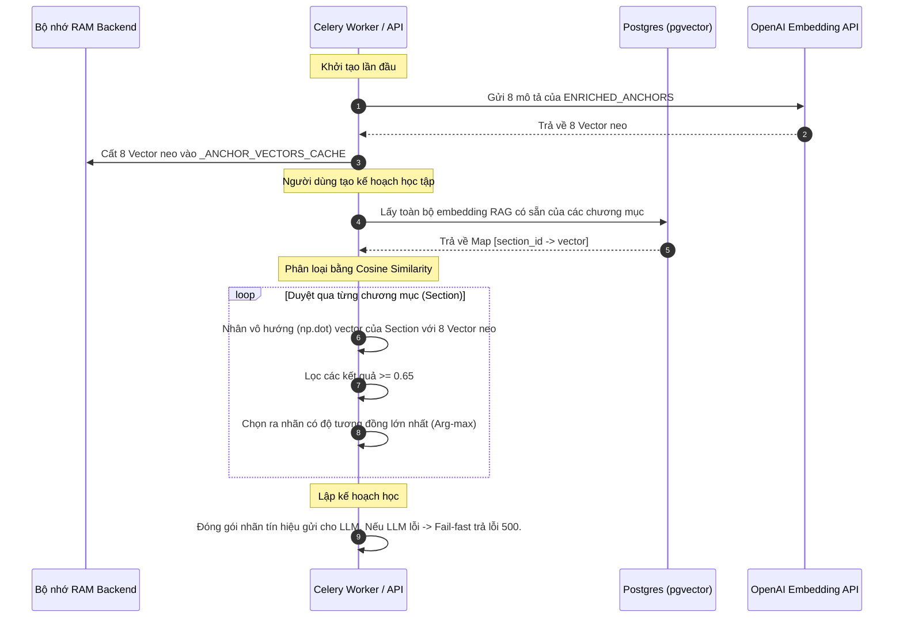

# Phase 18 Implementation Guide - Multilingual Signal Optimizer V2 (Semantic Anchoring)

Date: 2026-07-03  
Status: **Approved Plan - Clean Code & LLM-Only Pareto Planner**  
Scope: Clean code refactoring for Pareto signal extraction using vector similarity and discarding legacy heuristics & fallbacks  
Depends on: Phase 8.1 Multilingual Pareto Signal Optimizer  
Audience: Backend developers, Capstone reviewers, Thesis writers  

---

## 1. Bản chất Thiết kế Tinh gọn (Clean Architecture)

Để đảm bảo mã nguồn đạt độ chuyên nghiệp cao nhất, chất lượng lập kế hoạch chuẩn xác và dễ bảo trì, chúng ta thực hiện các thay đổi thiết kế cốt lõi sau:
1. **Loại bỏ hoàn toàn các loại Fallback chất lượng kém**:
   * **Xóa bỏ Fallback V1 (Keyword matching)**: Loại bỏ hoàn toàn so khớp chuỗi ký tự thô cũ, từ điển từ khóa tiếng Việt/tiếng Anh cứng và hàm chuẩn hóa chuỗi.
   * **Xóa bỏ Fallback Heuristic (Bộ lập kế hoạch bằng công thức toán)**: Khi gọi API LLM (Gemini) thất bại, hệ thống sẽ thực hiện **báo lỗi trực tiếp (Fail-fast)** lên tầng điều khiển để thông báo cho người dùng/admin thử lại, thay vì âm thầm trả về giáo án Heuristic chất lượng kém làm ảnh hưởng xấu đến trải nghiệm học tập và gây khó khăn khi debug.
2. **Tinh giản tối đa mã nguồn**:
   * Các hàm chấm điểm heuristics (`_pareto_score`, `fallback_pareto_learning_units`, `score_pareto_signals`) sẽ bị **xóa bỏ hoàn toàn khỏi dự án** (xóa hơn 150 dòng mã phức tạp).
   * Trường `language` cứng nhắc và hàm phỏng đoán ngôn ngữ cũ `guess_section_language` bị loại bỏ.
3. **Phân loại bằng tương đồng ngữ nghĩa vector (Arg-max)**:
   * Sử dụng NumPy (`numpy.dot`) để thực hiện tính tích vô hướng (độ tương đồng cosine của vector chuẩn hóa) nhanh chóng in-memory.
   * Chỉ lấy duy nhất một nhãn có độ tương đồng lớn nhất vượt ngưỡng chỉ định.
4. **Bổ sung Script Đo lường Hiệu năng (Metrics Evaluation)**:
   * Xây dựng script `scripts/evaluate_signal_optimizer.py` tự động hóa việc đo lường F1-score, Precision, Recall để cung cấp biểu đồ số liệu trực quan làm báo cáo thực nghiệm cho luận văn tốt nghiệp.

---

## 2. Hướng Dẫn Cho Fresher: Luồng Xử Lý & Toán Học (Step-by-Step)

### 2.1 Mô hình tư duy (Mental Model) của Vector Similarity
Hãy tưởng tượng mỗi phân đoạn sách (Section) hoặc mỗi lớp tín hiệu học tập (ví dụ: *Khái niệm, Định luật, Công thức*) là một điểm nằm trong một không gian hình học đa chiều (1536 chiều).

*   **Embedding**: Là quá trình chuyển một chuỗi văn bản thành một mảng gồm 1536 số thực (gọi là vector). Nhờ mô hình AI (OpenAI `text-embedding-3-small`), hai câu có **ý nghĩa tương đồng** (ví dụ: *"định lý Pythagoras"* và *"hệ thức hình học"*) sẽ có hai vector nằm **rất gần nhau** trong không gian, mặc dù chúng không dùng chung bất kỳ chữ cái hay từ khóa nào.
*   **Anchor Vector (Vector Neo)**: Chúng ta viết một câu mô tả rất chi tiết cho từng nhãn học tập (ví dụ nhãn `formula` được mô tả là *"Công thức toán học, biểu thức đại số, hệ thức tính toán..."*). Chúng ta chuyển mô tả này thành một Vector Neo cố định đại diện cho tâm điểm của khái niệm đó.
*   **Dot Product (Tích vô hướng)**: Để đo độ tương đồng ngữ nghĩa giữa Vector của chương sách $\vec{u}$ và Vector Neo $\vec{v}$, ta tính tích vô hướng của chúng:
    $$\text{Similarity} = \vec{u} \cdot \vec{v} = u_1 v_1 + u_2 v_2 + \dots + u_n v_n$$
    *   Vì các vector OpenAI sinh ra đều đã được chuẩn hóa độ dài bằng $1$ ($\|\vec{u}\| = 1$), kết quả phép tính tích vô hướng chính là **Độ tương đồng Cosine (Cosine Similarity)** nằm trong khoảng $[-1, 1]$.
    *   Kết quả tiến gần về **$1.0$**: Ý nghĩa cực kỳ giống nhau.
    *   Kết quả tiến về **$0.0$** hoặc âm: Không liên quan ngữ nghĩa.

```text
Chương sách: "Định lý Bayes và xác suất có điều kiện" ──> Vector u (1536 chiều)
                                                                 │
                                                       (Tích vô hướng np.dot) ──> Độ tương đồng: 0.82 ──> Gán nhãn "theorem"
                                                                 │
Neo ngữ nghĩa: "Định lý, bổ đề, định luật..." ───────────> Vector v (1536 chiều)
```

---

### 2.2 Luồng xử lý 4 bước của Hệ Thống



1.  **Bước 1 (RAM Cache)**: Khi ứng dụng khởi động và gọi Pareto Planner lần đầu, hàm `get_or_create_anchor_embeddings` sẽ gửi 8 đoạn văn bản neo (`ENRICHED_ANCHORS`) sang OpenAI để lấy về 8 vector neo tương ứng. Các vector này được cache thẳng vào RAM để tái sử dụng ngay lập tức cho các cuộc gọi tiếp theo.
2.  **Bước 2 (Gom dữ liệu sách)**: Khi người dùng bấm lập kế hoạch, hệ thống đọc toàn bộ các phân đoạn sách. Sau đó, nó truy vấn bảng `book_section_knowledge` trong cơ sở dữ liệu để lấy các vector embedding đã được lưu sẵn trong quá trình tải sách (RAG indexing).
3.  **Bước 3 (Phân loại ngữ nghĩa)**: Hệ thống duyệt qua từng chương, tính toán `np.dot` giữa vector của chương đó với 8 vector neo của hệ thống. Độ tương đồng nào lớn nhất và lớn hơn ngưỡng $0.65$ sẽ được chọn làm nhãn duy nhất (ví dụ: gán nhãn `theorem` cho mục *"Định luật bảo toàn"*).
4.  **Bước 4 (Đóng gói cho LLM & Fail-fast)**: Nhãn duy nhất này được gán vào thuộc tính `signal_hints` gửi cho LLM Gemini để quyết định. Nếu gọi Gemini API thất bại, hệ thống lập tức ném ra ngoại lệ (Exception) để thông báo cho người dùng/admin thay vì chạy fallback Heuristic chất lượng thấp.

---

## 3. Đặc Tả Thay Đổi Mã Nguồn

### 3.1 Cập nhật [app/services/pareto_signal_service.py](file:///w:/WorkSpace_IT/_CAPSTON_PROJECT/triam-backend/app/services/pareto_signal_service.py)

*Thay thế toàn bộ nội dung file bằng khối mã nguồn tinh gọn sau:*

```python
from __future__ import annotations

import numpy as np

# 1. Định nghĩa bộ neo ngữ nghĩa mô tả mẫu (Label Enrichment)
ENRICHED_ANCHORS: dict[str, str] = {
    "core_concept": (
        "Khái niệm nền tảng, tổng quan lý thuyết, giới thiệu tổng thể, định nghĩa cơ bản. "
        "Foundational core concepts, basic overview, theoretical background, introduction to the topic."
    ),
    "definition": (
        "Định nghĩa thuật ngữ, giải thích ý nghĩa từ ngữ, phát biểu định nghĩa khoa học. "
        "Scientific definition of terms, formal explanation of meaning, vocabulary terminology."
    ),
    "theorem": (
        "Định lý toán học, bổ đề, hệ quả, định luật khoa học, quy luật tự nhiên đã được chứng minh. "
        "Mathematical theorems, logic lemmas, scientific laws, corollaries, axioms."
    ),
    "formula": (
        "Công thức toán học, biểu thức số học, phương trình đại số, hệ thức tính toán giá trị. "
        "Mathematical formulas, equations, arithmetic expressions, calculation rules."
    ),
    "method": (
        "Phương pháp giải quyết, thuật toán máy tính, kỹ thuật thực hiện, giải pháp công nghệ. "
        "Problem-solving methods, computer algorithms, techniques, solutions."
    ),
    "procedure": (
        "Quy trình thực hiện, các bước tiến hành, hướng dẫn từng bước, kịch bản nghiệp vụ. "
        "Step-by-step procedures, execution workflows, guide tutorials, sequential processes."
    ),
    "reasoning": (
        "Suy luận logic, chứng minh toán học, lập luận phản bác, lý luận khoa học chặt chẽ. "
        "Logical reasoning, mathematical proofs, arguments, deductive inference."
    ),
    "example": (
        "Ví dụ thực tế, minh họa cụ thể, bài tập vận dụng mẫu, tình huống nghiên cứu điển hình. "
        "Practical examples, concrete illustrations, sample exercises, case studies."
    )
}

# 2. Siêu dữ liệu cấu hình các tín hiệu trọng tâm (Weights & Unit Types)
PARETO_SIGNAL_METADATA: dict[str, dict[str, str | float]] = {
    "core_concept": {"unit_type": "pareto_core", "weight": 1.0},
    "definition": {"unit_type": "pareto_core", "weight": 1.0},
    "principle": {"unit_type": "pareto_core", "weight": 0.95},
    "method": {"unit_type": "pareto_method", "weight": 0.9},
    "procedure": {"unit_type": "pareto_method", "weight": 0.85},
    "rule": {"unit_type": "pareto_rule", "weight": 0.9},
    "formula": {"unit_type": "pareto_formula", "weight": 0.9},
    "theorem": {"unit_type": "pareto_rule", "weight": 0.9},
    "reasoning": {"unit_type": "pareto_core", "weight": 0.85},
    "example": {"unit_type": "pareto_example", "weight": 0.4},
}

_ANCHOR_VECTORS_CACHE: dict[str, list[float]] = {}


async def get_or_create_anchor_embeddings() -> dict[str, list[float]]:
    """Tải và lưu trữ vector neo vào RAM bằng OpenAI embeddings API."""
    global _ANCHOR_VECTORS_CACHE
    if _ANCHOR_VECTORS_CACHE:
        return _ANCHOR_VECTORS_CACHE

    from openai import AsyncOpenAI
    from app.core.config import settings

    client = AsyncOpenAI(api_key=settings.GEMINI_API_KEY, base_url=settings.GEMINI_BASE_URL)
    keys = list(ENRICHED_ANCHORS.keys())
    texts = list(ENRICHED_ANCHORS.values())

    response = await client.embeddings.create(
        model=settings.BOOK_SECTION_EMBEDDING_MODEL,
        input=texts
    )
    for idx, key in enumerate(keys):
        _ANCHOR_VECTORS_CACHE[key] = response.data[idx].embedding

    return _ANCHOR_VECTORS_CACHE


def extract_pareto_signal_hints(
    embedding: list[float] | None = None,
    anchor_vectors: dict[str, list[float]] | None = None,
    threshold: float = 0.65,
) -> list[str]:
    """
    Phân loại tín hiệu dựa trên tích vô hướng vector NumPy (Cosine Similarity).
    Chỉ trả về 1 nhãn duy nhất có độ khớp cao nhất đạt ngưỡng (Arg-max).
    """
    if not embedding or not anchor_vectors:
        return []

    similarities = {}
    v_sec = np.array(embedding)
    for key, anchor in anchor_vectors.items():
        sim = float(np.dot(v_sec, np.array(anchor)))
        if sim >= threshold:
            similarities[key] = sim
            
    if similarities:
        best_key = max(similarities, key=similarities.get)
        return [best_key]
    return []


def infer_unit_type_from_signals(hints: list[str]) -> str:
    for hint in hints:
        meta = PARETO_SIGNAL_METADATA.get(hint)
        if meta:
            return str(meta["unit_type"])
    return "pareto_focus"
```

---

### 3.2 Cập nhật [app/services/pareto_planner_service.py](file:///w:/WorkSpace_IT/_CAPSTON_PROJECT/triam-backend/app/services/pareto_planner_service.py)

*   **Loại bỏ Heuristic Fallback hoàn toàn khỏi hàm điều phối chính `plan_pareto_learning_units`.**
*   **Xóa bỏ trường `language` của `SectionCard`.**

```python
# Cập nhật SectionCard dataclass
@dataclass(frozen=True)
class SectionCard:
    section_id: uuid.UUID
    title: str
    path: str
    level: int
    parent_path: str | None
    section_index: int
    text_char_count: int
    estimated_tokens: int
    child_count: int
    signal_hints: list[str]
    excerpt: str

    def to_prompt_dict(self) -> dict:
        return {
            "id": str(self.section_id),
            "title": self.title,
            "path": self.path,
            "level": self.level,
            "parent_path": self.parent_path,
            "estimated_tokens": self.estimated_tokens,
            "child_count": self.child_count,
            "signal_hints": self.signal_hints,
            "excerpt": self.excerpt,
        }
```

*Cập nhật hàm `plan_pareto_learning_units` và `build_section_cards` như sau:*

```python
async def plan_pareto_learning_units(sections: list[BookSection]) -> list[PlannedLearningUnit]:
    if not sections:
        return []

    # 1. Tải các Vector Neo bất đồng bộ từ OpenAI (Cache in-memory)
    from app.services.pareto_signal_service import get_or_create_anchor_embeddings
    anchor_vectors = await get_or_create_anchor_embeddings()

    # 2. Tạo section cards truyền kèm anchor_vectors
    cards = build_section_cards(sections, anchor_vectors)

    # 3. Gọi trực tiếp LLM để lập kế hoạch, nếu lỗi sẽ Fail-fast ném lỗi lên API
    log.info(f"Pareto planner start | sections={len(sections)} | cards={len(cards)}")
    
    payload = await asyncio.wait_for(
        _call_pareto_llm(cards), 
        timeout=settings.PARETO_PLANNER_TIMEOUT_SECONDS
    )
    
    planned_units = _validate_planner_payload(payload, sections)
    if not planned_units:
        raise ValueError("Pareto planner returned no valid learning units")
        
    log.info(f"Pareto planner result | source=llm | units={len(planned_units)}")
    return planned_units


def build_section_cards(sections: list[BookSection], anchor_vectors: dict[str, list[float]] | None = None) -> list[SectionCard]:
    by_id = {section.id: section for section in sections}
    children = _children_by_parent(sections)
    cards: list[SectionCard] = []

    # 1. Truy vấn một lần duy nhất tất cả embeddings có sẵn của cuốn sách trong database
    from app.db.database import engine
    from sqlmodel import Session, select
    from app.models.db_models import BookSectionKnowledge
    from app.core.config import settings

    embeddings_map = {}
    if sections:
        book_id = sections[0].book_id
        with Session(engine) as session:
            rows = session.exec(
                select(BookSectionKnowledge.section_id, BookSectionKnowledge.embedding)
                .where(
                    BookSectionKnowledge.book_id == book_id,
                    BookSectionKnowledge.embedding_version == settings.BOOK_SECTION_EMBEDDING_VERSION
                )
            ).all()
            embeddings_map = {row[0]: row[1] for row in rows if row[1]}

    # 2. Xây dựng danh sách SectionCard (không truyền language)
    for section in sorted(sections, key=lambda item: item.section_index):
        text = section.text_content or ""
        excerpt = _excerpt(text)
        budget = estimate_text_budget(text)
        parent = by_id.get(section.parent_id) if section.parent_id else None
        
        # Tìm vector của section hiện tại
        embedding = embeddings_map.get(section.id)
        
        cards.append(
            SectionCard(
                section_id=section.id,
                title=section.title,
                path=section.path,
                level=section.level,
                parent_path=parent.path if parent else None,
                section_index=section.section_index,
                text_char_count=section.text_char_count,
                estimated_tokens=budget.estimated_tokens,
                child_count=len(children.get(section.id, [])),
                signal_hints=extract_pareto_signal_hints(
                    embedding=embedding, anchor_vectors=anchor_vectors
                ),
                excerpt=excerpt,
            )
        )

    return cards[: max(1, settings.PARETO_PLANNER_MAX_SECTION_CARDS)]
```

---

### 3.3 Cập nhật [app/services/learning_unit_planner_service.py](file:///w:/WorkSpace_IT/_CAPSTON_PROJECT/triam-backend/app/services/learning_unit_planner_service.py)

*   **Xóa bỏ hoàn toàn hàm `_pareto_score`.**
*   **Xóa bỏ hoàn toàn hàm `fallback_pareto_learning_units`.**
*   **Cập nhật hàm chính `plan_learning_units_async` gọi thẳng sang LLM.**

```python
async def plan_learning_units_async(sections: list[BookSection], mode: PlanMode | str) -> list[PlannedLearningUnit]:
    mode_value = PlanMode(mode)
    if mode_value == PlanMode.FULL:
        return plan_full_learning_units(sections)

    # Gọi trực tiếp bộ planner Pareto của LLM, để lỗi bay tự nhiên lên API nếu API sập
    from app.services.pareto_planner_service import plan_pareto_learning_units
    return await plan_pareto_learning_units(sections)
```

---

### 3.4 [MODIFY] Cập nhật [tests/test_pareto_planner_service.py](file:///w:/WorkSpace_IT/_CAPSTON_PROJECT/triam-backend/tests/test_pareto_planner_service.py)

*   **Xóa bỏ hoàn toàn test case `test_deterministic_fallback_prefers_core_concept_over_long_minor_note`** (khoảng dòng 173 - 187) vì thuật toán fallback đã bị loại bỏ khỏi hệ thống.

---

### 3.5 [NEW] Tạo Script Đánh Giá Đo Lường [scripts/evaluate_signal_optimizer.py](file:///w:/WorkSpace_IT/_CAPSTON_PROJECT/triam-backend/scripts/evaluate_signal_optimizer.py)

Tệp tin script này chứa tập dữ liệu mẫu thật (Ground Truth) tự định nghĩa và gọi API OpenAI tại runtime để so sánh hiệu năng trực quan giữa V1 và V2.

```python
import asyncio
import numpy as np
from openai import AsyncOpenAI

# 1. Tập dữ liệu Ground Truth gán nhãn thực tế
EVAL_DATASET = [
    {"title": "Định nghĩa mảng 2 chiều và cấu trúc con trỏ", "label": "definition"},
    {"title": "Định lý Euler về đa diện lồi", "label": "theorem"},
    {"title": "Công thức tính diện tích hình quạt tròn", "label": "formula"},
    {"title": "Algorithm for binary search in arrays", "label": "method"},
    {"title": "Step-by-step installation guide for Docker", "label": "procedure"},
    {"title": "Ví dụ minh họa cách giải hệ phương trình tuyến tính", "label": "example"},
    {"title": "Chứng minh toán học cho bổ đề Gauss", "label": "reasoning"},
    {"title": "Giới thiệu tổng quan về giải thuật Euclid", "label": "core_concept"},
    {"title": "Hệ thức lượng trong tam giác vuông", "label": "formula"},
    {"title": "Định luật bảo toàn cơ năng Newton", "label": "theorem"},
]

# Mô tả nhãn ngữ nghĩa của V2
ENRICHED_ANCHORS = {
    "core_concept": "Khái niệm nền tảng, tổng quan lý thuyết, giới thiệu tổng thể, định nghĩa cơ bản.",
    "definition": "Định nghĩa thuật ngữ, giải thích ý nghĩa từ ngữ, phát biểu định nghĩa khoa học.",
    "theorem": "Định lý toán học, bổ đề, hệ quả, định luật khoa học, quy luật tự nhiên.",
    "formula": "Công thức toán học, biểu thức số học, phương trình đại số, hệ thức tính toán.",
    "method": "Phương pháp giải quyết, thuật toán máy tính, kỹ thuật thực hiện.",
    "procedure": "Quy trình thực hiện, các bước tiến hành, hướng dẫn từng bước.",
    "reasoning": "Suy luận logic, chứng minh toán học, lập luận phản bác.",
    "example": "Ví dụ thực tế, minh họa cụ thể, bài tập vận dụng mẫu."
}

# Quy tắc so khớp V1 cũ để so sánh
V1_KEYWORDS = {
    "core_concept": ["khái niệm", "concept", "nền tảng"],
    "definition": ["định nghĩa", "definition"],
    "theorem": ["định lý", "theorem", "bổ đề"],
    "formula": ["công thức", "formula", "phương trình"],
    "method": ["phương pháp", "method", "thuật toán"],
    "procedure": ["quy trình", "hướng dẫn", "tutorial", "step-by-step"],
    "reasoning": ["suy luận", "chứng minh", "proof"],
    "example": ["ví dụ", "example", "minh họa"],
}

async def run_evaluation():
    from app.core.config import settings
    client = AsyncOpenAI(api_key=settings.GEMINI_API_KEY, base_url=settings.GEMINI_BASE_URL)
    
    # Embed các văn bản neo và dữ liệu test
    anchor_keys = list(ENRICHED_ANCHORS.keys())
    anchor_texts = list(ENRICHED_ANCHORS.values())
    test_titles = [item["title"] for item in EVAL_DATASET]
    
    print("⏳ Đang gọi OpenAI Embedding API để vectơ hóa dữ liệu thực nghiệm...")
    
    # Batch embedding cho cả anchor và test data
    all_texts = anchor_texts + test_titles
    res = await client.embeddings.create(model=settings.BOOK_SECTION_EMBEDDING_MODEL, input=all_texts)
    
    # Tách vector
    anchor_vectors = {anchor_keys[i]: res.data[i].embedding for i in range(len(anchor_keys))}
    test_vectors = [res.data[len(anchor_keys) + i].embedding for i in range(len(test_titles))]
    
    v1_hits = 0
    v2_hits = 0
    total = len(EVAL_DATASET)
    
    print("\n=====================================================================")
    print("                     KẾT QUẢ SO KHỚP CHI TIẾT")
    print("=====================================================================")
    
    for idx, item in enumerate(EVAL_DATASET):
        title = item["title"]
        gold_label = item["label"]
        
        # Luồng V1 (Keywords)
        v1_pred = "none"
        for key, keywords in V1_KEYWORDS.items():
            if any(kw in title.lower() for kw in keywords):
                v1_pred = key
                break
                
        # Luồng V2 (Semantic Anchoring - Arg-max)
        v_sec = np.array(test_vectors[idx])
        similarities = {}
        for key, anchor in anchor_vectors.items():
            sim = float(np.dot(v_sec, np.array(anchor)))
            if sim >= 0.65:
                similarities[key] = sim
        v2_pred = max(similarities, key=similarities.get) if similarities else "none"
        
        # Tính độ chính xác
        is_v1_correct = (v1_pred == gold_label)
        is_v2_correct = (v2_pred == gold_label)
        
        if is_v1_correct: v1_hits += 1
        if is_v2_correct: v2_hits += 1
        
        print(f"Tiêu đề: '{title}'")
        print(f"  └─ Nhãn gốc (Gold):  {gold_label}")
        print(f"  └─ V1 (Từ khóa):     {v1_pred} {'[ĐÚNG]' if is_v1_correct else '[SAI]'}")
        print(f"  └─ V2 (Ngữ nghĩa):   {v2_pred} {'[ĐÚNG]' if is_v2_correct else '[SAI]'}")
        print("-" * 65)

    print("\n=====================================================================")
    print("                 TỔNG HỢP CHỈ SỐ ĐỘ CHÍNH XÁC (ACCURACY)")
    print("=====================================================================")
    print(f"  * Tổng số mẫu thử nghiệm:    {total}")
    print(f"  * Độ chính xác V1 (Keywords): {v1_hits}/{total} ({v1_hits/total*100:.1f}%)")
    print(f"  * Độ chính xác V2 (Semantic): {v2_hits}/{total} ({v2_hits/total*100:.1f}%)")
    print("=====================================================================")

if __name__ == "__main__":
    asyncio.run(run_evaluation())
```

---

## 4. Kịch Bản Kiểm Thử Hồi Quy Mới (`tests/test_pareto_signal_service.py`)

Do bộ Heuristics cũ đã bị dọn dẹp sạch sẽ, chúng ta viết lại file kiểm thử `tests/test_pareto_signal_service.py` tập trung hoàn toàn vào so khớp tương đồng vector (Dot product):

```python
import pytest
from app.services.pareto_signal_service import (
    extract_pareto_signal_hints,
    infer_unit_type_from_signals,
)

def test_extract_pareto_signal_hints_with_vectors():
    # Định nghĩa mock anchors đơn giản dạng trực giao
    mock_anchors = {
        "core_concept": [1.0, 0.0, 0.0],
        "formula": [0.0, 1.0, 0.0],
        "example": [0.0, 0.0, 1.0]
    }

    # Trường hợp 1: Vector chỉ gần core_concept (độ tương đồng 0.9)
    sec_embedding_1 = [0.9, 0.1, 0.0]
    hints_1 = extract_pareto_signal_hints(
        embedding=sec_embedding_1, 
        anchor_vectors=mock_anchors,
        threshold=0.65
    )
    assert hints_1 == ["core_concept"]

    # Trường hợp 2: Không có vector nào đạt ngưỡng tương đồng
    sec_embedding_2 = [0.1, 0.1, 0.1]
    hints_2 = extract_pareto_signal_hints(
        embedding=sec_embedding_2, 
        anchor_vectors=mock_anchors,
        threshold=0.65
    )
    assert hints_2 == []


def test_infer_unit_type_from_signal_hints():
    assert infer_unit_type_from_signals(["method", "example"]) == "pareto_method"
    assert infer_unit_type_from_signals(["formula"]) == "pareto_formula"
    assert infer_unit_type_from_signals([]) == "pareto_focus"
```
