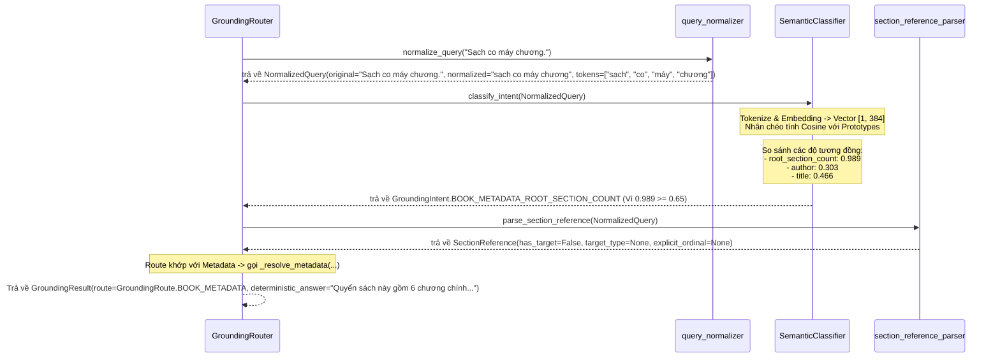
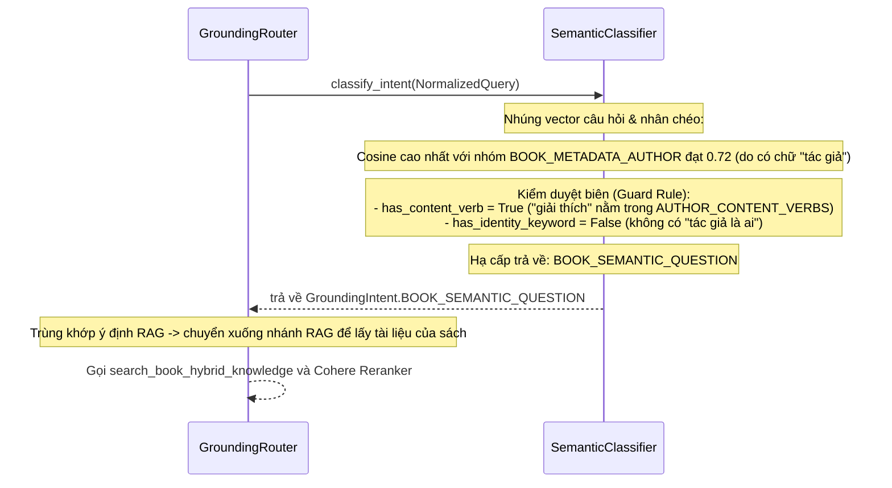
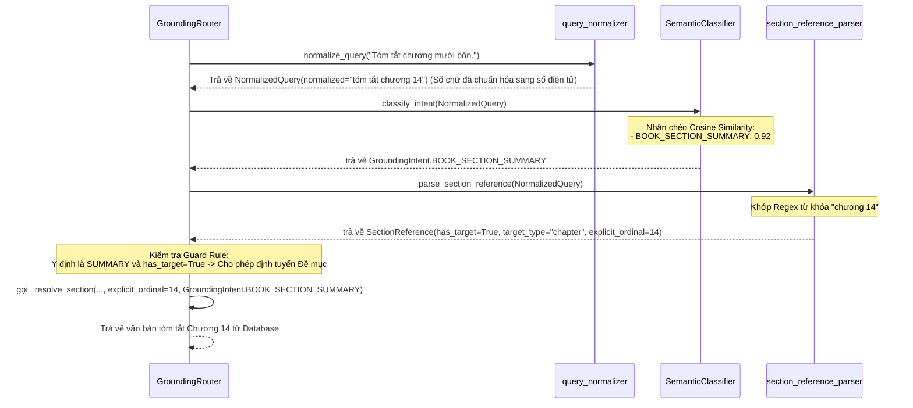

# Hướng dẫn Kỹ thuật Phase 20 - Semantic Similarity Intent Routing for Grounding Router

## 1. Tại sao Phase này tồn tại (Bối cảnh & Nghiệp vụ)

Trong các phiên bản trước, bộ định tuyến `GroundingRouter` phân loại ý định người dùng (metadata, tóm tắt chương, nội dung chương, hoặc câu hỏi RAG) dựa trên mảng từ khóa Heuristic cứng (như `AUTHOR_MARKERS`, `TITLE_MARKERS`). 

### Hạn chế của giải pháp Heuristic
1.  **Nhạy cảm với lỗi chính tả âm học**: Khi Whisper dịch sai từ `"sách có mấy"` thành `"Sạch co máy"`, thuật ngữ Regex không khớp được từ khóa và đẩy sai xuống luồng RAG gây ra câu trả lời lạc đề.
2.  **Bảo trì phức tạp**: Lập trình viên phải bổ sung thủ công hàng ngàn biến thể từ khóa khác nhau, vi phạm nguyên lý thiết kế mở rộng.

### Giải pháp mô hình SOTA (all-MiniLM-L6-v2)
Hệ thống thay thế hoàn toàn heuristic cứng bằng phương pháp **So khớp độ tương đồng ngữ nghĩa Cosine (Cosine Similarity)** trên không gian vector của mô hình **`all-MiniLM-L6-v2`** chạy local trên CPU.

> **💡 Góc nhìn NLP chuyên sâu:**
> Mặc dù `all-MiniLM-L6-v2` là mô hình tiếng Anh, nhưng đối với các từ tiếng Việt không nằm trong từ điển của nó, tokenizer sẽ phân tách thành các cụm ký tự (subwords/characters). Sự trùng lặp cao về ký tự này giúp mô hình hoạt động như một **Character-level Matcher** cực kỳ thông minh, nhận diện rất chính xác các từ bị lệch dấu (như `"Sạch co máy"` -> `"sách có mấy"`) với điểm cosine $> 0.95$, đồng thời đẩy các câu hỏi RAG bình thường xuống luồng RAG chính xác.

---

## 2. Hướng dẫn sửa đổi mã nguồn chi tiết

Chúng ta sẽ thực hiện sửa đổi 3 tệp tin chính:
1.  `app/services/agent_grounding/intent_router.py`: Loại bỏ toàn bộ từ khóa tĩnh và cài đặt lớp `SemanticIntentClassifier` có nạp trì hoãn (lazy loading).
2.  `app/services/agent_grounding/grounding_router.py`: Điều chỉnh luồng `resolve` để gọi bộ phân loại ngữ nghĩa không đồng bộ (async).
3.  `tests/services/agent_grounding/test_intent_router.py`: Cập nhật các hàm unit test sang async để đồng bộ với cơ chế mới.

---

### 2.1 Cập nhật [app/services/agent_grounding/intent_router.py](file:///w:/WorkSpace_IT/_CAPSTON_PROJECT/triam-backend/app/services/agent_grounding/intent_router.py)

Thay thế toàn bộ tệp cũ bằng lớp `SemanticIntentClassifier` và cơ chế lazy-load không nghẽn luồng asyncio.

```python
from __future__ import annotations

import asyncio
import torch
from transformers import AutoTokenizer, AutoModel
from app.services.agent_grounding.contracts import GroundingIntent, NormalizedQuery

# Định nghĩa các câu mẫu đặc trưng đại diện cho từng lớp Ý định (Intent Class)
PROTOTYPES = {
    GroundingIntent.BOOK_METADATA_ROOT_SECTION_COUNT: [
        "sách có bao nhiêu chương chính",
        "quyển sách này gồm bao nhiêu chương",
        "sách có mấy chương",
        "sách gồm mấy phần",
        "tổng số chương chính",
        "how many chapters",
        "how many main sections"
    ],
    GroundingIntent.BOOK_METADATA_AUTHOR: [
        "ai là tác giả cuốn sách này",
        "tác giả quyển sách này là ai",
        "ai viết tác phẩm này",
        "sách này được soạn bởi ai",
        "author của cuốn sách này",
        "who wrote this book",
        "written by"
    ],
    GroundingIntent.BOOK_METADATA_TITLE: [
        "tên sách là gì",
        "tựa đề quyển sách này",
        "đang đọc quyển sách nào",
        "tên của quyển sách đang học",
        "quyển sách này tên là gì",
        "book title"
    ],
    GroundingIntent.BOOK_SECTION_SUMMARY: [
        "tóm tắt chương 1",
        "đại ý của chương hai",
        "tổng quan chương 3",
        "kể tóm lược phần 4",
        "summarize",
        "summary of chapter"
    ],
    GroundingIntent.BOOK_SECTION_CONTENT: [
        "nội dung chương 1 là gì",
        "giải thích chương 2",
        "đọc nội dung phần ba",
        "trình bày chi tiết mục 1.1",
        "nội dung phần",
        "what is in section"
    ],
    GroundingIntent.BOOK_METADATA_DOCUMENT_TYPE: [
        "định dạng tài liệu này là gì",
        "đây là loại file gì",
        "đây là tài liệu pdf hay word",
        "loại tài liệu hiện tại",
        "document type",
        "file format"
    ],
    GroundingIntent.BOOK_METADATA_STATUS: [
        "sách đã xử lý xong chưa",
        "trạng thái xử lý của sách",
        "sách đã được nạp thành công chưa",
        "tiến trình nạp sách thế nào",
        "sach da ingest thanh cong chua"
    ],
    GroundingIntent.BOOK_METADATA_SECTION_COUNT: [
        "bao nhiêu đề mục",
        "quyển này có bao nhiêu mục tất cả",
        "tổng số mục trong sách",
        "how many sections",
        "section count"
    ]
}

def mean_pooling(model_output, attention_mask):
    token_embeddings = model_output[0]
    input_mask_expanded = attention_mask.unsqueeze(-1).expand(token_embeddings.size()).float()
    return torch.sum(token_embeddings * input_mask_expanded, 1) / torch.clamp(input_mask_expanded.sum(1), min=1e-9)

class SemanticIntentClassifier:
    def __init__(self) -> None:
        self.model_name = "sentence-transformers/all-MiniLM-L6-v2"
        self.tokenizer = None
        self.model = None
        self.proto_embeddings = {}
        self._lock = asyncio.Lock()
        self._initialized = False

    def initialize(self) -> None:
        """
        Nạp tokenizer, weights và tính toán trước vector nhúng của các câu mẫu.
        Phương thức này chạy đồng bộ (blocking CPU) nên cần được bao bọc khi gọi từ async loop.
        """
        if self._initialized:
            return
        
        self.tokenizer = AutoTokenizer.from_pretrained(self.model_name)
        self.model = AutoModel.from_pretrained(self.model_name)
        self.model.eval()
        
        with torch.no_grad():
            for intent, phrases in PROTOTYPES.items():
                inputs = self.tokenizer(phrases, padding=True, truncation=True, return_tensors="pt")
                outputs = self.model(**inputs)
                embeddings = mean_pooling(outputs, inputs['attention_mask'])
                embeddings = torch.nn.functional.normalize(embeddings, p=2, dim=1)
                self.proto_embeddings[intent] = embeddings
                
        self._initialized = True

    async def initialize_async(self) -> None:
        """
        Khởi tạo an toàn bất đồng bộ. Đẩy tác vụ nạp model nặng sang Executor Thread
        để không chặn Event Loop chính của LiveKit.
        """
        if self._initialized:
            return
        async with self._lock:
            if not self._initialized:
                loop = asyncio.get_running_loop()
                await loop.run_in_executor(None, self.initialize)

    async def classify(self, query_text: str, threshold: float = 0.65) -> GroundingIntent:
        """
        Tính toán cosine similarity của câu hỏi với các mẫu.
        Nếu điểm số cao nhất dưới threshold, mặc định trả về RAG (BOOK_SEMANTIC_QUESTION).
        """
        await self.initialize_async()
        
        text = query_text.strip().lower()
        if not text:
            return GroundingIntent.BOOK_SEMANTIC_QUESTION

        with torch.no_grad():
            inputs = self.tokenizer([text], padding=True, truncation=True, return_tensors="pt")
            outputs = self.model(**inputs)
            query_emb = mean_pooling(outputs, inputs['attention_mask'])
            query_emb = torch.nn.functional.normalize(query_emb, p=2, dim=1)
            
            best_intent = GroundingIntent.BOOK_SEMANTIC_QUESTION
            best_score = -1.0
            
            for intent, proto_embs in self.proto_embeddings.items():
                # Nhân ma trận tính khoảng cách Cosine nhanh trên Pytorch
                sims = torch.matmul(query_emb, proto_embs.T).squeeze(0)
                max_sim = torch.max(sims).item()
                if max_sim > best_score:
                    best_score = max_sim
                    best_intent = intent
                    
            if best_score >= threshold:
                return best_intent
                
            return GroundingIntent.BOOK_SEMANTIC_QUESTION

# Đối tượng Singleton dùng chung trong suốt phiên hoạt động của module
_classifier = SemanticIntentClassifier()

async def classify_intent(query: NormalizedQuery) -> GroundingIntent:
    """
    Hàm giao tiếp hướng ngoại tương thích với các module gọi ngoài.
    """
    return await _classifier.classify(query.normalized)
```

---

### 2.2 Cập nhật [app/services/agent_grounding/grounding_router.py](file:///w:/WorkSpace_IT/_CAPSTON_PROJECT/triam-backend/app/services/agent_grounding/grounding_router.py)

Chỉnh sửa phương thức `resolve` (dòng 35-74) để tích hợp `classify_intent` không đồng bộ mới và xử lý fallbacks.

```python
    async def resolve(
        self,
        query: str,
        *,
        input_mode: AgentInputMode = AgentInputMode.TEXT,
        tracer: AgentTurnTracer | None = None,
    ) -> GroundingResult:
        started = time.perf_counter()
        normalized = normalize_query(query)

        # 1. Gọi bộ phân loại ý định ngữ nghĩa bất đồng bộ
        intent = await classify_intent(normalized)
        reference = parse_section_reference(normalized)

        # 2. Luật chặn (Guard Rule): Nếu phân loại là mục lục/tóm tắt chương nhưng không có đề mục cụ thể
        # thì tự động hạ cấp xuống RAG để tránh lỗi định tuyến
        if intent in (GroundingIntent.BOOK_SECTION_SUMMARY, GroundingIntent.BOOK_SECTION_CONTENT):
            if not reference.has_target:
                intent = GroundingIntent.BOOK_SEMANTIC_QUESTION

        result = None
        if intent == GroundingIntent.BOOK_SEMANTIC_QUESTION:
            result = GroundingResult(
                GroundingDecision(
                    GroundingIntent.BOOK_SEMANTIC_QUESTION,
                    GroundingRoute.BOOK_RAG,
                    ResolutionQuality.NOT_FOUND,
                    "semantic_rag_fallback",
                )
            )
        elif intent == GroundingIntent.CLARIFICATION_REQUIRED:
            result = self._clarification("missing_section_reference", "Bạn muốn hỏi chương hoặc đề mục nào?")
        elif intent in (GroundingIntent.BOOK_SECTION_SUMMARY, GroundingIntent.BOOK_SECTION_CONTENT):
            result = await self._resolve_section(normalized, reference, intent)
            if result.decision.route == GroundingRoute.CLARIFICATION:
                is_explicit = reference.explicit_path is not None or reference.explicit_ordinal is not None
                if not is_explicit:
                    result = None
        else:
            # Các nhóm Metadata
            result = self._resolve_metadata(normalized, intent)

        if result is None:
            # Fallback phòng thủ cuối cùng
            result = GroundingResult(
                GroundingDecision(
                    GroundingIntent.BOOK_SEMANTIC_QUESTION,
                    GroundingRoute.BOOK_RAG,
                    ResolutionQuality.NOT_FOUND,
                    "semantic_rag_fallback",
                )
            )

        if tracer is not None:
            self._record_trace(tracer, input_mode, result, int((time.perf_counter() - started) * 1000))
        return result
```

---

### 2.3 Cập nhật [tests/services/agent_grounding/test_intent_router.py](file:///w:/WorkSpace_IT/_CAPSTON_PROJECT/triam-backend/tests/services/agent_grounding/test_intent_router.py)

Chuyển đổi toàn bộ unit test thành async với decorator `@pytest.mark.asyncio`.

```python
import pytest
from app.services.agent_grounding.contracts import GroundingIntent
from app.services.agent_grounding.intent_router import classify_intent
from app.services.agent_grounding.query_normalizer import normalize_query

@pytest.mark.asyncio
async def test_detects_bilingual_metadata_intents():
    assert await classify_intent(normalize_query("Tác giả của sách là ai?")) == GroundingIntent.BOOK_METADATA_AUTHOR
    assert await classify_intent(normalize_query("Who wrote this book?")) == GroundingIntent.BOOK_METADATA_AUTHOR
    assert await classify_intent(normalize_query("Tên của quyển sách này là gì?")) == GroundingIntent.BOOK_METADATA_TITLE
    assert await classify_intent(normalize_query("Sách có bao nhiêu phần chính?")) == GroundingIntent.BOOK_METADATA_ROOT_SECTION_COUNT
    assert await classify_intent(normalize_query("Sách có bao nhiêu đề mục?")) == GroundingIntent.BOOK_METADATA_SECTION_COUNT

@pytest.mark.asyncio
async def test_does_not_misroute_author_content_question_as_metadata():
    query = normalize_query("Tác giả giải thích khái niệm này như thế nào?")
    assert await classify_intent(query) == GroundingIntent.BOOK_SEMANTIC_QUESTION

@pytest.mark.asyncio
async def test_detects_section_summary_and_missing_reference():
    clear = normalize_query("Tóm tắt chương 4.")
    main_idea = normalize_query("Ý chương bốn là gì?")
    
    assert await classify_intent(clear) == GroundingIntent.BOOK_SECTION_SUMMARY
    assert await classify_intent(main_idea) == GroundingIntent.BOOK_SECTION_SUMMARY
```

---

## 3. Giải thích Kỹ thuật dành cho Fresher (Training & Concepts)

### 3.1 Mean Pooling là gì?
Mô hình BERT/Transformer sinh ra các vector biểu diễn cho **từng token riêng lẻ** (Word Embeddings). Để chuyển đổi các vector này thành một vector duy nhất đại diện cho cả câu (Sentence Embedding):
*   **Mean Pooling**: Tính trung bình cộng của tất cả các vector token trong câu, đồng thời sử dụng `attention_mask` để loại bỏ các token đệm (`[PAD]`).
*   Công thức thực thi trong PyTorch:
    ```python
    # Nhân chéo với mask để triệt tiêu các vector [PAD] trước khi tính trung bình
    input_mask_expanded = attention_mask.unsqueeze(-1).expand(token_embeddings.size()).float()
    sum_embeddings = torch.sum(token_embeddings * input_mask_expanded, 1)
    ```

### 3.2 Tại sao cần dùng `run_in_executor` cho mô hình Local?
*   Hệ thống chạy trên Event Loop đơn luồng của Python (asyncio). 
*   Việc tải tệp weights mô hình từ ổ cứng và chạy tính toán Feed-Forward của mạng neural (PyTorch) tốn rất nhiều chu kỳ CPU và **gây nghẽn tiến trình (blocking)**.
*   Nếu không sử dụng `run_in_executor`, luồng xử lý giọng nói của tất cả các participant khác trong phòng LiveKit sẽ bị đứng băng (lag) trong khoảng 0.5s - 1.0s khi mô hình khởi tạo. `run_in_executor` đưa tác vụ này sang một Thread riêng biệt để chạy song song.

---

## 4. Kịch bản kiểm thử (Verification Plan)

### 4.1 Chạy Unit Test tự động
Chạy pytest để đảm bảo các unit test phân loại hoạt động chính xác:
```powershell
uv run pytest tests/services/agent_grounding/test_intent_router.py
```
### 4.2 Chạy bộ test hệ thống tổng thể
```powershell
uv run pytest tests/services/agent_grounding tests/services/voice_agent -q
```

---

## 5. Bản Đồ Luồng Dữ Liệu Thực Tế (Detailed Data Flow Trace)

Dưới đây là 3 kịch bản dữ liệu thực tế chạy qua hệ thống để Fresher nắm bắt được chính xác kiểu dữ liệu (Data Type) và giá trị (Value) luân chuyển qua từng hàm.

### 5.1 Kịch bản 1: Học viên nói lệch âm / sai chính tả nhẹ (Acoustic typo)
*   **Input thô từ Whisper STT**: `"Sạch co máy chương."`



---

### 5.2 Kịch bản 2: Câu hỏi RAG liên quan đến tác giả (Tránh nhận diện nhầm làm lỗi RAG)
*   **Input thô từ Whisper STT**: `"Tác giả giải thích khái niệm này như thế nào?"`



---

### 5.3 Kịch bản 3: Yêu cầu tóm tắt chương có đề mục rõ ràng
*   **Input thô từ Whisper STT**: `"Tóm tắt chương mười bốn."`


