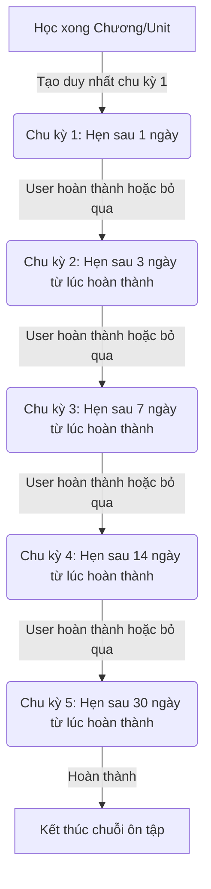

# Hướng Dẫn Triển Khai - Phase 22: Chuyển Đổi Sang Cơ Chế Sinh Lịch Ôn Tập Động (Dynamic Spaced Repetition)

Tài liệu này hướng dẫn chi tiết cách cấu trúc lại hệ thống ôn tập ngắt quãng (Spaced Repetition) từ việc sinh trước hàng loạt lịch ôn tập sang **cơ chế sinh lịch động theo chuỗi (Chain-based Dynamic Creation)**. Hướng dẫn này được viết nhằm giúp các nhà phát triển mới (Fresher) hiểu được bản chất thiết kế và dễ dàng tự triển khai.

---

## 🎯 1. Phân Tích Lỗi & Tư Duy Thiết Kế Kiến Trúc (Senior Perspective)

### Hiện trạng lỗi (Bug Context)
Khi người dùng học xong một bài học (`LearningUnit`), hệ thống cũ tự động tạo ra đồng thời **5 bản ghi** ôn tập (`SpacedReviewItem`) ứng với các chu kỳ 1, 3, 7, 14, 30 ngày ở trạng thái `PENDING` vào database với thời gian hẹn giờ `due_at` tăng dần.
*   **Vấn đề phát sinh:** Nếu người dùng bận rộn và không mở ứng dụng ôn tập trong vòng 10 ngày liên tiếp, thời gian thực tế sẽ vượt qua hạn của nhiều bản ghi cùng một lúc (hạn 1 ngày, 3 ngày, 7 ngày).
*   **Hậu quả:** API tìm kiếm thẻ cần ôn (`GET /reviews?status=due`) sẽ lấy tất cả các bản ghi có trạng thái chưa ôn và quá hạn (`due_at <= now`). Việc này trả về 3 bản ghi giống hệt nhau về nội dung nhưng khác nhau về ID chu kỳ. Mobile App hiển thị **3 thẻ ôn tập trùng lặp** trên giao diện, tạo trải nghiệm cực kỳ tồi tệ.

### Giải pháp thiết kế: Chuỗi liên kết động (Chain-based Spaced Repetition)
Spaced Repetition chỉ thực sự hoạt động tốt nhất khi **thời gian của chu kỳ tiếp theo được tính dựa trên thời điểm thực tế hoàn thành chu kỳ trước đó**.
*   **Thiết kế mới (Phương án A):**
    *   Khi học xong một bài học: Hệ thống **chỉ tạo duy nhất** lượt ôn tập đầu tiên (1 ngày).
    *   Khi người dùng ôn xong lượt hiện tại: Hệ thống đánh dấu hoàn thành lượt đó và **tự động tính toán ngày, sinh tiếp** lượt ôn tập kế tiếp (3 ngày, rồi đến 7 ngày, v.v.).
    *   Cơ chế này đảm bảo tại một thời điểm, một bài học chỉ có tối đa **1 thẻ ôn tập** ở trạng thái sẵn sàng (DUE hoặc PENDING), loại bỏ hoàn toàn khả năng trùng lặp nội dung.



---

## 📂 2. Chi Tiết Các Tệp Cần Chỉnh Sửa

### Tệp 1: spaced_review_service.py
#### [MODIFY] [app/services/spaced_review_service.py](file:///w:/WorkSpace_IT/_CAPSTON_PROJECT/triam-backend/app/services/spaced_review_service.py)
*   **Mục tiêu:** Sửa hàm `create_spaced_reviews_after_unit_completion` để không chạy vòng lặp tạo 5 bản ghi nữa, mà chỉ tạo bản ghi chu kỳ đầu tiên (`sequence_index = 0`, `interval_days = 1`).
*   **Mã nguồn sau khi chỉnh sửa:**

```python
import uuid
from datetime import datetime, timedelta

from sqlmodel import Session

from app.core.constant import PlanMode, ReviewItemStatus
from app.models.db_models import SpacedReviewItem
from app.repositories.spaced_review_repo import (
    cancel_unanchored_review_items_for_unit,
    create_review_item_once,
    has_active_review_chain_for_unit,
)

SPACED_REVIEW_INTERVALS = [1, 3, 7, 14, 30]


def create_spaced_reviews_after_unit_completion(
    session: Session,
    *,
    user_id: uuid.UUID,
    book_id: uuid.UUID,
    learning_unit_id: uuid.UUID,
    mode: PlanMode | str,
    review_text: str,
    completed_at: datetime,
    source_unit_progress_id: uuid.UUID,
) -> list[SpacedReviewItem]:
    clean_review_text = review_text.strip()
    if not clean_review_text:
        return []

    # Hủy các bản ghi mồ côi (chưa liên kết với tiến độ thực tế) của unit này
    cancel_unanchored_review_items_for_unit(session, user_id=user_id, learning_unit_id=learning_unit_id)
    
    # Kiểm tra xem unit này đã có chuỗi ôn tập nào đang hoạt động chưa
    if has_active_review_chain_for_unit(session, user_id=user_id, learning_unit_id=learning_unit_id):
        return []

    mode_value = PlanMode(mode)
    
    # Tối ưu hóa chuỗi động: Chỉ lấy khoảng thời gian của chu kỳ đầu tiên (ngày 1)
    first_interval_days = SPACED_REVIEW_INTERVALS[0]
    
    # Chỉ khởi tạo 1 bản ghi duy nhất cho chu kỳ đầu tiên (sequence_index = 0)
    item = SpacedReviewItem(
        user_id=user_id,
        book_id=book_id,
        learning_unit_id=learning_unit_id,
        mode=mode_value,
        interval_days=first_interval_days,
        sequence_index=0,
        due_at=completed_at + timedelta(days=first_interval_days),
        status=ReviewItemStatus.PENDING,
        review_text_snapshot=clean_review_text,
        anchor_completed_at=completed_at,
        source_unit_progress_id=source_unit_progress_id,
    )
    
    created_item = create_review_item_once(session, item)
    return [created_item] if created_item else []
```

---

### Tệp 2: review_service.py
#### [MODIFY] [app/services/review_service.py](file:///w:/WorkSpace_IT/_CAPSTON_PROJECT/triam-backend/app/services/review_service.py)
*   **Mục tiêu:** Thêm hàm bổ trợ `_create_next_review_cycle_if_applicable` để tự động tính toán và khởi tạo bản ghi cho chu kỳ tiếp theo dựa trên kết quả ôn tập hiện tại của người dùng.
*   **Mã nguồn bổ sung và chỉnh sửa:**

```python
import uuid
from datetime import datetime, timedelta, timezone

from sqlmodel import Session

from app.core.constant import PlanMode, ReviewItemStatus
from app.core.exceptions import BadRequestError, ReviewItemNotFoundError
from app.models.db_models import Book, LearningUnit, SpacedReviewItem
from app.repositories.spaced_review_repo import (
    create_review_item_once,  # Cần import thêm hàm này để tạo chu kỳ động
    get_review_item_for_user,
    list_review_items_for_user,
    mark_review_item_completed,
    mark_review_item_skipped,
)
# Import cấu hình khoảng thời gian để tính toán động
from app.services.spaced_review_service import SPACED_REVIEW_INTERVALS
from app.schemas.review import ReviewActionResponse, ReviewItemResponse, ReviewListResponse


def _to_review_item_response(session: Session, item: SpacedReviewItem) -> ReviewItemResponse:
    book = session.get(Book, item.book_id)
    unit = session.get(LearningUnit, item.learning_unit_id) if item.learning_unit_id else None
    return ReviewItemResponse(
        review_item_id=item.id,
        book_id=item.book_id,
        book_title=book.title if book else None,
        learning_unit_id=item.learning_unit_id,
        learning_unit_title=unit.title if unit else None,
        mode=item.mode,
        status=item.status,
        due_at=item.due_at,
        interval_days=item.interval_days,
        sequence_index=item.sequence_index,
        review_text=item.review_text_snapshot or (unit.review_text if unit else "") or "",
        review_audio_url=unit.review_audio_url if unit else None,
        anchor_completed_at=item.anchor_completed_at,
        last_reviewed_at=item.last_reviewed_at,
        completed_at=item.completed_at,
        notified_at=item.notified_at,
    )


def _create_next_review_cycle_if_applicable(
    session: Session,
    current_item: SpacedReviewItem,
    now: datetime,
) -> SpacedReviewItem | None:
    """
    Hàm bổ trợ (Helper) của Senior giúp tự động sinh chu kỳ ôn tập tiếp theo.
    Thực hiện kế thừa toàn bộ nội dung ôn tập cũ, chỉ thay đổi mốc hẹn giờ ôn tập.
    """
    next_index = current_item.sequence_index + 1
    if next_index >= len(SPACED_REVIEW_INTERVALS):
        # Đã hoàn thành chu kỳ cuối cùng (30 ngày), kết thúc chuỗi ôn tập cho bài học này
        return None

    next_interval_days = SPACED_REVIEW_INTERVALS[next_index]
    
    # Tạo bản ghi mới kế tiếp trong chuỗi liên kết
    next_item = SpacedReviewItem(
        user_id=current_item.user_id,
        book_id=current_item.book_id,
        learning_unit_id=current_item.learning_unit_id,
        mode=current_item.mode,
        interval_days=next_interval_days,
        sequence_index=next_index,
        # Hạn ôn mới = Thời điểm thao tác hiện tại + số ngày giãn cách của chu kỳ tiếp theo
        due_at=now + timedelta(days=next_interval_days),
        status=ReviewItemStatus.PENDING,
        review_text_snapshot=current_item.review_text_snapshot,
        anchor_completed_at=current_item.anchor_completed_at,
        source_unit_progress_id=current_item.source_unit_progress_id,
    )
    
    return create_review_item_once(session, next_item)


def list_review_items(
    session: Session,
    *,
    user_id: uuid.UUID,
    status: str = "due",
    book_id: uuid.UUID | None = None,
    mode: str | None = None,
    limit: int = 50,
    offset: int = 0,
) -> ReviewListResponse:
    allowed_statuses = {"due", "upcoming", "completed", "skipped", "all"}
    if status not in allowed_statuses:
        raise BadRequestError("Trạng thái ôn tập không hợp lệ.")
    try:
        mode_value = PlanMode(mode) if mode else None
    except ValueError as exc:
        raise BadRequestError("Mode ôn tập không hợp lệ.") from exc
    now = datetime.now(timezone.utc)
    items = list_review_items_for_user(
        session,
        user_id=user_id,
        now=now,
        status_filter=status,
        book_id=book_id,
        mode=mode_value,
        limit=limit,
        offset=offset,
    )
    return ReviewListResponse(items=[_to_review_item_response(session, item) for item in items], total=len(items))


def get_review_item_detail(session: Session, *, user_id: uuid.UUID, review_item_id: uuid.UUID) -> ReviewItemResponse:
    item = get_review_item_for_user(session, user_id=user_id, review_item_id=review_item_id)
    if not item:
        raise ReviewItemNotFoundError()
    return _to_review_item_response(session, item)


def complete_review_item(session: Session, *, user_id: uuid.UUID, review_item_id: uuid.UUID) -> ReviewActionResponse:
    item = get_review_item_for_user(session, user_id=user_id, review_item_id=review_item_id)
    if not item:
        raise ReviewItemNotFoundError()
    
    now = datetime.now(timezone.utc)
    # 1. Đánh dấu hoàn thành bản ghi hiện tại
    saved = mark_review_item_completed(session, item, completed_at=now)
    
    # 2. Tạo chu kỳ tiếp theo trong chuỗi liên kết (nếu chưa phải chu kỳ cuối)
    _create_next_review_cycle_if_applicable(session, saved, now)
    
    return ReviewActionResponse(review_item_id=saved.id, status=saved.status, completed_at=saved.completed_at)


def skip_review_item(session: Session, *, user_id: uuid.UUID, review_item_id: uuid.UUID) -> ReviewActionResponse:
    item = get_review_item_for_user(session, user_id=user_id, review_item_id=review_item_id)
    if not item:
        raise ReviewItemNotFoundError()
    
    now = datetime.now(timezone.utc)
    # 1. Đánh dấu bỏ qua bản ghi hiện tại
    saved = mark_review_item_skipped(session, item, skipped_at=now)
    
    # 2. Khi bỏ qua vẫn tiếp tục sinh chu kỳ tiếp theo để củng cố trí nhớ
    _create_next_review_cycle_if_applicable(session, saved, now)
    
    return ReviewActionResponse(review_item_id=saved.id, status=saved.status, completed_at=saved.completed_at)
```

---

## 🧪 3. Kịch Bản Kiểm Thử & Xác Minh Cho Học Viên (Verification Guide)

Sau khi chỉnh sửa xong mã nguồn, học viên cần chạy chuỗi kiểm thử để chứng minh tính đúng đắn:

### Bước 1: Khởi động môi trường & Chạy pytest tự động
Đảm bảo các thay đổi không gây ra lỗi cú pháp hay phá hỏng các hàm nghiệp vụ khác:
```bash
uv run pytest
```

### Bước 2: Kiểm thử luồng học mới trên CSDL (Manual SQL Check)
1. Hãy tìm một cuốn sách mới và cho người dùng hoàn thành 1 chương (`LearningUnit`).
2. Chạy câu lệnh SQL kiểm tra bảng ôn tập:
   ```sql
   SELECT id, sequence_index, interval_days, due_at, status 
   FROM spaced_review_items 
   WHERE user_id = 'ca7c241b-169b-4300-9747-16da743ffef0' AND learning_unit_id = 'ID_UNIT_VỪA_HỌC';
   ```
   *   **Kết quả mong đợi:** Chỉ trả về **đúng 1 dòng duy nhất** có `sequence_index = 0`, `interval_days = 1` và `status = 'pending'`.

### Bước 3: Kiểm thử luồng hoàn thành lượt ôn tập (Complete Review Transition)
1. Gửi request hoàn thành lượt ôn tập hiện tại thông qua API (hoặc bấm trên màn hình app):
   ```bash
   POST /api/v1/reviews/{ID_BẢN_GHI_ÔN_TẬP}/complete
   ```
2. Thực hiện truy vấn lại CSDL:
   ```sql
   SELECT id, sequence_index, interval_days, due_at, status 
   FROM spaced_review_items 
   WHERE user_id = 'ca7c241b-169b-4300-9747-16da743ffef0' AND learning_unit_id = 'ID_UNIT_VỪA_HỌC'
   ORDER BY sequence_index;
   ```
   *   **Kết quả mong đợi:** Trả về **đúng 2 dòng**:
       *   Dòng 1: `sequence_index = 0`, trạng thái `completed`.
       *   Dòng 2 (Bản ghi mới sinh): `sequence_index = 1`, `interval_days = 3`, trạng thái `pending`, và `due_at` được hẹn giờ chính xác bằng `thời điểm hoàn thành + 3 ngày`.
