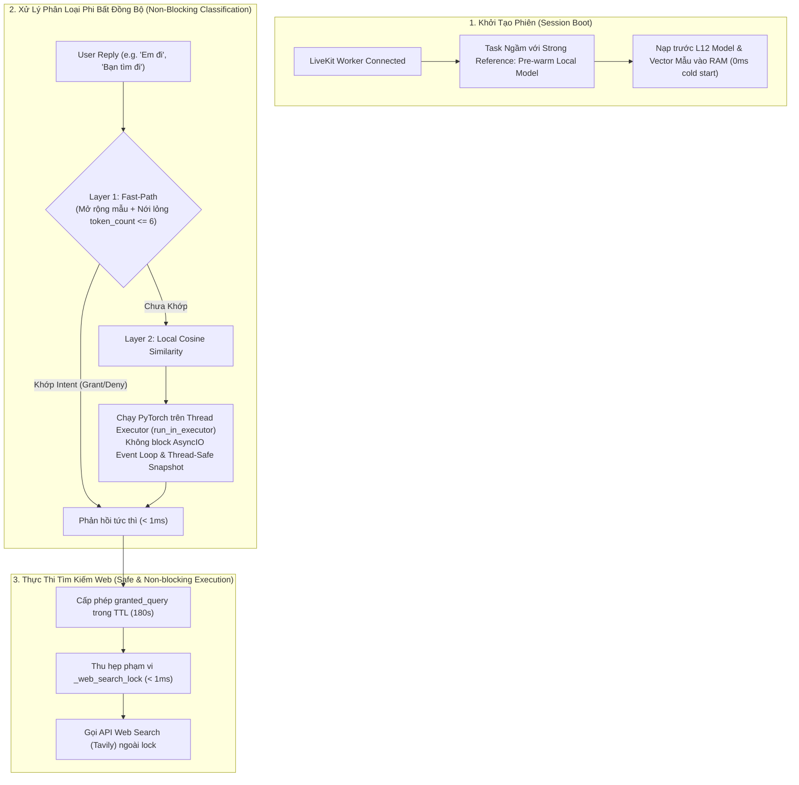

# Hướng Dẫn Triển Khai - Phase 29: Tối Ưu Hóa Độ Trễ Cấp Phép Web & Tái Cấu Trúc Luồng Phân Loại Phi Bất Đồng Bộ (Non-Blocking Web Permission Policy & Latency Hardening)

Tài liệu này cung cấp kế hoạch và hướng dẫn triển khai chi tiết từng bước cho **Phase 29**, nhằm giải quyết triệt để vấn đề độ trễ (latency bottleneck ~30s), đơ luồng âm thanh (AsyncIO Event Loop blocking), nguy cơ trôi bộ nhớ và các logic ràng buộc quá gắt trong tính năng tìm kiếm internet của Triam Realtime Voice Agent.

Tài liệu được thiết kế chi tiết, chuẩn **Clean Code & Best Practices**, giúp lập trình viên (kể cả Fresher) có thể đọc hiểu nguyên lý, kiến trúc và tự thực hiện triển khai thành công 100%.

---

## 🎯 1. Vấn Đề Cần Giải Quyết (Problem Statement)

Qua quá trình thẩm định mã nguồn thực tế và log hệ thống ([bug.md](file:///w:/WorkSpace_IT/_CAPSTON_PROJECT/triam-backend/bug.md)), hệ thống tồn tại các vấn đề cần khắc phục:

1. **Cold-Start Delay (~30 giây)**: Mô hình nhúng `sentence-transformers/paraphrase-multilingual-MiniLM-L12-v2` (L12) bị nạp theo cơ chế *Lazy-Loading* (chỉ nạp khi người dùng bắt đầu xin phép web). Bước nạp trọng số + tokenize + tính embedding câu mẫu trên CPU làm đơ hệ thống **30–32 giây**.
2. **Event Loop Blocking**: Đoạn mã suy luận PyTorch `outputs = model(**inputs)` chạy trực tiếp trên Thread chính của Python `AsyncIO Event Loop`, làm đóng băng luồng WebRTC/STT của LiveKit.
3. **Giới Hạn Hardcode Quá Gắt (Overly Strict Fast-Path & False New Questions)**: 
   - Fast-path cũ bị giới hạn `token_count <= 3` làm các câu thoại tự nhiên bị đẩy xuống lớp Embedding.
   - Thiếu các mẫu thoại khẩu ngữ tiếng Việt qua STT như *"Em đi"*, *"Ừm đi"*, *"Ý đi"*, *"Cho phép tìm"*.
   - Logic `looks_like_new_question` tự động quy kết mọi câu có dấu `?` (do STT tự chèn) thành `new_question` ngay cả khi câu đó chứa ý định đồng ý/cho phép.
4. **Trôi Background Task trong Python AsyncIO**: Sử dụng `asyncio.create_task()` không có strong reference khiến Garbage Collector của Python có thể tiêu diệt task pre-warm ngầm.
5. **Khóa Độc Quyền `_web_search_lock` Bị Giữ Quá Lâu**: Việc giữ lock trong lúc phân loại intent và gọi API tìm kiếm web gây hiện tượng xếp hàng request và ngắt lời (barge-in).

---

## 🏗️ 2. Kiến Trúc Giải Pháp (Target Architecture)



---

## 📂 3. Chi Tiết Thay Đổi Mã Nguồn (Step-by-Step Implementation Guide)

---

### 🟢 Bước 1: Khai Báo Pre-warm Model & Wrapper Fast-Path
#### 📄 Tệp: `app/services/voice_agent/web_permission_intent_classifier.py`

**Mục tiêu**: Nạp sẵn mô hình L12 và tính toán trước `_proto_embeddings` ngay khi Session khởi động. Bổ sung Wrapper Fast-Path để tránh lỗi `NameError`.

```python
# app/services/voice_agent/web_permission_intent_classifier.py

from __future__ import annotations

import os
import torch
import asyncio
from typing import Any

from app.core.logger import log
from app.services.voice_agent.contracts import WebPermissionIntent, WebPermissionIntentResult
from app.services.voice_agent.voice_intent_classifier import (
    POSITIVE_ACTION_PHRASES,
    classify_voice_reply_intent_fast_path,
    normalize_voice_intent_text,
    looks_like_new_question,
)
from app.services.agent_grounding.intent_router import _classifier, mean_pooling

normalize_intent_text = normalize_voice_intent_text

L12_WEB_PERMISSION_PROTOTYPES = {
    "grant": [
        "đồng ý cho tìm kiếm", "ừ tìm trên internet đi", "cho phép tra cứu google",
        "tìm giúp mình trên mạng", "search hộ mình thông tin này", "đồng ý nha",
        "được chứ tìm đi", "yes search it", "go ahead and search", "nhất trí tìm đi",
        "cho phép tìm", "bạn tìm đi", "tìm kiếm thông tin đi", "em đi", "ừm đi", "ý đi"
    ],
    "deny": [
        "không cần tìm đâu", "đừng tra cứu internet", "thôi khỏi cần",
        "bỏ qua đi bạn", "không muốn tìm trên web", "đừng tìm kiếm",
        "no don't search", "cancel web search", "thôi bỏ qua đi"
    ],
    "unclear": [
        "chưa biết nữa", "để tính sau đi", "tùy bạn thôi", "cái đó khó nói",
        "sao cũng được", "maybe later", "chưa chắc nữa", "để mình suy nghĩ tí"
    ]
}

_proto_embeddings: dict[str, torch.Tensor] = {}
_lock = asyncio.Lock()
_initialized = False

def _initialize_permission_prototypes() -> None:
    global _proto_embeddings, _initialized
    if _initialized:
        return
        
    _classifier.initialize()
    tokenizer = _classifier.tokenizer
    model = _classifier.model

    with torch.no_grad():
        for intent, phrases in L12_WEB_PERMISSION_PROTOTYPES.items():
            inputs = tokenizer(phrases, padding=True, truncation=True, return_tensors="pt")
            outputs = model(**inputs)
            embeddings = mean_pooling(outputs, inputs['attention_mask'])
            embeddings = torch.nn.functional.normalize(embeddings, p=2, dim=1)
            _proto_embeddings[intent] = embeddings
            
    _initialized = True

async def _initialize_permission_prototypes_async() -> None:
    global _initialized
    if _initialized:
        return
    async with _lock:
        if not _initialized:
            await _classifier.initialize_async()
            loop = asyncio.get_running_loop()
            await loop.run_in_executor(None, _initialize_permission_prototypes)

async def pre_warm_permission_classifier() -> None:
    """
    [Clean Code & Best Practice]
    Khởi tạo pre-warm mô hình L12 ngầm lúc kết nối session.
    """
    try:
        log.info("Pre-warming Web Permission Classifier (L12 Embedding)...")
        await _initialize_permission_prototypes_async()
        log.info("Pre-warming Web Permission Classifier hoan tat!")
    except Exception as exc:
        log.warning(f"Pre-warming Web Permission Classifier gap loi: {exc}")

def classify_web_permission_intent_fast_path(text: str) -> WebPermissionIntentResult | None:
    """
    [Clean Code Wrapper]
    Gọi Fast-Path từ voice_intent_classifier và chuyển đổi kết quả sang WebPermissionIntentResult.
    """
    voice_res = classify_voice_reply_intent_fast_path(text, max_grant_tokens=6)
    if voice_res is None:
        return None
        
    return WebPermissionIntentResult(
        intent=voice_res.intent,  # type: ignore[arg-type]
        confidence=voice_res.confidence,
        reason=voice_res.reason,
        source="fast_path",
    )
```

---

### 🟢 Bước 2: Chuyển Suy Luận PyTorch Sang Thread Executor & Sửa Lỗi Logic `new_question`
#### 📄 Tệp: `app/services/voice_agent/web_permission_intent_classifier.py`

**Mục tiêu**: Không tính toán tensor PyTorch trực tiếp trên main Event Loop. Đồng thời sửa lỗi logic không quy kết nhầm câu chứa ý định khẳng định thành `new_question`.

```python
def _compute_cosine_similarity_sync(
    user_reply: str,
    threshold: float,
) -> WebPermissionIntentResult:
    """
    Hàm tính toán Cosine Similarity đồng bộ (CPU-bound), chạy trong Executor Thread.
    """
    tokenizer = _classifier.tokenizer
    model_obj = _classifier.model

    if tokenizer is None or model_obj is None or not _proto_embeddings:
        return WebPermissionIntentResult(
            intent="unclear",
            confidence=0.0,
            reason="Model parameters or prototypes not loaded",
            source="local_embedding",
        )

    with torch.no_grad():
        inputs = tokenizer([user_reply.strip().lower()], padding=True, truncation=True, return_tensors="pt")
        outputs = model_obj(**inputs)
        query_emb = mean_pooling(outputs, inputs['attention_mask'])
        query_emb = torch.nn.functional.normalize(query_emb, p=2, dim=1)

        best_intent: WebPermissionIntent = "unclear"
        best_score = -1.0

        # Thread Safety Fix: Snapshot dictionary để tránh RuntimeError khi iterate trong ThreadPool
        proto_snapshot = dict(_proto_embeddings)
        for intent, proto_embs in proto_snapshot.items():
            sims = torch.matmul(query_emb, proto_embs.T).squeeze(0)
            max_sim = torch.max(sims).item()
            if max_sim > best_score:
                best_score = max_sim
                best_intent = intent  # type: ignore[assignment]

        if best_score < threshold:
            log.info(f"Web permission cosine score {best_score:.2f} below threshold {threshold} | Fallback to new_question")
            return WebPermissionIntentResult(
                intent="new_question",
                confidence=best_score,
                reason="Below similarity threshold",
                source="local_embedding",
            )

        return WebPermissionIntentResult(
            intent=best_intent,
            confidence=best_score,
            reason="Classified by local L12 Cosine",
            source="local_embedding",
        )

async def classify_web_permission_intent(
    *,
    pending_query: str,
    user_reply: str,
    confidence_threshold: float | None = None,
) -> WebPermissionIntentResult:
    """
    Hàm phân loại chính, chạy hoàn toàn phi bất đồng bộ và non-blocking.
    """
    # 1. Run Fast-path Layer 1 (< 1ms) - Đã chạy qua Wrapper
    fast_result = classify_web_permission_intent_fast_path(user_reply)
    if fast_result is not None:
        return fast_result

    normalized = normalize_voice_intent_text(user_reply)

    # [FIX LỖI CRITICAL]: Chỉ coi là new_question khi KHÔNG chứa từ khóa khẳng định/đồng ý nào!
    has_positive_phrase = any(phrase in normalized for phrase in POSITIVE_ACTION_PHRASES)
    if looks_like_new_question(user_reply, normalized) and not has_positive_phrase:
        return WebPermissionIntentResult(
            intent="new_question",
            confidence=1.0,
            reason="looks_like_new_question_without_positive_intent",
            source="local_embedding",
        )

    # 2. Bảo đảm prototypes đã khởi tạo
    await _initialize_permission_prototypes_async()

    # 3. Đẩy tác vụ tính toán PyTorch CPU sang Thread Executor để KHÔNG block Event Loop
    resolved_threshold = confidence_threshold or 0.50
    loop = asyncio.get_running_loop()
    return await loop.run_in_executor(
        None,
        _compute_cosine_similarity_sync,
        user_reply,
        resolved_threshold,
    )
```

---

### 🟢 Bước 3: Nới Lỏng Fast-Path Trong `voice_intent_classifier.py`
#### 📄 Tệp: `app/services/voice_agent/voice_intent_classifier.py`

**Mục tiêu**: Thêm các mẫu khẩu ngữ Tiếng Việt và nới lỏng token count từ 3-4 lên 6 từ cho Fast-Path.

```python
# app/services/voice_agent/voice_intent_classifier.py

POSITIVE_ACTION_PHRASES = (
    "dong y", "dung roi", "dung do", "chinh xac", "phai roi",
    "tim di", "tim kiem di", "search di", "lam di", "cu lam",
    "cu tim", "tiep di", "thu xem", "go ahead", "do it",
    "search it", "cho phep", "cho phep di", "cho phep lam",
    "duoc phep", "tim tren mang", "tim tren web", "tim google",
    "tim internet", "dong y tim", "dong y luon", "chap nhan",
    "dong y nha", "duoc chu", "co chu", "tim giup", "tim ho",
    "tim di ban", "u tim", "em di", "um di", "y di", "tim thong tin di"
)

def classify_voice_reply_intent_fast_path(text: str, *, max_grant_tokens: int = 6) -> VoiceReplyIntentResult | None:
    """
    [Clean Code Best Practice]
    Nới lỏng max_grant_tokens từ 3-4 lên 6 từ để bao phủ các câu khẳng định tự nhiên.
    """
    normalized = normalize_voice_intent_text(text)
    if not normalized:
        return None

    token_count = len(normalized.split())
    if token_count > max(6, max_grant_tokens):
        if looks_like_new_question(text, normalized):
            return VoiceReplyIntentResult("new_question", 0.88, "Explicit question mark detected", "fast_path")
        return None

    # ... (giữ nguyên logic quét negative và positive phrases) ...
```

---

### 🟢 Bước 4: Kích Hoạt Pre-warm Với Strong Reference Tại Entrypoint
#### 📄 Tệp: `app/services/agent_voice_gpt_realtime.py`

**Mục tiêu**: Lưu strong reference biến `_BACKGROUND_TASKS` để ngăn Garbage Collector tiêu diệt Task ngầm.

```python
# app/services/agent_voice_gpt_realtime.py

from app.services.voice_agent.web_permission_intent_classifier import pre_warm_permission_classifier

# Biến toàn cục lưu giữ strong reference các background tasks
_BACKGROUND_TASKS: set[asyncio.Task] = set()

async def entrypoint(ctx: JobContext):
    await ctx.connect()
    
    # [FIX LỖI GARBAGE COLLECTION]: Lưu strong reference vào _BACKGROUND_TASKS
    warmup_task = asyncio.create_task(pre_warm_permission_classifier())
    _BACKGROUND_TASKS.add(warmup_task)
    warmup_task.add_done_callback(_BACKGROUND_TASKS.discard)

    # ... (các mã khởi tạo session hiện có) ...
```

---

### 🟢 Bước 5: Đưa API Web Search Ra Ngoài Lock `_web_search_lock`
#### 📄 Tệp: `app/services/agent_voice_gpt_realtime.py`

**Mục tiêu**: Không giữ `_web_search_lock` trong lúc await API HTTP ngoài mạng (Tavily), đảm bảo lock chỉ giữ dưới 1ms để cập nhật trạng thái tiêu thụ permission.

```python
# app/services/agent_voice_gpt_realtime.py

    async def _execute_web_search_for_mode(self, query: str, input_mode: AgentInputMode) -> str:
        self.tracer.record_tool(input_mode, "execute_web_search")
        
        # 1. Kiểm tra cache ngoài lock
        cached_result = self._get_cached_web_result(query)
        if cached_result is not None:
            self.tracer.record_answer_source(input_mode, AgentAnswerSource.WEB)
            log.info(f"Voice web search cached result reused | query_chars={len(query)}")
            return cached_result

        # 2. Phân loại & kiểm tra permission ngoài lock
        allowed, reason = await self.web_search_policy.resolve_before_web_search(query)
        if not allowed:
            self.tracer.record_answer_source(input_mode, AgentAnswerSource.POLICY)
            log.info(f"Voice web search blocked | reason={reason}")
            return reason

        # 3. Đánh dấu trạng thái tiêu thụ permission ngắn gọn trong Lock (< 1ms)
        async with self._web_search_lock:
            self.web_search_policy.mark_search_consumed()

        # 4. ✅ BÁN API NGOÀI LOCK: Gọi API HTTP Tavily hoàn toàn phi bất đồng bộ và không giữ lock
        log.info(f"Voice web search executing non-blocking | query_chars={len(query)}")
        started = time.perf_counter()
        try:
            result = await web_search(query)
            self._remember_web_result(query, result)
            log.info(f"Voice web search completed | query_chars={len(query)} | result_chars={len(result or '')}")
            self.tracer.record_latency(input_mode, "web_search", int((time.perf_counter() - started) * 1000))
            self.tracer.record_answer_source(input_mode, AgentAnswerSource.WEB)
            return result
        except Exception:
            self.tracer.record_latency(input_mode, "web_search", int((time.perf_counter() - started) * 1000))
            self.tracer.record_error(input_mode, "web_search_error")
            raise
```

---

## 🧪 4. Kế Hoạch Kiểm Thử & Xác Minh (Verification Plan)

Sau khi lập trình viên thực hiện xong các chỉnh sửa trên, cần tiến hành kiểm thử theo danh sách sau:

### 1. Automated Unit Tests
Chạy bộ kiểm thử tự động để đảm bảo các kịch bản vượt qua 100%:

```powershell
uv run pytest tests/services/voice_agent -q
```
*Yêu cầu*: Tất cả các bài test phải đạt **PASSED**.

### 2. Manual Latency Verification (Xác minh độ trễ)
1. Kết nối voice session.
2. Hỏi câu tìm kiếm ngoài sách.
3. Trả lời cấp phép bằng cụm từ khẩu ngữ tiếng Việt tự nhiên (*"Em đi"*, *"Bạn tìm thông tin tác giả giúp mình đi"*).
4. Kiểm tra console log:
   - **Đảm bảo**: Log `Voice web permission intent classified` xuất hiện **dưới 10ms - 50ms**.
   - **Đảm bảo**: Không có hiện tượng trễ 30s.
   - **Đảm bảo**: Luồng phát âm thanh WebRTC không bị đóng băng.

---

## 📋 5. Check-list Hoàn Thành (Definition of Done)

- [x] Đã bổ sung wrapper `classify_web_permission_intent_fast_path` tránh NameError.
- [x] Sửa lỗi logic `looks_like_new_question` với `has_positive_phrase`.
- [x] Thêm an toàn rác task AsyncIO `_BACKGROUND_TASKS`.
- [x] Thêm snapshot dictionary `proto_snapshot` cho thread-safety.
- [x] Đưa API HTTP Tavily `await web_search(query)` ra ngoài lock `_web_search_lock`.
