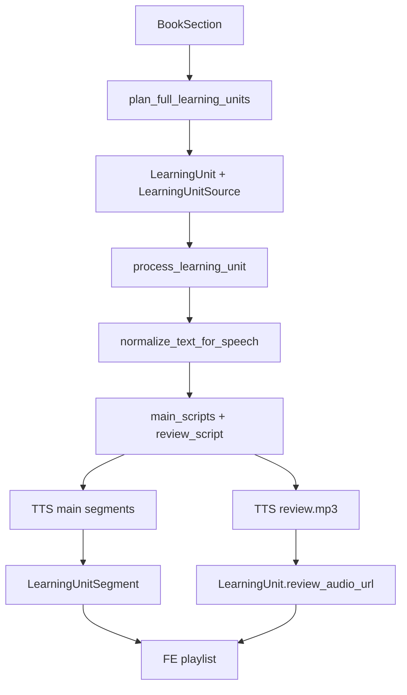
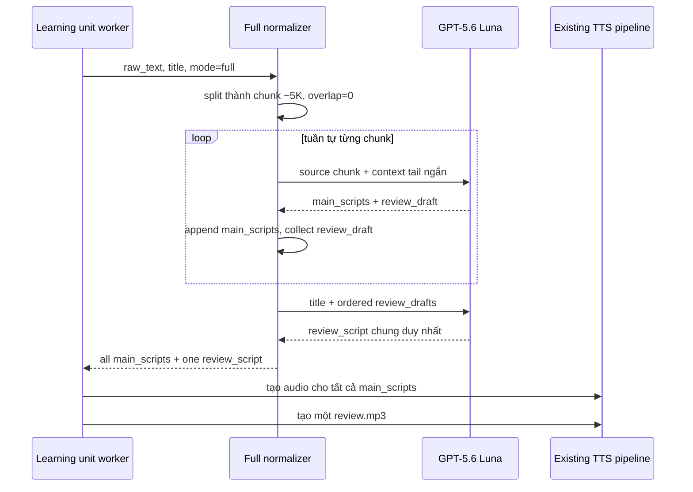

# Phase 31 — Full Mode: GPT-5.6 Luna, xử lý theo chunk 5K và một review audio cho mỗi bài học

## 1. Mục tiêu và quyết định đã chốt

Phase này cải thiện **chất lượng nội dung của Full Mode** trước thời điểm báo cáo luận văn, với thay đổi có phạm vi nhỏ và không làm thay đổi hợp đồng đang dùng bởi FE.

Quyết định sản phẩm:

1. Một `learning_unit` là một bài học mà FE hiển thị và người học hoàn thành.
2. Một `learning_unit` có thể có nhiều `LearningUnitSegment` (audio nội dung chính), nhưng chỉ có **một** `review_audio_url` và một `review_text` ở cuối bài.
3. Full Mode dùng trực tiếp OpenAI `gpt-5.6-luna`; Pareto Mode tiếp tục dùng Gemini theo cấu hình hiện tại.
4. Nếu nội dung của một Full learning unit lớn hơn khoảng 5K token, hệ thống chỉ tách **nội bộ** để gọi LLM. Việc này không tạo learning unit mới, không đổi API và không làm FE thấy khái niệm `chunk`.
5. Sau khi xử lý hết các chunk của cùng một unit, Luna tạo một review chung duy nhất dựa trên các review nháp của từng chunk. Hệ thống không nối các review nháp lại với nhau.
6. Không backfill 109 dữ liệu cũ, không migration database, không thêm lớp chấm ngưỡng/kiểm soát chất lượng đầu ra mới. Thay đổi áp dụng khi generate Full Mode mới hoặc generate lại mode.

Kết quả FE nhìn thấy vẫn là:

```text
Learning unit: Chương 5 - Phần 1
├─ segment 1: audio nội dung
├─ segment 2: audio nội dung
├─ ...
└─ review_audio_url: một audio ôn tập duy nhất ở cuối bài
```

Không có endpoint, DTO, bảng dữ liệu, hay thao tác FE mới nào trong phase này.

---

## 2. Cơ sở hiện trạng

### 2.1 Luồng đang chạy



Các điểm hiện trạng liên quan:

- `app/services/learning_unit_planner_service.py` đã chia outline Full theo `FULL_UNIT_MAX_TOKENS` (hiện là 12K) khi một nhóm gồm nhiều `BookSection` vượt giới hạn. Tiêu đề hiển thị là `Chương 5 - Phần 1/2`, `Chương 5 - Phần 2/2`.
- `app/services/llm_service.py` hiện chỉ chunk khi vượt `LLM_INPUT_SOFT_TOKEN_LIMIT` (hiện cao hơn mức Full unit mục tiêu); do đó unit 6–12K thường vẫn chỉ gọi LLM một lần.
- Nhánh chunk hiện tại nối `review_parts` bằng chuỗi. Đây là nguyên nhân review cuối bài dài, lặp và thiếu tính tổng hợp.
- `app/services/workers/learning_unit_tts_worker.py` đã tạo nhiều main segment và chỉ tạo một `review.mp3` cho mỗi unit. Hợp đồng này phù hợp với mục tiêu mới.
- Khi bất kỳ bước nào thất bại, worker hiện xóa segment đã tạo và cập nhật unit sang `ERROR`; phase này phải giữ nguyên tính atomic đó.

### 2.2 Bằng chứng thử nghiệm trước implementation

Test A/B thật trên chương 5 của *Of Mice and Men* (ước tính 6,044 token nguồn):

| Phương án | Tỷ lệ ký tự main/source | Nhận xét |
| --- | ---: | --- |
| Gemini Flash Lite, single/chunk | khoảng 13–23% | Thiên về tóm tắt, không đạt mục tiêu Full Mode |
| Gemini 3.6 Flash, single/chunk | khoảng 15–29% | Tốt hơn Lite nhưng không ổn định cho nội dung đầy đủ |
| GPT-5.6 Luna, 5K chunk | khoảng 98.8% | Giữ tên riêng và nội dung tốt; review nháp không được phép nối thẳng |

Lần chạy Luna 5K chunk trên chương này dùng khoảng 7,900 input token và 7,546 output token, chi phí API trực tiếp khoảng **USD 0.0106**. Đây chỉ là số đo tham khảo, không phải quota hoặc cam kết chi phí cho mọi sách.

---

## 3. Phạm vi implementation

### Bao gồm

- Định tuyến riêng Full Mode sang OpenAI Responses API với model `gpt-5.6-luna`.
- Chia Full unit theo khoảng 5K token tại ranh giới đoạn/câu, không overlap.
- Mang một context nối mạch nhỏ từ cuối chunk trước sang chunk sau.
- Thu thập `main_scripts` theo thứ tự nguồn.
- Tổng hợp một `review_script` duy nhất cho toàn learning unit bằng một call Luna cuối.
- Giữ nguyên pipeline tạo TTS, lưu `LearningUnitSegment`, `review_text`, `review_audio_url`, tiến độ và retry hiện có.
- Unit test, test tích hợp mock, và test thủ công có kiểm soát chi phí với sách export hiện có.

### Không bao gồm

- Đổi số learning unit chỉ vì tách LLM nội bộ thành 5K.
- Thay đổi schema DB, migration, API hoặc FE.
- Xử lý lại sách/mode đã `READY`.
- Đổi Pareto planner, prompt Pareto tiếng Việt, audio provider hoặc logic progress/review schedule.
- Thêm rule tự động loại unit do tỷ lệ coverage hay điểm quality. Chất lượng được xác nhận qua test và review mẫu trước rollout.
- Chạy song song nhiều chunk trong cùng một unit. Các chunk phải tuần tự để giữ mạch văn và giảm rate-limit burst.

---

## 4. Thiết kế đích

### 4.1 Ranh giới giữa planner 12K và normalize 5K

Hai ngưỡng có ý nghĩa khác nhau và phải được giữ tách biệt:

| Ngưỡng | Vai trò | FE có thấy không? |
| --- | --- | --- |
| `FULL_UNIT_MAX_TOKENS = 12000` | Planner cố gắng tách chương/nhóm outline lớn thành các learning unit khả dụng, ví dụ `Chương 5 - Phần 1/2`. | Có |
| `FULL_MODE_CHUNK_TARGET_TOKENS = 5000` | Giới hạn input cho **một lần** Luna normalize trong cùng learning unit. | Không |

Ví dụ một `learning_unit` 11K token:

```text
Chương 5 - Phần 1              # một learning_unit duy nhất
  ├─ LLM chunk 1: ~5K          # chỉ là implementation detail
  ├─ LLM chunk 2: ~5K
  └─ LLM chunk 3: ~1K

Kết quả lưu:
  main_scripts = scripts(chunk 1) + scripts(chunk 2) + scripts(chunk 3)
  review_script = một review tổng hợp duy nhất
```

### 4.2 Lưu ý chính xác về unit vượt 12K

Planner hiện chỉ tách Full unit tại ranh giới `BookSection`. Vì raw text khi worker chạy được dựng lại từ `LearningUnitSource -> BookSection`, không được lưu trực tiếp theo slice văn bản.

Do đó:

- Với một chương có nhiều section con, planner hiện có thể tạo `Chương 5 - Phần 1`, `Chương 5 - Phần 2` đúng như mong muốn.
- Với một `BookSection` đơn lẻ dài hơn 12K, không được tạo hai learning unit cùng trỏ đến section đó: khi worker dựng nguồn, cả hai sẽ đọc lại toàn bộ section và gây trùng nội dung.
- Phase 31 **không** thêm split theo offset cho `BookSection` đơn lẻ, vì điều đó cần lưu `source_start/source_end` hoặc snapshot `source_text` cho mỗi unit, kéo theo migration và thay đổi repository. Với mục tiêu cải thiện nhẹ nhàng, unit này vẫn là một learning unit lớn nhưng được xử lý an toàn bằng các LLM chunk 5K.

Nếu sau báo cáo cần bắt buộc mọi learning unit hiển thị không vượt 12K kể cả một section khổng lồ, triển khai một phase riêng: thêm range/snapshot nguồn vào DB, migration, và test mapping nguồn. Không gộp vào phase này.

### 4.3 Luồng normalize Full Mode mới



### 4.4 Chunk rules

1. Chỉ áp dụng khi `mode == PlanMode.FULL` và input lớn hơn `FULL_MODE_CHUNK_TARGET_TOKENS`.
2. Dùng `RecursiveCharacterTextSplitter` cùng separator hiện có: đoạn trống, xuống dòng, câu, rồi từ cuối cùng nếu cần.
3. `chunk_overlap = 0`. Không lặp nội dung nguồn giữa các audio.
4. Chunk được gọi tuần tự từ đầu đến cuối. `all_scripts.extend(...)` bảo toàn thứ tự.
5. Với chunk từ thứ hai, `context_hint` chỉ chứa title, chỉ số chunk, tổng chunk và tối đa khoảng 600 ký tự cuối nguồn trước đó. Context chỉ dùng nối mạch; không phải nội dung để đọc lại.
6. Prompt chunk phải cấm nói “chunk”, “phần thứ n” hoặc tự recap đoạn trước trừ khi nguồn thực sự có recap.
7. Không đổi hành vi single-call của Pareto hay của Full unit nhỏ hơn/equal 5K.

### 4.5 Review chung cuối unit

Mỗi chunk normalizer vẫn trả về payload structured hiện có:

```json
{
  "main_scripts": ["..."],
  "review_script": "review nháp chỉ cho nội dung của chunk này"
}
```

`review_script` của các chunk **không lưu và không gửi TTS**. Chúng trở thành input cho call cuối:

```text
Unit title
+ review nháp 1 (theo thứ tự nguồn)
+ review nháp 2
+ review nháp n
→ Luna viết đúng một review audio của toàn learning unit
```

Yêu cầu prompt tổng hợp review:

- Viết bằng tiếng Việt tự nhiên, dễ nghe.
- Bao quát các ý/diễn biến quan trọng theo đúng thứ tự bài học.
- Không nói về “chunk”, “phần xử lý”, hay quy trình AI.
- Không lặp lại cùng một điểm giữa các review nháp.
- Không thêm sự kiện, khái niệm hoặc kết luận không có trong review nháp.
- Kết thúc bằng một phần gợi nhớ ngắn, không biến thành bài tóm tắt quá dài.
- Trả JSON đúng schema `NormalizedUnitPayload`, với `main_scripts` là một danh sách hợp lệ. Chỉ đọc `review_script` của response; `main_scripts` không được đưa vào TTS/lưu segment ở call này.

Dùng lại schema đang có tránh tạo format output mới. Có thể đặt `main_scripts` ở response tổng hợp là một string placeholder hợp lệ, ví dụ `"Nội dung ôn tập của bài học."`; code không sử dụng giá trị này. Prompt phải nói rõ điều đó để model không tốn token viết lại nội dung chính.

---

## 5. Thiết kế code chi tiết

### 5.1 Cấu hình mới

Thêm vào `app/core/config.py` và `.env.example`; giá trị thật chỉ đặt trong `.env`, không log API key:

```dotenv
# Full Mode content-preserving normalization only
FULL_MODE_LLM_MODEL=gpt-5.6-luna
FULL_MODE_CHUNK_TARGET_TOKENS=5000
FULL_MODE_CHUNK_OVERLAP_TOKENS=0
FULL_MODE_REVIEW_MAX_OUTPUT_TOKENS=1600
```

Tái sử dụng `OPENAI_API_KEY` đang có. Không thay `GEMINI_MODEL_LLM`; biến đó tiếp tục phục vụ Pareto và các call Gemini hiện hữu.

`FULL_MODE_REVIEW_MAX_OUTPUT_TOKENS` là ceiling chi phí/an toàn cho call review, không phải quy tắc đánh giá nội dung. Chọn 1,600 trước, sau đó điều chỉnh nhỏ nếu test thực tế cho thấy review bị cắt.

### 5.2 Thay đổi trong `app/services/chapter_chunking_service.py`

Thêm hàm riêng, ví dụ:

```python
def split_full_mode_text_for_llm(text: str) -> list[TextChunk]:
    ...  # target=FULL_MODE_CHUNK_TARGET_TOKENS, overlap=0
```

Không sửa giá trị hay ngữ nghĩa toàn cục của `split_text_for_llm()`. Hàm cũ vẫn phục vụ hành vi non-Full và các test guardrail hiện có.

### 5.3 Thay đổi trong `app/services/llm_service.py`

Tách rõ ba trách nhiệm nội bộ, vẫn giữ public function `normalize_text_for_speech(...)` để worker không phải sửa contract:

| Hàm/hành vi đề xuất | Vai trò |
| --- | --- |
| `_call_gemini_normalize_llm(...)` | Bọc call Gemini đang có; dùng cho Pareto và Full unit nhỏ nếu quyết định giữ fallback Gemini. |
| `_call_luna_normalize_llm(...)` | Gọi OpenAI Responses API, structured output, parse về `NormalizedUnit`. |
| `_normalize_full_unit_chunked(...)` | Split 5K, xử lý tuần tự, ghép main scripts và gọi tổng hợp review. |
| `_synthesize_full_unit_review(...)` | Nhận title + review nháp đã có, trả về `review_script` duy nhất. |

Chính sách provider cần cố định, dễ đọc:

```python
if PlanMode(mode) == PlanMode.FULL:
    return await _normalize_full_with_luna(...)
return await _normalize_with_gemini(...)
```

Luna dùng OpenAI Responses API với model `settings.FULL_MODE_LLM_MODEL`, `reasoning.effort="low"`, `text.verbosity="high"`, `store=False`, và `max_output_tokens` phù hợp cho normalize. Đây là profile đã chạy được trong test thủ công với GPT-5.6 Luna.

Không fallback âm thầm Luna sang Gemini. Nếu Luna lỗi sau retry, unit thất bại như hiện tại, có log provider/model/error an toàn. Fallback silent sẽ tạo chất lượng Full Mode không đồng nhất và làm khó debug/đánh giá luận văn.

### 5.4 Prompt

Giữ `SYSTEM_PROMPT_REWRITE_FULL` đã được tăng cường theo hướng content-preserving. Bổ sung hai prompt scope rõ ràng:

1. **Full chunk normalization:** giữ gần như toàn bộ thông tin meaningful của nguồn chunk, bảo toàn tên riêng/chữ viết, không rút gọn thành summary, không lặp context từ chunk trước, trả `review_script` chỉ là ghi chú ôn tập cho chunk đang xử lý.
2. **Full review synthesis:** chỉ tổng hợp ordered review drafts thành một review cuối unit; không tạo main content mới, không lặp và không thêm facts.

Không thêm rule validator mới ngoài Pydantic structured JSON và sanitizer TTS đang tồn tại, theo đúng quyết định phạm vi.

### 5.5 Worker, DB, API và FE

Không sửa các thành phần sau:

- `LearningUnit`, `LearningUnitSegment`, `LearningUnitSource` và migrations.
- `create_learning_units`, `get_learning_unit_source_text_map`.
- `run_learning_unit_tts_pipeline`: vẫn nhận `{"main_scripts": [...], "review_script": "..."}`.
- `_generate_unit_main_segments`: tạo một segment cho từng main script.
- `_generate_unit_review_audio`: chỉ được gọi một lần với final `review_script`.
- endpoint chi tiết sách, API preview library, DTO và FE playlist.

Điều này giữ nguyên tính tương thích với dữ liệu và FE hiện có.

---

## 6. Thứ tự implementation

### Bước 1 — Cấu hình và client Luna

1. Thêm các setting Full Mode ở trên và validation cơ bản (`chunk >= 1000`, overlap phải bằng 0, model không rỗng).
2. Khởi tạo client OpenAI trực tiếp riêng cho Luna bằng `OPENAI_API_KEY`; không tái dùng `base_url` Gemini.
3. Bảo đảm logger chỉ log provider/model/token count/chars/attempt, không log raw source, review text hoặc secret.

**Done khi:** unit test settings hợp lệ và Pareto vẫn đọc `GEMINI_MODEL_LLM` như trước.

### Bước 2 — Chia text Full theo 5K

1. Thêm `split_full_mode_text_for_llm` với separator hiện có.
2. Viết unit test cho input 11K: tất cả chunk <= target cộng sai số splitter, thứ tự câu/đoạn được bảo toàn, không có overlap.
3. Viết test input <= 5K trả một chunk hoặc đi theo single-call Luna.

**Done khi:** lowering `FULL_MODE_CHUNK_TARGET_TOKENS` không ảnh hưởng hàm chunk global/non-Full.

### Bước 3 — Normalize chunked bằng Luna

1. Implement adapter Responses API trả `NormalizedUnit` và dùng lại `_sanitize_normalized_unit`.
2. Implement vòng lặp tuần tự; mỗi chunk có `context_hint` từ raw source tail trước đó.
3. `all_scripts` chỉ append `normalized.main_scripts`; `review_drafts` chỉ append `normalized.review_script`.
4. Khi một chunk fail qua retry, raise ngay; không trả một unit half-complete.

**Done khi:** mock test xác nhận số request đúng bằng số chunk, thứ tự main scripts giữ nguyên, raw review drafts không xuất hiện trong output final.

### Bước 4 — Review synthesis một lần mỗi learning unit

1. Implement `_synthesize_full_unit_review(title, review_drafts)` bằng Luna structured output.
2. Nếu unit chỉ có một chunk, vẫn dùng review original của chính chunk; không tốn call tổng hợp không cần thiết.
3. Nếu unit có >= 2 chunks, gọi synthesis đúng một lần.
4. Synthesis fail là unit fail để tránh tạo main audio mới nhưng thiếu review trong khi UI/logic mong chờ review. Retry format/transient theo chính sách normalize hiện có.

**Done khi:** mock test xác nhận unit 3 chunks có 4 call (3 normalize + 1 synthesis), trả một review duy nhất.

### Bước 5 — Tích hợp public entry point và observability

1. Route `PlanMode.FULL` vào Luna + chunking; route khác không thay đổi.
2. Giữ return value chính xác: `{"main_scripts": all_scripts, "review_script": final_review}`.
3. Bổ sung log milestone:
   - `Full normalize strategy | provider=openai | model=gpt-5.6-luna | chunks=N`
   - `Full normalize chunk done | chunk=i/N | cumulative_scripts=X`
   - `Full review synthesis done | drafts=N | review_chars=Y`
4. Giữ worker cleanup hiện có khi normalize/TTS lỗi.

**Done khi:** test của worker chứng minh review TTS được gọi đúng một lần và segment order không đổi.

### Bước 6 — Regression test và test thật kiểm soát chi phí

1. Chạy unit test liên quan:

```powershell
uv run pytest tests/test_phase3_generation_guardrails.py tests/test_learning_unit_planner.py tests/test_tts_script_quality_service.py tests/test_phase14_5_audio_duration.py -q
```

2. Thêm test mới, mock HTTP/Responses API:
   - Full 4K: 1 normalize call, 0 synthesis call, 1 review final.
   - Full 11K: 3 normalize calls + 1 synthesis call, scripts đúng thứ tự.
   - Pareto 11K: không gọi Luna, giữ Gemini path.
   - lỗi chunk 2: raise, worker cleanup segment/mark error như hiện tại.
   - lỗi synthesis: raise, không có dữ liệu ready dở dang.
   - review drafts lặp: synthesis response là review cuối duy nhất, không nối string drafts.

3. Chạy manual script Luna trên `Of Mice And Men_full_mode_export.json`, chapter 5, kèm report cục bộ ignored. Không ghi DB, storage hay TTS trong script.
4. Review thủ công: completeness, tiếng Việt, tên riêng, không lặp review, mạch nối giữa chunk, số segment/audio hợp lý.

**Không đặt threshold tự động 60–65%.** Kết quả test được ghi nhận bằng report để quyết định rollout, không block pipeline do một heuristic chưa được hiệu chỉnh.

---

## 7. Tiêu chí nghiệm thu

### Chức năng

- Full unit >5K được xử lý Luna thành nhiều request tuần tự, nhưng FE vẫn nhận một `learning_unit` duy nhất.
- Main segment được lưu đúng thứ tự nguồn, không overlap do chunking.
- Mỗi Full learning unit có tối đa một review URL, tại `.../review.mp3`.
- Review cuối tổng hợp nội dung của đúng unit, không phải phép nối review theo chunk.
- Full unit 5K hoặc nhỏ hơn không gọi synthesis dư thừa.
- Pareto mode không đổi provider, prompt, data hoặc hành vi.

### Độ tin cậy

- Không có secret/raw book text trong log.
- Lỗi ở bất kỳ normalizer call nào khiến unit `ERROR` và giữ cleanup semantics hiện có.
- Retry structured-output/format không đổi phạm vi so với normalizer hiện hữu.
- Re-run unit `READY` vẫn skip theo behavior hiện tại; không phát sinh audio/segment trùng.

### Chất lượng thủ công trước rollout

- Nội dung Full nghe không còn mang dạng summary ngắn như baseline Gemini Lite.
- Không có các lỗi tên riêng phổ biến đã quan sát như `Lennie` thành `Lenny`/phiên âm sai.
- Không xuất hiện tiếng Anh rơi vãi khi input cần chuyển sang tiếng Việt.
- Review cuối không lặp cùng một điểm do concatenation và không nhắc `chunk`.

---

## 8. Rủi ro và cách xử lý

| Rủi ro | Tác động | Cách xử lý trong phase |
| --- | --- | --- |
| Luna rate limit/timeout | Unit fail hoặc chậm | Gọi chunk tuần tự, reuse retry hiện có, log theo chunk; unit rollback như hiện tại. |
| Review synthesis thêm một call | Tăng latency/cost nhỏ | Chỉ gọi khi unit có từ hai chunk; input chỉ là review nháp, không gửi lại toàn bộ raw text. |
| Tên riêng/chuyển ngữ sai | Giảm chất lượng sách văn học | Prompt Full cấm thay đổi tên riêng; review thủ công các chương đại diện trước rollout. |
| Một BookSection nguyên khối >12K | Không thể tạo visible Part 1/2 an toàn với schema hiện tại | Vẫn normalize internal chunks 5K; để source-range persistence cho phase sau nếu thật sự cần. |
| Segment TTS nhiều hơn | Playlist dài hơn | Đây là hệ quả đúng của Full Mode đủ nội dung; FE đã hỗ trợ list segments, không đổi contract. |
| Lỗi một segment TTS | Một số audio thiếu | Giữ hành vi hiện tại: tạo được segment thì store; nếu không tạo được segment nào, unit fail. Không thay đổi trong phase này. |

---

## 9. Rollout và rollback

### Rollout

1. Merge test pass.
2. Set `OPENAI_API_KEY` và Full settings tại môi trường deploy; không commit `.env`.
3. Generate Full Mode cho một sách test nhỏ, kiểm tra playlist và review URL trên FE.
4. Generate sách đại diện dài, kiểm tra log milestone và nghe chapter có nhiều chunks.
5. Chỉ sau đó dùng Full Mode mới cho demo/luận văn.

### Rollback

Vì không migration DB/API/FE, rollback là deploy lại revision cũ. Unit Full Mode mới đang `PROCESSING`/`ERROR` tuân theo cleanup hiện có. Các unit đã `READY` trước phase không bị sửa hay backfill.

Không đổi `GEMINI_MODEL_LLM`, do đó Pareto vẫn hoạt động ngay cả khi rollback Luna path.

---

## 10. Checklist implementation ngắn

- [ ] Thêm config Full Mode riêng và không ghi secret vào log.
- [ ] Thêm splitter Full Mode 5K/no-overlap riêng, không chỉnh global splitter.
- [ ] Thêm Responses API adapter cho `gpt-5.6-luna` với structured output.
- [ ] Route Full Mode vào Luna; Pareto giữ Gemini.
- [ ] Nối main scripts theo thứ tự chunk.
- [ ] Chỉ dùng review drafts làm input cho synthesis; không concatenate để TTS.
- [ ] Bỏ synthesis cho single chunk.
- [ ] Giữ contract return của `normalize_text_for_speech`.
- [ ] Test unit, worker integration mock, và manual real API controlled-cost.
- [ ] Test FE với một learning unit multi-segment và đúng một review audio.

---

## 11. Kết quả implementation (2026-08-12)

Phase 31 đã được triển khai với phạm vi đã chốt:

- Thêm cấu hình `FULL_MODE_LLM_MODEL=gpt-5.6-luna`, target chunk 5K, overlap 0 và giới hạn output cho review synthesis.
- Full Mode được route riêng qua OpenAI Responses API; Pareto vẫn đi Gemini client và không gọi Luna.
- Full unit vượt 5K token được tách nội bộ tuần tự bằng `split_full_mode_text_for_llm` và giữ đúng thứ tự `main_scripts`.
- Các review nháp của chunk chỉ làm input cho một call tổng hợp; worker hiện có tiếp tục tạo chính xác một `review.mp3` cho learning unit.
- Không đổi migration, DB schema, API, DTO, FE hoặc contract worker/TTS.
- Luna client được tạo và đóng trong vòng đời một Full learning unit thay vì module-global, tương thích với Celery dùng `asyncio.run()` tạo event loop mới cho mỗi task.
- Upload Supabase được giới hạn theo `STORAGE_UPLOAD_CONCURRENCY=2`; nếu thiếu bất kỳ main segment nào sau retry, unit fail/rollback thay vì book `READY` với playlist khuyết audio.

Kiểm chứng đã chạy:

```powershell
uv run ruff check app/core/config.py app/services/chapter_chunking_service.py app/services/llm_service.py tests/test_phase31_full_mode_luna_normalization.py
uv run pytest tests/test_phase31_full_mode_luna_normalization.py tests/test_phase3_generation_guardrails.py tests/test_config_runtime_profile.py -q
```

Kết quả: lint pass; test tập trung pass. Một smoke test thực tế của call Luna review synthesis cũng trả structured review hợp lệ, không tạo DB, TTS hay storage side effect. Sau log production ngày 2026-08-12, đã bổ sung regression test cho lifecycle Luna, upload concurrency, và trường hợp một main segment thất bại.
