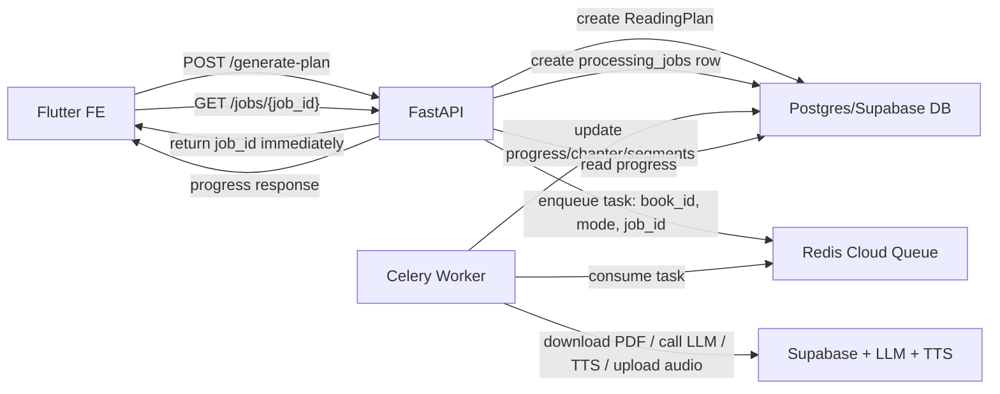
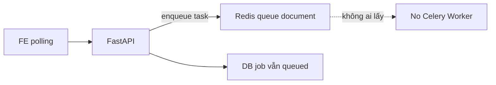
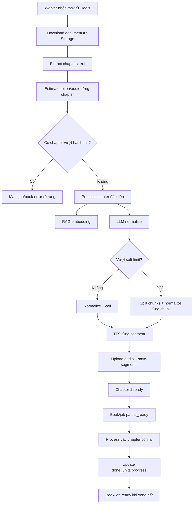

# Phase 3 Explained For Fresher - Celery, Redis, Worker, Progress

Date: 2026-05-22

Doc này viết để em hiểu **hệ thống đang chạy như thế nào**, không phải để copy code.

Nếu đọc document Phase 3 implementation mà thấy ngộp, hãy đọc file này trước.

## 1. Một Câu Tóm Tắt

TRIAM có 3 phần chính khi user gen audio:

```text
FastAPI = nhận request nhanh
Redis = hàng đợi công việc
Celery Worker = người làm việc nặng phía sau
Postgres DB = bảng trạng thái chính thức cho FE xem progress
```

Điều quan trọng nhất:

> Redis/Celery không phải nơi lưu progress chính thức. Progress thật nằm trong DB `processing_jobs`.

## 2. Vì Sao Không Để FastAPI Tự Xử Lý Hết?

Khi user upload sách và bấm `generate-plan`, backend phải làm rất nhiều việc:

- Tải file từ Supabase Storage.
- Extract text từng chương.
- Estimate token/audio.
- Gọi embedding để tạo RAG.
- Gọi LLM normalize text thành script nói.
- Gọi TTS tạo audio từng segment.
- Upload audio lên Supabase.
- Ghi segment/chapter/job status vào DB.

Những việc này có thể mất vài phút.

Nếu FastAPI làm trực tiếp trong request:

```text
FE gọi API -> FastAPI xử lý vài phút -> FE chờ dài -> dễ timeout
```

Nên mình tách ra:

```text
FE gọi API -> FastAPI tạo job + bỏ việc vào queue -> trả response ngay
Worker xử lý phía sau -> FE poll progress
```

## 3. Redis Là Gì Trong Dự Án Này?

Trong TRIAM, Redis giống như một **hàng đợi công việc**.

Khi API nhận `generate-plan`, nó không xử lý sách ngay. Nó gửi một message nhỏ vào Redis:

```json
{
  "task": "triam.books.process",
  "args": ["book_id", "mode", "job_id"]
}
```

Redis chỉ giữ message nhỏ này.

Redis **không giữ**:

- PDF bytes.
- Raw text chương.
- Audio.
- Progress chính thức.
- Kết quả LLM.

Vì vậy Redis Cloud free 30MB vẫn đủ cho capstone, miễn là mình không nhét dữ liệu lớn vào task.

## 4. Celery Là Gì?

Celery là thư viện giúp mình chạy background jobs.

Nó có 2 vai trò:

```text
Producer: FastAPI gửi task vào Redis
Consumer: Celery Worker lấy task từ Redis ra làm
```

Trong code hiện tại:

```text
FastAPI gọi process_book_task.apply_async(...)
-> Celery publish message vào Redis queue "document"
-> Worker đang nghe queue "document"
-> Worker nhận task và chạy run_background_processing(...)
```

## 5. Worker Là Gì?

Worker là một process riêng.

Nó không phải request API.
Nó không phải LiveKit voice agent.
Nó là process chuyên làm việc nặng:

```powershell
uv run celery -A app.core.celery_app.celery_app worker -Q document -l info --pool=solo --concurrency 1
```

Khi worker chạy, em sẽ thấy:

```text
[tasks]
  . triam.books.process
  . triam.books.switch_mode

ready
```

Nghĩa là worker đã sẵn sàng nhận job từ Redis.

## 6. Sơ Đồ Tổng Quát



Điểm phải nhớ:

- FE không hỏi Redis.
- FE không hỏi Celery.
- FE chỉ hỏi FastAPI.
- FastAPI đọc DB rồi trả progress cho FE.

## 7. Luồng Thật Khi Em Test Vừa Rồi

### Bước 1: Upload

```text
POST /api/v1/upload
```

Backend:

- Validate PDF có outline.
- Upload file lên Supabase Storage.
- Tạo `Book` status `draft`.
- Tạo 3 `Chapter` status `draft`.

Chưa có Redis/Celery ở bước này.

### Bước 2: Generate Plan

```text
POST /api/v1/generate-plan
```

Backend:

- Tạo `ReadingPlan`.
- Tạo `ProcessingJob` status `queued`.
- Đẩy task vào Redis queue `document`. 
- Trả về `job_id` cho FE.

Lúc này nếu **chưa có worker**, job sẽ đứng ở:

```text
queued
progress_percent = 0
done_units = 0
```

Đây là bug em gặp.

### Bước 3: Worker Chạy

Khi anh bật worker local:

```powershell
uv run celery -A app.core.celery_app.celery_app worker -Q document -l info --pool=solo --concurrency 1
```

Worker lấy task từ Redis.

Log:

```text
Task triam.books.process received
Celery process_book_task started
Downloading PDF from Storage
```

DB job chuyển:

```text
queued -> processing
```

### Bước 4: Chapter 1 Xong

Worker xử lý chương đầu tiên trước.

Khi chương đầu có audio:

```text
Book: partial_ready
Job: partial_ready
done_units = 1
progress = 33
```

FE có thể unlock nút nghe.

Đây là ý nghĩa của "partial unlock".

### Bước 5: Các Chương Còn Lại Xong

Worker xử lý tiếp chương 2 và 3.

Khi xong hết:

```text
Book: ready
Job: ready
done_units = 3
progress = 100
```

## 8. "Unlock Local" Là Gì?

Từ đúng hơn là **unblock local**, không phải unlock.

Nó nghĩa là:

> Môi trường local của em bị kẹt vì thiếu Celery worker process. Anh bật worker process lên để task trong Redis được xử lý.

Nó không phải xin quyền đặc biệt của Windows.

Trên laptop Windows của em, để hệ thống chạy đủ, cần ít nhất các process:

```text
1. FastAPI server
2. LiveKit voice agent nếu test voice
3. Celery worker nếu test generate audio/background jobs
```

Khi anh dùng `Start-Process`, anh chỉ mở thêm một process nền chạy Celery worker.

Windows không cấp "quyền business" gì cả. Nó chỉ cho phép chạy một chương trình mới trong user session hiện tại.

## 9. Vì Sao Redis Có Metric Nhảy Nhưng Job Không Chạy?

Vì Redis chỉ nhận task.

Nếu không có worker:

```text
FastAPI -> Redis: có task rồi
Redis: đang giữ task
Worker: không tồn tại
DB job: vẫn queued
```

Sơ đồ lỗi:



Đó là lý do em thấy Redis metric nhảy nhưng chapter không xong.

## 10. Deploy Lên Server Thì Sao?

Deploy cũng giống local ở nguyên tắc:

```text
Phải có API process
Phải có Worker process
Phải có Redis broker
Phải có DB
```

Khác nhau là server không có terminal em mở tay.
Server dùng startup script/process manager để chạy các process.

### Option A: API Và Worker Chung Một Server/Space

Trong `start.sh` hiện tại:

```bash
if [ "${ENABLE_CELERY_WORKER:-false}" = "true" ]; then
  uv run celery -A app.core.celery_app.celery_app worker \
    -Q document \
    -l info \
    --concurrency "${CELERY_DOCUMENT_CONCURRENCY:-1}" \
    > celery_document.log 2>&1 &
fi

uv run uvicorn app.main:app --host 0.0.0.0 --port "$BACKEND_PORT" --reload
```

Nghĩa là khi deploy, nếu em set:

```env
ENABLE_CELERY_WORKER=true
CELERY_BROKER_URL=redis://...
```

thì server sẽ tự chạy Celery worker nền trước khi chạy FastAPI.

Ưu điểm:

- Dễ cho capstone.
- Một nơi deploy là chạy đủ.

Trade-off:

- API, voice agent, worker chia sẻ CPU/RAM.
- Khi gen sách nặng, API có thể chậm hơn.

### Option B: API Và Worker Tách Riêng

```text
Space/Server 1: FastAPI
Space/Server 2: Celery Worker
Redis Cloud: dùng chung
Supabase DB: dùng chung
```

Ưu điểm:

- Sạch hơn cho production.
- Worker nặng không kéo API chậm.
- Dễ scale worker riêng.

Trade-off:

- Deploy phức tạp hơn.
- Phải quản lý 2 service.

Anh khuyên:

```text
Capstone/demo: Option A
Production thật: Option B
```

## 11. Phase 3 Thật Sự Làm Gì?

Phase 1:

```text
Tạo bảng processing_jobs để FE poll progress
```

Phase 2:

```text
Đưa việc nặng sang Celery + Redis worker queue
```

Phase 3:

```text
Làm pipeline gen audio an toàn hơn, dễ debug hơn, đỡ tốn tiền hơn, và user được nghe sớm hơn
```

Phase 3 gồm các ý chính:

### 11.1 Estimate Token/Audio Trước Khi Gọi LLM

Trước đây:

```text
Gửi toàn bộ chapter vào LLM luôn
```

Bây giờ:

```text
Đếm/ước lượng token trước
Nếu quá lớn thì chunk hoặc báo lỗi rõ
```

Mục tiêu:

- Tránh gọi LLM với input quá lớn.
- Tránh timeout.
- Tránh tốn tiền/rate limit.
- FE có `estimated_input_tokens`, `estimated_audio_seconds`.

### 11.2 Chunking Cho Chapter Lớn

Nếu chapter lớn nhưng chưa vượt hard limit:

```text
chapter text -> split chunks -> normalize từng chunk -> ghép scripts
```

Mục tiêu:

- Không crash vì một chương quá dài.
- Vẫn giữ được ngữ cảnh bằng `context_hint`.

### 11.3 First Playable Unlock

Trước đây:

```text
Đợi 50% số chương xong mới partial_ready
```

Bây giờ:

```text
Ưu tiên chương đầu tiên
Chương đầu có audio -> partial_ready ngay
```

Mục tiêu:

- User nghe được sớm.
- Không phải chờ cả sách.

### 11.4 Idempotent Per Chapter/Mode

Idempotent nghĩa là:

> Nếu task chạy lại, hệ thống không tạo dữ liệu trùng hoặc làm hỏng dữ liệu cũ.

Phase 3 thêm/chuyển hướng dùng `chapter_processing_states`:

```text
chapter_id + mode -> queued/processing/ready/error
```

Nhờ đó worker biết:

- Chapter mode này đã ready chưa?
- Có nên skip không?
- Nếu lỗi thì lỗi ở chương nào?

### 11.5 Không Xóa Chapter Khi Lỗi

Trước đây nếu chapter lỗi:

```text
xóa knowledge
xóa chapter
raise error
```

Vấn đề:

- Mất outline.
- FE khó biết chương nào lỗi.
- Retry khó.

Phase 3:

```text
giữ chapter
mark status error
xóa side effects lỗi nếu cần
lưu error_message vào state
```

### 11.6 Log/Observability

Sau bug vừa rồi, anh thêm log:

```text
Normalize preflight
LLM normalize start/done
Normalize chunk start/done
TTS segment start/done
TTS review start/done
TTS DB store start/done
Chapter READY
```

Mục tiêu:

- Không còn cảm giác "im ru".
- Biết nó đang kẹt ở LLM, TTS, upload hay DB.

## 12. Sơ Đồ Phase 3 Chi Tiết



## 13. Em Nên Nhìn Log Như Thế Nào?

Khi worker chạy job, em đọc theo thứ tự:

```text
Celery process_book_task started
Downloading PDF from Storage
Normalize preflight
Normalize strategy
LLM normalize start
LLM normalize done
TTS pipeline normalized
TTS segment start 1/N
TTS segment done 1/N
TTS DB store done
Chapter X READY
Book READY
```

Nếu đứng ở:

```text
LLM normalize start
```

thì đang chờ LLM.

Nếu đứng ở:

```text
TTS segment start 5/23
```

thì đang tạo audio segment thứ 5.

Nếu đứng ở:

```text
TTS DB store start
```

thì đang lưu kết quả vào DB.

## 14. Command Local Em Cần Nhớ

Terminal 1 - API:

```powershell
uv run uvicorn app.main:app --host 0.0.0.0 --port 8000 --reload
```

Terminal 2 - Worker:

```powershell
uv run celery -A app.core.celery_app.celery_app worker -Q document -l info --pool=solo --concurrency 1
```

Check worker:

```powershell
uv run celery -A app.core.celery_app.celery_app inspect active_queues --timeout=10
```

Check queue:

```powershell
uv run python -c "from redis import Redis; from app.core.config import settings; r=Redis.from_url(settings.CELERY_BROKER_URL); print(r.llen('document'))"
```

Check job:

```powershell
Invoke-RestMethod -Uri "http://127.0.0.1:8000/api/v1/jobs/<job_id>" -Method Get
```

## 15. Checklist Khi Job Không Chạy

Nếu job đứng `queued`:

```text
Redis có task, worker chưa consume.
Kiểm tra Celery worker có chạy chưa.
```

Nếu job `processing` nhưng log im:

```text
Worker đã nhận task.
Xem log đang đứng ở LLM/TTS/upload/DB.
```

Nếu job `partial_ready`:

```text
Ít nhất một chapter có audio.
FE có thể unlock nghe.
Worker vẫn xử lý phần còn lại.
```

Nếu job `ready`:

```text
Toàn bộ sách đã xử lý xong.
```

Nếu job `error`:

```text
Đọc error_message trong processing_jobs.
Đọc worker log để biết lỗi provider/storage/parser/DB.
```

## 16. Mental Model Quan Trọng

Hãy nhớ 4 vai:

```text
FastAPI: nhận yêu cầu, tạo job, trả nhanh.
Redis: giữ danh sách việc cần làm.
Celery Worker: lấy việc ra làm.
Postgres DB: ghi trạng thái thật để FE xem.
```

Khi em debug, luôn hỏi:

```text
1. API đã tạo job chưa?
2. Redis queue có task không?
3. Worker có chạy và nghe đúng queue không?
4. DB progress đã đổi chưa?
5. Worker log đang đứng ở bước nào?
```

Nếu trả lời được 5 câu này, em sẽ debug được hầu hết lỗi background job của dự án.

