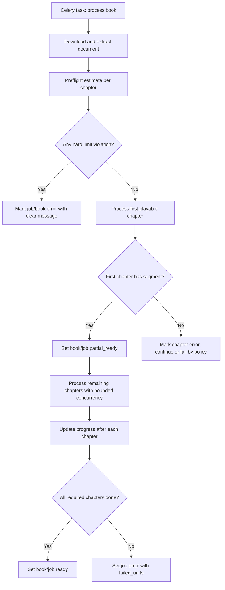

# Phase 3 Implementation Guide - Generation Guardrails, Chunking, Resume, Partial Unlock

Date: 2026-05-21

Status: **Implemented and tested on 2026-05-21**

Implementation/test report:

```text
_docs_implemented/phase_3_generation_guardrails_test_report.md
```

## 0. Decision Summary

Sau khi review lại roadmap cũ và spec sản phẩm, anh đề xuất **điều chỉnh Phase 3**.

Roadmap cũ ghi Phase 3 là:

```text
Celery Beat + Notification Outbox
```

Nhưng sau Phase 1 và Phase 2, rủi ro lớn nhất của dự án hiện tại không phải reminder, mà là:

- Chapter quá lớn có thể làm `normalize_text_for_speech()` tốn token, timeout, lỗi JSON, hoặc bị rate limit.
- Pipeline hiện chạy nhiều chapter song song, mỗi chapter lại gọi RAG + LLM normalize + TTS, dễ vượt quota provider.
- `partial_ready` hiện dựa theo hoàn tất 50% số chương, chưa đúng với mục tiêu product "nghe sớm".
- Chapter lỗi đang bị rollback bằng cách xóa chapter, làm FE/debug/retry khó.
- Celery `acks_late=True` có thể khiến task chạy lại, nhưng pipeline chưa đủ idempotent.
- Pareto hiện mới khác system prompt, chưa có rubric/quality gate rõ.

Vì vậy Phase 3 nên là:

> **Generation Reliability & Cost Guardrails**: ước lượng token/audio, soft/hard limit, xử lý chapter lớn bằng chunking có ngữ cảnh, idempotent per chapter/mode, retry an toàn, và unlock nghe sớm khi có nội dung đầu tiên.

Notification Outbox + Celery Beat nên chuyển sang **Phase 4**, vì nhắc học chỉ có giá trị khi pipeline tạo nội dung đã ổn định.

## 1. Research Notes

Nguồn chính thức đã tham khảo:

- FastAPI khuyến nghị dùng công cụ mạnh hơn như Celery cho background task nặng hoặc nhiều process/server, thay vì chỉ dựa `BackgroundTasks`: https://fastapi.tiangolo.com/tutorial/background-tasks/
- Celery Redis broker có các trade-off như visibility timeout và task có ETA/countdown lâu có thể nằm trong worker memory, dễ bị redelivery nếu vượt timeout: https://docs.celeryq.dev/en/latest/getting-started/backends-and-brokers/redis.html
- Celery task guide có cơ chế retry, backoff, task state, rate limit, nhưng retry phải đi cùng idempotency để không tạo side effect trùng: https://docs.celeryq.dev/en/stable/userguide/tasks.html
- Celery routing/queues giúp tách workload nặng như document/LLM/TTS/notification: https://docs.celeryq.dev/en/latest/userguide/routing.html
- Celery Beat là scheduler periodic, nhưng official docs nhắc chỉ nên có một scheduler cho một schedule để tránh duplicate task: https://docs.celeryq.dev/en/latest/userguide/periodic-tasks.html
- Gemini API có `countTokens` để đếm token trước khi gọi generate content: https://ai.google.dev/gemini-api/docs/tokens
- OpenAI giải thích token và cách đếm token, hữu ích cho estimate/fallback bằng `tiktoken`: https://help.openai.com/en/articles/4936856-what-are-tokens-and-how-to-count-them
- Supabase Realtime có thể dùng sau này để push progress, nhưng polling DB vẫn là source of truth ổn định hơn cho Phase 3: https://supabase.com/docs/guides/realtime

Kết luận research:

- Không nên dùng Redis/Celery result backend làm source progress. Mình giữ Postgres `processing_jobs` là đúng.
- Không nên schedule reminder dài hạn bằng nhiều Celery ETA task. Phase 4 sẽ dùng DB outbox + Beat scan.
- Không nên bật retry toàn bộ book khi pipeline chưa idempotent. Phase 3 phải làm idempotency trước.
- Với LLM, cần token preflight trước khi gọi normalize. Đếm token chính xác bằng provider nếu có, fallback local estimate nếu cần.

## 2. Current Trade-off Audit

### 2.1 Redis Cloud 30MB

Hiện tại ổn vì:

- Redis chỉ làm Celery broker.
- `CELERY_RESULT_BACKEND` rỗng.
- Celery args chỉ là `book_id`, `mode`, `job_id`.

Trade-off còn lại:

- Nếu worker down lâu, nhiều job có thể dồn trong Redis.
- Nếu sau này bật result backend hoặc gửi raw text vào task args, Redis 30MB sẽ không đủ.

Phase 3 action:

- Tiếp tục cấm đưa raw text/PDF/audio vào Celery args.
- Không bật result backend.
- Thêm guardrail ở DB/job trước khi gọi provider nặng.

### 2.2 `acks_late=True`

Lợi ích:

- Worker chết giữa chừng thì task có cơ hội được chạy lại.

Trade-off:

- Task có thể chạy lại sau khi đã tạo một phần segment/audio/storage.
- Nếu code không idempotent, có thể duplicate audio hoặc lỗi unique constraint.

Phase 3 action:

- Thêm per-chapter/per-mode state.
- Trước khi xử lý chapter, kiểm tra chapter/mode đã `ready` chưa.
- Với retry, xóa/replace segment của cùng `chapter_id + mode` có chủ đích, không insert bừa.

### 2.3 Progress Hiện Tại

Hiện tại:

- `processing_jobs.progress_percent` cập nhật theo số chương hoàn tất.
- `partial_ready` bật khi hoàn tất 50% số chương.

Trade-off:

- User phải chờ 50% chương dù chỉ cần 1 chương đầu để nghe.
- `asyncio.as_completed()` có thể hoàn tất chương sau trước chương đầu, làm playlist không ổn định.

Phase 3 action:

- Ưu tiên xử lý chapter đầu tiên trước.
- Khi chapter đầu tiên có segment nghe được, set `BookStatus.PARTIAL_READY`.
- Sau đó mới xử lý các chapter còn lại theo bounded concurrency.

### 2.4 Chapter Rollback

Hiện tại trong `app/services/workers/chapter_worker.py`, nếu chapter lỗi:

```text
delete book_knowledge
delete chapter
raise
```

Trade-off:

- Mất outline gốc.
- FE không biết chương nào lỗi.
- Retry khó vì chapter row biến mất.
- `total_chapters` và `Chapter.chapter_index` có thể lệch.

Phase 3 action:

- Không xóa `Chapter` khi lỗi.
- Mark chapter/chapter-processing-state là `error`.
- Xóa side effects của mode hiện tại nếu cần: segments/knowledge partial.
- Giữ `error_message` để FE/debug.

### 2.5 LLM Normalize Chưa Có Token Budget

Hiện tại `normalize_text_for_speech(raw_text, mode)` gửi toàn bộ chapter lên LLM.

Trade-off:

- Chapter quá lớn dễ timeout/rate limit.
- Output JSON quá lớn dễ parse fail.
- Không dự đoán được chi phí trước khi xử lý.

Phase 3 action:

- Estimate token trước.
- Nếu dưới soft limit: normalize một lần.
- Nếu vượt soft nhưng dưới hard limit: chunking có context bridge.
- Nếu vượt hard limit: fail job sớm với message rõ cho FE.

### 2.6 Pareto Mode Chưa Có Quality Guard

Hiện tại Pareto chỉ đổi prompt.

Trade-off:

- Không đảm bảo 20% chọn đúng kiến thức giá trị.
- Có thể bỏ nhầm định nghĩa/công thức/luận điểm quan trọng.

Phase 3 action:

- Pareto v1 nên thêm rubric scoring ở prompt và output schema.
- Chưa cần làm full knowledge-atom ranking phức tạp, nhưng phải có cấu trúc kiểm tra tối thiểu.

### 2.7 Switch Mode Re-extract Document

Hiện tại switch mode tải lại document và extract text lại.

Trade-off:

- Tốn I/O và parser time.
- Nếu parser version thay đổi, kết quả có thể lệch với upload/generate lần đầu.

Phase 3 action:

- Chưa cần lưu full raw text dài vào DB ngay.
- Nhưng nên lưu `raw_text_char_count`, `estimated_tokens`, `estimated_audio_seconds`.
- Phase sau có thể thêm `chapter_text_snapshots` hoặc object storage cache.

### 2.8 Mock User ID

Hiện tại vẫn dùng `MOCK_USER_ID`.

Trade-off:

- Chưa production-ready cho quota, ownership, reminder.

Phase 3 action:

- Chưa bắt buộc chuyển auth thật nếu FE chưa sẵn.
- Nhưng mọi bảng mới phải có `user_id` hoặc join được qua `book.user_id`.
- Phase Auth sẽ thay mock bằng dependency `get_current_user`.

## 3. Phase 3 Goals

Phase 3 hoàn tất khi:

1. Worker biết estimate token/audio trước khi gọi LLM/TTS.
2. Chapter lớn được xử lý bằng chunking có ngữ cảnh hoặc bị reject rõ ràng.
3. FE có thể thấy job lỗi do quá size thay vì server lỗi mù.
4. User được nghe sớm khi chapter đầu tiên có audio.
5. Retry/resume không xóa chapter gốc và không tạo duplicate segment.
6. LLM/TTS/embedding concurrency có config rõ để giảm rate limit.
7. Pareto mode có rubric tối thiểu để chất lượng đỡ "chỉ đổi prompt".

Non-goals:

- Chưa implement Notification Outbox.
- Chưa implement Celery Beat reminders.
- Chưa implement Supabase Realtime progress push.
- Chưa hoàn tất auth thật.

## 4. Proposed Architecture



## 5. DB Changes

### 5.1 Add `chapter_processing_states`

Lý do:

- `Chapter.status` hiện là status chung, không đủ cho nhiều mode.
- Full và Pareto có thể ready/error khác nhau.
- Retry cần biết chapter/mode nào đã xong.

File: `app/models/db_models.py`

Add model:

```python
class ChapterProcessingState(SQLModel, table=True):
    __tablename__ = "chapter_processing_states"

    id: uuid.UUID = Field(default_factory=uuid.uuid4, primary_key=True)
    user_id: uuid.UUID = Field(sa_column=Column(UUID(as_uuid=True), index=True, nullable=False))
    book_id: uuid.UUID = Field(sa_column=Column(UUID(as_uuid=True), ForeignKey("books.id", ondelete="CASCADE"), index=True, nullable=False))
    chapter_id: uuid.UUID = Field(sa_column=Column(UUID(as_uuid=True), ForeignKey("chapters.id", ondelete="CASCADE"), index=True, nullable=False))
    job_id: uuid.UUID | None = Field(default=None, sa_column=Column(UUID(as_uuid=True), ForeignKey("processing_jobs.id", ondelete="SET NULL"), index=True))
    mode: PlanMode = Field(sa_column=Column(SAEnum(PlanMode), nullable=False))
    status: ProcessingJobStatus = Field(default=ProcessingJobStatus.QUEUED, sa_column=Column(SAEnum(ProcessingJobStatus), index=True, nullable=False))
    raw_text_char_count: int = Field(default=0, sa_column=Column(Integer, nullable=False))
    estimated_tokens: int = Field(default=0, sa_column=Column(Integer, nullable=False))
    estimated_audio_seconds: int = Field(default=0, sa_column=Column(Integer, nullable=False))
    main_segment_count: int = Field(default=0, sa_column=Column(Integer, nullable=False))
    error_message: str | None = Field(default=None, sa_column=Column(Text))
    created_at: datetime = Field(default_factory=lambda: datetime.now(timezone.utc), sa_column=Column(DateTime(timezone=True), server_default=func.now(), nullable=False))
    updated_at: datetime = Field(default_factory=lambda: datetime.now(timezone.utc), sa_column=Column(DateTime(timezone=True), server_default=func.now(), onupdate=func.now(), nullable=False))
    started_at: datetime | None = Field(default=None, sa_column=Column(DateTime(timezone=True)))
    finished_at: datetime | None = Field(default=None, sa_column=Column(DateTime(timezone=True)))

    __table_args__ = (
        UniqueConstraint("chapter_id", "mode", name="uq_chapter_processing_state_chapter_mode"),
    )
```

Trade-off:

- Thêm bảng mới và repository mới.
- Đổi lại retry/debug/multi-mode sạch hơn nhiều so với nhét mọi thứ vào `Chapter.status`.

### 5.2 Add Estimate Fields To `ProcessingJob`

File: `app/models/db_models.py`

Add nullable fields:

```python
estimated_input_tokens: int | None = Field(default=None, sa_column=Column(Integer))
estimated_audio_seconds: int | None = Field(default=None, sa_column=Column(Integer))
```

Lý do:

- FE có thể hiển thị dự kiến: "Sách khoảng X phút audio".
- Backend debug chi phí dễ hơn.

Trade-off:

- Estimate không tuyệt đối chính xác.
- Vẫn hữu ích để guard cost và giải thích cho user.

### 5.3 Optional Add `Chapter.error_message`

Nếu muốn FE hiển thị lỗi theo chương ngay từ `BookDetailResponse`, add:

```python
error_message: str | None = Field(default=None, sa_column=Column(Text))
```

Nhưng nếu không muốn đụng DTO nhiều, Phase 3 có thể để lỗi chi tiết trong `chapter_processing_states`.

## 6. Config Changes

File: `app/core/config.py`

Add:

```python
    # Generation guardrails
    LLM_INPUT_SOFT_TOKEN_LIMIT: int = 12000
    LLM_INPUT_HARD_TOKEN_LIMIT: int = 60000
    LLM_CHUNK_TARGET_TOKENS: int = 5000
    LLM_CHUNK_OVERLAP_TOKENS: int = 300
    MAX_ESTIMATED_AUDIO_SECONDS_PER_BOOK: int = 4 * 60 * 60
    FIRST_PLAYABLE_CHAPTERS: int = 1

    # Provider concurrency
    CHAPTER_PROCESSING_CONCURRENCY: int = 2
    LLM_NORMALIZE_CONCURRENCY: int = 1
    TTS_GENERATION_CONCURRENCY: int = 2
    EMBEDDING_BATCH_SIZE: int = 64
```

File: `.env.example`

Add:

```env
# Phase 3 generation guardrails
LLM_INPUT_SOFT_TOKEN_LIMIT=12000
LLM_INPUT_HARD_TOKEN_LIMIT=60000
LLM_CHUNK_TARGET_TOKENS=5000
LLM_CHUNK_OVERLAP_TOKENS=300
MAX_ESTIMATED_AUDIO_SECONDS_PER_BOOK=14400
FIRST_PLAYABLE_CHAPTERS=1
CHAPTER_PROCESSING_CONCURRENCY=2
LLM_NORMALIZE_CONCURRENCY=1
TTS_GENERATION_CONCURRENCY=2
EMBEDDING_BATCH_SIZE=64
```

Tại sao soft/hard:

- Soft limit: qua ngưỡng này dùng chunking.
- Hard limit: qua ngưỡng này báo user file/chapter quá lớn, không xử lý.

Các số trên là starting point cho capstone, phải tune bằng log thực tế.

## 7. Constants And Exceptions

File: `app/core/exceptions.py`

Add:

```python
class DocumentTooLargeError(AppException):
    status_code = 422
    detail = "Tài liệu quá lớn để xử lý tự động. Vui lòng tách tài liệu thành file nhỏ hơn."


class ChapterTooLargeError(AppException):
    status_code = 422
    detail = "Một chương trong tài liệu quá lớn để xử lý. Vui lòng tách chương hoặc chọn tài liệu nhỏ hơn."


class LLMResponseFormatError(ExternalServiceError):
    detail = "LLM trả về dữ liệu không đúng định dạng yêu cầu."


class NoPlayableAudioError(AppException):
    status_code = 422
    detail = "Không tạo được audio có thể phát cho nội dung này."
```

Rule:

- File quá lớn/chapter quá lớn là lỗi business `422`, không phải `500`.
- Provider lỗi tạm thời là `502` hoặc retry nội bộ.

## 8. New Service: Token Budget

File mới: `app/services/token_budget_service.py`

Purpose:

- Estimate token nhanh bằng `tiktoken`.
- Tùy chọn count chính xác bằng Gemini `countTokens` nếu cần.
- Estimate audio duration thô để guard chi phí TTS.

Suggested code:

```python
from dataclasses import dataclass

import tiktoken

from app.core.config import settings


@dataclass(frozen=True)
class TextBudget:
    char_count: int
    estimated_tokens: int
    estimated_audio_seconds: int


_encoding = tiktoken.get_encoding("cl100k_base")


def estimate_tokens(text: str) -> int:
    if not text:
        return 0
    return len(_encoding.encode(text))


def estimate_audio_seconds(text: str) -> int:
    """
    Vietnamese TTS rough estimate.

    130-160 words/min is common speech speed.
    Use conservative 130 words/min to avoid underestimating.
    """
    words = len(text.split())
    if words == 0:
        return 0
    return int(words / 130 * 60)


def estimate_text_budget(text: str) -> TextBudget:
    return TextBudget(
        char_count=len(text or ""),
        estimated_tokens=estimate_tokens(text),
        estimated_audio_seconds=estimate_audio_seconds(text),
    )


def exceeds_hard_limit(text_budget: TextBudget) -> bool:
    return text_budget.estimated_tokens > settings.LLM_INPUT_HARD_TOKEN_LIMIT


def should_chunk(text_budget: TextBudget) -> bool:
    return text_budget.estimated_tokens > settings.LLM_INPUT_SOFT_TOKEN_LIMIT
```

Trade-off:

- `tiktoken` không phải tokenizer chính xác của Gemini.
- Nhưng nhanh, offline, không tốn API call.
- Nếu estimate gần hard limit, có thể Phase 3.1 bổ sung exact Gemini count.

Optional Gemini exact count file:

```python
from google import genai

from app.core.config import settings


_gemini_client = genai.Client(api_key=settings.GEMINI_API_KEY)


def count_gemini_tokens(text: str) -> int:
    response = _gemini_client.models.count_tokens(
        model=settings.GEMINI_MODEL_LLM,
        contents=text,
    )
    return int(response.total_tokens)
```

Anh khuyên Phase 3 ban đầu dùng local estimate, chỉ thêm exact count sau khi cần.

## 9. New Service: Chapter Chunking

File mới: `app/services/chapter_chunking_service.py`

Purpose:

- Split text theo paragraph/section, không cắt giữa câu nếu tránh được.
- Dùng token length function để chunk ổn định hơn character-only.

Suggested code:

```python
from dataclasses import dataclass

from langchain_text_splitters import RecursiveCharacterTextSplitter

from app.core.config import settings
from app.services.token_budget_service import estimate_tokens


@dataclass(frozen=True)
class TextChunk:
    index: int
    text: str
    estimated_tokens: int


def split_text_for_llm(text: str) -> list[TextChunk]:
    splitter = RecursiveCharacterTextSplitter(
        chunk_size=settings.LLM_CHUNK_TARGET_TOKENS,
        chunk_overlap=settings.LLM_CHUNK_OVERLAP_TOKENS,
        length_function=estimate_tokens,
        separators=["\n\n", "\n", ". ", "! ", "? ", "; ", ", ", " ", ""],
    )
    parts = [part.strip() for part in splitter.split_text(text) if part.strip()]
    return [
        TextChunk(
            index=index,
            text=part,
            estimated_tokens=estimate_tokens(part),
        )
        for index, part in enumerate(parts)
    ]
```

Trade-off:

- Chunk overlap tốn token hơn.
- Đổi lại giảm mất ngữ cảnh ở ranh giới chunk.

## 10. Refactor LLM Normalize

Hiện tại file:

```text
app/services/llm_service.py
```

Problem:

- `normalize_text_for_speech()` vừa chọn prompt, vừa gọi LLM, vừa parse JSON.
- Không có validate output.
- Không có path cho long text.

Phase 3 nên tách:

```text
app/services/llm_prompts.py
app/services/llm_normalization_service.py
```

### 10.1 `app/services/llm_prompts.py`

Move prompts ra file riêng:

```python
SYSTEM_PROMPT_REWRITE_FULL = """..."""
SYSTEM_PROMPT_REWRITE_PARETO = """..."""


def get_rewrite_prompt(mode: str) -> str:
    if mode.lower() == "pareto":
        return SYSTEM_PROMPT_REWRITE_PARETO
    return SYSTEM_PROMPT_REWRITE_FULL
```

Pareto prompt nên bổ sung rubric:

```text
PARETO RUBRIC:
- Giữ định nghĩa, công thức, quy trình, luận điểm chính.
- Giữ keyword chuyên môn và quan hệ giữa chúng.
- Có thể bỏ ví dụ dài, lặp lại, dẫn nhập ít giá trị.
- Không được bỏ kết luận hoặc cảnh báo quan trọng.
- Output phải có "coverage_notes" liệt kê nhóm ý đã giữ.
```

### 10.2 `app/services/llm_normalization_service.py`

Suggested code:

```python
import json
from dataclasses import dataclass

from openai import AsyncOpenAI

from app.core.config import settings
from app.core.exceptions import ChapterTooLargeError, LLMResponseFormatError
from app.core.logger import log
from app.services.chapter_chunking_service import split_text_for_llm
from app.services.llm_prompts import get_rewrite_prompt
from app.services.token_budget_service import estimate_text_budget, exceeds_hard_limit, should_chunk


client = AsyncOpenAI(api_key=settings.GEMINI_API_KEY, base_url=settings.GEMINI_BASE_URL)


@dataclass(frozen=True)
class NormalizedChapter:
    main_scripts: list[str]
    review_script: str


def _validate_normalized_payload(payload: dict) -> NormalizedChapter:
    main_scripts = payload.get("main_scripts")
    review_script = payload.get("review_script")

    if not isinstance(main_scripts, list) or not all(isinstance(item, str) and item.strip() for item in main_scripts):
        raise LLMResponseFormatError("LLM response thiếu main_scripts hợp lệ.")

    if not isinstance(review_script, str):
        raise LLMResponseFormatError("LLM response thiếu review_script hợp lệ.")

    return NormalizedChapter(
        main_scripts=[item.strip() for item in main_scripts if item.strip()],
        review_script=review_script.strip(),
    )


async def _call_normalize_llm(text: str, mode: str, *, context_hint: str | None = None) -> NormalizedChapter:
    prompt = get_rewrite_prompt(mode)
    user_content = text if not context_hint else f"{context_hint}\n\n--- INPUT ---\n{text}"

    response = await client.chat.completions.create(
        model=settings.GEMINI_MODEL_LLM,
        messages=[
            {"role": "system", "content": prompt},
            {"role": "user", "content": user_content},
        ],
        temperature=0.3,
        response_format={"type": "json_object"},
    )

    content = response.choices[0].message.content
    if not content:
        raise LLMResponseFormatError("LLM response rỗng.")

    try:
        payload = json.loads(content)
    except json.JSONDecodeError as exc:
        raise LLMResponseFormatError("LLM response không phải JSON hợp lệ.") from exc

    return _validate_normalized_payload(payload)


async def normalize_text_for_speech_v2(raw_text: str, mode: str, *, chapter_title: str | None = None) -> dict:
    budget = estimate_text_budget(raw_text)

    if exceeds_hard_limit(budget):
        raise ChapterTooLargeError(
            f"Chương quá lớn: khoảng {budget.estimated_tokens} tokens, vượt giới hạn {settings.LLM_INPUT_HARD_TOKEN_LIMIT} tokens."
        )

    if not should_chunk(budget):
        normalized = await _call_normalize_llm(raw_text, mode)
        return {
            "main_scripts": normalized.main_scripts,
            "review_script": normalized.review_script,
        }

    chunks = split_text_for_llm(raw_text)
    log.info(f"Normalize long chapter with {len(chunks)} chunks | mode={mode} | title={chapter_title}")

    all_scripts: list[str] = []
    review_parts: list[str] = []
    previous_tail = ""

    for chunk in chunks:
        context_hint = (
            f"Chương: {chapter_title or 'Không rõ'}.\n"
            f"Đây là chunk {chunk.index + 1}/{len(chunks)} của cùng một chương.\n"
            "Giữ mạch văn nối tiếp với chunk trước. Không tự nhắc 'chunk'.\n"
            f"Đoạn cuối chunk trước để nối ngữ cảnh: {previous_tail[-600:]}"
        )
        normalized = await _call_normalize_llm(chunk.text, mode, context_hint=context_hint)
        all_scripts.extend(normalized.main_scripts)
        if normalized.review_script:
            review_parts.append(normalized.review_script)
        previous_tail = chunk.text[-1000:]

    review_script = " ".join(review_parts)
    return {
        "main_scripts": all_scripts,
        "review_script": review_script,
    }
```

Trade-off:

- Chunking giữ được file lớn hơn nhưng tốn nhiều LLM calls.
- Có thể mất global context nếu chapter có lập luận dài.
- Bù lại không crash/rate-limit một call khổng lồ.

Phase sau có thể nâng cấp bằng map-reduce summary hoặc knowledge atom ranking.

## 11. TTS Worker Changes

File: `app/services/workers/tts_worker.py`

Current issue:

- Segment TTS lỗi thì chỉ warning rồi bỏ qua.
- Nếu tất cả segment lỗi, function vẫn có thể lưu review_text và không raise.
- Chapter có thể bị mark READY dù không có segment nghe được.

Phase 3 target:

- `run_tts_pipeline()` trả về result.
- Nếu không có main audio segment nào, raise `NoPlayableAudioError`.
- Idempotent replace segments theo `(chapter_id, mode)` trước khi insert.

Suggested result type:

```python
from dataclasses import dataclass


@dataclass(frozen=True)
class TTSChapterResult:
    main_segment_count: int
    review_audio_created: bool
```

Suggested function shape:

```python
async def run_tts_pipeline(
    book_id: uuid.UUID,
    chapter_id: uuid.UUID,
    chapter_index: int,
    raw_text: str,
    mode: str,
) -> TTSChapterResult:
    obj_chapter = await normalize_text_for_speech_v2(raw_text, mode)
    main_scripts: list[str] = obj_chapter.get("main_scripts", [])
    review_text: str = obj_chapter.get("review_script", "")

    if not main_scripts:
        raise NoPlayableAudioError("LLM không tạo main_scripts để phát audio.")

    segments: list[ChapterSegment] = []
    ...

    if not segments:
        raise NoPlayableAudioError("Không tạo được segment audio nào.")

    with Session(engine) as session:
        delete_segments_by_chapter_and_mode(session, chapter_id, mode)
        if review_text:
            update_chapter_review_text(session, chapter_id, review_text, mode)
        bulk_create_segments(session, segments)
        if review_url:
            update_chapter_review_audio(session, chapter_id, review_url, mode)

    return TTSChapterResult(
        main_segment_count=len(segments),
        review_audio_created=bool(review_url),
    )
```

Trade-off:

- Delete then insert có thể tạo gap ngắn nếu FE đọc đúng lúc.
- Nhưng job đang processing, FE nên không coi mode đó ready cho đến khi state ready.
- Phase sau có thể dùng staging table hoặc transaction chặt hơn.

## 12. Chapter Worker Changes

File: `app/services/workers/chapter_worker.py`

Current issue:

- Xóa chapter khi lỗi.
- Semaphore hard-coded `5`.

Phase 3 target:

- Semaphore lấy từ config.
- Upsert `chapter_processing_states`.
- Không xóa `Chapter`.
- Mark error với message.

Suggested code shape:

```python
sem = asyncio.Semaphore(settings.CHAPTER_PROCESSING_CONCURRENCY)
```

Processing logic:

```python
async def process_chapter(..., job_id: uuid.UUID | None = None) -> ChapterProcessingResult:
    async with sem:
        with Session(engine) as session:
            state = upsert_chapter_processing_state(
                session,
                user_id=...,
                book_id=book_id,
                chapter_id=chapter_id,
                job_id=job_id,
                mode=mode,
                status=ProcessingJobStatus.PROCESSING,
                started_at=datetime.now(timezone.utc),
            )

        try:
            await asyncio.gather(
                _run_rag_pipeline(...),
                run_tts_pipeline(...),
            )
            with Session(engine) as session:
                mark_chapter_state_ready(...)
                update_chapter_status(session, chapter_id, BookStatus.READY)
            return ChapterProcessingResult(chapter_id=chapter_id, ready=True)

        except Exception as exc:
            with Session(engine) as session:
                delete_segments_by_chapter_and_mode(session, chapter_id, mode)
                delete_knowledge_by_chapter(session, chapter_id)
                mark_chapter_state_error(..., error_message=str(exc))
            raise
```

Important decision:

- Với initial full processing, nếu RAG lỗi nhưng TTS thành công thì có nên ready không?
- Anh đề xuất Phase 3 vẫn coi chapter failed nếu RAG hoặc TTS lỗi, vì Q&A theo sách cần RAG.
- Phase sau có thể tách `audio_ready` và `rag_ready`.

## 13. Book Pipeline Changes

File: `app/services/workers/book_pipeline.py`

### 13.1 Preflight All Chapters

Sau khi extract `chapters_data`, trước khi tạo tasks:

```python
chapter_budgets = []
for chapter, raw_text in processable_chapters:
    budget = estimate_text_budget(raw_text)
    chapter_budgets.append((chapter, raw_text, budget))

too_large = [
    (chapter, budget)
    for chapter, _, budget in chapter_budgets
    if budget.estimated_tokens > settings.LLM_INPUT_HARD_TOKEN_LIMIT
]

if too_large:
    message = (
        f"Có {len(too_large)} chương vượt giới hạn xử lý. "
        f"Chương đầu tiên vượt giới hạn: {too_large[0][0].title} "
        f"~{too_large[0][1].estimated_tokens} tokens."
    )
    _set_book_status(book_id, BookStatus.ERROR, message)
    _fail_job(job_id, "Tài liệu vượt giới hạn xử lý.", message)
    return
```

Update job estimates:

```python
total_tokens = sum(budget.estimated_tokens for _, _, budget in chapter_budgets)
total_audio_seconds = sum(budget.estimated_audio_seconds for _, _, budget in chapter_budgets)

_update_job(
    job_id,
    status=ProcessingJobStatus.PROCESSING,
    current_step="Đã ước lượng kích thước tài liệu.",
    total_units=len(chapter_budgets),
    estimated_input_tokens=total_tokens,
    estimated_audio_seconds=total_audio_seconds,
)
```

Repository cần update thêm params cho `update_processing_job`.

### 13.2 First Playable Priority

Current:

```python
tasks = [asyncio.create_task(process_chapter(...)) for ...]
await _track_progress(tasks, ...)
```

Phase 3:

```python
first_chapter, *remaining = chapter_budgets

await process_chapter(... first_chapter ...)

_set_book_status(book_id, BookStatus.PARTIAL_READY)
_update_job(
    job_id,
    status=ProcessingJobStatus.PARTIAL_READY,
    progress_percent=int(100 / total_units),
    current_step="Đã có chương đầu tiên có thể nghe.",
    done_units=1,
)

tasks = [
    asyncio.create_task(process_chapter(...))
    for chapter, raw_text, budget in remaining
]
await _track_progress(tasks, job_id, total_units, book_id, "Đã xử lý {completed}/{total} chương.", completed_offset=1)
```

Need update `_track_progress()` to accept offset:

```python
async def _track_progress(..., completed_offset: int = 0) -> None:
    completed = completed_offset
    ...
```

Trade-off:

- Chapter 1 chậm thì các chương sau chưa chạy ngay.
- Nhưng user experience tốt hơn vì playlist bắt đầu đúng thứ tự.
- Có thể sau này chạy chapter 1 + 2 song song, nhưng chỉ unlock khi chapter 1 ready.

### 13.3 Switch Mode

Switch mode cũng nên:

- Ưu tiên chapter đầu tiên của mode mới.
- Set partial_ready khi mode mới có chapter đầu tiên.
- Nếu mode mới đã có đủ segments, không enqueue lại.

## 14. Repository Changes

File mới: `app/repositories/chapter_processing_state_repo.py`

Suggested functions:

```python
def get_state_by_chapter_and_mode(session: Session, chapter_id: uuid.UUID, mode: PlanMode) -> ChapterProcessingState | None:
    ...


def upsert_chapter_processing_state(
    session: Session,
    *,
    user_id: uuid.UUID,
    book_id: uuid.UUID,
    chapter_id: uuid.UUID,
    job_id: uuid.UUID | None,
    mode: PlanMode,
    status: ProcessingJobStatus,
    raw_text_char_count: int = 0,
    estimated_tokens: int = 0,
    estimated_audio_seconds: int = 0,
) -> ChapterProcessingState:
    ...


def mark_chapter_state_ready(
    session: Session,
    chapter_id: uuid.UUID,
    mode: PlanMode,
    *,
    main_segment_count: int,
) -> ChapterProcessingState | None:
    ...


def mark_chapter_state_error(
    session: Session,
    chapter_id: uuid.UUID,
    mode: PlanMode,
    error_message: str,
) -> ChapterProcessingState | None:
    ...
```

File: `app/repositories/processing_job_repo.py`

Add params:

```python
estimated_input_tokens: int | None = None
estimated_audio_seconds: int | None = None
```

And include in update map.

## 15. DTO / API Contract

File: `app/schemas/processing_job.py`

Extend response:

```python
estimated_input_tokens: int | None = None
estimated_audio_seconds: int | None = None
```

FE behavior:

```text
queued/processing:
  show progress bar

partial_ready:
  unlock listen button
  show "Bạn có thể nghe chương đầu, phần còn lại đang được xử lý"

ready:
  full playlist available

error:
  show error_message
  if error is too large:
    suggest user split document/chapter
```

No new FE endpoint required in Phase 3. Existing endpoints remain:

```text
GET /api/v1/jobs/{job_id}
GET /api/v1/books/{book_id}/processing-status
GET /api/v1/books/{book_id}/details
```

Optional endpoint for debug/admin:

```text
GET /api/v1/books/{book_id}/chapter-processing-states
```

Anh đề xuất chưa expose endpoint này cho FE chính thức trong Phase 3 nếu chưa cần.

## 16. Celery Retry Policy For Phase 3

Do not autoretry entire book yet.

Instead:

- Retry small provider calls with backoff.
- Keep book-level task simple: if persistent failure, mark job error.

Potential later task decorator:

```python
@celery_app.task(
    name="triam.books.process",
    autoretry_for=(ExternalServiceError,),
    retry_backoff=True,
    retry_jitter=True,
    retry_kwargs={"max_retries": 3},
)
def process_book_task(...):
    ...
```

But only enable after:

- `process_chapter()` is idempotent.
- Storage paths are deterministic.
- Segment replace is safe.
- Chapter state can skip already ready chapter/mode.

For Phase 3, better retry provider wrappers:

```python
async def call_llm_with_retry(...):
    for attempt in range(3):
        try:
            return await _call_normalize_llm(...)
        except Exception:
            if attempt == 2:
                raise
            await asyncio.sleep(2**attempt)
```

Can use `tenacity` later, but manual small retry is enough if kept simple.

## 17. Rate Limit And Concurrency

Current:

- `chapter_worker.sem = 5`
- `tts_service._tts_sem = 5`
- embedding call batches all chunks in one request

Phase 3 recommendation:

- Document worker concurrency: `1`.
- Chapter concurrency: `2`.
- LLM normalize concurrency: `1`.
- TTS concurrency: `2`.
- Embedding batch size: `64` chunks max.

Why conservative:

- Capstone/dev quota is limited.
- Rate limit bugs are expensive and hard to debug.
- Latency is solved by first playable unlock, not by max concurrency.

Trade-off:

- Full book generation slower.
- More predictable cost and fewer failed jobs.

## 18. Migration Plan

Commands:

```powershell
uv run alembic revision --autogenerate -m "phase 3 generation guardrails"
uv run alembic upgrade head
```

Review generated migration manually:

- Ensure it creates `chapter_processing_states`.
- Ensure unique constraint `(chapter_id, mode)`.
- Ensure FK on delete cascade for book/chapter.
- Ensure nullable added fields do not require backfill.

Because em nói data hiện tại có thể reset, migration can be straightforward. Nhưng vẫn phải review để tránh autogenerate drop nhầm.

## 19. Test Plan

### 19.1 Unit Tests

File: `tests/test_token_budget_service.py`

Cases:

- Empty text returns zero.
- Vietnamese text estimate > 0.
- Hard limit helper returns true when over config.

File: `tests/test_chapter_chunking_service.py`

Cases:

- Short text returns 1 chunk.
- Long text returns multiple chunks.
- Each chunk has estimated tokens <= target + safety margin.

File: `tests/test_llm_normalization_service.py`

Mock LLM:

- Valid JSON passes.
- Missing `main_scripts` raises `LLMResponseFormatError`.
- Invalid JSON raises `LLMResponseFormatError`.
- Over hard limit raises `ChapterTooLargeError`.

### 19.2 Worker Tests

File: `tests/test_phase3_worker_guardrails.py`

Cases:

- Chapter too large marks job/book error, no LLM call.
- First chapter ready sets book `partial_ready`.
- If no TTS segments generated, chapter state becomes error.
- Retry/resume skips chapter/mode already ready.

### 19.3 Integration Test With Real PDF

Use:

```text
Chương 4_ Phương pháp luận nghiên cứu.pdf
```

Mock external heavy calls:

- Mock Storage upload/download if needed.
- Mock LLM normalize response.
- Mock TTS audio generation.
- Keep real parser and DB.

Expected:

```text
upload -> draft book with 3 chapters
generate-plan -> queued job
worker preflight -> estimates stored
chapter 1 -> segments created
book/job -> partial_ready
remaining chapters -> ready
```

### 19.4 Failure Test

Create synthetic PDF/chapter text over hard token limit.

Expected:

```text
job.status = error
book.status = error
job.error_message explains chapter too large
LLM mock not called
```

## 20. Implementation Checklist

Phase 3A - Schema and config:

- Add config guardrails.
- Add `.env.example` values.
- Add `ChapterProcessingState`.
- Add estimate fields to `ProcessingJob`.
- Add migration.
- Add repository for chapter processing state.

Phase 3B - Token/chunking:

- Add `token_budget_service.py`.
- Add `chapter_chunking_service.py`.
- Refactor prompts to `llm_prompts.py`.
- Add `llm_normalization_service.py`.
- Keep old `normalize_text_for_speech()` as compatibility wrapper temporarily.

Phase 3C - Worker reliability:

- Update `tts_worker.py` to return result and raise if no segments.
- Update `chapter_worker.py` to mark state, not delete chapter.
- Update `book_pipeline.py` preflight estimates.
- Process first playable chapter first.
- Update progress to `partial_ready` when first playable exists.

Phase 3D - Tests:

- Add token/chunking tests.
- Add LLM response validation tests.
- Add worker progress/partial-ready tests.
- Run real PDF integration test.

## 21. What We Should Not Do In Phase 3

Do not:

- Add Notification Outbox before generation is reliable.
- Enable aggressive Celery autoretry for whole book.
- Store raw PDF bytes or raw chapter text in Redis.
- Rely only on frontend timeout/loading state.
- Delete `Chapter` rows when processing fails.
- Treat Pareto as only "different prompt" forever.
- Use Supabase Realtime as source of truth for progress.

## 22. Recommended Phase Order After This

Phase 3:

```text
Generation guardrails + chunking + first playable unlock + idempotent chapter states
```

Phase 4:

```text
Notification outbox + Celery Beat + spaced review schedules
```

Phase 5:

```text
Auth user_id replacement + per-user quotas + upload limits
```

Phase 6:

```text
Realtime progress push via Supabase Realtime/WebSocket as optional acceleration
```

## 23. Final Recommendation

Anh khuyên implement Phase 3 theo thứ tự nhỏ:

1. Token budget + hard reject trước LLM.
2. TTS must produce at least one playable segment.
3. First playable partial unlock.
4. Stop deleting chapter on error.
5. Add chunking for long chapters.
6. Add per-chapter/mode processing state.

Nếu làm cả 6 cùng lúc hơi lớn, có thể chia:

- Phase 3.1: token budget + no playable audio guard + no delete chapter.
- Phase 3.2: first playable unlock + idempotent state.
- Phase 3.3: long chapter chunking + Pareto rubric v1.

Đây là phase giúp dự án bớt "demo chạy được" và tiến gần hơn tới "sản phẩm thật có thể chịu lỗi".
