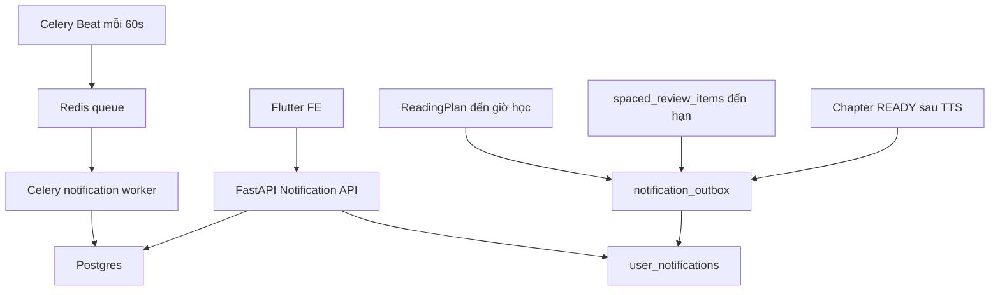
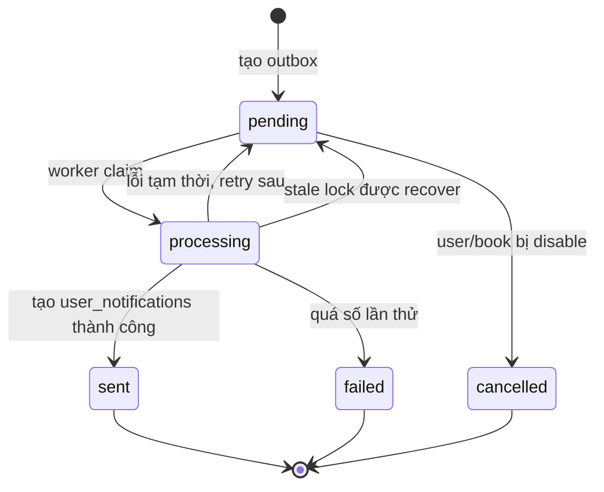

# Training Phase 4.1 - In-app Notification, Outbox, Celery Beat, Spaced Review

Ngày: 2026-05-24

Mục tiêu của tài liệu này: giúp em **hiểu thật sự** những gì Phase 4.1 đã làm, để khi báo cáo capstone em không chỉ nói "em dùng Celery", mà giải thích được:

- Vì sao cần notification workflow.
- Vì sao cần `notification_outbox`.
- Vì sao cần Celery Beat.
- Vì sao Redis không phải nơi lưu business data.
- Vì sao Phase 4.1 mới chỉ làm in-app notification, chưa làm push notification.
- Khi lỗi thì nhìn bảng/log nào để debug.

---

## 1. Nói Ngắn Gọn Trước

Phase 4.1 thêm cho TriAm một hệ thống nhắc học và ôn tập bên trong app.

Trước Phase 4.1, TriAm chủ yếu làm:

```text
User upload sách
-> backend xử lý sách
-> tạo audio/chapter/knowledge
-> user nghe
```

Sau Phase 4.1, TriAm bắt đầu có vòng học:

```text
User có nội dung mới
-> app báo nội dung đã sẵn sàng
-> đến lịch học thì app nhắc học
-> đến hạn ôn tập thì app nhắc ôn
-> FE hiển thị notification trong app
```

Điều quan trọng: Phase 4.1 **không gửi push notification ra điện thoại**. Nó chỉ tạo notification để FE Flutter gọi API và hiển thị trong app.

---

## 2. Mental Model: 5 Nhân Vật Chính

Em hãy nhớ Phase 4.1 bằng 5 nhân vật:

| Nhân vật | Vai trò | Ví dụ |
| --- | --- | --- |
| Postgres | Nơi lưu sự thật business | notification nào đã tạo, đã gửi, đã đọc |
| Redis | Hàng đợi kỹ thuật cho Celery | task `scan_due`, `deliver_due` |
| Celery Beat | Đồng hồ báo thức | mỗi 60 giây bắn task scan |
| Celery Worker | Người làm việc nền | nhận task từ Redis rồi xử lý |
| FastAPI | Cổng API cho FE | `GET /notifications`, `PATCH /read` |

Điểm dễ nhầm:

- Redis giống "hàng chờ công việc", không phải nơi lưu notification thật.
- Celery Beat không xử lý notification; nó chỉ bắn task định kỳ.
- Celery Worker mới là người chạy task thật.
- Postgres mới là nơi FE đọc trạng thái cuối cùng.

---

## 3. Vì Sao Không Làm Trực Tiếp Trong API?

Em có thể hỏi: "Tại sao không để API tự tạo notification luôn?"

Vì notification/reminder là logic chạy theo thời gian, không phải chỉ chạy khi user gọi API.

Ví dụ:

```text
20:00 hôm nay user cần được nhắc học.
Nhưng user không mở app, không gọi API.
Backend vẫn phải biết đến giờ và tạo notification.
```

Vì vậy cần:

```text
Celery Beat mỗi phút
-> scan DB xem có gì tới hạn
-> tạo outbox
-> worker deliver thành user_notifications
```

---

## 4. Kiến Trúc Tổng Quan



Nếu nói trong buổi bảo vệ:

> "Em tách scheduler, worker và database rõ ràng. Redis chỉ dùng làm broker cho Celery. Trạng thái notification thật nằm trong Postgres, nên nếu worker restart hoặc Redis mất message tạm thời, hệ thống vẫn có thể scan lại và phục hồi."

---

## 5. Các Bảng Mới Trong Phase 4.1

### 5.1 `notification_settings`

Lưu cấu hình notification của từng user.

Các field quan trọng:

| Field | Ý nghĩa |
| --- | --- |
| `user_id` | Mỗi user có một settings |
| `timezone` | Múi giờ để tính lịch học, mặc định `Asia/Ho_Chi_Minh` |
| `reminders_enabled` | Có bật nhắc học không |
| `spaced_review_enabled` | Có bật nhắc ôn tập không |
| `reminder_time` | Giờ nhắc học, ví dụ `20:00` |
| `quiet_hours_start/end` | Khung giờ không làm phiền |
| `daily_cap` | Giới hạn số notification/ngày |

Tại sao cần `timezone`?

Vì user nghĩ theo giờ địa phương:

```text
20:00 giờ Việt Nam
```

Nhưng DB nên lưu `due_at` bằng UTC để ổn định.

---

### 5.2 `spaced_review_items`

Lưu lịch ôn tập sau khi một chapter/mode đã xử lý xong và có `review_text`.

Ví dụ một chapter tạo ra 5 mốc ôn:

```text
1 ngày
3 ngày
7 ngày
14 ngày
30 ngày
```

Các field quan trọng:

| Field | Ý nghĩa |
| --- | --- |
| `user_id` | Lịch ôn thuộc user nào |
| `book_id`, `chapter_id` | Ôn sách/chương nào |
| `mode` | `full` hay `pareto` |
| `interval_days` | Mốc ôn thứ mấy |
| `due_at` | Khi nào tới hạn |
| `status` | `pending`, `due`, `completed`, ... |
| `review_text_snapshot` | Snapshot nội dung ôn tại thời điểm tạo |

Unique constraint:

```text
(user_id, chapter_id, mode, interval_days)
```

Lý do: cùng một user, một chapter, một mode, một mốc ngày thì chỉ nên có một review item.

---

### 5.3 `notification_outbox`

Đây là bảng quan trọng nhất Phase 4.1.

Nó không phải inbox cho FE. Nó là **hàng đợi bền vững trong Postgres**.

Tại sao cần outbox?

Giả sử worker đang gửi notification thì app crash:

```text
Đã tạo task trong Redis
-> worker lấy task
-> đang tạo notification
-> crash giữa chừng
```

Nếu không có outbox trong DB, ta rất khó biết notification đã gửi chưa. Với outbox, ta nhìn được:

```text
pending -> processing -> sent
```

Các field quan trọng:

| Field | Ý nghĩa |
| --- | --- |
| `type` | `content_ready`, `plan_reminder`, `spaced_review_due` |
| `channel` | Phase 4.1 chỉ có `in_app` |
| `status` | `pending`, `processing`, `sent`, `failed`, ... |
| `payload` | Dữ liệu nhỏ để build notification |
| `due_at` | Thời điểm được phép gửi |
| `next_retry_at` | Khi nào retry nếu lỗi |
| `locked_at`, `locked_by` | Worker nào đang giữ job |
| `attempts` | Đã thử gửi bao nhiêu lần |
| `idempotency_key` | Chống tạo trùng |

Unique constraint:

```text
idempotency_key unique
```

Đây là chìa khóa chống duplicate.

---

### 5.4 `user_notifications`

Đây là inbox thật cho FE.

FE gọi:

```text
GET /api/v1/notifications
```

Backend đọc từ bảng này.

Các field quan trọng:

| Field | Ý nghĩa |
| --- | --- |
| `user_id` | Notification của user nào |
| `outbox_id` | Sinh ra từ outbox nào |
| `type` | Loại notification |
| `title`, `body` | Text hiển thị |
| `action_type` | FE bấm vào thì mở màn nào |
| `action_payload` | ID sách/chapter/review để FE navigate |
| `read_at` | Đã đọc chưa |

Unique constraint:

```text
outbox_id unique
```

Lý do: nếu worker tạo inbox xong nhưng crash trước khi mark outbox `sent`, retry lại không được tạo bong bóng trùng.

---

## 6. Các Loại Notification Hiện Có

Phase 4.1 có 3 loại:

| Type | Khi nào tạo | Ý nghĩa |
| --- | --- | --- |
| `content_ready` | Khi chapter/mode xử lý xong | Báo có nội dung mới để nghe |
| `plan_reminder` | Đến lịch học trong ReadingPlan | Nhắc user học theo kế hoạch |
| `spaced_review_due` | Đến hạn ôn tập | Nhắc user ôn lại một chương |

Chưa có:

| Type | Vì sao chưa làm |
| --- | --- |
| `completion_message` | Chưa có `listening_progress`, nên chưa biết user thật sự nghe xong |
| `recovery_reminder` | Cần dữ liệu user bỏ dở/lâu chưa nghe |
| push notification | Để Phase 4.2, cần Firebase token và mobile permission |

---

## 7. Luồng 1: Chapter Xử Lý Xong Tạo `content_ready` Và Spaced Review

Khi sách đang được xử lý, mỗi chapter chạy qua TTS/RAG.

Sau khi chapter ready:

```text
process_chapter()
-> run_tts_pipeline()
-> TTSChapterResult có review_text
-> mark_chapter_state_ready()
-> create_chapter_ready_learning_events()
```

Hàm `create_chapter_ready_learning_events()` làm 2 việc:

```text
1. create_spaced_reviews_for_chapter()
2. create_content_ready_outbox_once()
```

Nghĩa là:

- Tạo 5 mốc ôn tập 1/3/7/14/30 ngày.
- Tạo một outbox `content_ready`.

Điểm clean code:

- Notification creation được bọc trong `_create_learning_events_safely()`.
- Nếu tạo notification lỗi thì chapter vẫn giữ trạng thái READY.
- Vì notification là phụ trợ, không được làm hỏng pipeline xử lý sách chính.

---

## 8. Luồng 2: Celery Beat Tạo Reminder/Review Đến Hạn

Celery Beat giống đồng hồ:

```text
mỗi 60 giây
-> gửi task triam.notifications.scan_due vào Redis
```

Worker nghe queue `maintenance` nhận task này.

Task:

```python
scan_due_notifications_task()
```

Nó làm:

```text
1. recover stale outbox
2. scan spaced_review_items đến hạn
3. scan ReadingPlan đến giờ học
4. tạo notification_outbox nếu cần
5. nếu có outbox due thì enqueue deliver_due
```

Điểm rất quan trọng:

```text
created_count > 0
or recovered_count > 0
or has_due_outbox()
```

Tại sao cần `has_due_outbox()`?

Vì có thể trước đó đã có outbox `pending` rồi, nhưng chưa deliver. Nếu scanner chỉ nhìn `created_count`, nó sẽ nghĩ "không có gì mới" và không gọi delivery. Đây là bug rất dễ gặp trong hệ thống queue.

---

## 9. Luồng 3: Delivery Tạo `user_notifications`

Worker nghe queue `notification` nhận task:

```python
deliver_due_notifications_task()
```

Nó làm:

```text
1. recover stale outbox
2. claim due outbox rows bằng SKIP LOCKED
3. từng outbox -> deliver_one_notification()
4. tạo user_notifications
5. mark outbox sent
```

Claim bằng `SKIP LOCKED` nghĩa là:

```text
Nếu có nhiều worker cùng chạy,
mỗi worker sẽ lấy một nhóm row khác nhau,
không giành nhau cùng một notification.
```

Phase 4.1 chỉ support channel:

```text
in_app
```

Nên delivery hiện tại chỉ tạo row trong `user_notifications`.

---

## 10. State Machine Của Outbox



Em cần hiểu `processing` không phải trạng thái cuối. Nó chỉ nghĩa là:

```text
Worker đang giữ row này.
```

Nếu worker chết, row có thể bị kẹt `processing`. Vì vậy có:

```python
recover_stale_outbox()
```

Nó đưa row cũ về `pending` để retry.

---

## 11. Vì Sao Cần `idempotency_key`?

Idempotency nghĩa là:

```text
Cùng một hành động chạy lại nhiều lần
nhưng kết quả cuối không bị trùng.
```

Ví dụ:

```text
Beat chạy 2 lần
-> cùng muốn tạo reminder cho user/book/ngày hôm nay
```

Nếu không có unique key, user sẽ nhận 2 notification giống nhau.

Với idempotency:

```text
plan:<user_id>:<book_id>:<YYYY-MM-DD>
```

DB chỉ cho tạo một row.

Các key hiện tại:

| Type | Idempotency key |
| --- | --- |
| `content_ready` | `content-ready:<user_id>:<chapter_id>:<mode>` |
| `spaced_review_due` | `spaced-review:<review_item_id>` |
| `plan_reminder` | `plan:<user_id>:<book_id>:<local_date>` |

---

## 12. Vì Sao Không Dùng Redis Để Lưu Notification?

Vì Redis là hạ tầng queue, không phải source of truth.

Nếu Redis bị flush:

```text
task có thể mất
```

Nhưng Postgres vẫn còn:

```text
notification_outbox pending
spaced_review_items pending
reading_plans active
```

Beat scan lại sẽ tạo/deliver tiếp.

Đây là lý do kiến trúc dùng:

```text
Postgres = sự thật
Redis = đường vận chuyển task
Celery = người thực thi
```

---

## 13. File Map: Em Nên Đọc File Nào?

### Core/config

| File | Vai trò |
| --- | --- |
| `app/core/constant.py` | Enum notification/review status/type |
| `app/core/config.py` | Config worker/Beat/notification |
| `app/core/celery_app.py` | Celery routes + Beat schedule |
| `start.sh` | Bật/tắt process worker/Beat khi deploy |

### DB/API

| File | Vai trò |
| --- | --- |
| `app/models/db_models.py` | Models mới |
| `app/db/migrations/versions/e4f7a9c2d1b0_phase_4_1_in_app_notifications.py` | Migration tạo bảng |
| `app/api/v1/routers/notifications.py` | FastAPI endpoints |
| `app/schemas/notification.py` | DTO request/response |

### Repository

| File | Vai trò |
| --- | --- |
| `notification_settings_repo.py` | get/update settings |
| `spaced_review_repo.py` | tạo/lấy/defer review item |
| `notification_outbox_repo.py` | create/claim/recover/mark outbox |
| `user_notification_repo.py` | list/read/create inbox |

### Service/task

| File | Vai trò |
| --- | --- |
| `notification_service.py` | Service cho API |
| `notification_event_service.py` | Business logic tạo/deliver notification |
| `notification_copy_service.py` | Tạo title/body deterministic |
| `reminder_schedule_service.py` | Timezone, quiet hours, weekday |
| `spaced_review_service.py` | Tạo mốc ôn tập 1/3/7/14/30 |
| `app/tasks/notification_tasks.py` | Celery task scan/deliver |

### Hook vào pipeline sách

| File | Vai trò |
| --- | --- |
| `app/services/workers/tts_worker.py` | Trả thêm `review_text` |
| `app/services/workers/chapter_worker.py` | Sau chapter READY thì tạo learning events |

---

## 14. API Cho FE

### List notification

```text
GET /api/v1/notifications?limit=30&unread_only=false
```

Response:

```json
{
  "items": [
    {
      "id": "...",
      "type": "spaced_review_due",
      "title": "Đến lúc ôn lại rồi",
      "body": "Ôn nhanh: Chương 4.",
      "action_type": "open_review",
      "action_payload": {
        "book_id": "...",
        "chapter_id": "...",
        "review_item_id": "..."
      },
      "read_at": null,
      "created_at": "2026-05-24T10:00:00Z"
    }
  ],
  "unread_count": 1
}
```

### Mark one read

```text
PATCH /api/v1/notifications/{notification_id}/read
```

### Mark all read

```text
PATCH /api/v1/notifications/read-all
```

### Settings

```text
GET /api/v1/notifications/settings
PUT /api/v1/notifications/settings
```

---

## 15. Local Và Deploy Chạy Như Nào?

Local nếu muốn chạy full:

```powershell
uv run uvicorn app.main:app --host 0.0.0.0 --port 8000 --reload

uv run celery -A app.core.celery_app.celery_app worker `
  -Q document `
  -l info `
  --pool=solo `
  --concurrency 1

uv run celery -A app.core.celery_app.celery_app worker `
  -Q notification,maintenance `
  -l info `
  --pool=solo `
  --concurrency 1

uv run celery -A app.core.celery_app.celery_app beat -l info
```

Trên Hugging Face Space hiện tại nếu chạy chung một runtime:

```env
ENABLE_CELERY_WORKER=true
ENABLE_NOTIFICATION_WORKER=true
ENABLE_CELERY_BEAT=true
```

Nếu tách nhiều runtime:

```text
API runtime:
  ENABLE_CELERY_WORKER=false
  ENABLE_NOTIFICATION_WORKER=false
  ENABLE_CELERY_BEAT=false

Document worker runtime:
  ENABLE_CELERY_WORKER=true
  ENABLE_NOTIFICATION_WORKER=false
  ENABLE_CELERY_BEAT=false

Notification runtime:
  ENABLE_CELERY_WORKER=false
  ENABLE_NOTIFICATION_WORKER=true
  ENABLE_CELERY_BEAT=true
```

Nhớ:

```text
Notification worker có thể nhiều.
Celery Beat chỉ nên có một.
```

---

## 16. Cách Debug Khi Notification Không Xuất Hiện

### Câu hỏi 1: Beat có chạy không?

Tìm log:

```text
Scheduler: Sending due task scan-due-notifications
```

Nếu không có dòng này:

- `ENABLE_CELERY_BEAT` chưa bật.
- Beat process chưa chạy.
- Beat đang chạy ở runtime khác hoặc bị crash.

---

### Câu hỏi 2: Worker có nghe đúng queue không?

Worker log phải có:

```text
[queues]
  .> maintenance
  .> notification
```

Nếu worker chỉ nghe `document`, Phase 4 notification sẽ không chạy.

---

### Câu hỏi 3: Scanner có tạo outbox không?

Tìm log:

```text
Notification scan done | created=... | recovered=... | should_deliver=True
```

Nếu `created=0`:

- Có thể chưa tới lịch.
- User tắt reminder.
- Daily cap đã đầy.
- Quiet hours đang chặn.
- Không có review item due.

---

### Câu hỏi 4: Outbox có bị kẹt không?

Query DB:

```sql
select type, status, attempts, due_at, locked_at, error_message
from notification_outbox
order by created_at desc
limit 20;
```

Nếu thấy:

```text
status = processing
locked_at rất cũ
```

Thì stale-lock recovery sẽ đưa về `pending` ở lần scan/deliver sau.

---

### Câu hỏi 5: User inbox có row chưa?

```sql
select type, title, body, read_at, created_at
from user_notifications
where user_id = '<user_id>'
order by created_at desc
limit 20;
```

Nếu outbox `sent` nhưng không có `user_notifications`, đó là lỗi nghiêm trọng. Nhưng Phase 4.1 đã có unique `outbox_id` để tránh duplicate khi retry.

---

## 17. Full Runtime Test Đã Pass

Test thật đã chạy với:

```text
Celery Beat thật
Notification worker thật
Redis Cloud thật
Postgres thật
FastAPI TestClient đọc API thật trong app
```

Kết quả:

```json
{
  "outbox_count": 3,
  "sent_outbox_count": 3,
  "notification_count": 3,
  "api_items_for_run_count": 3,
  "review_status": "due",
  "api_status_code": 200
}
```

Chi tiết xem:

```text
_docs_implemented/phase_4_1_runtime_test_report.md
```

---

## 18. Câu Trả Lời Capstone Mẫu

### Hỏi: Vì sao em cần Celery Beat?

Trả lời:

> Vì reminder và spaced review là tác vụ theo thời gian. User không nhất thiết mở app đúng lúc, nên backend cần scheduler chủ động scan các mốc đến hạn. Em dùng Celery Beat để định kỳ bắn task scan, còn trạng thái thật vẫn lưu ở Postgres.

### Hỏi: Vì sao không lưu reminder trong Redis?

Trả lời:

> Redis chỉ là message broker. Nếu Redis bị flush hoặc worker restart, business data không được mất. Vì vậy em lưu schedule, outbox và inbox trong Postgres. Redis chỉ vận chuyển task cho Celery.

### Hỏi: Nếu Beat chạy 2 lần thì user có bị nhận trùng không?

Trả lời:

> Em có `idempotency_key` unique ở bảng `notification_outbox`, ví dụ plan reminder dùng `plan:<user_id>:<book_id>:<date>`. Dù scanner chạy lặp, DB chỉ cho tạo một outbox cho cùng sự kiện.

### Hỏi: Nếu worker crash khi đang gửi notification thì sao?

Trả lời:

> Outbox có trạng thái `processing`, `locked_at`, `attempts`. Nếu worker crash, row sẽ bị kẹt `processing`. Lần scan/delivery sau sẽ chạy stale-lock recovery, đưa row về `pending` hoặc đánh `failed` nếu quá số lần thử.

### Hỏi: Vì sao Phase 4.1 chưa có push notification?

Trả lời:

> Em tách phase để giảm rủi ro. Phase 4.1 hoàn thiện in-app notification và outbox architecture trước. Push notification cần Firebase, device token, permission mobile, foreground/background handling, nên em để Phase 4.2 thêm adapter push lên nền outbox đã ổn định.

### Hỏi: Làm sao FE biết có notification?

Trả lời:

> FE gọi `GET /api/v1/notifications`. Backend trả `items` và `unread_count`. Khi user mở notification, FE gọi `PATCH /notifications/{id}/read` hoặc `PATCH /notifications/read-all`.

---

## 19. Những Điều Chưa Làm Ở Phase 4.1

Điều này cũng cần nói rõ khi báo cáo:

| Chưa làm | Lý do |
| --- | --- |
| Push notification | Để Phase 4.2, cần Firebase/device token |
| Completion notification | Chưa có bảng listening progress |
| Recovery reminder | Cần biết user bỏ dở thật sự |
| Multi-user auth thật | Hiện project vẫn dùng mock user |
| Notification realtime websocket | FE có thể polling trước |

---

## 20. Cách Học Lại Phase 4.1 Trong 30 Phút

Nếu em bị ngợp, học theo thứ tự này:

1. Đọc phần `Mental Model: 5 nhân vật chính`.
2. Hiểu 4 bảng: `settings`, `review_items`, `outbox`, `user_notifications`.
3. Vẽ lại 3 flow:
   - chapter ready
   - Beat scan
   - delivery
4. Mở `notification_tasks.py` đọc 2 task.
5. Mở `notification_event_service.py` đọc hàm tạo outbox.
6. Mở runtime report để thấy log thật.

Chỉ cần em nắm được các câu này:

```text
Postgres là source of truth.
Redis chỉ là broker.
Beat chỉ bắn task định kỳ.
Worker xử lý task.
Outbox chống mất trạng thái và chống duplicate.
User_notifications là inbox cho FE.
```

Là em đã hiểu lõi Phase 4.1 rồi.
