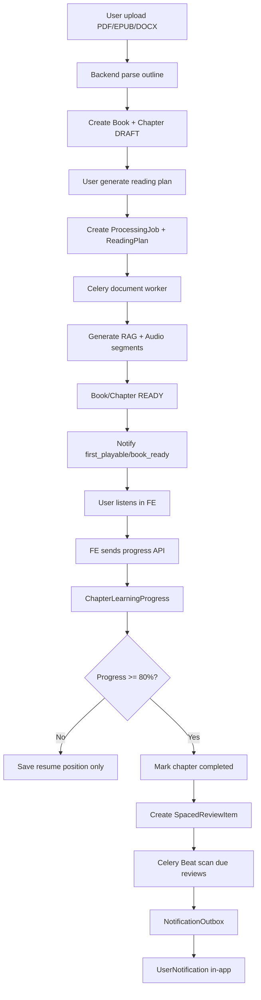
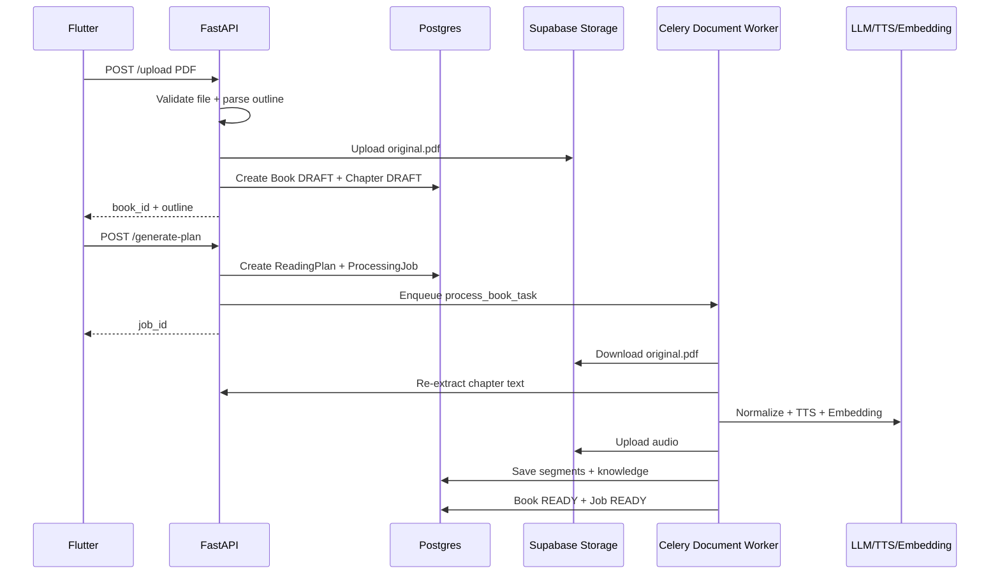
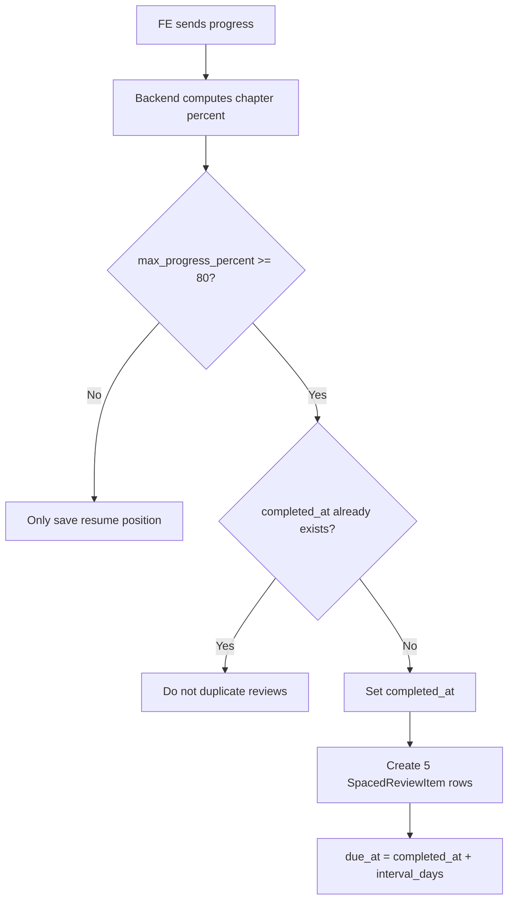
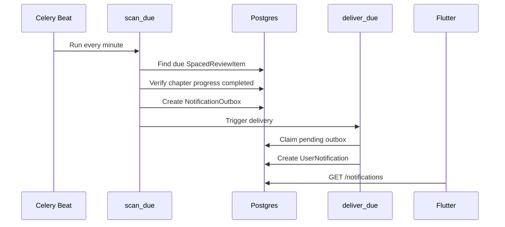

# Phase 4.2 Training - Hiểu Tường Tận Production Learning Loop

Tài liệu này viết cho fresher backend đang làm dự án TriAm. Mục tiêu là đọc xong em có thể:

- hiểu Phase 4.2 giải quyết vấn đề gì;
- hiểu từng bảng mới dùng để làm gì;
- hiểu flow từ upload sách tới nghe, lưu tiến độ, ôn tập, notification;
- tự giải thích được khi bảo vệ capstone;
- biết debug khi flow này bị lỗi.

## 1. Câu Chuyện Của Phase 4.2

Trước Phase 4.2, hệ thống đã làm được một việc lớn:

```text
User upload sách
-> backend generate audio
-> user có thể nghe
-> backend có notification in-app
```

Nhưng business logic vẫn còn một lỗi rất quan trọng:

```text
Sách/chapter được generate xong không có nghĩa là user đã học xong.
```

Ví dụ:

- Backend generate xong chương 1 lúc 10:00.
- User chưa mở app, chưa nghe chương 1 lần nào.
- Nếu backend tạo lịch ôn tập ngay lúc 10:00 thì vài ngày sau user bị nhắc "ôn lại chương 1".
- Nhưng user chưa học chương đó.

Như vậy là sai logic học tập.

Phase 4.2 sửa lỗi này bằng tư duy:

```text
Content ready là trạng thái của hệ thống.
Learning completed là trạng thái của user.
Hai thứ này khác nhau.
```

## 2. Một Câu Phải Nhớ

Nếu chỉ nhớ một câu, hãy nhớ câu này:

```text
Book READY không có nghĩa là User COMPLETED.
```

`Book READY` nghĩa là:

- backend đã parse sách;
- đã gọi LLM normalize;
- đã tạo audio segment;
- đã tạo RAG knowledge;
- user có thể bắt đầu nghe.

`User COMPLETED` nghĩa là:

- user đã nghe đủ một chapter;
- hoặc user bấm hoàn thành thủ công;
- backend có record trong `chapter_learning_progress`;
- lúc này mới được tạo spaced review.

## 3. Sơ Đồ Tổng Quan



## 4. Các Bảng Chính Và Cách Hiểu

### 4.1 `books`

Bảng này lưu thông tin sách.

Ví dụ:

```text
book_id
title
file_url
document_type
status
total_chapters
```

Các status quan trọng:

- `draft`: vừa upload xong, chưa generate audio.
- `processing`: đang xử lý.
- `partial_ready`: đã có phần đầu nghe được.
- `ready`: tất cả chapter đã xử lý xong.
- `error`: lỗi.

Cách hiểu:

```text
books.status là trạng thái xử lý nội dung của backend.
Không phải trạng thái học của user.
```

### 4.2 `chapters`

Bảng này lưu từng chương của sách.

Ví dụ:

```text
chapter_id
book_id
chapter_index
title
status
review_text
review_audio_url
```

Trong real-book test:

```text
Chương 4: 11 audio segments
Chương 5: 38 audio segments
Chương 6: 50 audio segments
```

### 4.3 `chapter_segments`

Bảng này lưu từng đoạn audio nhỏ của một chapter.

Ví dụ:

```text
id
chapter_id
segment_index
audio_url
text_content
duration_ms
mode
```

Tại sao cần segment?

Vì một chapter dài không nên là một file audio khổng lồ. Chia segment giúp:

- dễ stream audio;
- dễ resume;
- dễ retry khi TTS lỗi;
- FE có thể phát lần lượt.

### 4.4 `processing_jobs`

Bảng này cho FE biết tiến độ xử lý nền.

Ví dụ:

```text
job_id
book_id
status
progress_percent
current_step
total_units
done_units
failed_units
error_message
```

FE poll:

```text
GET /api/v1/jobs/{job_id}
```

Cách hiểu:

```text
Redis/Celery chạy việc nền.
processing_jobs cho FE biết việc nền tới đâu.
```

Redis không phải nơi lưu trạng thái business chính. Postgres mới là source of truth.

### 4.5 `reading_plans`

Bảng này lưu plan học user chọn.

Ví dụ:

```text
book_id
mode
pace
schedule_config
status
```

`mode` có thể là:

- `full`: giữ nhiều nội dung hơn.
- `pareto`: rút gọn theo hướng ý chính.

### 4.6 `reading_plan_schedule_slots`

Bảng này là guardrail mới của Phase 4.2.

Nó lưu lịch học đã active thành slot cụ thể:

```text
user_id
plan_id
book_id
weekday
reminder_time
timezone
is_active
```

Tại sao cần bảng này?

Vì nếu chỉ lưu `schedule_config=["Mon", "Wed"]` trong JSON, rất khó check conflict.

Ví dụ user có 2 sách:

```text
Sách A: Mon 20:00
Sách B: Mon 20:00
```

Nếu không check, user bị nhắc 2 sách cùng lúc. Phase 4.2 không cho tạo active slot trùng.

### 4.7 `chapter_learning_progress`

Đây là bảng quan trọng nhất của Phase 4.2.

Nó trả lời câu hỏi:

```text
User này đã nghe chương này tới đâu?
```

Fields quan trọng:

```text
user_id
book_id
chapter_id
mode
current_segment_id
last_segment_index
position_ms
progress_percent
max_progress_percent
status
started_at
last_activity_at
completed_at
```

Giải thích dễ hiểu:

- `current_segment_id`: user đang nghe segment nào.
- `position_ms`: đang ở giây thứ mấy trong segment đó.
- `progress_percent`: tiến độ hiện tại.
- `max_progress_percent`: tiến độ cao nhất từng đạt.
- `status`: `not_started`, `in_progress`, `completed`.
- `completed_at`: thời điểm hoàn thành chapter.

Tại sao cần `max_progress_percent`?

Vì user có thể tua ngược.

Ví dụ:

```text
User nghe tới 85%.
Sau đó tua về 20%.
```

Nếu chỉ dùng progress hiện tại thì chapter lại thành chưa học xong. Điều đó không đúng. Vì vậy:

```text
progress_percent có thể giảm.
max_progress_percent không giảm.
completion dựa trên max_progress_percent.
```

### 4.8 `spaced_review_items`

Bảng này lưu các mốc ôn tập.

Ví dụ sau khi user hoàn thành một chapter:

```text
completed_at = 2026-05-25 10:00
interval_days = 1  -> due_at = 2026-05-26 10:00
interval_days = 3  -> due_at = 2026-05-28 10:00
interval_days = 7  -> due_at = 2026-06-01 10:00
interval_days = 14 -> due_at = 2026-06-08 10:00
interval_days = 30 -> due_at = 2026-06-24 10:00
```

Phase 4.2 dùng intervals:

```text
[1, 3, 7, 14, 30]
```

Điểm rất quan trọng:

```text
due_at = chapter_completed_at + interval_days
```

Không phải:

```text
due_at = chapter_ready_at + interval_days
```

### 4.9 `notification_outbox`

Bảng này là hàng chờ notification bền vững trong DB.

Nó không phải notification user nhìn thấy ngay. Nó là "ý định gửi notification".

Ví dụ:

```text
type = spaced_review_due
status = pending
due_at = 2026-05-26 20:00
payload = {...}
idempotency_key = unique key
```

Tại sao cần outbox?

Vì gửi notification có thể lỗi:

- worker chết;
- mạng lỗi;
- FCM lỗi sau này;
- server restart.

Nếu không có outbox, lỗi là mất notification.

Có outbox thì:

- lỗi vẫn còn record;
- có thể retry;
- debug được;
- tránh duplicate bằng `idempotency_key`.

### 4.10 `user_notifications`

Bảng này là notification user thật sự thấy trong app.

Ví dụ:

```text
title = "Đến lúc ôn lại rồi"
body = ...
action_type = "open_review"
action_payload = {"book_id": "...", "review_item_id": "..."}
```

Quan hệ với outbox:

```text
notification_outbox -> deliver -> user_notifications
```

Một outbox chỉ nên tạo một user notification. Vì vậy có unique theo `outbox_id`.

## 5. Vì Sao Phải Tách `notification_outbox` Và `user_notifications`

Em từng hỏi: tại sao không chỉ dùng một bảng?

Câu trả lời ngắn:

```text
Outbox là việc cần gửi.
UserNotification là thứ đã hiển thị cho user.
```

Ví dụ:

```text
notification_outbox:
  "20:00 tối nay cần nhắc user ôn chương 1"

user_notifications:
  "Thông báo đã được tạo trong app cho user nhìn thấy"
```

Nếu gộp lại, sẽ khó xử lý các trạng thái:

- pending;
- processing;
- retry;
- failed;
- sent;
- idempotency;
- nhiều channel sau này như push/email.

Hiện tại quan hệ gần giống 1-1 vì mới có in-app. Nhưng thiết kế này để sau này mở rộng:

```text
1 outbox event có thể deliver ra:
- in-app notification
- push notification
- email
```

## 6. Hai Worker Notification Hoạt Động Như Thế Nào

Trong `app/tasks/notification_tasks.py` có 2 task:

```python
"triam.notifications.scan_due": {"queue": "maintenance"}
"triam.notifications.deliver_due": {"queue": "notification"}
```

### 6.1 `scan_due`

Nhiệm vụ:

```text
Đi tìm những việc notification đã tới hạn.
```

Nó làm:

1. Tìm review item đã tới hạn.
2. Tạo outbox `spaced_review_due`.
3. Tìm reading plan tới giờ nhắc.
4. Tạo outbox `plan_reminder`.
5. Recover outbox bị kẹt ở `processing`.
6. Nếu có gì cần gửi thì enqueue/call `deliver_due`.

Nói dễ hiểu:

```text
scan_due là người đi kiểm tra lịch.
```

### 6.2 `deliver_due`

Nhiệm vụ:

```text
Lấy các outbox pending đã tới hạn và biến chúng thành user notification.
```

Nó làm:

1. Claim outbox pending.
2. Đổi status sang `processing`.
3. Gọi `deliver_one_notification`.
4. Nếu thành công, outbox thành `sent`.
5. Nếu lỗi, outbox retry hoặc failed.

Nói dễ hiểu:

```text
deliver_due là người thật sự giao thông báo.
```

## 7. Flow Upload Sách Đến Book READY



## 8. Flow User Nghe Và Lưu Tiến Độ

FE audio player nên gửi progress định kỳ:

```text
PUT /api/v1/books/{book_id}/chapters/{chapter_id}/progress
```

Payload ví dụ:

```json
{
  "mode": "full",
  "segment_id": 1839,
  "segment_index": 9,
  "position_ms": 3583,
  "listened_ms": 3583,
  "progress_percent": 82
}
```

Backend sẽ:

1. Kiểm tra book có thuộc user không.
2. Kiểm tra chapter có thuộc book không.
3. Kiểm tra segment có thuộc chapter/mode không.
4. Tính progress theo tổng duration thật nếu có duration.
5. Lưu `chapter_learning_progress`.
6. Nếu `max_progress_percent >= 80`, mark completed.
7. Nếu lần đầu completed, tạo spaced review.

Quan trọng:

```text
FE gửi progress_percent chỉ là fallback.
Nếu backend có duration thật, backend tự tính percent.
```

Vì vậy trong real-book test:

```text
request nhắm 82%
backend trả 81%
vẫn completed vì threshold là 80%
```

## 9. Flow Tạo Spaced Review



Tại sao không tạo duplicate?

Vì user có thể gửi progress nhiều lần:

```text
81%
83%
90%
95%
```

Nếu mỗi lần tạo review thì user bị spam. Vì vậy chỉ lần đầu completed mới tạo review.

## 10. Flow Notification Review



## 11. Các API FE Cần Biết

### 11.1 Lấy tiến độ book

```text
GET /api/v1/books/{book_id}/learning-progress?mode=full
```

Response quan trọng:

```json
{
  "book_progress_percent": 27,
  "completed_chapters": 1,
  "playable_chapters": 3,
  "last_chapter_id": "...",
  "last_segment_id": 1839,
  "last_segment_index": 9,
  "position_ms": 3583,
  "chapters": []
}
```

FE dùng để:

- hiện progress bar của sách;
- nút "Tiếp tục nghe";
- mở đúng chapter/segment/position.

### 11.2 Cập nhật progress

```text
PUT /api/v1/books/{book_id}/chapters/{chapter_id}/progress
```

FE nên gọi:

- khi user đổi segment;
- khi pause;
- khi close player;
- định kỳ khoảng 10 đến 30 giây/lần.

Không nên gọi mỗi giây nếu chưa có throttle.

### 11.3 Manual complete chapter

```text
POST /api/v1/books/{book_id}/chapters/{chapter_id}/complete
```

Dùng khi FE có nút:

```text
"Đánh dấu đã học xong"
```

### 11.4 Complete review

```text
POST /api/v1/reviews/{review_item_id}/complete
```

FE gọi khi user đã ôn xong.

### 11.5 Skip review

```text
POST /api/v1/reviews/{review_item_id}/skip
```

FE gọi khi user bỏ qua mốc ôn tập đó.

## 12. Real-book Test Đã Chứng Minh Gì

File thật:

```text
Chương 4_ Phương pháp luận nghiên cứu.pdf
```

Parser đọc được:

```text
3 chapters
```

Worker tạo:

```text
99 audio segments
35 knowledge chunks
3 review audios
```

Job:

```text
ready 100%
failed_units = 0
```

Learning progress:

```text
50% -> in_progress, chưa có review
>=80% -> completed, tạo review
```

Notifications:

```text
"Có thể bắt đầu nghe rồi"
"Sách đã sẵn sàng"
"Đến lúc ôn lại rồi"
```

Điều này chứng minh Phase 4.2 không chỉ chạy bằng seed data mà đã chạy được với file thật qua upload/generate/worker.

## 13. Cách Debug Khi Có Lỗi

### 13.1 User nói upload xong nhưng không thấy audio

Check:

```text
books.status
processing_jobs.status
processing_jobs.current_step
processing_jobs.error_message
chapter_processing_states
chapter_segments count
```

Nếu job queued mãi:

```text
Celery worker chưa chạy hoặc nghe sai queue.
```

Nếu book error:

```text
Xem processing_jobs.error_message.
```

### 13.2 User nghe rồi nhưng không resume đúng

Check:

```text
chapter_learning_progress.current_segment_id
chapter_learning_progress.last_segment_index
chapter_learning_progress.position_ms
chapter_learning_progress.last_activity_at
```

Nếu không có row:

```text
FE chưa gọi progress API.
```

Nếu segment sai:

```text
FE gửi sai segment_id hoặc mode.
```

### 13.3 User đã nghe xong nhưng không có review

Check:

```text
chapter_learning_progress.max_progress_percent
chapter_learning_progress.status
chapter_learning_progress.completed_at
spaced_review_items
```

Nếu max progress dưới 80:

```text
Chưa đủ threshold.
```

Nếu completed nhưng không có review:

```text
Kiểm tra chapter.review_text có rỗng không.
```

### 13.4 Review tới hạn nhưng không thấy notification

Check:

```text
spaced_review_items.due_at
spaced_review_items.status
notification_outbox
user_notifications
```

Nếu không có outbox:

```text
scan_due chưa chạy hoặc review chưa due.
```

Nếu outbox pending:

```text
deliver_due chưa chạy.
```

Nếu outbox failed:

```text
đọc error_message.
```

## 14. Các Lỗi Fresher Hay Mắc

### Lỗi 1: Nghĩ Redis là nơi lưu trạng thái job

Sai.

Đúng:

```text
Redis chỉ giữ task queue.
Postgres giữ trạng thái business.
```

### Lỗi 2: Tạo spaced review khi chapter READY

Sai.

Đúng:

```text
Chỉ tạo spaced review khi user completed chapter.
```

### Lỗi 3: Tin tuyệt đối progress_percent FE gửi

Chưa đủ.

Đúng:

```text
Nếu có duration thật, backend tự tính progress theo segment duration.
```

### Lỗi 4: Gửi notification trực tiếp không qua outbox

Sai với workflow production.

Đúng:

```text
Tạo outbox trước, deliver sau.
```

### Lỗi 5: Dùng một bảng cho mọi notification

Không sai tuyệt đối, nhưng khó scale.

Thiết kế hiện tại:

```text
notification_outbox = event cần gửi
user_notifications = notification user thấy
```

## 15. Vì Sao Đây Là Clean Architecture Hơn

Flow API:

```text
router -> service -> repository -> database
```

Ví dụ progress:

```text
learning_progress router
-> learning_progress_service
-> learning_progress_repo + spaced_review_service
-> DB
```

Router chỉ nhận request và trả response.

Service quyết định business:

- progress bao nhiêu;
- có completed chưa;
- có tạo review không.

Repository chỉ query/update DB.

Điều này giúp code dễ test, dễ debug, dễ mở rộng.

## 16. Cách Giải Thích Với Hội Đồng

Nếu được hỏi:

```text
Tại sao phải thêm bảng chapter_learning_progress?
```

Em trả lời:

> Vì trạng thái generate nội dung và trạng thái học của user là hai khái niệm khác nhau. `chapter_learning_progress` giúp backend biết từng user đã nghe chapter nào, tới segment nào, vị trí nào, và đã hoàn thành chưa. Từ đó FE resume được và hệ thống chỉ tạo ôn tập khi user thật sự học xong.

Nếu được hỏi:

```text
Tại sao spaced review không tạo từ lúc generate xong?
```

Em trả lời:

> Generate xong chỉ nghĩa là có nội dung để nghe. Nếu tạo review ngay lúc đó thì user có thể bị nhắc ôn một chương chưa từng học. Vì vậy em neo review vào `completed_at` của user.

Nếu được hỏi:

```text
Tại sao dùng outbox?
```

Em trả lời:

> Outbox là pattern giúp workflow notification bền vững. Nếu delivery lỗi, mất mạng hoặc worker restart, event vẫn còn trong DB để retry. Nó cũng giúp chống duplicate bằng idempotency key.

Nếu được hỏi:

```text
Tại sao không chỉ lưu progress theo book?
```

Em trả lời:

> Vì user cần resume chính xác trong audio. Book-level progress chỉ đủ để hiện thanh tổng quan, không đủ để biết user đang nghe chapter nào, segment nào, position bao nhiêu. Do đó backend lưu chi tiết theo chapter/segment, rồi tổng hợp thành book progress.

## 17. Việc Em Cần Nhớ Khi Làm FE

FE không nên tự suy luận quá nhiều.

FE nên:

- lấy `learning-progress` khi mở book;
- dùng `last_chapter_id`, `last_segment_id`, `position_ms` để resume;
- gọi progress API định kỳ;
- hiện completed dựa vào `status`;
- hiện review dựa vào notification/action payload;
- không tự tạo review ở FE;
- không tự quyết định chapter completed chỉ bằng local state mà không sync BE.

## 18. Việc Em Cần Nhớ Khi Làm BE Tiếp

Ưu tiên tiếp theo:

1. Thay `MOCK_USER_ID` bằng auth thật.
2. Test Redis/Celery worker process thật end-to-end.
3. Thêm throttle cho progress API.
4. Thêm push notification FCM.
5. Thêm quota/cost control.

## 19. Bản Tóm Tắt Một Phút

Phase 4.2 biến TriAm từ app "generate audio" thành app có "learning loop":

```text
Generate nội dung
-> user nghe
-> backend lưu tiến độ
-> user hoàn thành chapter
-> backend tạo lịch ôn tập
-> notification nhắc đúng lúc
-> user ôn lại
```

Cái quan trọng nhất là:

```text
Ôn tập phải dựa trên hành vi học thật của user, không dựa trên việc backend generate xong.
```

Đó là giá trị business của Phase 4.2.
