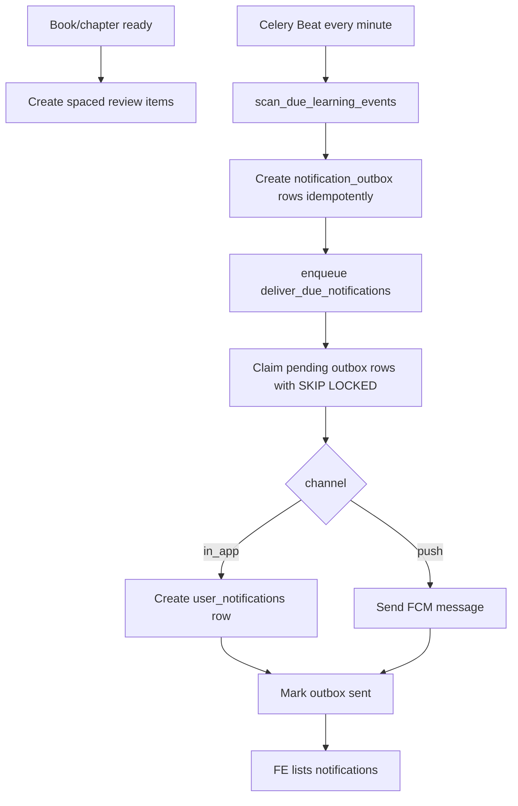

# Phase 4 Implementation Guide - Notification Outbox, Celery Beat, Spaced Review

Date: 2026-05-21

Status: **Plan only, not implemented yet**

## 0. Decision Summary

Sau Phase 1, 2, 3, backend đã có:

- DB progress + polling endpoint.
- Celery + Redis worker queue.
- Token/audio guardrails.
- First playable `partial_ready`.
- Per-chapter/per-mode processing state.

Phase 4 nên tập trung vào:

> **Notification Outbox + Celery Beat + Spaced Review** để biến TRIAM từ app "nghe sách" thành **AI Learning Companion có habit loop và ôn tập đúng lúc**.

Mục tiêu sản phẩm:

- Nhắc user quay lại nghe theo reading plan.
- Nhắc user khi bỏ dở hoặc trễ tiến độ.
- Chúc mừng/chốt tiến độ khi hoàn thành chapter/book.
- Tạo spaced review sau khi chapter có `review_text`.
- Cho FE có API hiển thị notification trong app.
- Chuẩn bị nền để gửi push notification qua FCM cho Flutter.

## 1. Research Notes

Nguồn chính thức đã tham khảo:

- Celery Beat là scheduler chạy task định kỳ; official docs nhấn mạnh chỉ nên có **một scheduler** cho cùng một schedule, nếu không có thể tạo duplicate task: https://docs.celeryq.dev/en/latest/userguide/periodic-tasks.html
- Celery routing cho phép route task vào queue riêng bằng `task_routes` và worker consume queue bằng `-Q`: https://docs.celeryq.dev/en/latest/userguide/routing.html
- Celery task retry hỗ trợ `autoretry_for`, `retry_backoff`, `retry_jitter`; retry phải đi cùng idempotency để không gửi trùng notification: https://docs.celeryq.dev/en/stable/userguide/tasks.html
- PostgreSQL `FOR UPDATE SKIP LOCKED` cho phép nhiều worker lấy job khác nhau mà không chờ row đang bị lock, phù hợp với outbox scanner/delivery worker: https://www.postgresql.org/docs/current/sql-select.html
- PostgreSQL unique constraints/unique indexes là cách enforce idempotency ở DB: https://www.postgresql.org/docs/current/indexes-unique.html
- Firebase Cloud Messaging official docs cho phép backend server gửi message bằng Firebase Admin SDK, hỗ trợ Python Admin SDK: https://firebase.google.com/docs/cloud-messaging/send-message
- FlutterFire Messaging docs là hướng FE Flutter nhận FCM token và handle foreground/background notifications: https://firebase.flutter.dev/docs/messaging/usage
- Supabase Edge Functions có ví dụ push notification, nhưng với BE Python hiện tại, dùng Firebase Admin SDK trực tiếp trong worker đơn giản hơn: https://supabase.com/docs/guides/functions/examples/push-notifications

Kết luận research:

- Không nên schedule từng reminder bằng Celery ETA/countdown dài hạn.
- Nên lưu lịch thật trong Postgres, Beat chỉ quét mỗi phút.
- Notification phải có `idempotency_key` unique ở DB.
- Delivery worker phải claim rows bằng lock/mark status để không gửi trùng.
- Ban đầu nên implement **in-app notification** trước, vì không cần FCM credential. Push FCM là adapter thêm sau.

## 2. Phase 4 Goals

Phase 4 hoàn tất khi:

1. Có bảng notification outbox làm hàng đợi gửi notification.
2. Có bảng user-facing notification để FE hiển thị notification trong app.
3. Có bảng device token để chuẩn bị push FCM.
4. Có user notification settings: timezone, quiet hours, daily cap, enable flags.
5. Có spaced review items được tạo từ chapter `review_text`.
6. Celery Beat chạy định kỳ:
   - scan due reminders/reviews
   - tạo outbox rows idempotent
   - enqueue delivery task
7. Delivery task gửi in-app notification và optional FCM push.
8. FE có endpoint cơ bản:
   - list notifications
   - mark read
   - register device token
   - update notification settings

Non-goals:

- Chưa cần analytics/streak dashboard phức tạp.
- Chưa cần email notification.
- Chưa cần Supabase Realtime push event.
- Chưa thay mock user bằng auth thật, nhưng mọi bảng phải sẵn `user_id`.
- Chưa cần cá nhân hóa notification copy bằng LLM. Copy rule-based là đủ cho capstone.

## 3. Business Logic

### 3.1 Notification Types

Phase 4 dùng 4 loại chính:

```text
plan_reminder
recovery_reminder
completion_message
spaced_review_due
```

Meaning:

- `plan_reminder`: nhắc user học theo lịch đã chọn.
- `recovery_reminder`: user bỏ dở lâu hoặc trễ plan.
- `completion_message`: user hoàn thành chapter/book.
- `spaced_review_due`: đến hạn ôn tập lại kiến thức.

### 3.2 Channels

Start with:

```text
in_app
push
```

Recommendation:

- Phase 4.1: implement `in_app` first.
- Phase 4.2: add FCM `push`.

Lý do:

- In-app notification không cần credential bên thứ ba.
- FE có thể test logic business ngay.
- Push notification trên Android/iOS cần Firebase setup, token lifecycle, quyền user, background handling.

### 3.3 Spaced Review Intervals

Theo skill/roadmap dự án:

```text
1, 3, 7, 14, 30 days
```

When to create:

- Sau khi chapter/mode xử lý xong và có `review_text`.
- Nếu `review_text` hiện đang lưu JSON theo mode trong `Chapter.review_text`, lấy đúng `mode`.

Idempotency:

```text
review:<user_id>:<chapter_id>:<mode>:<interval_day>
```

### 3.4 Quiet Hours And Daily Cap

Business rule:

- Không gửi notification trong quiet hours.
- Không gửi quá daily cap.
- Nếu due_at rơi vào quiet hours, dời tới thời điểm cho phép tiếp theo.

Default:

```text
timezone = Asia/Ho_Chi_Minh
quiet_hours_start = 22:00
quiet_hours_end = 07:00
daily_cap = 3
```

Trade-off:

- Cần timezone-aware datetime.
- Phase 4 nên lưu `due_at` UTC trong DB, convert theo timezone user khi tính.

## 4. Architecture



Source of truth:

- Schedules/reviews/outbox live in Postgres.
- Redis/Celery only executes scanner/delivery.
- FE reads notification state from Postgres APIs.

## 5. DB Design

### 5.1 Enums

File: `app/core/constant.py`

Add:

```python
class NotificationType(str, Enum):
    PLAN_REMINDER = "plan_reminder"
    RECOVERY_REMINDER = "recovery_reminder"
    COMPLETION_MESSAGE = "completion_message"
    SPACED_REVIEW_DUE = "spaced_review_due"


class NotificationChannel(str, Enum):
    IN_APP = "in_app"
    PUSH = "push"


class NotificationStatus(str, Enum):
    PENDING = "pending"
    PROCESSING = "processing"
    SENT = "sent"
    FAILED = "failed"
    CANCELLED = "cancelled"
    SKIPPED = "skipped"


class ReviewItemStatus(str, Enum):
    PENDING = "pending"
    DUE = "due"
    COMPLETED = "completed"
    SKIPPED = "skipped"
    CANCELLED = "cancelled"


class DevicePlatform(str, Enum):
    ANDROID = "android"
    IOS = "ios"
    WEB = "web"
```

### 5.2 `notification_settings`

Purpose:

- Per-user controls for reminders/push/no-spam.

Model:

```python
class NotificationSettings(SQLModel, table=True):
    __tablename__ = "notification_settings"

    user_id: uuid.UUID = Field(sa_column=Column(UUID(as_uuid=True), primary_key=True))
    timezone: str = Field(default="Asia/Ho_Chi_Minh", sa_column=Column(Text, nullable=False))
    reminders_enabled: bool = Field(default=True, sa_column=Column(Boolean, nullable=False))
    push_enabled: bool = Field(default=True, sa_column=Column(Boolean, nullable=False))
    spaced_review_enabled: bool = Field(default=True, sa_column=Column(Boolean, nullable=False))
    quiet_hours_start: str = Field(default="22:00", sa_column=Column(Text, nullable=False))
    quiet_hours_end: str = Field(default="07:00", sa_column=Column(Text, nullable=False))
    daily_cap: int = Field(default=3, sa_column=Column(Integer, nullable=False))
    created_at: datetime = Field(default_factory=lambda: datetime.now(timezone.utc), sa_column=Column(DateTime(timezone=True), server_default=func.now(), nullable=False))
    updated_at: datetime = Field(default_factory=lambda: datetime.now(timezone.utc), sa_column=Column(DateTime(timezone=True), server_default=func.now(), onupdate=func.now(), nullable=False))
```

Trade-off:

- `quiet_hours_start/end` lưu string `HH:MM` dễ làm DTO.
- Có thể chuyển thành `Time` column sau nếu cần query sâu.

### 5.3 `user_device_tokens`

Purpose:

- FE Flutter gửi FCM token lên BE.
- BE worker dùng token này để gửi push.

Model:

```python
class UserDeviceToken(SQLModel, table=True):
    __tablename__ = "user_device_tokens"

    id: uuid.UUID = Field(default_factory=uuid.uuid4, primary_key=True)
    user_id: uuid.UUID = Field(sa_column=Column(UUID(as_uuid=True), index=True, nullable=False))
    token: str = Field(sa_column=Column(Text, nullable=False))
    platform: DevicePlatform = Field(sa_column=Column(SAEnum(DevicePlatform), nullable=False))
    device_id: str | None = Field(default=None, sa_column=Column(Text))
    is_active: bool = Field(default=True, sa_column=Column(Boolean, nullable=False))
    last_seen_at: datetime | None = Field(default=None, sa_column=Column(DateTime(timezone=True)))
    created_at: datetime = Field(default_factory=lambda: datetime.now(timezone.utc), sa_column=Column(DateTime(timezone=True), server_default=func.now(), nullable=False))
    updated_at: datetime = Field(default_factory=lambda: datetime.now(timezone.utc), sa_column=Column(DateTime(timezone=True), server_default=func.now(), onupdate=func.now(), nullable=False))

    __table_args__ = (
        UniqueConstraint("user_id", "token", name="uq_user_device_tokens_user_token"),
    )
```

### 5.4 `spaced_review_items`

Purpose:

- Store due review schedule independently from notification delivery.
- If notification fails, review schedule is still visible.

Model:

```python
class SpacedReviewItem(SQLModel, table=True):
    __tablename__ = "spaced_review_items"

    id: uuid.UUID = Field(default_factory=uuid.uuid4, primary_key=True)
    user_id: uuid.UUID = Field(sa_column=Column(UUID(as_uuid=True), index=True, nullable=False))
    book_id: uuid.UUID = Field(sa_column=Column(UUID(as_uuid=True), ForeignKey("books.id", ondelete="CASCADE"), index=True, nullable=False))
    chapter_id: uuid.UUID = Field(sa_column=Column(UUID(as_uuid=True), ForeignKey("chapters.id", ondelete="CASCADE"), index=True, nullable=False))
    mode: PlanMode = Field(sa_column=Column(SAEnum(PlanMode), nullable=False))
    interval_days: int = Field(sa_column=Column(Integer, nullable=False))
    sequence_index: int = Field(sa_column=Column(Integer, nullable=False))
    due_at: datetime = Field(sa_column=Column(DateTime(timezone=True), index=True, nullable=False))
    status: ReviewItemStatus = Field(default=ReviewItemStatus.PENDING, sa_column=Column(SAEnum(ReviewItemStatus), index=True, nullable=False))
    review_text_snapshot: str | None = Field(default=None, sa_column=Column(Text))
    completed_at: datetime | None = Field(default=None, sa_column=Column(DateTime(timezone=True)))
    created_at: datetime = Field(default_factory=lambda: datetime.now(timezone.utc), sa_column=Column(DateTime(timezone=True), server_default=func.now(), nullable=False))
    updated_at: datetime = Field(default_factory=lambda: datetime.now(timezone.utc), sa_column=Column(DateTime(timezone=True), server_default=func.now(), onupdate=func.now(), nullable=False))

    __table_args__ = (
        UniqueConstraint("chapter_id", "mode", "interval_days", name="uq_review_chapter_mode_interval"),
    )
```

Why store `review_text_snapshot`:

- If `Chapter.review_text` changes later, historical review stays stable.
- FE can display/play review content without parsing chapter JSON every time.

### 5.5 `notification_outbox`

Purpose:

- Durable delivery queue.
- Idempotency and retry state live here.

Model:

```python
class NotificationOutbox(SQLModel, table=True):
    __tablename__ = "notification_outbox"

    id: uuid.UUID = Field(default_factory=uuid.uuid4, primary_key=True)
    user_id: uuid.UUID = Field(sa_column=Column(UUID(as_uuid=True), index=True, nullable=False))
    type: NotificationType = Field(sa_column=Column(SAEnum(NotificationType), index=True, nullable=False))
    channel: NotificationChannel = Field(sa_column=Column(SAEnum(NotificationChannel), index=True, nullable=False))
    status: NotificationStatus = Field(default=NotificationStatus.PENDING, sa_column=Column(SAEnum(NotificationStatus), index=True, nullable=False))
    payload: dict[str, Any] = Field(default_factory=dict, sa_column=Column(JSONB, nullable=False))
    due_at: datetime = Field(sa_column=Column(DateTime(timezone=True), index=True, nullable=False))
    locked_at: datetime | None = Field(default=None, sa_column=Column(DateTime(timezone=True)))
    sent_at: datetime | None = Field(default=None, sa_column=Column(DateTime(timezone=True)))
    attempts: int = Field(default=0, sa_column=Column(Integer, nullable=False))
    error_message: str | None = Field(default=None, sa_column=Column(Text))
    idempotency_key: str = Field(sa_column=Column(Text, nullable=False))
    created_at: datetime = Field(default_factory=lambda: datetime.now(timezone.utc), sa_column=Column(DateTime(timezone=True), server_default=func.now(), nullable=False))
    updated_at: datetime = Field(default_factory=lambda: datetime.now(timezone.utc), sa_column=Column(DateTime(timezone=True), server_default=func.now(), onupdate=func.now(), nullable=False))

    __table_args__ = (
        UniqueConstraint("idempotency_key", name="uq_notification_outbox_idempotency_key"),
    )
```

### 5.6 `user_notifications`

Purpose:

- User-facing inbox for FE.
- Outbox remains delivery queue; inbox remains UI state.

Model:

```python
class UserNotification(SQLModel, table=True):
    __tablename__ = "user_notifications"

    id: uuid.UUID = Field(default_factory=uuid.uuid4, primary_key=True)
    user_id: uuid.UUID = Field(sa_column=Column(UUID(as_uuid=True), index=True, nullable=False))
    outbox_id: uuid.UUID | None = Field(default=None, sa_column=Column(UUID(as_uuid=True), ForeignKey("notification_outbox.id", ondelete="SET NULL"), index=True))
    type: NotificationType = Field(sa_column=Column(SAEnum(NotificationType), index=True, nullable=False))
    title: str = Field(sa_column=Column(Text, nullable=False))
    body: str = Field(sa_column=Column(Text, nullable=False))
    action_type: str | None = Field(default=None, sa_column=Column(Text))
    action_payload: dict[str, Any] | None = Field(default=None, sa_column=Column(JSONB))
    read_at: datetime | None = Field(default=None, sa_column=Column(DateTime(timezone=True)))
    created_at: datetime = Field(default_factory=lambda: datetime.now(timezone.utc), sa_column=Column(DateTime(timezone=True), server_default=func.now(), nullable=False))
```

## 6. Migration Plan

Command:

```powershell
uv run alembic revision --autogenerate -m "phase 4 notification outbox"
```

Then manually review generated migration.

Important:

- Ensure enum values are lowercase strings if the existing enum mapping style requires it.
- Ensure unique constraints exist:
  - `uq_user_device_tokens_user_token`
  - `uq_review_chapter_mode_interval`
  - `uq_notification_outbox_idempotency_key`
- Add indexes:
  - `notification_outbox(status, due_at)`
  - `spaced_review_items(status, due_at)`
  - `user_notifications(user_id, created_at)`

Example manual migration additions:

```python
op.create_index(
    "ix_notification_outbox_status_due_at",
    "notification_outbox",
    ["status", "due_at"],
)
op.create_index(
    "ix_spaced_review_items_status_due_at",
    "spaced_review_items",
    ["status", "due_at"],
)
```

Run:

```powershell
uv run alembic upgrade head
```

## 7. Config Changes

File: `app/core/config.py`

Add:

```python
    # Notification / reminders
    ENABLE_CELERY_BEAT: bool = False
    NOTIFICATION_SCAN_INTERVAL_SECONDS: int = 60
    NOTIFICATION_DELIVERY_BATCH_SIZE: int = 50
    NOTIFICATION_MAX_ATTEMPTS: int = 5
    NOTIFICATION_DEFAULT_TIMEZONE: str = "Asia/Ho_Chi_Minh"
    NOTIFICATION_DEFAULT_DAILY_CAP: int = 3
    NOTIFICATION_DEFAULT_QUIET_START: str = "22:00"
    NOTIFICATION_DEFAULT_QUIET_END: str = "07:00"

    # FCM push, optional in Phase 4.2
    FCM_ENABLED: bool = False
    FIREBASE_CREDENTIALS_JSON: str | None = None
```

File: `.env.example`

Add:

```env
# Phase 4 notification/reminder
ENABLE_CELERY_BEAT=false
NOTIFICATION_SCAN_INTERVAL_SECONDS=60
NOTIFICATION_DELIVERY_BATCH_SIZE=50
NOTIFICATION_MAX_ATTEMPTS=5
NOTIFICATION_DEFAULT_TIMEZONE=Asia/Ho_Chi_Minh
NOTIFICATION_DEFAULT_DAILY_CAP=3
NOTIFICATION_DEFAULT_QUIET_START=22:00
NOTIFICATION_DEFAULT_QUIET_END=07:00

# Optional FCM push
FCM_ENABLED=false
FIREBASE_CREDENTIALS_JSON=
```

Security:

- `FIREBASE_CREDENTIALS_JSON` is a secret.
- Do not commit Firebase service account JSON.
- Use HuggingFace Secrets or local `.env`.

## 8. Celery App Changes

File: `app/core/celery_app.py`

Add tasks include:

```python
include=[
    "app.tasks.book_tasks",
    "app.tasks.notification_tasks",
]
```

Add routes:

```python
task_routes={
    "triam.books.process": {"queue": "document"},
    "triam.books.switch_mode": {"queue": "document"},
    "triam.notifications.scan_due": {"queue": "maintenance"},
    "triam.notifications.deliver_due": {"queue": "notification"},
}
```

Add beat schedule:

```python
from celery.schedules import schedule

celery_app.conf.beat_schedule = {
    "scan-due-notifications-every-minute": {
        "task": "triam.notifications.scan_due",
        "schedule": schedule(run_every=settings.NOTIFICATION_SCAN_INTERVAL_SECONDS),
        "options": {"queue": "maintenance"},
    }
}
```

Rule:

- Only run **one** Beat instance.
- Multiple workers are okay.
- Multiple Beat schedulers can duplicate scanner tasks.

## 9. Start Script Setup

File: `start.sh`

Current worker start exists for document worker. Add optional notification worker and beat:

```bash
if [ "${ENABLE_NOTIFICATION_WORKER:-false}" = "true" ]; then
  uv run celery -A app.core.celery_app.celery_app worker \
    -Q notification,maintenance \
    -l info \
    --concurrency "${CELERY_NOTIFICATION_CONCURRENCY:-1}" \
    > celery_notification.log 2>&1 &
fi

if [ "${ENABLE_CELERY_BEAT:-false}" = "true" ]; then
  uv run celery -A app.core.celery_app.celery_app beat \
    -l info \
    > celery_beat.log 2>&1 &
fi
```

HuggingFace capstone option:

```env
ENABLE_CELERY_WORKER=true
ENABLE_NOTIFICATION_WORKER=true
ENABLE_CELERY_BEAT=true
```

Production recommendation:

- API Space/process.
- Document worker process.
- Notification worker process.
- One Beat process only.

## 10. Repositories

### 10.1 Notification Settings Repo

File: `app/repositories/notification_settings_repo.py`

```python
def get_or_create_settings(session: Session, user_id: uuid.UUID) -> NotificationSettings:
    settings = session.get(NotificationSettings, user_id)
    if settings:
        return settings

    settings = NotificationSettings(user_id=user_id)
    session.add(settings)
    session.commit()
    session.refresh(settings)
    return settings
```

### 10.2 Device Token Repo

File: `app/repositories/device_token_repo.py`

```python
def upsert_device_token(
    session: Session,
    *,
    user_id: uuid.UUID,
    token: str,
    platform: DevicePlatform,
    device_id: str | None,
) -> UserDeviceToken:
    existing = session.exec(
        select(UserDeviceToken).where(
            UserDeviceToken.user_id == user_id,
            UserDeviceToken.token == token,
        )
    ).first()
    now = datetime.now(timezone.utc)
    if existing:
        existing.platform = platform
        existing.device_id = device_id
        existing.is_active = True
        existing.last_seen_at = now
        existing.updated_at = now
        session.add(existing)
        session.commit()
        session.refresh(existing)
        return existing

    record = UserDeviceToken(
        user_id=user_id,
        token=token,
        platform=platform,
        device_id=device_id,
        is_active=True,
        last_seen_at=now,
    )
    session.add(record)
    session.commit()
    session.refresh(record)
    return record
```

### 10.3 Notification Outbox Repo

File: `app/repositories/notification_outbox_repo.py`

```python
def create_outbox_once(session: Session, outbox: NotificationOutbox) -> NotificationOutbox | None:
    existing = session.exec(
        select(NotificationOutbox).where(NotificationOutbox.idempotency_key == outbox.idempotency_key)
    ).first()
    if existing:
        return None

    session.add(outbox)
    session.commit()
    session.refresh(outbox)
    return outbox
```

Claim due rows:

```python
def claim_due_outbox(
    session: Session,
    *,
    now: datetime,
    limit: int,
) -> list[NotificationOutbox]:
    rows = session.exec(
        select(NotificationOutbox)
        .where(NotificationOutbox.status == NotificationStatus.PENDING)
        .where(NotificationOutbox.due_at <= now)
        .order_by(NotificationOutbox.due_at)
        .limit(limit)
        .with_for_update(skip_locked=True)
    ).all()

    for row in rows:
        row.status = NotificationStatus.PROCESSING
        row.locked_at = now
        row.attempts += 1
        session.add(row)
    session.commit()
    return list(rows)
```

Why `SKIP LOCKED`:

- If multiple notification workers run, they do not deliver the same row.
- Locked rows are skipped instead of blocking.

## 11. Services

### 11.1 Notification Copy Service

File: `app/services/notification_copy_service.py`

No LLM in Phase 4. Keep deterministic copy:

```python
def build_notification_copy(notification_type: NotificationType, payload: dict) -> tuple[str, str]:
    match notification_type:
        case NotificationType.PLAN_REMINDER:
            return (
                "Đến giờ học rồi",
                f"Tiếp tục nghe {payload.get('book_title', 'sách của bạn')} nhé.",
            )
        case NotificationType.RECOVERY_REMINDER:
            return (
                "Quay lại nhịp học nào",
                f"Bạn còn một phần trong {payload.get('book_title', 'sách này')} đang chờ.",
            )
        case NotificationType.COMPLETION_MESSAGE:
            return (
                "Bạn vừa hoàn thành một phần học",
                payload.get("message", "Tiến độ hôm nay rất ổn. Tiếp tục giữ nhịp nhé."),
            )
        case NotificationType.SPACED_REVIEW_DUE:
            return (
                "Đến lúc ôn lại rồi",
                f"Ôn nhanh: {payload.get('chapter_title', 'một chương đã học')}.",
            )
    return ("TRIAM", "Bạn có một thông báo mới.")
```

### 11.2 Reminder Schedule Service

File: `app/services/reminder_schedule_service.py`

Responsibilities:

- Parse user timezone.
- Apply quiet hours.
- Check daily cap.
- Generate due plan reminders/recovery reminders.

Core helpers:

```python
from datetime import datetime, time, timedelta, timezone
from zoneinfo import ZoneInfo


def local_now(user_timezone: str, now_utc: datetime) -> datetime:
    return now_utc.astimezone(ZoneInfo(user_timezone))


def parse_hhmm(value: str) -> time:
    hour, minute = value.split(":", 1)
    return time(hour=int(hour), minute=int(minute))


def is_quiet_time(local_dt: datetime, start_hhmm: str, end_hhmm: str) -> bool:
    start = parse_hhmm(start_hhmm)
    end = parse_hhmm(end_hhmm)
    current = local_dt.time()
    if start <= end:
        return start <= current < end
    return current >= start or current < end
```

Phase 4 simplification:

- If quiet time, scanner does not create/send notification yet.
- It can move `due_at` to quiet end.

### 11.3 Spaced Review Service

File: `app/services/spaced_review_service.py`

Create review items after chapter ready:

```python
SPACED_REVIEW_INTERVALS = [1, 3, 7, 14, 30]


def create_spaced_reviews_for_chapter(
    session: Session,
    *,
    user_id: uuid.UUID,
    book_id: uuid.UUID,
    chapter_id: uuid.UUID,
    mode: PlanMode,
    review_text: str,
    base_time: datetime,
) -> list[SpacedReviewItem]:
    created = []
    for index, days in enumerate(SPACED_REVIEW_INTERVALS):
        item = SpacedReviewItem(
            user_id=user_id,
            book_id=book_id,
            chapter_id=chapter_id,
            mode=mode,
            interval_days=days,
            sequence_index=index,
            due_at=base_time + timedelta(days=days),
            status=ReviewItemStatus.PENDING,
            review_text_snapshot=review_text,
        )
        try:
            session.add(item)
            session.commit()
            session.refresh(item)
            created.append(item)
        except IntegrityError:
            session.rollback()
    return created
```

Where to call:

- In Phase 4, call from `chapter_worker` after `mark_chapter_state_ready()`.
- Use review text returned/saved by TTS pipeline.

Trade-off:

- This couples chapter completion to review schedule creation.
- It is okay because spaced review is a direct domain consequence of chapter ready.

## 12. Celery Notification Tasks

File: `app/tasks/notification_tasks.py`

### 12.1 Scanner Task

```python
@celery_app.task(name="triam.notifications.scan_due")
def scan_due_notifications_task() -> None:
    now = datetime.now(timezone.utc)
    with Session(engine) as session:
        created = create_due_review_outbox_rows(session, now=now)
        created += create_due_plan_reminder_outbox_rows(session, now=now)

    if created:
        deliver_due_notifications_task.apply_async(queue="notification")
```

Scanner should:

- Query due `spaced_review_items`.
- Create outbox rows with unique idempotency key.
- Mark review item `DUE` or keep `PENDING` until completed depending on chosen semantics.
- Enqueue delivery task only if rows were created.

### 12.2 Delivery Task

```python
@celery_app.task(
    name="triam.notifications.deliver_due",
    autoretry_for=(ExternalServiceError,),
    retry_backoff=True,
    retry_jitter=True,
    retry_kwargs={"max_retries": 3},
)
def deliver_due_notifications_task() -> None:
    now = datetime.now(timezone.utc)
    with Session(engine) as session:
        rows = claim_due_outbox(
            session,
            now=now,
            limit=settings.NOTIFICATION_DELIVERY_BATCH_SIZE,
        )

    for row in rows:
        try:
            deliver_one_notification(row.id)
        except Exception:
            log.exception(f"Failed to deliver notification outbox_id={row.id}")
```

`deliver_one_notification(outbox_id)`:

- Open its own DB session.
- Load outbox.
- Build copy from payload.
- If channel `in_app`, create `UserNotification`.
- If channel `push`, send FCM to active device tokens.
- Mark outbox `SENT`.
- If permanent failure, mark `FAILED`.
- If attempts exceeded, mark `FAILED`.

## 13. FCM Push Adapter

Dependency:

```powershell
uv add firebase-admin
```

File: `app/services/push_notification_service.py`

```python
import json

import firebase_admin
from firebase_admin import credentials, messaging

from app.core.config import settings

_firebase_app = None


def _get_firebase_app():
    global _firebase_app
    if _firebase_app:
        return _firebase_app

    if not settings.FIREBASE_CREDENTIALS_JSON:
        raise RuntimeError("FIREBASE_CREDENTIALS_JSON is not configured.")

    cred_dict = json.loads(settings.FIREBASE_CREDENTIALS_JSON)
    cred = credentials.Certificate(cred_dict)
    _firebase_app = firebase_admin.initialize_app(cred)
    return _firebase_app


def send_push_to_token(*, token: str, title: str, body: str, data: dict[str, str]) -> str:
    app = _get_firebase_app()
    message = messaging.Message(
        notification=messaging.Notification(title=title, body=body),
        data=data,
        token=token,
    )
    return messaging.send(message, app=app)
```

Phase 4.1 can skip this and only implement in-app.

## 14. API Contract For FE

Router:

```text
app/api/v1/routers/notifications.py
```

Endpoints:

```text
GET /api/v1/notifications
PATCH /api/v1/notifications/{notification_id}/read
POST /api/v1/notifications/device-tokens
DELETE /api/v1/notifications/device-tokens/{token_id}
GET /api/v1/notifications/settings
PUT /api/v1/notifications/settings
```

### 14.1 List Notifications

Response:

```json
{
  "items": [
    {
      "id": "...",
      "type": "spaced_review_due",
      "title": "Đến lúc ôn lại rồi",
      "body": "Ôn nhanh: Chương 4...",
      "action_type": "open_review",
      "action_payload": {
        "book_id": "...",
        "chapter_id": "...",
        "review_item_id": "..."
      },
      "read_at": null,
      "created_at": "2026-05-21T10:00:00Z"
    }
  ],
  "unread_count": 1
}
```

### 14.2 Register Device Token

Request:

```json
{
  "token": "fcm-token-from-flutter",
  "platform": "android",
  "device_id": "optional-device-id"
}
```

Response:

```json
{
  "id": "...",
  "is_active": true
}
```

### 14.3 Settings

Request:

```json
{
  "timezone": "Asia/Ho_Chi_Minh",
  "reminders_enabled": true,
  "push_enabled": true,
  "spaced_review_enabled": true,
  "quiet_hours_start": "22:00",
  "quiet_hours_end": "07:00",
  "daily_cap": 3
}
```

## 15. DTO Files

File:

```text
app/schemas/notification.py
```

Suggested DTOs:

```python
class DeviceTokenCreateRequest(BaseModel):
    token: str
    platform: DevicePlatform
    device_id: str | None = None


class DeviceTokenResponse(BaseModel):
    model_config = ConfigDict(from_attributes=True)

    id: uuid.UUID
    platform: DevicePlatform
    is_active: bool
    last_seen_at: datetime | None = None


class NotificationSettingsRequest(BaseModel):
    timezone: str = "Asia/Ho_Chi_Minh"
    reminders_enabled: bool = True
    push_enabled: bool = True
    spaced_review_enabled: bool = True
    quiet_hours_start: str = "22:00"
    quiet_hours_end: str = "07:00"
    daily_cap: int = 3


class UserNotificationResponse(BaseModel):
    model_config = ConfigDict(from_attributes=True)

    id: uuid.UUID
    type: NotificationType
    title: str
    body: str
    action_type: str | None = None
    action_payload: dict[str, Any] | None = None
    read_at: datetime | None = None
    created_at: datetime


class NotificationListResponse(BaseModel):
    items: list[UserNotificationResponse]
    unread_count: int
```

## 16. Where To Create Notifications

### 16.1 Chapter Ready

In `chapter_worker.py`, after TTS/RAG success:

```python
create_spaced_reviews_for_chapter(...)
create_completion_outbox_once(...)
```

But be careful:

- Do not create notification before transaction is stable.
- Use idempotency key.

### 16.2 Book Ready

In `book_pipeline.py`, when book becomes `READY`:

```python
create_book_completion_outbox_once(...)
```

### 16.3 Plan Reminder

Beat scanner queries active `ReadingPlan`.

Phase 4 simplified rule:

- If book is `processing`, `partial_ready`, or `ready`.
- If user has reminders enabled.
- If current local time matches a configured schedule window.
- Create one reminder per day per book.

Idempotency:

```text
plan:<user_id>:<book_id>:<YYYY-MM-DD>
```

### 16.4 Recovery Reminder

Need progress/listening event data to be good. If current project has no playback progress table yet, Phase 4 can implement simple version:

- If book is `partial_ready` or `ready`.
- If no notification in last 48 hours.
- If plan exists and user has not completed book.

Better Phase 5:

- Add `listening_progress` table.
- Recovery reminder based on actual last listened timestamp.

## 17. FE Implementation Notes

FE needs:

1. Register FCM token after login/permission granted.
2. Call `GET /notifications` on app start.
3. Show unread badge.
4. Mark read when user opens notification.
5. Navigate by `action_type`:

```text
open_book
open_chapter
open_review
open_thread
```

For Phase 4.1, even without push:

- FE can still display in-app notification list.
- Backend habit logic is testable.

## 18. Testing Strategy

### 18.1 Unit Tests

Files:

```text
tests/test_notification_copy_service.py
tests/test_reminder_schedule_service.py
tests/test_notification_outbox_repo.py
tests/test_spaced_review_service.py
```

Cases:

- Quiet hours true/false across midnight.
- Daily cap blocks extra notifications.
- `create_outbox_once` does not duplicate same idempotency key.
- Spaced review creates intervals 1/3/7/14/30 once.
- Notification copy contains title/body for each type.

### 18.2 API Tests

File:

```text
tests/test_notifications_api.py
```

Cases:

- Register device token.
- Upsert same token does not duplicate.
- List notifications returns unread count.
- Mark notification read.
- Get/update settings.

### 18.3 Worker Tests

File:

```text
tests/test_notification_tasks.py
```

Cases:

- Scanner creates outbox rows for due review items.
- Delivery task creates `user_notifications` for in-app channel.
- Delivery task marks outbox sent.
- Failed delivery increments attempts and stores error.
- Duplicate scanner run does not duplicate outbox.

### 18.4 Manual Test

Run local worker/beat:

```powershell
uv run celery -A app.core.celery_app.celery_app worker -Q notification,maintenance -l info --pool=solo
uv run celery -A app.core.celery_app.celery_app beat -l info
```

Create a due review item:

```sql
UPDATE spaced_review_items
SET due_at = now() - interval '1 minute'
WHERE id = '<review_item_id>';
```

Expected:

```text
Beat sends scan_due task
Scanner creates notification_outbox
Delivery creates user_notifications
Outbox status becomes sent
FE list endpoint shows notification
```

## 19. Deployment Notes

### 19.1 HuggingFace Free

Possible but fragile if API, document worker, notification worker, beat all run in one Space.

Capstone option:

```text
One Space:
  FastAPI
  LiveKit/voice worker if needed
  Celery document worker
  Celery notification worker
  Celery Beat
External Redis Cloud
Postgres/Supabase
```

Risk:

- Shared CPU/RAM.
- Beat duplicated if Space restarts weirdly or multiple replicas.
- Logs become noisy.

Better:

```text
Space A: FastAPI
Space B: Celery document worker
Space C or same B: notification worker + one Beat
```

But HuggingFace free may sleep/restart; reminders are less reliable.

Production recommendation:

- Use a platform with always-on worker/scheduler.
- Ensure only one Beat instance.

### 19.2 Redis Cloud 30MB

Still okay if:

- Beat only enqueues small task messages.
- Outbox payload remains in Postgres.
- Redis result backend stays disabled.

Not okay if:

- Push payloads/results stored in Redis.
- Massive notification bursts.
- Result backend enabled.

## 20. Trade-offs

| Decision | Benefit | Trade-off |
| --- | --- | --- |
| DB outbox | Durable, debuggable, idempotent | More tables and repo code |
| Beat scan every minute | Simple and reliable enough | Notification can be delayed up to 60s |
| In-app first | Easy to test, no FCM credential | No phone notification until user opens app |
| FCM adapter optional | Real push later | Requires Firebase setup and token lifecycle |
| Quiet hours in backend | Protects user experience | Timezone logic needs tests |
| Unique idempotency key | Prevents duplicate notification | Need carefully design keys |
| `SKIP LOCKED` claim | Multiple workers safe | Postgres-specific behavior |
| Rule-based copy | Cheap and predictable | Less personalized than LLM copy |

## 21. Implementation Checklist

Phase 4A - Schema:

- Add notification/review enums.
- Add `notification_settings`.
- Add `user_device_tokens`.
- Add `spaced_review_items`.
- Add `notification_outbox`.
- Add `user_notifications`.
- Create Alembic migration.

Phase 4B - Services:

- Add notification copy service.
- Add reminder schedule service.
- Add spaced review service.
- Add notification outbox service.

Phase 4C - Celery:

- Add `app/tasks/notification_tasks.py`.
- Add Celery routes for `maintenance` and `notification`.
- Add Beat schedule for scanner.
- Update `start.sh`.

Phase 4D - API:

- Add `app/api/v1/routers/notifications.py`.
- Add DTOs.
- Include router in `app/main.py`.

Phase 4E - Tests:

- Unit tests for schedule/copy/outbox/review.
- API tests for settings/device tokens/inbox.
- Worker tests for scanner/delivery idempotency.

Phase 4F - Optional Push:

- `uv add firebase-admin`.
- Add FCM service.
- Add Firebase credential secret.
- FE registers FCM token.

## 22. Recommended Implementation Order For Fresher

Do this in small safe steps:

1. Implement schemas/models/migration only.
2. Implement in-app notification APIs and tests.
3. Implement outbox repo with idempotency tests.
4. Implement spaced review creation from chapter ready.
5. Implement Beat scanner to create outbox rows.
6. Implement delivery worker for in-app.
7. Only then add FCM push.

This avoids mixing DB design, scheduler, FE API, and push provider bugs into one giant problem.

## 23. Senior Notes

Important rules for this phase:

- Do not use Celery ETA/countdown for long-range reminders.
- Do not send duplicate notification if Beat runs twice.
- Do not trust Redis as schedule storage.
- Do not log FCM tokens or Firebase credentials.
- Do not send push during quiet hours.
- Do not spam: daily cap is a product requirement, not a nice-to-have.
- Keep notification copy short and action-oriented.
- Keep outbox payload small; store IDs and short text, not large documents.

Phase 4 turns TRIAM into a learning loop:

```text
listen -> understand -> return -> review -> remember
```

That is the real product value beyond audiobook generation.
