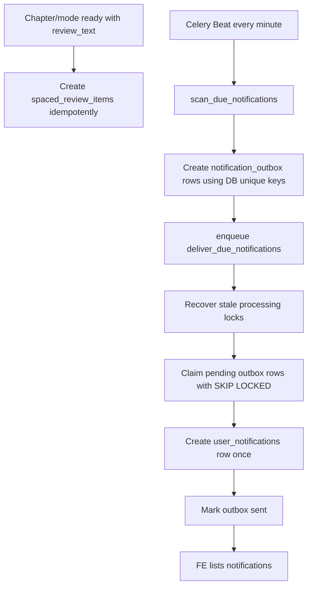
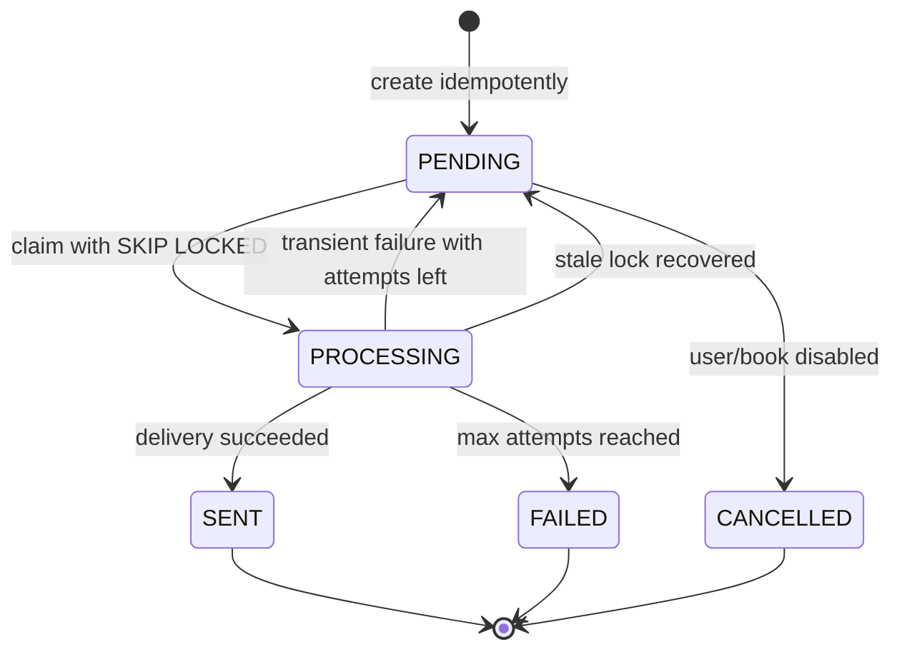

# Phase 4.1 Implementation Guide - In-App Notification Outbox, Celery Beat, Spaced Review

Date: 2026-05-24

Status: **Plan only, not implemented yet**

Audience: Fresher backend developer implementing with senior review.

## 0. Decision Summary

After Phase 1, 2, and 3, TRIAM already has:

- DB-backed processing progress and polling endpoints.
- Celery + Redis document worker queue.
- Token/audio guardrails.
- First playable `partial_ready`.
- Per-chapter/per-mode processing state.
- Hardened Hugging Face deployment rules: `uv run --no-sync`, no production reload, conservative worker concurrency.

Phase 4.1 should implement:

> **In-app notifications + durable notification outbox + Celery Beat scanner + spaced review schedule.**

This phase turns TRIAM from “generated audiobook app” into a learning loop:

```text
listen -> understand -> return -> review -> remember
```

Important scope decision:

- **Phase 4.1 implements in-app notifications only.**
- **FCM push is deferred to Phase 4.2.**
- **Playback-based completion/streak analytics are deferred to Phase 5.**

This keeps the implementation clean and testable before adding Firebase credentials, mobile permission handling, token lifecycle, and real listening-progress analytics.

## 1. Research Notes

Official sources already reviewed:

- Celery Beat schedules periodic tasks. Celery docs warn that only one scheduler should run for a schedule, otherwise duplicate tasks may be emitted: https://docs.celeryq.dev/en/latest/userguide/periodic-tasks.html
- Celery routing supports dedicated queues and workers via `task_routes` and `-Q`: https://docs.celeryq.dev/en/latest/userguide/routing.html
- Celery retries support `autoretry_for`, `retry_backoff`, and `retry_jitter`, but retries must be paired with idempotency: https://docs.celeryq.dev/en/stable/userguide/tasks.html
- PostgreSQL `FOR UPDATE SKIP LOCKED` lets multiple workers claim different due rows without blocking each other: https://www.postgresql.org/docs/current/sql-select.html
- PostgreSQL unique indexes/constraints enforce idempotency even when multiple Beat/worker processes race: https://www.postgresql.org/docs/current/indexes-unique.html

Project-specific conclusions:

- Do not schedule long-range reminders with Celery ETA/countdown.
- Store schedule truth in Postgres.
- Use Redis/Celery only as execution infrastructure.
- Use DB unique constraints as the final duplicate-prevention layer.
- Use stale-lock recovery so crashed workers do not leave outbox rows stuck in `processing`.
- Implement in-app delivery first. Push notification is an adapter added later.

## 2. Phase 4.1 Goals

Phase 4.1 is complete when:

1. Backend has `notification_settings` per user.
2. Backend has `spaced_review_items` created after a chapter/mode has `review_text`.
3. Backend has `notification_outbox` as a durable delivery queue.
4. Backend has `user_notifications` as a user-facing inbox for FE.
5. Celery Beat periodically runs a scanner task.
6. Scanner creates outbox rows idempotently for due spaced reviews and plan reminders.
7. Delivery task claims due outbox rows and creates in-app notifications.
8. FE has endpoints to list notifications, mark read, and update notification settings.

Phase 4.1 non-goals:

- No Firebase Cloud Messaging.
- No device-token table yet.
- No email notification.
- No Supabase Realtime notification push.
- No LLM-generated notification copy.
- No playback-based completion notification.
- No full streak/analytics dashboard.
- No auth migration yet; use current mock user pattern, but every table must include `user_id`.

Phase 4.2 later:

- Add `user_device_tokens`.
- Add Firebase Admin SDK.
- Add `push` channel delivery.
- Let Flutter register/delete FCM tokens.

Phase 5 later:

- Add `listening_progress`.
- Add real user-completed chapter/book events.
- Add streaks and recovery reminders based on actual last-listened timestamps.

## 3. Business Logic

### 3.1 Notification Types

Phase 4.1 uses three notification types:

```text
plan_reminder
content_ready
spaced_review_due
```

Meaning:

- `plan_reminder`: remind user to study on a selected reading-plan day.
- `content_ready`: tell user generated content is ready to listen/review. This is not “user completed chapter”.
- `spaced_review_due`: remind user to review knowledge from a chapter.

Deferred:

- `recovery_reminder`: needs real playback progress to avoid noisy guesses.
- `completion_message`: should mean user completed listening, so defer until `listening_progress` exists.

### 3.2 Channel

Phase 4.1 supports only:

```text
in_app
```

Why:

- No third-party credentials.
- FE can test the notification list immediately.
- Worker delivery can be deterministic and cheap.
- We avoid mixing Firebase bugs with DB/scheduler bugs.

### 3.3 Spaced Review Intervals

Use:

```text
1, 3, 7, 14, 30 days
```

Create review items when:

- Chapter/mode processing succeeds.
- `review_text` exists for that mode.
- Review items for `(user_id, chapter_id, mode, interval_days)` do not already exist.

Idempotency key:

```text
review:<user_id>:<chapter_id>:<mode>:<interval_day>
```

### 3.4 Plan Reminder Schedule

Current `ReadingPlan.schedule_config` is a simple list, for example:

```json
["Mon", "Wed", "Fri"]
```

This has no reminder hour. Phase 4.1 should add reminder time to `notification_settings` instead of changing the Phase 1-3 FE contract immediately.

Defaults:

```text
timezone = Asia/Ho_Chi_Minh
reminder_time = 20:00
quiet_hours_start = 22:00
quiet_hours_end = 07:00
daily_cap = 3
```

Rule:

- If today is in `ReadingPlan.schedule_config`, scanner may create a `plan_reminder`.
- It should only create one plan reminder per user/book/local-date.
- Use `notification_settings.reminder_time` as local wall-clock time.
- Store all `due_at` values as UTC.

Plan reminder idempotency key:

```text
plan:<user_id>:<book_id>:<YYYY-MM-DD>
```

### 3.5 Quiet Hours And Daily Cap

Business rules:

- Do not create/send notifications in quiet hours.
- Do not exceed `daily_cap` per user per local date.
- If an event becomes due during quiet hours, move `due_at` to the next allowed local time.
- Daily cap counts both already-created outbox rows and already-sent in-app notifications for that user/local date.

Implementation detail:

- Store `due_at` UTC in DB.
- Convert to user timezone only for schedule/quiet-hour/daily-cap logic.
- When several review items become due in the same scan, reserve cap slots as rows are created so one scan cannot create more than `daily_cap`.
- Add unit tests for quiet hours crossing midnight.

## 4. Architecture



Source of truth:

- Schedules, review items, outbox rows, and user inbox live in Postgres.
- Redis/Celery only executes scanner and delivery.
- FE reads notification state from Postgres APIs.

## 5. DB Design

### 5.1 Enums

File: `app/core/constant.py`

Add:

```python
class NotificationType(str, Enum):
    PLAN_REMINDER = "plan_reminder"
    CONTENT_READY = "content_ready"
    SPACED_REVIEW_DUE = "spaced_review_due"


class NotificationChannel(str, Enum):
    IN_APP = "in_app"


class NotificationStatus(str, Enum):
    PENDING = "pending"
    PROCESSING = "processing"
    SENT = "sent"
    FAILED = "failed"
    CANCELLED = "cancelled"
    SKIPPED = "skipped"


class ReviewItemStatus(str, Enum):
    PENDING = "pending"
    DUE = "due"
    COMPLETED = "completed"
    SKIPPED = "skipped"
    CANCELLED = "cancelled"
```

Do not add FCM/device enums in Phase 4.1. Add them in Phase 4.2.

### 5.2 `notification_settings`

Purpose:

- Per-user reminder and no-spam settings.
- Store timezone and reminder time without changing current `ReadingPlan.schedule_config`.

Model:

```python
class NotificationSettings(SQLModel, table=True):
    __tablename__ = "notification_settings"

    user_id: uuid.UUID = Field(sa_column=Column(UUID(as_uuid=True), primary_key=True))
    timezone: str = Field(default="Asia/Ho_Chi_Minh", sa_column=Column(Text, nullable=False))
    reminders_enabled: bool = Field(default=True, sa_column=Column(Boolean, nullable=False))
    spaced_review_enabled: bool = Field(default=True, sa_column=Column(Boolean, nullable=False))
    reminder_time: str = Field(default="20:00", sa_column=Column(Text, nullable=False))
    quiet_hours_start: str = Field(default="22:00", sa_column=Column(Text, nullable=False))
    quiet_hours_end: str = Field(default="07:00", sa_column=Column(Text, nullable=False))
    daily_cap: int = Field(default=3, sa_column=Column(Integer, nullable=False))
    created_at: datetime = Field(default_factory=lambda: datetime.now(timezone.utc), sa_column=Column(DateTime(timezone=True), server_default=func.now(), nullable=False))
    updated_at: datetime = Field(default_factory=lambda: datetime.now(timezone.utc), sa_column=Column(DateTime(timezone=True), server_default=func.now(), onupdate=func.now(), nullable=False))
```

Validation rules:

- `timezone` must be accepted by `zoneinfo.ZoneInfo`.
- `reminder_time`, `quiet_hours_start`, `quiet_hours_end` must match `HH:MM`.
- `daily_cap` should be between `0` and `10` for Phase 4.1.

### 5.3 `spaced_review_items`

Purpose:

- Store review schedule separately from notification delivery.
- If a notification fails, the review schedule is still visible and recoverable.

Model:

```python
class SpacedReviewItem(SQLModel, table=True):
    __tablename__ = "spaced_review_items"

    id: uuid.UUID = Field(default_factory=uuid.uuid4, primary_key=True)
    user_id: uuid.UUID = Field(sa_column=Column(UUID(as_uuid=True), index=True, nullable=False))
    book_id: uuid.UUID = Field(sa_column=Column(UUID(as_uuid=True), ForeignKey("books.id", ondelete="CASCADE"), index=True, nullable=False))
    chapter_id: uuid.UUID = Field(sa_column=Column(UUID(as_uuid=True), ForeignKey("chapters.id", ondelete="CASCADE"), index=True, nullable=False))
    mode: PlanMode = Field(sa_column=Column(SAEnum(PlanMode), nullable=False))
    interval_days: int = Field(sa_column=Column(Integer, nullable=False))
    sequence_index: int = Field(sa_column=Column(Integer, nullable=False))
    due_at: datetime = Field(sa_column=Column(DateTime(timezone=True), index=True, nullable=False))
    status: ReviewItemStatus = Field(default=ReviewItemStatus.PENDING, sa_column=Column(SAEnum(ReviewItemStatus), index=True, nullable=False))
    review_text_snapshot: str | None = Field(default=None, sa_column=Column(Text))
    completed_at: datetime | None = Field(default=None, sa_column=Column(DateTime(timezone=True)))
    created_at: datetime = Field(default_factory=lambda: datetime.now(timezone.utc), sa_column=Column(DateTime(timezone=True), server_default=func.now(), nullable=False))
    updated_at: datetime = Field(default_factory=lambda: datetime.now(timezone.utc), sa_column=Column(DateTime(timezone=True), server_default=func.now(), onupdate=func.now(), nullable=False))

    __table_args__ = (
        UniqueConstraint("user_id", "chapter_id", "mode", "interval_days", name="uq_review_user_chapter_mode_interval"),
    )
```

Why include `user_id` in the unique constraint:

- Current app uses mock user, but long term multiple users can own or access the same book/chapter.
- The schedule is user-specific.

### 5.4 `notification_outbox`

Purpose:

- Durable delivery queue.
- Stores idempotency, retry, lock, and error state.

Model:

```python
class NotificationOutbox(SQLModel, table=True):
    __tablename__ = "notification_outbox"

    id: uuid.UUID = Field(default_factory=uuid.uuid4, primary_key=True)
    user_id: uuid.UUID = Field(sa_column=Column(UUID(as_uuid=True), index=True, nullable=False))
    type: NotificationType = Field(sa_column=Column(SAEnum(NotificationType), index=True, nullable=False))
    channel: NotificationChannel = Field(default=NotificationChannel.IN_APP, sa_column=Column(SAEnum(NotificationChannel), index=True, nullable=False))
    status: NotificationStatus = Field(default=NotificationStatus.PENDING, sa_column=Column(SAEnum(NotificationStatus), index=True, nullable=False))
    payload: dict[str, Any] = Field(default_factory=dict, sa_column=Column(JSONB, nullable=False))
    due_at: datetime = Field(sa_column=Column(DateTime(timezone=True), index=True, nullable=False))
    next_retry_at: datetime | None = Field(default=None, sa_column=Column(DateTime(timezone=True), index=True))
    locked_at: datetime | None = Field(default=None, sa_column=Column(DateTime(timezone=True)))
    locked_by: str | None = Field(default=None, sa_column=Column(Text))
    sent_at: datetime | None = Field(default=None, sa_column=Column(DateTime(timezone=True)))
    attempts: int = Field(default=0, sa_column=Column(Integer, nullable=False))
    error_message: str | None = Field(default=None, sa_column=Column(Text))
    idempotency_key: str = Field(sa_column=Column(Text, nullable=False))
    created_at: datetime = Field(default_factory=lambda: datetime.now(timezone.utc), sa_column=Column(DateTime(timezone=True), server_default=func.now(), nullable=False))
    updated_at: datetime = Field(default_factory=lambda: datetime.now(timezone.utc), sa_column=Column(DateTime(timezone=True), server_default=func.now(), onupdate=func.now(), nullable=False))

    __table_args__ = (
        UniqueConstraint("idempotency_key", name="uq_notification_outbox_idempotency_key"),
    )
```

Stale-lock rule:

- A row in `PROCESSING` with `locked_at < now - NOTIFICATION_STALE_LOCK_MINUTES` is stale.
- Scanner/delivery can reset it to `PENDING` if attempts remain.
- If attempts exceed max, mark `FAILED`.

Outbox state transitions:



Important:

- `PROCESSING` is a lock state, not a final business state.
- Never leave a row in `PROCESSING` without `locked_at`.
- Delivery must be idempotent because a row can move from `PROCESSING` back to `PENDING`.

### 5.5 `user_notifications`

Purpose:

- User-facing inbox for FE.
- Outbox remains delivery queue; inbox remains UI state.

Model:

```python
class UserNotification(SQLModel, table=True):
    __tablename__ = "user_notifications"

    id: uuid.UUID = Field(default_factory=uuid.uuid4, primary_key=True)
    user_id: uuid.UUID = Field(sa_column=Column(UUID(as_uuid=True), index=True, nullable=False))
    outbox_id: uuid.UUID | None = Field(default=None, sa_column=Column(UUID(as_uuid=True), ForeignKey("notification_outbox.id", ondelete="SET NULL"), index=True))
    type: NotificationType = Field(sa_column=Column(SAEnum(NotificationType), index=True, nullable=False))
    title: str = Field(sa_column=Column(Text, nullable=False))
    body: str = Field(sa_column=Column(Text, nullable=False))
    action_type: str | None = Field(default=None, sa_column=Column(Text))
    action_payload: dict[str, Any] | None = Field(default=None, sa_column=Column(JSONB))
    read_at: datetime | None = Field(default=None, sa_column=Column(DateTime(timezone=True)))
    created_at: datetime = Field(default_factory=lambda: datetime.now(timezone.utc), sa_column=Column(DateTime(timezone=True), server_default=func.now(), nullable=False))

    __table_args__ = (
        UniqueConstraint("outbox_id", name="uq_user_notifications_outbox_id"),
    )
```

Why unique `outbox_id`:

- If delivery creates the inbox row and crashes before marking outbox `SENT`, retry must not create a duplicate bubble.

## 6. Migration Plan

Command:

```powershell
uv run alembic revision --autogenerate -m "phase 4 in app notifications"
```

Then manually review generated migration.

Required constraints:

- `uq_review_user_chapter_mode_interval`
- `uq_notification_outbox_idempotency_key`
- `uq_user_notifications_outbox_id`

Required indexes:

- `notification_outbox(status, due_at)`
- `notification_outbox(status, next_retry_at)`
- `spaced_review_items(status, due_at)`
- `user_notifications(user_id, created_at)`
- `user_notifications(user_id, read_at)`

Example manual migration additions:

```python
op.create_index(
    "ix_notification_outbox_status_due_at",
    "notification_outbox",
    ["status", "due_at"],
)
op.create_index(
    "ix_notification_outbox_status_next_retry_at",
    "notification_outbox",
    ["status", "next_retry_at"],
)
op.create_index(
    "ix_spaced_review_items_status_due_at",
    "spaced_review_items",
    ["status", "due_at"],
)
op.create_index(
    "ix_user_notifications_user_created_at",
    "user_notifications",
    ["user_id", "created_at"],
)
```

Run:

```powershell
uv run alembic upgrade head
```

Review checklist:

- No accidental drops.
- Enum names and values match current SQLModel enum style.
- Downgrade removes indexes before tables/enums.

## 7. Config Changes

File: `app/core/config.py`

Add:

```python
    # Notification / reminders
    ENABLE_NOTIFICATION_WORKER: bool = False
    ENABLE_CELERY_BEAT: bool = False
    NOTIFICATION_SCAN_INTERVAL_SECONDS: int = 60
    NOTIFICATION_DELIVERY_BATCH_SIZE: int = 50
    NOTIFICATION_MAX_ATTEMPTS: int = 5
    NOTIFICATION_STALE_LOCK_MINUTES: int = 10
    NOTIFICATION_DEFAULT_TIMEZONE: str = "Asia/Ho_Chi_Minh"
    NOTIFICATION_DEFAULT_REMINDER_TIME: str = "20:00"
    NOTIFICATION_DEFAULT_DAILY_CAP: int = 3
    NOTIFICATION_DEFAULT_QUIET_START: str = "22:00"
    NOTIFICATION_DEFAULT_QUIET_END: str = "07:00"
    CELERY_NOTIFICATION_CONCURRENCY: int = 1
```

File: `.env.example`

Add:

```env
# Phase 4.1 in-app notification/reminder
ENABLE_NOTIFICATION_WORKER=false
ENABLE_CELERY_BEAT=false
NOTIFICATION_SCAN_INTERVAL_SECONDS=60
NOTIFICATION_DELIVERY_BATCH_SIZE=50
NOTIFICATION_MAX_ATTEMPTS=5
NOTIFICATION_STALE_LOCK_MINUTES=10
NOTIFICATION_DEFAULT_TIMEZONE=Asia/Ho_Chi_Minh
NOTIFICATION_DEFAULT_REMINDER_TIME=20:00
NOTIFICATION_DEFAULT_DAILY_CAP=3
NOTIFICATION_DEFAULT_QUIET_START=22:00
NOTIFICATION_DEFAULT_QUIET_END=07:00
CELERY_NOTIFICATION_CONCURRENCY=1
```

No Firebase settings in Phase 4.1.

## 8. Celery App Changes

File: `app/core/celery_app.py`

Add tasks include:

```python
include=[
    "app.tasks.book_tasks",
    "app.tasks.notification_tasks",
]
```

Add routes:

```python
task_routes={
    "triam.books.process": {"queue": "document"},
    "triam.books.switch_mode": {"queue": "document"},
    "triam.notifications.scan_due": {"queue": "maintenance"},
    "triam.notifications.deliver_due": {"queue": "notification"},
}
```

Add beat schedule:

```python
from celery.schedules import schedule

celery_app.conf.beat_schedule = {
    "scan-due-notifications-every-minute": {
        "task": "triam.notifications.scan_due",
        "schedule": schedule(run_every=settings.NOTIFICATION_SCAN_INTERVAL_SECONDS),
        "options": {"queue": "maintenance"},
    }
}
```

Rules:

- Run exactly one Beat instance.
- Multiple notification workers are allowed because outbox claim uses row locks and unique keys.
- Redis result backend remains disabled.

## 9. Start Script Setup

File: `start.sh`

Use the existing hardened pattern:

- `export UV_NO_SYNC="${UV_NO_SYNC:-1}"`
- `UV_RUN=(uv run --no-sync)`
- Use `"${UV_RUN[@]}"` for all runtime commands.

Add optional notification worker and Beat:

```bash
if [ "${ENABLE_NOTIFICATION_WORKER:-false}" = "true" ]; then
  echo "Starting Celery notification worker..."
  "${UV_RUN[@]}" celery -A app.core.celery_app.celery_app worker \
    -Q notification,maintenance \
    -l "${CELERY_LOG_LEVEL:-info}" \
    --concurrency "${CELERY_NOTIFICATION_CONCURRENCY:-1}" \
    2>&1 | tee celery_notification.log &
else
  echo "Skipping Celery notification worker because ENABLE_NOTIFICATION_WORKER=false"
fi

if [ "${ENABLE_CELERY_BEAT:-false}" = "true" ]; then
  echo "Starting Celery Beat..."
  "${UV_RUN[@]}" celery -A app.core.celery_app.celery_app beat \
    -l "${CELERY_LOG_LEVEL:-info}" \
    2>&1 | tee celery_beat.log &
else
  echo "Skipping Celery Beat because ENABLE_CELERY_BEAT=false"
fi
```

Hugging Face capstone option:

```env
ENABLE_CELERY_WORKER=true
ENABLE_NOTIFICATION_WORKER=true
ENABLE_CELERY_BEAT=true
CELERY_DOCUMENT_CONCURRENCY=1
CELERY_NOTIFICATION_CONCURRENCY=1
```

Warning:

- Co-hosting FastAPI + LiveKit + document worker + notification worker + Beat is acceptable for capstone demo, but fragile.
- Production should split API, document worker, notification worker, and one Beat scheduler into separate runtimes.

## 10. Repositories

### 10.1 Notification Settings Repo

File: `app/repositories/notification_settings_repo.py`

```python
def get_or_create_settings(session: Session, user_id: uuid.UUID) -> NotificationSettings:
    settings = session.get(NotificationSettings, user_id)
    if settings:
        return settings

    settings = NotificationSettings(user_id=user_id)
    session.add(settings)
    session.commit()
    session.refresh(settings)
    return settings
```

### 10.2 Spaced Review Repo

File: `app/repositories/spaced_review_repo.py`

Rules:

- Create review rows idempotently.
- Prefer DB unique constraint + `IntegrityError` handling.
- Do not select-before-insert as the only duplicate protection.

```python
def create_review_item_once(session: Session, item: SpacedReviewItem) -> SpacedReviewItem | None:
    try:
        session.add(item)
        session.commit()
        session.refresh(item)
        return item
    except IntegrityError:
        session.rollback()
        return None
```

### 10.3 Notification Outbox Repo

File: `app/repositories/notification_outbox_repo.py`

Create once:

```python
def create_outbox_once(session: Session, outbox: NotificationOutbox) -> NotificationOutbox | None:
    try:
        session.add(outbox)
        session.commit()
        session.refresh(outbox)
        return outbox
    except IntegrityError:
        session.rollback()
        return None
```

Recover stale rows:

```python
def recover_stale_outbox(
    session: Session,
    *,
    now: datetime,
    stale_before: datetime,
    max_attempts: int,
) -> int:
    rows = session.exec(
        select(NotificationOutbox)
        .where(NotificationOutbox.status == NotificationStatus.PROCESSING)
        .where(NotificationOutbox.locked_at < stale_before)
        .with_for_update(skip_locked=True)
    ).all()

    recovered = 0
    for row in rows:
        if row.attempts >= max_attempts:
            row.status = NotificationStatus.FAILED
            row.error_message = row.error_message or "Notification delivery exceeded max attempts."
        else:
            row.status = NotificationStatus.PENDING
            row.locked_at = None
            row.locked_by = None
            row.next_retry_at = now
            recovered += 1
        session.add(row)
    session.commit()
    return recovered
```

Check whether due rows exist:

```python
def has_due_outbox(session: Session, *, now: datetime) -> bool:
    return session.exec(
        select(NotificationOutbox.id)
        .where(NotificationOutbox.status == NotificationStatus.PENDING)
        .where(NotificationOutbox.due_at <= now)
        .where(
            (NotificationOutbox.next_retry_at.is_(None))
            | (NotificationOutbox.next_retry_at <= now)
        )
        .limit(1)
    ).first() is not None
```

Claim due rows:

```python
def claim_due_outbox(
    session: Session,
    *,
    now: datetime,
    limit: int,
    worker_id: str,
) -> list[uuid.UUID]:
    rows = session.exec(
        select(NotificationOutbox)
        .where(NotificationOutbox.status == NotificationStatus.PENDING)
        .where(NotificationOutbox.due_at <= now)
        .where(
            (NotificationOutbox.next_retry_at.is_(None))
            | (NotificationOutbox.next_retry_at <= now)
        )
        .order_by(NotificationOutbox.due_at)
        .limit(limit)
        .with_for_update(skip_locked=True)
    ).all()

    ids = []
    for row in rows:
        row.status = NotificationStatus.PROCESSING
        row.locked_at = now
        row.locked_by = worker_id
        row.attempts += 1
        row.error_message = None
        ids.append(row.id)
        session.add(row)
    session.commit()
    return ids
```

Return IDs instead of detached ORM objects so delivery opens a fresh session per row.

### 10.4 User Notification Repo

File: `app/repositories/user_notification_repo.py`

Create once from outbox:

```python
def create_user_notification_once(session: Session, notification: UserNotification) -> UserNotification | None:
    try:
        session.add(notification)
        session.commit()
        session.refresh(notification)
        return notification
    except IntegrityError:
        session.rollback()
        return None
```

## 11. Services

### 11.1 Notification Copy Service

File: `app/services/notification_copy_service.py`

No LLM in Phase 4.1. Keep deterministic copy:

```python
def build_notification_copy(notification_type: NotificationType, payload: dict) -> tuple[str, str]:
    match notification_type:
        case NotificationType.PLAN_REMINDER:
            return (
                "Đến giờ học rồi",
                f"Tiếp tục nghe {payload.get('book_title', 'sách của bạn')} nhé.",
            )
        case NotificationType.CONTENT_READY:
            return (
                "Nội dung đã sẵn sàng",
                payload.get("message", "Bạn đã có nội dung mới để nghe trong TRIAM."),
            )
        case NotificationType.SPACED_REVIEW_DUE:
            return (
                "Đến lúc ôn lại rồi",
                f"Ôn nhanh: {payload.get('chapter_title', 'một chương đã học')}.",
            )
    return ("TRIAM", "Bạn có một thông báo mới.")
```

### 11.2 Reminder Schedule Service

File: `app/services/reminder_schedule_service.py`

Responsibilities:

- Parse user timezone.
- Parse `HH:MM` values.
- Apply quiet hours.
- Check daily cap.
- Generate local-date based plan reminder due times.

Core helpers:

```python
from datetime import datetime, time, timedelta, timezone
from zoneinfo import ZoneInfo


def local_now(user_timezone: str, now_utc: datetime) -> datetime:
    return now_utc.astimezone(ZoneInfo(user_timezone))


def parse_hhmm(value: str) -> time:
    hour, minute = value.split(":", 1)
    return time(hour=int(hour), minute=int(minute))


def is_quiet_time(local_dt: datetime, start_hhmm: str, end_hhmm: str) -> bool:
    start = parse_hhmm(start_hhmm)
    end = parse_hhmm(end_hhmm)
    current = local_dt.time()
    if start <= end:
        return start <= current < end
    return current >= start or current < end
```

Tests must cover:

- Normal quiet hours, e.g. 12:00-13:00.
- Overnight quiet hours, e.g. 22:00-07:00.
- Invalid timezone.
- Invalid `HH:MM`.
- Daily cap reached.

### 11.3 Spaced Review Service

File: `app/services/spaced_review_service.py`

Create review items after chapter ready:

```python
SPACED_REVIEW_INTERVALS = [1, 3, 7, 14, 30]


def create_spaced_reviews_for_chapter(
    session: Session,
    *,
    user_id: uuid.UUID,
    book_id: uuid.UUID,
    chapter_id: uuid.UUID,
    mode: PlanMode,
    review_text: str,
    base_time: datetime,
) -> list[SpacedReviewItem]:
    created = []
    for index, days in enumerate(SPACED_REVIEW_INTERVALS):
        item = SpacedReviewItem(
            user_id=user_id,
            book_id=book_id,
            chapter_id=chapter_id,
            mode=mode,
            interval_days=days,
            sequence_index=index,
            due_at=base_time + timedelta(days=days),
            status=ReviewItemStatus.PENDING,
            review_text_snapshot=review_text,
        )
        created_item = create_review_item_once(session, item)
        if created_item:
            created.append(created_item)
    return created
```

Integration with current code:

- `Chapter.review_text` is currently JSON text by mode, for example `{"full": "...", "pareto": "..."}`.
- `run_tts_pipeline()` currently returns `TTSChapterResult(main_segment_count, review_audio_created)`, not `review_text`.
- Recommended clean implementation: extend `TTSChapterResult` with `review_text: str`.
- Then `chapter_worker.py` can call `create_spaced_reviews_for_chapter()` after `mark_chapter_state_ready()`.
- If we do not extend `TTSChapterResult`, query `Chapter.review_text` after TTS DB store and extract the current mode.

## 12. Celery Notification Tasks

File: `app/tasks/notification_tasks.py`

### 12.1 Scanner Task

```python
@celery_app.task(name="triam.notifications.scan_due")
def scan_due_notifications_task() -> None:
    now = datetime.now(timezone.utc)
    created_count = 0
    recovered_count = 0
    should_deliver = False
    with Session(engine) as session:
        recovered_count = recover_stale_outbox(
            session,
            now=now,
            stale_before=now - timedelta(minutes=settings.NOTIFICATION_STALE_LOCK_MINUTES),
            max_attempts=settings.NOTIFICATION_MAX_ATTEMPTS,
        )
        created_count += create_due_review_outbox_rows(session, now=now)
        created_count += create_due_plan_reminder_outbox_rows(session, now=now)
        should_deliver = created_count > 0 or recovered_count > 0 or has_due_outbox(session, now=now)

    if should_deliver:
        deliver_due_notifications_task.apply_async(queue="notification")
```

Scanner rules:

- Query due `spaced_review_items`.
- Create outbox rows with unique idempotency key.
- Do not create outbox if user has disabled spaced review/reminders.
- If quiet hours require moving `due_at` forward, update the source due time or create the outbox with the shifted future `due_at`; do not deliver it immediately.
- Do not create outbox if daily cap is reached.
- Mark review item `DUE` only after outbox exists or has already existed.
- Always enqueue delivery if there are due pending rows, even when the current scan created zero new rows.

### 12.2 Delivery Task

```python
@celery_app.task(name="triam.notifications.deliver_due")
def deliver_due_notifications_task() -> None:
    now = datetime.now(timezone.utc)
    worker_id = f"notification-worker:{uuid.uuid4()}"
    with Session(engine) as session:
        recover_stale_outbox(
            session,
            now=now,
            stale_before=now - timedelta(minutes=settings.NOTIFICATION_STALE_LOCK_MINUTES),
            max_attempts=settings.NOTIFICATION_MAX_ATTEMPTS,
        )
        outbox_ids = claim_due_outbox(
            session,
            now=now,
            limit=settings.NOTIFICATION_DELIVERY_BATCH_SIZE,
            worker_id=worker_id,
        )

    for outbox_id in outbox_ids:
        deliver_one_notification(outbox_id)
```

`deliver_one_notification(outbox_id)`:

- Open its own DB session.
- Load outbox.
- If status is not `PROCESSING`, return.
- Build deterministic copy from payload.
- For `in_app`, create `UserNotification` once.
- Mark outbox `SENT`.
- On failure:
  - If attempts >= max attempts, mark `FAILED`.
  - Else set `PENDING`, set `next_retry_at` with simple backoff, clear lock fields.

No `autoretry_for` for the outer delivery task in Phase 4.1.

Why:

- Per-row state is already tracked in Postgres.
- Retrying the whole task can make debugging noisier.
- A future Beat scan will pick up retryable rows.

## 13. API Contract For FE

Router:

```text
app/api/v1/routers/notifications.py
```

Phase 4.1 endpoints:

```text
GET /api/v1/notifications
PATCH /api/v1/notifications/{notification_id}/read
PATCH /api/v1/notifications/read-all
GET /api/v1/notifications/settings
PUT /api/v1/notifications/settings
```

Deferred to Phase 4.2:

```text
POST /api/v1/notifications/device-tokens
DELETE /api/v1/notifications/device-tokens/{token_id}
```

### 13.1 List Notifications

Response:

```json
{
  "items": [
    {
      "id": "...",
      "type": "spaced_review_due",
      "title": "Đến lúc ôn lại rồi",
      "body": "Ôn nhanh: Chương 4...",
      "action_type": "open_review",
      "action_payload": {
        "book_id": "...",
        "chapter_id": "...",
        "review_item_id": "..."
      },
      "read_at": null,
      "created_at": "2026-05-24T10:00:00Z"
    }
  ],
  "unread_count": 1
}
```

Recommended query params:

```text
GET /api/v1/notifications?limit=30&unread_only=false
```

Backend constraints:

- `limit` should default to `30`.
- `limit` should be capped, for example `100`, so the notification screen cannot accidentally request the whole table.
- Query must always filter by current `user_id`.

### 13.2 Mark Read

Response:

```json
{
  "id": "...",
  "read_at": "2026-05-24T10:05:00Z"
}
```

### 13.3 Mark All Read

Response:

```json
{
  "updated_count": 5,
  "read_at": "2026-05-24T10:05:00Z"
}
```

### 13.4 Settings

Request:

```json
{
  "timezone": "Asia/Ho_Chi_Minh",
  "reminders_enabled": true,
  "spaced_review_enabled": true,
  "reminder_time": "20:00",
  "quiet_hours_start": "22:00",
  "quiet_hours_end": "07:00",
  "daily_cap": 3
}
```

## 14. DTO Files

File:

```text
app/schemas/notification.py
```

Suggested DTOs:

```python
class NotificationSettingsRequest(BaseModel):
    timezone: str = "Asia/Ho_Chi_Minh"
    reminders_enabled: bool = True
    spaced_review_enabled: bool = True
    reminder_time: str = "20:00"
    quiet_hours_start: str = "22:00"
    quiet_hours_end: str = "07:00"
    daily_cap: int = 3


class NotificationSettingsResponse(NotificationSettingsRequest):
    user_id: uuid.UUID


class UserNotificationResponse(BaseModel):
    model_config = ConfigDict(from_attributes=True)

    id: uuid.UUID
    type: NotificationType
    title: str
    body: str
    action_type: str | None = None
    action_payload: dict[str, Any] | None = None
    read_at: datetime | None = None
    created_at: datetime


class NotificationListResponse(BaseModel):
    items: list[UserNotificationResponse]
    unread_count: int
```

Add validators for:

- valid timezone
- `HH:MM` time strings
- `0 <= daily_cap <= 10`

## 15. Where To Create Notifications

### 15.1 Chapter Ready

In `chapter_worker.py`, after TTS/RAG success and after DB state is stable:

```python
create_spaced_reviews_for_chapter(...)
create_content_ready_outbox_once(...)
```

Rules:

- Do not create review/notification before TTS result has been persisted.
- Use idempotency keys.
- For switch-mode generation, create spaced reviews for the new mode only if that mode has review text and rows do not already exist.

Content-ready idempotency key:

```text
content-ready:<user_id>:<chapter_id>:<mode>
```

### 15.2 Book Ready

Book-ready notification is optional in Phase 4.1. If implemented:

```text
content-ready:<user_id>:<book_id>:book:<mode>
```

Avoid naming this “completion” because the user has not listened yet.

### 15.3 Plan Reminder

Beat scanner queries active `ReadingPlan`.

Simplified Phase 4.1 rule:

- Book status is `partial_ready` or `ready`.
- User reminders enabled.
- Today local weekday is in `ReadingPlan.schedule_config`.
- Current local time is at or after `notification_settings.reminder_time`.
- Not in quiet hours.
- Daily cap not reached.
- Outbox for `plan:<user_id>:<book_id>:<YYYY-MM-DD>` does not already exist.

## 16. FE Implementation Notes

FE needs:

1. Call `GET /notifications` on app start and when opening the notification screen.
2. Show unread badge.
3. Mark read when user opens notification.
4. Navigate by `action_type`:

```text
open_book
open_chapter
open_review
open_thread
```

No FCM work is required in Phase 4.1.

## 17. Testing Strategy

### 17.1 Unit Tests

Files:

```text
tests/test_notification_copy_service.py
tests/test_reminder_schedule_service.py
tests/test_notification_outbox_repo.py
tests/test_spaced_review_service.py
```

Cases:

- Quiet hours true/false across midnight.
- Invalid timezone fails cleanly.
- Invalid `HH:MM` fails cleanly.
- Daily cap blocks extra notifications.
- `create_outbox_once` does not duplicate under unique constraint.
- Stale `PROCESSING` outbox row returns to `PENDING`.
- Too many attempts marks row `FAILED`.
- Spaced review creates intervals 1/3/7/14/30 once.
- Notification copy contains title/body for each type.

### 17.2 API Tests

File:

```text
tests/test_notifications_api.py
```

Cases:

- List notifications returns unread count.
- Mark notification read.
- Mark all notifications read.
- Mark notification read only for current user.
- Get/update settings.
- Settings validation rejects invalid timezone/time/cap.

### 17.3 Worker Tests

File:

```text
tests/test_notification_tasks.py
```

Cases:

- Scanner creates outbox rows for due review items.
- Duplicate scanner run does not duplicate outbox.
- Delivery task creates `user_notifications` for in-app channel.
- Duplicate delivery does not duplicate `user_notifications`.
- Delivery task marks outbox sent.
- Failed delivery increments attempts and stores error.
- Stale lock recovery works.

### 17.4 Manual Test

Run local worker/beat:

```powershell
uv run celery -A app.core.celery_app.celery_app worker -Q notification,maintenance -l info --pool=solo --concurrency 1
uv run celery -A app.core.celery_app.celery_app beat -l info
```

Create a due review item:

```sql
UPDATE spaced_review_items
SET due_at = now() - interval '1 minute'
WHERE id = '<review_item_id>';
```

Expected:

```text
Beat sends scan_due task
Scanner creates notification_outbox
Delivery creates user_notifications
Outbox status becomes sent
FE list endpoint shows notification
```

## 18. Deployment Notes

### 18.1 Hugging Face Free

Possible but fragile if API, voice worker, document worker, notification worker, and Beat all run in one Space.

Capstone option:

```text
One Space:
  FastAPI
  LiveKit voice worker if needed
  Celery document worker
  Celery notification worker
  Celery Beat
External Redis Cloud
Supabase Postgres/Storage
```

Use conservative settings:

```env
UV_NO_SYNC=true
ENABLE_CELERY_WORKER=true
ENABLE_NOTIFICATION_WORKER=true
ENABLE_CELERY_BEAT=true
CELERY_DOCUMENT_CONCURRENCY=1
CELERY_NOTIFICATION_CONCURRENCY=1
LIVEKIT_AGENT_MAX_CONCURRENT_JOBS=1
```

Production recommendation:

- API runtime.
- Document worker runtime.
- Notification worker runtime.
- Exactly one Beat scheduler runtime.

Beat safety rule:

- Never run local Beat and production Beat against the same production database/Redis at the same time.
- If the app is deployed to more than one runtime, only one runtime may have `ENABLE_CELERY_BEAT=true`.
- Duplicate Beat emissions should still be harmless because of idempotency keys, but relying on duplicates is bad ops hygiene.

### 18.2 Redis Cloud 30MB

Still okay if:

- Beat only enqueues small task messages.
- Outbox payload remains in Postgres.
- Redis result backend stays disabled.

Not okay if:

- Push payloads/results are stored in Redis.
- Massive notification bursts.
- Result backend is enabled.

## 19. Trade-offs

| Decision | Benefit | Trade-off |
| --- | --- | --- |
| In-app first | Easy to test, no Firebase setup | No OS-level push until app opens |
| DB outbox | Durable, debuggable, idempotent | More tables and repo code |
| Beat scan every minute | Simple and reliable enough | Notification can be delayed up to 60s |
| Stale-lock recovery | Survives worker crash | More state transitions to test |
| Unique idempotency key | Prevents duplicate outbox | Need carefully designed keys |
| Unique `outbox_id` in inbox | Prevents duplicate bubbles | Manual notifications without outbox need `outbox_id=None` |
| `SKIP LOCKED` claim | Multiple workers safe | Postgres-specific behavior |
| Rule-based copy | Cheap and predictable | Less personalized than LLM copy |
| Defer FCM | Keeps phase small and safe | No push notification yet |

## 20. Implementation Checklist

Phase 4.1A - Schema:

- Add notification/review enums.
- Add `notification_settings`.
- Add `spaced_review_items`.
- Add `notification_outbox`.
- Add `user_notifications`.
- Create and review Alembic migration.

Phase 4.1B - Services and Repositories:

- Add notification settings repo.
- Add spaced review repo.
- Add notification outbox repo.
- Add user notification repo.
- Add notification copy service.
- Add reminder schedule service.
- Add spaced review service.

Phase 4.1C - Celery:

- Add `app/tasks/notification_tasks.py`.
- Add Celery routes for `maintenance` and `notification`.
- Add Beat schedule for scanner.
- Update `start.sh` with `uv run --no-sync` pattern.

Phase 4.1D - API:

- Add `app/api/v1/routers/notifications.py`.
- Add DTOs.
- Include router in `app/main.py`.

Phase 4.1E - Integration:

- Extend `TTSChapterResult` with `review_text` or query saved review text by mode.
- Create spaced reviews after chapter/mode ready.
- Create content-ready outbox rows if desired.

Phase 4.1F - Tests:

- Unit tests for schedule/copy/outbox/review.
- API tests for settings/inbox.
- Worker tests for scanner/delivery/idempotency/stale locks.
- `bash -n start.sh`.
- Verify local Beat is disabled before deploying if production Beat is enabled.

Phase 4.2 - Optional Push Later:

- Add device token table.
- Add `DevicePlatform`.
- Add Firebase Admin SDK.
- Add FCM service.
- Add Firebase credential secret.
- Add FE token register/delete endpoints.

## 21. Recommended Implementation Order For Fresher

Do this in small safe steps:

1. Implement enums, models, and Alembic migration only.
2. Implement notification settings API and tests.
3. Implement user notification list/read API and tests.
4. Implement outbox repo with idempotency and stale-lock tests.
5. Implement spaced review creation service and tests.
6. Integrate spaced review creation after chapter ready.
7. Implement scanner task to create outbox rows.
8. Implement delivery worker for in-app notifications.
9. Update `start.sh` and run deployment checks.
10. Only after Phase 4.1 is stable, design Phase 4.2 push notification.

This avoids mixing DB design, scheduler, FE API, and push provider bugs into one giant failure surface.

## 22. Senior Notes

Important rules for this phase:

- Do not use Celery ETA/countdown for long-range reminders.
- Do not send duplicate notifications if Beat runs twice.
- Do not rely on select-before-insert for idempotency.
- Do not leave `PROCESSING` rows stuck forever.
- Do not trust Redis as schedule storage.
- Do not log notification payloads if they may contain user/private content.
- Do not send notifications during quiet hours.
- Do not spam; daily cap is a product requirement.
- Keep notification copy short and action-oriented.
- Keep outbox payload small; store IDs and short text, not large documents.
- Do not call a generated-content notification “completion” unless user playback completion is tracked.

Approve this doc only if Phase 4.1 in-app-first scope is acceptable.
