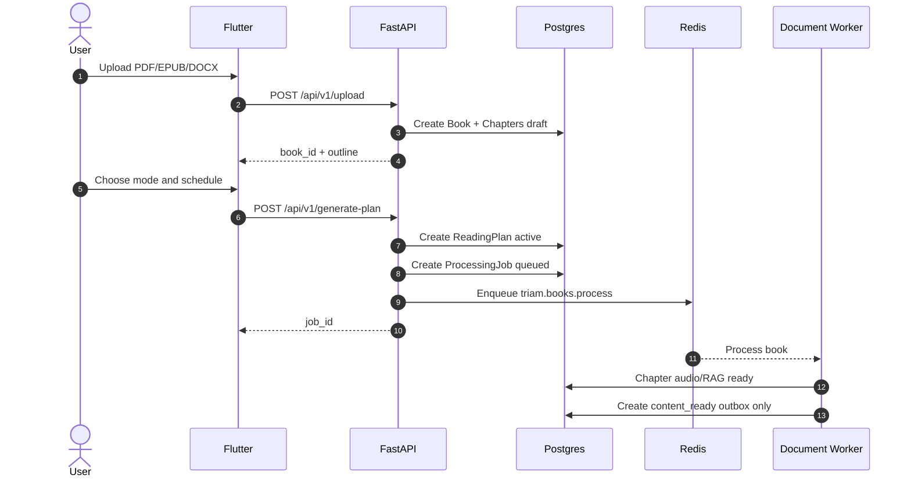
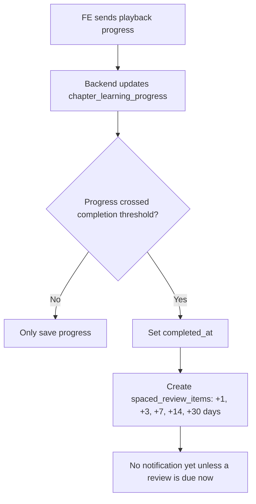
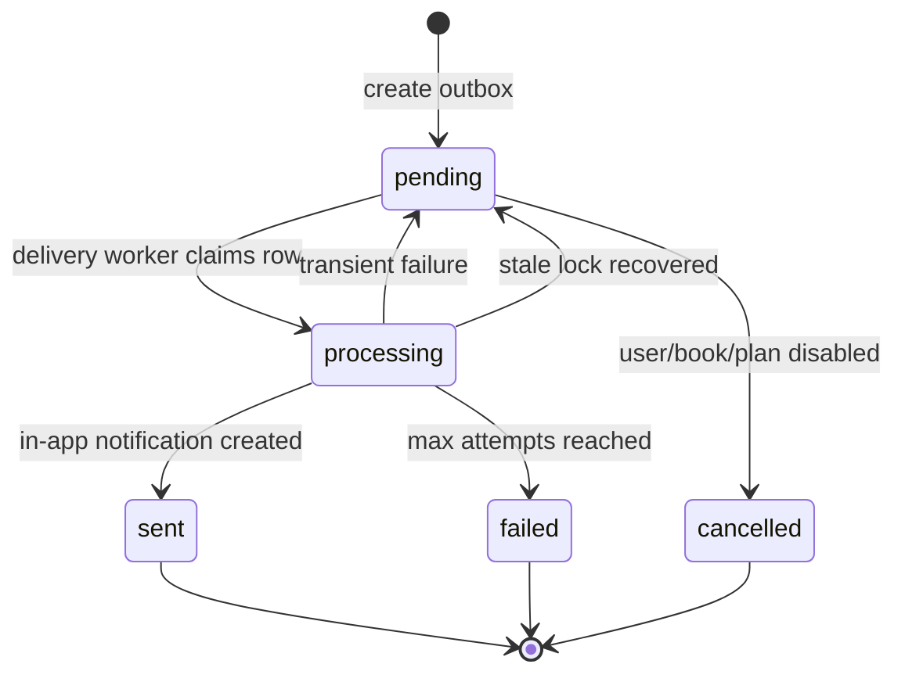
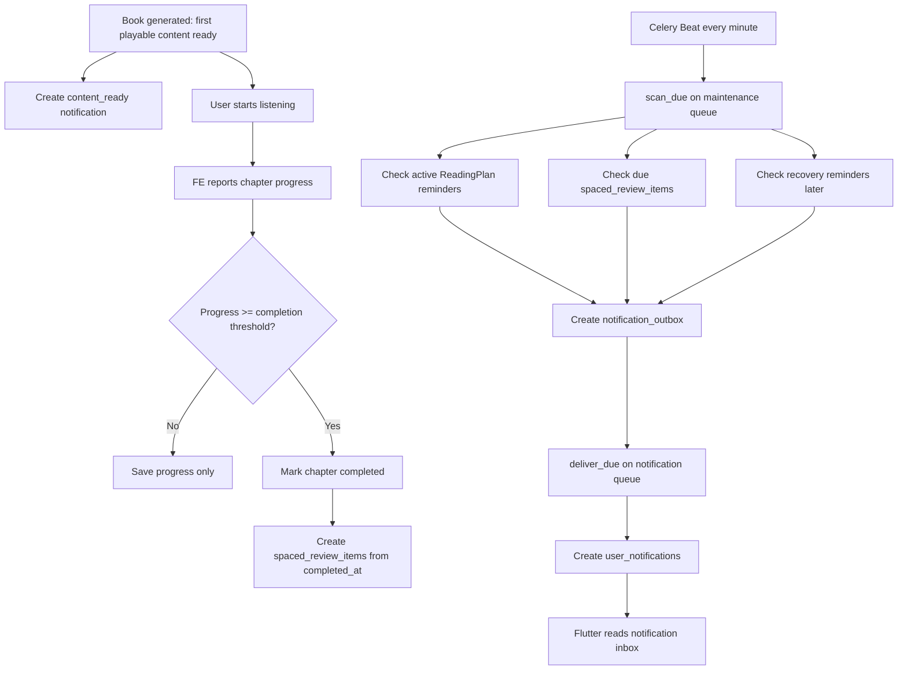

# Phase 4 Production Business Logic - Notification, Study Reminder, Spaced Review

Date: 2026-05-25  
Status: **Production business design, no source code change in this document**  
Audience: Backend developer, Flutter developer, capstone reviewer

---

## 1. Purpose

Phase 4 không nên được hiểu là "thêm notification cho có". Trong sản phẩm thật, Phase 4 là phần tạo **learning loop** cho TRIAM:

```text
User tạo kế hoạch học
-> hệ thống tạo nội dung nghe được
-> user học thật qua audio/text
-> backend ghi nhận tiến độ học
-> hệ thống nhắc user tiếp tục đúng lúc
-> hệ thống nhắc ôn tập sau khi user đã học xong
-> user quay lại học/ôn, không bỏ dở
```

Vì vậy business logic đúng phải dựa trên **hành vi học thật của user**, không chỉ dựa trên việc backend đã generate audio xong.

Nguyên tắc quan trọng nhất:

```text
Content ready != User learned.
Chapter generated != Chapter completed.
Spaced review must be anchored by user completion, not by generation time.
```

---

## 2. Current Phase 4.1 Reality

Code hiện tại đã làm tốt phần hạ tầng notification:

- Có `notification_settings` cho từng user.
- Có `notification_outbox` để lưu hàng đợi gửi notification bền vững trong Postgres.
- Có `user_notifications` là inbox cho FE.
- Có Celery Beat scan định kỳ.
- Có Celery task `scan_due` và `deliver_due`.
- Có quiet hours, timezone, daily cap.
- Có idempotency key để chống tạo trùng.
- Có stale-lock recovery để worker crash vẫn recover được.
- Có in-app notification API cho FE.

Nhưng logic học tập hiện tại chưa đạt production ở điểm này:

```text
spaced_review_items đang được tạo khi chapter/mode READY.
```

Điều này nghĩa là lịch ôn tập bắt đầu tính từ lúc backend xử lý xong chapter, dù user có thể chưa nghe chương đó.

Với sản phẩm thật, đây là logic sai về mặt học tập.

---

## 3. Production Target Logic

Phase 4 production phải tách 4 loại sự kiện:

| Event | Ý nghĩa | Có tạo spaced review không? |
| --- | --- | --- |
| `content_ready` | Backend đã tạo xong audio/review/RAG cho chapter/mode | Không |
| `study_due` | Đến lịch học theo reading plan | Không |
| `chapter_completed` | User đã thật sự học xong chapter | Có |
| `review_completed` | User đã hoàn thành một phiên ôn tập | Có thể dùng để cập nhật analytics sau |

Business rule chuẩn:

```text
content_ready chỉ báo user có nội dung mới để học.
plan_reminder chỉ kéo user quay lại học theo kế hoạch.
spaced_review_due chỉ được tạo sau khi user đã completed chapter.
```

---

## 4. Domain Objects

### 4.1 `notification_settings`

Vai trò:

```text
Lưu sở thích notification theo user.
```

Business fields:

| Field | Ý nghĩa |
| --- | --- |
| `user_id` | Setting thuộc user nào |
| `timezone` | Múi giờ dùng để tính ngày/giờ local |
| `reminders_enabled` | Bật/tắt nhắc học theo plan |
| `spaced_review_enabled` | Bật/tắt nhắc ôn tập |
| `reminder_time` | Giờ nhắc học mặc định |
| `quiet_hours_start/end` | Khung giờ không làm phiền |
| `daily_cap` | Giới hạn tổng notification/ngày |

Nhận định:

```text
Thiết kế hiện tại đúng.
```

Trade-off:

- Hiện tại `reminder_time` là global theo user.
- Production tốt hơn có thể cho từng `ReadingPlan` override `reminder_time`, nhưng chưa bắt buộc.

Recommendation:

```text
Giữ global setting trước.
Sau này nếu một user học nhiều sách với lịch khác nhau, thêm plan-level reminder_time.
```

---

### 4.2 `reading_plans`

Vai trò:

```text
Lưu ý định học của user cho một book.
```

Hiện tại:

| Field | Ý nghĩa |
| --- | --- |
| `book_id` | Plan thuộc book nào |
| `mode` | `full` hoặc `pareto` |
| `pace` | Nhịp học |
| `schedule_config` | Các ngày học user chọn |
| `status` | `active`, `inactive`, `error` |

Business rule production:

Một reading plan không chỉ dùng để generate audio. Nó phải trả lời được:

- User đang học sách nào?
- User chọn mode nào?
- User muốn học vào ngày nào?
- Hôm nay có phải ngày cần học không?
- User còn chapter nào chưa học không?
- User có đang bị trễ kế hoạch không?

Current gap:

```text
ReadingPlan chưa gắn chặt với learning progress.
```

Recommendation:

```text
Plan reminder phải dựa trên ReadingPlan + ChapterLearningProgress.
Không chỉ dựa vào Book partial_ready/ready.
```

### 4.2.1 Multiple Active Books And Non-overlapping Schedules

Production requirement:

```text
Một user có thể học nhiều sách cùng lúc.
Mỗi sách active có thể có lịch học riêng.
Các lịch active không nên trùng cùng một time slot.
Hệ thống có thể giới hạn số sách user đang học cùng lúc.
```

Definition:

```text
Active learning book = book có ReadingPlan active và chưa completed/archived.
Schedule slot = user_id + local_weekday + reminder_time.
```

Ví dụ:

```text
Book A: Monday 20:00
Book B: Monday 20:00
=> conflict, không cho tạo/sửa plan nếu cả hai đều active.

Book A: Monday 20:00
Book B: Tuesday 20:00
=> allowed.

Book A: Monday 20:00
Book B: Monday 21:00
=> allowed nếu product cho phép user học nhiều phiên trong cùng một ngày.
```

Recommended production schema:

```text
reading_plan_schedule_slots
  id
  user_id
  plan_id
  book_id
  weekday          -- 0-6 or Mon-Sun enum
  reminder_time    -- HH:MM
  timezone
  is_active
  created_at
  updated_at
```

Recommended constraints:

```text
unique(user_id, weekday, reminder_time)
where is_active = true
```

Why not rely only on `ReadingPlan.schedule_config` JSON:

```text
JSON is flexible but weak for production schedule conflict checks.
It is hard to enforce "no duplicate active slot" with a normal DB constraint.
```

Capstone-compatible path:

```text
Keep schedule_config for now.
Add service-level validation before creating/updating a plan.
Later normalize to reading_plan_schedule_slots before Push/Auth scale-up.
```

Active book limit:

```text
settings or subscription tier should define max_active_learning_books_per_user.
```

Example:

```text
Free user: 2 active books
Paid/student tier: 5-10 active books
Admin/internal: unlimited or configurable
```

Business reason:

- Prevent notification overload.
- Control background processing and storage cost.
- Keep user focus clear.

---

### 4.3 Proposed `chapter_learning_progress`

Đây là bảng còn thiếu để Phase 4 trở thành sản phẩm thật.

Vai trò:

```text
Lưu tiến độ học thật của user theo từng chapter/mode.
```

Suggested model:

```text
chapter_learning_progress
  id
  user_id
  book_id
  chapter_id
  mode
  current_segment_id
  last_segment_index
  position_ms
  listened_ms
  total_duration_ms
  progress_percent
  max_progress_percent
  status              -- not_started, in_progress, completed
  started_at
  last_activity_at
  completed_at
  created_at
  updated_at
```

Recommended unique constraint:

```text
unique(user_id, chapter_id, mode)
```

Granularity:

```text
Progress is stored at chapter level, but it must include segment-level resume data.
```

Meaning:

| Field | Purpose |
| --- | --- |
| `last_segment_index` | FE resumes from the correct segment |
| `current_segment_id` | Safer resume if segment order is ever reloaded |
| `position_ms` | FE resumes from the correct timestamp inside that segment |
| `listened_ms` | Backend estimates real listening effort |
| `total_duration_ms` | Denominator for progress calculation |
| `progress_percent` | Current chapter progress |
| `max_progress_percent` | Highest progress ever reached, useful for completion |
| `last_activity_at` | Used by plan/recovery reminders |

Completion rule:

```text
Chapter is completed when:
- progress_percent >= 80
OR user reaches the last segment and position is near the end
OR user manually marks chapter as completed
```

Why 80 percent:

- Audio users may skip intro/outro.
- Exact 100 percent is brittle on mobile players.
- 80 percent is common enough for "meaningful completion".

Trade-off:

| Option | Benefit | Problem |
| --- | --- | --- |
| Require 100 percent | Strict | Dễ không bao giờ complete vì player lệch vài giây |
| Use 50 percent | Dễ complete | Quá lỏng, ôn tập khi user chưa học đủ |
| Use 80 percent | Cân bằng | Vẫn cần FE gửi progress chính xác |

Recommendation:

```text
Use 80 percent threshold + manual complete button.
```

Important progress rule:

```text
Use max_progress_percent for completion.
Do not mark a completed chapter incomplete just because user seeks backward later.
```

Book-level progress:

```text
Book progress should be derived from chapter_learning_progress.
```

Recommended calculation:

```text
book_progress_percent =
  average progress of playable chapters in the selected mode
```

or:

```text
book_progress_percent =
  completed_chapters / playable_chapters
```

Decision:

```text
For UI progress bar: use average chapter progress.
For business completion: use completed_chapters / playable_chapters.
```

---

### 4.4 `spaced_review_items`

Vai trò production:

```text
Lưu từng mốc ôn tập sau khi user đã học xong một chapter.
```

Hiện tại:

```text
due_at = chapter_ready_at + interval_days
```

Production target:

```text
due_at = chapter_completed_at + interval_days
```

Recommended intervals:

```text
1, 3, 7, 14, 30 days
```

Correct creation trigger:

```text
When ChapterLearningProgress changes to completed:
  create spaced_review_items for that chapter/mode.
```

Incorrect trigger:

```text
When backend finishes generating chapter audio.
```

State meaning:

| Status | Meaning |
| --- | --- |
| `pending` | Review item exists but due time has not arrived |
| `due` | Notification has been created for this review item |
| `completed` | User opened/completed the review |
| `skipped` | User dismissed/skipped this review |
| `cancelled` | Item is no longer valid, for example plan disabled/deleted |

Current schema has:

```text
completed_at
review_text_snapshot
```

That is useful and should stay.

Production improvement fields:

```text
anchor_completed_at
source_progress_id
notified_at
last_reviewed_at
```

These are not mandatory for first production pass, but they make debugging and analytics much clearer.

---

## 5. Full Production Flow

### 5.1 Upload And Generate Plan



Important:

```text
At this point, do not create spaced_review_items yet.
```

---

### 5.2 Content Ready Notification

When a chapter becomes ready:

```text
Backend creates content_ready outbox.
```

Purpose:

```text
Tell user: "Nội dung đã sẵn sàng để nghe."
```

It should not mean:

```text
User has learned the chapter.
```

Production anti-spam rule:

If a book has many chapters, sending one content-ready notification per chapter can spam user.

Recommendation:

| Situation | Notification behavior |
| --- | --- |
| First playable chapter ready | Send one high-value `content_ready` |
| More chapters become ready while user is active | Do not notify each chapter |
| Whole book ready | Optionally send one `book_ready` or aggregate `content_ready` |

Current implementation:

```text
content-ready:<user_id>:<chapter_id>:<mode>
```

This is safe technically, but product should avoid too many chapter notifications.

Recommended production idempotency:

```text
content-ready:first-playable:<user_id>:<book_id>:<mode>
content-ready:book-ready:<user_id>:<book_id>:<mode>
```

Trade-off:

- Per-chapter notification gives detail but can spam.
- First-playable + book-ready gives cleaner UX.

Recommendation:

```text
Use first-playable + book-ready for production UX.
Keep per-chapter outbox only if FE has a specific chapter-ready UI need.
```

Final decision:

```text
Production default should send:
1. one `content_ready:first_playable` notification when the first useful audio is ready;
2. one `content_ready:book_ready` notification when the whole book/mode is ready.
```

Do not send a notification for every chapter by default.

---

### 5.3 User Learning Progress

FE audio player must report progress.

Suggested endpoint:

```text
PUT /api/v1/books/{book_id}/chapters/{chapter_id}/progress
```

Request:

```json
{
  "mode": "full",
  "segment_index": 3,
  "position_ms": 92000,
  "listened_ms": 410000,
  "total_duration_ms": 500000,
  "progress_percent": 82
}
```

Backend behavior:

```text
1. Validate user owns book.
2. Validate chapter belongs to the book and segment belongs to the chapter/mode.
3. Upsert chapter_learning_progress.
4. Save resume position: segment_index/current_segment_id + position_ms.
5. Update chapter progress and max_progress_percent.
6. Derive book-level progress from chapter progress.
7. If progress crosses completion threshold for first time:
   - set completed_at
   - create spaced_review_items anchored by completed_at
   - optionally create completion_message notification
```

Segment-level resume:

```text
Chapter progress is the business aggregate.
Segment index and position_ms are the playback resume state.
Both are required.
```

FE resume behavior:

```text
When user taps "Tiếp tục nghe":
1. FE calls book detail/progress endpoint.
2. Backend returns last chapter, last segment, position_ms.
3. FE starts the player at that segment and timestamp.
```

Progress reporting frequency:

```text
FE should report progress every 15-30 seconds,
on pause,
on segment change,
on app background,
and when chapter ends.
```

Do not send progress every second.

Idempotency:

```text
If FE sends progress repeatedly, backend must not create duplicate review items.
```

Recommended idempotency for review creation:

```text
review:<user_id>:<chapter_id>:<mode>:<interval_days>
```

---

### 5.4 Spaced Review Creation

Correct production flow:



Review item due time:

```text
due_at = completed_at + interval_days
```

If due time falls into quiet hours:

```text
The scanner shifts notification due_at to the next allowed local time.
```

Do not permanently corrupt the learning interval if only the notification is shifted. Store the learning due time separately later if analytics matters.

Recommended future distinction:

```text
review_due_at        = pedagogical due time
notification_due_at  = user-friendly delivery time after quiet-hour adjustment
```

Current schema only has `due_at`, so first implementation can use it as notification due time.

---

### 5.5 Plan Reminder

Plan reminder answers:

```text
Should we nudge user to continue learning today?
```

Production conditions:

```text
Create plan_reminder only if:
1. ReadingPlan is active.
2. User reminders_enabled is true.
3. Today local weekday is enabled by schedule_config.
4. Current local time >= reminder_time.
5. Book is partial_ready or ready.
6. There is at least one playable chapter not completed.
7. User has not already studied this book today.
8. The active plan schedule slot does not conflict with another active plan.
9. User has not exceeded max active learning books.
10. User is not inside quiet hours.
11. Daily cap is not exceeded.
12. Same plan reminder for this local date was not created before.
```

Current implementation covers:

- active plan
- user setting
- weekday
- reminder time
- book partial_ready/ready
- quiet hours
- daily cap
- idempotency by local date

Current gap:

```text
It does not check whether user already studied today.
It does not check chapter completion/progress because progress table does not exist yet.
It does not enforce active schedule-slot conflicts.
It does not enforce max active learning books.
```

Recommended idempotency:

```text
plan:<user_id>:<book_id>:<plan_id>:<local_date>
```

Current key:

```text
plan:<user_id>:<book_id>:<local_date>
```

This is acceptable while each book has only one active plan. If multiple active plans per book become possible, include `plan_id`.

Recommended "already studied today" check:

```text
Skip plan_reminder if chapter_learning_progress.last_activity_at
for this user/book/mode is within the current local day.
```

Recommended "has work to do" check:

```text
Only remind if there is at least one playable chapter in the plan mode
where progress status != completed.
```

Recommended conflict check:

```text
When creating/updating a ReadingPlan:
1. expand selected weekdays into schedule slots;
2. compare with active plans of the same user;
3. reject conflict with 409;
4. return the conflicting book/plan info so FE can show a useful message.
```

---

### 5.6 Recovery Reminder

Recovery reminder is different from plan reminder.

Plan reminder:

```text
"Hôm nay đến lịch học rồi."
```

Recovery reminder:

```text
"Bạn đã bỏ dở mấy ngày rồi, quay lại học tiếp nhé."
```

Production conditions:

```text
Create recovery_reminder only if:
1. Plan is active.
2. Book has playable uncompleted content.
3. User has not had learning activity for N days.
4. User is behind expected schedule.
5. No recovery reminder was sent recently.
6. User setting allows reminders.
7. Quiet hours and daily cap allow sending.
```

Required data:

```text
chapter_learning_progress.last_activity_at
reading_plans.schedule_config
book/chapter completion ratio
```

Recommended cooldown:

```text
Do not send more than one recovery reminder per book every 2-3 days.
```

This should not be implemented before learning progress exists.

---

### 5.7 Review Due Notification

Review due answers:

```text
Should user review knowledge they already learned?
```

Production conditions:

```text
Create spaced_review_due notification only if:
1. SpacedReviewItem status is pending.
2. due_at <= now.
3. User spaced_review_enabled is true.
4. User has completed the chapter that owns this review item.
5. Quiet hours and daily cap allow sending.
6. No outbox exists for this review item.
```

Important:

```text
Review notification should never be created for uncompleted chapters.
```

Current gap:

```text
Current code assumes review_item exists only for learned chapters.
But current creation trigger violates that assumption.
```

Therefore the correct fix is:

```text
Move review item creation from chapter READY to chapter COMPLETED.
```

---

## 6. Outbox And Inbox Logic

### 6.1 Why Keep Both Tables

`notification_outbox` is backend delivery state.

`user_notifications` is FE-visible inbox.

They may look 1-1 for in-app notifications, but they are not the same concept.

| Table | Owner | Purpose |
| --- | --- | --- |
| `notification_outbox` | Backend workers | retry, lock, due time, delivery status |
| `user_notifications` | Product/FE | unread badge, notification list, navigation |

Production rule:

```text
FE must never read notification_outbox directly.
Workers must never use user_notifications as their queue.
```

State flow:



### 6.2 Notification Priority

Production should not treat all notifications equally.

Recommended priority:

| Priority | Type | Daily cap behavior |
| --- | --- | --- |
| High | `content_ready:first_playable`, critical system messages | May bypass or reserve cap |
| Medium | `plan_reminder`, `spaced_review_due` | Counts toward daily cap |
| Low | `completion_message`, encouragement | Send only if cap available |
| Recovery | `recovery_reminder` | Strong cooldown, counts toward cap |

Current implementation:

```text
All notification types count the same.
```

Trade-off:

- Simpler code.
- But important content-ready notification may be blocked by low-value reminders.

Recommendation:

```text
Add priority later if notification volume grows.
For current capstone, daily_cap=3 is acceptable after fixing completion-based review.
```

---

## 7. Celery Tasks Production Meaning

### 7.1 `triam.notifications.scan_due`

Queue:

```text
maintenance
```

Business meaning:

```text
Periodic scanner that checks the database for due learning events.
```

It should:

```text
1. Recover stale outbox rows.
2. Scan due spaced review items.
3. Scan due plan reminders.
4. Later: scan recovery reminders.
5. Create notification_outbox rows idempotently.
6. Enqueue delivery if any due outbox exists.
```

It should not:

```text
Send notifications directly to FE/provider.
Call FCM directly.
Use Redis as source of truth.
Create review schedules for uncompleted chapters.
```

### 7.2 `triam.notifications.deliver_due`

Queue:

```text
notification
```

Business meaning:

```text
Delivery worker that turns due outbox rows into actual user notifications.
```

It should:

```text
1. Claim due pending outbox rows.
2. Lock them with worker_id and locked_at.
3. Deliver channel-specific notification.
4. For in_app: create user_notifications once.
5. Mark outbox sent.
6. Retry or fail cleanly on error.
```

It should not:

```text
Decide study schedule.
Create spaced review items.
Guess whether a user has learned a chapter.
```

---

## 8. Production Business Flow Diagram



---

## 9. Current Implementation Gap Analysis

| Area | Current status | Production issue | Required fix |
| --- | --- | --- | --- |
| Outbox architecture | Good | None major | Keep |
| In-app inbox | Good | None major | Keep |
| Settings | Good | Global setting only | Add plan-level override later if needed |
| Plan schedule | Too loose | JSON schedule cannot strongly prevent active slot conflicts | Add service validation now, normalize schedule slots later |
| Active learning limit | Missing | User can keep too many books active | Add max active learning books per user/tier |
| Plan reminder | Partially correct | Does not know if user already studied today | Add progress/activity check |
| Spaced review creation | Incorrect for production | Created at chapter READY | Create at chapter COMPLETED |
| Learning progress | Missing | Cannot know completion | Add `chapter_learning_progress` |
| Review completion | Missing | Cannot know if user actually reviewed | Add review complete endpoint |
| Recovery reminder | Missing | Cannot detect abandonment | Add after progress exists |
| Content-ready notification | Technically safe | Can spam per chapter | Aggregate first-playable/book-ready |
| Auth | Mock user | Cross-user production risk | Replace with real auth dependency |
| Push notification | Not implemented | No OS-level notification | Add FCM later as channel adapter |

---

## 10. Recommended Implementation Order

### Step 1 - Tighten Reading Plan Scheduling

Before improving reminders, define what an active learning schedule means.

Add service rules:

```text
1. One active plan per user/book/mode unless product explicitly allows multiple.
2. No duplicate active schedule slot for the same user.
3. Enforce max active learning books per user.
```

Capstone implementation can validate against `ReadingPlan.schedule_config`.

Production implementation should normalize to:

```text
reading_plan_schedule_slots
```

Expected API behavior:

```text
409 conflict if a new/updated plan overlaps another active plan slot.
409 conflict if max active learning books is reached.
```

### Step 2 - Add Learning Progress

Add:

```text
chapter_learning_progress
```

Add endpoint:

```text
PUT /api/v1/books/{book_id}/chapters/{chapter_id}/progress
GET /api/v1/books/{book_id}/learning-progress
```

Backend responsibilities:

- Upsert progress by user/chapter/mode.
- Store segment-level resume position.
- Calculate completion.
- Store `completed_at` only once.
- Derive book-level progress.
- Return current progress summary to FE.

### Step 3 - Move Spaced Review Creation

Remove production dependency:

```text
chapter READY -> create spaced_review_items
```

Replace with:

```text
chapter progress crosses completion threshold -> create spaced_review_items
```

Keep:

```text
chapter READY -> content_ready outbox
```

### Step 4 - Improve Content Ready Aggregation

Replace per-chapter content-ready spam with:

```text
first_playable_ready
book_ready
```

This is better UX for real users.

### Step 5 - Add Review Completion API

Add:

```text
POST /api/v1/reviews/{review_item_id}/complete
POST /api/v1/reviews/{review_item_id}/skip
```

Rules:

- Only owner can complete/skip.
- `completed_at` set once.
- Future analytics can use this for retention score.

### Step 6 - Improve Plan Reminder

Plan reminder should check:

```text
There is at least one playable uncompleted chapter.
User has not studied this book today.
Plan slot does not conflict with another active plan.
User is within active learning book limit.
```

This prevents annoying reminders after user already studied.

### Step 7 - Add Recovery Reminder

Only after progress exists:

```text
if user has uncompleted playable content
and last_activity_at older than threshold
and plan is active
and cooldown passed
then send recovery_reminder.
```

### Step 8 - Add Push Channel Later

After in-app logic is correct:

```text
notification_outbox channel = push
user_device_tokens
Firebase adapter
delivery receipt/error handling
```

Do not add push before learning logic is correct.

---

## 11. FE Contract For Production Phase 4

### 11.1 Playback Progress

FE must report progress during audio playback.

Recommended behavior:

```text
Send progress every 15-30 seconds,
on pause,
on segment change,
on app background,
and when chapter ends.
```

Do not send every second.

Reason:

- Saves battery.
- Reduces backend writes.
- Still accurate enough for learning logic.

Required payload semantics:

```text
segment_index/current_segment_id + position_ms = resume playback.
progress_percent/max_progress_percent = learning completion.
last_activity_at = reminder/recovery logic.
```

Recommended continue-listening response:

```json
{
  "book_id": "...",
  "mode": "full",
  "book_progress_percent": 42,
  "last_chapter_id": "...",
  "last_segment_index": 3,
  "position_ms": 92000,
  "chapter_progress_percent": 82
}
```

### 11.2 Reading Plan Schedule

FE should prevent obvious duplicate schedule slots before submit, but backend remains the source of truth.

If backend returns `409`, FE should show:

```text
Lịch học này đang trùng với sách khác. Hãy chọn ngày hoặc giờ khác.
```

If user exceeds active learning book limit, FE should show:

```text
Bạn đã đạt giới hạn số sách đang học. Hãy hoàn thành hoặc tạm dừng một sách trước.
```

### 11.3 Notification Inbox

Existing endpoints remain:

```text
GET /api/v1/notifications
PATCH /api/v1/notifications/{notification_id}/read
PATCH /api/v1/notifications/read-all
GET /api/v1/notifications/settings
PUT /api/v1/notifications/settings
```

FE navigation by `action_type`:

| Action | FE behavior |
| --- | --- |
| `open_book` | Open book detail/listening screen |
| `open_chapter` | Open specific chapter |
| `open_review` | Open review screen/audio |
| `open_thread` | Open chat thread |

### 11.4 Review UI

When user opens a review notification:

```text
FE opens review screen
-> user listens/reads review
-> FE calls complete/skip endpoint
```

This lets backend know the review was actually done.

---

## 12. Business Rules By Notification Type

### 12.1 `content_ready`

Purpose:

```text
Let user know learning content is available.
```

Trigger:

```text
First playable chapter ready
or whole book ready.
```

Not a learning completion event.

Do not create spaced review from this.

### 12.2 `plan_reminder`

Purpose:

```text
Help user follow their selected plan.
```

Trigger:

```text
Active plan + scheduled day + reminder time + uncompleted playable content.
```

Skip if:

- User already studied the book today.
- No playable content exists.
- Book is completed.
- User disabled reminders.
- Quiet hours/daily cap blocks it.

### 12.3 `spaced_review_due`

Purpose:

```text
Help user retain knowledge already learned.
```

Trigger:

```text
Review item due after chapter completion.
```

Skip if:

- Chapter was never completed.
- User disabled spaced review.
- Review item already completed/skipped/cancelled.
- Quiet hours/daily cap blocks it.

### 12.4 `recovery_reminder`

Purpose:

```text
Bring user back after inactivity.
```

Trigger:

```text
User is behind plan or inactive for N days.
```

Requires:

```text
chapter_learning_progress.last_activity_at
```

Do not implement before progress tracking.

### 12.5 `completion_message`

Purpose:

```text
Give positive feedback after user completes chapter/book.
```

Trigger:

```text
Chapter/book completion by user action/progress.
```

Do not trigger when backend only generated content.

---

## 13. Mode Logic: Full And Pareto

Current schema has review items unique by:

```text
user_id, chapter_id, mode, interval_days
```

This means user can theoretically get two review chains:

```text
chapter 1 full review
chapter 1 pareto review
```

Production decision needed.

### Option A - Review Per Mode

Behavior:

```text
Completing full creates full review chain.
Completing pareto creates pareto review chain.
```

Benefit:

- Accurate if full/pareto are treated as different learning experiences.

Trade-off:

- User may receive duplicate review reminders for the same chapter.

### Option B - One Review Chain Per Chapter

Behavior:

```text
First completed mode creates review chain.
Later mode switch updates preferred review mode but does not duplicate reminders.
```

Benefit:

- Better UX, less spam.

Trade-off:

- Slightly less precise if user wants separate full/pareto mastery.

Recommendation:

```text
For TRIAM production UX, use one active review chain per user/chapter.
Store mode as preferred_review_mode or source_mode.
Do not send duplicate review reminders for full and pareto unless user explicitly chooses separate tracks.
```

Capstone-compatible implementation:

```text
Keep current mode column,
but before creating review items, check if active review items already exist for user/chapter in any mode.
If yes, do not create another chain automatically.
```

---

## 14. Trade-offs And Decisions

| Problem | Option | Decision |
| --- | --- | --- |
| When to create spaced reviews? | On chapter ready vs on user completion | Use user completion |
| How to know completion? | FE progress vs backend audio logs | FE progress endpoint |
| Completion threshold | 100 percent vs 80 percent | 80 percent + manual complete |
| Content-ready notifications | Per chapter vs aggregate | First playable + book ready |
| Review per mode | Per mode vs per chapter | One active chain per chapter by default |
| Multiple active books | Unlimited vs capped | Cap active learning books by tier/settings |
| Schedule conflict | Flexible overlap vs non-overlap | Reject duplicate active schedule slot |
| Progress granularity | Chapter only vs segment resume + chapter aggregate | Store segment resume and chapter aggregate |
| Reminder time | Global setting vs per plan | Global first, plan override later |
| Notification delivery | Direct API vs outbox | Keep outbox |
| Scheduler | Celery ETA vs Beat scan DB | Keep Beat scan DB |
| Source of truth | Redis vs Postgres | Postgres |
| Push notification | Add now vs later | Later after logic is correct |

---

## 15. Definition Of Done For Production Phase 4

Phase 4 production is done when:

```text
1. User progress is tracked per chapter/mode.
2. Segment resume position is stored for continue-listening UX.
3. Book-level progress can be derived from chapter progress.
4. Chapter completion is detected reliably.
5. Spaced review items are created only after completion.
6. Active reading plans do not have duplicate schedule slots.
7. User active learning book limit is enforced.
8. Plan reminders skip users who already studied today.
9. Review notifications are never sent for uncompleted chapters.
10. User can complete/skip review items.
11. Outbox/inbox flow remains idempotent.
12. Quiet hours, timezone and daily cap are respected.
13. FE has a clear contract for progress/reporting/review actions.
14. Tests prove no duplicate reminders and no premature review.
```

Required test cases:

- User cannot create two active plans with the same local weekday/reminder_time slot.
- User cannot exceed max active learning books.
- FE progress stores segment index and position for resume.
- User has generated chapter but no progress: no spaced review items.
- User listens 50 percent: no spaced review items.
- User listens 82 percent: review items created once.
- FE sends completion progress twice: no duplicate review items.
- Due review item creates one outbox.
- Scanner runs twice: no duplicate outbox.
- Delivery retries: no duplicate user notification.
- User already studied today: plan reminder skipped.
- Quiet hours shift notification.
- Daily cap blocks low/medium priority notifications.

---

## 16. Senior Recommendation

Anh khuyến nghị mình giữ phần hạ tầng Phase 4.1 đã làm:

```text
notification_settings
notification_outbox
user_notifications
Celery Beat scan_due
Celery deliver_due
quiet hours
daily cap
idempotency
```

Nhưng phải đổi business anchor:

```text
From:
chapter READY -> spaced_review_items

To:
chapter COMPLETED by user -> spaced_review_items
```

Đây là thay đổi quan trọng nhất để Phase 4 không chỉ "chạy được", mà còn đúng logic học tập thật.

Nếu chỉ có thời gian implement một phần cho capstone, thứ tự ưu tiên nên là:

```text
1. Tighten ReadingPlan schedule conflict and active book limit.
2. Add chapter_learning_progress with segment resume fields.
3. Move spaced review creation to chapter completion.
4. Aggregate content-ready notifications into first-playable/book-ready.
5. Add review complete/skip endpoint.
6. Improve plan reminder with progress and "already studied today" checks.
```

Những phần như recovery reminder, push notification, priority notification có thể đi sau vì chúng phụ thuộc vào progress data và không nên làm trước khi logic ôn tập đã đúng.
