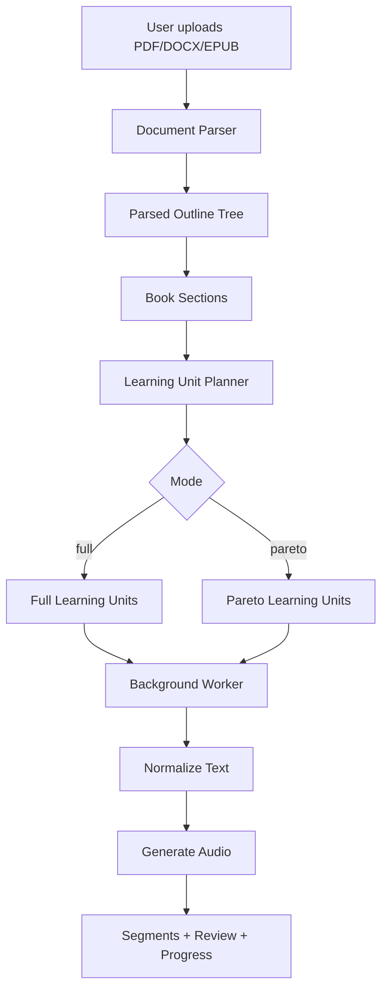

# Phase 5 Implementation Guide - Document Structure Tree And Learning Unit Planner

Date: 2026-05-27  
Status: **Implementation plan only, not source code yet**  
Depends on: Phase 1 -> Phase 4.2, current upload/parser/audio pipeline  
Audience: Backend developer, Flutter developer, capstone reviewer

---

## 1. Goal

Phase 5 sửa một lỗi business lớn trong hệ thống hiện tại:

```text
Backend đang gọi mọi outline item là "chapter/chương".
Thực tế nhiều item chỉ là đề mục, mục con hoặc tiểu mục.
```

Ví dụ trong tài liệu logic:

```text
Khái niệm mệnh đề và chân trị
Phân loại
Các phép toán mệnh đề
Phép tuyển
Phép hoặc
Phép kéo theo
...
```

Các dòng này không phải 93 chương. Đây là 93 **đề mục** trong một hoặc vài chương lớn.

Phase 5 chuyển hệ thống từ mô hình cũ:

```text
Document -> flat list chapters -> audio per item
```

sang mô hình đúng hơn:

```text
Document -> outline tree -> source sections -> learning units -> audio/review/progress
```

Trong đó:

- `source section`: đề mục gốc trong tài liệu.
- `learning unit`: đơn vị học/nghe thật sự trong ứng dụng.
- `full mode`: tạo learning unit theo chương lớn hoặc cụm mục hợp lý.
- `pareto mode`: tạo learning unit trọng tâm bằng cách gom các mục nhỏ liên quan.

---

## 2. Current Problem

### 2.1 Parser hiện tại đang flatten outline

Hiện tại:

- `app/services/pdf_service.py`
  - đọc PDF outline bằng `pypdf`;
  - gặp nested list thì parse tiếp;
  - sau đó sort theo page;
  - không giữ `level`, `parent`, `children`.

- `app/services/docx_service.py`
  - gặp `Heading 1`, `Heading 2`, `Heading 3` đều tạo một item ngang hàng;
  - không giữ quan hệ cha-con.

- `app/services/epub_service.py`
  - EPUB TOC có thể nested;
  - code hiện flatten toàn bộ.

Kết quả:

```text
Mục lục có 93 đề mục -> backend tạo 93 "chapters"
```

### 2.2 Hậu quả với product

| Vấn đề | Hậu quả |
| --- | --- |
| Gọi sai đề mục thành chương | UI hiển thị "93 chương" gây sai hiểu |
| Full mode xử lý quá vụn | Audio bị ngắn, rời rạc, không giống học theo chương |
| Pareto mode chỉ tóm tắt từng đề mục | Không gom ý, chưa đúng tinh thần 80/20 |
| Progress theo item nhỏ | User thấy quá nhiều mục đang xử lý |
| Cost/latency cao | Nhiều LLM/TTS call nhỏ không cần thiết |

---

## 3. Final Direction

### 3.1 Rule quan trọng

Không dùng LLM để đoán cấu trúc gốc trước.

Thứ tự đúng:

```text
1. Parser deterministic đọc cấu trúc thật từ PDF/DOCX/EPUB.
2. Backend build outline tree.
3. Backend tạo learning units bằng rule rõ ràng.
4. LLM chỉ hỗ trợ pareto planner hoặc rewrite nội dung, không thay parser.
```

Lý do:

- Parser phải có tính ổn định, test được.
- LLM có thể hỗ trợ gom nhóm, nhưng không nên là nguồn sự thật duy nhất.
- FE cần preview cấu trúc trước khi user bấm generate.

### 3.2 Đổi thuật ngữ

Trong backend và tài liệu FE nên phân biệt:

| Thuật ngữ | Ý nghĩa |
| --- | --- |
| `Book` | Tài liệu/sách user upload |
| `BookSection` | Đề mục/mục con lấy từ outline gốc |
| `LearningUnit` | Bài học/bài nghe được tạo ra từ một hoặc nhiều section |
| `Full Learning Unit` | Bài nghe đầy đủ, thường theo chương lớn |
| `Pareto Learning Unit` | Bài học trọng tâm, gom các section quan trọng |

UI không nên ghi:

```text
93 chương
```

Nên ghi:

```text
93 đề mục
```

hoặc:

```text
Cấu trúc tài liệu: 93 mục
```

Khi đã generate xong, player nên hiển thị:

```text
12 bài nghe
```

hoặc:

```text
8 bài học trọng tâm
```

---

## 4. Target Architecture



Layer ownership:

| Layer | File đề xuất | Trách nhiệm |
| --- | --- | --- |
| Parser | `pdf_service.py`, `docx_service.py`, `epub_service.py` | Đọc outline/tree + text |
| Structure model | `document_structure_service.py` | Build tree, validate, normalize section metadata |
| Planner | `learning_unit_planner_service.py` | Tạo learning units cho full/pareto |
| Repository | `book_section_repo.py`, `learning_unit_repo.py` | DB read/write |
| Worker | `book_pipeline.py`, `learning_unit_worker.py` | Xử lý audio/RAG/progress |
| API | `upload.py`, `audiobooks.py`, `jobs.py` | Thin route, gọi service |

---

## 5. Database Design

### 5.1 Best-practice target schema

Nên thêm bảng mới thay vì tiếp tục ép bảng `chapters` chứa cả đề mục và bài nghe.

#### `book_sections`

Lưu cây mục lục gốc của tài liệu.

```python
class BookSection(SQLModel, table=True):
    __tablename__ = "book_sections"

    id: uuid.UUID = Field(default_factory=uuid.uuid4, primary_key=True)
    book_id: uuid.UUID = Field(foreign_key="books.id", index=True)
    parent_id: uuid.UUID | None = Field(default=None, foreign_key="book_sections.id")

    section_index: int
    title: str
    level: int
    path: str

    text_content: str | None = None
    text_char_count: int = 0
    page_start: int | None = None
    page_end: int | None = None
    source_href: str | None = None
    source_anchor: str | None = None

    created_at: datetime
    updated_at: datetime

    __table_args__ = (
        UniqueConstraint("book_id", "section_index", name="uq_book_sections_book_index"),
    )
```

Ý nghĩa:

- `level`: cấp mục lục, ví dụ `1`, `2`, `3`.
- `parent_id`: quan hệ cha-con.
- `path`: đường dẫn đọc được, ví dụ `1`, `1.2`, `1.2.3`.
- `text_content`: text thuộc section đó.

Trade-off:

- Lưu text trong DB giúp worker không cần parse lại file, giảm lỗi lệch upload/generate.
- Tốn dung lượng DB hơn.
- Với capstone và file giới hạn 50MB, lưu text trong DB là hợp lý.
- Nếu scale lớn, có thể chuyển `text_content` sang object storage.

#### `learning_units`

Lưu bài học/bài nghe thật sự.

```python
class LearningUnit(SQLModel, table=True):
    __tablename__ = "learning_units"

    id: uuid.UUID = Field(default_factory=uuid.uuid4, primary_key=True)
    user_id: uuid.UUID = Field(index=True)
    book_id: uuid.UUID = Field(foreign_key="books.id", index=True)

    mode: PlanMode
    unit_index: int
    title: str
    unit_type: str  # full_chapter | full_group | pareto_focus

    status: ProcessingJobStatus
    source_text_char_count: int = 0
    estimated_tokens: int = 0
    estimated_audio_seconds: int = 0
    planner_reason: str | None = None

    created_at: datetime
    updated_at: datetime

    __table_args__ = (
        UniqueConstraint("book_id", "mode", "unit_index", name="uq_learning_units_book_mode_index"),
    )
```

#### `learning_unit_sources`

Mapping một bài học lấy nội dung từ những section nào.

```python
class LearningUnitSource(SQLModel, table=True):
    __tablename__ = "learning_unit_sources"

    learning_unit_id: uuid.UUID = Field(foreign_key="learning_units.id", primary_key=True)
    section_id: uuid.UUID = Field(foreign_key="book_sections.id", primary_key=True)
    source_order: int
```

#### `learning_unit_segments`

Best practice là tạo bảng mới thay cho `chapter_segments`.

```python
class LearningUnitSegment(SQLModel, table=True):
    __tablename__ = "learning_unit_segments"

    id: int | None = Field(default=None, primary_key=True)
    learning_unit_id: uuid.UUID = Field(foreign_key="learning_units.id", index=True)
    segment_index: int
    audio_url: str | None = None
    text_content: str | None = None
    duration_ms: int | None = None

    __table_args__ = (
        UniqueConstraint("learning_unit_id", "segment_index", name="uq_learning_unit_segments_unit_index"),
    )
```

### 5.2 Migration strategy

Vì đây là đổi mô hình lớn, có 2 lựa chọn:

| Option | Ưu điểm | Nhược điểm |
| --- | --- | --- |
| Reset data | Nhanh, sạch, dễ làm đúng | Mất dữ liệu demo cũ |
| Migrate từ `chapters` sang `book_sections` | Giữ dữ liệu cũ | Khó vì dữ liệu cũ đã flatten, không có level/parent |

Recommendation:

```text
Nếu dự án capstone cho phép reset data, chọn reset.
```

Lý do: dữ liệu cũ đang sai nghĩa, migrate sẽ chỉ chuyển lỗi sang schema mới.

---

## 6. Parser Design

### 6.1 Shared DTO

Tạo file:

```text
app/schemas/document_structure.py
```

hoặc nếu chỉ dùng nội bộ:

```text
app/services/document_structure_types.py
```

DTO đề xuất:

```python
@dataclass(frozen=True)
class ParsedSection:
    title: str
    level: int
    order_index: int
    path: str
    text: str
    page_start: int | None = None
    page_end: int | None = None
    source_href: str | None = None
    source_anchor: str | None = None
    children: list["ParsedSection"] = field(default_factory=list)
```

Không trả về dict tự do nếu có thể tránh được. Dùng dataclass/Pydantic để test và refactor an toàn hơn.

### 6.2 PDF parser

Hiện tại PDF outline bị flatten. Cần parse recursive và giữ level.

Pseudo-code:

```python
def parse_pdf_outline_tree(reader: PdfReader) -> list[OutlineNode]:
    def walk(items, level: int, parent_path: list[int]):
        result = []
        sibling_index = 0
        for item in items:
            if isinstance(item, list):
                if result:
                    result[-1].children = walk(item, level + 1, result[-1].path_parts)
                continue

            sibling_index += 1
            node = OutlineNode(
                title=item.title,
                level=level,
                path_parts=[*parent_path, sibling_index],
                page_index=reader.get_destination_page_number(item),
            )
            result.append(node)
        return result

    return walk(reader.outline, level=1, parent_path=[])
```

Text extraction rule for PDF:

- PDF outline cho biết bookmark nằm ở page nào.
- PDF không luôn cho biết vị trí heading chính xác trong trang.
- Vì vậy text range là best-effort.

Rule đề xuất:

```text
Leaf section text = từ page_start của section đến trước page_start của section kế tiếp theo document order.
Parent section text = tổng text của subtree children, cộng phần intro nếu detect được.
```

Trade-off:

- Nếu nhiều mục bắt đầu cùng một trang, text có thể chưa chia thật chính xác.
- Đây là giới hạn tự nhiên của PDF outline.
- Không nên dùng regex đoán chương nếu product vẫn giữ rule "outline chuẩn".

### 6.3 DOCX parser

DOCX là định dạng dễ làm đúng hơn PDF vì có Heading levels.

Rule:

- `Heading 1` hoặc outline level 0 -> level 1.
- `Heading 2` hoặc outline level 1 -> level 2.
- `Heading 3` hoặc outline level 2 -> level 3.
- Paragraph thường được gắn vào heading hiện tại gần nhất.

Pseudo-code:

```python
current_stack: list[ParsedSectionBuilder] = []

for paragraph in document.paragraphs:
    if is_heading(paragraph):
        level = get_heading_level(paragraph)
        pop stack until parent level < current level
        create new node
        attach to parent if exists
        push node
    else:
        append paragraph text to current_stack[-1].own_text
```

Best practice:

- Không hard-code chỉ `Heading 1/2/3`.
- Có thể support đến level 6.
- Đọc `w:outlineLvl` nếu style name bị localize.

### 6.4 EPUB parser

EPUB TOC thường đã là cây.

Rule:

- Giữ nested TOC.
- Lưu `href` và anchor nếu có.
- Nếu một HTML file chứa nhiều anchors, cố gắng lấy text theo anchor.
- Nếu không lấy được anchor chính xác, fallback trong cùng file nhưng log warning.

Không bỏ nested TOC như hiện tại.

---

## 7. Structure Normalization

Tạo service:

```text
app/services/document_structure_service.py
```

Trách nhiệm:

1. Flatten tree thành DFS list để lưu DB.
2. Gán `section_index`.
3. Gán `path`.
4. Validate level không nhảy bất thường.
5. Tính `text_char_count`.
6. Detect top-level learning roots.

### 7.1 Validate outline quality

Nếu outline quá lộn xộn, không nên cố xử lý sai.

Rules đề xuất:

```text
- Có ít nhất 1 section có text.
- Không quá 300 sections trong một book ở bản capstone.
- Không quá 6 levels.
- Ít nhất 60% sections có text hoặc có children có text.
- Nếu toàn bộ section đều level 1 và quá nhiều item nhỏ, báo "tài liệu có outline phẳng".
```

Với outline phẳng nhưng hợp lệ, có thể có 2 hướng:

| Hướng | Khi dùng |
| --- | --- |
| Báo lỗi 422 | Khi cần chất lượng chắc chắn |
| Cho user xác nhận gom tự động | Khi muốn UX mềm hơn |

Recommendation hiện tại:

```text
Không reject ngay outline phẳng.
Cho backend gom tự động theo token/title pattern và hiển thị preview cho FE.
```

Lý do: nhiều tài liệu thật chỉ có bookmark phẳng dù nội dung vẫn học được.

---

## 8. Learning Unit Planner

Tạo service:

```text
app/services/learning_unit_planner_service.py
```

Input:

```text
book_sections tree
mode
token/audio limits
```

Output:

```text
learning_units
learning_unit_sources
estimate metadata
```

### 8.1 Full mode planner

Goal:

```text
Giữ đầy đủ nội dung, nhưng gom theo chương lớn/cụm lớn để audio không vụn.
```

Algorithm đề xuất:

1. Tìm chapter roots:
   - ưu tiên level 1 sections;
   - title có pattern như `Chương`, `Chapter`, `Phần`, `Bài`;
   - nếu không có, dùng level thấp nhất có số lượng hợp lý.

2. Gom subtree của mỗi root thành một learning unit.

3. Nếu unit quá dài:
   - split theo children cấp dưới;
   - không split giữa đoạn văn.

4. Nếu unit quá ngắn:
   - merge với sibling liền kề cùng parent;
   - giữ max token/audio limit.

Pseudo-code:

```python
def plan_full_units(book_sections):
    roots = detect_learning_roots(book_sections)
    units = []
    for root in roots:
        source_sections = collect_leaf_sections(root)
        if estimate(source_sections) > FULL_UNIT_MAX_TOKENS:
            units.extend(split_large_root(root))
        else:
            units.append(make_unit(root.title, source_sections))
    return merge_tiny_units(units)
```

Config đề xuất:

```python
FULL_UNIT_TARGET_TOKENS = 5000
FULL_UNIT_MAX_TOKENS = 12000
MIN_UNIT_TOKENS = 300
```

### 8.2 Pareto mode planner

Goal:

```text
Không tóm tắt đều mọi mục.
Tạo ít bài học trọng tâm, gom các mục liên quan, giữ phần tạo nhiều giá trị học nhất.
```

Pareto planner nên chạy 2 bước:

#### Step A - Deterministic candidate grouping

Backend tạo danh sách candidate groups từ tree:

```text
level 1/root groups
important level 2 groups
short adjacent groups
```

Mỗi candidate có:

```json
{
  "candidate_id": "c1",
  "title": "Các phép toán mệnh đề",
  "section_ids": ["..."],
  "outline_path": "1.3",
  "estimated_tokens": 4200,
  "children_titles": ["Phép tuyển", "Phép hoặc", "Phép kéo theo"]
}
```

#### Step B - LLM assisted Pareto selection

Gửi cho LLM:

- outline tree rút gọn;
- title;
- level;
- token estimate;
- 1-2 câu preview mỗi section, không gửi toàn bộ text nếu sách lớn.

LLM trả JSON:

```json
{
  "units": [
    {
      "title": "Nền tảng logic mệnh đề",
      "source_section_paths": ["1.1", "1.2"],
      "reason": "Hai mục này là nền tảng để hiểu các phép toán logic.",
      "priority": "high"
    },
    {
      "title": "Các phép toán logic quan trọng",
      "source_section_paths": ["1.3", "1.3.1", "1.3.2", "1.3.3"],
      "reason": "Đây là nhóm kiến thức có tần suất sử dụng cao nhất."
    }
  ]
}
```

Validation bắt buộc:

```text
- Mỗi source_section_path phải tồn tại.
- Không tạo unit rỗng.
- Không vượt max unit tokens.
- Không tạo quá nhiều units.
- Nếu LLM output lỗi, fallback sang deterministic pareto planner.
```

Fallback deterministic Pareto:

```text
Chọn các root/section có nhiều children, nhiều text, title mang tính khái niệm/quy trình/công thức.
Merge adjacent small sections.
Limit khoảng 30-50% tổng tokens.
```

Config đề xuất:

```python
PARETO_MAX_UNITS = 8
PARETO_TARGET_COVERAGE_RATIO = 0.4
PARETO_UNIT_TARGET_TOKENS = 3000
PARETO_UNIT_MAX_TOKENS = 8000
```

---

## 9. Upload Flow After Phase 5

Current:

```text
upload -> parse chapters -> create Book + Chapter rows
```

Target:

```text
upload
-> parse document structure tree
-> validate tree
-> create Book
-> create BookSection rows
-> return outline tree preview
```

Response đề xuất:

```json
{
  "book_id": "uuid",
  "document_type": "pdf",
  "total_sections": 93,
  "max_depth": 3,
  "outline_tree": [
    {
      "id": "uuid",
      "title": "Chương 1. Logic mệnh đề",
      "level": 1,
      "path": "1",
      "children": [
        {
          "id": "uuid",
          "title": "Khái niệm mệnh đề và chân trị",
          "level": 2,
          "path": "1.1"
        }
      ]
    }
  ],
  "warnings": [
    "Tài liệu có nhiều đề mục nhỏ. Hệ thống sẽ gom thành bài nghe lớn khi tạo kế hoạch."
  ]
}
```

FE copy:

```text
Tài liệu có 93 đề mục. TRIAM sẽ gom các đề mục liên quan thành bài nghe khi tạo kế hoạch.
```

Không ghi:

```text
93 chương
```

---

## 10. Generate Plan Flow After Phase 5

Current:

```text
generate-plan -> create ReadingPlan -> enqueue process chapters
```

Target:

```text
generate-plan
-> create ReadingPlan
-> create LearningUnits for selected mode
-> create ProcessingJob total_units = learning_units count
-> enqueue process learning units
```

Response đề xuất:

```json
{
  "book_id": "uuid",
  "job_id": "uuid",
  "mode": "pareto",
  "status": "queued",
  "progress_percent": 0,
  "planned_units": [
    {
      "unit_index": 0,
      "title": "Nền tảng logic mệnh đề",
      "source_section_count": 3,
      "estimated_audio_seconds": 420
    }
  ]
}
```

---

## 11. Worker Flow After Phase 5

Worker không xử lý `Chapter` nữa. Worker xử lý `LearningUnit`.

```text
process_learning_unit
-> load source sections
-> concatenate source text in source_order
-> embed raw source sections if needed
-> normalize text for speech
-> generate TTS segments
-> store learning_unit_segments
-> mark learning_unit READY
```

RAG rule:

```text
Embed raw source sections once per book.
Không cần embed lại khi switch full/pareto.
```

Audio rule:

```text
Audio phụ thuộc mode và learning unit.
Full và pareto có segment riêng.
```

Progress rule:

```text
job total_units = learning_units count
done_units = ready learning units
partial_ready = first learning unit ready
```

---

## 12. API Compatibility Plan

### 12.1 Short-term compatibility

Để FE không vỡ toàn bộ ngay, backend có thể giữ endpoint cũ nhưng đổi meaning response:

```text
GET /api/v1/books/{book_id}/details
```

Trả về:

```json
{
  "units": [
    {
      "id": "learning_unit_id",
      "title": "Nền tảng logic mệnh đề",
      "unit_index": 0,
      "mode": "pareto",
      "segments": []
    }
  ],
  "outline_tree": []
}
```

Nếu FE hiện tại đang dùng field `chapters`, có thể tạm giữ alias:

```json
{
  "chapters": [
    {
      "id": "learning_unit_id",
      "title": "Nền tảng logic mệnh đề"
    }
  ]
}
```

Nhưng trong doc FE phải ghi rõ:

```text
chapters field hiện là backward-compatible alias cho learning units.
FE mới nên dùng units.
```

### 12.2 Long-term endpoint

Nên thêm:

```text
GET /api/v1/books/{book_id}/outline
GET /api/v1/books/{book_id}/learning-units?mode=full|pareto
GET /api/v1/books/{book_id}/learning-progress?mode=full|pareto
```

---

## 13. Clean Code Rules For Phase 5

1. Parser không ghi DB.
2. Parser không gọi LLM.
3. Parser không quyết định pareto/full.
4. Planner không đọc file.
5. Worker không tự parse lại document nếu `book_sections` đã có text.
6. Repository chỉ read/write DB.
7. Service raise domain exceptions, không raise `HTTPException`.
8. Không log raw text tài liệu.
9. Không dùng string `"chapter"` cho đề mục mới.
10. Test parser bằng fixtures nhỏ trước khi test production file thật.

---

## 14. Implementation Steps

### Step 1 - Add document structure DTO

Files:

```text
app/services/document_structure_types.py
tests/test_document_structure_types.py
```

Add:

- `ParsedSection`
- `ParsedDocument`
- helper `flatten_sections`
- helper `max_depth`

### Step 2 - Refactor parser output

Files:

```text
app/services/pdf_service.py
app/services/docx_service.py
app/services/epub_service.py
app/services/document_parser_service.py
```

Add new functions:

```python
async def parse_pdf_structure(file_obj) -> ParsedDocument
async def parse_docx_structure(file_obj) -> ParsedDocument
async def parse_epub_structure(file_obj) -> ParsedDocument
async def parse_document_structure(file_obj, document_type: str) -> ParsedDocument
```

Keep old functions temporarily:

```python
extract_pdf_chapters
extract_docx_chapters
extract_epub_chapters
```

but mark as deprecated in comments.

### Step 3 - Add DB models and migration

Files:

```text
app/models/db_models.py
app/db/migrations/versions/<revision>_phase_5_document_structure_learning_units.py
```

Add:

- `BookSection`
- `LearningUnit`
- `LearningUnitSource`
- `LearningUnitSegment`

Optional if doing full rename:

- `LearningUnitProgress` instead of `ChapterLearningProgress`
- `LearningUnitReviewItem` instead of chapter-based review

Recommendation:

```text
Add new tables first.
Do not rename old tables in the same migration.
After FE migrates, deprecate old chapter endpoints.
```

### Step 4 - Write repositories

Files:

```text
app/repositories/book_section_repo.py
app/repositories/learning_unit_repo.py
app/repositories/learning_unit_segment_repo.py
```

Functions:

```python
def create_book_sections(session, book_id, parsed_document) -> list[BookSection]
def list_book_sections_tree(session, book_id) -> list[BookSection]
def create_learning_units(session, user_id, book_id, mode, planned_units) -> list[LearningUnit]
def list_learning_units(session, book_id, mode) -> list[LearningUnit]
def update_learning_unit_status(session, unit_id, status, error_message=None) -> None
```

### Step 5 - Add structure service

File:

```text
app/services/document_structure_service.py
```

Functions:

```python
def validate_document_structure(parsed: ParsedDocument) -> None
def build_outline_preview(parsed: ParsedDocument) -> list[dict]
def detect_structure_warnings(parsed: ParsedDocument) -> list[str]
```

### Step 6 - Add learning unit planner

File:

```text
app/services/learning_unit_planner_service.py
```

Functions:

```python
def plan_full_learning_units(sections: list[BookSection]) -> list[PlannedLearningUnit]
async def plan_pareto_learning_units(sections: list[BookSection]) -> list[PlannedLearningUnit]
def fallback_pareto_learning_units(sections: list[BookSection]) -> list[PlannedLearningUnit]
```

Important:

```text
Pareto planner must validate LLM output.
If invalid, fallback deterministic.
```

### Step 7 - Refactor upload service

File:

```text
app/services/upload_service.py
```

Change:

```text
extract_chapters_by_type
```

to:

```text
parse_document_structure
```

Upload returns:

- `total_sections`
- `max_depth`
- `outline_tree`
- `warnings`

### Step 8 - Refactor generate plan service

File:

```text
app/services/upload_service.py
```

Current `handle_generate_plan` creates `ReadingPlan` and job.

Add:

```text
create learning units before enqueue
job.total_units = number of learning units
```

### Step 9 - Refactor worker

Files:

```text
app/services/workers/book_pipeline.py
app/services/workers/learning_unit_worker.py
app/services/workers/tts_worker.py
```

Target:

```text
book_pipeline dispatches learning units
learning_unit_worker loads source sections
tts_worker remains mostly reusable
```

### Step 10 - Update FE contract

File:

```text
_docs_implemented/doc_setup_flutter/flutter_phase_4_backend_contract_uiux_guide.md
```

or create:

```text
_docs_implemented/doc_setup_flutter/flutter_phase_5_document_structure_uiux_guide.md
```

Need update:

- `chapters` -> `sections` / `learning units`
- upload preview tree
- full mode units
- pareto mode focus units
- progress text
- player labels

---

## 15. Testing Plan

### 15.1 Unit tests

Add:

```text
tests/test_pdf_structure_parser.py
tests/test_docx_structure_parser.py
tests/test_epub_structure_parser.py
tests/test_learning_unit_planner.py
tests/test_pareto_planner_validation.py
```

Test cases:

1. DOCX `Heading 1 -> Heading 2 -> Heading 3`.
2. DOCX flat headings with many items.
3. PDF nested outline.
4. EPUB nested TOC.
5. Full planner groups children under level 1 root.
6. Pareto planner merges related small sections.
7. Pareto planner fallback when LLM returns invalid section id.
8. Very small sections are merged.
9. Very large unit is split.
10. Outline tree preview preserves order.

### 15.2 Integration tests

Use real files:

```text
Chương 4_ Phương pháp luận nghiên cứu.pdf
LogiForce.docx
Logic_Chuong1 or equivalent real file with many đề mục
```

Expected:

```text
Upload returns total_sections, not total_chapters.
Full mode planned_units < total_sections.
Pareto mode planned_units <= full planned_units.
First playable still works.
Job progress reaches ready.
Player can list units and segments.
```

### 15.3 Manual production smoke test

Flow:

```text
POST /upload real file
verify outline_tree
POST /generate-plan mode=full
poll job to partial_ready/ready
GET details/learning-units
POST /switch-mode mode=pareto
poll job
verify pareto units are grouped, not 1:1 with đề mục
```

---

## 16. Rollout Plan

### Option A - Clean reset

Recommended if data can reset:

```text
1. Deploy migration.
2. Reset old books/chapters/segments demo data.
3. Upload test files again.
4. FE migrates labels and APIs.
```

### Option B - Backward-compatible rollout

If production data must stay:

```text
1. Add new tables.
2. Keep old chapter APIs.
3. New uploads use Phase 5 model.
4. Old books keep old model.
5. FE handles both old and new response versions.
```

Need add field:

```text
book.structure_version = 1 | 2
```

Recommendation:

```text
For capstone, use clean reset.
For real production, use structure_version migration.
```

---

## 17. Open Decisions / Chưa Chốt

### 17.1 Có cho user chỉnh grouping không?

Options:

| Option | Decision |
| --- | --- |
| Không cho chỉnh | Nhanh, backend quyết định hết |
| Cho preview và chỉnh nhẹ | UX tốt hơn, khó implement hơn |

Recommendation:

```text
Phase 5.1 chưa cho chỉnh.
FE chỉ preview outline + planned units.
Phase sau mới cho user merge/split thủ công.
```

### 17.2 Full mode nên gom theo cấp nào?

Không phải tài liệu nào cũng có `Chương`.

Recommendation:

```text
Ưu tiên level 1.
Nếu level 1 chỉ có 1 item hoặc quá nhiều item nhỏ, detect root level bằng heuristic.
```

Cần test nhiều file thật để chỉnh heuristic.

### 17.3 Pareto nên cover bao nhiêu phần trăm nội dung?

Options:

```text
30%
40%
50%
```

Recommendation ban đầu:

```text
PARETO_TARGET_COVERAGE_RATIO = 0.4
```

Nhưng đây là config, không hard-code.

### 17.4 Có lưu `text_content` trong DB không?

Recommendation:

```text
Có, trong phase 5.
```

Lý do:

- worker không phải parse lại;
- tránh upload và generate ra cấu trúc khác nhau;
- dễ debug.

Trade-off:

- DB lớn hơn.
- Sau capstone có thể chuyển section text sang storage.

### 17.5 Có đổi tên toàn bộ Chapter thành LearningUnit ngay không?

Best practice:

```text
Nên đổi về LearningUnit.
```

Trade-off:

- Đụng nhiều API/FE.
- Cần cập nhật progress/review/notification.

Recommendation:

```text
Nếu còn đủ thời gian, làm đúng LearningUnit.
Nếu cần giảm rủi ro, thêm LearningUnit nhưng giữ response alias chapters tạm thời.
```

### 17.6 Có dùng LLM planner cho Pareto ngay không?

Recommendation:

```text
Có, nhưng phải có fallback deterministic.
```

Không được để LLM planner lỗi làm fail toàn bộ generate-plan.

---

## 18. Definition Of Done

Phase 5 chỉ được xem là xong khi:

- Upload không còn trả `total_chapters` cho outline gốc, mà trả `total_sections`.
- FE không còn hiển thị `93 chương` cho 93 đề mục.
- DB lưu được outline tree với `level`, `parent_id`, `path`.
- Full mode tạo ít learning units hơn số đề mục nhỏ khi tài liệu có cấu trúc nested.
- Pareto mode gom được nhiều section vào một bài học trọng tâm.
- Worker xử lý theo learning units.
- Progress job dùng số learning units.
- Existing real files test pass.
- Có regression test cho file từng bị `93 chương`.

---

## 19. Suggested Commit Breakdown

1. `phase5: add document structure DTO and parser tree tests`
2. `phase5: preserve PDF DOCX EPUB outline hierarchy`
3. `phase5: add book sections and learning units schema`
4. `phase5: write section and learning unit repositories`
5. `phase5: implement full mode learning unit planner`
6. `phase5: implement pareto learning unit planner with fallback`
7. `phase5: refactor upload and generate-plan to use learning units`
8. `phase5: refactor worker and progress to process learning units`
9. `phase5: update Flutter contract and production smoke tests`

---

## 20. Summary

Phase 5 là một refactor business quan trọng, không phải chỉ đổi tên UI.

Điểm cốt lõi:

```text
Outline item không đồng nghĩa với chương.
Chương lớn là cấu trúc học.
Đề mục là nguồn nội dung.
Learning unit là thứ user thật sự nghe/học.
Pareto là gom và chọn trọng tâm, không phải tóm tắt từng đề mục.
```

Nếu làm đúng Phase 5, hệ thống TriAm sẽ trưởng thành hơn nhiều:

- học theo cấu trúc thật của tài liệu;
- ít audio vụn;
- Pareto có giá trị hơn;
- progress dễ hiểu hơn;
- FE trình bày đúng hơn;
- báo cáo capstone cũng thuyết phục hơn.
