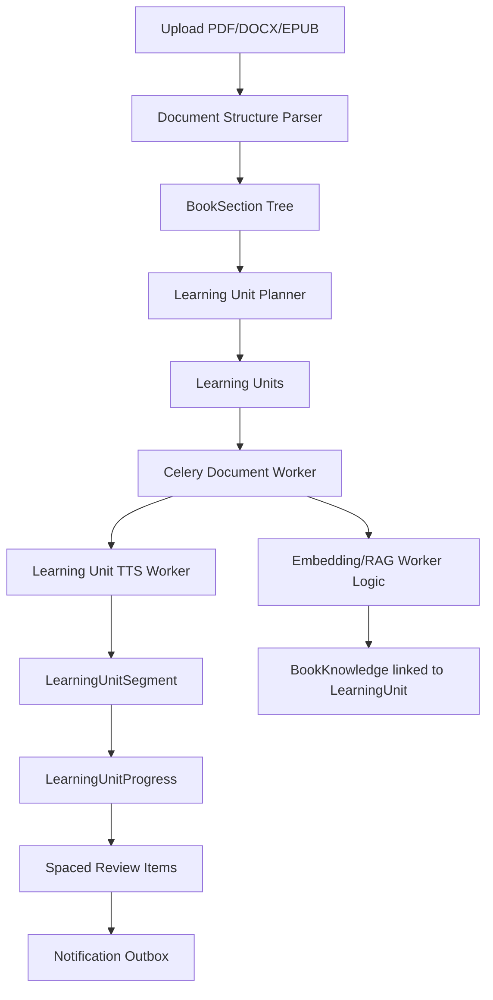

# Phase 6 Cleanup And Refactor Stabilization Plan

Date: 2026-05-29  
Status: **Proposed**  
Scope: Backend cleanup after Phase 4.2 and Phase 5  
Audience: Backend developer, Flutter developer, capstone reviewer

---

## 1. Goal

Phase 6 không thêm tính năng lớn ngay. Mục tiêu chính là làm sạch source code và database sau khi hệ thống đã chuyển từ mô hình cũ:

```text
Book -> Chapter -> ChapterSegment -> ChapterLearningProgress
```

sang mô hình mới đúng hơn:

```text
Book -> BookSection -> LearningUnit -> LearningUnitSegment -> LearningUnitProgress
```

Kết quả mong muốn:

- Các chức năng hiện tại vẫn chạy ổn.
- Code không còn bị lẫn quá nhiều khái niệm `chapter` cũ.
- DB gọn hơn, ít bảng/field không còn dùng.
- Worker xử lý sách chỉ còn đi theo `learning_unit`.
- FE contract ổn định hơn trước khi triển khai UI Phase 5/6.
- Dự án dễ giải thích trong báo cáo luận văn và khi demo.

---

## 2. Non-Negotiable Rule

Trong Phase 6, refactor phải đi theo nguyên tắc:

```text
Không đổi behavior trước khi có test bảo vệ.
Không xoá legacy table/code trước khi chứng minh flow mới không dùng nó.
Không làm vỡ các API FE đang cần nếu chưa có contract thay thế.
```

Nếu cần breaking change, phải ghi rõ trong FE contract và chỉ làm sau khi đã chốt.

---

## 3. Current Stable Features Must Keep Working

Sau Phase 6, các flow này bắt buộc vẫn hoạt động:

### 3.1 Authentication

- FE login bằng Supabase email/password hoặc Google OAuth.
- BE lấy `user_id` từ access token.
- User A không thấy hoặc sửa được sách/thông báo/thread của user B.

### 3.2 Upload Document

Supported:

- PDF có hidden outline/bookmark.
- DOCX có Heading styles.
- EPUB có TOC/navigation.

Required behavior:

- Upload validate file type/size.
- Nếu tài liệu thiếu cấu trúc thì trả 422, không fallback bừa.
- Upload thành công tạo `Book` ở trạng thái draft.
- Upload thành công tạo `BookSection` tree.
- Response trả outline preview cho FE.

### 3.3 Generate Plan

- `POST /api/v1/generate-plan` tạo reading plan.
- Tạo `LearningUnit` theo mode `full` hoặc `pareto`.
- Tạo `ProcessingJob`.
- Enqueue Celery task vào queue `document`.
- FE poll được job progress.

### 3.4 Background Processing

- Celery worker consume queue `document`.
- Worker xử lý theo `LearningUnit`, không theo legacy `Chapter`.
- Sinh audio segments.
- Sinh review audio/text.
- Sinh knowledge chunks cho RAG.
- Book chuyển `processing -> partial_ready -> ready`.
- Job chuyển `queued -> processing -> partial_ready -> ready`.

### 3.5 Library And Player APIs

Các API này phải giữ hoạt động:

```text
GET /api/v1/books
GET /api/v1/books/{book_id}
GET /api/v1/books/{book_id}/outline
GET /api/v1/books/{book_id}/learning-units?mode=full|pareto
GET /api/v1/books/{book_id}/details?mode=full|pareto
GET /api/v1/books/{book_id}/learning-progress?mode=full|pareto
PUT /api/v1/books/{book_id}/learning-units/{learning_unit_id}/progress
POST /api/v1/books/{book_id}/learning-units/{learning_unit_id}/complete
POST /api/v1/books/{book_id}/switch-mode
GET /api/v1/jobs/{job_id}
GET /api/v1/books/{book_id}/processing-status
```

### 3.6 Notification Phase 4.2

- In-app notification vẫn hoạt động.
- Plan reminder dựa trên reading plan + learning progress.
- Review reminder chỉ tạo sau khi user hoàn thành learning unit.
- Celery Beat scan due notification.
- Notification worker deliver vào `user_notifications`.

### 3.7 Realtime Voice Agent

- LiveKit realtime voice agent vẫn start được.
- RAG vẫn dùng `match_book_knowledge`.
- Realtime service không được bị ảnh hưởng bởi cleanup DB legacy.

---

## 4. Current Technical Debt

### 4.1 Legacy Chapter Tables

Hiện Phase 5 flow mới không còn dùng các bảng này, nhưng codebase vẫn giữ:

```text
chapters
chapter_segments
chapter_processing_states
chapter_learning_progress
```

Trên dev DB sau Phase 5, các bảng này đang có count bằng 0. Đây là dấu hiệu có thể cleanup, nhưng phải làm có kiểm soát.

### 4.2 Legacy Chapter Code

Các file còn phục vụ flow cũ:

```text
app/services/workers/chapter_worker.py
app/repositories/chapter_repo.py
app/repositories/chapter_segment_repo.py
app/repositories/chapter_processing_state_repo.py
```

`app/services/workers/tts_worker.py` hiện chứa cả logic TTS cho chapter cũ và learning unit mới. File này nên được tách ra để giảm rủi ro.

### 4.3 Legacy Parser API

Các hàm cũ vẫn còn:

```text
extract_chapters_by_document_type
extract_pdf_chapters
extract_docx_chapters
extract_epub_chapters
parsed_sections_to_legacy_chapters
```

Phase 5 đang dùng `parse_document_structure`, không còn cần tạo flat `chapters` cho pipeline chính.

### 4.4 Naming Debt

Một số config vẫn dùng chữ `chapter`, nhưng behavior đã chuyển sang unit:

```text
FIRST_PLAYABLE_CHAPTERS
CHAPTER_PROCESSING_CONCURRENCY
```

Nên đổi dần thành:

```text
FIRST_PLAYABLE_UNITS
LEARNING_UNIT_PROCESSING_CONCURRENCY
```

Để tránh deploy vỡ, trong một giai đoạn nên support cả tên cũ và tên mới.

### 4.5 Repository Debt

`app/repositories/plan_repo.py` có hàm:

```python
get_all_plan_by_user_id(session, user_id)
```

nhưng model `ReadingPlan` hiện không có `user_id`. Đây là code thừa hoặc bug tiềm ẩn. Nên xoá nếu không dùng, hoặc refactor query qua `Book.user_id`.

### 4.6 DB Field Debt

Các field nên cleanup sau khi chốt không cần backward compatibility:

```text
books.total_chapters
book_knowledge.chapter_id
spaced_review_items.chapter_id
spaced_review_items.source_progress_id
```

Target mới:

```text
books.total_sections
books.total_units
book_knowledge.learning_unit_id
spaced_review_items.learning_unit_id
spaced_review_items.source_unit_progress_id
```

### 4.7 Query Performance Debt

`GET /outline` chỉ cần metadata, không cần load toàn bộ `text_content`. Nếu `book_sections.text_content` lớn, query hiện tại có thể tốn RAM/latency.

Nên có repository query riêng chỉ select:

```text
id
book_id
parent_id
section_index
title
level
path
page_start
page_end
text_char_count
```

---

## 5. Target Cleanup Architecture



Target sau cleanup:

```text
Source of truth for structure: book_sections
Source of truth for playable content: learning_units + learning_unit_segments
Source of truth for progress: learning_unit_progress
Source of truth for reminders: spaced_review_items + notification_outbox
```

---

## 6. Phase 6 Implementation Plan

### 6.1 Step 0 - Freeze Baseline

Trước khi refactor:

1. Chạy migration đến head.
2. Chạy server local.
3. Chạy Celery document worker.
4. Chạy notification worker nếu test reminder.
5. Upload/generate một file thật.
6. Lưu lại response API làm baseline.

Baseline files nên lưu:

```text
_docs_implemented/runtime_test_logs/phase6_before_cleanup_api_baseline.md
_docs_implemented/runtime_test_logs/phase6_before_cleanup_worker_log.md
```

Minimum baseline:

```text
GET /books
GET /books/{book_id}
GET /books/{book_id}/outline
GET /books/{book_id}/learning-units?mode=pareto
GET /books/{book_id}/details?mode=pareto
GET /books/{book_id}/learning-progress?mode=pareto
GET /jobs/{job_id}
```

Acceptance:

```text
Baseline captured before touching cleanup code.
```

---

### 6.2 Step 1 - Add Safety Tests Before Cleanup

Add or update tests first:

```text
tests/test_document_parsers.py
tests/test_learning_unit_planner.py
tests/test_learning_progress_service.py
tests/test_phase5_api_contract.py
tests/test_phase5_worker_unit_pipeline.py
```

Required test coverage:

- DOCX nested headings preserve tree.
- PDF outline preserves hierarchy.
- EPUB TOC preserves hierarchy.
- Planner creates fewer learning units than source sections for nested documents.
- Pareto groups multiple sections into fewer units.
- Progress update persists only when threshold/stale/segment change is met.
- Book details returns segments for player.
- Learning units list endpoint returns metadata only.
- Legacy chapter worker is not imported by book task.

Acceptance:

```text
Focused tests pass before deleting legacy code.
```

---

### 6.3 Step 2 - Rename Config With Backward Compatibility

Add new env names:

```text
FIRST_PLAYABLE_UNITS
LEARNING_UNIT_PROCESSING_CONCURRENCY
```

Keep fallback to old names:

```text
FIRST_PLAYABLE_CHAPTERS
CHAPTER_PROCESSING_CONCURRENCY
```

Recommended behavior:

```python
FIRST_PLAYABLE_UNITS = env("FIRST_PLAYABLE_UNITS") or env("FIRST_PLAYABLE_CHAPTERS") or 1
LEARNING_UNIT_PROCESSING_CONCURRENCY = env("LEARNING_UNIT_PROCESSING_CONCURRENCY") or env("CHAPTER_PROCESSING_CONCURRENCY") or 2
```

Do not remove old env names immediately because Hugging Face secrets may still use them.

Acceptance:

```text
Old env still works.
New env works.
Docs use new unit wording.
```

---

### 6.4 Step 3 - Split TTS Worker

Current issue:

```text
tts_worker.py contains both chapter TTS and learning unit TTS.
```

Target:

```text
app/services/workers/learning_unit_tts_worker.py
```

Move only unit-based logic:

```text
run_learning_unit_tts_pipeline
_generate_unit_main_segments
_generate_unit_review_audio
_store_unit_tts_result
```

Then update:

```text
app/services/workers/learning_unit_worker.py
```

to import from `learning_unit_tts_worker.py`.

Keep old `tts_worker.py` temporarily until tests prove chapter flow is unused.

Acceptance:

```text
Learning unit worker no longer imports chapter TTS code.
Existing upload/generate/switch-mode still pass.
```

---

### 6.5 Step 4 - Remove Legacy Chapter Worker Path

After Step 3 passes:

Candidate files to delete:

```text
app/services/workers/chapter_worker.py
app/repositories/chapter_repo.py
app/repositories/chapter_segment_repo.py
app/repositories/chapter_processing_state_repo.py
```

Before deleting, run:

```powershell
rg "chapter_worker|process_chapter|chapter_repo|chapter_segment_repo|chapter_processing_state_repo" app tests
```

If only legacy tests refer to them, update tests to learning unit flow.

Acceptance:

```text
No production code imports chapter worker/repositories.
All Phase 5 worker tests pass.
```

---

### 6.6 Step 5 - Remove Legacy Parser Chapter API

Target cleanup:

```text
extract_chapters_by_document_type
extract_pdf_chapters
extract_docx_chapters
extract_epub_chapters
parsed_sections_to_legacy_chapters
```

Replace tests that call `extract_*_chapters` with tests that call:

```text
parse_document_structure
```

Do not remove if a public API or FE contract still depends on legacy chapter output. Current product direction should not depend on it.

Acceptance:

```text
Parser tests assert tree structure, not flat chapters.
Upload still supports PDF/DOCX/EPUB.
```

---

### 6.7 Step 6 - Clean DB Schema

Because current dev data can be reset, recommended approach:

```text
Create one clean baseline migration for final capstone schema.
```

Target tables to keep:

```text
books
book_sections
learning_units
learning_unit_sources
learning_unit_segments
learning_unit_progress
reading_plans
reading_plan_schedule_slots
processing_jobs
book_knowledge
notification_settings
spaced_review_items
notification_outbox
user_notifications
study_contexts
study_context_document_links
chat_threads
chat_messages
direct_book_context
```

Target tables to remove if no production data migration is needed:

```text
chapters
chapter_segments
chapter_processing_states
chapter_learning_progress
```

Target fields to remove:

```text
books.total_chapters
book_knowledge.chapter_id
spaced_review_items.chapter_id
spaced_review_items.source_progress_id
```

Important:

- If production DB has valuable data, do not drop directly. Write backfill first.
- If capstone/dev DB can reset, clean baseline is simpler and safer.

Acceptance:

```text
Fresh DB can run alembic upgrade head successfully.
No migration enum/function duplicate errors.
No model references removed tables.
```

---

### 6.8 Step 7 - Query And Index Optimization

Add or verify indexes for common access paths:

```text
books(user_id, status, updated_at)
book_sections(book_id, parent_id, section_index)
learning_units(book_id, mode, unit_index)
learning_unit_segments(learning_unit_id, segment_index)
learning_unit_progress(user_id, book_id, mode)
learning_unit_progress(user_id, learning_unit_id)
processing_jobs(user_id, book_id, created_at)
notification_outbox(status, due_at)
notification_outbox(user_id, due_at)
spaced_review_items(user_id, status, due_at)
book_knowledge(book_id)
book_knowledge(learning_unit_id)
```

Optimize endpoints:

```text
GET /books/{book_id}/outline
```

should not load full `text_content`.

```text
GET /books/{book_id}/learning-units
```

should not load segments.

```text
GET /books/{book_id}/details
```

can load segments because this is player/detail view.

Acceptance:

```text
Outline endpoint remains fast on large documents.
Details endpoint remains complete for audio player.
```

---

### 6.9 Step 8 - Service And Repository Cleanup

Target service rules:

- Router stays thin.
- Service owns business logic.
- Repository owns DB query only.
- Worker owns long-running processing.

Specific cleanup:

```text
upload_service.py
  Keep upload validation + orchestration.
  Move plan/job creation helpers if file grows too large.

audiobook_service.py
  Keep read/update/delete/switch-mode.
  Consider extracting outline/detail builders into response mapper helpers.

learning_progress_service.py
  Keep progress business logic.
  Add tests for throttle and completion threshold.

notification_event_service.py
  Keep outbox creation logic.
  Later add Firebase channel without changing in-app behavior.

plan_repo.py
  Remove unused/incorrect functions or refactor through Book.user_id.
```

Acceptance:

```text
No repository uses external services.
No service has dead imports.
No code references removed chapter models.
```

---

### 6.10 Step 9 - API Contract Lock

After cleanup, update:

```text
_docs_implemented/doc_setup_flutter/flutter_phase_4_backend_contract_uiux_guide.md
```

with Phase 5/6 stable wording:

```text
BookSection = source outline item
LearningUnit = playable lesson/audio unit
```

FE should use:

```text
outline_tree for document structure preview
learning-units for playlist/list view
details for player view
learning-progress for resume/progress UI
```

Acceptance:

```text
FE no longer uses "chapter" wording for outline items.
FE can render "đề mục" and "bài học" clearly.
```

---

## 7. Regression Test Matrix

### 7.1 Local Commands

Run after each major cleanup step:

```powershell
uv run ruff check app tests
uv run pytest tests/test_document_parsers.py tests/test_learning_unit_planner.py -q
uv run pytest tests/test_phase3_generation_guardrails.py tests/test_phase4_2_learning_loop.py -q
uv run python -m py_compile app/models/db_models.py app/services/upload_service.py app/services/audiobook_service.py app/services/workers/book_pipeline.py app/services/workers/learning_unit_worker.py
```

### 7.2 Runtime Smoke Test

Local terminals:

```powershell
# Terminal 1
uv run uvicorn app.main:app --host 0.0.0.0 --port 8000 --reload

# Terminal 2
uv run celery -A app.core.celery_app.celery_app worker -Q document -l info --pool=solo --concurrency 1

# Terminal 3, if testing notification
uv run celery -A app.core.celery_app.celery_app worker -Q notification,maintenance -l info --pool=solo --concurrency 1
```

Smoke test files:

```text
Chương 4_ Phương pháp luận nghiên cứu.pdf
trr.docx
phase5_sample.epub
```

Required API checks:

```text
POST /api/v1/upload
POST /api/v1/generate-plan
GET  /api/v1/jobs/{job_id}
GET  /api/v1/books/{book_id}/outline
GET  /api/v1/books/{book_id}/learning-units?mode=full|pareto
GET  /api/v1/books/{book_id}/details?mode=full|pareto
PUT  /api/v1/books/{book_id}/learning-units/{learning_unit_id}/progress
POST /api/v1/books/{book_id}/learning-units/{learning_unit_id}/complete
GET  /api/v1/books/{book_id}/learning-progress?mode=full|pareto
POST /api/v1/books/{book_id}/switch-mode
```

Acceptance:

```text
PDF full flow ready.
DOCX pareto flow ready.
DOCX full or switch-mode flow ready.
EPUB full flow ready.
Progress update works.
Manual complete creates review schedule.
Notification scan/deliver still works.
Realtime voice agent starts.
```

---

## 8. Deployment Safety

Before deploy:

```text
RUN_MIGRATIONS_ON_START=true only when intentionally applying migration.
ENABLE_CELERY_WORKER=true if document processing should run.
ENABLE_NOTIFICATION_WORKER=true if notification delivery should run.
ENABLE_CELERY_BEAT=true only on one runtime.
```

Redis free tier warning:

```text
Do not run too many Celery worker processes.
Keep broker pool small.
Avoid enabling duplicate Beat.
```

Recommended HF free config:

```text
CELERY_BROKER_POOL_LIMIT=1
CELERY_DOCUMENT_CONCURRENCY=1
CELERY_NOTIFICATION_CONCURRENCY=1
ENABLE_CELERY_BEAT=true on only one deployed runtime
```

---

## 9. What Not To Do In Phase 6

Do not implement Firebase push in the same PR as cleanup.

Reason:

```text
Cleanup changes database and worker internals.
Firebase adds new external integration and device token security.
Mixing both makes bugs hard to isolate.
```

Do not rewrite Pareto planner with LLM in the same PR as cleanup.

Reason:

```text
Pareto v2 changes learning quality logic.
Cleanup should preserve behavior first.
```

Do not delete all Alembic history blindly if production DB still matters.

Reason:

```text
Clean baseline is fine for resettable capstone DB, but not for preserving production data.
```

---

## 10. Suggested Commit Breakdown

```text
1. phase6: add cleanup baseline tests
2. phase6: rename unit config with backward-compatible env aliases
3. phase6: split learning unit tts worker from legacy chapter tts
4. phase6: remove unused chapter worker imports and tests
5. phase6: remove legacy chapter repositories and parser chapter helpers
6. phase6: add clean schema migration or final baseline migration
7. phase6: optimize outline and learning unit queries
8. phase6: update FE contract and runtime test report
```

---

## 11. Exit Criteria

Phase 6 is complete only when:

```text
1. Current upload/generate/switch/progress/notification/realtime flows still pass.
2. No production code references legacy chapter worker path.
3. DB schema no longer contains unused chapter tables if reset strategy is accepted.
4. Fresh DB migration path works.
5. FE contract uses section/unit wording.
6. Runtime test report exists.
7. Codebase is ready for Firebase push and Pareto v2 as separate phases.
```

---

## 12. Recommended Next Phases After Cleanup

### Phase 7 - Pareto Planner V2

Goal:

```text
Pareto không chỉ chọn chương dài nhất.
Pareto phải chọn/gom kiến thức trọng tâm dựa trên mục tiêu học.
```

Recommended design:

```text
Deterministic candidates
-> LLM strict JSON selection
-> validate source_section_ids
-> fallback deterministic if invalid
```

### Phase 8 - Firebase Push Notification

Goal:

```text
Đưa notification ra ngoài app bằng Firebase Cloud Messaging.
```

Recommended design:

```text
user_devices
notification_outbox channel=push
Firebase delivery worker
token invalidation handling
```

### Phase 9 - Final Capstone Freeze

Goal:

```text
Không thêm feature mới.
Chỉ test, fix bug, viết báo cáo, chuẩn bị demo.
```

Deliverables:

```text
README final
architecture diagram final
FE contract final
runtime test reports
capstone chapter 5
demo script
```

