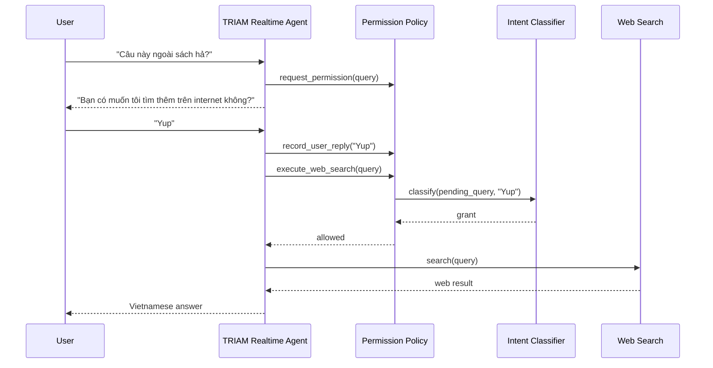
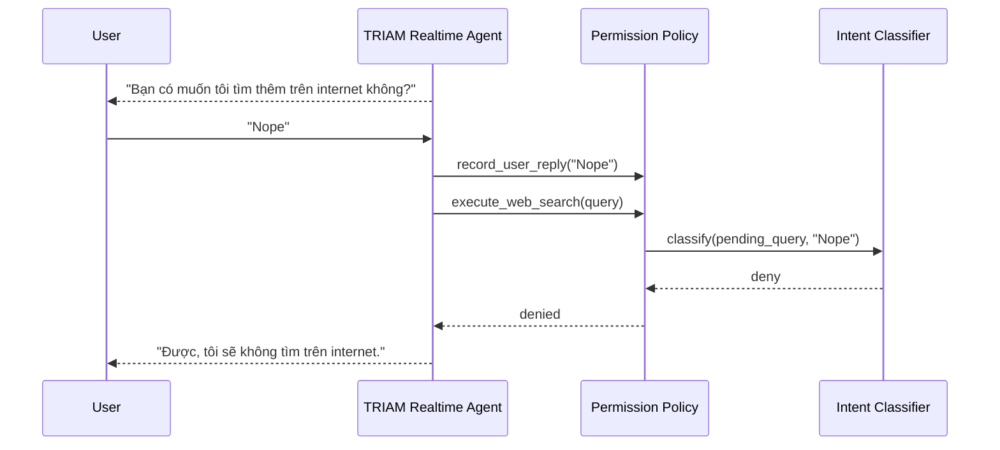
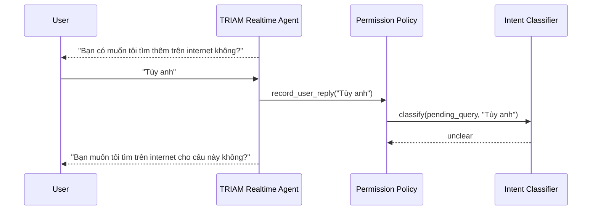

# Phase 7.1 Implementation Guide - Voice Web Permission Intent Classifier

Status: Proposed, not implemented yet  
Main target files:

- `app/services/voice_agent/web_permission_policy.py`
- `app/services/voice_agent/contracts.py`
- `app/services/agent_voice_gpt_realtime.py`

New files recommended:

- `app/services/voice_agent/web_permission_intent_classifier.py`
- `tests/services/voice_agent/test_web_permission_intent_classifier.py`
- `tests/services/voice_agent/test_web_permission_policy_state_machine.py`

Related FE contract:

- `lk.chat`: unchanged
- `lk.transcript`: unchanged
- `lk.control`: optional enhancement for button-based permission, not required for voice

---

## 1. Why This Phase Exists

Phase 7 already stabilized the realtime voice worker, transcript persistence, DB connection behavior, and LiveKit event handling.

The remaining problem is web-search permission in voice flow.

Current implementation uses hard-coded pattern lists:

```python
YES_PATTERNS = ("có", "co", "đồng ý", "ok", "okay", ...)
NO_PATTERNS = ("không", "khong", "khỏi", "đừng", ...)
```

This is acceptable as a cheap first filter, but it is not production-quality for voice.

Real users can answer:

```text
Yup
Sure
Go ahead
Ừ tìm đi anh
Ok thử xem
Được đó
Nope
Nah
Khỏi nha
Thôi bỏ qua đi
Không cần đâu
```

No fixed list can cover all natural replies. If we keep extending patterns, the logic becomes brittle, language-dependent, and hard to maintain.

The real product requirement is:

```text
When the assistant asks for permission to search the internet, the user should be able to answer naturally by voice without touching the phone.
```

---

## 2. Final Decision

Use a hybrid permission system:

```text
State machine as source of truth
        +
Pattern fast-path for obvious replies
        +
Natural language intent classifier for voice/free text
        +
Optional FE explicit button for touch UI
```

The important distinction:

- Chat/touch UI: FE button is a good shortcut.
- Voice-first UI: natural language classifier is the primary flow.
- Backend state machine: always required for safety.

FE explicit permission must not be the only solution because users may be listening through Bluetooth headphones, driving, walking, or not looking at the phone.

---

## 3. Business Logic

### 3.1 Permission States

Backend should treat web search permission as a small state machine per LiveKit session:

```text
idle
  -> pending_permission(query, request_id, expires_at)
  -> granted(query, request_id, granted_at)
  -> consumed
  -> idle
```

State meanings:

- `idle`: no web-search permission is pending.
- `pending_permission`: assistant has asked the user for permission for one specific query.
- `granted`: user has granted permission for that exact pending query.
- `consumed`: one web search has been executed, then permission is cleared.

Important rule:

```text
Permission is single-use.
```

If user grants search for query A, backend must not reuse that grant for query B.

### 3.2 Classifier Decision Types

The classifier should return exactly one of:

```text
grant
deny
unclear
new_question
```

Meaning:

- `grant`: user agrees to search the internet for the pending query.
- `deny`: user refuses.
- `unclear`: user reply is ambiguous, assistant should ask again.
- `new_question`: user ignored the permission question and asked something else.

Examples:

| User reply                    | Expected decision |
| ----------------------------- | ----------------- |
| `Yup`                         | `grant`           |
| `Sure, go ahead`              | `grant`           |
| `Ừ tìm đi anh`                | `grant`           |
| `Ok thử xem`                  | `grant`           |
| `Nope`                        | `deny`            |
| `Khỏi nha`                    | `deny`            |
| `Thôi bỏ qua đi`              | `deny`            |
| `Tùy anh`                     | `unclear`         |
| `Cái chương này nói gì tiếp?` | `new_question`    |

### 3.3 Behavior By Decision

```text
grant:
  set granted_query = pending_query
  clear pending_query
  allow exactly one execute_web_search call

deny:
  clear pending_query
  respond: "Được, tôi sẽ không tìm trên internet..."

unclear:
  keep pending_query
  ask again in Vietnamese

new_question:
  clear pending_query
  process the new user question normally
```

---

## 4. Why Pattern-Only Is Not Enough

Pattern-only is cheap, but it fails on:

- English replies: `yup`, `sure`, `go ahead`, `nope`, `nah`.
- Mixed Vietnamese-English replies: `ok search đi`, `sure tìm thử`.
- Spoken variants from STT: `duoc roi`, `co tim di`, `khong dau`.
- Long answers: `ừ nếu trong sách không có thì anh tìm trên mạng giúp em`.
- Ambiguous answers: `thôi cũng được`, `tùy`, `sao cũng được`.
- Context changes: user may ask a new question instead of answering permission.

The backend must understand intent, not just substrings.

---

## 5. Why Classifier-Only Is Also Not Ideal

Using LLM classifier for every user reply is simple, but not optimal.

Trade-offs:

- Higher latency.
- Higher cost.
- More moving parts in realtime voice.
- More failure modes if the classifier provider times out.

Therefore the recommended design is:

```text
1. If no pending permission -> do nothing.
2. If reply is obvious by deterministic fast-path -> decide immediately.
3. Otherwise call classifier with timeout.
4. If classifier fails or confidence is low -> return unclear.
```

This keeps common cases fast and robust while still supporting natural voice.

---

## 6. Recommended Architecture

### 6.1 Current Layering

Current Phase 7 files:

```text
app/services/agent_voice_gpt_realtime.py
  LiveKit worker entrypoint and session wiring

app/services/voice_agent/web_permission_policy.py
  Permission state and deterministic pattern logic

app/services/voice_agent/contracts.py
  Dataclasses and topic constants
```

### 6.2 New Layering

Recommended:

```text
app/services/voice_agent/web_permission_intent_classifier.py
  Owns LLM classifier prompt, schema parsing, timeout, fallback.

app/services/voice_agent/web_permission_policy.py
  Owns state machine, TTL, request_id, grant/deny/consume logic.
  Uses classifier only as an injected dependency or async collaborator.

app/services/agent_voice_gpt_realtime.py
  Wires policy into voice/text flow.
  Does not contain classifier prompt or pattern lists.
```

Why:

- Keeps LiveKit file from growing again.
- Makes intent classifier unit-testable.
- Makes permission policy testable without external LLM.
- Makes future provider swap easy.

---

## 7. Data Contracts

### 7.1 New Intent Result

Add to `app/services/voice_agent/contracts.py`:

```python
from dataclasses import dataclass
from typing import Literal

WebPermissionIntent = Literal["grant", "deny", "unclear", "new_question"]


@dataclass(frozen=True)
class WebPermissionIntentResult:
    intent: WebPermissionIntent
    confidence: float
    reason: str = ""
```

### 7.2 Extend Permission State

Current:

```python
@dataclass
class WebSearchPermissionState:
    enabled: bool = False
    pending_query: str | None = None
    granted_query: str | None = None
    granted_at: datetime | None = None
```

Recommended:

```python
@dataclass
class WebSearchPermissionState:
    enabled: bool = False
    pending_query: str | None = None
    pending_request_id: str | None = None
    last_user_reply: str | None = None
    granted_query: str | None = None
    granted_request_id: str | None = None
    granted_at: datetime | None = None
```

Reason:

- `pending_request_id` prevents stale permission confusion.
- `last_user_reply` allows guarded execution to classify just-in-time.
- `granted_request_id` makes debugging easier.

---

## 8. Classifier Prompt

The classifier prompt should be English, short, and schema-constrained.

Example:

```text
Classify whether the user is answering a web-search permission question.

Pending web query:
{pending_query}

User reply:
{user_reply}

Return only valid JSON:
{"intent":"grant|deny|unclear|new_question","confidence":0.0,"reason":"short"}

Rules:
- grant: user agrees to search the web for the pending query.
- deny: user refuses or asks to skip.
- unclear: ambiguous reply.
- new_question: user asks something else instead of answering.
- Support Vietnamese, English, and mixed replies.
```

Expected examples:

```json
{ "intent": "grant", "confidence": 0.95, "reason": "User said Yup" }
```

```json
{ "intent": "deny", "confidence": 0.94, "reason": "User said Nope" }
```

```json
{ "intent": "unclear", "confidence": 0.55, "reason": "Ambiguous reply" }
```

The prompt must not ask the model to answer the user's study question. It only classifies permission intent.

---

## 9. Config Variables

Add to `app/core/config.py` and `.env.example`:

```env
VOICE_AGENT_PERMISSION_CLASSIFIER_ENABLED=true
VOICE_AGENT_PERMISSION_CLASSIFIER_MODEL=gpt-4o-mini
VOICE_AGENT_PERMISSION_CLASSIFIER_TIMEOUT_SECONDS=1.5
VOICE_AGENT_PERMISSION_CLASSIFIER_CONFIDENCE_THRESHOLD=0.72
```

Reasonable defaults:

- Enabled in local/prod once tests pass.
- Timeout short because realtime voice cannot wait too long.
- Confidence threshold around `0.72` to avoid over-asking while still protecting sensitive permission.

If classifier times out:

```text
Treat as unclear.
```

Never silently grant permission on classifier failure.

---

## 10. Implementation Plan

### Step 1 - Add Contracts

Update `app/services/voice_agent/contracts.py`:

- Add `WebPermissionIntent`.
- Add `WebPermissionIntentResult`.
- Extend `WebSearchPermissionDecision` if needed:

```python
@dataclass(frozen=True)
class WebSearchPermissionDecision:
    granted_query: str | None = None
    denied: bool = False
    unclear: bool = False
    new_question: str | None = None
```

### Step 2 - Create Intent Classifier

Create:

```text
app/services/voice_agent/web_permission_intent_classifier.py
```

Recommended public function:

```python
async def classify_web_permission_intent(
    *,
    pending_query: str,
    user_reply: str,
) -> WebPermissionIntentResult:
    ...
```

Rules:

- Normalize empty input to `unclear`.
- Use deterministic fast-path before calling LLM.
- Use strict JSON parsing.
- Clamp confidence between `0.0` and `1.0`.
- If response invalid -> `unclear`.
- If timeout -> `unclear`.

### Step 3 - Refactor Permission Policy

Current `observe_user_reply` is sync and pattern-only.

Recommended shape:

```python
async def observe_user_reply(self, text: str) -> WebSearchPermissionDecision:
    ...
```

But there is one important realtime concern:

```text
Voice model may call execute_web_search quickly after user says "Yup".
```

If classifier has not finished yet, `execute_web_search` might still see no grant and block the tool.

So the safer production design is:

```python
async def resolve_before_web_search(self, query: str) -> tuple[bool, str]:
    if already_granted_and_query_matches:
        return True, ""

    if pending_query and last_user_reply:
        classify last_user_reply against pending_query
        if grant:
            grant pending query
            return can_execute(query)
        if deny:
            clear
            return False, "WEB_SEARCH_PERMISSION_DENIED"
        if unclear:
            return False, "WEB_SEARCH_PERMISSION_UNCLEAR"

    return False, "WEB_SEARCH_PERMISSION_REQUIRED"
```

This avoids race conditions between transcript events and tool calls.

### Step 4 - Update Realtime Voice Tool

In `TriamAssistant.execute_web_search`:

Current:

```python
allowed, reason = self.web_search_policy.can_execute(query)
```

Recommended:

```python
allowed, reason = await self.web_search_policy.resolve_before_web_search(query)
```

Then:

- If allowed -> execute web search.
- If denied -> assistant says it will not search.
- If unclear -> assistant asks permission again.
- If required -> assistant asks permission.

### Step 5 - Update User Reply Observation

In `agent_voice_gpt_realtime.py`, current `_observe_web_permission_reply(text)` is sync.

Recommended:

```python
def _record_user_reply_for_permission(text: str) -> None:
    web_search_policy.record_user_reply(text)
```

This function should be cheap and sync. It only records `last_user_reply`.

Actual classification can happen:

- immediately in text chat flow when we need a decision;
- just-in-time inside `execute_web_search` for voice tool flow.

This avoids blocking LiveKit event callbacks.

### Step 6 - Keep FE Button Optional

If FE wants touch UI, it may send:

```json
{
  "type": "web_search_permission",
  "request_id": "uuid",
  "decision": "granted"
}
```

But Phase 7.1 must not depend on this.

Voice should work with only natural speech.

---

## 11. Expected Flow

### 11.1 Voice Grant Flow



### 11.2 Voice Deny Flow



### 11.3 Ambiguous Flow



---

## 12. Test Plan

### 12.1 Unit Tests - Classifier Fast Path

Add tests:

```text
Yup -> grant
Sure -> grant
Go ahead -> grant
Ừ tìm đi anh -> grant
Ok thử xem -> grant
Nope -> deny
Nah -> deny
Khỏi nha -> deny
Không cần đâu -> deny
Tùy anh -> unclear
Cái chương này nói gì tiếp? -> new_question
```

### 12.2 Unit Tests - Policy State Machine

Cases:

- No pending permission + `Yup` -> no decision.
- Pending query + `Yup` -> grant.
- Pending query + `Nope` -> deny and clear.
- Pending query + `Tùy` -> unclear and keep pending.
- Pending query expires -> block search.
- Granted query consumed -> cannot search again.
- Granted query A cannot execute query B.

### 12.3 Integration Tests - Text

Use existing `tests/test_agent_chat_text_only.py` style:

```text
1. Ask an out-of-book question.
2. Agent asks web permission.
3. Send "Yup" through lk.chat.
4. Verify assistant executes web search and replies.
5. Verify DB has user + assistant messages.
```

### 12.4 Integration Tests - Voice

Create new fixture or use TTS-generated short wav files:

```text
Yup.wav
Nope.wav
Ừ tìm đi.wav
Khỏi nha.wav
```

Manual test flow:

```text
1. Start local FastAPI.
2. Start local realtime worker with local agent name.
3. Connect to thread with a book.
4. Ask out-of-book question by text or voice.
5. Agent asks permission.
6. Publish "Yup" wav as mic.
7. Verify web search executes.
8. Verify lk.chat, lk.transcript, and DB persistence.
```

---

## 13. Logging Rules

Log:

```text
permission requested | request_id | query_chars
permission intent classified | intent | confidence | source=fast_path/classifier
permission granted | request_id
permission denied | request_id
permission unclear | request_id
permission consumed | request_id
```

Do not log:

- Full web query when it may contain private user content.
- Full user transcript unless `VOICE_AGENT_LOG_TRANSCRIPT_TEXT=true`.
- Access tokens or headers.

---

## 14. Trade-offs

### 14.1 Added Cost

Classifier adds small LLM cost only for ambiguous replies that do not match deterministic fast-path.

Mitigation:

- Fast-path obvious replies first.
- Use short prompt.
- Use timeout.
- Do not call classifier when there is no pending permission.

### 14.2 Added Latency

Voice can wait slightly longer when user says a non-pattern reply such as `Yup`.

Mitigation:

- Keep timeout around `1.5s`.
- Treat timeout as unclear, not failure.
- In future, use a smaller local classifier or provider-specific low-latency model if needed.

### 14.3 Misclassification Risk

Classifier can misunderstand ambiguous language.

Mitigation:

- Require confidence threshold.
- If confidence is low -> ask again.
- Never grant on classifier error.
- Permission remains single-use.

### 14.4 Race Conditions In Realtime

Realtime model may attempt tool call before async classifier finishes.

Mitigation:

- Record user reply synchronously.
- Resolve permission just-in-time inside guarded `execute_web_search`.
- Do not rely only on background classifier task.

---

## 15. Acceptance Criteria

Phase 7.1 is complete when:

- `Yup` grants web-search permission in voice flow.
- `Nope` denies web-search permission in voice flow.
- Ambiguous replies cause the assistant to ask again.
- User asking a new question clears old pending permission and processes the new question.
- Permission is single-use.
- Query mismatch is still blocked.
- FE contract does not break.
- Unit tests pass.
- Manual realtime voice test passes with at least one English consent reply.

---

## 16. Recommended Implementation Order

1. Add contracts.
2. Add deterministic intent helper with expanded but small fast-path.
3. Add classifier service with strict JSON output.
4. Refactor `WebSearchPermissionPolicy` into state machine + just-in-time resolver.
5. Update `TriamAssistant.execute_web_search`.
6. Update text chat flow to handle `grant`, `deny`, `unclear`, `new_question`.
7. Add unit tests.
8. Add manual integration test for `Yup` voice flow.
9. Update Flutter contract only if FE will add optional permission buttons.

---

## 17. What We Should Not Do

Do not:

- Keep adding dozens of hard-coded phrases forever.
- Grant permission when there is no pending query.
- Reuse one grant for multiple searches.
- Let FE button be the only permission mechanism.
- Let classifier failure default to grant.
- Log full private transcripts in production.

---

## 18. Final Recommendation

Implement Phase 7.1 before deploying voice web search as a production feature.

The current pattern-only policy is acceptable for early manual testing, but not enough for real voice UX. TRIAM is a voice-first learning assistant, so users must be able to answer permission questions naturally without touching the phone.

Best architecture:

```text
Pattern fast-path + natural language classifier + backend state machine + single-use permission
```

This keeps the system usable, safe, and maintainable.
