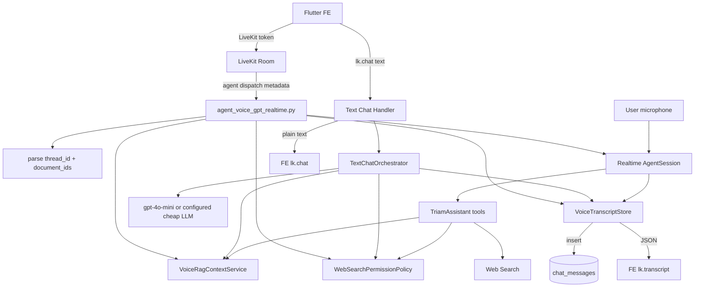

# Phase 7 Implementation Guide - Realtime Voice Agent Stabilization

Status: Implemented locally - core stabilization  
Target file first: `app/services/agent_voice_gpt_realtime.py`  
Related files:

- `app/services/live_service.py`
- `app/services/rag_service.py`
- `app/models/db_models.py`
- `app/core/config.py`
- `_docs_implemented/doc_setup_flutter/flutter_phase_6_backend_contract_uiux_refactor_guide.md`

Implementation result:

- Added `app/services/voice_agent/contracts.py`.
- Added `app/services/voice_agent/rag_context.py`.
- Added `app/services/voice_agent/web_permission_policy.py`.
- Added `app/services/voice_agent/transcript_store.py`.
- Refactored `app/services/agent_voice_gpt_realtime.py` to use the new helpers.
- Added focused tests under `tests/services/voice_agent/`.
- Kept FE DataChannel contract unchanged.

Deferred intentionally:

- `text_chat_orchestrator.py` and `realtime_factory.py` are still future cleanup candidates. The current pass extracted the riskiest business rules first without moving SDK-heavy session wiring too far away from LiveKit's entrypoint.

---

## 1. Why This Phase Exists

`app/services/agent_voice_gpt_realtime.py` is currently responsible for too many concerns:

- LiveKit worker bootstrap.
- OpenAI Realtime session creation.
- Voice agent instructions and tools.
- Text chat via DataChannel `lk.chat`.
- Transcript publishing via `lk.transcript`.
- Chat history persistence.
- RAG search and formatting.
- Web search permission policy.
- Runtime load/capacity behavior.

The system works, but realtime voice bugs are hard to debug because event flow is asynchronous and can produce duplicate transcript, wrong tool calls, wrong context, or inconsistent behavior between voice and typed chat.

Phase 7 improves the file without changing the FE contract first.

Current FE contract remains:

```text
lk.chat       FE -> BE plain text, BE -> FE plain assistant text
lk.transcript BE -> FE JSON transcript events
lk.control    FE -> BE JSON control events
```

---

## 2. Official Docs Notes Checked

Checked on 2026-05-30:

- OpenAI `gpt-realtime` supports realtime text/audio input and output, function calling, and is priced separately for text/audio tokens.
- OpenAI `gpt-realtime-2` is a newer, more capable realtime voice model with stronger instruction following and more reliable tool use, but higher output text-token price and potentially higher latency when reasoning effort increases.
- LiveKit recommends realtime models when low latency and expressive speech matter more than strict control.
- LiveKit docs warn that realtime model transcripts can be delayed and may arrive after the agent response.
- LiveKit docs also warn that loading a long conversation history into realtime models can increase the chance of text-only output even when audio is configured.
- LiveKit supports text and transcription output, including default transcription streams. TRIAM intentionally keeps its own `lk.transcript` contract because FE needs stable JSON with `id`, `role`, `text`, and `ts`.

Sources:

- https://developers.openai.com/api/docs/models/gpt-realtime
- https://developers.openai.com/api/docs/models/gpt-realtime-2
- https://docs.livekit.io/agents/models/realtime/
- https://docs.livekit.io/agents/models/realtime/plugins/openai/
- https://docs.livekit.io/agents/multimodality/text/
- https://docs.livekit.io/agents/integrations/openai/

---

## 3. Current Business Logic

### 3.1. Intended product behavior

User enters a study context or chat thread, then talks to TRIAM:

```text
FE gets LiveKit token
-> LiveKit dispatches agent with metadata
-> metadata contains thread_id and document_ids
-> voice agent answers based on selected books
-> if book knowledge is not enough, agent asks permission before web search
-> transcript is saved to DB and published to FE
```

### 3.2. Current implementation behavior

```text
Voice input
-> OpenAI RealtimeModel
-> TriamAssistant tools
-> agent_speech_committed/user_speech_committed events
-> save ChatMessage
-> publish lk.transcript

Typed chat on lk.chat
-> handle_data_input
-> gpt-4o-mini
-> manual RAG or manual tool loop
-> save ChatMessage
-> publish lk.chat and lk.transcript
```

This means TRIAM currently has a **dual-model architecture**:

- Realtime model for voice.
- Cheaper text LLM for typed chat.

This is a good production direction because it keeps realtime cost focused on voice. The trade-off is that voice and text can behave differently unless both share the same policy layer.

---

## 4. Current Issues To Fix

### 4.1. Tool name mismatch

Current prompt says:

```text
execute_web_search
```

Actual tool in code:

```python
search_web
```

Impact:

- The realtime model may try to follow a tool name that does not exist.
- Web-search permission behavior becomes unreliable.

Fix:

- Either rename the tool method to `execute_web_search`, or update instructions to use `search_web`.
- Recommendation: rename the tool to `execute_web_search` and keep a clear method name because the prompt already expresses business logic around that name.

### 4.2. RAG return contract is inconsistent

Current `app/services/rag_service.py`:

```python
if not result.data:
    return "Không tìm thấy thông tin cụ thể trong sách."

return result.data
```

Current agent expects:

```python
if not data:
    return "RAG don't have data"

if not isinstance(data, list):
    return "RAG invalid RAG data format"
```

Impact:

- No-data RAG can become "invalid format".
- Agent may not know whether to answer from book, ask web permission, or give fallback.
- Text chat and voice chat may branch differently.

Fix:

- Introduce a normalized service-level result object.
- Never return sometimes `str`, sometimes `list`.

Recommended DTO:

```python
from dataclasses import dataclass
from typing import Any


@dataclass(frozen=True)
class VoiceRagResult:
    found: bool
    chunks: list[dict[str, Any]]
    message: str


async def search_voice_book_context(query: str, document_ids: list[str]) -> VoiceRagResult:
    data = await search_book_knowledge(query, document_ids)
    if not isinstance(data, list) or not data:
        return VoiceRagResult(
            found=False,
            chunks=[],
            message="Không tìm thấy thông tin phù hợp trong sách.",
        )
    return VoiceRagResult(found=True, chunks=data, message="")
```

### 4.3. Web search permission is prompt-only

Current behavior relies mostly on model instructions:

```text
Ask permission before web search.
```

Impact:

- Prompt is a guideline, not a backend guard.
- A model can still call the web tool if it interprets the conversation incorrectly.
- Hard to prove privacy/business compliance during capstone defense.

Fix:

- Add a small server-side permission state.
- The tool itself must reject web search if permission was not granted for the current pending query.

Recommended state:

```python
@dataclass
class WebSearchPermissionState:
    enabled: bool = False
    pending_query: str | None = None
    granted_query: str | None = None
    granted_at: datetime | None = None
```

Business rules:

```text
1. RAG not enough -> ask_web_search_permission(query)
2. Backend stores pending_query
3. User answers yes/no
4. If yes -> granted_query = pending_query
5. execute_web_search only runs when query matches granted_query
6. After execute_web_search, clear granted_query
```

### 4.4. Transcript and DB persistence are embedded in entrypoint

Current nested functions:

- `_publish_transcript`
- `_save_message`
- `_save_and_publish_user_transcript`
- `_load_history`

Impact:

- Hard to test.
- Duplicate transcript behavior is hard to reason about.
- `entrypoint()` is too long.

Fix:

- Extract to a small helper class or service.
- Keep external behavior identical.

Recommended class:

```python
class VoiceTranscriptStore:
    def __init__(self, room: rtc.Room, thread_id: uuid.UUID | None) -> None:
        self.room = room
        self.thread_id = thread_id
        self._seen_user_texts: dict[str, datetime] = {}

    async def save_and_publish_user(self, text: str) -> None:
        ...

    async def save_and_publish_assistant(self, text: str) -> None:
        ...

    async def publish_transcript(self, role: str, text: str) -> None:
        ...

    def load_recent_history(self, limit: int) -> list[ChatMessage]:
        ...
```

### 4.5. Logs include raw user text/transcript

Current examples:

```python
log.info(f"Data input from {participant_id or 'unknown'}: {normalized_text}")
log.info(f"user_input_transcribed received: final={is_final}, chars={len(transcript)}, transcript={transcript!r}")
```

Impact:

- User study content and private conversation are visible in production logs.
- Harder to share logs safely.

Fix:

- Production logs should use length, role, room/thread ids only.
- Optional debug logs can be gated behind a config flag.

Recommended config:

```python
VOICE_AGENT_LOG_TRANSCRIPT_TEXT: bool = False
```

Recommended logging:

```python
log.info(
    "Voice transcript received | final={} | chars={} | thread_id={}",
    is_final,
    len(transcript),
    thread_uuid,
)
```

### 4.6. Realtime model history can cause audio issues

LiveKit docs warn that loading long history into a realtime model may make it more likely to respond in text only.

Current code loads recent DB history into `session.history`.

Impact:

- More context, better continuity.
- But possible audio-mode instability if history grows or gets noisy.

Fix:

- Keep small history limit.
- Keep `VOICE_AGENT_HISTORY_LIMIT` conservative for realtime, e.g. `12` to `24`.
- Consider summarizing old history later instead of loading many raw turns.

---

## 5. Target Architecture

### 5.1. Keep current public entrypoint

Keep:

```text
python -m app.services.agent_voice_gpt_realtime start
```

Keep:

```python
async def entrypoint(ctx: JobContext)
```

### 5.2. Split responsibilities gradually

Recommended new files:

```text
app/services/voice_agent/
  __init__.py
  contracts.py
  transcript_store.py
  rag_context.py
  web_permission_policy.py
  text_chat_orchestrator.py
  realtime_factory.py
```

`agent_voice_gpt_realtime.py` becomes the wiring file:

```text
parse metadata
create services
create TriamAssistant
create AgentSession
attach handlers
start session
```

### 5.3. Target flow diagram



---

## 6. Implementation Plan

### Step 1 - Add constants and contracts

Create:

```text
app/services/voice_agent/contracts.py
```

Suggested content:

```python
from dataclasses import dataclass
from datetime import datetime
from typing import Any, Literal


LK_CHAT_TOPIC = "lk.chat"
LK_CONTROL_TOPIC = "lk.control"
LK_TRANSCRIPT_TOPIC = "lk.transcript"

TranscriptRole = Literal["user", "assistant"]


@dataclass(frozen=True)
class VoiceJobMetadata:
    thread_id: str
    document_ids: list[str]


@dataclass(frozen=True)
class VoiceRagResult:
    found: bool
    chunks: list[dict[str, Any]]
    message: str


@dataclass
class WebSearchPermissionState:
    enabled: bool = False
    pending_query: str | None = None
    granted_query: str | None = None
    granted_at: datetime | None = None
```

Why:

- Avoid repeated magic strings.
- Make FE DataChannel contract explicit.
- Make RAG contract explicit.

Trade-off:

- Adds one small module.
- Reduces hidden coupling.

### Step 2 - Normalize RAG result

Create:

```text
app/services/voice_agent/rag_context.py
```

Responsibilities:

- Call current `app.services.rag_service.search_book_knowledge`.
- Normalize output into `VoiceRagResult`.
- Format chunks for model context.
- Enforce `VOICE_AGENT_RAG_MAX_CHARS`.

Important rule:

```text
No RAG helper returns mixed string/list types.
```

Suggested API:

```python
async def search_voice_book_context(query: str, document_ids: list[str]) -> VoiceRagResult:
    ...


def format_rag_context(result: VoiceRagResult, max_chars: int) -> str:
    ...
```

Update `TriamAssistant.search_book_knowledge()` to call this helper.

Expected tool output:

```text
BOOK_CONTEXT_FOUND
...
```

or:

```text
BOOK_CONTEXT_NOT_FOUND: Không tìm thấy thông tin phù hợp trong sách.
```

Why:

- The model gets a deterministic signal.
- Text chat can reuse the same behavior.

### Step 3 - Fix tool naming and web search permission

In `TriamAssistant`, rename or wrap:

```python
@function_tool
async def execute_web_search(...):
    ...
```

Update instructions to reference only actual tool names:

```text
search_book_knowledge
ask_web_search_permission
execute_web_search
```

Add:

```text
app/services/voice_agent/web_permission_policy.py
```

Suggested API:

```python
class WebSearchPermissionPolicy:
    def __init__(self) -> None:
        self.state = WebSearchPermissionState()

    def set_enabled(self, enabled: bool) -> None:
        ...

    def request_permission(self, query: str) -> str:
        ...

    def observe_user_reply(self, text: str) -> None:
        ...

    def assert_allowed(self, query: str) -> None:
        ...

    def clear_after_search(self) -> None:
        ...
```

Simple Vietnamese yes/no detection:

```python
YES_WORDS = {"có", "đồng ý", "ok", "oke", "được", "tìm đi", "search đi"}
NO_WORDS = {"không", "khỏi", "đừng", "không cần", "thôi"}
```

Business rule:

- If web search toggle is off, reject web search.
- If no granted query, reject web search.
- If the query is too different from granted query, reject web search.
- After one web search, clear grant.

Trade-off:

- Simple yes/no detection can misread natural language.
- But it is much safer than prompt-only guard.
- Later can replace with an intent classifier if needed.

### Step 4 - Extract transcript persistence

Create:

```text
app/services/voice_agent/transcript_store.py
```

Move out of `entrypoint()`:

- `_publish_transcript`
- `_save_message`
- `_save_and_publish_user_transcript`
- `_load_history`

Rules:

- Save DB in thread via `asyncio.to_thread` or sync method called from async wrapper.
- Dedupe only near-duplicate user transcripts.
- Do not dedupe assistant replies by text unless there is a real duplicate event path.
- Publish transcript JSON with stable schema.

Schema remains:

```json
{
  "v": 1,
  "type": "transcript",
  "role": "user",
  "text": "Xin chào",
  "id": "uuid",
  "ts": "2026-05-30T..."
}
```

### Step 5 - Extract typed chat orchestration

Create:

```text
app/services/voice_agent/text_chat_orchestrator.py
```

Responsibilities:

- Receive typed text.
- Add to history.
- Run RAG-first logic.
- If web enabled and allowed, run web flow.
- Return assistant text.

Do not publish DataChannel inside this service. Publishing remains in entrypoint/handler layer.

Why:

- Easier to unit test.
- Voice and text can share policy.

### Step 6 - Extract realtime session creation

Create:

```text
app/services/voice_agent/realtime_factory.py
```

Responsibilities:

- Build `RealtimeModel`.
- Build `AgentSession`.
- Keep fallback model logic.
- Keep room options.

Recommended config additions:

```python
VOICE_AGENT_TEXT_LLM_MODEL: str = "gpt-4o-mini"
VOICE_AGENT_LOG_TRANSCRIPT_TEXT: bool = False
VOICE_AGENT_ENABLE_WEB_SEARCH_BY_DEFAULT: bool = False
VOICE_AGENT_DEDUPE_WINDOW_SECONDS: int = 3
```

Model recommendation:

- Keep `OPENAI_STREAM_MODEL_NAME` configurable.
- Do not hard-code `gpt-realtime-2` yet.
- If tool calling reliability becomes a major issue, test `gpt-realtime-2` behind env config because it is newer and stronger for complex voice-agent workflows.

Current stable default:

```env
OPENAI_STREAM_MODEL_NAME=gpt-realtime
```

Experiment option:

```env
OPENAI_STREAM_MODEL_NAME=gpt-realtime-2
```

### Step 7 - Reduce raw logs

Change logs like:

```python
log.info(f"Data input from {participant_id or 'unknown'}: {normalized_text}")
```

to:

```python
log.info(
    "Data input received | participant={} | chars={} | thread_id={}",
    participant_id or "unknown",
    len(normalized_text),
    thread_uuid,
)
```

If debug is needed:

```python
if settings.VOICE_AGENT_LOG_TRANSCRIPT_TEXT:
    log.debug("Transcript text preview: {}", _trim_text(text, 120))
```

### Step 8 - Keep FE contract unchanged

Do not change:

- `lk.chat`
- `lk.transcript`
- `lk.control`
- transcript JSON shape

Add optional control events only after FE agrees.

Optional future control payload:

```json
{
  "type": "toggle_web_search",
  "enabled": true
}
```

Current payload remains valid.

---

## 7. Suggested Final File Layout

After this phase:

```text
app/services/
  agent_voice_gpt_realtime.py
  voice_agent/
    __init__.py
    contracts.py
    rag_context.py
    realtime_factory.py
    text_chat_orchestrator.py
    transcript_store.py
    web_permission_policy.py
```

`agent_voice_gpt_realtime.py` should ideally shrink from around 646 lines to around 250-350 lines.

Do not chase perfect architecture in one pass. The main goal is to move volatile logic into testable modules.

---

## 8. Testing Plan

### 8.1. Unit tests

Add tests:

```text
tests/services/voice_agent/test_rag_context.py
tests/services/voice_agent/test_web_permission_policy.py
tests/services/voice_agent/test_transcript_store.py
```

Test cases:

- RAG list result -> `found=True`.
- RAG empty result -> `found=False`.
- RAG string result -> `found=False`, not invalid format.
- Web search disabled -> blocked.
- Web search permission requested -> pending query stored.
- User says yes -> grant created.
- User says no -> pending cleared.
- Search after grant -> allowed once, then cleared.
- Duplicate user transcript inside dedupe window -> saved once.

### 8.2. Static checks

```powershell
uv run ruff check app/services/agent_voice_gpt_realtime.py app/services/voice_agent tests/services/voice_agent
uv run python -m py_compile app/services/agent_voice_gpt_realtime.py
```

### 8.3. Local realtime smoke test

Run:

```powershell
uv run python -m app.services.agent_voice_gpt_realtime console
```

Expected:

- Agent starts.
- Uses console book/thread fallback.
- Vietnamese transcription is still stable.
- RAG questions call book search first.
- If no RAG result, assistant asks permission before web.
- If user says no, no web search occurs.
- If user says yes, web search can run once.

### 8.4. Local LiveKit app test

Run:

```powershell
uv run uvicorn app.main:app --host 0.0.0.0 --port 8000 --reload
uv run python -m app.services.agent_voice_gpt_realtime start
```

FE flow:

```text
Get LiveKit token for thread
Join room
Speak Vietnamese
Send typed lk.chat
Toggle lk.control web search
Check lk.transcript JSON
Check chat_messages DB
```

### 8.5. Production smoke test

After deploy:

- Check LiveKit worker registered.
- Check no raw user text appears in logs.
- Check no API key or token appears in logs.
- Check one voice session can join.
- Check one typed message returns via `lk.chat`.
- Check transcript rows are persisted.

---

## 9. Trade-Off Summary

| Decision | Benefit | Trade-off | Recommendation |
| --- | --- | --- | --- |
| Keep dual-model architecture | Saves realtime cost, text chat is cheaper | Voice and text can diverge | Keep, but share RAG/policy logic |
| Keep custom `lk.transcript` | FE has stable JSON contract | Duplicates LiveKit built-in transcription stream | Keep because FE needs normalized chat bubbles |
| Server-side web permission | Safer and explainable | More state to manage | Implement now |
| No raw transcript logs | Privacy-safe production logs | Harder to debug rare cases | Add opt-in debug flag |
| Keep `modalities=["audio"]` | Realtime model only handles voice output | Text output behavior must be observed carefully | Keep for current architecture |
| Keep history small | Reduces audio-mode issues | Less long-term conversational memory | Keep DB full history, load only recent turns |
| Split modules | Testable and cleaner | More files | Worth it now |

---

## 10. Things Not To Do In This Phase

Do not:

- Change FE DataChannel topic names.
- Replace the whole LiveKit/OpenAI architecture.
- Move typed chat into RealtimeModel just because it is possible.
- Add another external queue for voice chat.
- Auto web-search without user permission if product policy says ask first.
- Log full user utterances in production.
- Hard-code a newer realtime model without testing cost and latency.

---

## 11. Implementation Order For Lowest Risk

Recommended sequence:

1. Add contracts/constants.
2. Add RAG context wrapper and tests.
3. Fix tool name mismatch.
4. Add web permission policy and tests.
5. Extract transcript store and tests.
6. Wire `agent_voice_gpt_realtime.py` to new helpers.
7. Reduce raw logs.
8. Local console test.
9. Local FE LiveKit test.
10. Production smoke test.

This order keeps the app runnable after each step.

---

## 12. Definition Of Done

Phase 7 is complete when:

- `agent_voice_gpt_realtime.py` is smaller and mostly orchestration.
- RAG return type is deterministic.
- Prompt tool names match actual function tools.
- Web search cannot execute unless backend permission state allows it.
- FE contract remains compatible.
- Voice and typed chat both use the same RAG result formatting.
- Production logs do not show raw user transcript by default.
- Tests cover RAG contract, web permission, and transcript dedupe.
- Manual voice test in Vietnamese succeeds.
