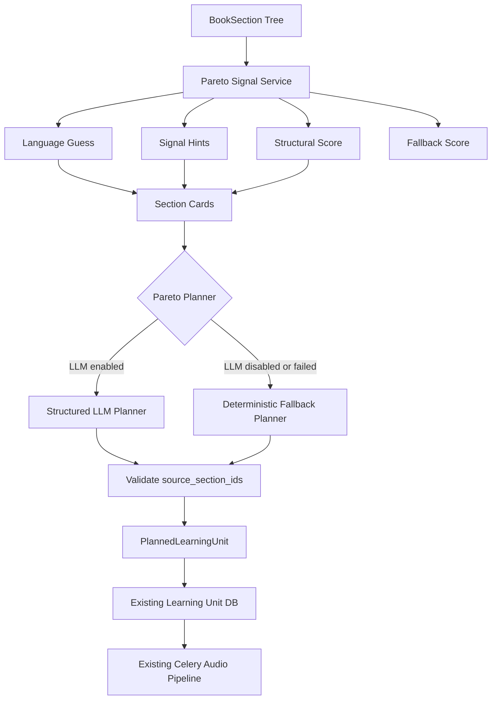

# Phase 8.1 Implementation Guide - Multilingual Pareto Signal Optimizer

Date: 2026-06-02  
Status: **Implemented locally - automated regression passed**  
Scope: Backend Pareto planner quality and clean-code improvement  
Depends on: Phase 8 Pareto Learning Unit Planner  
Audience: Backend developer, Flutter developer, capstone reviewer

---

## 1. Goal

Phase 8 đã nâng `pareto` mode từ việc chỉ đổi prompt sang một planner có khả năng chọn và gom các phần quan trọng của tài liệu. Tuy nhiên, fallback hiện tại vẫn còn một điểm yếu:

```text
Keyword tiếng Việt đang nằm trực tiếp trong scoring logic.
```

Điều này chỉ ổn khi sách viết tiếng Việt và tiêu đề dùng các từ quen thuộc như "khái niệm", "định nghĩa", "phương pháp". Trong thực tế, Tri Âm cần xử lý cả:

- sách tiếng Việt;
- sách tiếng Anh;
- tài liệu song ngữ;
- tài liệu có tiêu đề ngắn hoặc tiêu đề học thuật không chứa keyword rõ ràng.

Mục tiêu Phase 8.1:

```text
Tách toàn bộ signal nhận diện nội dung quan trọng ra một service riêng,
hỗ trợ song ngữ Việt - Anh,
giữ LLM planner là hướng chính,
và giữ deterministic fallback đủ tốt khi LLM lỗi hoặc bị tắt.
```

---

## 0. Implementation Result

Phase 8.1 đã được implement theo hướng không breaking API và không migration DB.

Đã hoàn thành:

- Thêm `app/services/pareto_signal_service.py`.
- Tách keyword/signal Pareto ra khỏi `_pareto_score`.
- Thêm taxonomy song ngữ Việt - Anh cho các loại tín hiệu học tập: core concept, definition, principle, method, procedure, rule, formula, theorem, reasoning, example.
- Thêm normalize tiếng Việt có dấu/không dấu.
- Thêm word-boundary matching để tránh từ ngắn như `law` khớp nhầm `flaw` hoặc `outlaw`.
- Bổ sung synonym cho `formula` như `identity/identities`, và cho `procedure` như `hướng dẫn`, `guide`, `tutorial`.
- Thêm language guess nhẹ: `vi`, `en`, `mixed`, `unknown`.
- Đổi `SectionCard.keyword_hints` thành `SectionCard.signal_hints`.
- Bổ sung `SectionCard.language`.
- Cập nhật English planner prompt để nói rõ tài liệu có thể là Vietnamese, English hoặc mixed-language.
- Cập nhật deterministic fallback để dùng signal score + structure score + content score thay vì hard-code keyword trực tiếp.
- Bổ sung test tiếng Việt, tiếng Việt không dấu, tiếng Anh, mixed-language, no-keyword structural importance.
- Bổ sung test chống false-positive cho keyword tiếng Anh ngắn.

Verification đã chạy:

```powershell
uv run python -m py_compile app\services\pareto_signal_service.py app\services\pareto_planner_service.py app\services\learning_unit_planner_service.py tests\test_pareto_signal_service.py tests\test_pareto_planner_service.py tests\test_learning_unit_planner.py
uv run ruff check app\services\pareto_signal_service.py app\services\pareto_planner_service.py app\services\learning_unit_planner_service.py tests\test_pareto_signal_service.py tests\test_pareto_planner_service.py tests\test_learning_unit_planner.py --output-format=concise
uv run pytest tests\test_pareto_signal_service.py tests\test_pareto_planner_service.py tests\test_learning_unit_planner.py -q
uv run pytest tests\test_celery_enqueue.py tests\test_upload_service_batch_commit.py tests\test_phase3_generation_guardrails.py tests\test_processing_jobs_api.py tests\test_auth_user_isolation.py -q
uv run pytest tests\test_phase4_2_learning_loop.py tests\test_notifications_api.py tests\test_notification_outbox_repo.py -q
uv run ruff check app tests --exclude app/db/migrations --output-format=concise
uv run pytest -q
```

Kết quả:

```text
Focused planner/signal tests: 16 passed
Backend regression groups: 46 passed
Full regression: 113 passed
Ruff: pass
```

---

## 2. Why This Phase Matters

### 2.1 Vấn đề hiện tại

Hiện tại fallback Pareto có logic dạng:

```python
for keyword in ("khái niệm", "định nghĩa", "nguyên lý", ...):
    if keyword in title:
        keyword_score += 5000
```

Vấn đề:

- Chỉ nhận tốt tiếng Việt.
- Keyword bị hard-code trực tiếp trong hàm score.
- Không có trọng số theo loại tín hiệu.
- Không test đủ với sách tiếng Anh.
- Nếu sách dùng từ khác, ví dụ `Core Ideas`, `Fundamentals`, `Inference`, `Proof`, fallback sẽ yếu.
- Nếu title không có keyword nhưng section rất quan trọng vì có nhiều mục con, fallback có thể đánh giá chưa đúng.

### 2.2 Cách nhìn đúng

Hard-code keyword không hoàn toàn sai nếu nó chỉ là:

```text
Một phần nhỏ của fallback heuristic.
```

Nhưng nó sai nếu trở thành:

```text
Nguồn quyết định chính của Pareto mode.
```

Phase 8.1 không xoá hoàn toàn keyword. Ta chuyển nó thành một **taxonomy có kiểm soát**, dùng như signal phụ, kết hợp với cấu trúc outline và LLM planner.

---

## 3. Target Behavior

### 3.1 Với sách tiếng Việt

Ví dụ outline:

```text
1.1 Khái niệm mệnh đề
1.2 Các phép toán mệnh đề
1.3 Suy luận toán học
1.4 Các phương pháp chứng minh
```

Pareto nên hiểu:

- `Khái niệm mệnh đề` là kiến thức nền;
- `Các phép toán mệnh đề` là quy tắc/công cụ;
- `Suy luận toán học` là năng lực cốt lõi;
- `Các phương pháp chứng minh` là phương pháp áp dụng.

### 3.2 Với sách tiếng Anh

Ví dụ outline:

```text
1.1 Core Concepts
1.2 Logical Operators
1.3 Rules of Inference
1.4 Proof Methods
```

Pareto nên hiểu tương tự:

- `Core Concepts` là kiến thức nền;
- `Logical Operators` là quy tắc/công cụ;
- `Rules of Inference` là quy tắc suy luận;
- `Proof Methods` là phương pháp.

### 3.3 Với title không có keyword

Ví dụ:

```text
2. Boolean Algebra
  2.1 AND
  2.2 OR
  2.3 NOT
  2.4 Karnaugh Map
```

Dù title không có chữ `definition` hay `khái niệm`, section này vẫn quan trọng vì:

- cấp cao trong outline;
- có nhiều mục con;
- là nhóm kiến thức nền của nhiều phần sau;
- có lượng nội dung đủ lớn.

Vì vậy score không được phụ thuộc keyword tuyệt đối.

---

## 4. Design Principles

Phase 8.1 dùng các nguyên tắc sau:

1. LLM planner là hướng chính.
2. Keyword chỉ là một tín hiệu phụ.
3. Tất cả signal phải tập trung trong một file/service, không rải trong nhiều hàm.
4. Hỗ trợ tiếng Việt và tiếng Anh bằng cùng một taxonomy.
5. Không đổi API cho FE.
6. Không migration DB trong phase này.
7. Fallback phải deterministic, test được, không gọi external API.
8. Không log source text, prompt dài, token, credential hoặc nội dung sách.

---

## 5. Target Architecture



Layer ownership:

| Layer | File | Responsibility |
| --- | --- | --- |
| Signal taxonomy | `app/services/pareto_signal_service.py` | Multilingual signal definitions, normalization, language guess |
| Pareto LLM planner | `app/services/pareto_planner_service.py` | Build cards, call LLM, validate structured output |
| General planner facade | `app/services/learning_unit_planner_service.py` | Full/Pareto entrypoint and fallback selection |
| Existing persistence | `app/repositories/learning_unit_repo.py` | Save learning units and source links |
| Existing workers | `app/services/workers/*` | Generate script/audio/RAG/progress |

---

## 6. Recommended Code Changes

### 6.1 Add new service: `pareto_signal_service.py`

Create:

```text
app/services/pareto_signal_service.py
```

Purpose:

- normalize heading text;
- guess Vietnamese/English/mixed language;
- extract signal hints;
- score section importance for fallback;
- keep all bilingual terms in one place.

Recommended data model:

```python
from dataclasses import dataclass


@dataclass(frozen=True)
class ParetoSignal:
    key: str
    unit_type: str
    weight: float
    vi_terms: tuple[str, ...]
    en_terms: tuple[str, ...]
```

Example taxonomy:

```python
PARETO_SIGNALS: tuple[ParetoSignal, ...] = (
    ParetoSignal(
        key="core_concept",
        unit_type="pareto_core",
        weight=1.0,
        vi_terms=("khái niệm", "nền tảng", "cốt lõi", "tổng quan"),
        en_terms=("concept", "core concept", "fundamental", "overview", "introduction"),
    ),
    ParetoSignal(
        key="definition",
        unit_type="pareto_core",
        weight=1.0,
        vi_terms=("định nghĩa", "định danh"),
        en_terms=("definition", "define", "defined as"),
    ),
    ParetoSignal(
        key="principle",
        unit_type="pareto_core",
        weight=0.95,
        vi_terms=("nguyên lý", "nguyên tắc"),
        en_terms=("principle", "law"),
    ),
    ParetoSignal(
        key="method",
        unit_type="pareto_method",
        weight=0.9,
        vi_terms=("phương pháp", "cách làm", "kỹ thuật"),
        en_terms=("method", "technique", "approach"),
    ),
    ParetoSignal(
        key="procedure",
        unit_type="pareto_method",
        weight=0.85,
        vi_terms=("quy trình", "các bước"),
        en_terms=("procedure", "process", "steps", "workflow"),
    ),
    ParetoSignal(
        key="rule",
        unit_type="pareto_rule",
        weight=0.9,
        vi_terms=("quy tắc", "luật", "điều kiện"),
        en_terms=("rule", "condition", "criteria"),
    ),
    ParetoSignal(
        key="formula",
        unit_type="pareto_formula",
        weight=0.9,
        vi_terms=("công thức", "biểu thức"),
        en_terms=("formula", "equation", "expression"),
    ),
    ParetoSignal(
        key="theorem",
        unit_type="pareto_rule",
        weight=0.9,
        vi_terms=("định lý", "bổ đề", "hệ quả"),
        en_terms=("theorem", "lemma", "corollary"),
    ),
    ParetoSignal(
        key="reasoning",
        unit_type="pareto_core",
        weight=0.85,
        vi_terms=("suy luận", "lập luận", "chứng minh"),
        en_terms=("reasoning", "inference", "proof", "argument"),
    ),
    ParetoSignal(
        key="example",
        unit_type="pareto_example",
        weight=0.45,
        vi_terms=("ví dụ", "minh họa", "bài tập"),
        en_terms=("example", "case study", "exercise", "illustration"),
    ),
)
```

Important:

- `example` có weight thấp hơn vì ví dụ không phải lúc nào cũng là lõi.
- `overview`, `definition`, `core concept`, `rule`, `method` nên có weight cao hơn.
- Không dùng keyword để quyết định tuyệt đối.

### 6.2 Normalize text before matching

Vietnamese có dấu và không dấu. User hoặc tài liệu có thể ghi:

```text
khái niệm
khai niem
định nghĩa
dinh nghia
```

Recommended helper:

```python
import re
import unicodedata


def normalize_signal_text(value: str) -> str:
    lowered = value.casefold()
    without_accents = "".join(
        char for char in unicodedata.normalize("NFD", lowered)
        if unicodedata.category(char) != "Mn"
    )
    normalized = without_accents.replace("đ", "d")
    return re.sub(r"\s+", " ", normalized).strip()
```

Then each term should also be normalized once before matching.

### 6.3 Add lightweight language guess

Do not add heavy dependency yet. Use a simple deterministic helper:

```python
def guess_section_language(title: str, excerpt: str = "") -> str:
    sample = f"{title} {excerpt[:300]}".casefold()
    vi_markers = ("đ", "ă", "â", "ê", "ô", "ơ", "ư", "khái", "định", "phương")
    en_markers = ("the ", "and ", "of ", "definition", "method", "concept")

    vi_score = sum(1 for marker in vi_markers if marker in sample)
    en_score = sum(1 for marker in en_markers if marker in sample)

    if vi_score and en_score:
        return "mixed"
    if vi_score:
        return "vi"
    if en_score:
        return "en"
    return "unknown"
```

Trade off:

- Không chính xác tuyệt đối.
- Nhưng đủ tốt cho signal hint.
- Không ảnh hưởng correctness vì LLM planner vẫn đọc card.

### 6.4 Extract signal hints

Recommended function:

```python
def extract_pareto_signal_hints(title: str, excerpt: str = "") -> list[str]:
    normalized = normalize_signal_text(f"{title} {excerpt[:300]}")
    hints: list[str] = []

    for signal in PARETO_SIGNALS:
        terms = signal.vi_terms + signal.en_terms
        if any(normalize_signal_text(term) in normalized for term in terms):
            hints.append(signal.key)

    return hints
```

Use hint names like:

```text
core_concept
definition
method
rule
formula
reasoning
example
```

Do not send raw keyword list to LLM. Send compact signal hints.

### 6.5 Replace scattered keyword score

Current fallback should move from:

```python
for keyword in (...):
    if keyword in title:
        keyword_score += 5000
```

To:

```python
signal_score = score_pareto_signals(root.title, root.source_text_excerpt)
```

Recommended scoring:

```text
final_score =
    structural_score
  + content_size_score
  + child_dependency_score
  + signal_score
  - noise_penalty
```

Where:

```text
structural_score:
    root sections and higher-level sections get more weight.

content_size_score:
    enough content matters, but cap it to avoid choosing long minor notes.

child_dependency_score:
    sections with many children are often major concepts.

signal_score:
    bilingual taxonomy hints.

noise_penalty:
    repeated examples, appendix, references, exercises can be lower priority.
```

### 6.6 Update SectionCard

Current `SectionCard` should include compact multilingual signals:

```python
@dataclass(frozen=True)
class SectionCard:
    id: str
    title: str
    level: int
    order_index: int
    parent_id: str | None
    estimated_tokens: int
    child_count: int
    language: str
    signal_hints: list[str]
    excerpt: str
```

Important:

- Keep `excerpt` short.
- Do not send full source text to planner.
- Keep `title` original; do not translate titles in planner input.

### 6.7 Update English planner prompt

Prompt should explicitly support multilingual documents:

```text
You may receive Vietnamese, English, or mixed-language section titles.
Use the original document language when naming learning units unless the title is unclear.
Use signal_hints only as hints, not as strict rules.
Prefer structurally important sections even when there are no obvious keywords.
Merge related child sections into one learning unit when they form one concept.
Do not create a unit only because a title contains "example" or "exercise".
```

Reason:

- Prompt tiếng Anh thường ngắn hơn.
- LLM vẫn hiểu title tiếng Việt.
- `signal_hints` giúp LLM giảm phải suy luận từ raw keyword.

### 6.8 Output language decision

Recommended for now:

```text
Learning unit title should preserve the source language by default.
```

Examples:

```text
Vietnamese book -> "Khái niệm mệnh đề và phép toán logic"
English book -> "Core Concepts and Logical Operators"
Mixed book -> keep the dominant source language of selected sections.
```

Do not translate all English titles to Vietnamese in Phase 8.1 unless product explicitly wants that. Translation can confuse FE/user when they compare title with original outline.

Optional config for later:

```python
PARETO_UNIT_TITLE_LANGUAGE: str = "source"  # source | vi | en
```

Do not add this config unless we really need it.

---

## 7. Files To Change

### 7.1 New file

```text
app/services/pareto_signal_service.py
```

Contains:

- `ParetoSignal`
- `PARETO_SIGNALS`
- `normalize_signal_text`
- `guess_section_language`
- `extract_pareto_signal_hints`
- `score_pareto_signals`
- optional `infer_unit_type_from_signals`

### 7.2 Update

```text
app/services/pareto_planner_service.py
```

Change:

- `SectionCard.keyword_hints` -> `signal_hints`
- add `language`
- call `extract_pareto_signal_hints`
- update prompt wording

### 7.3 Update

```text
app/services/learning_unit_planner_service.py
```

Change:

- remove direct keyword loop from `_pareto_score`
- use `score_pareto_signals`
- keep structural/content score

### 7.4 Update tests

Add:

```text
tests/test_pareto_signal_service.py
```

Update:

```text
tests/test_pareto_planner_service.py
tests/test_learning_unit_planner.py
```

---

## 8. Testing Plan

### 8.1 Unit tests for signal service

Cases:

```text
Vietnamese title:
  "Khái niệm mệnh đề" -> core_concept
  "Phương pháp chứng minh" -> method
  "Các quy tắc suy luận" -> rule/reasoning

Vietnamese no-accent title:
  "Khai niem menh de" -> core_concept
  "Dinh nghia logic" -> definition/logic

English title:
  "Core Concepts" -> core_concept
  "Rules of Inference" -> rule/reasoning
  "Proof Methods" -> method/reasoning
  "Boolean Algebra" -> no keyword, but not error

Mixed title:
  "Definition - Định nghĩa" -> definition
```

### 8.2 Fallback planner tests

Cases:

```text
1. Vietnamese outline with concepts/methods creates fewer Pareto units than full mode.
2. English outline with concepts/methods creates meaningful Pareto units.
3. Section with many children but no keyword still ranks above a long minor note.
4. Example-only section does not outrank core concept section.
5. Fallback output order follows original document order, not score order.
```

### 8.3 LLM planner tests

Mock `_call_pareto_llm` and verify:

```text
1. SectionCard includes language and signal_hints.
2. Invalid section ids are rejected.
3. Empty unit list falls back.
4. Timeout falls back.
5. English title is preserved in planned unit title.
```

### 8.4 Commands

```powershell
uv run python -m py_compile app\services\pareto_signal_service.py app\services\pareto_planner_service.py app\services\learning_unit_planner_service.py
uv run ruff check app\services\pareto_signal_service.py app\services\pareto_planner_service.py app\services\learning_unit_planner_service.py tests\test_pareto_signal_service.py tests\test_pareto_planner_service.py tests\test_learning_unit_planner.py --output-format=concise
uv run pytest tests\test_pareto_signal_service.py tests\test_pareto_planner_service.py tests\test_learning_unit_planner.py -q
```

Recommended regression after implementation:

```powershell
uv run pytest tests\test_celery_enqueue.py tests\test_processing_jobs_api.py tests\test_auth_user_isolation.py -q
uv run pytest -q
```

---

## 9. Manual Test Plan

### 9.1 Vietnamese document

Use existing real file:

```text
Chương 4_ Phương pháp luận nghiên cứu.pdf
```

Expected:

- Upload success.
- Generate plan `pareto`.
- Pareto learning units fewer than source outline sections.
- Unit titles are Vietnamese.
- Units group related sections.
- No excessive tiny units.

### 9.2 English document

Prepare one English DOCX/PDF/EPUB with real heading/outline styles.

Expected:

- Upload success if outline exists.
- Generate plan `pareto`.
- English titles are preserved.
- Core sections such as `Concepts`, `Methods`, `Rules`, `Principles`, `Examples` are treated differently.
- Example-only sections do not dominate.

### 9.3 Mixed-language document

Prepare a small file:

```text
Chapter 1 Introduction
1.1 Khái niệm cơ bản
1.2 Core Methods
1.3 Ví dụ / Examples
```

Expected:

- No crash.
- Signal hints can be mixed.
- Planner still creates valid units.

---

## 10. FE Impact

No required API change.

FE still uses existing endpoints:

```text
POST /api/v1/generate-plan
POST /api/v1/books/{book_id}/switch-mode
GET  /api/v1/books/{book_id}/learning-units?mode=pareto
GET  /api/v1/books/{book_id}/details?mode=pareto
GET  /api/v1/jobs/{job_id}
```

Optional FE wording improvement:

```text
Mode Pareto:
Nghe bản tinh gọn các ý cốt lõi.

English:
Listen to a focused version of the core ideas.
```

FE must not assume:

```text
number of outline sections = number of learning units
```

This remains true after Phase 8.1.

---

## 11. Trade Offs

### 11.1 Taxonomy vẫn là rule-based

Phase 8.1 vẫn dùng terms như `definition`, `khái niệm`, `method`, `phương pháp`.

But:

- chúng nằm trong một taxonomy duy nhất;
- có weight rõ ràng;
- chỉ dùng như signal phụ;
- có test;
- dễ mở rộng thêm ngôn ngữ khác sau này.

Đây là trade off hợp lý hơn rất nhiều so với keyword rải trực tiếp trong scoring logic.

### 11.2 Language detection không hoàn hảo

Simple language guess có thể nhầm với title quá ngắn như:

```text
Logic
Set
Map
Proof
```

Giải pháp:

- Cho phép `unknown`.
- Không dùng language guess để reject.
- Chỉ dùng để enrich card.

### 11.3 Không thêm embedding/semantic clustering

Phase 8.1 chưa dùng embedding để gom section theo ngữ nghĩa.

Lý do không chọn lúc này:

- tăng chi phí;
- tăng latency;
- tăng complexity;
- dễ làm pipeline upload/generate-plan chậm hơn.

Nếu sau này cần nâng cấp, có thể làm Phase 8.2:

```text
Semantic clustering for Pareto units using embeddings.
```

### 11.4 LLM vẫn có thể chọn chưa đúng

Structured output giúp giảm lỗi format, nhưng không đảm bảo planner luôn chọn đúng về mặt học thuật.

Mitigation:

- validate ids;
- fallback deterministic;
- unit tests;
- manual test bằng sách thật;
- không để LLM tự tạo source content, chỉ để LLM chọn/gom source sections.

---

## 12. Done Criteria

Phase 8.1 hoàn thành khi:

- [x] Không còn keyword loop trực tiếp trong `_pareto_score`.
- [x] Có `pareto_signal_service.py`.
- [x] Signal taxonomy hỗ trợ tiếng Việt và tiếng Anh.
- [x] SectionCard có `language` và `signal_hints`.
- [x] LLM planner prompt nói rõ hỗ trợ Vietnamese/English/mixed documents.
- [x] Fallback planner dùng signal score + structure score.
- [x] Test tiếng Việt pass.
- [x] Test tiếng Anh pass.
- [x] Test no-keyword structural importance pass.
- [x] Ruff pass.
- [x] Focused pytest pass.
- [x] Không thay đổi response contract của FE.

---

## 13. Recommended Next Phase

Sau Phase 8.1, nếu còn thời gian và cần chất lượng cao hơn:

```text
Phase 8.2 - Semantic Pareto Clustering
```

Mục tiêu:

- dùng embedding để gom các section có liên quan ngữ nghĩa;
- giảm phụ thuộc vào outline title;
- xử lý tốt tài liệu có heading kém rõ ràng nhưng source text tốt.

Tuy nhiên Phase 8.2 nên làm sau khi:

- Phase 8.1 ổn định;
- FE test Pareto mode đủ nhiều;
- có ít nhất 3 tài liệu tiếng Việt và 3 tài liệu tiếng Anh để so sánh chất lượng.
