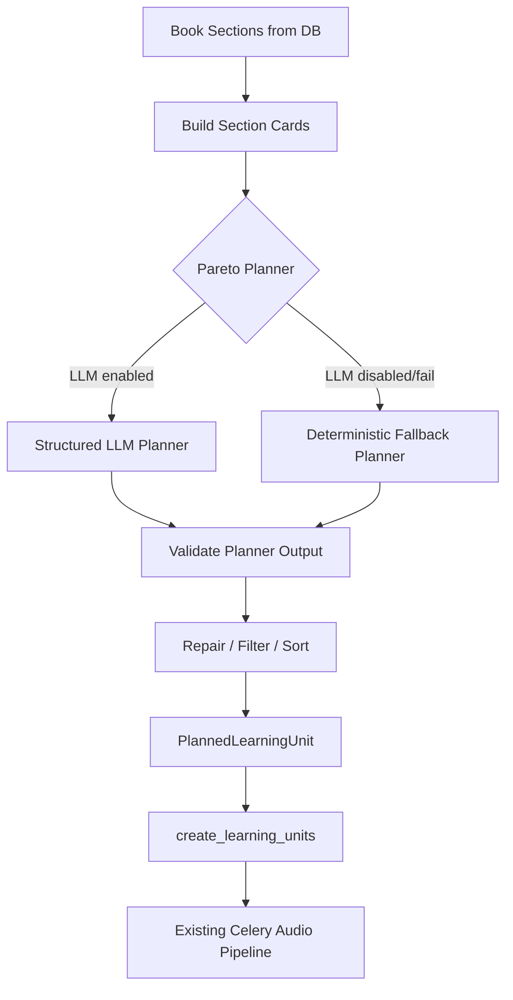

# Phase 8 Implementation Guide - Production Pareto Learning Unit Planner

Date: 2026-06-02  
Status: **Implemented locally - automated regression passed**  
Scope: Backend planner quality upgrade for `pareto` mode  
Depends on: Phase 5 `BookSection -> LearningUnit`, Phase 6 cleanup, current Celery generation pipeline  
Audience: Backend developer, Flutter developer, capstone reviewer

---

## 1. Goal

Phase 8 nâng cấp `pareto` mode từ kiểu "chọn ít mục hơn + prompt tóm tắt" thành một **Pareto Learning Unit Planner** đúng bản chất hơn:

```text
Full mode:
    giữ nhiều nội dung nhất có thể theo cấu trúc tài liệu.

Pareto mode:
    chọn và gom các phần quan trọng nhất để user nắm khung kiến thức cốt lõi nhanh hơn.
```

Pareto trong Tri Âm không nên hiểu là:

```text
Tóm tắt toàn bộ mục lục theo từng đề mục.
```

Mà nên hiểu là:

```text
Chọn nhóm nhỏ nội dung có giá trị học tập cao nhất,
gom các mục nhỏ liên quan thành các bài học trọng tâm,
rồi mới chuyển thành audio ngắn, rõ, dễ ôn.
```

---

## 0. Implementation Result

Phase 8 đã được implement theo hướng không breaking API và không migration DB.

Đã hoàn thành:

- Thêm `app/services/pareto_planner_service.py`.
- Thêm structured output schema cho Pareto planner.
- Thêm English system prompt cho planner để giảm token và rõ vai trò.
- Thêm `SectionCard` builder: gửi metadata + excerpt ngắn, không gửi toàn bộ source text.
- Thêm LLM planner có timeout.
- Thêm validation: chỉ nhận section id có thật trong tài liệu, sort lại theo thứ tự tài liệu, loại unit rỗng.
- Thêm deterministic fallback khi LLM disabled/timeout/schema lỗi/invalid id.
- Cải thiện fallback cũ để không chọn mục dài chỉ vì dài; ưu tiên keyword học tập như khái niệm, định nghĩa, quy tắc, phương pháp, công thức.
- Thêm async planner facade `plan_learning_units_async()`.
- Tích hợp vào `generate-plan` và `switch-mode`.
- Giữ nguyên response shape hiện tại cho FE.
- Không thêm bảng/cột DB mới.

Verification đã chạy:

```powershell
uv run ruff check app tests --exclude app/db/migrations --output-format=concise
uv run python -m py_compile app\services\pareto_planner_service.py app\services\learning_unit_planner_service.py app\services\upload_service.py app\services\audiobook_service.py app\api\v1\routers\audiobooks.py tests\test_pareto_planner_service.py
uv run pytest tests\test_pareto_planner_service.py tests\test_learning_unit_planner.py -q
uv run pytest tests\test_celery_enqueue.py tests\test_upload_service_batch_commit.py tests\test_phase3_generation_guardrails.py tests\test_processing_jobs_api.py tests\test_auth_user_isolation.py -q
uv run pytest tests\test_phase4_2_learning_loop.py tests\test_notifications_api.py tests\test_notification_outbox_repo.py -q
uv run pytest -q
```

Kết quả:

```text
Ruff: pass
Planner tests: 7 passed
Focused regression: 46 passed
Full regression: 104 passed
```

---

## 2. Research Summary

### 2.1 Pareto principle

Pareto principle thường được diễn giải là "vital few and useful many". Trong ngữ cảnh học tập, điều này có nghĩa là một phần nhỏ nội dung thường tạo phần lớn giá trị hiểu bài. Phần còn lại không vô dụng, nhưng không phải ưu tiên của chế độ học nhanh.

Nguồn tham khảo:

- Juran - Pareto Principle / vital few: https://www.juran.com/blog/a-guide-to-the-pareto-principle-80-20-rule-pareto-analysis/

### 2.2 Cognitive load

Người học khó xử lý quá nhiều thông tin mới cùng lúc. Pareto mode nên giảm tải nhận thức bằng cách:

- giảm số lượng bài học;
- giảm ví dụ phụ và đoạn lan man;
- giữ khung khái niệm, quy tắc, phương pháp;
- tổ chức lại các mục nhỏ thành cụm ý nghĩa.

Nguồn tham khảo:

- NSW Education - Cognitive Load Theory: https://education.nsw.gov.au/about-us/education-data-and-research/cese/publications/literature-reviews/cognitive-load-theory.education.nsw.gov.au%201education.nsw.gov.au%201

### 2.3 LLM structured output

Planner có dùng LLM thì phải trả về schema có kiểm soát. Không nhận text tự do, không parse kiểu ad hoc. Gemini hỗ trợ structured output theo JSON schema/Pydantic, phù hợp để bắt planner trả về danh sách unit rõ ràng.

Nguồn tham khảo:

- Google Gemini structured output: https://ai.google.dev/gemini-api/docs/structured-output

### 2.4 Hierarchical summarization caveat

Tóm tắt theo cây nhiều tầng có thể làm mất ý hoặc tăng hallucination nếu không bám nguồn. Vì vậy Phase 8 không để LLM tự tạo nội dung cuối cùng ngay ở bước planner. Planner chỉ chọn/gom source sections; audio script vẫn được sinh ở pipeline hiện tại từ source text đã chọn.

---

## 3. Current State

File chính hiện tại:

- `app/services/learning_unit_planner_service.py`
- `app/services/llm_service.py`
- `app/services/upload_service.py`
- `app/services/audiobook_service.py`
- `app/repositories/learning_unit_repo.py`
- `app/services/workers/book_pipeline.py`
- `app/services/workers/learning_unit_worker.py`

Hiện tại `pareto` đang đi qua:

```text
BookSection list
-> fallback_pareto_learning_units()
-> create LearningUnit
-> normalize_text_for_speech(mode="pareto")
-> TTS/audio/RAG
```

Vấn đề:

- Scoring còn thô: dựa nhiều vào độ dài text, số section con, keyword title.
- `PARETO_TARGET_COVERAGE_RATIO = 0.4`, hơi cao so với tinh thần Pareto.
- Chưa gom mục nhỏ theo ý nghĩa học tập.
- Chưa phân biệt rõ "core concept", "method", "example", "supporting detail".
- Chưa dùng LLM để nhìn toàn cục outline và chọn "vital few".
- Nếu outline có nhiều mục nhỏ, Pareto vẫn có thể chọn các mục rời rạc.

Điểm tốt cần giữ:

- Phase 5 đã có `BookSection` tree và `LearningUnit`, rất phù hợp để nâng cấp.
- Worker/audio/progress không cần đổi.
- API hiện tại có thể giữ nguyên, tránh breaking change với FE.

---

## 4. Target Business Logic

### 4.1 Full mode

Full mode tiếp tục làm như hiện tại:

```text
Tạo learning units theo chương lớn hoặc cụm mục hợp lý,
giữ gần đầy đủ nội dung tài liệu.
```

Không chỉnh hành vi full mode trong Phase 8, trừ khi test chứng minh có bug trực tiếp.

### 4.2 Pareto mode

Pareto mode cần tạo các bài học trọng tâm:

```text
Input:
    toàn bộ BookSection tree + metadata ngắn.

Output:
    3-8 LearningUnit trọng tâm, mỗi unit gom một hoặc nhiều section liên quan.
```

Một Pareto unit tốt phải có:

- title rõ nghĩa, không chỉ copy title mục đầu tiên;
- `source_section_ids` gồm các mục thật trong sách;
- lý do chọn (`planner_reason`);
- mục tiêu học (`learning_objective`);
- loại unit (`unit_type`) như `pareto_core`, `pareto_method`, `pareto_formula`, `pareto_example`, `pareto_review`.

### 4.3 Tiêu chí chọn nội dung Pareto

Ưu tiên cao:

- định nghĩa nền tảng;
- nguyên lý, định lý, công thức;
- quy tắc, phương pháp, quy trình;
- phần tổng quan/kết luận giúp nắm khung;
- mục mà nhiều mục con/mục sau phụ thuộc vào;
- ví dụ đại diện cần thiết để hiểu ý chính.

Ưu tiên thấp:

- ví dụ phụ dài;
- lịch sử, dẫn nhập lan man;
- lặp lại ý đã nói;
- bài tập/danh sách nhỏ không giải thích khái niệm;
- chi tiết trang trí không ảnh hưởng hiểu bài.

---

## 5. Target Architecture



Layer ownership:

| Layer | File | Responsibility |
| --- | --- | --- |
| Planner facade | `learning_unit_planner_service.py` | Public `plan_learning_units()` API |
| Pareto LLM planner | `pareto_planner_service.py` | Build cards, call LLM, validate output |
| Deterministic fallback | `pareto_planner_service.py` or current planner file | Stable no-LLM fallback |
| Repository | `learning_unit_repo.py` | Save `LearningUnit` and source links |
| Worker | existing worker files | No change |

---

## 6. Recommended Implementation

### 6.1 Add config

File: `app/core/config.py`

Add:

```python
PARETO_PLANNER_LLM_ENABLED: bool = True
PARETO_PLANNER_MODEL: str = "gemini-2.5-flash"
PARETO_PLANNER_TIMEOUT_SECONDS: float = 8.0
PARETO_PLANNER_MAX_UNITS: int = 8
PARETO_PLANNER_MIN_UNITS: int = 3
PARETO_TARGET_COVERAGE_RATIO: float = 0.25
PARETO_SECTION_EXCERPT_CHARS: int = 700
PARETO_PLANNER_MAX_SECTION_CARDS: int = 120
```

`.env.example`:

```env
PARETO_PLANNER_LLM_ENABLED=true
PARETO_PLANNER_MODEL=gemini-2.5-flash
PARETO_PLANNER_TIMEOUT_SECONDS=8
PARETO_PLANNER_MAX_UNITS=8
PARETO_PLANNER_MIN_UNITS=3
PARETO_TARGET_COVERAGE_RATIO=0.25
PARETO_SECTION_EXCERPT_CHARS=700
PARETO_PLANNER_MAX_SECTION_CARDS=120
```

Trade off:

- `0.25` không phải luôn đúng tuyệt đối, nhưng tốt hơn `0.4` cho Pareto mode.
- Có env giúp tune sau khi test tài liệu thật mà không đổi code.

### 6.2 Add `SectionCard`

New file: `app/services/pareto_planner_service.py`

```python
from dataclasses import dataclass
import uuid


@dataclass(frozen=True)
class SectionCard:
    section_id: uuid.UUID
    title: str
    path: str
    level: int
    parent_path: str | None
    text_char_count: int
    estimated_tokens: int
    child_count: int
    keyword_hints: list[str]
    excerpt: str
```

Rule:

- Không gửi toàn bộ `text_content` vào planner.
- Chỉ gửi excerpt ngắn và metadata.
- Planner chọn/gom source sections, không tạo nội dung audio ở đây.

### 6.3 Add structured output schema

```python
from pydantic import BaseModel, Field, field_validator


class ParetoPlannedUnitPayload(BaseModel):
    title: str = Field(min_length=3)
    source_section_ids: list[str] = Field(min_length=1)
    unit_type: str
    importance_score: int = Field(ge=1, le=5)
    learning_objective: str = Field(min_length=10)
    planner_reason: str = Field(min_length=10)


class ParetoPlannerPayload(BaseModel):
    units: list[ParetoPlannedUnitPayload] = Field(min_length=1)

    @field_validator("units")
    @classmethod
    def validate_units(cls, value):
        # Reject empty titles/source ids; detailed validation happens against DB sections.
        return value
```

### 6.4 LLM planner prompt

Prompt nên viết bằng tiếng Anh để ngắn, ổn định và giảm token. Nội dung source card vẫn là tiếng Việt.

System prompt proposal:

```text
You are TRIAM's Pareto learning planner.
Your job is not to summarize the book.
Your job is to select and group the vital few source sections that give the learner the highest understanding value.

Rules:
- Return only valid JSON matching the requested schema.
- Select 3 to 8 learning units unless the document is very small.
- Prefer foundational definitions, principles, formulas, methods, procedures, and representative examples.
- Merge small related sections into one coherent learning unit.
- Preserve the source order inside each unit.
- Do not invent section ids.
- Do not create audio script content.
- Do not include sections that are only decorative, repetitive, or minor examples unless they are necessary to understand a core idea.
- Each unit must explain why it was selected.
```

User content:

```text
Book title: ...
Mode: pareto
Target coverage: 25% of estimated tokens
Max units: 8

Section cards:
[
  {
    "id": "...",
    "path": "1.1",
    "title": "Khái niệm mệnh đề",
    "level": 2,
    "parent_path": "1",
    "estimated_tokens": 900,
    "child_count": 0,
    "keyword_hints": ["definition", "core_concept"],
    "excerpt": "..."
  }
]
```

### 6.5 Validation and repair

After LLM response:

```text
1. Parse Pydantic schema.
2. Ensure every source_section_id exists.
3. Remove duplicate section ids inside same unit.
4. Drop invalid/empty units.
5. Sort sections inside each unit by section_index.
6. Sort units by first source section order.
7. Enforce max units.
8. Estimate total selected tokens.
9. If selected tokens > target too much, trim lower-score units.
10. If result too small/empty, fallback deterministic.
```

Important:

- Never trust LLM ids blindly.
- Never let LLM create new section ids.
- Never store planner result before validation.

### 6.6 Deterministic fallback

Current `fallback_pareto_learning_units()` should not be deleted immediately. It should become fallback path.

Fallback improvements:

- Lower target ratio from `0.4` to config `0.25`.
- Score by:
  - keyword title;
  - level/root importance;
  - child count;
  - text size but capped, so long sections do not always win;
  - whether title looks like definition/method/rule/formula.

Example scoring idea:

```python
score = 0
score += keyword_score(title)
score += min(estimated_tokens, 2000) * 0.4
score += child_count * 250
score += max(0, 5 - level) * 150
```

### 6.7 Integrate with existing facade

File: `app/services/learning_unit_planner_service.py`

Keep public API:

```python
def plan_learning_units(sections: list[BookSection], mode: PlanMode | str) -> list[PlannedLearningUnit]:
    mode_value = PlanMode(mode)
    if mode_value == PlanMode.FULL:
        return plan_full_learning_units(sections)
    return plan_pareto_learning_units(sections)
```

Since LLM call is async, choose one of two approaches:

#### Option A - Recommended

Make a new async planner call used only by service layer:

```python
async def plan_learning_units_async(sections: list[BookSection], mode: PlanMode | str) -> list[PlannedLearningUnit]:
    ...
```

Then update:

- `handle_generate_plan()`
- `_ensure_learning_units_for_mode()` / switch mode path

Trade off:

- More files change, but correct because LLM planner is async.
- Avoid blocking event loop with `asyncio.run()` inside FastAPI.

#### Option B - Not recommended

Keep planner sync and call LLM via blocking wrapper.

Do not choose this unless forced. It is harder to debug and worse for FastAPI async routes.

### 6.8 Upload/generate-plan integration

Current generate plan path:

```text
POST /generate-plan
-> _planned_units_for_book()
-> create ReadingPlan + LearningUnit + ProcessingJob
-> enqueue Celery document task
```

Target:

```text
POST /generate-plan
-> await _planned_units_for_book()
-> if mode=pareto, planner may call LLM with timeout/fallback
-> create ReadingPlan + LearningUnit + ProcessingJob
-> enqueue Celery document task
```

Potential issue:

- If Pareto planner calls LLM during request, `POST /generate-plan` may become slower.

Recommended guard:

- Timeout planner at `PARETO_PLANNER_TIMEOUT_SECONDS`.
- On timeout, fallback deterministic.
- Log `planner_source=llm|fallback`.

Future alternative:

- Move planning itself into Celery. Not needed for this phase if timeout is controlled.

---

## 7. API / FE Contract Impact

No breaking API change required.

Existing responses can remain:

```json
{
  "planned_units": [
    {
      "unit_index": 0,
      "title": "...",
      "unit_type": "pareto_core",
      "source_section_count": 4,
      "estimated_audio_seconds": 180
    }
  ]
}
```

FE should already display learning units from current Phase 6 contract.

Optional improvement for FE:

- Show `unit_type`.
- Show `planner_reason` in detail/debug/admin screen only, not necessarily user-facing.
- For Pareto mode, label:

```text
Bài học trọng tâm
```

instead of:

```text
Chương
```

---

## 8. Testing Plan

### 8.1 Unit tests

File: `tests/test_learning_unit_planner.py`

Add tests:

```text
1. Full mode behavior unchanged.
2. Pareto fallback does not select a section only because it is long.
3. Pareto groups related small sections into one unit.
4. Pareto respects max unit count.
5. Pareto selected source ids preserve document order.
```

New file: `tests/test_pareto_planner_service.py`

Add tests:

```text
1. Section cards do not include full source text.
2. LLM response with invalid section ids is repaired or rejected.
3. Empty/invalid LLM response falls back.
4. LLM planner timeout falls back.
5. Valid structured response becomes PlannedLearningUnit.
```

### 8.2 Integration tests

Use a small synthetic `BookSection` tree:

```text
Chương 1 Logic mệnh đề
  1.1 Mệnh đề
    1.1.1 Khái niệm
    1.1.2 Phân loại
    1.1.3 Phép toán
  1.2 Vị từ
  1.3 Suy luận toán học
```

Expected:

```text
Pareto creates fewer units than full.
Pareto groups core sections.
Pareto unit title is meaningful.
```

### 8.3 Real document test

Use real file already tested in project:

```text
trr.docx
```

Manual checks:

- Upload success.
- Generate plan full success.
- Generate plan pareto success.
- Pareto unit count less than full unit count.
- Pareto unit titles are not just random small headings.
- FE displays "bài học trọng tâm" / units, not fake chapters.
- Job reaches ready.

---

## 9. Logging

Log useful metadata only:

```text
Pareto planner start | book_id=... | sections=... | cards=... | model=...
Pareto planner result | source=llm | units=... | selected_tokens=... | target_ratio=...
Pareto planner fallback | reason=timeout/schema_error/invalid_ids
```

Do not log:

- full section text;
- full LLM prompt;
- full LLM response if it contains content snippets;
- secrets/API keys.

---

## 10. Trade Offs

| Choice | Benefit | Cost |
| --- | --- | --- |
| LLM planner with structured output | Better semantic grouping | More latency/cost |
| Deterministic fallback | Stable production behavior | Lower semantic quality |
| Planner in request with timeout | Simple integration | Generate-plan can be slower |
| Planner in Celery | More durable | Bigger refactor/API progress complexity |
| No DB migration | Faster, safer phase | Limited planner metadata fields |

Recommendation for this phase:

```text
Use LLM planner with strict timeout + deterministic fallback.
Do not add migration yet.
Do not move planning into Celery yet.
```

---

## 11. Implementation Checklist

- [ ] Add config vars.
- [ ] Add `pareto_planner_service.py`.
- [ ] Add `SectionCard` builder.
- [ ] Add structured output models.
- [ ] Add English Pareto planner prompt.
- [ ] Add LLM call with timeout and semaphore.
- [ ] Add validation/repair/fallback.
- [ ] Keep current deterministic planner as fallback.
- [ ] Add async planner facade.
- [ ] Update generate-plan path.
- [ ] Update switch-mode path.
- [ ] Add unit tests.
- [ ] Run ruff/pytest.
- [ ] Manual test with `trr.docx`.

---

## 12. Open Questions

### 12.1 Should Pareto planner use LLM during request?

Recommended now: yes, but with timeout and fallback.

Reason:

- Generate-plan already creates user-visible plan preview.
- User expects Pareto unit list early.
- Celery pipeline starts after plan exists.

If this becomes slow in production, move planning into Celery in a later phase.

### 12.2 Should Pareto store `importance_score` and `learning_objective` in DB?

Recommended now: no migration yet.

Use existing:

- `unit_type`
- `planner_reason`

Later, if FE wants richer explanation, add:

- `learning_objective`
- `importance_score`
- `planner_metadata` JSON

### 12.3 Should RAG index Pareto content or full content?

Current behavior indexes generated unit source text. For Pareto mode this means RAG sees only selected Pareto source sections.

Recommendation:

- Keep current behavior for now.
- Long-term: chat/RAG should search full book knowledge, not only the active audio mode.

This is a separate RAG architecture concern and should not block Phase 8.

---

## 13. Definition Of Done

Phase 8 is done when:

- `full` mode output remains stable.
- `pareto` mode creates fewer, more meaningful units.
- Small related sections can be grouped into larger focus units.
- Pareto planner has LLM structured output and deterministic fallback.
- Invalid LLM output cannot corrupt DB.
- Generate-plan still returns same response shape to FE.
- Full regression tests pass.
- A real document test confirms Pareto unit titles and grouping look reasonable.
