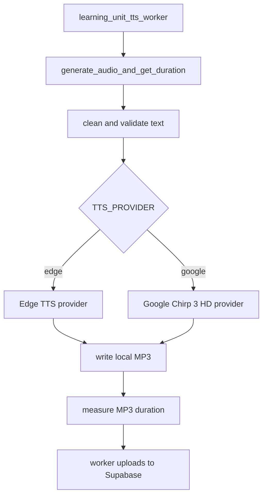

# Phase 9 Implementation Guide - TTS Provider Switch With Google Chirp 3 HD

Date: 2026-06-02  
Status: **Implemented locally - automated regression and provider smoke passed**
Scope: Backend TTS provider switch for audiobook generation  
Depends on: Current `app/services/tts_service.py`, worker pipeline, successful `scripts/test_google_tts.py` smoke test  
Audience: Backend developer, capstone reviewer

---

## 0. Implementation Result

Phase 9 đã được implement theo hướng không đổi API cho FE, không đổi DB, và không đổi worker contract.

Đã hoàn thành:

- Thêm config `TTS_PROVIDER=edge|google`.
- Thêm alias `gg` cho `google`.
- Thêm config `TTS_GOOGLE_API_KEY`, `GOOGLE_TTS_LANGUAGE_CODE`, `GOOGLE_TTS_VOICE`, `GOOGLE_TTS_MAX_BYTES_PER_REQUEST`, `GOOGLE_TTS_ENABLE_COST_LOG`.
- Đổi default `EDGE_TTS_VOICE` trong config sang `vi-VN-HoaiMyNeural`.
- Refactor `app/services/tts_service.py` thành provider-based helpers.
- Giữ public function `generate_audio_and_get_duration(text, filename, voice=None, max_retries=6)`.
- Giữ `stream_text_to_speech_edge()` và `generate_audio_file_edge()` để không phá import cũ.
- Google TTS dùng `TTS_GOOGLE_API_KEY` với `ClientOptions(api_key=...)`, giống script test đã thành công.
- Google input có guardrail `GOOGLE_TTS_MAX_BYTES_PER_REQUEST`.
- Không log API key hoặc full input text.
- Thêm sanitizer cho exception message để không log nhầm `TTS_GOOGLE_API_KEY`.
- Thêm `tests/test_tts_service_provider_switch.py` để mock Edge/Google và test config errors.
- Cập nhật `.env.example`.
- Cập nhật `scripts/test_google_tts.py` import order để ruff sạch.

Verification đã chạy:

```powershell
uv run python -m py_compile app\services\tts_service.py app\core\config.py tests\test_tts_service_provider_switch.py scripts\test_google_tts.py
uv run ruff check app\services\tts_service.py app\core\config.py tests\test_tts_service_provider_switch.py scripts\test_google_tts.py --output-format=concise
uv run pytest tests\test_tts_service_provider_switch.py -q
uv run pytest tests\test_celery_enqueue.py tests\test_upload_service_batch_commit.py tests\test_phase3_generation_guardrails.py tests\test_processing_jobs_api.py -q
uv run ruff check app tests --exclude app/db/migrations --output-format=concise
uv run ruff check scripts\test_google_tts.py --output-format=concise
uv run pytest -q
```

Kết quả:

```text
TTS provider unit tests: 8 passed
Worker/job focused regression: 16 passed
Full pytest: 122 passed
Ruff app/tests: pass
Ruff scripts/test_google_tts.py: pass
```

Provider smoke test thật đã chạy:

```text
Edge provider:
duration_ms=9288, size=55728, generated file cleaned

Google provider:
duration_ms=11496, size=45984, generated file cleaned
```

Lưu ý:

- Khi chạy Edge smoke, local `.env` hiện đang override voice thành `en-US-AvaMultilingualNeural`. Code default đã đổi sang `vi-VN-HoaiMyNeural`, nhưng `.env` luôn có ưu tiên cao hơn. Nếu muốn Edge local đọc giọng Việt, set:

```env
EDGE_TTS_VOICE=vi-VN-HoaiMyNeural
```

- Ruff toàn bộ thư mục `scripts/` vẫn có lỗi legacy ở các script cũ ngoài scope Phase 9. Phase này chỉ làm sạch `scripts/test_google_tts.py`.

---

## 1. Goal

Phase này thêm cơ chế chọn provider TTS bằng biến môi trường:

```env
TTS_PROVIDER=edge
```

hoặc:

```env
TTS_PROVIDER=google
```

Mục tiêu:

- Local/dev có thể dùng Edge TTS để tránh đốt quota Google.
- Production hoặc test chất lượng có thể đổi sang Google Chirp 3 HD bằng `.env`.
- Không đổi public function worker đang dùng:

```python
generate_audio_and_get_duration(text, filename, voice=None, max_retries=6)
```

- Không đổi API cho FE.
- Không đổi DB.
- Không tự động fallback từ Google sang Edge trong production, vì sẽ làm giọng đọc bị lẫn và che lỗi vận hành.

---

## 2. Research Summary

### 2.1 Google Chirp 3 HD

Theo tài liệu chính thức, Chirp 3 HD là thế hệ giọng Text-to-Speech mới của Google Cloud, tập trung vào độ tự nhiên và cảm xúc. Google có sample `synthesize_speech` tạo MP3 bằng `TextToSpeechClient`, `SynthesisInput`, `VoiceSelectionParams`, `AudioConfig`.

Nguồn:

- Chirp 3 HD docs: https://docs.cloud.google.com/text-to-speech/docs/chirp3-hd
- Python synthesize sample: https://docs.cloud.google.com/text-to-speech/docs/samples/tts-quickstart
- Python client reference: https://docs.cloud.google.com/python/docs/reference/texttospeech/latest/google.cloud.texttospeech_v1.services.text_to_speech.TextToSpeechClient

### 2.2 Pricing

Theo pricing chính thức:

```text
Chirp 3 HD:
0 to 1 million characters free
US$0.00003 per character after free usage
US$30 per 1 million characters
```

Nguồn:

- Google Text-to-Speech pricing: https://cloud.google.com/text-to-speech/pricing

Lưu ý quan trọng:

- Google tính theo **characters/ký tự**, không phải token.
- Tiếng Việt có dấu vẫn tính theo ký tự cho pricing, nhưng request limit lại tính theo bytes.

### 2.3 Quota and request size

Theo quota chính thức:

```text
Total bytes per request: 5,000
Chirp3RequestsPerMinutePerProject: 200
```

Nguồn:

- Google Text-to-Speech quotas: https://docs.cloud.google.com/text-to-speech/quotas

Với tiếng Việt UTF-8, một ký tự có thể chiếm nhiều bytes. Vì vậy hệ thống nên đặt giới hạn nội bộ thấp hơn 5,000 bytes, ví dụ:

```env
GOOGLE_TTS_MAX_BYTES_PER_REQUEST=4500
```

### 2.4 API key security

Google khuyến nghị hạn chế API key theo client/API được phép gọi. API restrictions có thể giới hạn key chỉ gọi một số Google Cloud APIs. Google cũng cảnh báo không hard-code API key trong source code hoặc commit lên repo.

Nguồn:

- API key restrictions: https://docs.cloud.google.com/api-keys/docs/add-restrictions-api-keys
- API key best practices: https://docs.cloud.google.com/docs/authentication/api-keys-best-practices

Chốt cho Tri Âm:

- Dùng biến riêng `TTS_GOOGLE_API_KEY`.
- Không dùng chung `GEMINI_API_KEY`.
- Restrict API key chỉ cho **Cloud Text-to-Speech API** nếu có thể.
- Không log key, không log request payload đầy đủ.

---

## 3. Current State

File chính:

```text
app/services/tts_service.py
```

Hiện tại:

- `generate_audio_and_get_duration()` chỉ dùng Edge TTS.
- `voice` default đang là `settings.EDGE_TTS_VOICE`.
- Retry/backoff hard-code trong hàm.
- `receive_timeout=300` hard-code.
- Chưa có provider switch.
- Chưa có Google TTS trong worker pipeline.

File test đã thành công:

```text
scripts/test_google_tts.py
```

Script này đã chứng minh cách dùng:

```python
options = ClientOptions(api_key=api_key)
client = texttospeech.TextToSpeechClient(client_options=options)
voice = texttospeech.VoiceSelectionParams(
    language_code="vi-VN",
    name="vi-VN-Chirp3-HD-Iapetus",
)
```

Vì vậy Phase 9 sẽ dùng đúng biến:

```env
TTS_GOOGLE_API_KEY=
```

---

## 4. Target Architecture



Provider selection lives only in `tts_service.py`. Worker code should not know which provider is active.

---

## 5. Config Plan

File:

```text
app/core/config.py
```

Add:

```python
    # Text-to-Speech provider
    TTS_PROVIDER: str = "edge"  # edge | google
    TTS_RECEIVE_TIMEOUT_SECONDS: int = 300
    TTS_RETRY_BASE_SECONDS: int = 3
    TTS_MIN_TEXT_CHARS: int = 10

    # Google Cloud Text-to-Speech
    TTS_GOOGLE_API_KEY: str | None = None
    GOOGLE_TTS_LANGUAGE_CODE: str = "vi-VN"
    GOOGLE_TTS_VOICE: str = "vi-VN-Chirp3-HD-Iapetus"
    GOOGLE_TTS_MAX_BYTES_PER_REQUEST: int = 4500
    GOOGLE_TTS_ENABLE_COST_LOG: bool = True
```

Update `.env.example`:

```env
# Text-to-Speech provider
# edge = free/dev provider
# google = Google Cloud Text-to-Speech Chirp 3 HD
TTS_PROVIDER=edge
EDGE_TTS_VOICE=vi-VN-HoaiMyNeural
TTS_GENERATION_CONCURRENCY=2
TTS_RECEIVE_TIMEOUT_SECONDS=300
TTS_RETRY_BASE_SECONDS=3
TTS_MIN_TEXT_CHARS=10

# Google Cloud Text-to-Speech, required only when TTS_PROVIDER=google
TTS_GOOGLE_API_KEY=
GOOGLE_TTS_LANGUAGE_CODE=vi-VN
GOOGLE_TTS_VOICE=vi-VN-Chirp3-HD-Iapetus
GOOGLE_TTS_MAX_BYTES_PER_REQUEST=4500
GOOGLE_TTS_ENABLE_COST_LOG=true
```

Recommended local modes:

```env
TTS_PROVIDER=edge
TTS_GENERATION_CONCURRENCY=2
```

Google smoke test:

```env
TTS_PROVIDER=google
TTS_GOOGLE_API_KEY=<your-key>
TTS_GENERATION_CONCURRENCY=1
```

Production start:

```env
TTS_PROVIDER=google
TTS_GOOGLE_API_KEY=<secret>
TTS_GENERATION_CONCURRENCY=1
GOOGLE_TTS_VOICE=vi-VN-Chirp3-HD-Iapetus
```

Reason:

- Google Chirp 3 has request quota, but cost is the bigger concern.
- Start concurrency at 1 to protect quota/cost.
- Increase only after real monitoring.

---

## 6. Implementation Plan

### 6.1 Keep public worker function stable

Do not change worker calls:

```python
duration_ms = await generate_audio_and_get_duration(script, local_file)
```

Recommended signature:

```python
async def generate_audio_and_get_duration(
    text: str,
    filename: str,
    voice: str | None = None,
    max_retries: int = 6,
) -> int:
```

Why `voice: str | None = None`:

- If provider is Edge, default to `settings.EDGE_TTS_VOICE`.
- If provider is Google, default to `settings.GOOGLE_TTS_VOICE`.
- Avoid binding default function argument to Edge when provider is Google.

### 6.2 Add constants and client cache

File:

```text
app/services/tts_service.py
```

Add:

```python
import re
from pathlib import Path

SUPPORTED_TTS_PROVIDERS = {"edge", "google", "gg"}
_STAGE_TAG_RE = re.compile(r"\[(?:[A-Za-zÀ-ỹ_ -]{2,40})\]")
_google_tts_client = None
```

`gg` can be accepted as an alias, but the canonical provider should be `google`.

### 6.3 Clean and validate text

```python
def _clean_text_for_tts(text: str) -> str:
    cleaned = _STAGE_TAG_RE.sub("", text or "")
    return " ".join(cleaned.split()).strip()


def _validate_tts_text(text: str) -> None:
    if len(text) < settings.TTS_MIN_TEXT_CHARS:
        raise TTSInputTooShortError(
            f"Nội dung quá ngắn để tạo audio ({len(text)} ký tự)."
        )
```

Do not log full text.

### 6.4 Provider selector

```python
def _selected_tts_provider() -> str:
    provider = settings.TTS_PROVIDER.strip().lower()
    if provider == "gg":
        return "google"
    if provider not in {"edge", "google"}:
        raise ExternalServiceError(f"TTS_PROVIDER không hợp lệ: {settings.TTS_PROVIDER}")
    return provider
```

Config sai phải fail rõ, không âm thầm fallback.

### 6.5 Google client with API key

Use the same approach as `scripts/test_google_tts.py`:

```python
def _get_google_tts_client():
    global _google_tts_client

    if _google_tts_client is not None:
        return _google_tts_client

    try:
        from google.api_core.client_options import ClientOptions
        from google.cloud import texttospeech
    except ImportError as exc:
        raise ExternalServiceError(
            "Thiếu dependency google-cloud-texttospeech."
        ) from exc

    if not settings.TTS_GOOGLE_API_KEY:
        raise ExternalServiceError(
            "Thiếu TTS_GOOGLE_API_KEY để gọi Google Text-to-Speech."
        )

    options = ClientOptions(api_key=settings.TTS_GOOGLE_API_KEY)
    _google_tts_client = texttospeech.TextToSpeechClient(client_options=options)
    return _google_tts_client
```

### 6.6 Google sync generation

Google client is sync. Use `asyncio.to_thread()` from async function.

```python
def _utf8_size(text: str) -> int:
    return len(text.encode("utf-8"))


def _generate_audio_file_google_sync(text: str, filename: str, voice_name: str) -> int:
    from google.cloud import texttospeech

    byte_count = _utf8_size(text)
    if byte_count > settings.GOOGLE_TTS_MAX_BYTES_PER_REQUEST:
        raise ExternalServiceError(
            "Google TTS input quá dài cho một request "
            f"({byte_count} bytes > {settings.GOOGLE_TTS_MAX_BYTES_PER_REQUEST} bytes)."
        )

    client = _get_google_tts_client()
    synthesis_input = texttospeech.SynthesisInput(text=text)
    voice = texttospeech.VoiceSelectionParams(
        language_code=settings.GOOGLE_TTS_LANGUAGE_CODE,
        name=voice_name,
    )
    audio_config = texttospeech.AudioConfig(
        audio_encoding=texttospeech.AudioEncoding.MP3,
    )

    response = client.synthesize_speech(
        input=synthesis_input,
        voice=voice,
        audio_config=audio_config,
    )
    Path(filename).write_bytes(response.audio_content)
    return len(response.audio_content)
```

### 6.7 Edge generation

```python
async def _generate_audio_file_edge(text: str, filename: str, voice_name: str) -> None:
    communicate = edge_tts.Communicate(
        text,
        voice_name,
        receive_timeout=settings.TTS_RECEIVE_TIMEOUT_SECONDS,
    )
    await communicate.save(filename)
```

Keep compatibility wrapper:

```python
async def generate_audio_file_edge(text: str, filename: str, voice: str = settings.EDGE_TTS_VOICE):
    await _generate_audio_file_edge(_clean_text_for_tts(text), filename, voice)
```

### 6.8 Duration helper

```python
def _measure_mp3_duration_ms(filename: str) -> int:
    from mutagen.mp3 import MP3

    try:
        audio = MP3(filename)
        return int(audio.info.length * 1000)
    except Exception:
        return 0
```

### 6.9 Main function

```python
async def generate_audio_and_get_duration(
    text: str,
    filename: str,
    voice: str | None = None,
    max_retries: int = 6,
) -> int:
    cleaned = _clean_text_for_tts(text)
    _validate_tts_text(cleaned)

    provider = _selected_tts_provider()
    target_voice = voice or (
        settings.GOOGLE_TTS_VOICE if provider == "google" else settings.EDGE_TTS_VOICE
    )

    async with get_loop_semaphore("tts_generation", settings.TTS_GENERATION_CONCURRENCY):
        for attempt in range(max_retries):
            try:
                if provider == "google":
                    audio_bytes = await asyncio.to_thread(
                        _generate_audio_file_google_sync,
                        cleaned,
                        filename,
                        target_voice,
                    )
                    if settings.GOOGLE_TTS_ENABLE_COST_LOG:
                        log.info(
                            "Google TTS generated | chars={} | bytes={} | audio_bytes={} | voice={}",
                            len(cleaned),
                            len(cleaned.encode("utf-8")),
                            audio_bytes,
                            target_voice,
                        )
                else:
                    await _generate_audio_file_edge(cleaned, filename, target_voice)
                    log.info(
                        "Edge TTS generated | chars={} | bytes={} | voice={}",
                        len(cleaned),
                        len(cleaned.encode("utf-8")),
                        target_voice,
                    )

                return _measure_mp3_duration_ms(filename)
            except Exception as exc:
                if attempt < max_retries - 1:
                    wait = settings.TTS_RETRY_BASE_SECONDS * (2**attempt)
                    log.warning(
                        "TTS attempt failed | provider={} | attempt={}/{} | chars={} | wait_seconds={} | error={}",
                        provider,
                        attempt + 1,
                        max_retries,
                        len(cleaned),
                        wait,
                        exc,
                    )
                    await asyncio.sleep(wait)
                    continue

                log.error(
                    "TTS failed | provider={} | attempts={} | chars={} | voice={} | error={}",
                    provider,
                    max_retries,
                    len(cleaned),
                    target_voice,
                    exc,
                )
                raise

    return 0
```

---

## 7. Long Text Guardrail

Official limit is 5,000 bytes/request. Tri Âm should keep 4,500 bytes internal guardrail.

Phase 9 should not join/split MP3 inside `tts_service.py`.

Why:

- Worker already stores one row per `LearningUnitSegment`.
- If service splits one script into many MP3s and joins them, duration/seek can become harder to debug.
- Joining MP3 properly may need FFmpeg, increasing deploy complexity.

Correct long-term approach:

```text
llm_service.py should produce main_scripts small enough for TTS.
```

Recommended prompt rule later:

```text
Mỗi phần tử main_scripts phải dưới 3,500 ký tự tiếng Việt,
kết thúc ở ranh giới câu hoàn chỉnh.
```

Optional later validator:

```python
if len(script.encode("utf-8")) > settings.GOOGLE_TTS_MAX_BYTES_PER_REQUEST:
    raise ValueError("main_scripts item exceeds Google TTS byte budget")
```

Do not add this validator yet unless manual tests show scripts are too long. Start with TTS guardrail first.

---

## 8. Testing Plan

### 8.1 Static checks

```powershell
uv run python -m py_compile app\services\tts_service.py app\core\config.py scripts\test_google_tts.py
uv run ruff check app\services\tts_service.py app\core\config.py scripts\test_google_tts.py --output-format=concise
```

### 8.2 Unit tests

Add tests:

```text
tests/test_tts_service_provider_switch.py
```

Cases:

- provider `edge` selects Edge voice.
- provider `google` selects Google voice.
- provider `gg` maps to Google if alias is implemented.
- invalid provider raises `ExternalServiceError`.
- text shorter than `TTS_MIN_TEXT_CHARS` raises `TTSInputTooShortError`.
- Google input over byte guardrail raises `ExternalServiceError`.
- Google API key missing raises `ExternalServiceError`.
- logging does not include full text or API key.

Mock Google client and Edge call. Unit tests must not call real TTS.

### 8.3 Edge local smoke

Set:

```env
TTS_PROVIDER=edge
```

Run:

```powershell
@'
import asyncio
from pathlib import Path
from app.services.tts_service import generate_audio_and_get_duration

async def main():
    Path("uploads").mkdir(exist_ok=True)
    output = "uploads/test_edge_tts.mp3"
    duration = await generate_audio_and_get_duration(
        "Đây là kiểm thử Edge TTS cho hệ thống Tri Âm.",
        output,
    )
    print({"duration_ms": duration, "size": Path(output).stat().st_size})

asyncio.run(main())
'@ | uv run python -
```

Expected:

- `duration_ms > 0`
- file exists
- no full text in logs

### 8.4 Google local smoke

Set:

```env
TTS_PROVIDER=google
TTS_GOOGLE_API_KEY=<your-key>
GOOGLE_TTS_VOICE=vi-VN-Chirp3-HD-Iapetus
TTS_GENERATION_CONCURRENCY=1
```

Run existing script:

```powershell
uv run python scripts\test_google_tts.py
```

Then run service-level smoke:

```powershell
@'
import asyncio
from pathlib import Path
from app.services.tts_service import generate_audio_and_get_duration

async def main():
    Path("uploads").mkdir(exist_ok=True)
    output = "uploads/test_google_service_tts.mp3"
    duration = await generate_audio_and_get_duration(
        "Xin chào, đây là kiểm thử Google Chirp ba HD tiếng Việt trong Tri Âm.",
        output,
    )
    print({"duration_ms": duration, "size": Path(output).stat().st_size})

asyncio.run(main())
'@ | uv run python -
```

Expected:

- file exists
- `duration_ms > 0`
- logs show provider Google, chars, bytes, voice
- logs do not expose `TTS_GOOGLE_API_KEY`

### 8.5 Worker integration smoke

With Google:

```env
TTS_PROVIDER=google
TTS_GENERATION_CONCURRENCY=1
```

Run local:

```powershell
uv run uvicorn app.main:app --host 0.0.0.0 --port 8000 --reload
uv run celery -A app.core.celery_app.celery_app worker -Q document -l info --pool=solo --concurrency 1
```

Flow:

```text
POST /api/v1/upload
POST /api/v1/generate-plan
GET /api/v1/jobs/{job_id}
GET /api/v1/books/{book_id}/learning-units
```

Expected:

- job reaches `partial_ready` or `ready`
- audio URLs created
- no Google bytes limit error
- no key leaked in logs

---

## 9. Production Checklist

Before deploy:

- [ ] `TTS_PROVIDER=google`
- [ ] `TTS_GOOGLE_API_KEY` set as Hugging Face secret
- [ ] API key restricted to Cloud Text-to-Speech API if possible
- [ ] Billing enabled in Google Cloud
- [ ] Cloud Text-to-Speech API enabled
- [ ] `TTS_GENERATION_CONCURRENCY=1`
- [ ] `GOOGLE_TTS_MAX_BYTES_PER_REQUEST=4500`
- [ ] `GOOGLE_TTS_VOICE=vi-VN-Chirp3-HD-Iapetus`
- [ ] logs do not print full text or API key
- [ ] smoke test one short text
- [ ] smoke test one small book

---

## 10. Trade Offs

### 10.1 API key vs service account

Official Google client samples usually use Application Default Credentials. Your local test proved API key works with `ClientOptions(api_key=...)`.

For this capstone phase, API key is acceptable because:

- simple setup;
- works in local and Hugging Face secrets;
- easy to rotate;
- no JSON credentials file to manage.

But production best practice is still:

- restrict key;
- monitor usage;
- do not commit or log key;
- consider service account/IAM later if the product scales.

### 10.2 No automatic provider fallback

If Google fails, do not silently call Edge in the same job.

Reason:

- mixed voice quality is bad UX;
- cost/permission/rate-limit problems become hidden;
- retry/reprocess becomes harder to reason about.

Switch provider manually through `.env` instead.

### 10.3 Google costs money after free quota

Edge is free but quality is lower.

Google is better for audiobook voice quality, but must be controlled:

- start with concurrency 1;
- log character count;
- estimate cost before large books in later phase;
- keep Edge as dev provider.

### 10.4 Request limit is bytes, pricing is characters

This is easy to confuse.

Use:

```text
chars -> cost estimate
bytes -> request safety
```

---

## 11. Done Criteria

Phase 9 is complete when:

- [x] `TTS_PROVIDER=edge|google` works.
- [x] `TTS_GOOGLE_API_KEY` is read from settings.
- [x] Edge regression still generates MP3.
- [x] Google service-level smoke generates MP3.
- [x] Worker can generate audio using active provider without code change.
- [x] Invalid config fails clearly.
- [x] No API key or full text is logged.
- [x] Focused TTS tests pass.
- [x] Full backend regression pass.
