# TRIAM System Architecture Mermaid

File này là bản Mermaid chính xác nhất hiện tại để dùng trong README, báo cáo hoặc Mermaid Live Editor.

## Latest Version

```mermaid
flowchart LR
  %% =========================
  %% TRIAM SYSTEM ARCHITECTURE
  %% =========================

  subgraph CLIENT["1. Client"]
    direction TB
    FLUTTER["Flutter Mobile App<br/>Upload Document<br/>Reading Plan<br/>Audio Player<br/>Progress Tracking<br/>Study Chat / Voice<br/>In-App Notifications"]
  end

  subgraph RT["2. Realtime Transport"]
    direction TB
    LKROOM["LiveKit Cloud Room<br/>Realtime audio transport<br/>DataChannel: lk.chat / lk.transcript / lk.control"]
  end

  subgraph BACKEND["3. Backend Runtime - Hugging Face Docker Space"]
    direction TB

    API["FastAPI API Server<br/>Upload / Books / Plans<br/>LiveKit Token API<br/>Jobs & Processing Status<br/>Study Context & Chat Threads<br/>Learning Progress API<br/>Notifications API"]

    REDIS["Redis Cloud Broker<br/>Celery broker only<br/>document queue<br/>maintenance queue<br/>notification queue"]

    DOCW["Celery Document Worker<br/>Queue: document<br/>triam.books.process<br/>triam.books.switch_mode<br/>Parse chapters<br/>RAG embeddings<br/>LLM normalize<br/>TTS audio generation<br/>Partial-ready unlock"]

    BEAT["Celery Beat Scheduler<br/>Schedules scan_due<br/>Does not scan DB directly"]

    NOTIFW["Celery Notification Worker<br/>Queues: maintenance, notification<br/>scan_due<br/>deliver_due<br/>stale-lock recovery"]

    AGENT["LiveKit Realtime Agent<br/>Voice lane: OpenAI Realtime<br/>Typed chat lane: OpenAI Chat LLM + RAG<br/>publishes lk.chat / lk.transcript<br/>reads lk.control"]
  end

  subgraph DATA["4. Data Layer - Supabase"]
    direction TB

    PG["Supabase Postgres + pgvector<br/>books / chapters / chapter_segments<br/>processing_jobs / chapter_processing_states<br/>reading_plans / reading_plan_schedule_slots<br/>chapter_learning_progress<br/>spaced_review_items<br/>notification_outbox / user_notifications<br/>study_contexts / chat_threads / chat_messages<br/>book_knowledge vectors"]

    STORAGE["Supabase Storage<br/>raw_books<br/>audios"]
  end

  subgraph EXT["5. External AI Services"]
    direction TB

    GEMINI["Gemini LLM<br/>OpenAI-compatible API<br/>normalize TTS scripts"]

    EMBED["OpenAI Embeddings<br/>text-embedding-3-small"]

    EDGETTS["Edge TTS<br/>audio segments + review audio"]

    OAIR["OpenAI Realtime<br/>voice STT + realtime voice response"]

    CHATLLM["OpenAI Chat LLM<br/>typed chat: gpt-4o-mini"]

    TAVILY["Tavily Search<br/>optional web lookup"]
  end

  subgraph LOOP["6. Production Learning Loop"]
    direction LR
    L1["Book READY"]
    L2["User listens to segments"]
    L3["FE sends progress"]
    L4["chapter_learning_progress"]
    L5["80 percent or manual complete"]
    L6["Create spaced_review_items"]
    L7["scan_due"]
    L8["notification_outbox"]
    L9["deliver_due"]
    L10["user_notifications"]

    L1 --> L2 --> L3 --> L4 --> L5 --> L6 --> L7 --> L8 --> L9 --> L10
  end

  subgraph RULES["Core Architecture Rules"]
    direction LR
    R1["Postgres is the source of truth"]
    R2["Redis is only the Celery broker"]
    R3["FastAPI issues LiveKit token"]
    R4["LiveKit Cloud Room is transport only"]
    R5["Voice uses OpenAI Realtime"]
    R6["Typed chat uses LiveKit DataChannel + text LLM"]
    R7["Spaced review starts after chapter completion"]
    R8["Push notification is future work"]
  end

  %% =========================
  %% REST/API FLOW
  %% =========================

  FLUTTER -- "REST API" --> API
  API -- "API responses + LiveKit token" --> FLUTTER

  %% =========================
  %% LIVEKIT CHAT / VOICE FLOW
  %% =========================

  FLUTTER -- "LiveKit SDK: audio + DataChannel" --> LKROOM
  LKROOM -- "voice audio + lk.chat" --> AGENT
  AGENT -- "assistant audio + lk.chat / lk.transcript" --> LKROOM
  LKROOM -- "audio + DataChannel events" --> FLUTTER

  AGENT -- "voice STT + response" --> OAIR
  AGENT -- "typed chat answer" --> CHATLLM
  AGENT -- "optional web search" --> TAVILY
  AGENT -- "chat history + RAG query" --> PG
  PG -- "RAG results + chat history" --> AGENT

  %% =========================
  %% DOCUMENT PROCESSING FLOW
  %% =========================

  API -- "enqueue book task IDs" --> REDIS
  REDIS -- "document queue" --> DOCW

  API -- "CRUD + polling state" --> PG
  PG -- "records + processing status" --> API

  API -- "upload original document" --> STORAGE

  DOCW -- "read/write jobs, segments, vectors, progress" --> PG
  PG -- "book, chapter, job state" --> DOCW

  DOCW -- "download document / upload audio" --> STORAGE

  DOCW -- "normalize" --> GEMINI
  DOCW -- "embed chunks" --> EMBED
  DOCW -- "generate audio" --> EDGETTS

  %% =========================
  %% NOTIFICATION SCHEDULING FLOW
  %% =========================

  BEAT -- "enqueue triam.notifications.scan_due" --> REDIS
  REDIS -- "maintenance queue: scan_due" --> NOTIFW

  NOTIFW -- "scan due plan reminders / reviews" --> PG
  NOTIFW -- "create notification_outbox rows" --> PG
  NOTIFW -- "recover stale outbox locks" --> PG

  NOTIFW -- "enqueue triam.notifications.deliver_due" --> REDIS
  REDIS -- "notification queue: deliver_due" --> NOTIFW
  NOTIFW -- "claim due notification_outbox" --> PG
  NOTIFW -- "create user_notifications" --> PG

  %% =========================
  %% LEARNING LOOP STORAGE LINKS
  %% =========================

  L4 -. "stored in Postgres" .-> PG
  L6 -. "created after chapter completion" .-> PG
  L8 -. "outbox source of pending notifications" .-> PG
  L10 -. "read by Notifications API" .-> API

  %% =========================
  %% STYLES
  %% =========================

  classDef client fill:#eaf3ff,stroke:#1d4ed8,color:#0f172a;
  classDef realtime fill:#eef2ff,stroke:#4f46e5,color:#111827;
  classDef backend fill:#f4edff,stroke:#7c3aed,color:#111827;
  classDef data fill:#ecfdf3,stroke:#15803d,color:#111827;
  classDef external fill:#fff7ed,stroke:#ea580c,color:#111827;
  classDef loop fill:#f5f3ff,stroke:#6d28d9,color:#111827;
  classDef rule fill:#f8fafc,stroke:#64748b,color:#111827;

  class FLUTTER client;
  class LKROOM realtime;
  class API,REDIS,DOCW,BEAT,NOTIFW,AGENT backend;
  class PG,STORAGE data;
  class GEMINI,EMBED,EDGETTS,OAIR,CHATLLM,TAVILY external;
  class L1,L2,L3,L4,L5,L6,L7,L8,L9,L10 loop;
  class R1,R2,R3,R4,R5,R6,R7,R8 rule;
```

## Review Notes

- `REST API` đi trực tiếp từ Flutter tới FastAPI.
- `LiveKit token` do FastAPI cấp, không phải LiveKit Cloud Room cấp.
- `LiveKit Cloud Room` chỉ là realtime transport cho audio và DataChannel.
- Voice đi qua OpenAI Realtime.
- Typed chat đi qua `lk.chat`, được Agent xử lý bằng `gpt-4o-mini` + RAG.
- Redis chỉ là Celery broker, không phải source of truth.
- Celery Beat chỉ enqueue `scan_due`; Notification Worker mới scan DB.
- `scan_due` tạo/recover `notification_outbox`, rồi enqueue `deliver_due`.
- `deliver_due` claim outbox và tạo `user_notifications`.
- Spaced review chỉ tạo sau khi user hoàn thành chapter.
